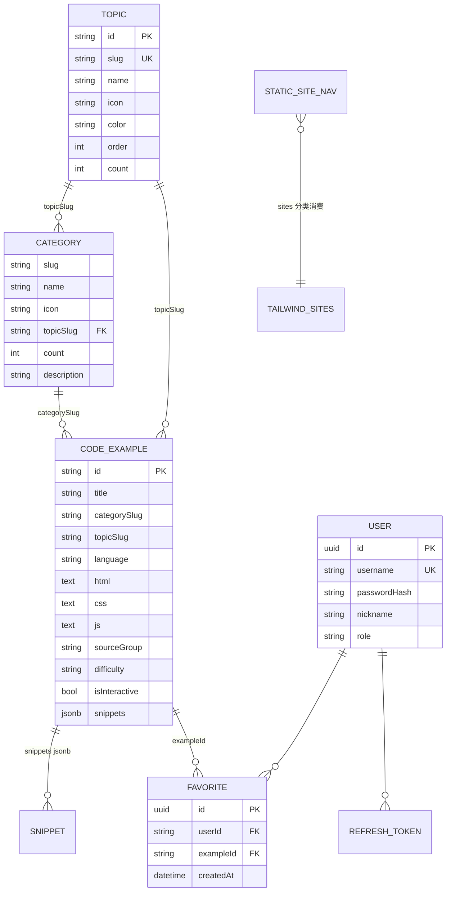
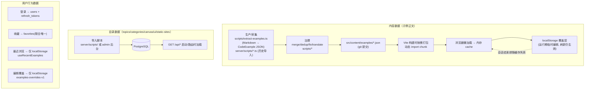

# 04 数据模型
> 项目：html5-examples ｜ 版本：v1.0 ｜ 生成日期：2026-10-06 ｜ 依据：源码分析

---

## 1. 数据模型全景

项目数据分三域管理，各有独立的 schema 来源与生命周期：

| 数据域 | Schema 定义处 | 存储介质 | 生命周期管理者 |
|--------|--------------|---------|--------------|
| **内容域**（示例正文、生成器目录、动效/模板/SVG 课程数据） | 前端 `src/types/index.ts` + `src/config/**` + JSON 自身结构 | `src/content/examples/*.json`（git 管理）+ TS 常量 | 开发者（git 工作流，改 JSON 即改内容） |
| **目录域**（主题、分类、UI 组件、Canvas 示例、静态站点元数据） | `server/src/modules/*/entities/*.entity.ts` | PostgreSQL | 管理后台（`server/admin`）+ 迁移脚本 |
| **用户行为域**（用户、会话、收藏、最近浏览、知识库协作数据） | `server/src/modules/auth|favorites|knowledge/entities/` | PostgreSQL + localStorage（缓存/纯本地项） | 运行时 API |

这张三分法是理解全项目数据流的钥匙。它回答了一个新人最常困惑的问题："改一个示例要不要动数据库？改一个分类要不要发版？"——内容域的修改是 git commit + 重新构建发布；目录域的修改走管理后台或导入脚本即时生效；用户行为域则由用户自己产生、自己负责。三个域的备份策略、回滚手段、灰度方式完全不同：内容域回滚是 `git revert` 加重新构建；目录域回滚靠数据库备份与迁移回退；行为域几乎不需要回滚。把数据先按域归位，再做操作决策，就不会出现"改个示例文案去连生产数据库"这类错位操作。



> 图中 `CODE_EXAMPLE` 自 2026-10-05 起主要存在于 JSON 文件；PostgreSQL `examples` 表与同名实体保留但不再是前端数据源。

---

## 2. 前端核心实体（`src/types/index.ts`，73 行）

### 2.1 Topic（主题）

```typescript
interface Topic {
  id: string; name: string; slug: string; icon: string
  description: string; color: string; order: number; count: number
}
```

| 字段 | 类型 | 说明 |
|------|------|------|
| `slug` | string | URL 标识（如 `html5`、`css`）；`topics` 表中 unique |
| `color` | string | 主题色 hex（如 `'#c0c1ff'`），主题卡侧色条 |
| `order` / `count` | number | 排序权重 / 示例总数（`topicOptions` getter 会过滤 `count > 0`） |

### 2.2 Category（分类）

```typescript
interface Category {
  name: string; slug: string; icon: string
  topicSlug: string; count: number; description: string
}
```

### 2.3 CodeExample（示例核心实体）

字段全表见 03 篇 §3.1。这里补充三个模型设计要点：

1. **`sourceGroup` 是治理产物**：`src/types/index.ts` 与后端实体注释一致地写明——"将原始混乱的 categorySlug（`50d-*`、`ch01-*`、`mdn-*` 等）归并为标准分组；同一 sourceGroup 下可继续按 categorySlug 细分"。它把当前 750 个示例（历史迁移基线 1057 个）组织成 8 个标准分组（JSON 文件即分组）：`css-animation / css-basics / css-layout / css-visual / html5-advanced / html5-basics / html5-forms-media / html5-visual`。
2. **`snippets` 是变体模型**：`DemoSnippet { label, css }`（前端类型）在后端实体中扩展为 `{ label, css?, html?, js? }`（`ExampleSnippet` 接口，`example.entity.ts`），jsonb 列存储；前端 `sandbox.ts` 的 `Snippet` 接口与之兼容。
3. **`language` 是展示语义而非解析依据**：沙箱对三段源码无条件全部拼接，`language` 只影响高亮别名选择（`highlighter.ts` 的 `LANGUAGE_ALIASES` 把 `mixed/vue/xml` 都映射到 `html`）。

### 2.4 筛选状态类型（`src/types/index.ts` 尾部 + `types/refactor.ts`）

```typescript
type ViewMode = 'desktop' | 'tablet' | 'mobile'
type CodeTab = 'html' | 'css' | 'js'
type ExamplesViewMode = 'grid' | 'list'
type ExamplesSortBy = 'newest' | 'popular' | 'difficulty-asc' | 'difficulty-desc' | 'name-asc'
interface ExamplesFilterState { search, topicSlug, sourceGroup, tags, sortBy, viewMode }
```

页面实际使用 `types/refactor.ts` 的 `ListFilterState` 作为基础接口，再交叉扩展板块专属字段（如 `ExamplesLibraryPage` 的 `LibraryFilters` 增加 `topicSlug/sourceGroup/categorySlug`）。

### 2.5 工具目录类型（`src/types/tool.ts`）

```typescript
type ToolAccent = 'blue'|'purple'|'pink'|'cyan'|'orange'|'green'|'rose'|'amber'|'sky'|'indigo'
interface ToolCategory { id, name, icon, accent? }
interface ToolItem { id, name, description?, icon, categoryId, link, accent? }
```

`ToolAccent` 十色系统注释标明取自 Stitch DESIGN.md 功能色规范（blue=布局/数据、purple=按钮、pink=卡片/图片、cyan=导航、orange=动画/文本、green=文本/安全、rose=背景、amber=表单、sky=辅助、indigo=默认）。`cssToolsSubgroups` 的 8 个子分类（layout/button/card/nav/animation/text/bg/form）各持一个 accent。

值得一提的是，工具目录类型是"配置即内容"理念在类型系统里的落点：`ToolItem` 的每个字段都能追溯到一处 UI 表现——`icon` 决定卡片与侧栏的图标（AppIcon 的 `ms:` 词表）、`categoryId` 决定它落在哪个子分类 Bento 卡、`accent` 决定分类卡顶部彩条与计数徽章的颜色、`link` 决定点击去哪里、`description` 决定卡片上的说明文字。也就是说，为 CSS 实验室新增一个生成器的"运营动作"（出现在首页、侧栏、搜索里）与"工程动作"（组件实现）完全解耦，前者只是往这份类型化的清单里加一条记录。这种"清单驱动 UI"的模式同样出现在动效库（`EffectItem`）与 Tailwind 模板（`tailwindTemplates.ts`）中，三处共享同一种维护心智。

---

## 3. 本地内容清单结构（`src/content/examples/`）

| 文件 | 示例数（实测 2026-10-06） | 体积 | 分组语义 |
|------|--------------|------|---------|
| `html5-basics.json` | 58 | 684K | HTML 基础（语义化标签等） |
| `html5-advanced.json` | 90 | 685K | HTML 进阶 |
| `html5-forms-media.json` | 77 | 715K | 表单与媒体 |
| `html5-visual.json` | 40 | 129K | HTML 视觉类 |
| `css-basics.json` | 114 | 724K | CSS 基础 |
| `css-layout.json` | 188 | 3.1M | CSS 布局（最大分组，Flex/Grid 等） |
| `css-visual.json` | 130 | 1.4M | CSS 视觉效果 |
| `css-animation.json` | 53 | 583K | CSS 动画 |
| **合计** | **750**（历史基线 1057，差额源于 2026-10-06 提交 54429841 的合集并入与去重） | **约 8.3MB** | 文件名 = `sourceGroup` 值 |

结构规则：

- 每个文件是 `CodeExample[]` 裸数组（无包装对象），文件内条目天然共享 `sourceGroup`；
- 加载顺序无关性：`api/examples.ts` 的 `loadAll()` 统一排序（数字 id 升序在前，非数字 id 按 `title.localeCompare(zh-CN)` 排后），所以新增条目不必关心插入位置；
- 内容编辑直接改 JSON 并提交 git（`api/examples.ts` 头注释："内容编辑走 git 工作流直接改 JSON"），本地调试期的临时修改可用 localStorage 覆盖层（`examples-overrides-v1`）而不污染文件。

关于 JSON 清单的编辑纪律，有几条从加载机制反推出来的实操建议。第一，条目顺序不重要——加载后统一重排，review diff 时不要被"整文件顺序变化"吓到，也**不要手动重排**数组，那会产生无意义的大 diff；第二，`id` 稳定性最重要——它被收藏表（`favorites.exampleId`）、最近浏览列表、localStorage 覆盖层三处引用，改 id 等于让所有已收藏用户的收藏项悄悄失效，因此 id 一经发布永不复用、永不变更；第三，描述与标题参与搜索索引（`getExamples` 的 search 对这两个字段做包含匹配），文案质量直接影响可发现性，值得认真写；第四，`tags` 数组参与"任一命中"过滤，建议控制在 3-8 个且复用既有词汇，同义标签散落会稀释筛选的聚合价值。

## 4. 后端数据库实体（PostgreSQL）

### 4.1 目录域实体

**`topics`**（`modules/topics/entities/topic.entity.ts`）：与前端 `Topic` 同构，`slug` unique，主键为 varchar `id`（非自增），`count` 默认 0。

**`examples`**（`modules/examples/entities/example.entity.ts`，历史数据源）：varchar 主键 `id`；`tags text[]`（PG 数组）；`snippets jsonb`；`source_group varchar(128)`；`is_interactive boolean` 默认 false；`created_at/updated_at` 自动列。前端 `CodeExample` 接口与其逐字段对应（camelCase ↔ snake_case 显式 `name:` 映射）。

**`favorites`**（`modules/favorites/entities/favorite.entity.ts`）：uuid 自增主键；`user_id + example_id` **联合唯一索引**（幂等收藏的数据库保障）；两个 varchar 外键列 + 时间列。

**`static_site_nav`**（迁移 `1781720198871-AddStaticSiteNav`）：字段契约见 AGENTS.md 8.8——`title/description/slug(unique)/category(portfolio|corporate|product|landing|saas|demo)/tags text[]/thumbnail/entry_url/pages jsonb/page_count/asset_count/external_deps jsonb/difficulty/is_published/source_directory`。`entry_url` 统一以 `/static-sites/{id}/` 绝对路径指向 `public/static-sites/{id}/`（构建时随 `public/` 分发，不经 API）。

这张表是"元数据与实体分离"的范本：数据库里只存描述性信息（标题、分类、页数、缩略图地址），真正的网站实体（HTML/CSS/图片/字体）完整躺在 `public/static-sites/{id}/` 目录里由静态服务器直出。项目还为此沉淀过一条明确的教训记录（AGENTS.md 8.8「经验教训」）：不要把静态网站塞进示例表、不要把网站文件内嵌进 iframe、路径一律绝对化、外部 CDN 依赖必须治理、缩略图记录生成方式、保留 `source_directory` 溯源字段。这六条教训本质上是六次踩坑后的防御性约定，新导入任何静态站点前应先读它们。

**`ui_element_template` / `ui_element_category`**：UI 片段模板与分类；迁移 `SplitUiElementCode`/`DropUiElementCode`（1781874085568/1781875149762）显示代码列经历拆分又删除——代码改为文件存储或运行时拼装（`⚠️ 待确认`：具体存储形态需查迁移文件正文）。

**`canvas_example`**：9 个图形库的示例元数据（迁移 `1782202000000-CreateChartExamples` 后另有 `AddThumbnailToChartExamples` 为图表示例加缩略图列）。

### 4.2 用户与协作域实体

**`users`**（`modules/auth/entities/user.entity.ts`）：username/password/nickname/role 等；配套 `refresh_tokens`（刷新令牌吊销）与 `captcha_challenges`（验证码 challenge）实体（`app.module.ts` entities 数组登记；两个实体文件现错放在 `modules/knowledge/entities/`，见《13》第 6 条）。

**knowledge 家族**（`modules/knowledge/entities/`，15 个实体）：`KnowledgeBase / KnowledgeDocument / DocumentVersion / DocumentShare / RecentView / KnowledgeFavorite / Comment / Notification / SnippetCollection / KnowledgeSnippet / KnowledgeSnippetTag / KnowledgeSnippetTagLink / SnippetVersion / BoardLibrary / BoardLibraryAsset`（实测 2026-10-06 逐一对上实体类）。对应迁移 `1784910872223-CreateKnowledgeTables` 与 `1786000000000-AddPublicSnippetSupport`。该域已核实无消费方——SPA 前端、三姊妹项目与 `/admin` 静态页均无调用（见 01 篇 §3.1 表格与《13》第 2 条）。

### 4.3 数据库对象清单

28 项实体（27 个实体文件，`app.module.ts` entities 数组；`data-source.ts` 仅登记 26 项，见《13》第 5 条）注册于 `html5_examples` 库；结构演进由 `server/src/migrations/` 的 11 个迁移管理（`1718000000000-InitialSchema` → `1786000000000-AddPublicSnippetSupport`）；开发环境可临时 `DB_SYNC=true` 让 TypeORM 自动同步（生产禁用）。

实体设计上有三条贯穿性惯例，新写实体时应当延续。**命名上**，实体类用 PascalCase 单数（`Topic`），表名用 snake_case 复数（`topics`），列名 snake_case（`topic_slug`）——TypeORM 实体里通过 `@Column({ name: '...' })` 显式映射，不依赖隐式命名策略，因此每列的名字都在源码里可查。**主键上**，业务实体（topics、examples）用 varchar 业务主键因为它们要与前端 JSON 的字符串 id 对齐；关系型实体（favorites、refresh_tokens）用 uuid 自增因为它们没有跨端引用诉求。**时间上**，一律 `CreateDateColumn/UpdateDateColumn` 自动列，业务代码不手写时间——排序（如静态站点按 `createdAt DESC`）与缓存失效判断都依赖这两个列的可靠性。

---

## 5. 数据生命周期



分域说明：

1. **内容数据是"编译期数据"**：从采集脚本（`scripts/extract-examples.ts` 从 Markdown 提取代码块；历史上还有 MDN 抓取、翻译、去重等约 130 个脚本）到 JSON 落库（git），再到构建产物，全程不经过数据库。运行期唯一的"写路径"是 localStorage 覆盖层，且语义是"本机临时覆盖，清缓存即还原"。
2. **目录数据是"运行期读多写少数据"**：`exampleStore.loadTopicsAndCategories()` 在 `App.vue` 挂载时拉取一次并幂等缓存于 Pinia；写操作仅管理后台使用。
3. **用户行为数据是"会话数据"**：收藏走后端（登录态 Bearer 识别，`favorites` 表联合唯一保证幂等）；最近浏览与编辑覆盖**纯本地**，不登录也可用，换账号时由 `clearFavorites()` 清缓存防串号。

生命周期视角下还有一条隐含的"数据保质期"规则值得知晓：内容域数据随构建固化，永不过期；目录域数据在浏览器里只有一次会话生命周期（`exampleStore` 挂载加载、不落 localStorage、刷新即重新拉取）；行为域则分两档——收藏缓存与编辑覆盖层是"跨会话持久、可随时丢弃"的（丢失的后果只是重新拉取或丢失本地试验），而 token 会话有自己的过期与刷新节奏（见 05 篇流程三）。做缓存相关改动时，先判断数据属于哪一档，再决定要不要加时间戳、要不要做失效兜底，可以避免绝大多数缓存一致性问题。

## 6. 数据模型演进史（一段值得记住的弯路）

把 `AGENTS.md`、实体注释与 `api/examples.ts` 头注释三处信息拼起来，可以还原出内容域存储的完整迁移轨迹，这段历史对理解当前架构的"为什么"极有价值。**第一阶段**，内容是纯前端静态 JSON，打包进 bundle，缺点显而易见：8MB 内容全部进首屏缓存、每加一个示例都要发版。**第二阶段**（AGENTS.md 成文时），内容迁入 PostgreSQL，前端经 `/api/examples` 分页拉取——获得了运行时管理与筛选下推，但部署形态被绑死："静态托管一把梭"不再可能，数据库成为演示站点的硬依赖。**第三阶段**（2026-10-05，当前态），内容再次回到前端，但方式升级了：不再是打进主 bundle，而是按 8 个分组拆文件动态 `import()`，兼顾了"发版即发布"的简单性与"按需加载"的性能；数据库退守行为域，职责反而更纯粹。

这段往返并非折腾——两次迁移解决的是不同阶段的主要矛盾：第二阶段解决"内容规模膨胀后静态方案的运维成本"，第三阶段解决"轻量部署与内容协作评审"的诉求。它留下的可复用结论是：`api/` 层签名稳定的前提下，存储介质的更换可以做到对页面层完全透明；而任何"要不要把 X 搬进数据库"的争论，都应先回答"X 是否需要不发版的运行时写入"，不需要就不搬。

---

## 7. 设计评价与维护提示

1. **单一事实源的两级演化**：项目经历过"静态 JSON → PostgreSQL → 本地 JSON"的完整往返（AGENTS.md 3 节记载了第一跳，`api/examples.ts` 头注释记载了第二跳）。当前内容域事实源是 `src/content/examples/`，**不要再向后端 examples 表写入新内容**。
2. **类型同构三处同步**：`CodeExample` 前端接口（`types/index.ts`）、后端实体（`example.entity.ts`）、JSON 实际结构需保持一致；改字段时三处 + 沙箱消费逻辑（`sandbox.ts`）一起核查。
3. **`sourceGroup` 即文件名**：新增分组 = 新建 JSON + 在 `api/examples.ts` 的 `GroupKey` 联合类型与 `groupLoaders` 表各登记一行；漏登不会报错但内容不可见， Code review 时需重点检查。
4. **jsonb 与 PG 数组的使用边界**：自由结构（snippets、pages、external_deps）用 jsonb；简单标签集合用 `text[]`——新增实体时延续此惯例。
5. ⚠️ 待确认项汇总：`ui_element_template` 代码列拆分后的存储形态。（原登记的另两项已于 2026-10-06 核实关闭：knowledge 域 15 实体经静态 grep 排除 `/admin` 隐性消费——`server/admin/js/` 仅调 topics/categories/examples；`oss`、`run` 模块在 SPA 前端、三姊妹项目与 `/admin` 中均无调用方，残余不确定仅"未开源分支"，见《13》第 2 条。）

---

*本篇完。下一篇：[05-核心流程.md](./05-核心流程.md)*
