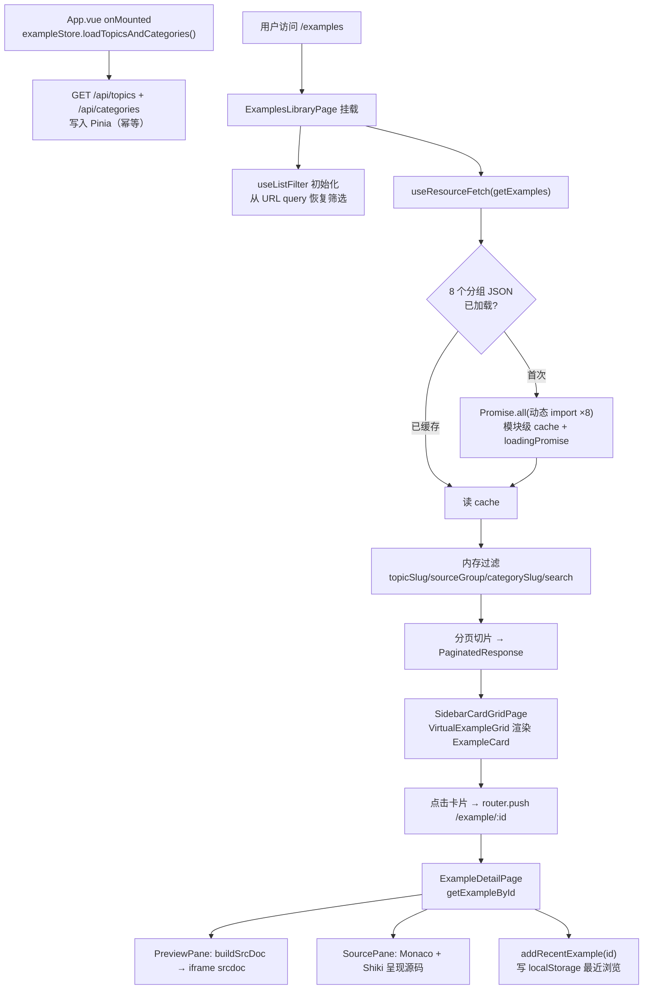
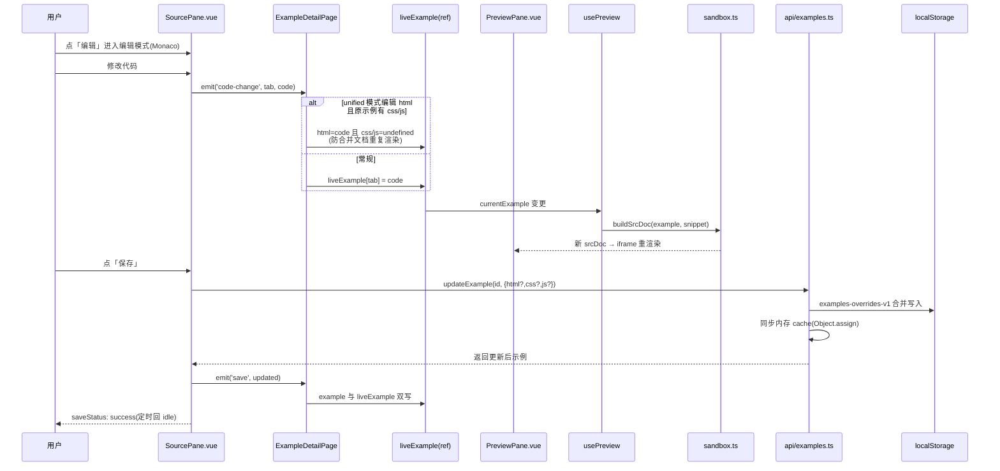
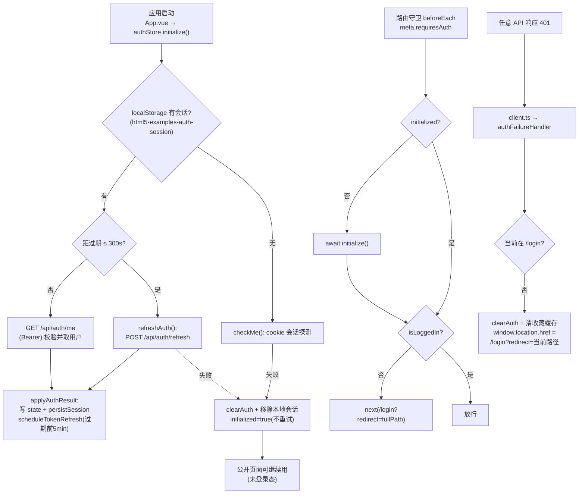
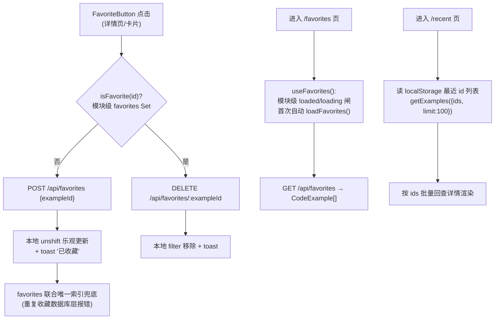
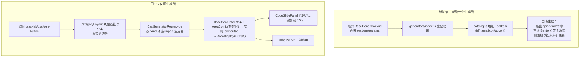

# 05 核心流程
> 项目：html5-examples ｜ 版本：v1.0 ｜ 生成日期：2026-10-06 ｜ 依据：源码分析

本篇拆解 5 条端到端流程，每条配流程图/时序图、分步说明与涉及文件清单。这五条覆盖了项目的全部关键路径：内容消费主线（流程一/二）、用户行为主线（流程三/四）、内容生产主线（流程五）。

---

## 流程一：示例发现 → 加载 → 渲染（示例库主线）

**场景**：用户从首页点入 `/examples`，筛选后点开一个示例详情。

**分步说明**：

1. **目录预热**：`src/App.vue` 的 `onMounted` 并行触发 `authStore.initialize()` 与 `exampleStore.loadTopicsAndCategories()`。后者（`src/stores/exampleStore.ts`）用 `Promise.all([getTopics(), getCategories({ limit: 1000 })])` 拉目录，`loaded/loading` 双闸防重入。
2. **列表页装配**：`src/views/ExamplesLibraryPage.vue` 首先从 `window.location.search` 恢复初始页码（在 `usePagination` 建立前完成，保证首次请求带对页码）；`useListFilter`（`src/composables/useListFilter.ts`）按 `urlKeys` 把 URL query 映射为筛选状态并输出 300ms 防抖视图。
3. **数据加载**：`getExamples()`（`src/api/examples.ts`）首次调用触发 8 个 JSON 的动态 import——Vite 会为每个 JSON 生成独立 chunk，按分组分摊下载量；`loadingPromise` 使并发首调共享同一 Promise；失败置空允许重试。
4. **过滤与分页**：七维内存过滤（见 03 篇 §3.3），`limit` 默认 100；`total` 写回页面驱动分页器。
5. **渲染**：`SidebarCardGridPage`（`src/components/layout/`）统一六态渲染；卡片为 `src/components/examples/ExampleCard.vue`。
6. **详情**：`src/views/ExampleDetailPage.vue` 经 `useResourceFetch` 取单条（404 归一为 `data=null` 走 not-found 态）；加载成功回调里 `addRecentExample(exampleId)` 写最近浏览（`src/composables/useRecentExamples.ts`：`devcanvas-recent-examples` 键，`useStorage` 响应式持久化，去重置顶、上限 `MAX_RECENT = 12`）。

**涉及文件**：`src/App.vue`、`src/main.ts`、`src/stores/exampleStore.ts`、`src/api/topics.ts`、`src/api/categories.ts`、`src/views/ExamplesLibraryPage.vue`、`src/composables/{useListFilter,usePagination,useResourceFetch}.ts`、`src/api/examples.ts`、`src/content/examples/*.json`、`src/components/layout/SidebarCardGridPage.vue`、`src/components/examples/{ExampleCard,ExamplesLibrarySidebar}.vue`、`src/views/ExampleDetailPage.vue`、`src/components/examples/{PreviewPane,SourcePane}.vue`、`src/utils/sandbox.ts`、`src/utils/highlighter.ts`、`src/composables/useRecentExamples.ts`。

**设计解读与边界条件**。这条主线的性能设计围绕一个数字展开：750 个示例（历史迁移基线 1057 个）约 8.3MB 原文，绝不可能一次下发。解决方案是"三层递进"——分组层（8 个文件按 sourceGroup 切，用户按主题浏览时通常只命中一两个分组）、内存层（分组加载后常驻 cache，翻页筛选零成本）、组件层（卡片网格虚拟滚动，DOM 数量与可视区挂钩）。首访 `/examples` 不带筛选时会并发拉全部 8 个分组，这是唯一的全量场景；若未来示例数再涨一个量级，第一优化点应是让 `loadAll()` 支持按需分组加载而非强制全量。另一个容易忽视的细节是排序的稳定性：数字 id 升序在前、非数字 id 按中文 locale 排后，这个"稳定序"保证任何一次加载得到的顺序一致，前端翻页才不会在页与页之间出现重复或遗漏——若修改 `loadAll` 的排序逻辑，务必保持"确定性"这个前提。

---

## 流程二：代码编辑 → 实时预览 → 保存（编辑器主线）

**场景**：用户在示例详情页修改源码并保存。

**分步说明**：

1. **编辑态**：`SourcePane.vue` 维护 `isEditing`、`hasUnsavedChanges`（computed 对比初值）与 `saveStatus: 'idle'|'success'|'error'`（保存结果 toast 状态由定时器复位，源码注释特别说明要先清旧定时器防错位）。
2. **变更上行**：`@code-change` 事件把 `(tab, code)` 抛给页面。`unified` 模式（详情页默认）下源码以"合并后的完整文档"呈现，因此编辑 html 时页面**主动清空 `css/js`**——否则 `buildSrcDoc` 会把文档再拼一次造成重复渲染（`ExampleDetailPage.vue` 68-79 行的专门分支）。
3. **实时预览**：`liveExample` 是 `example` 的可变副本（`{ ...data }` 深拷贝外壳）；`usePreview`（`src/composables/usePreview.ts`）的 `srcDoc` computed 依赖它，任何变更重算 `buildSrcDoc()`，iframe `srcdoc` 属性更新即重载。
4. **保存**：`updateExample()`（`src/api/examples.ts` 188-208 行）只摘取 `html/css/js` 三字段合并进 `examples-overrides-v1`；**同时 `Object.assign` 进内存 cache**，使列表页与详情页立即可见；刷新后由 `loadAll()` 末尾的 `applyOverrides()` 恢复覆盖。`readOnly` 或 `unified=false` 时 SourcePane 可改为把 `save` 事件交给父组件（props 注释 27 行）。
5. **变体联动**：若示例带 `snippets`，`activeSnippet` 作为 `buildSrcDoc` 第二参参与拼装——变体切换同样走实时预览链路。

**涉及文件**：`src/views/ExampleDetailPage.vue`、`src/components/examples/SourcePane.vue`、`src/components/examples/PreviewPane.vue`、`src/composables/usePreview.ts`、`src/utils/sandbox.ts`、`src/api/examples.ts`、`@guolao/vue-monaco-editor`（编辑器）、`src/utils/highlighter.ts`（只读高亮）。

**设计解读**。这条流程里最精巧的是 `liveExample` 与 `example` 的双副本设计：`example` 是"已保存的真相"（来自 JSON 加覆盖层），`liveExample` 是"编辑中的草稿"（可随意污染）。预览始终消费草稿，实现"敲一行代码立刻看到效果"的实时性；保存动作才把草稿固化进覆盖层并同步回真相。这个模式免去了草稿态与已存态之间反复深拷贝的开销，也让"放弃编辑"只需丢弃 liveExample。另一个值得体会的点是覆盖层的位置选择：把"保存"放在 localStorage 而不是后端，让编辑能力不依赖登录态，同时天然隔离了"个人试验"与"内容发布"——覆盖层永远不该被同步或上报，它是每个浏览器自己的沙上笔记。若未来要支持多人协作编辑，正确路径是把覆盖层升级为服务端草稿表，而不是污染内容域的 JSON。

---

## 流程三：认证链路（登录 → 会话维持 → 失效处理）

**场景**：受保护页访问、登录、令牌静默续期、401 兜底。

**分步说明**：

1. **初始化幂等**：`initialize()`（`src/stores/authStore.ts` 189-253 行）以 `initialized` 闸只跑一次；先注册两个注入点——`setAuthTokenProvider(() => this.accessToken)` 与 `setAuthFailureHandler`（`src/api/client.ts` 的依赖反转接口），再 `ensureHydrated()` 恢复本地会话。
2. **双通道校验**：有 token 走 Bearer 校验（`GET /auth/me`）；无 token 回退 cookie（`checkMe()`）——兼容后端"仅 cookie"的历史会话。
3. **静默续期**：`REFRESH_AHEAD_SECONDS = 300`；刷新定时器是模块级 `refreshTimer`（非响应式），`persistSession` 后与 `ensureHydrated` 后都要重挂（源码注释强调刷新页面后定时器会丢）。
4. **守卫等待**：路由守卫（`src/router/index.ts` 181-200 行）在 `requiresAuth` 时 `await initialize()`——源码注释解释这是为防"守卫先于初始化完成而误判未登录"。
5. **401 兜底**：仅 401 触发登出跳转（403 保持会话），`redirect` 参数带回跳地址；已在 `/login` 时不重复跳。换号/登出/刷新失败三条路径都调 `clearFavorites()`（`src/composables/useFavorites.ts` 导出的模块级重置）。

**涉及文件**：`src/stores/authStore.ts`、`src/api/auth.ts`、`src/api/client.ts`、`src/router/index.ts`、`src/views/LoginPage.vue`、`src/composables/useFavorites.ts`、`server/src/modules/auth/**`（controller/service/strategies/guards）。

**设计解读**。这条链路对"失败"的处理比"成功"更用心，三处细节能说明：其一，`initialize()` 的 catch 分支在清理会话后仍把 `initialized` 置真——注释写明这是为了避免"每次路由跳转都重试无效 token 造成卡顿"，宁可让用户停在未登录态，也不让页面陷入重复请求循环；其二，401 与 403 被严格区分，前者意味着凭证失效要登出，后者意味着权限不足但会话仍有效，只提示不登出——混淆这两者是权限系统最常见的 bug 来源；其三，刷新定时器在 `persistSession`、`ensureHydrated`、`applyAuthResult` 三个入口都会重挂，因为 localStorage 恢复会话后定时器必然丢失，漏挂一处就会出现"用户挂机到 token 过期突然被踢出"的体验事故。安全方面，密码经 bcryptjs 哈希存储，登录接口带验证码 challenge（captcha.service + captcha_challenges 表），刷新令牌可服务端吊销（refresh_tokens 实体），后端启动时强制拒绝弱 JWT 密钥——教学站点的安全基线并不因为"只是示例站"而放水。

---

## 流程四：收藏与最近浏览（用户行为主线）

**分步说明**：

1. **收藏是模块级单例状态**：`useFavorites.ts` 的 `favorites/loading/loaded` 定义在**模块顶层**而非函数内——任何组件调用 `useFavorites()` 共享同一份状态；首次调用惰性加载（`shouldReload` 判定）。
2. **乐观更新**：`toggleFavorite` 先发请求、成功后改本地数组并 toast；失败（含未登录 401 → 全局跳登录）只 toast 错误，状态不变。
3. **登出隔离**：`clearFavorites()` 被登出/换号/刷新失败三处调用（见流程三），重置模块状态使下次进入收藏页重新拉取。
4. **最近浏览是纯本地**：`useRecentExamples.ts` 用 `@vueuse/core` 的 `useStorage` 把 id 列表（去重置顶、上限 12）持久化在 `devcanvas-recent-examples`；进入 `/recent` 页时用 `getExamples({ ids })` 从本地 JSON 批量回查详情——**不依赖登录与后端**。

**涉及文件**：`src/composables/useFavorites.ts`、`src/api/favorites.ts`、`src/components/common/FavoriteButton.vue`、`src/views/FavoritesPage.vue`、`src/composables/useRecentExamples.ts`、`src/views/RecentBrowsingPage.vue`、`server/src/modules/favorites/**`。

**设计解读**。收藏与最近浏览是一对刻意设计的对照组：同样是"用户浏览过/喜欢过"，收藏走后端（跨设备、需登录、可清理），最近浏览走本地（单设备、免登录、随缓存消失）。这个区分的原则是**数据的社交属性与持久价值**——收藏代表用户的主动意志，值得服务端持久化；最近浏览只是会话痕迹，本地即可。另一处设计亮点是 `useFavorites` 的模块级单例： favorites 状态不进 Pinia 而是模块顶层 ref，效果等同于全局单例 store，但省去了 store 注册与命名空间；代价是脱离了 devtools 的时间线审查，这是项目在"极简"与"可观测"之间的又一次权衡。最近浏览的回查用 `getExamples({ ids })` 批量接口而不是逐条请求，且 `immediate: false` 控制只在进入 `/recent` 页时才触发——这类"列表回查"模式在其他 id 引用场景（如收藏页渲染完整示例数据）同样适用。

---

## 流程五：CSS 实验室工具的注册与运行（内容生产主线）

**场景**：维护者新增一个生成器，或用户使用一个生成器。

**分步说明**：

1. **注册三件套**：新工具生效需要 `src/views/css-lab/css/generators/` 下的组件（组合 `BaseGenerator.vue`）、`generators/index.ts` 的 kind→组件映射、`src/config/css-lab/catalog.ts` 的 `ToolItem` 条目。路由无需改动——`css/gen-:kind` 动态段（`src/router/routes/css-lab.ts` 66-71 行）自动承接；首页 Bento 卡与侧边栏从 `catalog.ts` 派生。
2. **运行时分发**：`CssGeneratorRouter.vue` 读取 `route.params.kind` 动态 import 对应生成器组件，未注册的 kind 走 404/回退分支。
3. **交互闭环**：参数区（`GeneratorParam` 六种控件）→ `computed` 拼 CSS → 预览区实时渲染 → `CodeSlidePanel`（`src/components/css-lab/`）展示可复制代码；`GeneratorPreset.apply()` 提供一键预设。
4. **独立工作台特例**：Flex/Grid/渐变三个工作台不走 BaseGenerator，而是独立页面 + 页面级 store（`flexboxStore.ts`/`gridStore.ts`）+ 专属组件（`AreaConfig/AreaDisplay/AreaCode` 等，`src/views/css-lab/css/components/`），路由各自显式注册且 Flex/Grid 标 `meta.noSidebar: true` 全宽呈现。

**涉及文件**：`src/router/routes/css-lab.ts`、`src/components/css-lab/{CategoryLayout,CodeSlidePanel}.vue`、`src/views/css-lab/CssLabHomePage.vue`、`src/views/css-lab/css/{CssGeneratorRouter,CheatsheetPage,FlexboxPage,GridPage,GradientPage}.vue`、`src/views/css-lab/css/generators/**`（`BaseGenerator.vue` + 63 个生成器 + `generatorTypes.ts` + `index.ts`）、`src/config/css-lab/{catalog,routes,categories}.ts`、`src/types/tool.ts`。

**设计解读**。这条主线展示了项目"配置驱动扩展"的极致形态：63 个生成器共享一条动态路由、一个基类骨架、一份目录清单，新增工具的边际成本被压到"写一个组件 + 登记两行"。动态路由 `gen-:kind` 的价值在于把"工具数量增长"与"路由表膨胀"解耦；`BaseGenerator` 的价值在于把"参数区-预览区-代码区"的交互范式固化，新工具只描述自己的参数模型（sections/params），布局、联动、代码生成面板全部继承；`catalog.ts` 的价值在于让首页、侧栏、搜索三处 UI 从同一份数据派生，不会出现"首页有卡片、侧栏没入口"的失同步。对比 SOP-B（独立演示）每加一个要在页面里加一行 defineAsyncComponent，生成器的扩展成本更低，这正是"参数化程度越高、模板化越彻底的内容形态，扩展成本越低"的直接体现。维护时应警惕的退化方向是：某个生成器开始需要特殊布局或特殊参数控件时，宁可让它升级为独立工作台（如 Flex/Grid 的先例），也不要往 BaseGenerator 里塞条件分支。

---

## 附：异常路径速查

| 异常 | 处理位置 | 行为 |
|------|---------|------|
| 动态 chunk 加载失败（发版后旧 chunk 404） | `src/router/index.ts` `router.onError` | 标志位防重后整页 `reload()` |
| 列表/详情请求失败 | `useResourceFetch` error + `EmptyState type="error"` | 显示重试按钮，`@retry` 触发 `refresh()` |
| 示例不存在 | `getExampleById` 抛 `ApiError(404)` → 详情页 `data=null` | `EmptyState type="not-found"` + 返回按钮 |
| 列表加载中 | `EmptyState type="loading"` / 骨架（`components/skeleton/`） | 占位渲染 |
| JSON 加载失败 | `loadingPromise` 置空 | 下次调用自动重试 |
| 隐私模式 localStorage 不可写 | `authStore.persistSession` / `api/examples.ts` persistOverrides | 静默降级（内存会话 / 放弃覆盖） |

这张速查表的共同模式是"**降级而非崩溃**"：每个异常路径都有兜底行为，用户最多损失一项便利（重试按钮、回退默认主题、丢失本地覆盖），不会看到白屏或未捕获异常堆栈。这源于两处架构层的保障——`App.vue` 的 ErrorBoundary 拦截渲染期异常，`useResourceFetch` 把取数异常折叠进 error 状态由界面消费。排查线上问题时，先对照本表判断是否属于"已设计的降级"，再决定是否升级为 bug 处理，可以过滤掉大量误报。

---

*本篇完。下一篇：[06-部署运行.md](./06-部署运行.md)*
