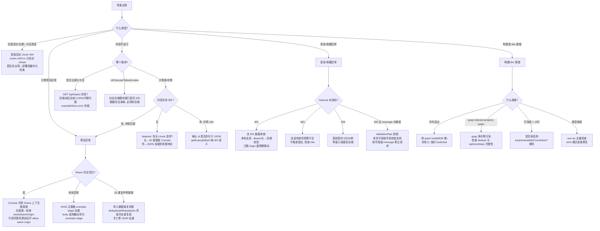

# 12 FAQ 与故障排查
> 项目：html5-examples ｜ 版本：v1.1 ｜ 生成日期：2026-10-06 ｜ 依据：源码分析

---

## 0. 排查总纲：先定位层，再定位点

本项目的问题现象可以按"数据域"先分层（《04-数据模型》的三分法）：内容不显示 → 查内容域（JSON 与沙箱链路）或目录域（后端接口）；行为不生效（收藏/登录）→ 查用户行为域与 HTTP 链路；构建/加载异常 → 查构建配置与 chunk。再往下定位点之前，先做两个零成本动作：**打开 DevTools 的 Application 面板清点 localStorage**（本项目大量"诡异现象"最终指向某个本地键的残留——改了代码没生效、别人能看到我的收藏、示例还是旧样式，清掉对应键即复位）；**Console 里过滤一次错误首行**——本项目的前端错误几乎都会以 ApiError、Vue warn 或 chunk 加载失败三种形态之一出现，各有固定排查路径。

本篇结构：§1 给出日志与调试入口清单；§2 给出覆盖全站现象的排查决策树（mermaid）；§3 按频率排列高频问题详解。与《06-部署运行》§6 的"常见问题排查"速查表分工：那里是部署视角的速查，这里是机制视角的深挖，重叠条目以引用方式处理。

---

## 1. 日志与调试入口

| 入口 | 位置 | 用途 |
|------|------|------|
| 前端 logger | `src/utils/logger.ts` | 四级日志（debug/info/warn/error），默认开发环境 debug 起、生产仅 error；可用 `VITE_LOG_LEVEL` 环境变量或运行时 `logger.setLevel()` 调整；输出带 `[时间] [前缀]` 格式 |
| 浏览器 localStorage 键 | DevTools Application 面板 | 四个核心键：`html5-examples-auth-session`（会话）、`examples-overrides-v1`（示例编辑覆盖）、`devcanvas-recent-examples`（最近浏览）、`devcanvas-theme`（主题）；收藏缓存键在 `useFavorites.ts` 内定义 |
| Network 面板 | DevTools | 所有 `/api` 请求经 `client.ts` 发出，失败必然有红色条目；注意 401 会先触发全局登出再抛错，页面提示可能是"跳登录"而非错误文案 |
| Vite 代理 | `vite.config.ts` server.proxy | 开发期 `/api → localhost:3000`；代理报错（ECONNREFUSED）即后端未启动 |
| 后端控制台 | NestJS Logger | 启动横幅（端口）、SQL 日志（`NODE_ENV=development` 时由 TypeORM logging 开启）、JWT 弱密钥告警、默认管理员告警（admin123） |
| 后端启动安检输出 | `server/src/main.ts` | 生产启动失败的第一现场：JWT_SECRET 弱值 / 缺 DB_PASSWORD 的抛错信息就在这里 |
| iframe 内部 | DevTools 上下文选择器 | 预览白屏时把 Console 上下文切到 iframe（top 下拉），示例自己的报错在 iframe 上下文里 |

---

## 2. 排查决策树

决策树的分叉逻辑对应三个心智：白屏类先想 chunk 自愈机制是否已兜底；内容类先分清数据域；交互类先看状态码再看语义（401/403/429/400 的处置完全不同，见 §3.3）。

---

## 3. 高频问题详解

### 3.1 chunk 失效与自动恢复

**现象**：发版后正在使用的页面点击跳转，白屏一瞬后自动恢复；或用户反馈"刷新一下就好了"。
**机制**：hash 命名的 chunk 在发版后被删除，旧页面持有的引用在动态 import 时 404，`src/router/index.ts` 的 `router.onError` 匹配 `Loading chunk|Failed to fetch dynamically imported module` 后整页 reload（`chunkReloadTriggered` 防连环刷新）。**这属于已设计的自愈，不是 bug**。
**何时升级为问题**：反复触发（每次导航都白屏）说明 reload 后仍拿到坏引用——排查部署层是否给 `index.html` 配了长缓存（应 no-cache）或 CDN 缓存了过期引用；组件内 `defineAsyncComponent` 的失败不经过 router.onError，Playground 演示加载失败不会自愈，需要用户手动刷新（已知边界，《10-性能设计》§4）。

### 3.2 示例加载竞态与"闪旧数据"

**现象**：快速切换筛选/详情时列表闪过前一条件的结果；或切换详情时短暂显示上一个示例。
**机制与保障**：取数走 `useResourceFetch` 的 last-request-wins（requestId 递增 + AbortController 取消前序，过期结果与过期错误都不落状态），理论上不应出现旧数据落地。若观察到闪旧数据，优先排查调用方是否**绕过了 useResourceFetch**（自己 watch + 赋值）；其次是 `getExamples` 的内存缓存把"筛选变化"变成同步操作，页面用 `loading` 门控渲染时序——检查 loading 是否正确传递给 `SidebarCardGridPage`。

### 3.3 认证类：401 / 403 / 429 / 会话丢失

- **401 联动**：任意 API 401 → client 触发全局处理器 → 清会话、清收藏缓存、跳 `/login?redirect=当前页`。用户报"莫名被登出"时，先看是哪个接口的 401：refresh 刷新失败（refresh token 过期 7 天未在线）属预期；access token 过期且静默刷新没触发（定时器在 `persistSession/ensureHydrated/applyAuthResult` 三处都会重挂，若只在一处被改动过需回查）则属 bug。
- **403**：会话有效、权限不足——**不会**登出，只展示错误。管理员功能报 403 说明账号 role 不是 admin。
- **429**：登录/注册/手机号登录触发限流（5 次/60 秒，按 IP 的进程内计数）。提示带 retryAfter；重启后端会清零计数（`RateLimitGuard` 内存态，《08-安全与权限设计》§7 第 3 条）。
- **登录后刷新即丢会话**：隐私模式 localStorage 不可写（persistSession 静默降级内存会话）——换常规窗口；cookie 回退通道仅覆盖"后端种了 cookie 且前端无 token"的场景，且注意 `POST /api/auth/me` 标记 `@Public()` 后 `checkMe()` 恒得 `{ user: null }`（《08-安全与权限设计》§7 第 1 条，`⚠️ 待确认`），**不要**依赖该通道恢复登录。
- **改了后端用户数据不生效**：JWT payload（sub/username/role）在签发时固化，改库不等于改 token——需要用户重新登录或等待刷新换发。

### 3.4 沙箱逃逸面相关的预览问题

- **预览白屏且 iframe 无报错**：最常见根因是示例引用同源资源但 `needsSameOrigin` 未命中（正则覆盖 `/shared-assets/`、`/static-sites/`、`../assets/`、`./assets/`、`/images/` 模式——自定义路径写法不在列）。验证法：Console 里查 `base` 标签解析后的资源请求是否 404；修复法：调整资源路径到已覆盖模式，或扩充 `needsSameOrigin` 正则（改动属安全面，需评审）。
- **示例访问 document.cookie/localStorage 的行为**：无 `allow-same-origin` 的示例运行在 opaque origin，同源 API 大多抛 SecurityError——这是**预期隔离**，不是 bug；引用共享素材的示例才有同源权限（并因此承担《08-安全与权限设计》§1 讨论的逃逸面）。
- **示例里 window.top 操作无效**：sandbox 属性组合未含 `allow-top-navigation`，属预期。

### 3.5 数据与缓存类

- **改了 JSON 内容没生效**：三连查——dev 服务器是否重启（JSON 变更经 HMR 通常生效，个别情况需重启）；localStorage 覆盖层 `examples-overrides-v1` 是否有旧覆盖（详情页保存过会覆盖 JSON 值，清该键复位）；浏览器缓存（分组 chunk 带 hash，理论上不会）。
- **别人的收藏/我的收藏串了**：换号隔离由 `clearFavorites()` 三处触发兜底，若绕过 logout 直接改 localStorage 会话键可能复现——清 `html5-examples-auth-session` 与收藏缓存键。
- **收藏列表为空但已登录**：`GET /api/favorites` 依赖 Bearer 识别身份，检查请求头是否带上 token（authTokenProvider 注册时机在 `initialize()`，若在初始化完成前发请求会无头）。
- **搜索无结果**：search 只匹配 title 与 description 的包含关系（大小写不敏感）——查这两个字段而非 tags；tags 走的是"任一命中"过滤，两者是不同参数（`getExamples({ search })` vs `getExamples({ tags })`）。

### 3.6 构建与依赖类（速查引《06-部署运行》§6）

内存溢出用 8GB 堆构建；gsap 多实例报错查 `resolve.dedupe` 与 `optimizeDeps` 完整性；`experimentalMinChunkSize` 禁止启用（O(n²) 教训）；类型错误逐条修（strict 门禁不容忍）。**部署后问题三差异点**（路径/协议网络/构建期环境变量）的展开见《06-部署运行》§6 末段——其中 `VITE_API_BASE_URL` 是构建期注入，改 env 必须重新构建是最常见误区。

---

## 4. 升级路径：什么时候该报 bug

按本篇排查后仍无法定位的问题，报 bug 前收集六项信息：现象截图或录屏、Console 完整报错（含 iframe 上下文）、Network 中失败请求的 URL 与状态码、复现步骤（含 URL query）、localStorage 四键的键名存在性（勿贴 token 值——会话键含凭证）、环境（dev/生产、浏览器版本）。对照《05-核心流程》附录"异常路径速查表"先确认是否属于"已设计的降级"（重试按钮、404 空态、静默重载），属降级的不报 bug 报体验优化。这份六项清单能过滤掉绝大多数往返，因为本项目的错误几乎都在 ApiError/守卫跳转/沙箱报错三条已铺设的路径上留下痕迹，缺的只是把痕迹收集全。

---

*本篇完。下一篇：[13-技术债务与演进建议.md](./13-技术债务与演进建议.md)*
