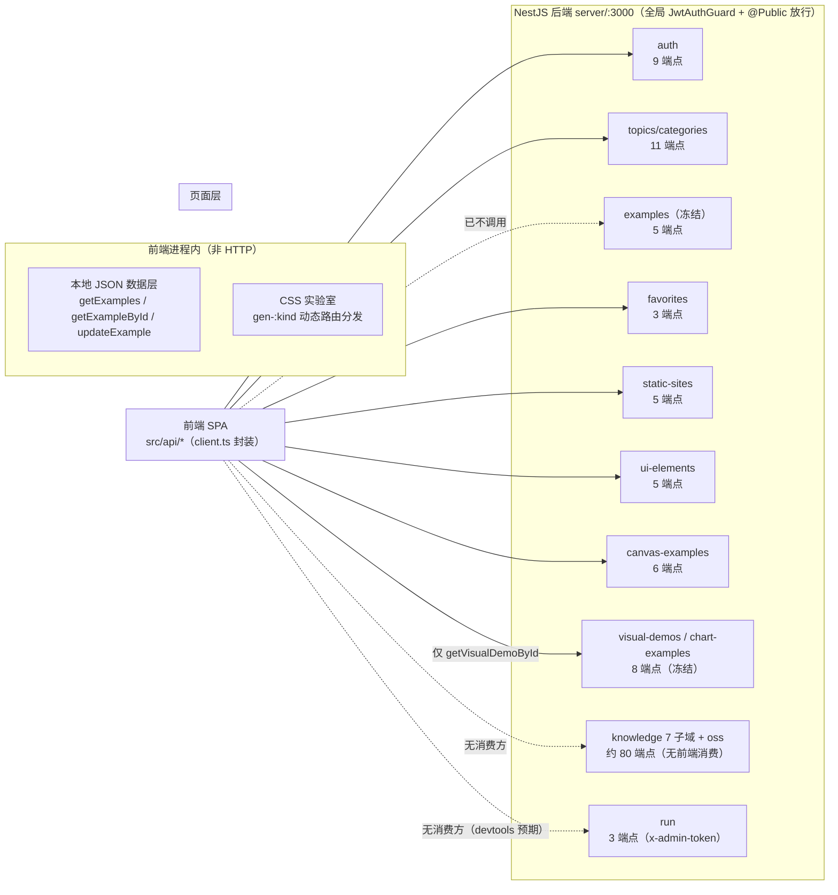

# 15 接口全量参考
> 项目：html5-examples ｜ 版本：v1.1 ｜ 生成日期：2026-10-06 ｜ 依据：源码分析

---

## 0. 总览

本篇是全项目"接口面"的一站式参考，四类内容：**§2 后端 REST 端点全表**（方法/路径/用途/入参/响应/鉴权，逐控制器从源码 grep 实证）、**§3 前端 HTTP 客户端与 api 模块方法对照**、**§4 CSS 实验室目录速查**（gen-:kind 类型与生成器组件）、**§5 四种示例形态的注册契约对照**。与《03-接口设计》的分工：03 篇讲契约的设计意图与惯例（读设计），本篇是查表手册（查条目）——条目冲突时以本篇为准（本篇为最新实测，且补充了 03 篇从略的 knowledge 域细节）。

鉴权标记约定（贯穿全篇）：**[公开]** = `@Public()` 放行；**[登录]** = 全局守卫解析后业务要求身份（含叠加 RequireAuthGuard）；**[Admin]** = 叠加 AdminGuard；**[令牌]** = 非常规鉴权（如 x-admin-token 头）。全局守卫为宽容模式：无任何凭证时 req.user 为 undefined 继续放行，有凭证但无效才 401（机制见《08-安全与权限设计》§3）。

---

## 1. 后端端点全表（按控制器）

### 1.1 应用根（app.controller.ts）

| 方法 | 路径 | 鉴权 | 用途 | 响应 |
|------|------|------|------|------|
| GET | `/` | [公开] | 探活/欢迎 | 文本 |
| GET | `/health` | [公开] | 健康检查 | 文本 |

### 1.2 认证（modules/auth/auth.controller.ts，cookie 名 `auth-token`）

| 方法 | 路径 | 鉴权 | 用途 | 入参 | 响应 |
|------|------|------|------|------|------|
| GET | `/api/auth/captcha` | [公开] | 获取图形验证码 | — | `{ captchaId, imageData, expiresAt }` |
| POST | `/api/auth/login` | [公开] + 限流 5/60s | 账号密码登录（账号可为用户名/邮箱/手机号） | body：`account`（或 `username`）、`password`，可选 `remember` | `AuthResult{ user, accessToken, refreshToken, expiresIn }` + set-cookie |
| POST | `/api/auth/register` | [公开] + 限流 | 注册（邮箱/手机号） | `account`、`password`、`displayName?`、`captchaId`、`captchaCode` | `AuthResult` + cookie |
| POST | `/api/auth/phone-auth` | [公开] + 限流 | 手机号登录/自动注册 | `phone`、`captchaId`、`captchaCode`（及 password 字段） | `AuthResult` + cookie |
| POST | `/api/auth/refresh` | [公开] | 刷新令牌（一次性，重用即全量吊销） | `{ refreshToken }` | 新 `AuthResult` + cookie |
| GET | `/api/auth/me` | [登录] | Bearer 校验并取当前用户 | —（Bearer/cookie） | `AuthUser`（含 email/phone/displayName/avatar/createdAt） |
| POST | `/api/auth/me` | [公开] | cookie 会话探测 | —（凭证由守卫宽容模式解析） | `{ user: req.user \|\| null }`——⚠️ 因 @Public 短路守卫，恒返回 `{ user: null }`（《08》§7.1） |
| POST | `/api/auth/logout` | [公开] | 登出（吊销全部 refresh token + 清 cookie） | — | `{ success: true, message }` |
| PUT | `/api/auth/password` | [登录] | 修改密码（成功后全量吊销 refresh token） | `{ oldPassword, newPassword }` | `{ success: true }` |

### 1.3 主题与分类（topics / categories）

| 方法 | 路径 | 鉴权 | 入参 | 响应 |
|------|------|------|------|------|
| GET | `/api/topics` | [公开] | query：`page?` `limit?` | `PaginatedResponse<Topic>` |
| GET | `/api/topics/:slug` | [公开] | slug | `Topic`（404 不存在） |
| POST | `/api/topics` | [Admin] | CreateTopicDto | `Topic` |
| PATCH | `/api/topics/:slug` | [Admin] | UpdateTopicDto | `Topic` |
| DELETE | `/api/topics/:slug` | [Admin] | slug | 200 |
| GET | `/api/categories` | [公开] | `topicSlug?` `page?` `limit?` | `PaginatedResponse<Category>` |
| GET | `/api/categories/grouped` | [公开] | — | `{ groups: CategoryGroup[] }` |
| GET | `/api/categories/subcategories/:sourceGroup` | [公开] | sourceGroup | `{ sourceGroup, data: Category[] }`（示例库侧边栏二级菜单数据源） |
| GET | `/api/categories/:slug` | [公开] | slug | `Category` |
| POST | `/api/categories` | [Admin] | Partial\<Category\> | `Category` |
| PATCH | `/api/categories/:slug` | [Admin] | 同上 | `Category` |
| DELETE | `/api/categories/:slug` | [Admin] | slug | 200 |

### 1.4 示例（examples，冻结：前端已切本地 JSON）

| 方法 | 路径 | 鉴权 | 入参 | 响应 |
|------|------|------|------|------|
| GET | `/api/examples` | [公开] | query：`topicSlug?` `categorySlug?` `search?` `isInteractive?('true'/'false')` `sourceFilePrefix?` `sourceGroup?` `ids?`（逗号分隔）`page?` `limit?`（默认 20，钳上限 100） | `PaginatedResponse<Example>` |
| GET | `/api/examples/:id` | [公开] | id | `Example`（404 当不存在） |
| POST | `/api/examples` | [Admin] | Partial\<Example\> | `Example` |
| PATCH | `/api/examples/:id` | [Admin] | Partial\<Example\> | `Example` |
| DELETE | `/api/examples/:id` | [Admin] | id | 200 |

### 1.5 收藏（favorites，控制器类级 JwtAuthGuard）

| 方法 | 路径 | 鉴权 | 入参 | 响应 |
|------|------|------|------|------|
| GET | `/api/favorites` | [登录] | —（身份由 Bearer 识别） | `Example[]`（完整示例数据，按收藏时间倒序） |
| POST | `/api/favorites` | [登录] | `{ exampleId }` | `Favorite`（示例不存在 404；重复收藏由联合唯一索引兜底） |
| DELETE | `/api/favorites/:exampleId` | [登录] | exampleId | `{ message }`（不存在 404） |

### 1.6 静态站点（static-site-nav）

| 方法 | 路径 | 鉴权 | 入参 | 响应 |
|------|------|------|------|------|
| GET | `/api/static-sites` | [公开] | `page?` `limit?`（服务端默认 limit=1000，createdAt DESC） | `PaginatedResponse<StaticSiteNav>` |
| GET | `/api/static-sites/:id` | [公开] | id | `StaticSiteNav`（pages/external_deps 等 jsonb 全量） |
| POST | `/api/static-sites` | [Admin] | Partial\<StaticSiteNav\> | 实体 |
| PATCH | `/api/static-sites/:id` | [Admin] | 同上 | 实体 |
| DELETE | `/api/static-sites/:id` | [Admin] | id | 200 |

### 1.7 UI 组件（ui-elements）

| 方法 | 路径 | 鉴权 | 入参 | 响应 |
|------|------|------|------|------|
| GET | `/api/ui-elements/categories` | [公开] | — | 分类列表 |
| GET | `/api/ui-elements` | [公开] | `page?` `limit?` `category?` `framework?` `search?` `sort?` | 模板分页列表 |
| GET | `/api/ui-elements/:id` | [公开] | id | `UiElementTemplate` |
| PATCH | `/api/ui-elements/:id` | [Admin] | Partial | 实体 |
| DELETE | `/api/ui-elements/:id` | [Admin] | id | 200 |

注：该控制器**没有 POST（创建）端点**——创建走导入脚本/直接入库，属历史决策。

### 1.8 Canvas 示例（canvas-examples）

| 方法 | 路径 | 鉴权 | 入参 | 响应 |
|------|------|------|------|------|
| GET | `/api/canvas-examples/libraries` | [公开] | — | `{ data: LibraryStat[] }`（9 库统计） |
| GET | `/api/canvas-examples/categories` | [公开] | `library?` | `{ data: CategoryStat[] }` |
| GET | `/api/canvas-examples` | [公开] | `page?` `limit?` `library?` `category?` `group?` `search?` | `PaginatedResponse<CanvasExample>` |
| GET | `/api/canvas-examples/:id` | [公开] | id | `CanvasExample`（含 code jsonb、html/css/js/reactCode 等） |
| POST | `/api/canvas-examples` | [Admin] | Partial\<CanvasExample\> | 实体 |
| PATCH | `/api/canvas-examples/:id` | [Admin] | 同上 | 实体 |

### 1.9 历史板块（visual-demos / chart-examples，GET 全 [公开]）

| 方法 | 路径 | 说明 |
|------|------|------|
| GET | `/api/visual-demos/libraries`、`/engines`、`/groups` | 三个聚合统计端点（前端已拆分下线） |
| GET | `/api/visual-demos`、`/api/visual-demos/:id` | 列表与详情；**`:id` 详情仍被消费**——前端 `getVisualDemoById` 服务于 `/visual-demo/:id` 深链（SVG 课程共用） |
| GET | `/api/chart-examples/categories` | query `library` 必填 |
| GET | `/api/chart-examples`、`/:id` | 列表（library/category/search/分页）与详情；前端零调用 |

### 1.10 knowledge 域（7 子模块，全部叠加 RequireAuthGuard，前端零消费）

以下为端点清单（方法 路径 形式；body/query 细节从略——该域契约建议在决定"保留/删除"后再补全，见《13-技术债务》第 2 条）：

| 子模块（@Controller 前缀） | 端点 |
|---------------------------|------|
| knowledge-bases（`/api/knowledge/knowledge-bases`） | GET `/`；GET `trash`；GET `:id`；POST `/`；PATCH `:id`；DELETE `:id`；POST `:id/restore`；PUT `:id/settings`（可见性） |
| documents（`/api/knowledge/documents`，27 个路由装饰器） | POST `/`；GET `/`（kbId）；GET `tree`；POST `reorder`；GET `search`；GET `recent`；GET `recent-all`；GET `trash`；DELETE `trash`；POST `trash/restore-many`；POST `trash/hard-delete-many`；GET `templates`；POST `templates/:templateId/create`；DELETE `shares/:shareId`；POST `:id/view`；POST `:id/trash`；POST `:id/restore`；GET `:id/versions`；GET `:id/versions/:versionId`；POST `:id/versions/:versionId/rollback`；DELETE `:id/versions/:versionId`；POST `:id/shares`；GET `:id/shares`；GET `:id`（其余为内容更新类端点，共 27 个） |
| comments（`/api/knowledge`） | POST `documents/:id/comments`；GET `documents/:id/comments`；GET `comments/:id`；PATCH `comments/:id`；DELETE `comments/:id`；PATCH `comments/:id/resolve`；PATCH `comments/:id/unresolve` |
| favorites（`/api/knowledge/favorites`） | GET `/`；GET `exists/:documentId`；POST `/`；DELETE `:documentId` |
| notifications（`/api/knowledge/notifications`） | GET `/`；GET `unread-count`；POST `mark-read`；POST `mark-all-read`；POST `batch-delete`；DELETE `:id` |
| snippets（`/api/knowledge/snippets`，19 个路由装饰器） | GET `collections/tree`；POST `collections`；POST `collections/reorder`；PATCH `collections/:id`；DELETE `collections/:id`；GET `tags`；GET `/`；POST `batch/add-tag`；POST `batch/delete`；GET `:id`；POST `/`；PATCH `:id`；DELETE `:id`；GET `:id/versions`；GET `:id/versions/:versionId`；DELETE `:id/versions/:versionId`；POST `:id/versions/:versionId/rollback`；POST `:id/use`；POST `:id/copy`。公共化：`is_public` 列（迁移 1786000000000）支持片段/集合对未登录只读 |
| board-library（`/api/knowledge/board-library`） | GET `/`（整库）；PUT `/`（整库更新）；POST `assets/upload` |
| oss（`/api/knowledge/oss`） | GET `signature`（直传签名，有效期至次日）；POST `upload`（服务端上传，单文件上限 200MB，大文件走 STS 分片） |

### 1.11 运行通道（run，类级 AdminTokenGuard [令牌]）

| 方法 | 路径 | 用途 | 入参 | 响应要点 |
|------|------|------|------|---------|
| POST | `/api/run/code/execute` | python3/java 子进程执行 | `{ language: 'python'\|'java', code, input?, timeoutMs? }`（timeout 钳 500-10000ms，代码上限 100K 字符） | `{ language, stdout, stderr, exitCode, durationMs, timedOut, outputTruncated, compile* }`（输出上限 100K 截断） |
| POST | `/api/run/sql/query` | PostgreSQL 只读查询 | `{ sql }`（服务端强制 `^\s*(SELECT\|SHOW\|DESCRIBE\|DESC\|EXPLAIN)` 前缀） | 行数据 |
| POST | `/api/run/mysql/query` | MySQL 只读查询（mysql2） | 同上 | 行数据 |

鉴权细节：请求头 `x-admin-token` 必须等于环境变量 `RUN_ADMIN_TOKEN`；该变量未配置时三端点全部 401（整通道禁用）。

---

## 2. 前端 HTTP 客户端与 api 模块方法对照

### 2.1 client.ts（src/api/client.ts，397 行）公共导出

| 导出 | 形态 | 说明 |
|------|------|------|
| `ApiError` | class | `status/statusText/url/body` |
| `getApiErrorMessage(error, fallback?)` | 函数 | 唯一错误文案提取器（message 数组以「；」连接） |
| `request<T>(endpoint, options)` | 函数 | 主循环：10s 超时、重试 2 次（仅 GET + 0/5xx，指数退避 ≤2s）、401 触发 authFailureHandler |
| `get/post/put/patch/del` | 函数 | 五谓词；get 可附 `_t` 缓存戳（disableCache） |
| `fireAndForgetKeepalive(endpoint, options)` | 函数 | 卸载期 fire-and-forget（keepalive、64KB 上限） |
| `configureClient(partial)` / `setAuthTokenProvider(fn)` / `setAuthFailureHandler(fn)` | 注入点 | baseURL/超时/重试配置；令牌与 401 处理由 authStore 注册 |
| `OkResult` / `DeleteResult` | 类型 | 通用写操作响应 |

### 2.2 前端 api 函数 ↔ 后端端点对照（含前端进程内数据层）

| 前端模块 | 函数 | 对端 | 备注 |
|----------|------|------|------|
| `auth.ts` | login / loginByAccount | POST /auth/login | 两函数同端点（login 走 username 字段兼容） |
| | register / phoneAuth / getCaptcha / refreshTokens / getMe / checkMe / changePassword / logout | 对应 §1.2 各端点 | checkMe 即 POST /auth/me（见其 ⚠️ 注） |
| `topics.ts` | getTopics / getTopicBySlug / createTopic / updateTopic / deleteTopic | §1.3 topics 五端点 | 43 行标准薄封装范本 |
| `categories.ts` | getCategories / getCategoriesGrouped / getCategoryBySlug / getSubcategoriesBySourceGroup / createCategory / updateCategory / deleteCategory | §1.3 categories 七端点 | 就近声明并导出 `CategoryGroup/GroupedCategoriesResponse` |
| `examples.ts` | **getExamples / getExampleById / updateExample** | **前端进程内**（8 分组 JSON + localStorage 覆盖层） | 签名与响应结构与后端 §1.4 同构；ApiError(404) 语义保留；无 delete/create |
| `favorites.ts` | getFavorites / addFavorite / removeFavorite | §1.5 三端点 | |
| `static-sites.ts` | getStaticSites / getStaticSiteById | §1.6 前两端点 | StaticSite 接口本地声明 |
| `ui-elements.ts` | getUiElementCategories / getUiElements / getUiElementById / updateUiElement / deleteUiElement | §1.7 全部五端点 | 无创建函数（后端亦无 POST） |
| `canvas-examples.ts` | getCanvasLibraries / getCanvasCategories / getCanvasExamples / getCanvasExampleById | §1.8 前四端点 | 本地声明 CanvasExample/LibraryStat/CategoryStat |
| `visual-demos.ts` | getVisualDemoById | GET /visual-demos/:id | 历史深链专用单函数（头注释明示） |
| `client.test.ts` | — | — | client 的单测 |

桶导出现状：`src/api/index.ts` 仅再导出 client/auth/topics/categories/examples/favorites/static-sites 七个模块；canvas-examples/ui-elements/visual-demos 三个由页面直接从文件 import（《13-技术债务》§9）。

---

## 3. CSS 实验室目录速查（config/css-lab + generators）

### 3.1 注册表关系

`cssTools`（catalog.ts，52 条 = 1 速查表 + 3 工作台 + 48 生成器入口 + ⚠️ 部分生成器未入清单）→ link 由 `toolPath()` 从 `TOOL_ROUTE_PATHS`（routes.ts，66 键）派生 → 路由 `css/gen-:kind`（router/routes/css-lab.ts）→ `CssGeneratorRouter.vue` 查 `generatorComponents`（generators/routes.ts，64 kind）动态渲染。**数量口径**：目录 52 / 路由常量 66 键 / 组件映射 64 kind / 组件文件 64 个（63 具体 + BaseGenerator）/ index.ts 导出 61——五表不同步的完整分析见《13-技术债务》第 3 条。

### 3.2 gen-:kind 类型 → 生成器组件对照（以 generatorComponents 为准，64 kind）

| 分组（cssToolSubgroups 八类） | kind（→ 组件均按 `XxxGenerator.vue` 命名） |
|-------------------------------|--------------------------------------------|
| 布局与速查（layout） | flex-layout（FlexLayoutGenerator，显式路由直挂 FlexboxPage）、grid-layout（显式路由直挂 GridPage）、column-divider |
| 按钮与交互（button） | button、button-hover、glow-button、cyber-button、glass-button（按钮同族五成员）、toggle-switch、range-slider、checkbox、radio、form、input-field、loading、skeleton、countdown |
| 卡片与容器（card） | card（别名→SlantedCardGenerator）、slanted-card、flip-card-3d、hover-card、pricing-card、glass-card、glass、tab-card、avatar-frame、hover 相关 |
| 导航与步骤（nav） | bottom-nav、sidebar-expand、breadcrumb、accordion、step-progress、progress-bar、circular-progress、timeline |
| 动画与加载（animation） | animation、transition、marquee、direction-transform |
| 文本效果（text） | text-stroke、text-gradient、text-neon、text-shadow、text-rotate、text-animation、glitch-text（文本同族七成员） |
| 背景与装饰（bg） | pattern-bg、noise-bg、gradient-bg（显式路由直挂 GradientPage）、gradient-border、neon-border、wave-divider、triangle、ribbon、badge、divider、neumorphism |
| 表单与反馈（form）+ 调试 | alert-bar、tooltip、tag-cloud、image-mask、scrollbar、rgba-color、filter、box-shadow、border-radius |

（上表为按语义归组的速查；权威清单以 `generatorComponents` 键集为准。四个显式路由例外：flex-layout/grid-layout 直挂独立工作台页，gradient-bg 直挂 GradientPage；cheatsheet 与 gen-:kind 平级独立路由。）

### 3.3 BaseGenerator 接入契约（生成器组件公共签名）

props：`title`（必填）、`description?`、`icon?`、`iconColor?`、`config: Record<string, unknown>`、`presets?: GeneratorPreset[]`、`sections?: GeneratorSection[]`、`previewStyles?: Record<string, string|number>`、`codeOutput?: string`、`customPreview?: CustomPreview \| null`。emits：`update:config(key, value)`、`reset`、`apply-preset(preset)`、`exit-custom-preview`。类型四件：`GeneratorParam{ key, label, type: 'slider'\|'color'\|'select'\|'text'\|'number'\|'toggle', min?, max?, step?, unit?, options? }`、`GeneratorSection{ id, label, icon?, params }`、`GeneratorPreset{ id, label, icon?, apply() }`、`CustomPreview{ html, css?, label? }`。可选实例方法：`applyCardShowcase(id, item): boolean`（卡片墙回填钩子，Router 经 ref 调用）。

---

## 4. 四种示例形态注册契约对照

| 契约面 | JSON 示例（750，历史基线 1057） | SFC 演示（73+） | CSS 生成器（63） | 动效/模板/课程数据 |
|--------|-------------------|------------------|-------------------|---------------------|
| 数据注册处 | `src/content/examples/<分组>.json` 追加 CodeExample 条目 | `src/views/PlaygroundPage.vue` 两处登记（defineAsyncComponent + 演示清单） | `generators/routes.ts` kind 映射 + `catalog.ts` ToolItem（link 经 toolPath） | `src/config/effects/*.ts` / `tailwindTemplates.ts` / `svgLessons*.ts` |
| 加载机制 | `groupLoaders` 动态 import + 模块缓存 | `defineAsyncComponent` 惰性 chunk | `defineAsyncComponent`（generatorComponents 表） | 静态 import 打入路由 chunk |
| 渲染机制 | buildSrcDoc → iframe srcdoc（沙箱） | Vue 组件页面内渲染（非沙箱） | Vue 组件（BaseGenerator 骨架） | 卡片网格 + Drawer/iframe 混合 |
| 需改路由？ | 否（分组即文件） | 否（/playground 单路由） | 否（gen-:kind 动态段承接；显式工作台除外） | 板块级才需（新板块加路由 + redirect） |
| 消费接口 | getExamples/getExampleById（进程内） | 无 | 无（catalog 常量） | config 常量 |
| 关键不变量 | id 永不复用；html 为片段；html5 主题 body→.example-stage | 自包含 + onUnmounted 清副作用 | kind 唯一；TOOL_ROUTE_PATHS 需有键；六种参数控件 | 页面只 import 统一入口 index.ts |

---

## 5. 查表使用说明

三步定位：**先判数据域**——内容域问题不查 HTTP（数据在前端进程内），目录/行为域问题先到 §1 找端点再回 §2 看前端哪个函数包它；**再判鉴权层**——401/403/404 的分叉先对号鉴权列（宽容模式语义见篇首），429 只出现在 §1.2 三个限流端点；**最后查字段**——入参列给出的是 query/body 骨架，字段级校验规则以后端 DTO 装饰器为最终依据（全局 ValidationPipe 对未声明字段一律 400）。本篇与《03-接口设计》互补使用：查条目用本篇，理解"为什么这样设计"回 03 篇。

---

*本篇完。全文档集共 16 篇：00 总览 ｜ 01 架构 ｜ 02 页面 ｜ 03 接口 ｜ 04 数据模型 ｜ 05 核心流程 ｜ 06 部署运行 ｜ 07 模块详解 ｜ 08 安全与权限 ｜ 09 测试与质量 ｜ 10 性能设计 ｜ 11 扩展开发 ｜ 12 FAQ 排查 ｜ 13 技术债务 ｜ 14 配置环境 ｜ 15 接口参考（本篇）*
