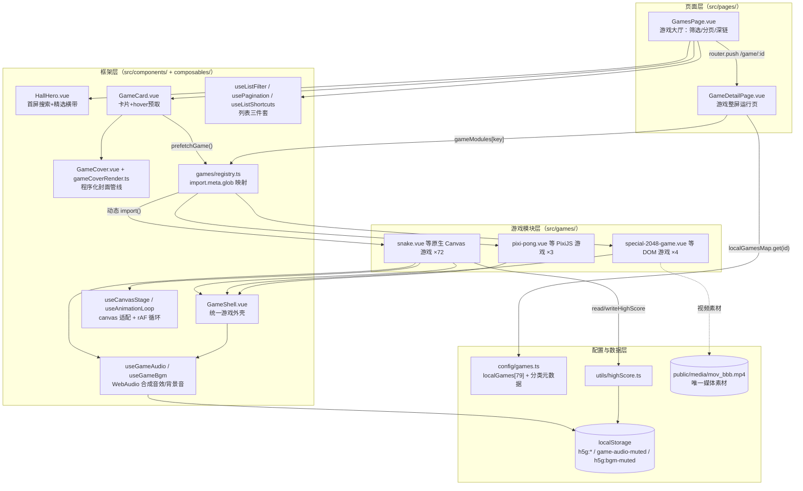
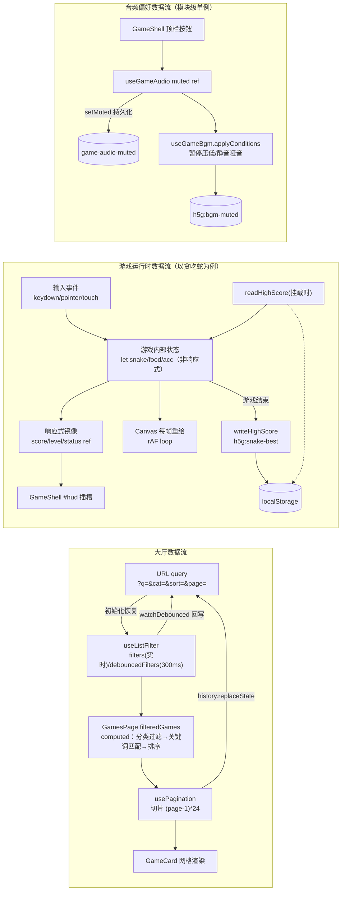

# 01 系统架构 — H5 游戏厅（html5-games）
> 项目：html5-games ｜ 版本：v1.0 ｜ 生成日期：2026-10-06 ｜ 依据：源码分析

## 1. 整体架构

本项目是一个**无后端、无状态库、无运行时编译**的纯前端单体应用。整体可分为四层：**页面层**（两个路由页面）、**框架层**（游戏外壳、加载注册表、封面管线、音频/画布 composables）、**游戏模块层**（79 个自包含游戏组件）、**资源与数据层**（程序化生成资源 + localStorage 持久化）。



各层职责边界清晰：**页面层只做「组织与调度」**（筛选管道、路由跳转、异步挂载），不含任何具体玩法；**游戏模块层只做「玩法」**（渲染 + 输入 + 结算），不感知路由与列表；两层通过 `src/games/registry.ts` 的懒加载映射与 `src/config/games.ts` 的元数据 Map 解耦。框架层是两层之间共享能力的沉淀，其中 `GameShell` 是所有游戏统一遵守的 UI 契约。

## 2. 游戏加载机制详解

这是本项目最核心的机制，由三个文件协作完成：`src/config/games.ts`（登记）、`src/games/registry.ts`（映射）、`src/pages/GameDetailPage.vue`（挂载）。

### 2.1 构建期：import.meta.glob 静态注册

`src/games/registry.ts` 全文仅 20 行，核心是一句：

```ts
export const gameModules = import.meta.glob('@/games/*.vue') as Record<
  string,
  () => Promise<{ default: Component }>
>
```

Vite 在构建期扫描该 glob，为 `src/games/` 下每个 `.vue` 生成一个独立懒加载 chunk，并把映射表内联进产物。因此「注册一款游戏」不需要在任何地方 `import` 具体组件——**文件落盘即注册**。与之配套：

- `prefetchGame(id)`：鼠标悬停/键盘聚焦卡片时调用（见 `GameCard.vue` 的 `@mouseenter` / `@focusin`），提前触发 chunk 下载；预取失败静默忽略，正式打开时由详情页兜底。它还顺带预取 `GameDetailPage.vue` 自身的 chunk，使应用内跳转零等待。
- `vite.config.ts` 的 `manualChunks` 把 `pixi.js` 单独拆为 `pixi-vendor`：只有 3 款 pixi 游戏引用它，普通玩家永远不会下载这段体积可观的 WebGL 引擎代码；Vue 全家桶合并为 `vendor`，@vueuse 为 `vueuse-vendor`。

### 2.2 运行期：详情页异步挂载

`GameDetailPage.vue` 的挂载逻辑（源码 38-58 行）：

1. 从路由参数取 `id`，用 `localGamesMap.get(id)` 查元数据——查不到直接渲染「未找到游戏」状态页（覆盖 id 拼错、游戏下线两种情况）。
2. 用 `gameModules['/src/games/${id}.vue']` 取 loader——取不到则置 `loadError`「游戏模块缺失」。
3. 用 `defineAsyncComponent` 包装 loader：`loadingComponent` 是自绘的旋转 spinner（`delay: 100ms` 防闪烁），加载异常时记录错误并 rethrow。
4. `onErrorCaptured` 捕获游戏组件**渲染期**的运行时异常，写入 `loadError` 并返回 `false` 阻止其向全局冒泡——游戏崩溃不会拖垮整个应用，用户看到 `ErrorFallback` 组件（重试按钮），点击 `retry()` 递增 `remountKey` 强制重建异步组件。

### 2.3 失败自愈与边界处理

- 路由级：`src/router/index.ts` 的 `router.onError` 检测「Failed to fetch dynamically imported module」（典型场景是发版后旧 hash chunk 404），自动 `window.location.assign(to.fullPath)` 整页刷新恢复。
- 数据级：`config/__tests__/games.test.ts` 有专门的「id 与 src/games/<id>.vue 文件一一对应」测试，配置与文件任何一侧漂移都会在 CI 阶段红掉，而不是等到运行时。

这套机制的本质是**「约定优于配置」+「构建期内联注册表」**：运行时没有扫描目录、没有动态拼接 URL、没有 eval/SFC 编译器，所有不确定性都被消灭在构建期。

把一次真实的加载在时间轴上走一遍，有助于体会各层的配合。假设用户在大厅悬停了「贪吃蛇」卡片又移开，然后从别的入口直接打开了 `/game/snake`：悬停触发的 `prefetchGame` 已经把 `snake-<hash>.js` 与详情页 chunk 拉进了浏览器缓存（失败也无人知晓，因为预取允许静默失败）；直接打开路由时，`GamesPage` 不会加载，`App.vue` 按 `hideHeader` 跳过顶栏渲染，首屏只有一个内联启动屏与即将出现的详情页；详情页 chunk 就绪后 `setup` 立即执行——同步查 `localGamesMap`（元数据在 vendor chunk 里，早已就绪）、同步拿到 loader 并包成异步组件；100ms 内游戏未就绪则显示 spinner，`snake-<hash>.js` 因预取命中几乎瞬间完成，`defineAsyncComponent` 渲染游戏组件，`onMounted` 里读最高分、注册键盘、启动 rAF，游戏可玩。整条链路中唯一的强依赖顺序是「元数据先于 loader 查询」，而这两者都在详情页 chunk 内部闭环，不存在跨 chunk 的初始化时序问题。

### 2.4 与替代方案的对比（为什么不用……）

评估本项目的加载设计时，值得记录被放弃的替代方案及其否决理由。**运行时 SFC 编译**（把游戏源码当文本加载、浏览器内编译）：会被 CSP 与体积否决——编译器本身数百 KB，且允许运行时注入组件等于打开注入攻击面；`GameDetailPage.vue` 源码注释「无需浏览器端 SFC 编译器」即是对此的否定。**单一巨型 bundle**（79 款全量打包）：首屏将包含数 MB 游戏代码，与「打开就玩」的定位冲突；代码分割后首屏只含框架与大厅。**运行时目录列举**（fetch 游戏清单 JSON）：多一次网络往返且引入清单与文件不一致的运行时错误面，本项目把一致性交给构建期 glob 与 CI 测试。**路由级懒加载代替组件级**：粒度太粗，79 款游戏共享一个路由 chunk 会退化为巨型 bundle；现在每款游戏独立 chunk，配合 hover 预取，把「点击到可玩」压到一个 RTT 以内。

## 3. 数据流向

项目无服务端，数据只有三种形态：**内存响应式状态**（页面/游戏内部）、**localStorage 持久化**（偏好与纪录）、**URL query**（可分享的列表视图状态）。



三个流向的设计要点：

1. **大厅流**：`useListFilter`（`src/composables/useListFilter.ts`）维护「实时 filters」与「防抖 debouncedFilters」两份状态，搜索词停止输入 300ms 后才进入过滤管道并写回 URL（`history.replaceState`，不打导航历史）；分页参数独立走 `GamesPage.vue` 内的 watch 同步。刷新或分享链接时，`resolveInitial()` 从 URL 反向恢复初始状态。
2. **游戏流**：高频可变量（蛇身坐标、粒子数组）刻意放在普通 `let` 变量里避免响应式开销，只有需要驱动 HUD 的低频标量才用 `ref`；这是 79 款游戏普遍遵循的「非响应式游戏世界 + 响应式 UI 镜像」模式（`src/games/snake.vue` 是范本）。
3. **音频流**：`muted` 是 `useGameAudio.ts` **模块顶层**的 `ref`，全应用共享同一实例；写 localStorage 的操作都被 try/catch 包裹，隐私模式下静默降级为仅内存生效。

## 4. 关键设计决策与设计模式

| 决策 | 具体做法（源码位置） | 解决的问题 | 可类比的模式 |
|------|----------------------|------------|--------------|
| 构建期注册表 | `import.meta.glob`（games/registry.ts） | 79 款游戏的零成本注册与代码分割 | Service Locator（静态化） |
| 插槽式外壳 | GameShell 五插槽：默认（舞台）/hud/info/overlay/actions | 统一 79 款游戏的页面骨架与控制键，游戏只写玩法 | Template Method |
| 单例 composable | useGameAudio/useGameBgm 的状态定义在模块顶层 | 全局静音开关跨页面跨游戏一致 | Module 单例 + 观察者（Vue ref） |
| 程序化资源 | gameCoverRender.ts 离屏绘制 + worker 编码 webp + 模块级 Map 缓存 | 79 张封面零图片素材、零重复绘制 | Flyweight（缓存）+ 幂等渲染 |
| 种子确定性作曲 | useGameBgm.ts `createBgmPlan(seedKey)` 纯函数：FNV-1a hash + mulberry32 PRNG | 每款游戏固定一首专属 BGM，且纯函数可单测 | 生成式艺术 + 纯函数分离 |
| 错误分级兜底 | 组件级 `onErrorCaptured`（详情页）→ `ErrorFallback` 重试；路由级 `router.onError` 刷新自愈 | 游戏 chunk 丢失/渲染崩溃不影响站点其余部分 | 断舱（Bulkhead） |
| 非 React 全家桶 | 无 Pinia；跨组件共享仅靠模块单例 + props/slots + provide 深度极浅 | 79 款游戏互相独立，全局状态天然极少 | — |
| 触控与键盘一等公民 | GameShell 按钮 ≥36px、卡片触控目标 ≥44px（GameDetailPage 返回按钮 44px）、`touch-action:none`（70 款游戏）、`prefers-reduced-motion` 降级 | PC-only → 全端可玩的核心诉求 | 渐进增强 |

另外两处值得点名的小型模式：

- **「确定性哈希」复用**：FNV-1a `hash()` 同时出现在 `gameCoverRender.ts`（决定封面几何符号）与 `useGameBgm.ts` 的 `hashKey`（决定 BGM 曲子），同一游戏 id 永远得到同一封面与同一曲子，且无任何存储成本。
- **事件清理的责任链**：`useCanvasStage` / `useAnimationLoop` 的 `registerTargetEvent` 把 `addEventListener` 与对应 cleanup 收进 `cleanupTasks` 数组，`onBeforeUnmount`/`onUnmounted` 统一出栈执行——79 款游戏因此不会泄漏 window 级监听器。

## 5. 架构约束与权衡（接手前必读）

1. **游戏组件不写路由与全局导航**。79 款游戏全部只通过 GameShell 的 `@restart` / `@toggle-pause` 事件与外界通信；「返回大厅」由 `GameDetailPage.vue` 左上角的悬浮返回按钮统一承担（`router.push('/games')`）。若某款游戏需要「返回」按钮，应复用该悬浮按钮而不是在游戏内自建。
2. **框架层 strict TS、游戏层允许 JS**。79 款游戏中 74 款是 `<script setup>`（无 `lang="ts"`）。这是有意的分层：框架代码（config/router/composables/components）全部 `.ts` 且被 `vue-tsc` 检查；游戏代码体积大、算法密集，允许 JS 降低迁移成本。新增游戏两种写法均可，但**元数据配置 `config/games.ts` 永远是 TS**。
3. **不要把游戏状态提升为全局**。项目没有任何跨游戏的共享玩法状态，最高分各自独立成键（`h5g:<id>-best`）。如果未来要做「全站成就」之类功能，应当新增独立模块而不是改造各游戏内部状态。
4. **封面与音频都是「生成」而非「引用」**。给游戏换封面 = 调整 gameCoverRender 的绘制参数或分类色，而不是放图片文件；新增音效 = 在 `useGameAudio.ts` 的 `render()` switch 里加一个 case，而不是放 mp3。
5. **web worker 只是加速手段，不是正确性依赖**。`gameCoverRender.ts` 在 worker 不可用时自动回退主线程同步编码（`workerBroken` 标记），删除 worker 文件功能不受损、仅性能下降。

再把第 1、2 条约束背后的权衡说透。**为什么游戏不感知路由**：79 款游戏是「内容」而非「页面」，把导航职责留给详情页的悬浮按钮，可以让任何游戏在嵌入式环境（例如未来被 iframe 或内嵌面板复用）中照常工作——`App.vue` 注释里「不做路由过渡：Transition 依赖 rAF，在按需出帧环境会把切换冻结在半路」的记载说明嵌入式场景是真实需求，游戏层保持环境无感知因此是硬约束而不仅是洁癖。**为什么允许游戏层用 JS**：5 款 TS 游戏（连连看/华容道/数独/消消乐/推箱子）是某批次重写时顺手带上的，此后没有回头统一；强行补齐类型注解对玩法正确性没有增量，反而会制造数百行的无意义 diff，维持「框架 TS、游戏 JS 双轨」是务实的稳定态。若团队决定终结双轨，建议以「新游戏必须 TS、旧游戏触及即改」的增量策略推进，避免一次性大改。

## 6. 与主项目（html5-examples）的关系

`src/types/index.ts` 注释明确记载 `ListFilterState` 「从主项目 html5-examples 的 src/types/refactor.ts 提取」，`useListFilter` 等 composables 沿用了主项目的列表页范式；`README.md` 徽章区也标明本项目是独立仓库（github.com/zhangzhengyang27/html5-games）。两项目已无构建期依赖，共享的只有设计语言（Linear 风格暗色令牌，见 `src/assets/main.css` 头注释「设计令牌 — Linear 主题移植」）与代码风格。维护本项目时无需关心主项目，但若从主项目移植新 composable，应保持「types 提取 + 注释注明来源」的惯例。
