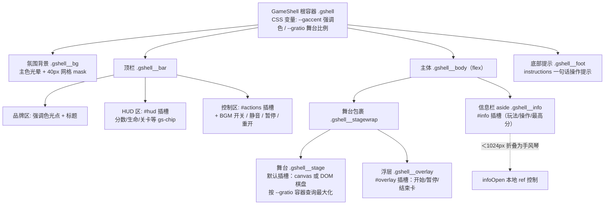
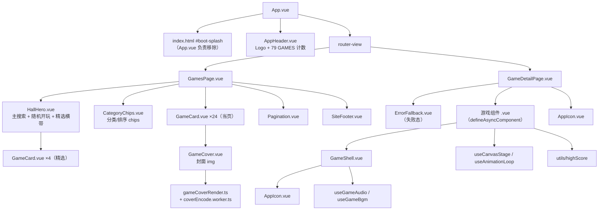
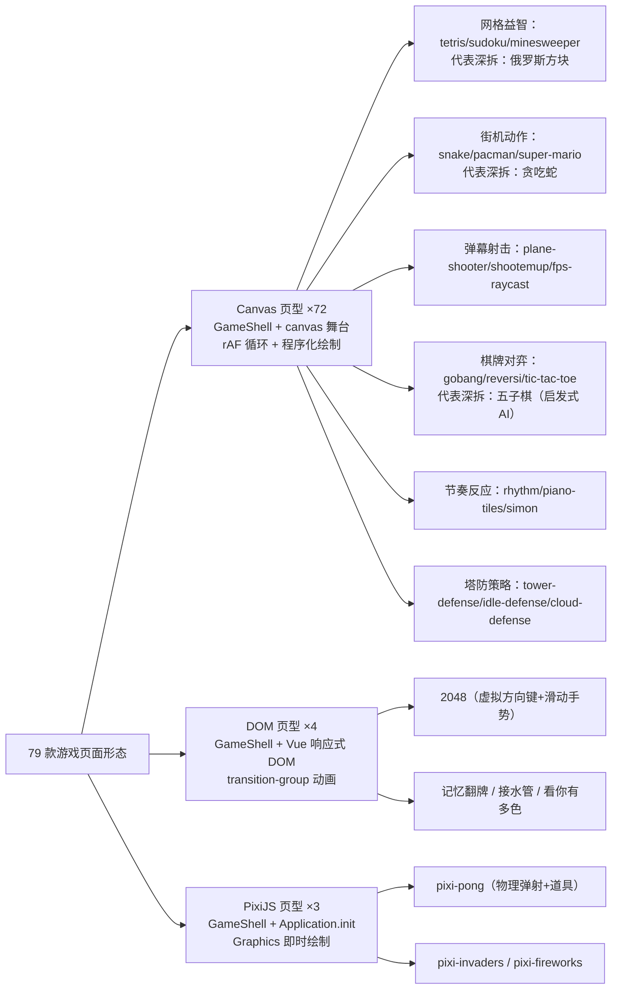

# 02 页面设计 — H5 游戏厅（html5-games）
> 项目：html5-games ｜ 版本：v1.0 ｜ 生成日期：2026-10-06 ｜ 依据：源码分析

本项目只有两条业务路由，页面复杂度高度收敛：**游戏大厅**（`src/pages/GamesPage.vue`）负责「发现游戏」，**游戏运行页**（`src/pages/GameDetailPage.vue`）负责「加载并承载游戏」，其余页面级体验由 `GameShell` 统一外壳与若干 layout/common 组件分担。本篇先给出路由总表，再分别展开两个页面的布局、交互与状态，最后按游戏类别归纳代表页面形态。

## 1. 路由与页面总表

路由定义在 `src/router/index.ts`，使用 `createWebHistory`：

| 路径 | 名称 | 组件 | meta | 行为说明 |
|------|------|------|------|----------|
| `/games` | Games | `pages/GamesPage.vue`（懒加载） | `title: '游戏大厅'` | 大厅列表页；`?q=&cat=&sort=&page=` 四个深链参数 |
| `/game/:id` | GameDetail | `pages/GameDetailPage.vue`（懒加载） | `title: '游戏详情'`、`hideHeader: true` | 游戏整屏运行页；`id` 经 `props: true` 可用，但页面实际从 `useRoute().params.id` 读取 |
| `/` | — | — | — | 重定向到 `/games` |
| `/:pathMatch(.*)*` | NotFound | — | — | 兜底重定向到 `/games` |

路由器还承担三项全局职责（均在 `src/router/index.ts`）：

1. **文档标题**：`beforeEach` 按 `meta.title` 设置 `document.title`；进入具体游戏后由 `GameDetailPage.vue` 的 `watchEffect` 细化为「<游戏名> - H5 游戏厅」。
2. **滚动位置**：`scrollBehavior` 对浏览器前进/后退使用 `savedPosition`；从运行页返回大厅时恢复模块变量 `lobbyScrollY`（由 `GamesPage` 的 `onBeforeRouteLeave` 调用 `rememberLobbyScroll` 记录），且刻意用 `behavior: 'instant'`——源码注释解释「全局 smooth 会让恢复动画依赖帧产出，在按需出帧环境里迟迟不到位」。
3. **chunk 失败自愈**：`router.onError` 匹配「Failed to fetch dynamically imported module」后整页刷新到目标路径，覆盖发版后旧 hash 失效的场景。

`src/App.vue` 根组件依据 `route.meta.hideHeader` 决定是否渲染 `AppHeader`（运行页隐藏顶栏，让游戏占满 100dvh）；同时负责移除 `index.html` 中的内联启动屏 `#boot-splash`（`router.isReady()` 后移除，8 秒超时兜底）。值得注意的是源码注释明确说明**不做路由过渡动画**：「Transition 的推进依赖 rAF，在按需出帧的环境（如内嵌面板）里 out-in 模式会把切换冻结在半路」。

## 2. 游戏大厅（GamesPage.vue）

### 2.1 布局结构

自上而下四个区块（模板 219-282 行）：

1. **首屏区 `HallHero`**：欢迎语（"79 款小游戏，打开就玩"）+ 主搜索框（带 `/` 快捷键提示 kbd 与清空按钮）+ 「随机开玩」按钮 + 「核心精选」横带（横向 snap 滚动，取 `group === '核心精选'` 前 4 款）。精选带是响应式的：一旦输入搜索词或切换到非「全部」分类，`featuredGames` 计算属性返回空数组，横带自动收起，避免与结果区争夺注意力。
2. **分类导航**：`CategoryChips` 渲染「全部 + 四分类」，每枚 chip 带图标与实时计数（全部 79 / 益智 20 / 棋牌 7 / 动作 25 / 休闲 27），计数由前端从 `localGames` 现算。
3. **结果区**：标题行（结果标题 + 总数 + 「默认/随机」排序 chips）→ 游戏网格 `games-grid`（`GameCard` 列表）→ `Pagination` 分页器。空态区块包含「没有找到匹配的游戏」提示与「清除筛选」按钮。
4. **页脚 `SiteFooter`**。

网格列数按断点阶梯（`GamesPage.vue` 样式 354-383 行）：默认 6 列，≤1279px 5 列，≤1023px 4 列，≤767px 3 列（间距同时收紧为 `--grid-gap-compact`），≤479px 2 列——与 README 声称的 6/5/4/3/2 列一致。

### 2.2 数据管道与交互

核心是一条约 30 行的 computed 链（源码 81-158 行）：

```
localGames（79 条）
  → category 过滤（all 或精确匹配）
  → 关键词过滤（debouncedFilters，300ms 防抖；匹配 title/description/tags，大小写不敏感）
  → 排序（latest = sortOrder 升序；random = Fisher-Yates 洗牌）
  = filteredGames → total → usePagination 切片（每页 24 条）→ games
```

交互细节：

- **URL 深链**：`useListFilter` 配置 `urlKeys: { search: 'q', category: 'cat', sort: 'sort' }`，防抖后经 `history.replaceState` 写回 URL；`page` 参数由页面内 watch 单独同步。初始化时从 URL 恢复，因此「搜索吃豆人的第 2 页」这样的视图可以直接分享。
- **翻页联动**：筛选条件（分类/排序/搜索词）任一变化即重置回第 1 页；`?page=999` 这类超范围深链被 `totalPages` watch clamp 到末页，避免空屏。
- **键盘导航**（`useListShortcuts`）：`/` 聚焦搜索框（经 `HallHero` 的 `defineExpose({ focus })`）、`j`/`↓` 与 `k`/`↑` 在当前页卡片间移动高亮（通过 `data-card-index` 属性 `scrollIntoView`）、`Enter` 打开选中卡片、`Esc` 取消选中；输入框聚焦时快捷键自动失效（`isTypingTarget` 守卫）。
- **打开游戏**：卡片本身是真实 `<a>` 链接（`router.resolve(...).href`），保留中键/Cmd+点击/右键「新标签打开」的原生能力；普通左键点击被 `onCardClick` 拦截改为 `router.push` 应用内跳转。悬停与键盘聚焦触发 `prefetchGame(id)` 预取游戏 chunk。

## 3. 游戏运行页（GameDetailPage.vue）与 GameShell 外壳

### 3.1 运行页状态机

页面有三种互斥渲染分支（模板 81-123 行）：

| 状态 | 触发条件 | 展示 |
|------|----------|------|
| 未找到 | `localGamesMap.get(id)` 为 undefined | 图标 + 「未找到游戏」+ 具体 id + 返回按钮 |
| 失败 | chunk 加载异常或渲染期错误（`onErrorCaptured` 捕获） | `ErrorFallback`（错误信息 + 重试按钮） |
| 正常 | 元数据存在且组件挂载成功 | `<component :is="GameComp">` 占满 100dvh |

正常分支下页面只叠加一个元素：左上角 44×44 的圆形悬浮「返回游戏列表」按钮（毛玻璃质感，z-index 20），这是运行页与游戏之间唯一的框架级 UI。加载中展示自绘 spinner（`defineAsyncComponent` 的 `loadingComponent`，100ms 延迟防闪烁）。

### 3.2 GameShell：79 款游戏的统一骨架

所有游戏第一行模板都是 `<GameShell>`（已扫描确认 79/79）。其结构（`src/components/games/GameShell.vue`）：



Props 契约：`title`（必填）、`ratio`（舞台宽高比，默认 1 正方形；横版游戏传 16/9 等）、`instructions`（底部操作提示）、`showRestart`/`showPause`/`paused`（重开与暂停按钮及受控暂停态）、`accent`（强调色 CSS 颜色，默认主色）、`showInfo`。事件：`@restart`、`@togglePause`。GameShell 自身还内置了音频联动：挂载时监听首个 `pointerdown`/`keydown` 手势，触发 `useGameAudio.unlock()` 并以游戏标题为种子 `bgm.start(title)`；`muted`/`paused` 变化经 `applyConditions` 同步为 BGM 的哑音/压低（暂停时音量降到 0.28 而非静音，见 `useGameBgm.ts` 的 `applyGain`）。

游戏的典型插槽用法（以 `src/games/snake.vue` 为例）：`#hud` 放三个 `gs-chip`（分数/最高/等级）；默认插槽放 `<canvas class="game-canvas" tabindex="0">`；`#info` 放「玩法/操作/提示」三节；`#overlay` 按 `state`（idle/paused/over）切换开始卡、暂停卡、结算卡——结算卡展示本局分数、是否新纪录（`newRecord`）与「再来一局」按钮。

## 4. 组件树



layout/common 组件都是无状态薄封装：`AppIcon` 包装 material-symbols 字体类名；`CategoryChips` 是受控 chip 组（`v-model` + `items`，带 size 变体）；`Pagination` 接 `page/totalPages/total/pageSize`，发 `update:page`。补充三个与页面体验直接相关的组件细节。**GameCard 的四态反馈**：常态是分类色描边的封面卡（16:10，封面由 GameCover 提供）；hover / 键盘选中（`is-keyboard-active`）/ 触屏按压三态共用同一套反馈——卡片上浮 3px、分类色描边加亮、辉光阴影、封面放大 5%、中央浮现圆形播放按钮；精选角标（右上「精选」pill）只在 `group === '核心精选'` 时出现。所有动效在 `prefers-reduced-motion: reduce` 下整体关闭（样式 195-203 行）。**CategoryChips 的受控约定**：`items` 是 `{ value, label, count?, icon? }[]`，选中值经 `v-model` 回写；大厅用它同时承载分类（带图标与计数）与排序（`size="sm"` 紧凑变体）两组互斥选择，组件本身不知道「分类」语义，完全通用。**空态设计**：搜索无结果时渲染居中空态（搜索图标 + 「没有找到匹配的游戏」+ 关键词回显 + 「清除筛选」按钮），按钮最小高度 44px 维持触控标准；`clearFilters` 只清搜索词并把分类复位为 all，保留排序选择。

视觉体系的根是 `src/assets/main.css` 的设计令牌：Tailwind v4 的 `@theme inline` 把 `--color-*` 桥接为原子类可用色，`:root` 里是 Linear 风格的暗色 RGB 三元组变量（画布 `#08090a`、面板 `#0f1011`、品牌靛紫 `#7170ff`），字号、间距（`--space-*`）、圆角阶梯（2/4/6/8/12px + pill）、动效时长与缓动（`--duration-*`/`--ease-*`）全部令牌化，`--page-max-width: 80rem` 定版心。页面层（GamesPage/GameDetailPage）与组件层统一 `rgb(var(--color-*-rgb) / alpha)` 语法消费这些变量，因此任何主题调整都在 main.css 一处完成；这也是「dark-first（当前仅暗色）、浅色列为后续增强」的注释得以成立的架构前提。

## 5. 状态管理设计

项目**没有引入 Pinia/Vuex**，状态按作用域分四层管理：

| 层级 | 载体 | 例子 | 持久化 |
|------|------|------|--------|
| 全局单例 | composable 模块顶层 `ref` | `useGameAudio` 的 `muted`、`useGameBgm` 的 `bgmMuted`、`gameCoverRender` 的 `coverCache` | muted/bgmMuted 写 localStorage |
| 路由器模块 | 普通模块变量 | `router/index.ts` 的 `lobbyScrollY` | 否（会话内） |
| 页面状态 | `ref`/`reactive`/`computed` | 大厅筛选（`useListFilter`）、分页（`usePagination`）、键盘索引 | 筛选与页码映射到 URL query |
| 游戏内部 | 响应式镜像（`ref`）+ 非响应式世界（普通 `let`） | snake 的 `score/level/state` 为 ref，`snake/food/dir/acc` 为 let | 最高分经 `utils/highScore.ts` |

这套分层的关键取舍：**跨组件共享状态被刻意压缩到「音频偏好」与「封面缓存」两个单例**，其余全部就地管理；页面间传值只靠路由参数与 URL。79 款游戏彼此完全隔离——没有共享的世界状态，也没有跨游戏的存档，卸载即销毁。这使「新增/删除一款游戏」永远不影响其他游戏（06 篇 SOP 依赖此性质）。

## 6. 游戏类别与代表页面归纳

按渲染范式与页面形态，79 款游戏可归纳为三大页型、八类玩法。页型判定已逐文件扫描确认（Canvas 72 / DOM 4 / PixiJS 3）：



代表页面形态说明：

- **贪吃蛇（街机/Canvas 页型范本）**：固定 21×21 网格，`useCanvasStage({ pauseWhenHidden: true })` 提供 canvas 引用、DPR 适配与 rAF；逻辑tick 用时间累加器 `acc` 与 `speedMs()`（150ms 递减到 70ms）实现「越吃越快」；键盘（方向键/WASD/空格）与触屏（`touchstart/touchend` 位移判定，24px 死区）双输入；结算时 `writeHighScore('h5g:snake-best', ...)`。
- **2048（DOM 页型代表）**：棋盘是 CSS Grid（`--dimension`/`--tile-size` CSS 变量驱动 3×3 到 6×6），方块是 `transition-group` 渲染的 `tile` 元素（key 为自增 id，移动有 pop 动画）；支持 3×3~6×6 四档尺寸切换；移动逻辑 `applyMoveTiles` 按行/列过滤-排序-合并后重排 id；触屏为滑动手势 + 屏幕虚拟方向键（`.control-pad` 的四个 pad-btn）双通道；无效移动触发棋盘抖动动画（`boardShaking`）。
- **弹球对战 pixi-pong（PixiJS 页型代表）**：固定 600×400 逻辑分辨率，`onMounted` 里 `new Application()` + `await app.init({ background:'#0b1020', antialias:true })`；所有实体（球/挡板/道具/球网）用 `Graphics` 即时绘制；自管 rAF 循环（非框架 composable）；`onBeforeUnmount` 经 `destroyed` 标志防止 init 完成前卸载的竞态，`app.destroy(true)` 释放。支持单人 AI（三档追踪速度）/双人本地、四种道具（变大/多球/加速/减速）。
- **五子棋（棋牌/AI 代表）**：Canvas 绘制 15 路棋盘与棋子，双人模式轮流落子；人机模式内置攻防启发式 AI（对候选点做我方成五/活四评分与对方威胁评分的加权求和）；含悔棋与胜负记录（`src/games/gobang.vue`，512 行）。

其余类别的页面骨架与上述代表一致，差异只在玩法层：弹幕射击类的共同点是「对象池 + 波次编排 + 碰撞检测」（如飞机大战的道具系统、射线 FPS 的 DDA 射线投射与深度缓冲）；节奏类的共同点是「时间轴调度 + 判定窗口」（节奏音游的 Perfect/Good/Miss 三档判定）；塔防类的共同点是「网格占用 + 路径寻路 + 经济循环」。维护这些游戏时，先读对应代表的实现即可举一反三。
