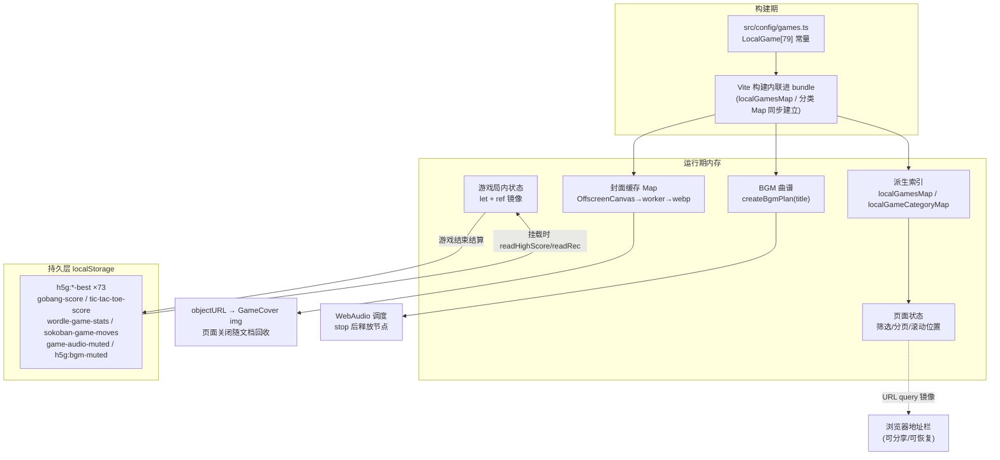

# 04 数据模型 — H5 游戏厅（html5-games）
> 项目：html5-games ｜ 版本：v1.0 ｜ 生成日期：2026-10-06 ｜ 依据：源码分析

本项目的数据模型极简：**一份内存元数据**（TypeScript 常量，随构建分发）+ **一组 localStorage 键**（玩家偏好与纪录）。没有服务端数据库、没有用户体系、没有跨游戏聚合数据。全项目所有持久化键名共 79 个（77 个游戏内键 + 2 个音频偏好键，按静态键名口径；记忆翻牌的动态分档键在运行时另展开 2 个实际键名，见 2.1 表），本篇逐一给出结构、语义与生命周期。

## 1. 游戏元数据模型（内存，`src/config/games.ts`）

### 1.1 LocalGame 字段表

| 字段 | 类型 | 必填 | 说明 | 消费方 |
|------|------|------|------|--------|
| `id` | `string`，匹配 `/^[a-z0-9-]+$/` | 是 | 全局唯一标识；同时决定组件文件名 `src/games/<id>.vue`、路由参数、localStorage 键名 | config 测试、GameDetailPage、registry |
| `category` | `'puzzle' \| 'board' \| 'action' \| 'casual'` | 是 | 四分类，决定筛选维度、分类色、封面辉光 | GamesPage、GameCard、GameCover |
| `engine` | `string`（固定 `'game'`） | 是 | 历史遗留字段（原供详情页 VisualDemo 类型消费），当前仓库内无实际逻辑依赖；《13》E-02 已裁定为**死字段**待清理 | 无实际消费方 |
| `library` | `string`（固定 `'showcase'`） | 是 | 同上（E-02 死字段裁定） | 无实际消费方 |
| `title` | `string` | 是 | 展示名；**同时是程序化 BGM 的作曲种子**（同名曲子恒定）与封面标题文字 | HallHero、GameShell、GameCover、useGameBgm |
| `description` | `string` | 是 | 一句话玩法描述；参与大厅搜索匹配 | GamesPage 搜索 |
| `tags` | `string[]`（≥1 项） | 是 | 标签；参与大厅搜索匹配（如「PixiJS」「粒子」） | GamesPage 搜索 |
| `group` | `string` | 是 | 来源分组字符串，当前取值 5 种：核心精选（7）/ GitHub 示例集成（61）/ PixiJS 精选（3）/ 专题灵感（4）/ Canvas Test 整理（4）；「核心精选」特判驱动首页横带与卡片角标 | HallHero、GameCard |
| `difficulty` | `string` | 是 | 难度标注，**当前 79 款全部为 `''`**，UI 未消费；《13》E-03 已裁定（无产品需求则与 E-02 同批删除） | 无 |
| `sortOrder` | `number`（全表唯一） | 是 | 默认排序键（0~79 区间，**缺 1**——第三批下线一款的历史痕迹，见《13》E-01），「默认」排序按其升序 | GamesPage 排序 |

完整性约束由 `src/config/__tests__/games.test.ts` 固化为 8 个测试用例（覆盖：总数 79、id 无重复且格式合法、sortOrder 唯一、必填字段非空、category 合法、分类色是六位 hex、分类非空、配置与磁盘文件一一双向对应、核心精选 ≥4、分类 Map 全覆盖——用例级拆解见《09-测试与质量保障》2.1）。

### 1.2 GameCategoryMeta 分类元数据

```ts
interface GameCategoryMeta {
  id: GameCategory      // 分类键
  name: string          // 展示名：益智/棋牌/动作/休闲
  icon: string          // material-symbols 图标名（如 'ms:extension'）
  color: string         // 六位 hex 主题色：#8b5cf6 / #f59e0b / #f43f5e / #14b8a6
  description: string   // 分类一句话描述
}
```

### 1.3 派生索引

模块加载时构建两个 Map（O(1) 查询，避免 79 条线性扫描）：`localGamesMap`（id → LocalGame，运行页校验用）与 `localGameCategoryMap`（分类 id → 元数据）。GamesPage 的分类计数则每次用 `filter` 现算——79 条规模下无性能问题。

## 2. 持久化数据模型（localStorage）

读写铁律：**全部 try/catch 静默降级**（隐私模式/配额满时仅内存生效，绝不抛错中断游戏）。经对 79 个游戏文件与两个 composables 的全量扫描，键清单如下。

### 2.1 键全景表

| 键模式 | 数量 | 值类型 | 写入方 | 语义 |
|--------|------|--------|--------|------|
| `h5g:<id>-best` | 73 | `string`（十进制整数） | 各游戏（60 款经 `utils/highScore.ts`，13 款内联） | 单款游戏最佳纪录，缺省读作 0（含 8 处历史短键，见 2.3） |
| `h5g:memory-match-best-<size>` | 2 | `string`（十进制整数） | memory-match-game.vue | 记忆翻牌按棋盘规格（4×4 / 4×6）分档的最高分——动态键，`bestKey()` 运行时拼接 |
| `h5g:gobang-score` | 1 | JSON `{ w, l, d }` | gobang.vue | 五子棋**人机模式**累计战绩：胜/负/平（`saveRec` 仅在 AI 模式结算分支调用） |
| `h5g:tic-tac-toe-score` | 1 | JSON `{ X, O, draw }` | tic-tac-toe.vue | 井字棋比分（X 胜/O 胜/平局） |
| `h5g:wordle-game-stats` | 1 | JSON `{ played, won, streak, maxStreak, guesses: number[6] }` | wordle-game.vue | Wordle 玩家统计：总局数/胜场/当前连胜/最大连胜/按猜测次数的分布直方图 |
| `h5g:sokoban-game-moves` | 1 | JSON `Record<number, number>` | sokoban-game.vue | 推箱子「关卡索引 → 最少步数」映射（低分更优的多关纪录） |
| `game-audio-muted` | 1 | `'1' \| '0'` | useGameAudio.setMuted | 全局音效静音开关（跨游戏共享） |
| `h5g:bgm-muted` | 1 | `'1' \| '0'` | useGameBgm.setEnabled | 背景音开关（`'1'` 表示关闭） |

### 2.2 最高分键的语义分支

`readHighScore` 工具只适配「高分更大」语义（缺失/非法一律返回 0）；**低分更优**的游戏（步数/用时类，如视频拼图、华容道、数独、推箱子）遵循「游戏内自行比较、仅在破纪录时写入」的约定——例如 `src/games/video-puzzle.vue` 第 288-291 行：`if (!bestMoves.value || moves.value < bestMoves.value) { writeHighScore(BEST_KEY, moves.value) }`。这意味着这些键里的数值同样可能是「最优步数」而非「最高分」，**键名中的 best 不保证方向**，接手时需看各游戏读取处的比较逻辑。

### 2.3 键名规范

惯例是 `h5g:` 前缀 + 游戏 id + 后缀（`-best`/`-score`/`-stats`/`-moves`）。但存在 8 处「短键」历史偏差（键名沿用早期无 `-game` 后缀的短形态；其中 7 处的 id 本身就无该后缀，仅 `h5g:whack-a-mole-best` 是 id 为 `whack-a-mole-game` 而键名未带的真漂移，见《13》E-04）：`h5g:snake-best`、`h5g:fifteen-puzzle-best`、`h5g:shot-ball-physics-best`、`h5g:special-look-def-color-best`、`h5g:special-man-down100-best`、`h5g:whack-a-mole-best`、`h5g:video-puzzle-best`、`h5g:pixi-invaders-best`（直接内联）。**新增游戏必须用完整 id 拼键（`h5g:<id>-best`），不要模仿短键**；已存玩家的短键数据不做迁移（改键会导致老玩家纪录清零，权衡后维持现状；《16-决策记录ADR》ADR-010 已裁定不做一次性迁移，未来「按 id 枚举键」的需求走《11-扩展开发指南》场景五的双读映射）。

值得为这条「不迁移」的决定补一句背景：这些短键全部诞生于早期批次，对应游戏（贪吃蛇、数字滑块、泡泡风暴等）恰恰是复玩率最高的经典款，任何改键动作都会立刻被老玩家感知为「纪录丢了」；而键名偏差的唯一实际危害是「无法用统一函数从 id 推导键名」——本项目并没有这样的函数（各游戏把键写在自己的 `BEST_KEY` 常量里），所以偏差目前是零成本的历史包袱。只有在未来开发「全站纪录中心」这类需要按 id 枚举键的功能时，才需要先解决映射问题，届时建议采用「双读」（先读规范键、miss 再读短键）而不是批量改名。

## 3. 非持久化的运行时数据

| 数据 | 位置 | 结构 | 生命周期 |
|------|------|------|----------|
| 大厅筛选/分页状态 | `GamesPage` + `useListFilter`/`usePagination` | `{ search, category, sort }` + `page: number` | 页面会话内；`q/cat/sort/page` 镜像到 URL query 可跨刷新恢复 |
| 大厅滚动位置 | `router/index.ts` 模块变量 `lobbyScrollY` | `number` | 进入运行页前记录，返回后消费，随后保持到下次覆盖 |
| 游戏进行时状态 | 各游戏组件内 `let` 变量 + 少量 `ref` 镜像 | 各异（棋盘数组/实体列表/粒子池） | 挂载创建、卸载销毁；**没有中途存档**——刷新页面即本局丢失 |
| 封面缓存 | `gameCoverRender.ts` 模块级 `coverCache: Map<string, string>` | id → objectURL(webp) | 页面会话内；Inter 字体可用性翻转时清空重建一次 |
| BGM 曲谱计划 | `useGameBgm.ts` 模块级 `plan: BgmPlan \| null` | `{ tempo, rootMidi, scaleName, progression, arpNotes[32], bassNotes[32], padNotes[32], arpWave }` | `start(seedKey)` 生成、`stop()` 置空；纯函数生成、确定性可复现 |
| AudioContext | `useGameAudio.ts` 模块级 `ctx` | 单例 | 首个用户手势创建，页面关闭销毁 |

值得强调：**项目没有「游戏进度存档」**——79 款游戏全部是单局制（roguelike 地牢也是 permadeath），localStorage 只保存跨局沉淀（最高分/战绩/统计）。这是刻意的产品边界：无账号体系下的最小持久化。若未来要加「续玩」，建议按 `h5g:<id>-save` 新键扩展并序列化整局快照，勿复用 best 键。

与持久化相对，局内状态在 79 款游戏中呈现出高度一致的建模套路，值得单独总结为三条模式。**模式一：状态机驱动**。几乎所有游戏用一个字符串 `ref` 表达局 lifecycle（贪吃蛇 `state: 'idle'|'running'|'paused'|'over'`、2048 `status: 'idle'|'playing'|'won'|'over'`、pixi-pong `status: 'idle'|'running'|'paused'|'over'`），overlay 插槽按状态切换浮层，rAF 循环与输入处理按状态守卫——这是理解任何一款陌生游戏的第一把钥匙：先找这个状态变量。**模式二：世界与镜像分离**。高频世界数据（蛇身数组、棋盘二维数组、实体列表、粒子池）放普通 `let`/模块变量，每帧原地修改；只有需要进 HUD 或 overlay 的低频标量（分数、等级、生命、状态名）才用 `ref`，避免每帧触发依赖收集。**模式三：输入缓冲**。方向类输入普遍采用「下一 tick 生效」的缓冲变量（贪吃蛇的 `nextDir`），防止一帧内两次转向导致的自杀回穿。这三条模式不是文档规定，而是从代表游戏中归纳的既成事实；新增游戏遵循它们，代码就不会在 79 款中显得异类。

## 4. 数据生命周期



分阶段说明：

1. **构建期**：元数据是编译进 JS bundle 的常量数组，随每款游戏 chunk 的 `import.meta.glob` 映射一起分发；磁盘上不存在独立的 JSON 清单文件。修改元数据 = 修改源码 + 重新构建。这也决定了「数据回滚」的唯一手段是回滚代码版本——不存在可以单独回滚的数据层。
2. **首屏挂载**：config 模块执行即建立两个派生 Map；`useGameAudio`/`useGameBgm` 读取各自的静音偏好初始化单例 ref；大厅首屏的封面在卡片挂载时按需渲染并入缓存。这一阶段的所有读取都有缺省值兜底（最高分缺省 0、偏好缺省开启），首次访问与第一百次访问的启动路径完全一致。
3. **游戏会话**：进入 `/game/:id` 后，游戏组件挂载创建局内状态；从 localStorage 读入历史纪录展示于 HUD；游戏结束时比较并回写。局内状态随组件卸载（返回大厅/切换路由）整体丢弃。注意回写的触发时机因游戏而异：多数在「游戏结束」事件里，少数（如推箱子每关最少步数）在关卡通过时即写，维护时应以各游戏结算代码为准。
4. **清理**：项目从不主动删除 localStorage 键（无过期策略）。删除一款游戏只会让对应键成为「孤儿数据」——无害但不回收；若需要彻底清理应同步手动移除 `h5g:<id>-*` 键。音频偏好两个键则跨游戏生命周期永久存在，与任何单款游戏的增删无关。

用两个具体场景演练一遍数据流转，帮助建立直觉。**场景 A（新玩家）**：首次打开站点，localStorage 为空——大厅正常渲染（不依赖任何键），进入贪吃蛇读 `h5g:snake-best` 得 0，玩到 120 分死亡，比较 120 > 0 成立，写入 `'120'` 并标记新纪录；顺路点了静音按钮，`game-audio-muted` 变为 `'1'`，此后所有游戏静音。**场景 B（脏数据）**：用户手动把 `h5g:snake-best` 改成 `'abc'`——下次读取时 `Number('abc')` 得 `NaN`，`|| 0` 短路返回 0，游戏照常进行，下次破纪录即以合法值覆盖，脏数据自愈；若改成 `'50'` 则会被当作合法历史纪录参与比较，这正是「localStorage 属于玩家领地」的语义。

## 5. 数据校验与一致性防线

- **配置-文件一致性**：`games.test.ts` 用第二个 `import.meta.glob('/src/games/*.vue')` 与配置 id 集合做双向比对，任何一侧漂移 CI 即失败——这是数据模型最重要的不变量。
- **文案联动**：测试文件头注释明确「总款数 79 与 README / index.html meta / package.json description 的文案联动，调整游戏列表后需同步这三处文档，本测试即为防漂移哨兵」。
- **运行时兜底**：即便脏数据进入 localStorage（如手工改成非数字），`readHighScore` 的 `Number(...) || 0` 与各游戏 read 函数的 try/catch + 默认值都能保证恢复为合法初值，不会崩溃。
- **localStorage 不可用**：全部写入路径 try/catch，游戏逻辑不依赖写入成功（fire-and-forget 语义），因此 Safari 隐私模式等环境功能完整、仅无纪录。

综上，数据模型的维护成本被压到最低：**元数据在 config 一处、纪录键一盘账（本篇 2.1 表）、偏好键两个**。新增一款游戏的数据面 = config 加一条 +（可选）一个 `h5g:<id>-best` 键，其余零改动。
