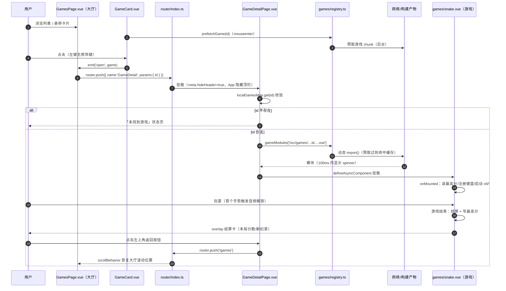
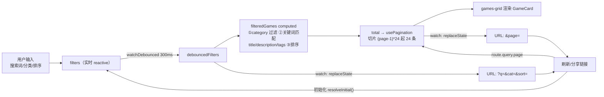
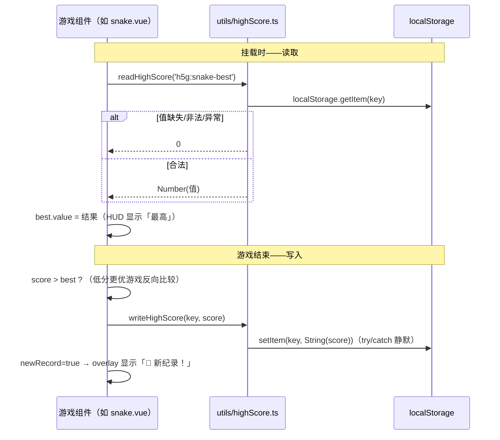
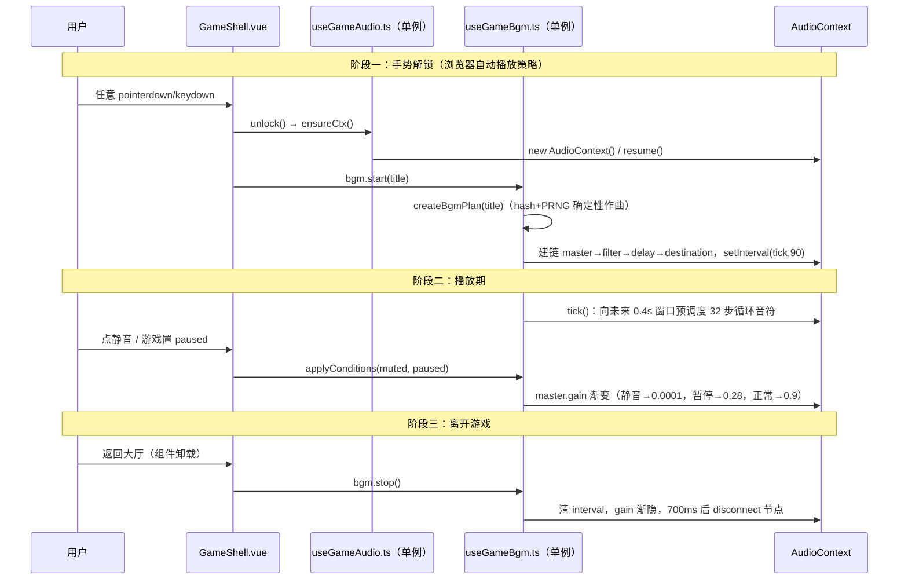
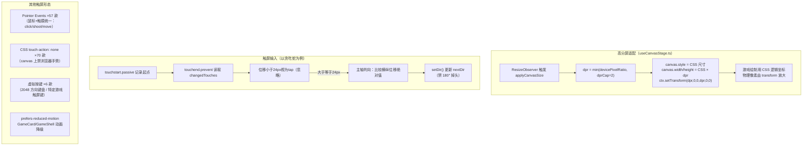

# 05 核心流程 — H5 游戏厅（html5-games）
> 项目：html5-games ｜ 版本：v1.0 ｜ 生成日期：2026-10-06 ｜ 依据：源码分析

本篇拆解 5 条端到端流程：①游戏发现→加载→启动→结算（主链路）②大厅筛选与 URL 深链 ③最高分存档读写 ④音频解锁与 BGM 生命周期 ⑤触屏与高分屏适配。每条流程配图、分步说明与涉及文件清单，标注的行号均指向当前源码。

## 1. 流程一：游戏发现 → 加载 → 启动 → 结算（主链路）

分步说明：

1. **发现与预取**：大厅 `GamesPage.vue` 的筛选管道产出当页 24 条元数据，`GameCard.vue` 渲染为真实 `<a>` 链接（`router.resolve(...).href`，保留新标签语义）。`@mouseenter` 与 `@focusin` 调用 `prefetchGame(game.id)`（`src/games/registry.ts` 15-20 行），后台预取游戏 chunk 与 `GameDetailPage.vue` 自身 chunk；预取失败静默忽略。
2. **路由跳转**：卡片点击被 `onCardClick` 拦截（非左键或带 Cmd/Ctrl 等修饰键时放行为浏览器原生行为），`emit('open')` → `GamesPage.openGame` → `router.push`。目标路由 `meta.hideHeader: true` 使 `App.vue` 不渲染 `AppHeader`，游戏占满整屏。
3. **校验与挂载**：`GameDetailPage.vue` 30-58 行先查 `localGamesMap`（元数据校验），再从 `gameModules` 取 loader 包成 `defineAsyncComponent`（`loadingComponent` 为自绘 spinner，`delay: 100` 防闪烁）；`onErrorCaptured` 兜住渲染期异常进入 `ErrorFallback`。
4. **游戏启动**：游戏组件 `onMounted` 里完成三件事——读最高分（HUD 展示）、注册键盘监听（`registerTargetEvent(window, 'keydown', …)`）、启动 rAF 循环（`startLoop`）。首个用户手势（点「开始游戏」或按任意键）触发 `unlock()` 创建/resume AudioContext，GameShell 同时启动以标题为种子的 BGM。
5. **运行与结算**：以 `src/games/snake.vue` 为例，rAF 回调 `loop(ts)` 计算 `dt`（clamp 到 100ms 防后台切回大步进），`update(dt)` 用时间累加器按 `speedMs()` 节拍驱动逻辑 tick，`draw()` 每帧全量重绘 canvas。死亡时 `gameOver()` 写最高分、播 `gameover` 音效、置 `state='over'`，overlay 渲染结算卡。
6. **返回**：`GameDetailPage` 左上悬浮按钮 `goBack()` → `router.push('/games')`；`router.scrollBehavior` 读取 `lobbyScrollY`（`GamesPage` 离开时经 `rememberLobbyScroll(window.scrollY)` 记录）以 `instant` 恢复位置。

涉及文件：`src/pages/GamesPage.vue`、`src/components/games/GameCard.vue`、`src/games/registry.ts`、`src/router/index.ts`、`src/pages/GameDetailPage.vue`、`src/components/ErrorFallback.vue`、`src/App.vue`、任一 `src/games/*.vue`。

## 2. 流程二：大厅筛选管道与 URL 深链

分步说明：输入即时写入 `filters`（搜索框不打断输入）；300ms 无输入后 `debouncedFilters` 更新（`useListFilter.ts` 67-73 行，基于 `@vueuse/core` 的 `watchDebounced`），才触发过滤计算与 URL 回写（76-100 行，`history.replaceState` 不产生历史记录）。分类/排序/搜索任一变化把页码重置为 1（`GamesPage.vue` 186-190 行）；页码变化独立同步 `?page=`（145-152 行）。刷新时 `resolveInitial()` 从 URL 反填初始筛选，`initialPage` 从 `route.query.page` 解析，超范围页码被 clamp（204-211 行）。随机排序是 Fisher-Yates 洗牌（98-102 行），每次筛选变化重洗。

这条流程里藏着三个容易踩坑的细节，维护前应当知晓。**细节一：URL 回写是「有条件」的。** `useListFilter` 在写回前会比对新旧 query 字符串（92-95 行），相同则跳过 `replaceState`，避免浏览器地址栏无意义的抖动与历史污染；这意味着手工改动 URL 后立即又改筛选状态可能不触发第二次回写，属预期。**细节二：分类与关键词的过滤是串行的。** 先按 category 精确匹配、再做大小写不敏感的子串匹配（title/description/tags 三字段），所以「搜索词命中已隐藏分类的游戏」不会出现——分类是硬边界，这与某些平台「搜索突破分类」的行为不同。**细节三：精选横带的收起逻辑独立于管道。** `featuredGames` 计算属性（172-175 行）只要检测到搜索词或非 all 分类就返回空数组，横带随之消失；它不参与分页计数，因此收起/展开不会引起页码跳动。

涉及文件：`src/pages/GamesPage.vue`、`src/composables/useListFilter.ts`、`src/composables/usePagination.ts`、`src/types/index.ts`（ListFilterState）。

## 3. 流程三：最高分存档读写

要点：工具函数（`src/utils/highScore.ts` 全文 23 行）只有两个导出，语义刻意与各游戏原生的 readBest/writeBest 完全一致以支撑批量重构；「低分更优」的步数/用时类游戏（视频拼图 `video-puzzle.vue` 288-291 行等）自行比较后调用同一对函数，故键值方向由游戏自定（见 04 篇 2.2）。多关游戏的复合纪录（推箱子每关最少步数）与统计型数据（Wordle 五件套）不经过该工具，由游戏内 readX/writeX 内联实现，同样 try/catch 包裹。

两个边界情况需要单独说明。**并列纪录**：比较普遍采用严格大于（`score > best`），因此追平既有纪录不会触发写入，「新纪录」浮层也不会出现——这是符合直觉的选择，但若未来要引入「并列也算破纪录」的运营口径，需要逐游戏修改比较符。**浮点与精度**：个别游戏的得分含小数（如限时加成折算），写入时统一经 `String(value)` 序列化，读取时 `Number()` 还原，JS 的双精度往返不会丢位；但跨语言工具（如后端脚本批量修数）应以十进制整数字符串为准，避免科学计数法进入键值。

涉及文件：`src/utils/highScore.ts`、`src/utils/__tests__/highScore.test.ts`、各 `src/games/*.vue`（60 款 import 该工具）。

## 4. 流程四：音频解锁与 BGM 生命周期

要点：两个模块的状态（`muted`、`bgmMuted`、单例 `ctx`）都定义在**模块顶层**，跨页面跨游戏共享；`play(name)` 在 `muted` 时直接 return、音频异常吞掉（`useGameAudio.ts` 167-177 行），保证「音效永不影响游戏逻辑」；BGM 用「向前看 0.4 秒」的 lookahead 调度规避 `setInterval` 抖动（`tick()` 197-207 行）；曲谱纯函数 `createBgmPlan` 有独立单测（`src/composables/__tests__/useGameBgm.test.ts`），断言同一标题曲目恒定、8 个代表标题至少分化 4 种速度（用例名中残留的「80 款」措辞是历史口径漂移，见《13-技术债务与演进建议》E-07）。

涉及文件：`src/composables/useGameAudio.ts`、`src/composables/useGameBgm.ts`、`src/components/games/GameShell.vue`（57-81 行手势监听与联动）、各游戏（`play()` 调用点）。

## 5. 流程五：触屏与高分屏适配

分步说明：

1. **DPR 适配**：`useCanvasStage` 的 `applyCanvasSize`（54-77 行）在挂载与容器尺寸变化（ResizeObserver 观察父元素）时执行「CSS 尺寸 + 物理尺寸双写 + setTransform」三步，游戏一律用 CSS 逻辑坐标绘制；`dprCap: 2` 防止 3x 屏过采样。79 款中未用该 composable 的游戏（多数自管 canvas）重复了同一模式。
2. **滑动手势**：`snake.vue` 357-387 行是范式——`@touchstart.passive`（不阻塞滚动注册起点）+ `@touchend.prevent`（阻断合成 click）；24px 死区过滤微抖；主轴判向后调 `setDir`，方向缓冲 `nextDir` 在下一逻辑 tick 才生效且禁止直接反向。
3. **Pointer Events 主导**：57 款游戏用 `pointerdown/pointermove` 统一鼠标与触摸（如 2048 之外的点击类、桌球拖拽、水果忍者划动）；配合 `touch-action: none`（70 款的 canvas CSS）阻止浏览器滚动手势抢占。
4. **兜底形态**：少数游戏提供屏上虚拟按键（如 2048 的 `.control-pad` 方向键）；全局层面 GameShell 控制按钮 36px、返回按钮 44px 满足触控目标下限；`App.vue` 高度用 `100dvh` 处理移动端地址栏伸缩。

涉及文件：`src/composables/useCanvasStage.ts`、`src/composables/useAnimationLoop.ts`、`src/games/snake.vue`（触屏范式）、`src/games/special-2048-game.vue`（虚拟按键范式）、`src/components/games/GameShell.vue`、`src/pages/GameDetailPage.vue`（100dvh 与 44px 返回按钮）。

## 6. 小结

五条流程共享同一组底层设施：registry 懒加载（流程一）、composable 单例（流程三/四）、canvas 适配（流程五）。排查线上问题的建议顺序：先确认 chunk 是否 404（流程一的加载分支）→ 再看 localStorage 是否被禁（流程三/四的静默降级）→ 最后查具体游戏局内逻辑（各游戏自包含，互不牵连）。

最后从「改动影响面」的角度给三条流程画像，方便维护者评估一次修改的波及范围。**动流程一**（加载机制）是全站级手术：`registry.ts` 的 glob 模式、详情页的挂载逻辑与 CI 的一致性测试三者强耦合，任何调整必须同步跑 `pnpm test` 与一次完整的手工回归（每类范式至少点开一款）。**动流程二/三**（筛选与存档）是体验级修改：`useListFilter` 的防抖与 URL 语义被大厅唯一消费，改坏的症状是「深链失效」或「搜索卡顿」，验证手段是刷新恢复与慢速输入两组手工用例。**动流程四/五**（音频与触屏）是全局横切：`useGameAudio` 的单例状态被 79 款游戏共享，改 `play()` 语义等于改全站音效行为；触屏参数（死区 24px、`touch-action`、44px 触控目标）则是「隐性接口」，没有测试守护，只能在真机或 DevTools 触屏模拟下逐类验证。总体而言，这个项目的安全修改区是「游戏内部」与「新增游戏」，危险修改区是「registry、GameShell 插槽语义、全局 composable 单例」——后者改动前建议先在本篇与 01 篇把既有设计意图读透。
