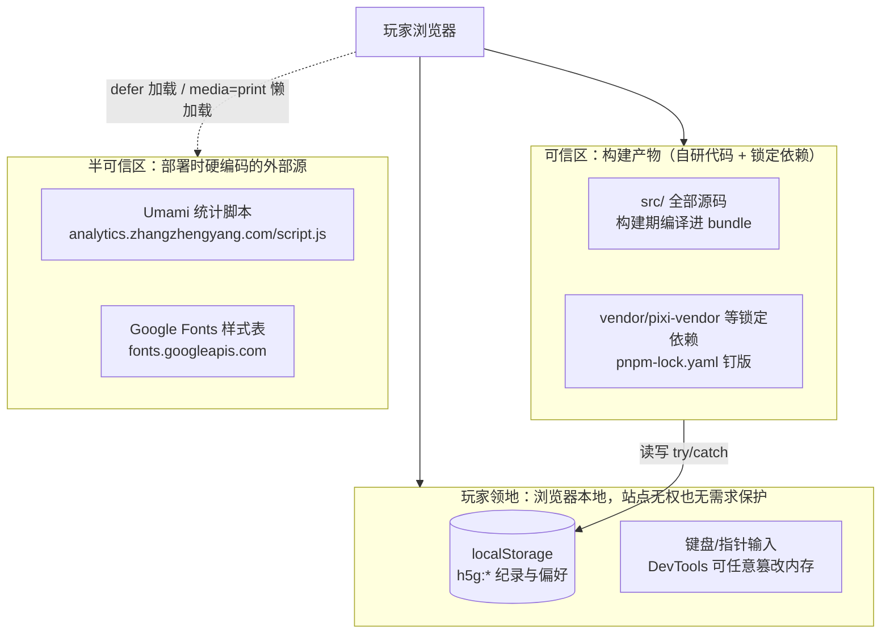

# 08 安全与权限设计 — H5 游戏厅（html5-games）
> 项目：html5-games ｜ 版本：v1.1 ｜ 生成日期：2026-10-06 ｜ 依据：源码分析

本项目没有后端、没有账号体系、没有用户输入的持久化共享，这让它天然避开了 Web 安全的大半张威胁清单（SQL 注入、越权、CSRF、会话劫持等一概不适用）。但「纯前端」不等于「无安全面」：本篇按攻击面盘点的方式，逐一分析外部依赖、存储信任边界、隐私边界、供应链与框架层遗留的隐患，并给出与项目定位相称的加固建议。全篇的风险评级口径：**高**=可被第三方利用或影响站点可用性；**中**=依赖运维部署环境；**低**=仅影响单机体验或属于理论风险。

## 1. 信任边界总览

先把整个站点的信任边界画出来，后续每一节都在这张图上展开。

边界两侧的语义需要说清楚：可信区内的代码若有缺陷，危害上限是「本站自己坏掉」；半可信区是构建时写死、运行时从第三方源加载的资产，其源一旦被投毒，脚本将在本站源下执行，这是本项目最大的真实攻击面（第 3 节展开）；玩家领地则完全相反——localStorage 里没有任何值得保护的东西（最高分、静音偏好），因此「玩家篡改自己的数据」不被视为攻击而是被接受的语义（第 4 节展开）。注意图中没有服务端节点：本项目不存在跨用户的数据通道，任何「攻击得手」的收益上限都是攻击者自己的浏览器会话。

## 2. 运行时注入面：为什么这个项目天然安全

评估任何前端站点的第一步是问「攻击者的输入能走到哪些危险出口」。本项目的答案非常干净，逐项核对如下。**无运行时编译**：详情页不使用 `vue/compiler-sfc`（`GameDetailPage.vue` 24-28 行注释明确「无需浏览器端 SFC 编译器」），产物中不存在 `new Function`/`eval` 类动态求值入口，`import.meta.glob` 的映射在构建期内联为静态表——攻击者无法通过 URL 参数让站点加载任意代码。**无 URL 参数进入危险出口**：路由仅消费 `route.params.id`（`GameDetailPage.vue` 30 行）与 `route.query.page`（`GamesPage.vue` 40-41 行），前者只用于 `localGamesMap.get()` 查表与模板插值，后者经 `Number()` 校验——Vue 模板插值默认 HTML 转义，不存在 `v-html`（全仓库 grep 无命中），无 XSS 注入点。**无 `postMessage`/`window.open`/`target="_blank"`**：卡片是同源 `<a>` 链接且点击被拦截为应用内跳转（`GameCard.vue` 44-48 行），不存在反向标签劫持（reverse tabnabbing）问题，因此也无需 `rel="noopener"`——原生的非拦截路径（中键/Cmd+点击）由浏览器新标签打开同源地址，无 `window.opener` 交换。**无第三方 iframe 嵌入**：全站没有 iframe 元素，也没有被设计为可嵌入的 `postMessage` 协议；若部署方需要禁止他人 iframe 嵌套本站，应在托管层加 `frame-ancestors`（本篇第 6 节）。**设计上排除的注入面**：《01-系统架构》2.4 节已记载「运行时 SFC 编译」方案被否决的安全理由，这里补全因果链——如果当初选择运行时编译，URL 到组件代码之间就存在一条注入路径，CSP 的 `unsafe-eval` 也必须放开；当前架构下这两件事都归于无。

## 3. 外部依赖（半可信区）：Umami 统计与 Google Fonts

`index.html` 是全项目唯一触碰外部网络的地方，两处硬编码需要逐一评估。**Umami 统计**（index.html 30-34 行）：`<script defer src="https://analytics.zhangzhengyang.com/script.js" data-website-id="112f56e0-…">`。风险有三层。其一，供应链——该脚本在玩家浏览器中于本站源下执行，若 `analytics.zhangzhengyang.com` 被攻破或域名易主，注入的脚本可读取本站全部 localStorage（虽然只是分数）、发起任意请求并伪装成本站行为；`defer` 只延迟执行不改变权限。其二，可用性——脚本源不可达时仅统计失效，不阻塞渲染（defer + 无依赖），属于可接受的优雅降级。其三，隐私——Umami 是无 Cookie 的轻量统计，但访问者 IP 与 UA 仍会到达统计服务器，这是第 5 节隐私声明的组成部分。**Google Fonts**（index.html 15-28 行）：preconnect 两条 + 样式表一条，采用 `media="print" onload="this.media='all'"` 的经典懒加载技巧——字体源不可达时不阻塞首屏渲染，`<noscript>` 兜底保证禁 JS 环境仍尝试加载。风险与 Umami 同构但更轻：CSS 文件本身在 fonts.googleapis.com 源下执行（样式不进入本站源），实际字体文件再从 fonts.gstatic.com 拉取；「被墙/离线」场景由系统字体栈兜底（`src/assets/main.css` 的 `--font-body` 回退链），且封面渲染管线的字体竞态防护（见《07-模块详解》第 3 节）保证字体缺失时封面照常生成——外部字体完全不可达时站点功能完整，仅排版降级。**评级与建议**：两处均为「中」级风险，缓解手段不是删依赖（统计与排版有价值），而是（a）若要严格化，可将两份资产下载进 `public/` 自托管——material-symbols 已经走了这条路线（npm 包自托管，`src/main.ts` 引入），Inter 与 Umami 理论上可以照办；（b）加 CSP 后这两处会成为显式白名单项，域名清单见第 6 节。

## 4. localStorage 的信任边界：玩家领地语义

全项目持久化数据共 79 个键（口径与复核见《04-数据模型》2.1 与《15-接口全量参考》第 3 节），内容只有最高分、战绩、统计与两个静音开关。这条信任边界的正确理解是：**localStorage 对本站是「只进不出的单向数据池」**——没有任何代码路径会把 localStorage 的值渲染进可执行上下文或转发到网络，玩家怎么改它都只影响自己。逐项核对安全性质：所有读写都被 try/catch 包裹（`src/utils/highScore.ts` 全文 23 行是范式），隐私模式下静默降级为仅内存生效，不会抛错中断游戏；读取端用 `Number(...) || 0` 把脏数据自愈为合法初值（测试 `highScore.test.ts` 的「abc 读 0」断言固化）；JSON 类键（`h5g:gobang-score` 的 `{w,l,d}`、`h5g:wordle-game-stats` 的五件套）读取时用 `raw.w || 0` 式的逐字段缺省，手工改成畸形对象不会崩。**由此得到的推论**：刷最高分在协议层面是被允许的——玩家开 DevTools 改 `h5g:snake-best` 就能「破纪录」，本项目认为这是可接受的（单机游戏排行榜本就只对本机有意义）；若未来引入跨用户排行榜，现有存储语义必须整体重新设计（服务端校验的上报制），那是产品级变更而不只是加签名的补丁。**残余风险**：localStorage 真正的价值在于它是 XSS 的战利品 amplifiers——一旦未来某次改动引入了 XSS（比如有人加了 `v-html`），本站 localStorage 会被一锅端，但目前只是分数，损失为零。这再次印证第 2 节「守住注入面」比「保护存储」重要得多。

## 5. 隐私边界：无账号、无追踪矩阵、无跨设备

把本项目放到数据合规的视角下审视，它的隐私面貌相当简单。**收集什么**：代码不收集任何个人信息——没有注册、没有表单、没有 Cookie；唯一的收集行为来自 Umami 统计（页面 PV、referrer、粗粒度地域、UA），且这是部署方在 `index.html` 里主动接入的第三方服务，不是代码库的数据行为。**存在哪**：玩家产生的全部数据（纪录与偏好）只存在玩家自己浏览器的 localStorage，离开该浏览器即不存在，无同步、无备份、无服务端副本；清除浏览器数据即永久消失，这既是隐私优点也是体验边界（见《04-数据模型》第 3 节「无跨设备同步」的取舍）。**谁能看**：站点运营者（代码作者）能通过 Umami 看到聚合流量，但无法把任何纪录与个人身份关联——因为根本没有身份。**对隐私敏感用户**：屏蔽 Umami 域名或用严格的隐私插件后，站点功能完整（统计脚本 fail-safe），这与第 3 节的可用性结论一致。**需要注意的一条**：`data-website-id="112f56e0-c906-4828-ac26-0a0f1ff2c366"` 硬编码在公开仓库与公开产物中——Umami 的 website-id 本来就是公开标识（类似 GA 的 tracking id），不构成泄露，但自部署者应当意识到要换成自己的 id 或删除整个 script 标签（`《06-部署运行》3.2` 已提醒）。如果未来引入「分享成绩」类功能，唯一安全的形态是「生成一张本地图片/文本由用户主动发送」，而不是把成绩上传到某个无鉴权接口——那会同时打开隐私与滥用两个口子。

## 6. 供应链与部署环境

**依赖面**：运行时依赖仅 5 个（`package.json` dependencies：vue、vue-router、@vueuse/core、pixi.js、material-symbols），devDependencies 11 个，`pnpm-lock.yaml`（84KB）钉死全部传递依赖版本，CI 以 `pnpm install --frozen-lockfile` 安装（`.github/workflows/` 的「安装依赖」步骤）——本地与 CI 的依赖树逐字节一致，不存在「CI 上悄悄装了不同版本」的漂移面。`engines.node >= 22` 与 `packageManager: pnpm@10.23.0` 把工具链也钉了版。**体积与暴露面**：pixi.js 是最大的第三方代码（构建产物 488KB，见《14-配置与环境详解》第 5 节），但它被 `manualChunks` 隔离在 `pixi-vendor` 且只有 3 款游戏引用，普通会话根本不下载；material-symbols 是字体资产无逻辑代码。**审计建议**：接入 `pnpm audit`（或 Dependabot/Renovate）是当前 CI 缺失的一环——五个运行时依赖都是活跃项目，pixi.js 与 vite 的小版本更新频繁，建议至少对 `vite`（devDependencies 但直接服务产物）与 `pixi.js` 保持月度升级节奏，升级策略沿用《06-部署运行》第 7 节「一次一类、五连验证」。**部署环境责任**：本仓库无法控制的三件事应写入部署 checklist——HTTPS（WebAudio、localStorage 在非安全上下文部分受限，且是基本要求）、缓存策略（hash 资产长缓存 + index.html 短缓存，《06-部署运行》3.2）、以及可选的安全响应头。**建议的安全响应头**（与现有代码完全兼容，无需改代码）：`Content-Security-Policy: default-src 'self'; script-src 'self' https://analytics.zhangzhengyang.com; style-src 'self' 'unsafe-inline' https://fonts.googleapis.com; font-src 'self' https://fonts.gstatic.com; img-src 'self' blob:; media-src 'self'; connect-src 'self'`——其中 `img-src blob:` 是封面 objectURL 所必需，`style-src 'unsafe-inline'` 是 Vue scoped style 与 index.html 内联启动屏所必需（这是当前架构下收紧 CSP 的上限，若想去掉 unsafe-inline 需引入 nonce/哈希方案，收益有限）；再加 `X-Content-Type-Options: nosniff`、`Referrer-Policy: strict-origin-when-cross-origin`、`frame-ancestors 'none'`（并入 CSP 或单独 `X-Frame-Options: DENY`）。**评级**：供应链当前为「低」（依赖少、锁定、无自动更新机制），缺审计为流程缺口；部署头为「中」，完全取决于托管配置。

## 7. 已知隐患清单（代码层）

把前文与既有篇章已经点过的代码层隐患集中成一张清单，每一项的展开与修复建议见对应篇章，本表只做安全视角的汇总定级：

| 编号 | 隐患 | 位置 | 安全影响 | 级别 |
|------|------|------|----------|------|
| S-01 | 74/79 款游戏为 JS SFC，不受 vue-tsc 与多数 TS 规则约束，接口违约（忘清理监听器、误用 API）只能靠 review 与运行时发现 | src/games/（5 款 lang="ts"：huarongdao/lianliankan/match3/sokoban/sudoku） | 非注入类风险，但类型空白会让「误把外部数据当内部状态」这类错误无预警；见《13-技术债务与演进建议》E-05 | 低 |
| S-02 | Umami 与 Google Fonts 硬编码外部源，无 SRI | index.html 15-34 行 | 第三方源投毒即在本站源执行；见本篇第 3 节 | 中 |
| S-03 | 无 CSP/nosniff 等安全响应头（代码层无从设置，依赖部署环境） | 部署配置 | 缺少纵深防御；见本篇第 6 节 | 中 |
| S-04 | gobang 播放 GameSfx 之外的音效名（'lose'/'draw'），render 无 case 静默无声 | src/games/gobang.vue 250/253/257 行 | 无安全影响，属类型系统缺口漏网的运行时事实，作为 S-01 的实证；见《13-技术债务与演进建议》E-06 | 低 |
| S-05 | localStorage 无过期、无清理策略，删游戏留下孤儿键 | 全项目（从不主动删除） | 无安全影响（数据只在玩家本机且无敏感内容），仅卫生问题；见《04-数据模型》4 | 低 |
| S-06 | `difficulty` 等死字段与 8 处历史短键 | src/config/games.ts | 无安全影响，维护性债务；见《13-技术债务与演进建议》E-02/E-03 | 低 |

清单里没有「高」级项——这与项目的攻击面结构一致：无后端、无注入点、无用户间通道，最重的现实风险都落在「外部源 + 部署环境」这两个代码库之外的环节。

## 8. 安全评审总结与接手者清单

用三句话总结本项目的安全模型。第一，**架构即安全**：构建期注册、无运行时编译、无 v-html、无用户间通道，这四个「没做的事」比任何安全配置都重要，接手者新增功能时应保持这些否定项的约束力（例如永远不要为「热更新游戏」引入运行时编译或远程脚本加载——那会一次性推翻本篇第 2 节的全部结论）。第二，**半可信区是软肋**：两个外部源 + 缺失的部署级安全头是仅有的「中」级项，都需要部署侧动作而非改代码。第三，**玩家领地不值得防御**：存储与内存数据被篡改属于被接受的语义，防御重心应始终放在「不让第三方代码进入本站源」。

给接手者的行动清单，按优先级：（1）部署时套用第 6 节的 CSP 与响应头（半小时工作量，收益最大）；（2）CI 增加依赖审计步骤（pnpm audit --prod 或 Dependabot）；（3）评估将 Google Fonts 与 Umami 自托管/移除（若目标用户含强隐私场景）；（4）保持「无 v-html、无 eval、无运行时编译、无 iframe」四条红线并在 code review 中显式检查；（5）若引入任何后端或排行榜能力，本篇全部结论作废，需要重新做一次完整的安全设计——那将是新的一篇文档而不是本篇的补丁。
