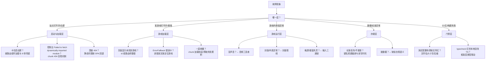

# 12 FAQ与故障排查 — H5 游戏厅（html5-games）
> 项目：html5-games ｜ 版本：v1.1 ｜ 生成日期：2026-10-06 ｜ 依据：源码分析

本篇是面向接手者与排障场景的速查篇：先给一张「按症状出发」的排查决策树，再把十余个高频问题逐条展开（症状 → 原因 → 定位 → 处置），最后汇总调试入口。与既有篇目的分工：《06-部署运行》第 6 节已有 5 行的排查索引表，本篇把它扩展为完整知识库并给出每条的源码依据；设计意图类的「为什么这样做」不在本篇重复，一律引用相应篇章。

## 1. 总决策树

## 2. 站点与加载层

**Q1 发版后玩家控制台报「Failed to fetch dynamically imported module」，页面自己刷新了一下然后就好了。** 这是设计内行为：产物文件名带内容 hash，新版发布后旧 HTML 请求的旧 hash chunk 必然 404；`src/router/index.ts` 的 `router.onError`（55-60 行）匹配该错误消息后 `window.location.assign(to.fullPath)` 整页刷新，拿新 HTML 重启加载。**若循环出现**（刷新后仍报），说明部署侧出了问题而非代码：检查 CDN 是否把旧 index.html 缓存住了（index.html 必须短缓存或 no-cache，assets/ 才允许长缓存，见《06-部署运行》3.2）、发布是否原子（先传全量产物再覆盖 index.html）。**Q2 直达链接 `/game/snake` 在生产环境 404。** `createWebHistory` 需要服务端 SPA 回退：Nginx `try_files $uri $uri/ /index.html`，各托管平台的标准 rewrite 配置见《06-部署运行》3.2；dev 模式没有此问题是 Vite 自带回退。**Q3 页面一直显示启动屏。** 启动屏由 `App.vue` 在 `router.isReady()` 后移除并带 8 秒超时兜底（12-14 行）；超时触发说明首个路由组件 8 秒内未就绪——查终端/Network 里 `GamesPage-*.js` 或 `GameDetailPage-*.js` 是否加载失败，dev 模式下多为编译错误（看 Vite 终端输出），生产下多为网络或缓存问题。**Q4 部署到子路径后资源全 404。** vite.config.ts 未设置 `base`（默认 `'/'`），子路径部署需加 `base: '/子路径/'` 并重新构建，`import.meta.glob` 的 chunk 引用与 worker URL 会随构建自动改写（见《06-部署运行》3.2 与《14-配置与环境详解》第 2 节），无需改游戏代码。

## 3. 游戏加载层

**Q5 打开 `/game/某id` 显示「未找到游戏」。** 三种可能，按序排查：id 拼写错误（对照 `src/config/games.ts`，校验只认精确匹配的 `localGamesMap.get(id)`）；该游戏确实被删除但外部链接还活着（正常表现，页面有返回按钮）；部署版本落后于配置（旧版本的 localGamesMap 里没有新 id——刷新拿新产物即可）。这个分支的实现是 `GameDetailPage.vue` 84-96 行。**Q6 显示 ErrorFallback「游戏加载失败」+ 一段错误文案。** 这是三层兜底的第二层（`onErrorCaptured`，61-64 行），错误文案即异常 message：写「游戏模块 xxx 缺失」说明 `gameModules` 里查不到该 id 的 loader——十有八九是**文件名与 id 不一致**（含大小写），先 `ls src/games/` 对照；其余 message 来自动态 import 的真实异常（语法错误、循环依赖等），dev 模式下重新加载能看到 Vite 的完整报错。点「重试」会递增 remountKey 强制重建异步组件（75-78 行），对瞬态网络失败有效。**Q7 CI 红：测试报「配置有但缺文件: xxx」。** 本项目最经典的门禁拦截（`games.test.ts` 第 49 行断言），根因排序：新建的 .vue 文件名与 config 的 id 大小写不一致（macOS 的默认文件系统大小写不敏感，本地 glob 能命中、CI 的 Linux 上不行——**务必核对字节级一致**）；文件放错目录；文件名少了或多了 `-game` 后缀；反向情况「孤儿文件」红则是文件存在但 config 没登记。修复永远以「id 与文件名逐字符一致」收口。

## 4. 游戏运行层

**Q8 没有声音。** 按三连查走：第一查**用户手势**——WebAudio 的 AudioContext 必须在用户手势内创建/恢复，直接刷新后程序化播放会被浏览器拦截，这是 `unlock()` 机制存在的原因（《00-项目总览》第 5 节），点一下任意按钮再试；第二查**两个独立开关**——音效静音（`game-audio-muted` 键）与背景音（`h5g:bgm-muted` 键）是彼此独立的持久化开关，任一为 '1' 都会让对应声部无声，GameShell 顶栏的音乐/音量两个按钮分别控制；第三查**游戏是否真的调用了有效音效名**——`render()` 只认 16 个 GameSfx 名（`useGameAudio.ts` 105-165 行），越界名静默无声，已确认的事故是 `src/games/gobang.vue` 250/253/257 行播放的 `'lose'`/`'draw'`（不在枚举内），人机模式输棋/和棋时无声，修复方向是把这两个名字加入 GameSfx 联合类型与 render switch（登记在《13-技术债务与演进建议》E-06）。**Q9 大厅卡片封面空白。** 封面管线有 worker 失效的同步兜底（`gameCoverRender.ts` 的 `workerBroken` 路径），空白说明兜底也没产出：依次查 `GameCover.vue` 的 `coverSrc` 是否始终空串（说明 `renderCoverAsync` 的回调没回来——罕见）；浏览器是否禁用了 OffscreenCanvas/Worker（老浏览器走同步兜底不该空白）；若「部分卡片有封面部分没有」，查该游戏 id 的 `localGameCategoryMap` 是否命中（分类缺失时辉光用兜底色但不会空白）。字体竞态防护在「字体不可达」环境永不重建缓存（68-83 行），该环境封面以系统字体渲染而非空白。**Q10 触屏操作没反应或页面跟着滚动。** 检查三处：canvas 是否有 `touch-action: none`（项目 70 款已设，漏设的那几款手感异常即源于此）；滑动处理是否用了 `@touchstart.passive` + `@touchend.prevent` 组合（只用 prevent 而不加 passive 会有控制台告警，只加 passive 不 prevent 会触发滚动）；虚拟按键是否只在 `@media (hover: none)` 显示（桌面模拟器里看不到是正常的，DevTools 需开设备模拟才触发 hover:none）。**Q11 切后台回来游戏「跳了一下」或穿模。** 反向排查：确认帧循环有 dt clamp（100ms 级，见《10-性能设计与优化》第 3 节）与 `pauseWhenHidden`（`useCanvasStage`/`useAnimationLoop` 的选项）；若游戏自管循环且两者都缺，按 snake.vue/plane-shooter-game.vue 的写法补上。

## 5. 数据与存储层

**Q12 玩家反馈「纪录没了」。** 排查顺序：问清场景——换浏览器/设备/清了浏览器数据都会「没了」，这是 localStorage 的物理边界（无跨设备同步是产品边界，《04-数据模型》第 3 节）；再查**键名偏差**——本项目存在 8 处历史短键，键名不总是 `h5g:<id>-best`：`h5g:snake-best`（贪吃蛇）、`h5g:fifteen-puzzle-best`（数字滑块）、`h5g:shot-ball-physics-best`（泡泡风暴）、`h5g:special-look-def-color-best`（看你有多色）、`h5g:special-man-down100-best`（是男人就下 100 层）、`h5g:whack-a-mole-best`（打地鼠，比 id 还短）、`h5g:video-puzzle-best`（视频拼图）、`h5g:pixi-invaders-best`（太空侵略者），另有记忆翻牌的动态键 `h5g:memory-match-best-<尺寸>`、五子棋 `h5g:gobang-score`、井字棋 `h5g:tic-tac-toe-score`、猜单词 `h5g:wordle-game-stats`、推箱子 `h5g:sokoban-game-moves`——排查时直接在 Application 面板搜 `h5g:` 前缀而不是按 id 猜；最后查**写入时机**——低分更优的游戏（步数/用时类）只在破纪录时写（video-puzzle.vue 288-291 行范式），「玩了一局没写入」可能只是没破纪录。**Q13 localStorage 里的值被改坏（如 'abc'）会崩吗。** 不会，这是被测试固化的自愈语义：`readHighScore` 用 `Number(...) || 0`（`highScore.test.ts` 的 abc 用例），JSON 键用逐字段缺省读，脏数据在下次覆盖前被当 0 处理。**Q14 搜索/分页行为「看起来不对」。** 三条预期行为常被误报为 bug：筛选条件（分类/排序/搜索词）变化会把页码重置回 1（`GamesPage.vue` 186-190 行）；`?page=999` 被 clamp 到末页不报错（204-211 行）；输入搜索词或切到非「全部」分类后首页精选横带自动收起（172-175 行）。都不是缺陷。**Q15 从游戏页返回大厅，滚动位置没恢复。** `rememberLobbyScroll` 只在「大厅 → 运行页」路径记录（`GamesPage.vue` 22-24 行的 `onBeforeRouteLeave`），浏览器前进/后退走 `savedPosition`，只有「运行页 router.push('/games')」才消费 `lobbyScrollY`（`router/index.ts` 40-45 行）；直接刷新大厅当然从 0 开始。**Q16 改了某游戏但列表/详情没变化。** 大厅数据来自 `src/config/games.ts` 编译期常量，确认保存触发了 HMR；若改的是游戏数（79），同步三处文案前测试会红（`games.test.ts` 用例 1），运行时表现是文案与新游戏数不一致。

## 6. 调试入口汇总

| 入口 | 位置 | 用途 |
|------|------|------|
| dev server | `pnpm dev` → http://localhost:5556（vite.config.ts 固定 host/port） | 首选调试环境，编译错误直出终端 |
| vitest | `pnpm test` / `pnpm test:watch` | 门禁层问题的本地复现（五连之一） |
| 产物 chunk 名 | `dist/assets/<游戏id>-<hash>.js` | Network 面板按游戏 id 过滤加载请求；worker chunk 为 `coverEncode.worker-*.js` |
| 错误文案三源 | `GameDetailPage.vue` 的 loadError（模块缺失/加载异常）、`onErrorCaptured`（渲染异常）、`router.onError`（chunk 404） | 页面上看到的错误文案都能反查到这三个捕获点 |
| localStorage 面板 | 浏览器 Application → Local Storage，搜 `h5g:` 与 `game-audio` | 存储层排查的唯一真相源；键清单见《15-接口全量参考》第 3 节 |
| 测试文件 | `src/config/__tests__/games.test.ts` 等 5 个 | 怀疑配置/契约漂移时先跑测试而不是先读代码 |
| 文案联动三处 | `games.test.ts`（79 断言）、README.md、index.html meta + package.json description | 游戏数变更必查 |
| dev 专属行为 | Vite HMR、SPA 回退、无缓存问题 | 生产独有的问题（chunk 404、SPA 404）在 dev 复现不出来，需 `pnpm build && pnpm preview` |

最后给一条排障方法论：本项目没有运行时日志框架（刻意最小化），故障定位几乎完全依赖「症状 → 分层 → 源码」的推演，因此《01-系统架构》的分层图与本篇的决策树值得放在手边。遇到决策树未覆盖的新症状，优先检查它是否属于「设计内行为」（本篇 Q14-Q16 那类），确认不是后再进入源码推演，并把结论补进本篇——FAQ 的价值在持续积累。
