# 15 接口全量参考 — H5 游戏厅（html5-games）
> 项目：html5-games ｜ 版本：v1.1 ｜ 生成日期：2026-10-06 ｜ 依据：源码分析

本篇是全套文档的字典卷：把散落在 03/04/07 篇的接口事实收拢为三张大表（LocalGame 元数据全表、GameShell 契约全表、79 款游戏索引表）与若干附表，供开发时直接查阅。语义推导与设计论证不在此展开——LocalGame 字段的数据模型语义见《04-数据模型》，GameShell 契约的机制走读见《07-模块详解》第 2 节，游戏组件的隐式契约见《03-接口设计》第 2 节，composables 与存储接口的完整签名见《03-接口设计》第 4-5 节，本篇只收录「查表即可用」的事实并标注与既有篇目的口径差异（如 -best 键数量按源码复核为 73，04 篇 2.1 已同步此口径）。

## 0. 接口面总览

```mermaid
graph TB
    subgraph 配置接口["配置接口（src/config/games.ts）"]
        LG["localGames: LocalGame[79]"]
        LGMAP["localGamesMap: Map"]
        CAT["localGameCategories[4]"]
        CATMAP["localGameCategoryMap"]
        FN["localGameFileName(id)<br/>（无运行时消费方）"]
    end
    subgraph 加载接口["加载接口（src/games/registry.ts）"]
        MODS["gameModules: Record<key, loader>"]
        PF["prefetchGame(id)"]
    end
    subgraph 组件契约["组件契约（GameShell.vue）"]
        P["props ×8"]
        S["slots ×5"]
        E["emits ×2"]
        AUTO["内置行为：手势解锁音频<br/>BGM 启停/联动"]
    end
    subgraph 工具接口["工具接口"]
        HS["highScore.ts：read/writeHighScore"]
        AU["useGameAudio：play/unlock/muted"]
        BG["useGameBgm：start/stop/toggle"]
        CS["useCanvasStage/useAnimationLoop"]
    end
    subgraph 存储接口["存储接口（localStorage）"]
        K1["h5g:* 游戏键 ×77"]
        K2["game-audio-muted / h5g:bgm-muted"]
    end
    GAME["游戏组件 <id>.vue"] --> LG
    GAME --> MODS
    GAME --> P & S & E
    GAME --> HS & AU & CS
    GamesPage["GamesPage.vue"] --> LG & CAT
    Detail["GameDetailPage.vue"] --> LGMAP & MODS
    Card["GameCard.vue"] --> CATMAP & PF
    Shell["GameShell.vue"] --> AU & BG & K2
    GamesPage --> K1
    Detail --> K1
```

总览图给出四组接口的消费关系：配置接口被页面与卡片消费、加载接口被详情页与卡片消费、组件契约被全部 79 款游戏消费、工具与存储接口是可选但高度共用的横切面。三张主表分别对应前三组，第 4 节附表收拢第四组。

## 1. LocalGame 元数据字段全表

来源：`src/config/games.ts`（接口定义 16-31 行，实例 78-1094 行）。「消费点」列列出运行时真实读取该字段的代码位置；「死字段」判定依据《13-技术债务与演进建议》E-02/E-03 的 grep 复核。

| 字段 | 类型与约束 | 语义 | 消费点 | 死字段 |
|------|-----------|------|--------|--------|
| `id` | string，`/^[a-z0-9-]+$/`，全表唯一 | 全局标识：同时决定组件文件名 `src/games/<id>.vue`、路由参数 `/game/:id`、推荐存档键名 | games.test.ts（格式/唯一/文件对应）、GameDetailPage.vue 30-41 行（查 localGamesMap 与 gameModules）、GameCard.vue 40-42 行（路由 href）、registry prefetchGame | 否 |
| `category` | `'puzzle'\|'board'\|'action'\|'casual'` | 四分类；决定筛选、分类色、封面辉光 | GamesPage.vue 84-86 行（过滤）、GameCard.vue 33-36 行（--cat-color）、gameCoverRender.ts 247-249 行（辉光与 pill）、CategoryChips 计数 | 否 |
| `engine` | string，79 条全部固定 `'game'` | 历史遗留：原供详情页 VisualDemo 类型消费 | 无（本仓库内零读取） | **是**（E-02，建议清理） |
| `library` | string，79 条全部固定 `'showcase'` | 同上 | 无 | **是**（E-02） |
| `title` | string，非空 | 展示名；**兼作 BGM 作曲种子**（useGameBgm 的 seedKey）与封面标题文字 | GameShell 顶栏、GameCover.drawCover 309-320 行、GameDetailPage 67-69 行（document.title）、bgm.start(props.title) | 否 |
| `description` | string，非空 | 一句话玩法描述，参与大厅搜索 | GamesPage.vue 88-96 行（关键词匹配） | 否 |
| `tags` | string[]，≥1 项 | 标签，参与大厅搜索 | 同上（`g.tags.some(...)`） | 否 |
| `group` | string，取值 5 种：核心精选(7)/GitHub 示例集成(61)/PixiJS 精选(3)/专题灵感(4)/Canvas Test 整理(4) | 来源分组；「核心精选」特判驱动首页横带与卡片角标 | GamesPage.vue 172-175 行（featuredGames）、HallHero（横带取前 4）、GameCard.vue 37 行（isFeatured 角标）、games.test.ts（≥4 断言） | 否 |
| `difficulty` | string，79 条全部 `''` | 预留难度标注 | 无（UI 与测试均不消费） | **是**（E-03，建议删除或激活） |
| `sortOrder` | number，全表唯一（0-79 区间，缺 1） | 默认排序键，「默认」排序按其升序 | GamesPage.vue 104 行（`list.sort((a,b)=>a.sortOrder-b.sortOrder)`） | 否 |

配套导出：`localGames`（数组本体，筛选管道数据源）、`localGameCategories`（四分类元数据：puzzle `#8b5cf6` / board `#f59e0b` / action `#f43f5e` / casual `#14b8a6`，图标 `ms:extension / ms:grid_on / ms:sports_esports / ms:toys`，顺序即侧栏顺序）、`localGamesMap` 与 `localGameCategoryMap`（模块加载时构建的两个 O(1) 索引）、`localGameFileName`（死导出，见 E-02）。完整性约束的 8 组测试断言见《09-测试与质量保障》2.1。

## 2. GameShell 插槽与事件契约全表

来源：`src/components/games/GameShell.vue`（props 20-44 行、emits 46-49 行、插槽布局 100-201 行）。全部 79 款游戏的第一行模板均为 `<GameShell>`（逐文件扫描确认）。

### 2.1 Props（8 个）

| prop | 类型 / 默认值 | 作用与备注 |
|------|--------------|-----------|
| `title` | string，必填 | 顶栏标题；**同时作为 BGM 作曲种子**，改标题会换曲 |
| `ratio` | number / `1` | 舞台宽高比（宽/高），经 `--gratio` + 容器查询最大化；竖版 0.56、横版 1.571 等 |
| `instructions` | string / `''` | 底部一句话操作提示；空串不渲染页脚 |
| `showRestart` | boolean / `true` | 重开按钮显隐（惯例按状态传：`:show-restart="status !== 'idle'"`） |
| `showPause` | boolean / `false` | 暂停按钮显隐 |
| `paused` | boolean / `false` | 受控暂停态：按钮图标与 BGM 压低（0.28）都跟随它 |
| `accent` | string / `''`（回退主色） | 强调色，注入 `--gaccent`；驱动氛围背景、控制按钮 hover、gs-btn |
| `showInfo` | boolean / `true` | 是否渲染右侧 info 栏（无说明内容时可关） |

### 2.2 插槽（5 个）与 2.3 事件（2 个）

| 插槽 | 位置 | 惯例内容与类名 |
|------|------|---------------|
| 默认 | `.gshell__stage`（按 ratio 最大化） | `<canvas class="game-canvas" tabindex="0">` 或 DOM 棋盘；`.gshell__overlay` 在 stage 之外，浮层不会被舞台裁切 |
| `#hud` | 顶栏中部 | 若干 `gs-chip`（分数/最高/生命）；窄屏独占一行横滑 |
| `#actions` | 顶栏控制区前部 | 自定义图标按钮，用 `gs-action` 类（如 gobang 的悔棋按钮） |
| `#info` | 右侧信息栏（<1024px 折叠手风琴） | `gs-info` 结构（h3/p/ul/kbd/gs-best） |
| `#overlay` | 舞台浮层 | `gs-overlay` > `gs-card` > `gs-emoji/gs-title/gs-sub/gs-score/gs-btn`，按状态机 ref 切换开始/暂停/结算卡 |

| 事件 | 载荷 | 语义 |
|------|------|------|
| `restart` | 无 | 顶栏重开按钮点击；游戏侧通常绑 `startGame`/`newGame` |
| `togglePause` | 无 | 暂停/继续按钮点击；游戏侧翻转自身状态机并回传 `:paused` |

GameShell 内置行为（游戏无需实现，也不应重复实现）：首个 pointerdown/keydown 手势 → `unlock()` 音频 + `bgm.start(title)`；`muted/paused` 变化 → `bgm.applyConditions`；BGM 与音效两个独立开关按钮；触屏设备控制按钮自动放大到 44px。插槽工具类（gs-chip/gs-info/gs-overlay/gs-card/gs-btn/gs-action/gs-emoji/gs-title/gs-sub/gs-score/gs-btns/gs-best/kbd 样式）定义于 542-729 行的非 scoped 样式块，靠 `.gshell` 前缀限定作用域。

## 3. 79 款游戏索引表

口径说明：分类与名称来自 `src/config/games.ts`（表内按 sortOrder 升序）；存档键按源码 grep 全量复核——`-best` 简写代表 `h5g:<id>-best`（共 73 款静态键，另有记忆翻牌 1 款动态键，04 篇 2.1 已同步此口径）；短键/特殊键以完整键名标注；「实现文件」即 `src/games/<id>.vue`，渲染范式标注 C=Canvas 2D / D=DOM / P=PixiJS。5 款 TS 游戏加 † 标记。

### 3.1 益智 puzzle（20 款）

| sortOrder | id | 名称 | 存档键 | 实现文件 |
|-----------|----|------|--------|----------|
| 0 | connect-pipe-game | 接水管 | `-best` | connect-pipe-game.vue（D） |
| 9 | special-2048-game | 2048 | `-best` | special-2048-game.vue（D） |
| 10 | special-look-def-color | 看你有多色 | `h5g:special-look-def-color-best`（短键） | special-look-def-color.vue（D） |
| 13 | tetris-game | 俄罗斯方块 | `-best` | tetris-game.vue（C，07 篇走读） |
| 14 | video-puzzle | 视频拼图 | `h5g:video-puzzle-best`（短键，低分更优） | video-puzzle.vue（C） |
| 19 | minesweeper-game | 扫雷 | `-best` | minesweeper-game.vue（C） |
| 22 | memory-match-game | 记忆翻牌 | `h5g:memory-match-best-<4x4\|4x6>`（动态键） | memory-match-game.vue（D） |
| 23 | catch-cat-game | 围住神经猫 | `-best` | catch-cat-game.vue（C） |
| 36 | tower-defense-game | 塔防 | `-best` | tower-defense-game.vue（C） |
| 40 | maze-survival-game | 迷宫生存 | `-best` | maze-survival-game.vue（C） |
| 42 | gravity-orbit-game | 引力弹弓 | `-best` | gravity-orbit-game.vue（C） |
| 43 | sokoban-game | 推箱子 † | `-best` + `h5g:sokoban-game-moves`（JSON 映射） | sokoban-game.vue（C） |
| 46 | lianliankan-game | 连连看 † | `-best` | lianliankan-game.vue（C） |
| 47 | huarongdao-game | 华容道 † | `-best`（低分更优） | huarongdao-game.vue（C） |
| 62 | cloud-defense-game | 云架构塔防 | `-best` | cloud-defense-game.vue（C） |
| 63 | nonogram-game | 数织 | `-best` | nonogram-game.vue（C） |
| 64 | lights-out-game | 点灯 | `-best` | lights-out-game.vue（C） |
| 65 | fifteen-puzzle | 数字滑块 | `h5g:fifteen-puzzle-best`（短键，低分更优） | fifteen-puzzle.vue（C） |
| 66 | wordle-game | 猜单词 | `h5g:wordle-game-stats`（JSON 五件套） | wordle-game.vue（C） |
| 67 | bulls-cows-game | 猜数字 | `-best`（低分更优） | bulls-cows-game.vue（C） |

### 3.2 棋牌 board（7 款）

| sortOrder | id | 名称 | 存档键 | 实现文件 |
|-----------|----|------|--------|----------|
| 2 | gobang | 五子棋 | `h5g:gobang-score`（JSON {w,l,d}，仅人机模式） | gobang.vue（C，07 篇走读） |
| 20 | reversi-game | 黑白棋 | `-best` | reversi-game.vue（C） |
| 33 | hex-strategy-game | 六边形策略 | `-best` | hex-strategy-game.vue（C） |
| 34 | tactics-game | 回合制战棋 | `-best` | tactics-game.vue（C） |
| 35 | mini-rpg-game | 小队 RPG | `-best` | mini-rpg-game.vue（C） |
| 44 | sudoku-game | 数独 † | `-best`（低分更优） | sudoku-game.vue（C） |
| 68 | tic-tac-toe | 井字棋 | `h5g:tic-tac-toe-score`（JSON {X,O,draw}） | tic-tac-toe.vue（C） |

### 3.3 动作 action（25 款）

| sortOrder | id | 名称 | 存档键 | 实现文件 |
|-----------|----|------|--------|----------|
| 3 | plane-shooter-game | 飞机大战 | `-best` | plane-shooter-game.vue（C，07 篇走读） |
| 5 | running-man-game | 无尽跑酷 | `-best` | running-man-game.vue（C） |
| 11 | special-man-down100 | 是男人就下 100 层 | `h5g:special-man-down100-best`（短键） | special-man-down100.vue（C） |
| 12 | special-tank-battle | 坦克大战 | `-best` | special-tank-battle.vue（C） |
| 17 | pixi-pong | 弹球对战 | 无存档 | pixi-pong.vue（P） |
| 18 | pixi-invaders | 太空侵略者 | `h5g:pixi-invaders-best`（短键，内联读写） | pixi-invaders.vue（P） |
| 25 | duck-hunt-game | 打鸭子 | `-best` | duck-hunt-game.vue（C） |
| 27 | bounce-ball-game | 弹跳球 | `-best` | bounce-ball-game.vue（C） |
| 28 | super-mario-game | 超级马里奥 | `-best` | super-mario-game.vue（C） |
| 29 | zelda-adventure-game | 塞尔达冒险 | `-best` | zelda-adventure-game.vue（C） |
| 30 | commando-game | 战场之狼 | `-best` | commando-game.vue（C） |
| 31 | shootemup-game | 弹幕射击 | `-best` | shootemup-game.vue（C） |
| 32 | space-shooter-game | 太空射击 | `-best` | space-shooter-game.vue（C） |
| 38 | roguelike-dungeon-game | 地牢探险 | `-best` | roguelike-dungeon-game.vue（C） |
| 39 | metroidvania-game | 银河恶魔城 | `-best` | metroidvania-game.vue（C） |
| 41 | fps-raycast-game | 射线 FPS | `-best` | fps-raycast-game.vue（C） |
| 48 | pacman-game | 吃豆人 | `-best` | pacman-game.vue（C） |
| 49 | bomberman-game | 炸弹人 | `-best` | bomberman-game.vue（C） |
| 50 | fruit-ninja-game | 水果忍者 | `-best` | fruit-ninja-game.vue（C） |
| 51 | slingshot-game | 弹弓小鸟 | `-best` | slingshot-game.vue（C） |
| 52 | bullet-dodge-game | 撑过20秒 | `-best` | bullet-dodge-game.vue（C） |
| 61 | air-hockey-game | 空气曲棍球 | `-best` | air-hockey-game.vue（C） |
| 77 | ninja-jump-game | 忍者跳跃 | `-best` | ninja-jump-game.vue（C） |
| 78 | asteroid-dodge-game | 躲避陨石 | `-best` | asteroid-dodge-game.vue（C） |
| 79 | doodle-jump-game | 涂鸦跳跃 | `-best` | doodle-jump-game.vue（C） |

### 3.4 休闲 casual（27 款）

| sortOrder | id | 名称 | 存档键 | 实现文件 |
|-----------|----|------|--------|----------|
| 4 | racer-game | 极速飞车 | `-best` | racer-game.vue（C） |
| 6 | shot-ball-physics | 泡泡风暴 | `h5g:shot-ball-physics-best`（短键） | shot-ball-physics.vue（C） |
| 7 | snake | 贪吃蛇 | `h5g:snake-best`（短键） | snake.vue（C，02/05 篇走读） |
| 8 | snooker-game | 花式桌球 | `-best` | snooker-game.vue（C） |
| 15 | breakout-game | 打砖块 | `-best` | breakout-game.vue（C） |
| 16 | pixi-fireworks | 粒子烟花 | 无存档 | pixi-fireworks.vue（P） |
| 21 | whack-a-mole-game | 打地鼠 | `h5g:whack-a-mole-best`（短键，键比 id 短） | whack-a-mole-game.vue（C） |
| 24 | crossy-road-game | 过马路 | `-best` | crossy-road-game.vue（C） |
| 26 | rhythm-game | 节奏音游 | `-best` | rhythm-game.vue（C） |
| 37 | idle-defense-game | 放置塔防 | `-best` | idle-defense-game.vue（C） |
| 45 | match3-game | 消消乐 † | `-best` | match3-game.vue（C） |
| 53 | dino-runner-game | 恐龙跑酷 | `-best` | dino-runner-game.vue（C） |
| 54 | bubble-shooter-game | 泡泡龙 | `-best` | bubble-shooter-game.vue（C） |
| 55 | pinball-game | 弹珠台 | `-best` | pinball-game.vue（C） |
| 56 | jump-jump-game | 跳一跳 | `-best` | jump-jump-game.vue（C） |
| 57 | suika-game | 合成大西瓜 | `-best` | suika-game.vue（C，07 篇走读） |
| 58 | piano-tiles-game | 别踩白块 | `-best` | piano-tiles-game.vue（C） |
| 59 | zuma-game | 祖玛 | `-best` | zuma-game.vue（C） |
| 60 | gold-miner-game | 黄金矿工 | `-best` | gold-miner-game.vue（C） |
| 69 | simon-game | 西蒙记忆 | `-best` | simon-game.vue（C） |
| 70 | typing-game | 打字游戏 | `-best` | typing-game.vue（C） |
| 71 | fishing-game | 钓鱼 | `-best` | fishing-game.vue（C） |
| 72 | burger-game | 汉堡叠叠乐 | `-best` | burger-game.vue（C） |
| 73 | garbage-sort-game | 垃圾分类 | `-best` | garbage-sort-game.vue（C） |
| 74 | coin-catch-game | 接金币 | `-best` | coin-catch-game.vue（C） |
| 75 | stack-game | 叠叠乐 | `-best` | stack-game.vue（C） |
| 76 | hopscotch-game | 跳房子 | `-best` | hopscotch-game.vue（C） |

索引表的三条读法：**查键**——「存档键」列的 `-best` 简写按 `h5g:<id>-best` 展开，全表完整键名与短键豁免清单同时服务于排查（见《12-FAQ与故障排查》Q12）与 E-04 的映射工具设计；**查范式**——实现文件列的 C/D/P 标记来自 00 篇 2.3 的逐文件扫描（C 72 / D 4 / P 3），四款 DOM 游戏（connect-pipe、memory-match、special-2048、special-look-def-color）与三款 Pixi 游戏（pixi-fireworks、pixi-pong、pixi-invaders）是范式代表；**查规模**——两列合计可作为「删除/下线某游戏」时的核对清单（文件、条目、键、文案四处联动，见《11-扩展开发指南》场景一的逆操作）。

## 4. 附表：横切接口与存储键

**GameSfx 音效名清单**（`useGameAudio.ts` 11-27 行，游戏侧 `play()` 只允许这 16 个）：click、start、select、score、eat、coin、hit、block、shoot、explode、pop、move、jump、gameover、win、error——越界名静默无声（gobang 事故见 E-06）。

**localStorage 完整键清单**（复核口径：77 个游戏键 + 2 个偏好键；73 款 `-best` + gobang-score + tic-tac-toe-score + wordle-game-stats + sokoban-game-moves + memory-match 动态键；pixi-fireworks 与 pixi-pong 无存档）：

| 键 | 值格式 | 写入方 |
|----|--------|--------|
| `h5g:<id>-best` ×73 | 十进制数字字符串（方向语义由游戏自定） | 各游戏（60 款经 highScore.ts，13 款内联） |
| `h5g:gobang-score` | JSON `{w,l,d}` | gobang.vue |
| `h5g:tic-tac-toe-score` | JSON `{X,O,draw}` | tic-tac-toe.vue |
| `h5g:wordle-game-stats` | JSON `{played,won,streak,maxStreak,guesses[6]}` | wordle-game.vue |
| `h5g:sokoban-game-moves` | JSON `Record<关卡,最少步数>` | sokoban-game.vue |
| `h5g:memory-match-best-<size>` | 数字字符串 | memory-match-game.vue |
| `game-audio-muted` | `'1'\|'0'` | useGameAudio.setMuted |
| `h5g:bgm-muted` | `'1'\|'0'`（'1'=关闭） | useGameBgm.setEnabled |

**工具接口速查**（完整签名见《03-接口设计》第 4 节）：`registry.ts` 的 `gameModules`/`prefetchGame`；`useGameAudio` 的 `{muted, play, unlock, setMuted, toggleMute}` + 导出 `ensureAudioContext`；`useGameBgm` 的 `{enabled, start, stop, toggle, applyConditions}` + 纯函数 `hashKey/mulberry32/createBgmPlan`；`useCanvasStage` 的 `{canvasRef, ctxRef, size, startLoop, stopLoop, registerTargetEvent, resize, destroy}`（useCanvas 为旧别名封装）；`useAnimationLoop` 的 `{startLoop, stopLoop, registerTargetEvent}`；`highScore.ts` 的 `readHighScore/writeHighScore`；`keyboard.ts` 的 `isTypingTarget`；`router/index.ts` 的 `rememberLobbyScroll`。

本篇与全套文档的关系：00-06 篇回答「系统为什么这样设计」，07-14 篇回答「每个模块/场景怎么理解与操作」，本篇回答「接口与数据的确切样子」。当其他篇章与本篇的表格发生口径冲突时（如 -best 数量），以本篇的复核口径为准并回改对应篇章；当源码与本篇冲突时，以源码为准——这张表的每一次维护都应伴随 `pnpm test` 全绿，因为索引表的三列（id、文件、分类）恰好就是 `games.test.ts` 守护的那三个不变量。
