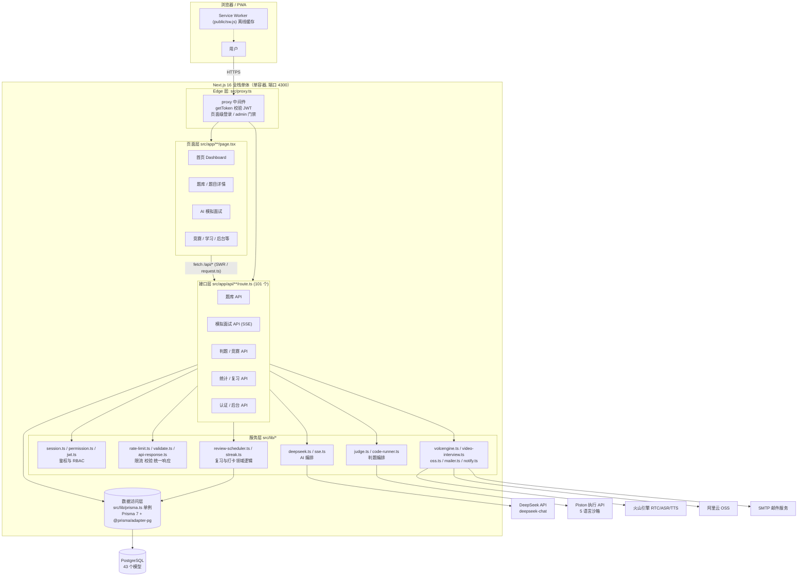
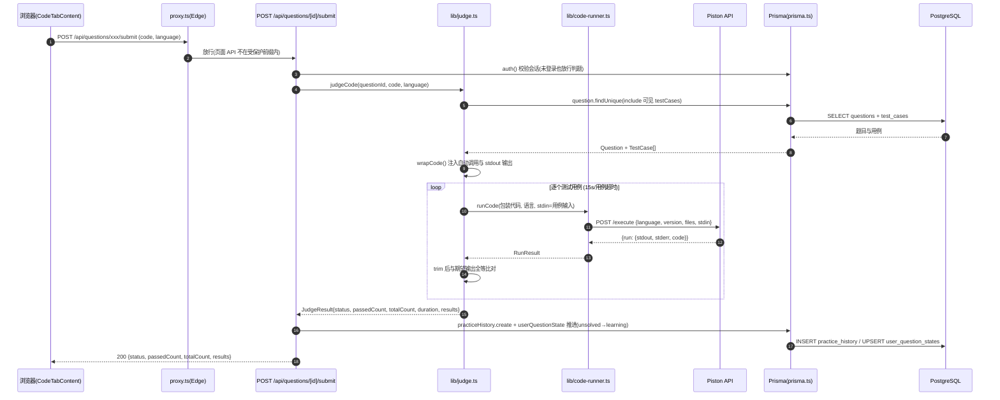

# 01 系统架构

> 项目：interview-platform ｜ 版本：v1.0 ｜ 生成日期：2026-10-05 ｜ 依据：源码分析

## 1. 架构总览

interview-platform 采用 **Next.js 16 App Router 全栈单体**架构：同一个 Node 进程既承载 React 页面（SSR/CSR），又承载 REST API（Route Handlers），还内置 AI 服务编排、判题引擎与数据访问层。部署形态为单容器（`Dockerfile` 暴露 4300 端口），数据库为外部 PostgreSQL，外部依赖还包括 DeepSeek API、Piston 代码执行 API、火山引擎语音/RTC、阿里云 OSS 与 SMTP 服务。

整体架构如下（mermaid）：

这一架构的核心特征是「**前后端同进程、按目录分层**」：`src/app/api/**` 是后端边界，`src/app/**/page.tsx` 是前端边界，两者共享 `src/lib` 服务层与 `src/types` 类型。没有独立的后端服务，也没有微服务拆分；跨层通信全部是进程内函数调用与 HTTP 回环（浏览器 → Route Handler）。

## 2. 分层职责详解与依赖方向

分层依赖方向严格自上而下：**页面层 → 接口层 → 服务层 → 数据访问层 → 数据库**。服务层之间允许横向复用（如 `judge.ts` 复用 `code-runner.ts` 与 `prisma.ts`），但页面层不允许直接 import `prisma.ts` 访问数据库（唯一的例外是极少数服务端组件直接读静态文件，如 career 页读取 `public/knowledge/*.md`，不走数据库）。

### 2.1 Edge 层：`src/proxy.ts`

Next.js 16 将 `middleware.ts` 更名为 `proxy.ts`，运行于 Edge Runtime，因此文件头部注释明确「不能导入 prisma 或 @/lib/auth」，仅用 `next-auth/jwt` 的 Edge 兼容导出 `getToken()` 校验 JWT。职责有三：

1. 静态资源直接放行（`_next/static`、图片、字体等后缀白名单）。
2. 页面门禁：`/profile`、`/settings`、`/bookmarks`、`/dashboard` 前缀要求登录，未登录重定向 `/login?callbackUrl=...`。
3. 管理门禁：`/admin` 前缀要求 `token.role === "admin"`，否则重定向首页。

注意它只做**页面级粗粒度拦截**；数据级权限（归属校验、权限点校验）仍由各 API 路由内部完成，形成「Edge 粗筛 + Node 细查」的双层防御。

### 2.2 页面层：`src/app/**`

页面层绝大多数为客户端组件（`"use client"`），采用「CSR + SWR」的数据获取模式：页面挂载后通过 `useSWR("/api/...", fetcher)` 拉取数据并自行管理 loading/error 状态（见 `src/app/page.tsx` 对六个看板接口的并行 SWR 订阅）。真正的服务端组件很少：`src/app/career/page.tsx`（静态目录重定向）、`src/app/sitemap.ts`、`src/app/robots.ts`。根布局 `src/app/layout.tsx` 承担全局职责：暗色模式防闪烁内联脚本（读 `localStorage["interview-platform-theme"]`）、SEO metadata、`Providers`（SessionProvider）、`TopNav`、`GlobalSearch`、`OfflineIndicator`、`SWRegister`（PWA 注册）与 `ViewTransitionWrapper`（实验性 viewTransition）。

页面级布局分组有两处：`src/app/(auth)/layout.tsx` 为登录/注册提供极简布局；`src/app/admin/layout.tsx` 为后台提供侧栏导航并做二次 admin 校验（与 proxy 双保险）。

### 2.3 接口层：`src/app/api/**/route.ts`

共 101 个 `route.ts`，默认导出 `GET/POST/PATCH/PUT/DELETE/HEAD` 函数。这一层是「薄控制器」：负责参数提取、调用 `requireAuth()`/`requirePermission()` 鉴权、`rateLimit()` 限流、`parseBody()` 校验，然后把业务委托给服务层或直接用 Prisma 查询。三个典型范式：

- **JSON 范式**：`src/app/api/questions/route.ts` 用 `handleApiError` 兜底、`NextResponse.json` 返回。
- **SSE 流式范式**：`src/app/api/mock-interview/route.ts` 构造 `ReadableStream`，以 `data: {json}\n\n` 帧协议推送 `interview/chunk/done/error` 事件，响应头固定 `Content-Type: text/event-stream` + `Cache-Control: no-cache, no-transform`。
- **代理范式**：`src/app/api/voice/asr/route.ts` 接收前端 base64 音频，服务端直连豆包 ASR WebSocket（`ws` 库 + 二进制协议），密钥不出服务端。

带动态段的路径（如 `app/api/questions/[id]/state/route.ts`）遵循 Next.js 16 约定：`params` 是 Promise，必须 `const { id } = await params` 解构。

### 2.4 服务层：`src/lib/*`

服务层按领域拆分为四组：

1. **鉴权与安全**：`auth.ts`（authOptions：CredentialsProvider + JWT callbacks）、`session.ts`（`requireAuth` 返回 401 响应或 null 的「守卫函数」模式）、`permission.ts`（`requirePermission(权限点)`，角色→权限 30 秒内存缓存）、`jwt.ts`（jose 签发/校验后台 Bearer JWT，7 天）、`admin-auth.ts`（等价于 `requirePermission("admin:access")`）。
2. **横切基础设施**：`rate-limit.ts`（Map + 时间戳数组的滑动窗口，5 分钟定期清理防泄漏）、`validate.ts` + `schemas.ts`（zod `parseBody` 判别联合返回）、`api-response.ts`（`ok`/`fail`/`handleApiError`）、`notify.ts`（失败不抛出的旁路通知）。
3. **领域逻辑**：`judge.ts` + `code-runner.ts`（判题编排）、`review-scheduler.ts`（艾宾浩斯 1/2/4/7/15/30 天间隔推导）、`streak.ts`（上海时区 UTC+8 的打卡日期推导）、`behavioral-questions.ts`（行为面试题库）、`category-cache.ts`/`category-utils.ts`（分类树内存缓存）。
4. **外部集成**：`deepseek.ts`（`callDeepSeek`/`callDeepSeekStream`/`sseFormat`）、`volcengine.ts`（四套凭证体系 + V4 HMAC 签名）、`video-interview.ts`（RTC Token 生成与 StartVoiceChat/StopVoiceChat OpenAPI 调用）、`volcengine-voice.ts`（ASR/TTS 请求构造）、`oss.ts`（STS assumeRole）、`mailer.ts`（SMTP 降级）、`verify-code.ts`（验证码生命周期）。

### 2.5 数据访问层：`src/lib/prisma.ts`

Prisma 7 新架构的落地范例：`new Pool({ connectionString })` 创建 `pg` 连接池，注入 `PrismaPg` 适配器构造 `PrismaClient`；非生产环境将实例缓存到 `globalThis` 防止热重载反复建池。客户端代码生成于 `src/generated/prisma/`（`.gitignore` 外的生成物，禁止手改）。所有数据访问均直接使用该单例的类型安全 API，没有再封装 Repository 层——查询条件内联在各 Route Handler 中，但「每用户数据必须显式 `where: { userId }`」作为强约定贯穿全部代码（见 `AGENTS.md` 第 6 节）。

## 3. 一次请求的端到端数据流

以「用户在题目详情页提交代码判题」为例（mermaid 时序图）：

该时序体现了三层关注点分离：接口层只做会话解析与响应包装；`judge.ts` 封装「取用例 → 包装代码 → 逐用例执行比对 → 汇总状态」的领域逻辑；`code-runner.ts` 只关心「一次代码执行」的外部调用。写库副作用（练习记录 + 掌握状态推进）集中在接口层完成，状态映射规则是 `accepted → completed`、其余 → `failed`，且只在通过判题时把 `unsolved` 推进为 `learning`（不回退已标记 `mastered` 的状态，见 `src/app/api/questions/[id]/submit/route.ts`）。

## 4. 关键设计决策与设计模式

**决策一：全栈单体而非前后端分离。** 团队规模小、页面与接口同步演进频繁，单体省去跨服务联调与独立部署成本；代价是 API 与页面耦合在同一构建产物，水平扩展时 AI/判题等长耗时请求与页面流量共享进程资源（当前用限流缓解）。

**决策二：JWT 会话 + 按需回查数据库。** `src/lib/auth.ts` 的 `session` 回调每次拉取会话都 `findUnique` 刷新 `image/name/role/banned`：JWT 无法主动吊销，封禁用户通过「session 回调返回 null → 全部 API 401」实现即时失效；头像等资料变更也无需等待 JWT 过期。这是「无状态令牌 + 有状态校正」的折中设计。

**决策三：RBAC 权限点模型，向后兼容。** `Role`/`Permission`/`RolePermission` 三表通过 `User.role` 字符串弱关联（无硬外键，`schema.prisma` 注释明确说明），`requirePermission` 支持两种鉴权来源（`Authorization: Bearer` JWT 供外部后台调用、NextAuth session 供主站），并用 30 秒 TTL 内存缓存减少查库。旧 `requireAdmin` 已收敛为 `admin:access` 权限点的别名。

**决策四：每用户状态独立成表。** `UserQuestionState`（userId+questionId 唯一）与 `UserStreak`（userId+date 唯一）取代了早期题目表上的全局字段（迁移 `20260924150000_add_per_user_state`、`20260924160000_drop_global_question_state`），使多用户数据天然隔离；列表接口（`/api/questions`）查询后用 `Map` 批量合并个人状态，避免 N+1。

**决策五：AI 成本三层护栏。** 第一层请求级限流（`rate-limit.ts`：模拟面试 10 次/分、AI 对话 20 次/分、提示 10 次/分）；第二层业务护栏（模拟面试每日 20 场，按上海时区自然日统计）；第三层结果缓存（`QuestionHint` 按 `@@unique([questionId, level])` 缓存 AI 提示，首个用户触发生成后所有人复用，并发冲突时回读兜底）。

**决策六：密钥全部服务端持有。** DeepSeek、火山、OSS、SMTP 凭证只出现在服务端；前端与 AI/语音的交互一律经自家 Route Handler 代理（`/api/ai`、`/api/voice/asr`、`/api/video-interview/token`）。OSS 采用 STS 临时凭证（1 小时）进一步收窄暴露面。

**模式清单**：单例（`prisma.ts`、`rate-limit.ts` 的模块级 store）、守卫函数（`requireAuth`/`requirePermission` 返回 null 或错误响应）、模板方法（`judge.ts` 的 `wrapCode` 按语言分派包装器）、管道过滤器（SSE 流的逐帧解析 `parseSSEStream`）、适配器（`PrismaPg` 驱动适配器、`code-runner.ts` 的语言映射表）、策略（`review-scheduler.ts` 按阶段索引取间隔）、缓存旁路（`QuestionHint`、`permission.ts` 角色缓存、`category-cache.ts`）。

**安全设计**：`next.config.ts` 注入 `X-Content-Type-Options`、`X-Frame-Options`、`Referrer-Policy`、`Permissions-Policy`（仅本站可用摄像头/麦克风）与 Report-Only 模式的 CSP（放行 DeepSeek/阿里云/火山/Umami 域名，观察期后切强制）；Markdown 渲染经 `rehype-sanitize` 消毒；写接口统一 zod 校验与长度上限；登录封禁（`banned`）、邮箱未验证（`emailVerified`）双拦截。

**已知的架构性局限**（源码注释自认）：`rate-limit.ts` 为进程内存实现，多实例部署时配额不共享，需替换 Redis；` judging` 依赖公共 Piston 服务，可用性与排队不可控（单用例 15 秒超时兜底）。
