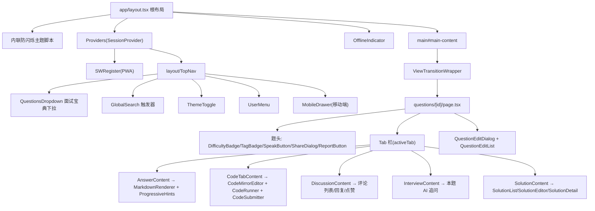
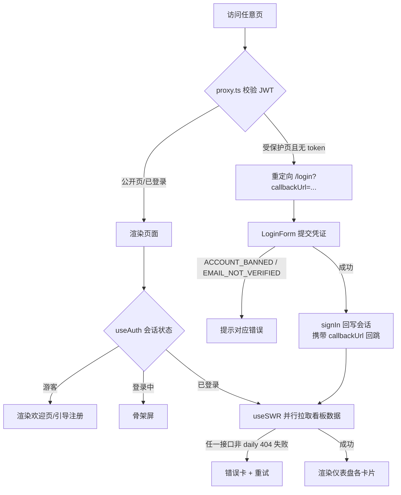

# 02 页面设计

> 项目：interview-platform ｜ 版本：v1.0 ｜ 生成日期：2026-10-05 ｜ 依据：源码分析

## 1. 前端技术形态概述

页面层位于 `src/app/`，遵循 App Router 约定：每个路由目录下的 `page.tsx` 即页面入口，`layout.tsx` 提供嵌套布局。与常见的「服务端组件优先」策略不同，本项目的页面几乎全部是客户端组件（`"use client"`），数据在浏览器端通过 SWR 或原生 `fetch` 从自家 `/api/*` 获取，页面组件自己管理 loading（骨架屏/`animate-pulse`）、error（重试卡片）与空状态（`EmptyState` 组件）。这样选择的好处是交互密集（筛选、Tab、编辑器、SSE 流式渲染）时状态完全在前端掌控；代价是首屏内容依赖接口往返，故首页、题库等页面都实现了骨架屏过渡。

样式体系为 Tailwind CSS v4 + CSS 变量设计令牌：颜色一律使用 `var(--primary)`、`var(--surface-container)` 等语义 token（定义在 `docs/design/DESIGN.md` 与 `src/lib/design-tokens.ts`），透明度用 `color-mix()`，禁止硬编码 rgba。暗色模式由 `src/app/layout.tsx` 头部的内联脚本实现：首帧前读取 `localStorage["interview-platform-theme"]`（无值则跟随系统 `prefers-color-scheme`），为 `<html>` 设置 `data-theme` 属性，避免刷新闪白。全局导航为 `src/components/layout/TopNav.tsx`（含「面试宝典」下拉、全局搜索触发、`ThemeToggle`、`UserMenu`），移动端由 `MobileDrawer` 承接。

## 2. 路由与页面总表

以下表格覆盖 `src/app/` 下的全部用户可见路由（依据实际文件清单整理）：

| 路由 | 文件 | 页面职责 | 主要数据来源 |
| --- | --- | --- | --- |
| `/` | `src/app/page.tsx` | 首页仪表盘（打卡/统计/每日一题/待复习/图表/热力图） | `useSWR` 并行订阅 6 个 `/api/stats*`、`/api/daily-question`、`/api/review/due` |
| `/login`、`/register` | `src/app/(auth)/login|register/page.tsx` | 登录/注册（`(auth)` 分组布局） | `LoginForm`/`RegisterForm` 组件 |
| `/questions` | `src/app/questions/page.tsx` | 题库列表：语言分组侧栏、筛选、分页、组卷篮 | `/api/categories`、`/api/questions` |
| `/questions/new` | `src/app/questions/new/page.tsx` | 新建题目（需 `question:add` 权限） | `POST /api/questions` |
| `/questions/[id]` | `src/app/questions/[id]/page.tsx` + `tabs/` | 题目详情五标签页（答案/代码/讨论/面试/题解） | `/api/questions/[id]` 及子资源 |
| `/ai` | `src/app/ai/page.tsx` | AI 功能入口页 | — |
| `/ai/mock-interview` | `src/app/ai/mock-interview/page.tsx` | AI 模拟面试（选择/对话/历史/视频四视图） | `/api/mock-interview*`（SSE） |
| `/contests`、`/contests/[id]` | `src/app/contests/*` | 竞赛列表（创建表单）与赛题详情/提交/排行 | `/api/contests*` |
| `/learning-paths`、`/[id]` | `src/app/learning-paths/*` | 学习路径浏览、详情、一键加入计划 | `/api/learning-paths*` |
| `/study-plans`、`/[id]` | `src/app/study-plans/*` | 学习计划列表/编排/进度勾选 | `/api/study-plans*` |
| `/test-papers`、`/new`、`/[id]` | `src/app/test-papers/*` | 试卷列表/组卷/答题与成绩 | `/api/test-papers*` |
| `/question-sets`、`/[slug]` | `src/app/question-sets/*` | 精选题集列表与集内题目 | `/api/question-sets*` |
| `/companies`、`/[company]` | `src/app/companies/*` | 公司题库聚合浏览 | `/api/companies`、`/api/questions` |
| `/experiences` | `src/app/experiences/page.tsx` | 经验分享/笔记社区流 | `/api/notes*` |
| `/search` | `src/app/search/page.tsx` | 全站搜索结果页 | `/api/search`、`/api/search-history` |
| `/s/[slug]` | `src/app/s/[slug]/page.tsx` | 分享短链落地页（题目/笔记/面试战报） | `/api/share` |
| `/leaderboard` | `src/app/leaderboard/page.tsx` | 排行榜（解题数等维度） | `/api/leaderboard` |
| `/report` | `src/app/report/page.tsx` | 学习报告 | `/api/stats/report` |
| `/profile`、`/settings` | `src/app/profile|settings/page.tsx` | 个人主页（仅本人）/ 资料与通知设置 | `/api/user`、`/api/upload/avatar` |
| `/users/[id]` | `src/app/users/[id]/page.tsx` | 公开用户主页（统计/关注/TA 的题解） | `/api/users/[id]/profile` |
| `/bookmarks` | `src/app/bookmarks/page.tsx` | 收藏夹管理 | `/api/bookmarks*` |
| `/notifications` | `src/app/notifications/page.tsx` | 通知中心（已读/全部已读/删除） | `/api/notifications*` |
| `/career`、`/career/[category]/[slug]` | `src/app/career/*` | 求职指南（服务端组件，读 `public/knowledge/*.md`） | 静态文件 + `career-catalog.ts` |
| `/admin`（重定向 dashboard） | `src/app/admin/*` | 后台：仪表盘/题目/题集/分类/用户/举报/竞赛/学习路径 8 个子页 | `/api/admin*` |
| 错误边界 | `src/app/error.tsx`、`global-error.tsx`、`not-found.tsx` | 路由级/全局错误与 404 | — |
| SEO | `src/app/sitemap.ts`、`robots.ts` | 站点地图与爬虫规则（用 `NEXT_PUBLIC_APP_URL`） | 服务端直查 |

## 3. 核心页面布局与交互详解

### 3.1 首页仪表盘（`src/app/page.tsx` + `src/app/dashboard/DashboardComponents.tsx`）

首页是登录后的数据中枢，布局为 12 列栅格的自上而下四段式：**DashboardHeader**（问候语 + 连续打卡徽章）→ 三卡行（`DailyGoalCard` 今日目标环形进度、`StatsCards` 今日/本周/本月统计与掌握度、`DailyQuestionCard` 每日一题卡片）→ `DueReviewSection`（待复习题目横滑列表，显示逾期天数与所处艾宾浩斯阶段）→ `ChartsSection`（能力雷达 `RadarChart` + 30 天进度折线 `ProgressLineChart`）→ `HeatmapSection`（90 天练习热力图 `CalendarHeatmap`）→ `CategoryErrorSection`/`RecentPracticeSection`（薄弱分类与最近练习）。

状态机清晰：页面以 `extendedStats` 是否就绪判定 loading（骨架屏）；未登录游客直接渲染欢迎页（三张功能介绍卡 + 注册/登录按钮），因为看板接口全部需要登录；任一看板接口出错则渲染统一错误卡并附「重试」按钮（`window.location.reload()`）。细节设计：`daily-question` 的 404（题库为空）被刻意排除在整页错误判定之外，由卡片自行显示「暂无每日一题」。首次访问还会触发 `OnboardingWizard` 引导浮层（localStorage 标记已完成）。

### 3.2 题库列表（`src/app/questions/page.tsx`）

三区布局：左侧 `QuestionBankSidebar`（按「语言分组 → 技术分类树」两级导航，含题目数徽章）、右侧上方筛选栏（关键字、难度、题型、岗位方向、排序）与 `QuestionGrid` 题目卡片网格、底部分页。移动端侧栏收纳进 `MobileQuestionBankDrawer` 抽屉。**URL 即状态**是该页的核心设计：`lang/bank/q/difficulty/type/jobRole/sort/page` 全部同步到查询串，初始化时从 `useSearchParams()` 恢复——从详情页返回时筛选状态不丢。另有 `QuestionBasketButton`/`useQuestionBasket`（localStorage）支持多选题目跳转组卷。列表数据经 `/api/questions` 返回后逐题合并当前用户的 `mastery/isBookmarked`（游客为默认值），掌握度以颜色标记呈现在卡片上。

### 3.3 题目详情（`src/app/questions/[id]/page.tsx`，1100 行）

顶部为题目标题、难度/标签徽章、收藏/分享/朗读/举报/编辑建议按钮与「上一题/下一题」导航（同分类内，支持 ←/→ 键盘切换，`F` 键进入沉浸模式，`Esc` 退出）。主体是五个 Tab，按题型由 `getQuestionTypeMeta(questionType).defaultTab` 决定默认页：

1. **答案（AnswerContent）**：`MarkdownRenderer` 渲染题面与参考答案，内置 `ProgressiveHints`（三级渐进提示，调 `/api/questions/[id]/hints`）。
2. **代码（CodeTabContent）**：`CodeMirrorEditor` 多语言编辑器（模板来自 `Question.codeTemplate` JSON）、`CodeRunner`（即时运行，走 `/api/run-code`）与 `CodeSubmitter`（正式判题，走 `/api/questions/[id]/submit`），逐用例结果以通过/失败列表展示。
3. **讨论（DiscussionContent）**：评论列表与一层回复、点赞、删除。
4. **面试（InterviewContent）**：针对本题快速发起 AI 追问式演练。
5. **题解（SolutionContent）**：`SolutionList`/`SolutionEditor`/`SolutionDetail` 三态视图，题解支持点赞与编辑。

收藏交互值得注意：`toggleBookmark` 同时做两件事——`PATCH /api/questions/[id]/state` 更新个人状态，以及 `syncBookmarkToFolder` 把题目同步进「默认收藏」收藏夹（不存在则自动创建，源码注释记录了曾误调 admin 接口导致 403 的修复过程）。

### 3.4 AI 模拟面试（`src/app/ai/mock-interview/page.tsx`，1715 行）

页面内部是四个视图（`ViewType`）：**select**（选择方向：Java/后端/前端/算法/系统设计/Python/通用/行为面试，以及模式：text/voice/video，video 未配置时禁用并标注）→ **chat**（对话主界面：左侧轮次时间线，右侧当前问题与作答区。作答区为 textarea + `VoiceInput` 语音输入按钮；AI 反馈流式渲染于 `MarkdownRenderer`，`SpeakButton` 可朗读问题）→ **history**（历史面试列表，`/api/mock-interviews`）→ **video**（`VideoInterviewView` 全屏视频面试，RTC 进房 + AI 面试官）。SSE 事件协议为：`interview`（携带面试 id）→ `feedback`/`chunk`（增量内容）→ `done`（携带 score、nextQuestion 或 overallScore/summary）→ `error`。前端用 `src/lib/sse.ts` 的 `parseSSEStream` 手工解析流（未用 EventSource，因为需要 POST 请求体），收到的 Prisma 字段 `aiQuestion/userAnswer/aiFeedback` 映射为前端 `question/answer/feedback`（`AGENTS.md` 明确要求保留该映射约定）。

### 3.5 竞赛（`src/app/contests/page.tsx`、`src/app/contests/[id]/page.tsx`）

列表页按状态（upcoming/ongoing/ended）着色渲染竞赛卡片，显示类型标签（周赛/月赛/自定义）、起止信息与题数/提交数统计，登录用户可通过 `CreateContestForm` 创建自定义赛。详情页（661 行）为赛题工作台：左侧题目列表（含分值与通过状态），右侧题目描述 + CodeMirror 编辑器；提交后展示判题结果（accepted/wrong_answer/runtime_error/time_limit_exceeded）与得分，页内可查看竞赛排行（`/api/contests/[id]/leaderboard`）。

### 3.6 后台管理（`src/app/admin/*`）

`admin/layout.tsx` 提供可折叠侧栏（8 个导航项）并做客户端 admin 校验（`user?.role === "admin"`，与 proxy 的服务端校验双保险）。子页面均为「列表 + 操作列」的管理表格形态：题目管理支持批量删除、批量设置公司（`batch-delete`/`batch-company`）、编辑跳转；用户管理支持封禁/解封与角色调整（`users/[id]/ban`、`users/[id]/role`）；举报管理对待处理举报逐条处置或批量处理（`reports/batch`）；仪表盘读取 `/api/admin/stats` 聚合指标。

## 4. 组件树

以全局布局 + 题目详情页为例的组件树（mermaid）：

## 5. 状态管理设计

项目**没有引入 Redux/Zustand 等全局状态库**，而是三层分工：

1. **服务端状态 = SWR**。`src/lib/swr.ts` 暴露统一 `fetcher`（内部走 `request.ts`，401/403 自动 `signOut` 跳登录）与默认配置（`revalidateOnFocus: false`、2 秒去重、3 次错误重试）。看板、题库、通知等只读数据全部由 `useSWR(key)` 托管，配合 `mutate` 做写后刷新。
2. **会话状态 = NextAuth Context**。`src/hooks/useAuth.ts` 封装 `useSession()`，对外提供 `user/isLoading/isAuthenticated/logout` 四件套，页面用它区分游客/登录态（如首页欢迎页）。
3. **UI 状态 = 组件本地 `useState` + URL**。筛选、Tab、弹窗开关均为本地 state；需要跨页面保持的（题库筛选）写入 URL 查询串；需要跨会话保持的（主题、题篮、onboarding 标记）写入 localStorage。跨组件事件用轻量约定，如 `src/components/layout/search-global.ts` 以自定义事件触发全局搜索弹窗。

## 6. 关键 UI 交互流程

以登录 → 首页就绪的全链路为例（mermaid）：

AI 模拟面试对话视图的交互循环：选择方向与模式 → `POST /api/mock-interview`（SSE，先收到 `interview` 事件拿到 id）→ 问题流式打印进聊天气泡 → 用户输入（或语音转写）→ `POST /api/mock-interview/[id]/turn`（SSE：`feedback` 增量渲染 → `done` 携带 score 与 nextQuestion）→ 下一题气泡；第 5 轮或 AI 判定 `isComplete` 时 `done` 事件携带 `overallScore` 与 `summary`，页面切换到战报展示并写入历史。语音/视频模式仅在服务端探测配置就绪（`HEAD /api/video-interview/token` 返回 200）时开放入口。

无障碍与细节：`TopNav` 下拉支持 `Escape` 关闭与焦点返回、`aria-haspopup/aria-expanded` 标注；`main#main-content` 提供 `tabIndex={-1}` 跳转锚点；图片上传组件 `ImageUploader` + `AvatarCropper`（react-easy-crop）负责头像裁剪；`SkeletonBox` 统一骨架样式。PWA 方面，`public/sw.js` + `SWRegister`/`OfflineIndicator` 提供离线兜底与断网提示，`public/manifest.json` 支持安装到桌面。
