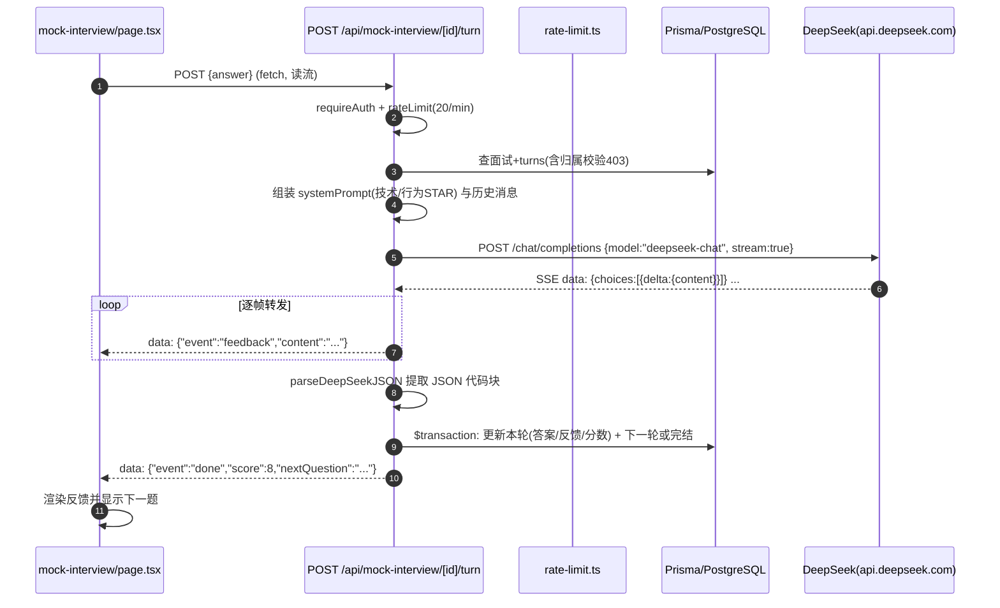

# 03 接口设计

> 项目：interview-platform ｜ 版本：v1.1 ｜ 生成日期：2026-10-05 ｜ 修订：2026-10-06 一致性回刷（对齐《15-接口全量参考》逐文件核对结论） ｜ 依据：源码分析

## 1. API 总体约定

全部后端接口位于 `src/app/api/**/route.ts`（共 101 个文件，约 49 个模块前缀），均为 Next.js Route Handler 形式：默认导出与 HTTP 方法同名的异步函数，请求入参为 `NextRequest`，动态段以 `[id]`/`[slug]` 目录表达且 `params` 为 Promise（须 `await params` 解构）。约定如下：

- **请求体校验**：高频写接口统一 `const parsed = await parseBody(request, schema)`（`src/lib/validate.ts` + zod schema 集中在 `src/lib/schemas.ts`），失败返回 `400 {error: "字段: 错误信息"}`；早期接口以手写 `if (!x) return 400` 为主。
- **响应结构**：成功为顶层 JSON（如 `{questions, total, take, skip}`、`{interviews}`），新增接口可用 `ok()/fail()`（`src/lib/api-response.ts`，`fail` 返回 `{success:false, code, error}`）；未捕获异常用 `handleApiError(e, "GET /api/xxx")` 统一打印 `[API Error]` 日志并返回 `500 {"error":"服务器内部错误"}`。
- **鉴权语义**：写接口一律先 `const authError = await requireAuth(); if (authError) return authError;`（401 `{error:"未登录，请先登录"}`）；管理接口用 `requirePermission("权限点")`（401/403）；公开接口用 `optionalAuth()`——有会话则个性化（合并掌握状态），无会话降级为游客视图。
- **限流**：消耗外部配额的接口用 `rateLimit(标识, 上限, 窗口ms)`（`src/lib/rate-limit.ts`），429 响应携带 `X-RateLimit-Limit/Remaining/Reset` 头。
- **动态渲染**：依赖会话的接口常显式声明 `export const dynamic = "force-dynamic"`（如 mock-interview、stats/extended）。
- **流式接口**：SSE 响应头固定 `Content-Type: text/event-stream`、`Cache-Control: no-cache, no-transform`、`Connection: keep-alive`，帧格式 `data: {JSON}\n\n`。

## 2. API 端点总表

按模块归组（「鉴权」列：Pub=公开/可选登录，User=requireAuth，Perm=requirePermission，Admin=管理员权限点）：

### 2.1 题库与练习

| 方法 | 路径 | 鉴权 | 用途 | 关键入参 | 响应要点 |
| --- | --- | --- | --- | --- | --- |
| GET | `/api/questions` | Pub | 题库分页筛选 | `search/difficulty/mastery/questionType/categoryId/categoryIds/tags/company/jobRole/take≤500/skip/orderBy/ orderDir` | `{questions, total}` |
| POST | `/api/questions` | Perm(`question:add`) | 创建题目 | `title/content/solution/codeTemplate/difficulty/company/tags/questionType` | 201 题目对象 |
| GET | `/api/questions/[id]` | Pub | 题目详情（近 50 条评论） | — | 题目 + 个人状态；404 `题目不存在` |
| PATCH | `/api/questions/[id]` | Admin | 编辑题目（标签全量重建于事务内） | 同上 + `jobRole/categoryId/answer` | 更新后题目 |
| DELETE | `/api/questions/[id]` | Perm(`question:manage`) | 删除题目 | — | `{success:true}` |
| GET/PATCH | `/api/questions/[id]/state` | User | 查询/更新个人掌握与收藏 | `mastery∈{unsolved,learning,mastered}`、`isBookmarked` | upsert `UserQuestionState` |
| POST | `/api/questions/[id]/submit` | Pub（登录才记录） | 正式判题 | `code/language` | `{status,passedCount,totalCount,duration,results[]}` |
| GET/POST | `/api/questions/[id]/hints` | GET Pub / POST User(10/min) | 渐进式提示（按题缓存） | `level 1..3` | `{level,content,cached}` |
| POST | `/api/questions/[id]/ai-improve` | User | AI 润色题目解析 | 题目内容 | AI 文本 |
| POST/GET | `/api/questions/[id]/edits` | User / Pub | 提交/列出解析编辑建议 | `description/reference` | `QuestionEdit` 记录 |
| POST | `/api/question-edits/[id]` | Admin | 审核编辑建议 | `action`/`reviewMessage` | 审核结果 |
| GET | `/api/questions/[id]/edit` | Pub | 读取当前解析 | — | `{solution}` |
| POST | `/api/questions/[id]/encounter` | User | 标记「在哪见过这题」 | `tags[],note` | upsert `QuestionEncounter` |
| GET | `/api/questions/[id]/encounters` | Pub | 该题的遇见记录 | — | 记录列表 |
| POST | `/api/practice` | User | 手写练习记录 | `questionId/status∈{completed,failed}/durationSeconds` | 201 记录 |
| GET/POST | `/api/categories` | Pub / Perm | 分类树（`includeStats`）/新建 | — | `{categories[]}` |
| PATCH/DELETE | `/api/categories/[id]` | Perm/Admin | 编辑/删除分类 | — | — |
| GET | `/api/companies` | Pub | 公司题库聚合 | — | 公司列表与题量 |
| GET/POST | `/api/run-code`（POST） | Pub | 即时运行代码（不判题） | `code/language/stdin` | `{stdout,stderr,code,duration}` |
| GET/POST | `/api/question-sets`、`GET /api/question-sets/[slug]` | Pub | 精选题集 | — | `{sets}` / `{set, items}` |

### 2.2 AI 与模拟面试

| 方法 | 路径 | 鉴权 | 用途 | 关键入参 | 响应要点 |
| --- | --- | --- | --- | --- | --- |
| POST | `/api/ai` | User(20/min) | AI 教练对话（默认 SSE，`?stream=false` 降级 JSON） | `messages[]` | SSE 帧或 `{content}` |
| POST | `/api/ai/evaluate` | User | 回答评分 | `question/answer` | JSON 评分反馈 |
| POST | `/api/ai/review-code` | User | 代码点评 | `code/language` | AI 点评 |
| POST | `/api/mock-interview` | User(10/min，每日 20 场护栏) | 创建面试并出第一题（SSE） | `direction`（含 `behavioral`） | SSE：`interview{id}`→`chunk`→`done` |
| POST | `/api/mock-interview/[id]/turn` | User(20/min) | 提交回答（SSE 评估+追问） | `answer` | SSE：`feedback`→`done{score,nextQuestion|overallScore,summary}` |
| PATCH | `/api/mock-interview/[id]/complete` | User | 提前结束面试 | — | 结束状态 |
| DELETE | `/api/mock-interview/[id]` | User | 删除自己的面试 | — | 归属校验 403 |
| GET | `/api/mock-interviews` | User | 我的历史面试（含 turns） | — | `{interviews[]}` |
| HEAD/POST | `/api/video-interview/token` | HEAD Pub / POST User(10/min) | 探测配置/签发 RTC Token | `direction` | `{appId,roomId,userId,token}` |
| POST/DELETE | `/api/video-interview/start` | User | 启停 AI 面试官语音对话（StartVoiceChat/Stop） | `roomId/userId/direction` | `{success,taskId}` |
| POST | `/api/video-interview/save` | User | 保存视频面试记录 | 对话内容 | — |
| POST | `/api/voice/asr` | User(10/min) | 豆包 ASR 代理（≤10MB base64） | `audio` | `{text,requestId}` |
| POST | `/api/voice/tts` | User | 豆包 TTS 代理 | `text` | 音频数据 |

### 2.3 竞赛、学习与试卷

| 方法 | 路径 | 鉴权 | 用途 | 关键入参 | 响应要点 |
| --- | --- | --- | --- | --- | --- |
| GET/POST | `/api/contests` | Pub / 登录 | 竞赛列表/创建 | `limit`；创建表单字段 | `{contests[]}` |
| GET/PATCH/DELETE | `/api/contests/[id]` | Pub / 管理 | 详情/编辑/删除 | — | 含 problems |
| POST | `/api/contests/[id]/submit` | User | 竞赛提交（含隐藏用例判题） | `questionId/code/language` | `{submission{status,score,passedCount,...}}`；时间窗外 400 |
| GET | `/api/contests/[id]/leaderboard` | Pub | 竞赛排行 | — | 排名列表 |
| GET/POST | `/api/learning-paths` | Pub/登录 | 路径列表/自定义创建 | — | `{paths[]}` |
| GET/PATCH/DELETE | `/api/learning-paths/[id]` | Pub/管理 | 详情/编辑/删除 | — | 含 items |
| POST | `/api/learning-paths/[id]/join` | User | 一键加入为学习计划 | — | 创建 StudyPlan |
| GET/POST | `/api/study-plans` | User | 我的计划列表/创建 | `title/description/totalDays` | `{plans[]}` |
| GET/PUT/DELETE | `/api/study-plans/[id]` | User | 详情/更新/删除（归属校验） | — | — |
| POST/DELETE | `/api/study-plans/[id]/items` | User | 计划内加题/移题 | `questionId/dayNumber` | — |
| POST/DELETE | `/api/study-plans/[id]/progress` | User | 勾选/取消进度（upsert 幂等） | `questionId` | 三元组唯一 |
| GET/POST | `/api/test-papers` | Pub(公开卷)/User | 试卷列表/组卷（1-100 题） | `title/detail/isPublic/questionIds[]` | `{papers[]}` |
| GET/PATCH/DELETE | `/api/test-papers/[id]` | GET Pub（无 isPublic 过滤）/ PATCH·DELETE 本人 | 试卷详情/编辑/删除 | — | GET 含 items 及题目 `answer/solution`（答题前即可见 ⚠️ 现状与风险见《15-接口全量参考》文末备注） |
| POST/GET | `/api/test-papers/[id]/submit` | User | 交卷判分 / 查询成绩 | 答案集合 | `{score,total,correctCount}`（answers 快照） |

### 2.4 看板、复习与社区

| 方法 | 路径 | 鉴权 | 用途 | 关键入参 | 响应要点 |
| --- | --- | --- | --- | --- | --- |
| GET | `/api/stats` | User | 基础统计（总数/掌握/最近练习/高频错题） | — | `{total,mastered,recentHistory[],topErrors[]}` |
| GET | `/api/stats/extended` | User | 扩展统计（日/周/月计数、分类与难度分布、90 天热力图、掌握四格） | — | `{dailyCount,...,heatmap[],overallStats}` |
| GET | `/api/stats/ability` | User | 能力雷达 + 30 天进度 | — | `{abilityData[],progressData[]}` |
| GET/POST | `/api/stats/streak` | User | 打卡统计（GET 顺带 upsert 当日快照）/设置 `dailyGoal` | `dailyGoal` | `{currentStreak,longestStreak,todayCount,goalMet}` |
| GET | `/api/stats/report` | User | 学习报告数据 | — | 聚合指标 |
| GET | `/api/review/due` | User | 到期复习清单 | `limit/stage` | `{dueCount,reviews[]}` |
| GET | `/api/review/schedule` | Pub（无守卫，按 questionId 可查任意题） | 单题复习计划 | `questionId` | 六阶段计划（响应不含个人完成态，`completedAt` 恒为 null，与 `/api/review/due` 的个人化口径不同） |
| GET | `/api/daily-question` | Pub | 每日一题（日期种子确定性抽取） | — | `{id,title,contentPreview,...}`；404 无题 |
| GET/POST/PUT | `/api/reminders` | User | 复习提醒设置 | — | — |
| POST | `/api/reminders/digest` | `CRON_SECRET` | 定时提醒邮件摘要（外部定时任务调用） | Bearer 密钥 | 发送结果 |
| GET/POST | `/api/notifications`、PATCH/DELETE `/api/notifications/[id]`、PATCH `/api/notifications/read-all` | User | 通知列表/发送/已读/删除/全部已读 | — | `{notifications[],unread}` |
| GET/POST/DELETE | `/api/follow` | User | 关注/取关/关注列表与状态 | `userId` | — |
| POST/GET | `/api/reports`、PATCH `/api/reports/[id]`、POST `/api/reports/batch` | User / Admin | 举报/列表/处置/批量处置 | `target_type/targetId/reason` | — |
| POST/GET | `/api/share` | User/Pub | 生成短链（幂等复用）/解析短链 | `type/targetId` | `{url,slug}` |
| GET/POST | `/api/notes`、GET/PUT/DELETE `/api/notes/[id]` | User（全部强登录，仅返回/操作本人笔记） | 笔记列表/发布/详情/编辑/删除 | `title/content/questionIds[]` | — |
| GET/POST | `/api/bookmarks/folders`、GET/PATCH/DELETE `/api/bookmarks/folders/[id]` | User | 收藏夹 CRUD | `name/icon` | — |
| POST/DELETE | `/api/bookmarks/items` | User | 收藏/取消（folderId+questionId） | — | 唯一约束 |
| GET/POST | `/api/questions/[id]/comments`、PATCH/DELETE `.../comments/[commentId]` | Pub/User | 评论与一层回复/编辑/删除 | `content≤5000/parentId` | `{comments[]}` |
| GET/POST | `/api/questions/[id]/solutions`、PATCH/DELETE `.../solutions/[solutionId]`、PATCH `/api/solutions/[id]/upvote`、GET `/api/solutions/user/[id]` | Pub/User（**upvote PATCH 无守卫**） | 题解发布/编辑/点赞/按用户查询 | `content≤20000/language` | `{solutions[]}` |
| GET | `/api/search`、POST `/api/search-history`、GET `/api/search-history/hot` | Pub | 聚合搜索/记录历史/热搜 | `q/type/take/skip` | `{results[],total}` |
| GET | `/api/achievements` | User | 成就进度（即时计算无表，仅有 GET，无 POST 端点） | — | `{achievements[],achievedCount,total}` |

> **鉴权现状注记（2026-10-06 回刷）**：`PATCH /api/solutions/[id]/upvote` 会读取会话但**不拒绝未登录请求**（session 仅用于给作者发通知），匿名可无限 +1 刷赞且无去重——按「现状+风险」如实记录，已列入《13-技术债务与演进建议》2.2（《08-安全与权限设计》第 9 节第 7 条、《12-FAQ与故障排查》已同步收录）。

### 2.5 认证、用户与后台

| 方法 | 路径 | 鉴权 | 用途 | 关键入参 | 响应要点 |
| --- | --- | --- | --- | --- | --- |
| GET/POST | `/api/auth/[...nextauth]` | — | NextAuth 处理器（signIn/callback/session） | — | — |
| POST | `/api/auth/send-code` | Pub(限流) | 发送注册验证码（5 分钟有效、60s 重发窗口） | `email` | `{success}`；SMTP 未配置降级控制台 |
| GET | `/api/auth/check-email` | Pub | 邮箱注册查重 | `email` | `{exists}` |
| POST | `/api/auth/register` | Pub(10 次/时/IP) | 注册（验证码先验、bcrypt 10 轮、emailVerified 置位） | `email/password≥6/name/code` | 201 `{id,email,name}` |
| GET/PATCH/DELETE | `/api/user` | User | 当前用户详情+统计/更新资料/注销 | PATCH 走 `updateUserProfileSchema` | `{user,stats}` |
| PATCH | `/api/user/password` | User | 修改密码 | 旧/新密码 | — |
| GET | `/api/users/[id]`、`/api/users/[id]/profile` | Pub | 公开用户信息/主页数据（统计、题解） | — | — |
| POST | `/api/upload/oss` | User | 获取 OSS STS 临时凭证 | — | `{AccessKeyId,AccessKeySecret,SecurityToken,Expiration}` |
| POST | `/api/upload/avatar` | User | 服务端上传头像 | 图片 | URL |
| GET | `/api/admin/stats`、`/api/admin/users`、PATCH `/api/admin/users/[id]/ban`、`/api/admin/users/[id]/role` | Admin | 后台仪表盘/用户列表/封禁/改角色 | — | — |
| GET/POST/PATCH/DELETE | `/api/admin/question-sets`（含 `[id]`） | Admin | 题集管理 | — | — |
| POST | `/api/admin/questions/batch-delete`、`/api/admin/questions/batch-company` | Admin | 批量删除/设置公司 | `ids[]` | — |
| POST | `/api/admin/login` | — | 后台独立登录（签发 7 天 Bearer JWT） | 账密 | `{token}` |
| GET | `/api/health` | Pub | 健康探针（无外部依赖） | — | `{status:"ok",timestamp}` |

## 3. 认证与鉴权机制

**注册链路**：`POST /api/auth/send-code` 生成 6 位数字码（`crypto.randomInt`，`src/lib/verify-code.ts`）写入 `VerificationToken` 表（5 分钟过期），经 `sendVerificationCode` 走 SMTP 下发；未配置 SMTP 时降级打印到服务端控制台。`POST /api/auth/register` 按「IP 限流 → 字段校验 → 邮箱查重 → `verifyCode`（校验成功即删除该邮箱全部历史码，一次性使用）→ bcrypt 哈希（10 轮）→ 建号并置 `emailVerified`」顺序执行。

**登录与会话**：`src/lib/auth.ts` 的 `authOptions` 配置 `session.strategy = "jwt"`、`secret = AUTH_SECRET`（显式指定，注释说明避免退回 `NEXTAUTH_SECRET` 开发默认值导致与 proxy/`lib/jwt.ts` 不一致；compose 中两者传同一值兜底）。仅 `CredentialsProvider`：`authorize` 内校验密码（bcrypt.compare），并抛出两类带 code 的业务错误——`ACCOUNT_BANNED`（封禁拒绝登录）、`EMAIL_NOT_VERIFIED`（引导先完成验证）。`jwt` 回调在登录时写入 `id/role/image`；`session` 回调**每次拉取会话都回查数据库**刷新 `image/name/role`，且若 `banned=true` 直接返回 null 会话——由于 JWT 无法吊销，这是实现「封禁即时生效」的关键设计。`pages.signIn` 指向 `/login`。另导出 `auth()` 包装 `getServerSession(authOptions)`（注释说明 NextAuth v4 handler 无 `.auth` 属性，那是 v5 API）。

**三层鉴权入口**：① 页面级——`src/proxy.ts` 用 `getToken`（Edge 兼容）做前缀门禁；② API 级——`requireAuth()`（登录）/`requirePermission(权限点)`（RBAC）；③ 外部后台——`Authorization: Bearer` 走 `src/lib/jwt.ts`（jose HS256，7 天过期）+ `permission.ts` 的 `resolveAuthUser` 双通道识别。RBAC 数据链：`User.role → Role.code → RolePermission → Permission.code`，30 秒内存缓存；迁移 `20260824010000_add_rbac_models` 与 `20260824020000_seed_rbac_data` 建表并灌入角色/权限点初始数据。

**限流矩阵**（`rate-limit(identifier, limit, windowMs)`，进程内存滑动窗口）：AI 对话 20 次/分/用户；模拟面试创建 10 次/分 + 每日 20 场（上海自然日）；面试轮次 20 次/分；渐进提示 10 次/分；视频 Token 与 ASR 各 10 次/分；注册 10 次/时/IP。`getClientIp` 取 `x-forwarded-for` 最后一跳（最外层可信代理写入）。

## 4. 错误处理约定

- **状态码语义**：400 参数/校验错误（含 JSON 非法）、401 未登录、403 无权限或归属不符（如操作他人面试返回「无权操作此面试」）、404 资源不存在、409 冲突（邮箱已注册）、429 限流、502 上游 AI/服务错误（约定不透传内部细节，如 turn 接口仅记日志返回「AI 服务暂时不可用」；**例外**：mock-interview 创建接口的 502 分支当前回显上游 `status - errorText` 详情，属已知债务，见《13-技术债务与演进建议》1.5）、503 依赖未配置（`DEEPSEEK_API_KEY`、视频面试六凭证、SMTP）、500 兜底。
- **响应体**：统一 `{ "error": "中文消息" }`；前端 `src/lib/request.ts` 优先读 `body.error`/`body.message`，封装为 `ApiError(status, message)` 抛出；401/403 默认自动 `signOut({callbackUrl:"/login"})`（`redirectOnAuth:false` 可关闭）。
- **流式错误**：SSE 中以 `data: {"event":"error","message":"..."}` 帧下发，由前端 `parseSSEStream` 回调处理，避免流已开始后无法改状态码的问题。
- **旁路容错**：通知 `createNotification` 与邮件发送失败只打日志不阻塞主流程；OSS/SMTP 未配置时功能级降级而非整体不可用。

## 5. AI 接口调用链示例

以「提交模拟面试回答」为例的完整调用链（mermaid 时序图）：

模型与协议细节：服务端用原生 `fetch` 直连 `https://api.deepseek.com/chat/completions`，`model` 固定 `deepseek-chat`，`temperature` 默认 0.7，`max_tokens` 默认 2048（提示接口按级别降至 200/500/1000）；未用任何官方 SDK，SSE 解析复用 `src/lib/sse.ts`（前端消费端）。Key 合法性校验两态：`/api/ai` 族与提示/润色接口先经 `validateDeepSeekApiKey()`；mock-interview 创建/轮次则在路由内内联同一占位值判断——创建路由**未复用** `src/lib/deepseek.ts` 的 `callDeepSeekStream` 与 `sseFormat`，`sse()` 是路由内的独立副本（与 `deepseek.ts` 的 `sseFormat` 逻辑相同，双份存在），两者均拒绝占位值 `sk-your-deepseek-api-key-here`/`fake`，未配置返回 503。行为面试（`direction=behavioral`）首题不走 AI，直接取 `src/lib/behavioral-questions.ts` 题库并模拟流式输出；其评估 system prompt 要求按 STAR 四维（完整性 40%/具体性 25%/逻辑性 20%/表达力 15%）打分。
