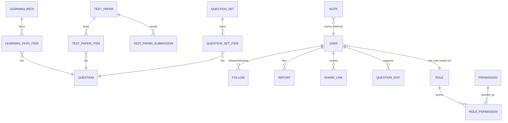

# 04 数据模型

> 项目：interview-platform ｜ 版本：v1.0 ｜ 生成日期：2026-10-05 ｜ 依据：源码分析

## 1. 存储方案

项目使用 **PostgreSQL 单库**存储全部业务数据，ORM 为 Prisma 7：模型唯一事实来源是 `prisma/schema.prisma`（739 行，**43 个模型**），generator 为新一代 `prisma-client`，产物输出到 `src/generated/prisma/`；数据源仅声明 `provider = "postgresql"`，连接串由 `prisma.config.ts` 从 `DATABASE_URL` 读取。运行时通过 `@prisma/adapter-pg` 驱动适配器 + `pg.Pool` 连接池访问数据库（`src/lib/prisma.ts` 单例，开发态缓存于 `globalThis`）。

模型命名约定：Prisma 模型名用大驼峰，表名经 `@@map` 映射为下划线复数（如 `User → users`、`UserQuestionState → user_question_states`），字段经 `@map` 映射为下划线小写（如 `emailVerified → email_verified`）。主键统一 `String @id @default(uuid())`；时间戳统一 `createdAt @default(now())` / `updatedAt @updatedAt`。删除策略分三类：强归属数据 `onDelete: Cascade`（删用户连带删其收藏夹/通知/学习计划进度等）、可匿名化数据 `onDelete: SetNull`（`PracticeHistory`、`Comment`、`Solution`、`Note`、`MockInterview` 的 `userId` 可空，删用户后内容保留但归属置空）、无删除约束的内容表（`Question` 被多处弱引用）。

PostgreSQL 特性被显式利用：数组列（`Note.questionIds String[]`、`QuestionEncounter.tags String[]`、`TestPaper.tags String[]`）、JSON 列（`Question.codeTemplate Json?`、`TestPaperSubmission.answers Json?`）、全文无关的 `mode: "insensitive"` 大小写不敏感查询。22 个迁移目录（`prisma/migrations/`）记录了从 init 到 `add_per_user_state`、`drop_global_question_state`、`add_hot_path_indexes`、`add_comment_replies`、`add_user_banned`、`add_question_hints` 的演进史。

## 2. 模型全景（43 个，按域分组）

| 域 | 模型 | 表名 | 说明 |
| --- | --- | --- | --- |
| 用户与认证 | `User` `Account` `Session` `VerificationToken` | users / accounts / sessions / verification_tokens | 账号主体 + NextAuth 标准四件套（本项目实际使用 Credentials + JWT，Account/Session 表保留兼容）；VerificationToken 复用为注册验证码存储 |
| 内容 | `Question` `Category` `QuestionTag` `TestCase` `QuestionHint` `Comment` `Solution` `Note` `PracticeHistory` `QuestionEdit` | questions / categories / question_tags / test_cases / question_hints / comments / solutions / notes / practice_history / question_edits | 题库核心内容域；Category 支持自关联树（parentId）；Comment 自关联一层回复（parentId） |
| 个人状态 | `UserQuestionState` `UserStreak` `QuestionEncounter` `SearchHistory` | user_question_states / user_streaks / question_encounters / search_histories | 每用户隔离状态；均带 userId 复合唯一键 |
| 模拟面试 | `MockInterview` `MockInterviewTurn` | mock_interviews / mock_interview_turns | 面试会话与逐轮问答 |
| 学习 | `StudyPlan` `StudyPlanDay` `StudyPlanItem` `StudyPlanProgress` `LearningPath` `LearningPathItem` | study_plans / study_plan_days / study_plan_items / study_plan_progress / learning_paths / learning_path_items | 计划四级结构（计划→天→条目→进度）；LearningPath 为可预设模板 |
| 竞赛 | `Contest` `ContestProblem` `ContestSubmission` | contests / contest_problems / contest_submissions | 竞赛、赛题（含分值排序）、提交 |
| 试卷与题集 | `TestPaper` `TestPaperItem` `TestPaperSubmission` `QuestionSet` `QuestionSetItem` | test_papers / test_paper_items / test_paper_submissions / question_sets / question_set_items | 用户组卷（含提交判分快照）与运营题集 |
| 社交 | `Follow` `Notification` `Report` `ShareLink` `BookmarkFolder` `BookmarkItem` | follows / notifications / reports / share_links / bookmark_folders / bookmark_items | 关注（自反多对多）、通知、举报、分享短链、两级收藏夹 |
| RBAC | `Role` `Permission` `RolePermission` | roles / permissions / role_permissions | 角色与权限点多对多；与 `User.role` 字符串弱关联（无硬外键） |

## 3. 核心模型字段详解

### 3.1 User（users）

| 字段 | 类型 | 约束 | 说明 |
| --- | --- | --- | --- |
| id | String | @id @default(uuid()) | 主键 |
| email | String | @unique | 登录标识 |
| name / image / bio | String? | — | 昵称/头像 URL/简介 |
| password | String? | — | bcrypt 哈希；OAuth 场景可空 |
| emailVerified | DateTime? | @map(email_verified) | 注册成功即置位；登录前置校验 |
| role | String | @default("user") | 指向 `Role.code`（弱关联）；proxy 以 `token.role==="admin"` 放行后台 |
| banned | Boolean | @default(false) | 封禁标记；session 回调查到即返回 null 会话 |
| emailNotifications / reminderEnabled | Boolean | @default(true) | 通知偏好 |
| createdAt / updatedAt | DateTime | 自动 | — |

关联（一对多，共 19 条）：practiceHistory、comments、studyPlans、notes、mockInterviews、followers/following（Follow 自反双命名关系）、bookmarkFolders、reports、shares、notifications、solutions、accounts、sessions、contestSubmissions、questionEncounters、testPapers、testPaperSubmissions、questionEdits、questionStates、userStreaks、studyPlanProgress。

### 3.2 Question（questions）与内容三件套

| 字段 | 类型 | 约束 | 说明 |
| --- | --- | --- | --- |
| id | String | @id | — |
| title / content | String | — | 题面（content 支持 Markdown 长文） |
| solution | String? | — | 参考解析 |
| answer | Boolean? | — | 判断题标准答案（questionType=judge 时使用） |
| codeTemplate | Json? | — | 代码题多语言模板，键为语言名 |
| questionType | String | @default("qa") | qa/code/judge 等题型 |
| difficulty | String | — | 简单/中等/困难 |
| company / jobRole | String? | — | 公司来源；岗位方向（backend/frontend/…，索引 `@@index([jobRole])`） |
| viewCount / encounterCount | Int | @default(0) | 浏览数/被标记遇见数（排序字段白名单） |
| categoryId | String? | — | 弱关联 Category（可空，索引） |

`QuestionTag`（question_tags）：复合主键 `@@id([questionId, tag])`，标签即关联表；`TestCase`（test_cases）：`input`（JSON 数组字符串，表示函数参数列表）+ `output`（期望返回值 JSON）+ `isHidden`（竞赛判题时包含隐藏用例）+ `orderBy`；`QuestionHint`（question_hints）：`level`(1/2/3) + `content @db.Text`，`@@unique([questionId, level])` 实现「按题按级缓存」；`QuestionEdit`（question_edits）：`reference @db.Text`（修改后解析）+ `status(pending/approved/rejected)` + `reviewMessage/reviewerId` 审核链路。

### 3.3 个人状态三表（多用户隔离的关键）

| 模型 | 唯一键 | 字段要点 | 写入方 |
| --- | --- | --- | --- |
| `UserQuestionState` | `@@unique([userId, questionId])`，另有 `@@index([userId, mastery])` | `mastery: unsolved/learning/mastered`、`isBookmarked` | `PATCH /api/questions/[id]/state`（upsert）；判题通过后 unsolved→learning |
| `UserStreak` | `@@unique([userId, date])`（date 为上海时区当日零点的 UTC 瞬时） | `questionCount`、`dailyGoal @default(5)`、`goalMet` | `GET/POST /api/stats/streak`（upsert 快照） |
| `StudyPlanProgress` | `@@unique([studyPlanId, userId, questionId])` | `completedAt` | `POST /api/study-plans/[id]/progress`（upsert 幂等） |

### 3.4 模拟面试两表

`MockInterview`（mock_interviews）：`direction`（java/backend/frontend/algorithm/system-design/python/general/behavioral）、`status @default("in-progress")`、`overallScore`(0-100)、`summary`（AI 总结）、`startedAt/endedAt`；userId 可空（SetNull，历史匿名记录保留）。`MockInterviewTurn`（mock_interview_turns）：`aiQuestion`（@map ai_question，Prisma 字段名与前端映射约定见下）、`userAnswer?`、`aiFeedback?`、`score?`（1-10）、`turnOrder`、可选 `questionId`（本题演练时关联题库）。**字段映射约定**：Prisma `aiQuestion/userAnswer/aiFeedback` ⇄ 前端 `question/answer/feedback`（`AGENTS.md` 开发约定第 4 条）。

### 3.5 学习、竞赛、试卷

- 学习：`StudyPlan`（userId 可空→可演化成模板）→ `StudyPlanDay`（`@@unique([studyPlanId, dayNumber])`，`targetQuestionCount`）→ `StudyPlanItem`（questionId + sortOrder）；`LearningPath`（`isPreset`、`difficultyLevel`、`category`、`durationDays`，索引 category/isPreset）→ `LearningPathItem`（`@@unique([pathId, dayNumber, questionId])`）。「join 学习路径」即服务端按模板复制生成个人 `StudyPlan/Day/Item`。
- 竞赛：`Contest`（`startTime`、`duration` 分钟、`status`、`type: weekly/monthly/custom`，索引 status/startTime）→ `ContestProblem`（`@@unique([contestId, questionId])`、`score @default(100)`、`orderBy`）→ `ContestSubmission`（`code @db.Text`、`language`、`status: accepted/wrong_answer/runtime_error/time_limit_exceeded`、`score`、`duration`ms，索引 contestId/userId/submittedAt）。
- 试卷：`TestPaper`（`isPublic`、`tags String[]`）→ `TestPaperItem`（快照 `questionType`）→ `TestPaperSubmission`（`score/total/correctCount`、`answers Json?` 答案快照，索引 testPaperId/userId）。

### 3.6 社交与 RBAC

`Follow`：`@@unique([followerId, followingId])` 防重复关注，双命名关系（`"Following"`/`"Follower"`）；`Notification`：`type`（follow/comment_reply/mention/reminder/system）、`read`，索引 `@@index([userId, read])` 支撑未读数查询；`Report`：`target_type/targetId` 多态引用 + `status(pending/resolved/dismissed)`，索引 status；`ShareLink`：`slug @unique` 短链、`type(question/note/interview_result)`、`views`、可 `expiresAt`，索引 `@@index([type, targetId])`；`BookmarkFolder/BookmarkItem`：两级收藏，条目 `@@unique([folderId, questionId])`。RBAC 三表：`Role(code @id)`、`Permission(code @id)`、`RolePermission`（复合主键 roleCode+permissionCode，双侧 Cascade），权限点示例 `question:add`、`question:manage`、`admin:access`。

## 4. ER 图

核心内容与用户域（mermaid erDiagram，仅画主外键与关键关系）：

```mermaid
erDiagram
    USER ||--o{ PRACTICE_HISTORY : writes
    USER ||--o{ USER_QUESTION_STATE : owns
    USER ||--o{ USER_STREAK : "daily snapshot"
    USER ||--o{ MOCK_INTERVIEW : starts
    USER ||--o{ STUDY_PLAN : creates
    USER ||--o{ STUDY_PLAN_PROGRESS : completes
    USER ||--o{ TEST_PAPER : authors
    USER ||--o{ CONTEST_SUBMISSION : submits
    USER ||--o{ BOOKMARK_FOLDER : organizes
    USER ||--o{ SOLUTION : contributes
    USER ||--o{ COMMENT : posts
    USER ||--o{ NOTIFICATION : receives
    QUESTION ||--o{ QUESTION_TAG : tagged
    QUESTION ||--o{ TEST_CASE : verified_by
    QUESTION ||--o{ QUESTION_HINT : hints
    QUESTION ||--o{ USER_QUESTION_STATE : "per-user state"
    QUESTION ||--o{ PRACTICE_HISTORY : practiced
    QUESTION ||--o{ COMMENT : discussed
    QUESTION ||--o{ SOLUTION : solved_by
    QUESTION ||--o{ BOOKMARK_ITEM : bookmarked
    QUESTION ||--o{ CONTEST_PROBLEM : included
    QUESTION ||--o{ STUDY_PLAN_ITEM : planned
    QUESTION ||--o{ QUESTION_ENCOUNTER : met
    CATEGORY |o--o{ QUESTION : classifies
    CATEGORY |o--o{ CATEGORY : "parent-child tree"
    MOCK_INTERVIEW ||--o{ MOCK_INTERVIEW_TURN : rounds
    STUDY_PLAN ||--o{ STUDY_PLAN_DAY : days
    STUDY_PLAN_DAY ||--o{ STUDY_PLAN_ITEM : items
    STUDY_PLAN ||--o{ STUDY_PLAN_PROGRESS : progress
    BOOKMARK_FOLDER ||--o{ BOOKMARK_ITEM : contains
    CONTEST ||--o{ CONTEST_PROBLEM : problems
    CONTEST ||--o{ CONTEST_SUBMISSION : submissions
    CONTEST_PROBLEM }o--|| QUESTION : refs
```

学习路径、试卷题集与社交/RBAC 域：

## 5. 索引与关系设计要点

**热路径索引**（迁移 `20260924170000_add_hot_path_indexes` 等沉淀）：`PracticeHistory` 有 `@@index([userId, attemptedAt])`（打卡/热力图/按期统计全部按「用户 + 时间范围」扫描）与 `@@index([questionId])`；`Notification` 的 `@@index([userId, read])` 服务导航栏未读徽章；`Question` 的 `jobRole/categoryId` 索引服务筛选；`Solution` 三个单列索引（questionId/userId/createdAt）对应三种排序读取；`ContestSubmission` 三索引支撑竞赛排行聚合。**关系基数**：核心内容表对 User 均为多对一，个人状态表一律复合唯一键兜底并发 upsert（`hints` 写入冲突时回读即利用 `@@unique([questionId, level])`）。**弱引用设计**：`Report`/`ShareLink` 的 `targetId` 为多态字符串引用（无外键），删除目标内容后举报/短链残留，由后台审核流程人工处置；`User.role` 与 `Role.code` 同为弱关联，schema 注释明确「避免破坏现有数据」。

## 6. 数据生命周期

- **产生**：内容域由 `prisma/seed.ts`（读 `src/data/*` 八个题库文件，按 title 去重、分类 upsert 幂等导入）与后台管理接口产生；用户域由注册接口产生；行为域由判题、面试、提交等接口实时产生。
- **更新**：个人状态表全部 upsert（唯一键幂等）；`UserStreak` 每次读打卡接口时顺手重算当日快照（读时物化）；题目计数（viewCount/encounterCount）接口内自增。
- **归档与清理**：验证码在验证成功后 `deleteMany` 清理同邮箱历史码（5 分钟过期 + 一次性）；分享短链支持 `expiresAt`；其余业务数据无自动清理任务（⚠️ 待确认：未见定时清理 `SearchHistory`/已读通知的机制，仅存在依赖 `CRON_SECRET` 的提醒摘要端点 `/api/reminders/digest`）。
- **删除级联**：删题目 Cascade 其标签/用例/提示/评论/题解/收藏条目/计划条目等；删用户 Cascade 强归属数据、SetNull 弱归属内容（题解、评论、笔记、面试记录保留为「匿名内容」）。
- **迁移纪律**：schema 变更必须走 `pnpm db:migrate` 生成迁移（`AGENTS.md` 约定禁止手改迁移）；生产容器启动时自动执行 `prisma migrate deploy`（幂等，见 `Dockerfile` CMD）。
