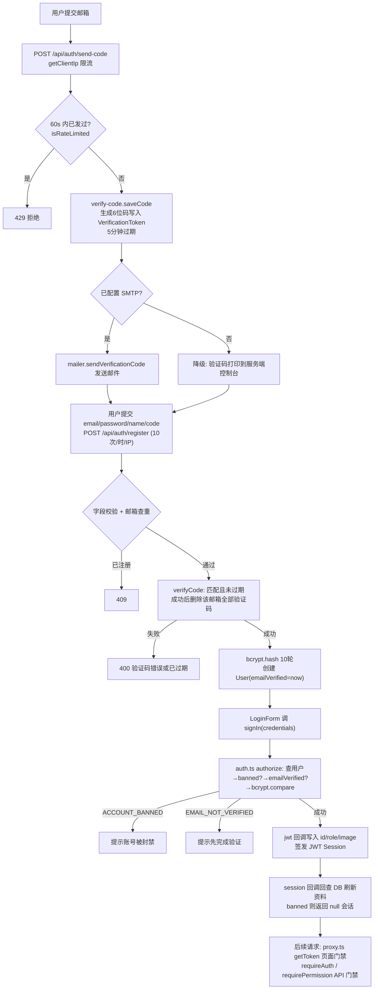
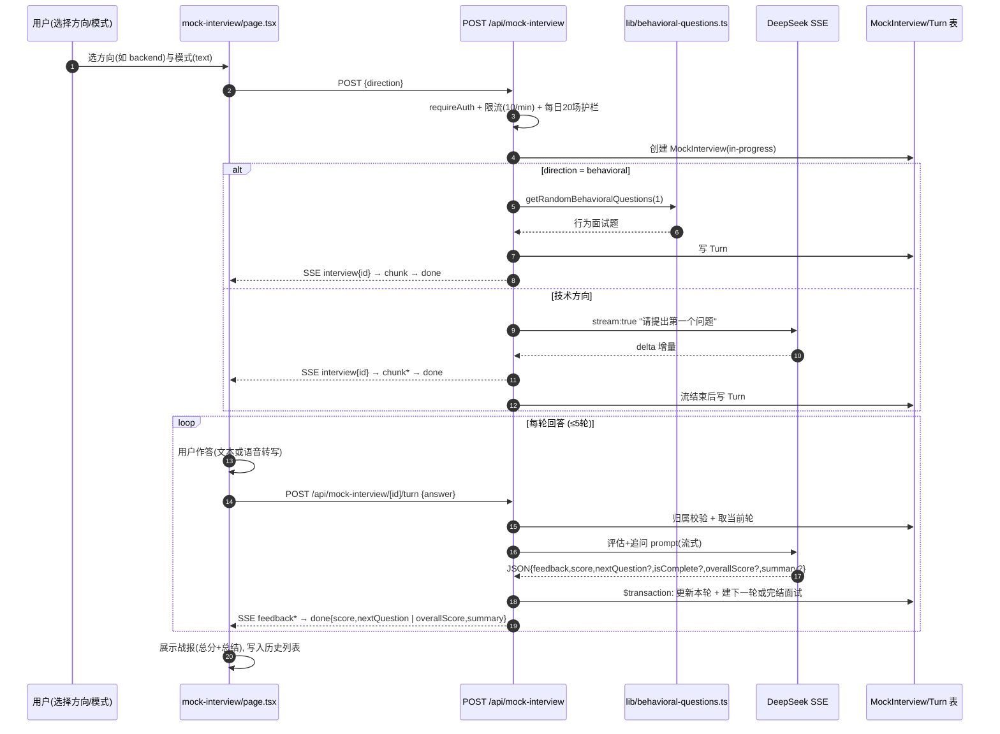
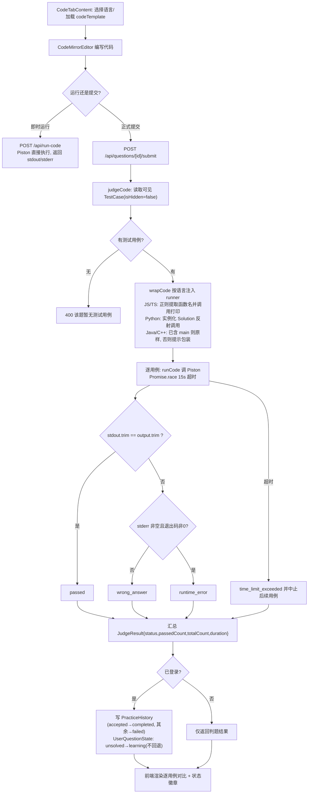
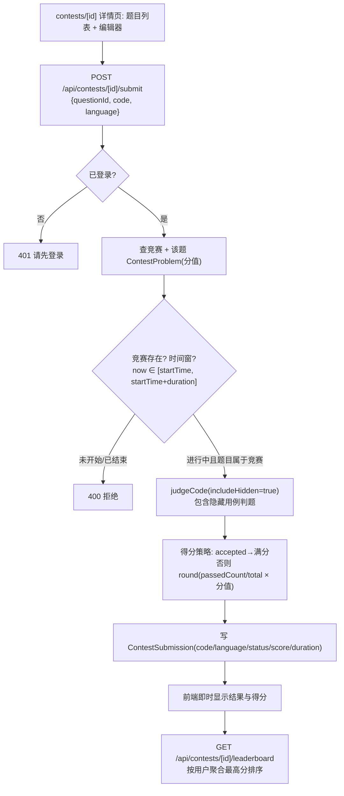
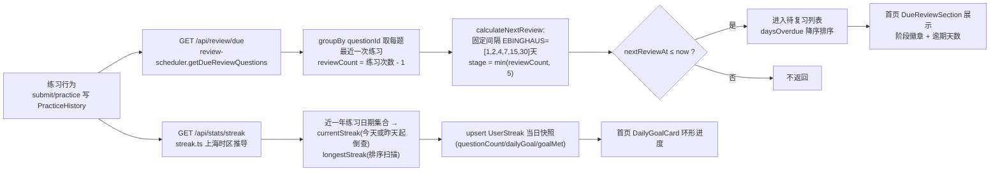

# 05 核心流程

> 项目：interview-platform ｜ 版本：v1.0 ｜ 生成日期：2026-10-05 ｜ 依据：源码分析

本篇选取五个业务价值最高的端到端流程展开：注册登录鉴权、AI 模拟面试、题目练习判题、竞赛提交评测、间隔复习与打卡。每个流程给出流程图/时序图、分步说明与涉及文件清单。

## 流程一：注册与登录鉴权

注册采用「邮箱验证码 + 密码」的自建体系，登录走 NextAuth Credentials，JWT 会话贯穿后续所有请求。

分步说明：① 发码接口的限流有两组——IP 级滑动窗口（`register` 前缀共用注册的 10 次/时）与验证码表内的 60 秒重发窗口（`isRateLimited` 用最近一条记录的过期时间倒推）。② 验证码刻意「先查重邮箱、再校验验证码」，避免已注册邮箱消耗验证码配额。③ `authorize` 的两类业务错误以异常 code 传递（`ACCOUNT_BANNED`/`EMAIL_NOT_VERIFIED`），前端 `LoginForm` 据此提示。④ 登录成功后的会话并非纯静态 JWT：`session` 回调每次都 `findUnique` 刷新 `image/name/role/banned`，实现「改头像立即生效、封禁即时踢出」。⑤ 页面访问由 `src/proxy.ts` 以 Edge 兼容的 `getToken` 粗粒度拦截（受保护前缀与 `/admin`），API 访问由路由内 `requireAuth()/requirePermission()` 细粒度把关，两层独立失效不影响另一层。

涉及文件：`src/app/api/auth/send-code/route.ts`、`src/app/api/auth/register/route.ts`、`src/lib/verify-code.ts`、`src/lib/mailer.ts`、`src/lib/auth.ts`、`src/lib/session.ts`、`src/lib/permission.ts`、`src/lib/jwt.ts`、`src/proxy.ts`、`src/components/auth/LoginForm.tsx`、`src/components/auth/RegisterForm.tsx`。

## 流程二：AI 模拟面试（多轮 SSE 对话）

一场面试 = 一条 `MockInterview` + 若干条 `MockInterviewTurn`，最多 5 轮；文本模式走 DeepSeek 流式，行为面试首题走本地题库，语音/视频模式复用同一对话模型并叠加火山引擎通道。

分步说明：① 创建接口的每日护栏以上海时区自然日为界统计该用户当日 `mockInterview.count`（源码手工计算 UTC+8 的当日零点）。② 首题阶段 DeepSeek 只输出问题本身（system prompt 规定「只问一个问题、循序渐进、针对性追问」），流式增量一边转发给前端一边累积，流结束才把完整问题落库。③ 回答阶段的要点是**原子落库**：用户回答与 AI 反馈在 `$transaction` 内一起写入（源码注释解释：此前先存答案再调 AI，一旦 AI 失败该轮被 `userAnswer` 占用、永远无法重试）。④ 最后一轮（`turnOrder>=5`）或 AI 返回 `isComplete` 时，事务同时更新面试的 `status/endedAt/overallScore/summary`。⑤ AI 返回的 JSON 通过 `parseDeepSeekJSON` 正则提取 JSON 代码块解析，失败则向前端发 `error` 事件。⑥ 语音模式：作答前调用 `POST /api/voice/asr`（前端录音 → base64 → 服务端直连豆包 ASR WebSocket 二进制协议 → 返回文本）；视频模式：`HEAD /api/video-interview/token` 探测六项火山凭证齐全后开放入口，`POST token` 签发 RTC Token（1 小时有效），`POST start` 以 V4 签名调用 StartVoiceChat 让 AI 面试官进房，字幕实时回传。

涉及文件：`src/app/api/mock-interview/route.ts`、`src/app/api/mock-interview/[id]/turn/route.ts`、`src/app/api/mock-interview/[id]/complete/route.ts`、`src/app/api/mock-interview/[id]/route.ts`、`src/app/api/mock-interviews/route.ts`、`src/lib/behavioral-questions.ts`、`src/lib/deepseek.ts`、`src/lib/sse.ts`、`src/lib/rate-limit.ts`、`src/app/ai/mock-interview/page.tsx`、`src/components/VoiceInput.tsx`、`src/hooks/useSpeechRecognition.ts`、`src/components/VideoInterviewView.tsx`、`src/app/api/video-interview/*`、`src/app/api/voice/*`、`src/lib/volcengine.ts`、`src/lib/video-interview.ts`、`src/lib/volcengine-voice.ts`。

## 流程三：题目练习与在线判题

分步说明：① 「即时运行」与「正式判题」分离：前者只执行一次不落库，面向调试；后者逐用例比对并产生学习记录。② 输入输出协议：`TestCase.input` 是 JSON 数组字符串（函数参数列表），`output` 是期望返回值的 JSON 串，比对前双方都做 `trim()` 全等比较。③ 语言包装器差异明显——JavaScript/Python 能自动调用用户函数；Java/C++ 的包装器仅在用户代码缺少入口时输出提示文案（意味着 Java/C++ 实际要求用户自带 `main`，⚠️ 源码 `wrapJava` 生成的 runner 并未真正调用 `Solution`，属已知局限）。④ 超时用 `Promise.race` 与 15 秒定时器实现，超时即判 `time_limit_exceeded` 并跳出循环，避免长尾请求拖垮接口。⑤ 登录用户的两个副作用：练习记录（供打卡/热力图/复习调度消费）与掌握状态单向推进 `unsolved→learning`。

涉及文件：`src/app/api/questions/[id]/submit/route.ts`、`src/app/api/run-code/route.ts`、`src/lib/judge.ts`、`src/lib/code-runner.ts`、`src/lib/prisma.ts`、`src/app/questions/[id]/tabs/CodeTabContent.tsx`、`src/components/CodeMirrorEditor.tsx`、`src/components/CodeRunner.tsx`、`src/components/CodeSubmitter.tsx`。

## 流程四：竞赛提交与排行

分步说明：① 与练习判题的两点差异：判题包含 `isHidden=true` 的隐藏用例（防「面向样例编程」），且产生得分与提交档案。② 时间窗校验由「`startTime + duration×60000`」动态推导，`Contest.status` 字段为展示用途的冗余状态。③ 部分通过的按比例折算鼓励渐进得分，排行榜聚合逻辑在 leaderboard 路由内完成（按用户取最高分/总分解题数，`take:100` 截断）。④ 提交代码原文入库（`code @db.Text`），支持赛后复盘。

涉及文件：`src/app/api/contests/route.ts`、`src/app/api/contests/[id]/route.ts`、`src/app/api/contests/[id]/submit/route.ts`、`src/app/api/contests/[id]/leaderboard/route.ts`、`src/lib/judge.ts`、`src/app/contests/page.tsx`、`src/app/contests/[id]/page.tsx`、`src/components/CreateContestForm.tsx`。

## 流程五：间隔复习与每日打卡

分步说明：① 复习调度不落库任何「复习计划表」，而是每次从 `PracticeHistory` 实时推导——每题的复习阶段 = 练习次数-1（上限 5），下次复习时间 = 最近练习日 + 当前阶段间隔。这使数据模型极简，代价是 `groupBy` 全量扫描个人练习记录（个人数据量级下可接受）。② 「到期」判定为 `daysOverdue >= 0`，逾期越久排序越靠前；`/api/review/schedule` 可查看单题完整六阶段计划（每阶段的 `scheduledAt/completedAt/isDue`）。③ 打卡统计统一以 **Asia/Shanghai（UTC+8）** 为自然日边界（`getShanghaiMidnight`/`toDateKey`），避免 UTC 部署下「今天」漂移；当前连续打卡从「今天练过则今天起、否则昨天起」向过去逐日回查。④ `UserStreak` 表是快照而非事实源：`GET /api/stats/streak` 每次重算并 upsert 当日记录，`dailyGoal` 可由 `POST` 修改，`goalMet = todayCount >= dailyGoal`。

涉及文件：`src/lib/review-scheduler.ts`、`src/lib/streak.ts`、`src/app/api/review/due/route.ts`、`src/app/api/review/schedule/route.ts`、`src/app/api/stats/streak/route.ts`、`src/app/api/practice/route.ts`、`src/app/api/questions/[id]/submit/route.ts`、`src/app/api/reminders/route.ts`、`src/app/api/reminders/digest/route.ts`、`src/app/page.tsx`、`src/app/dashboard/DashboardComponents.tsx`。

## 流程间的数据闭环

五个流程并非孤立：判题与手写练习共同产生 `PracticeHistory`（事实源），向下游供给三个消费方——打卡统计（streak）、热力图与分布（stats/extended）、复习调度（review-scheduler）；每日一题（daily-question）反哺练习入口；模拟面试战报可通过分享短链（`/api/share`，type=interview_result）进入社区传播。理解「`PracticeHistory` 是行为域的单一事实源」是把握本系统数据流的关键。
