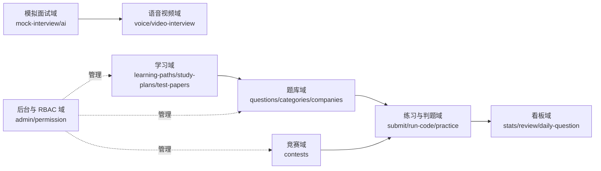

# 07 模块详解

> 项目：interview-platform ｜ 版本：v1.1 ｜ 生成日期：2026-10-06 ｜ 修订：2026-10-06 一致性回刷 ｜ 依据：源码分析

本篇是「业务域深读篇」，与旧篇的分工是：《00-项目总览》讲功能清单、《01-系统架构》讲分层与数据流、《02-页面设计》讲页面布局、《03-接口设计》讲端点契约。本篇则**按业务域逐个下钻到实现机制**：每个域给出「页面清单、Route Handler 清单、服务层清单」三张表，再走读该域的核心机制（谁调谁、状态怎么流转、边界怎么处理）。全部结论逐文件核对自 `src/` 实际源码；接口的逐端点契约细节本篇不展开，统一见《15-接口全量参考》。

## 0. 业务域划分总览

按源码的内聚性，整个平台可以划分为七个业务域。域与域之间通过 `PracticeHistory`（行为事实源）与 `UserQuestionState`（个人状态源）两个共享表产生数据闭环（见《05-核心流程》最后一节），代码层面则几乎不存在跨域 import 服务函数——每个域的 Route Handler 直接组合「`src/lib` 公共服务 + Prisma 单例」完成业务，这是典型的「薄控制器 + 宽服务层」形态。

## 1. 题库域（Question Bank）

### 1.1 文件清单

| 层 | 文件 | 职责 |
| --- | --- | --- |
| 页面 | `src/app/questions/page.tsx` | 列表页：语言分组侧栏 + 筛选 + 分页 + URL 即状态 |
| 页面 | `src/app/questions/[id]/page.tsx`（约 1100 行） | 详情页五标签页容器 |
| 页面 | `src/app/questions/[id]/tabs/*.tsx`（5 个） | AnswerContent / CodeTabContent / DiscussionContent / InterviewContent / SolutionContent |
| 页面 | `src/app/questions/new/page.tsx` | 新建题目表单（需 `question:add` 权限） |
| 页面 | `src/app/companies/page.tsx`、`src/app/companies/[company]/page.tsx` | 公司题库聚合浏览 |
| 页面 | `src/app/question-sets/page.tsx`、`src/app/question-sets/[slug]/page.tsx` | 精选题集列表与集内题目 |
| API | `src/app/api/questions/route.ts` | GET 分页筛选（游客可选登录）；POST 创建（`question:add`） |
| API | `src/app/api/questions/[id]/route.ts` | GET 详情（近 50 条评论）；PATCH 编辑（requireAdmin）；DELETE 删除（`question:manage`） |
| API | `src/app/api/questions/[id]/state/route.ts` | GET/PATCH 个人掌握度与收藏（upsert `UserQuestionState`） |
| API | `src/app/api/questions/[id]/hints/route.ts` | GET 提示列表 / POST 按级生成（按题缓存） |
| API | `src/app/api/questions/[id]/comments/route.ts`、`.../comments/[commentId]/route.ts` | 评论与一层回复 CRUD |
| API | `src/app/api/questions/[id]/solutions/route.ts`、`.../solutions/[solutionId]/route.ts` | 题解发布/编辑/删除 |
| API | `src/app/api/questions/[id]/edits/route.ts`、`src/app/api/question-edits/[id]/route.ts` | 解析编辑建议提交/审核 |
| API | `src/app/api/questions/[id]/encounter/route.ts`、`.../encounters/route.ts` | 「在哪见过这题」标记与查询 |
| API | `src/app/api/questions/[id]/ai-improve/route.ts`、`.../edit/route.ts` | AI 润色解析 / 读取当前解析 |
| API | `src/app/api/categories/route.ts`、`src/app/api/categories/[id]/route.ts` | 分类树（`includeStats`）/新建/编辑/删除（`category:manage`） |
| API | `src/app/api/companies/route.ts` | 公司聚合（distinct company + 计数） |
| API | `src/app/api/question-sets/route.ts`、`src/app/api/question-sets/[slug]/route.ts` | 题集列表 / slug 详情（含浏览计数自增） |
| 服务 | `src/lib/category-cache.ts` | 分类树 5 分钟内存缓存 + `invalidateCategoryCache()` |
| 服务 | `src/lib/category-utils.ts` | `buildCategoryLabels`：重名分类用父级路径消歧（带防死循环保护） |
| 服务 | `src/lib/question-types.ts` | 题型注册表：`QUESTION_TYPE_META` 是题型配置唯一事实来源 |
| 数据 | `prisma/seed.ts` + `src/data/*.ts`（8 个题库文件，约 7.3 万行） | 种子导入：分类 upsert、题目按 title 去重 |

### 1.2 机制走读

**筛选条件的组装策略**。`GET /api/questions` 把全部查询串参数翻译成一个 Prisma `where` 对象，有四个值得注意的细节。其一，关键字搜索对 `title/content/company` 三列做 `contains + mode: "insensitive"`，这是 PostgreSQL ILIKE 全表扫描，未用全文索引（性能讨论见《10-性能设计与优化》）。其二，`mastery` 筛选先查当前用户的 `UserQuestionState` 拿到 questionId 集合，再转成 `where.id = { in: [...] }`——游客请求带 mastery 参数会被直接忽略（个人状态表里没有游客数据）。其三，`categoryId` 筛选支持「连带子分类」：`getAllCategoryIds()` 从 `category-cache.ts` 拿全量分类（5 分钟 TTL），在内存里用 BFS 队列展开子树，避免递归查库。其四，排序字段走白名单 `["createdAt", "viewCount", "encounterCount"]`，白名单外的 `orderBy` 参数静默回退 `createdAt`，防注入任意字段排序。

**个人状态合并**。列表接口在 `findMany + count` 的 `Promise.all` 之后，再用第三次查询批量取当前用户在本页题目上的 `UserQuestionState`，以 `Map` 合并进每条题目（`mastery ?? "unsolved"`、`isBookmarked ?? false`）。这是《01-系统架构》决策四「每用户状态独立成表」的直接体现：题目表本身不存任何个人状态，三次查询替代了 N+1。详情接口 `GET /api/questions/[id]` 同样如此，且刻意**不再 include `practiceHistory`**——源码注释明确写着该关联「含所有用户的做题记录，泄露他人数据且前端未使用」。

**渐进式提示的缓存复用**。`POST /api/questions/[id]/hints` 是 AI 成本控制最精细的一处：提示按「题目 × 级别」唯一键（`QuestionHint` 的 `@@unique([questionId, level])`）缓存，第一个触发生成的用户为全站付费。生成前先查缓存命中即返回 `cached: true`；未命中才调 DeepSeek（非流式，`max_tokens` 按级别 200/500/1000 递增，三级规则为「点拨 / 思路框架 / 详细思路」，任何一级都不给完整答案）；写入时若并发撞唯一键，catch 后回读他人刚生成的记录返回 `cached: true`。GET 方向完全公开（无需登录），POST 需登录且 10 次/分钟限流。Prompt 把题面截断到 3000 字、参考答案截断到 2500 字注入，并约束「绝不直接透露答案」。

**题型注册表**。`src/lib/question-types.ts` 用 `QUESTION_TYPE_META` 常量收敛 qa/code/judge 三种题型的标签文案、配色 token、标签页集合、默认标签页与「是否需要代码模板」。`normalizeQuestionType()` 把数据库里的历史脏值一律归一化为 `qa`，`getQuestionTypeMeta()` 因此永不抛错。新增题型只需改这一个文件（SOP 见《11-扩展开发指南》第 6 节）。

**编辑建议审核链**。用户在详情页对解析提交修改建议（`POST /api/questions/[id]/edits`，登录即可），建议落在 `QuestionEdit` 表（`status: pending`）；管理员通过 `POST /api/question-edits/[id]`（`action: approve/reject` + 可选 `reviewMessage`）处置，approve 时会把建议的 `reference` 写回 `Question.solution`。这是平台「众包纠错 + 人工审核」的内容质量机制。

## 2. 练习与判题域（Practice & Judge）

### 2.1 文件清单

| 层 | 文件 | 职责 |
| --- | --- | --- |
| 组件 | `src/components/CodeMirrorEditor.tsx` | CodeMirror 6 多语言编辑器（JS/TS/Python/Java/C++/SQL 语言包） |
| 组件 | `src/components/CodeRunner.tsx` / `src/components/CodeSubmitter.tsx` | 即时运行 / 正式判题的交互封装 |
| API | `src/app/api/run-code/route.ts` | POST 即时运行（登录 + 30 次/分限流），不落库 |
| API | `src/app/api/questions/[id]/submit/route.ts` | POST 正式判题（未登录可判，登录才写记录） |
| API | `src/app/api/practice/route.ts` | POST 手写练习记录（登录） |
| 服务 | `src/lib/judge.ts` | `judgeCode()` 判题编排 + `wrapCode()` 四语言包装器 |
| 服务 | `src/lib/code-runner.ts` | `runCode()`：Piston API 调用 + 5 语言版本映射 |
| 模型 | `PracticeHistory` / `TestCase` / `UserQuestionState` | 行为事实源 / 判题依据 / 掌握状态 |

### 2.2 机制走读

判题链路在《01-系统架构》第 3 节已有完整时序图、《05-核心流程》流程三有流程图，这里补充三个实现层细节。**第一，包装器的语言差异是真实的能用性差异**：`wrapJavaScript` 用正则从用户代码里提取函数声明/箭头函数变量/Solution 类并自动调用，`wrapPython` 反射实例化 `Solution` 并调用第一个公开方法，两者都能「用户只写函数」即可判题；而 `wrapJava`/`wrapCpp` 在检测不到入口时只注入一个打印提示文案的占位 main（Java 包装器还留了一个未使用的 `input` 变量），意味着 Java/C++ 实际要求用户自带 `main`——这是已知局限（详见《13-技术债务与演进建议》2.7）。**第二，判题是串行逐用例**：`judgeCode` 用 for 循环逐个执行测试用例，每用例 `Promise.race` 15 秒超时，超时立即 `break`（状态定格 `time_limit_exceeded`），错答案与运行时错误的优先级是 `wrong_answer` > `runtime_error`（后者只在非 wrong_answer 时覆盖）。**第三，副作用集中且单向**：判题通过后把 `unsolved` 推进为 `learning`，但绝不回退 `mastered`；练习记录的 `status` 映射规则是 `accepted → completed`、其余 → `failed`，`/api/practice`、`/api/reminders`、`/api/leaderboard` 都消费同一约定，保证统计口径一致。

「即时运行」与「正式判题」的分离设计也值得注意：`/api/run-code` 只执行一次、支持 stdin、不产生任何写副作用，供调试；`/api/questions/[id]/submit` 逐用例比对、产生学习记录。两者共享 `runCode()` 但走不同的限流池（run-code 30 次/分/用户，submit 不限流因为耗时被 15 秒/用例上限天然约束）。

## 3. 模拟面试域（Mock Interview）

### 3.1 文件清单

| 层 | 文件 | 职责 |
| --- | --- | --- |
| 页面 | `src/app/ai/mock-interview/page.tsx`（约 1715 行） | 四视图：select（选方向模式）/ chat（对话）/ history（历史）/ video（视频面试） |
| 组件 | `src/components/ProgressiveHints.tsx`、`src/components/SpeakButton.tsx` | 提示面板 / 问题朗读（Web Speech API） |
| API | `src/app/api/mock-interview/route.ts` | POST 创建面试 + 出第一题（SSE） |
| API | `src/app/api/mock-interview/[id]/turn/route.ts` | POST 提交回答，AI 评估 + 追问（SSE） |
| API | `src/app/api/mock-interview/[id]/complete/route.ts` | PATCH 提前结束（本地均分计算 overallScore） |
| API | `src/app/api/mock-interview/[id]/route.ts` | DELETE 删除自己的面试（归属校验） |
| API | `src/app/api/mock-interviews/route.ts` | GET 我的历史面试（含 turns） |
| API | `src/app/api/ai/route.ts` | POST AI 教练自由对话（默认 SSE，`?stream=false` 降级） |
| API | `src/app/api/ai/evaluate/route.ts` | POST 四维评分（准确性/完整性/清晰度/深度） |
| API | `src/app/api/ai/review-code/route.ts` | POST 代码点评（可关联题目上下文） |
| 服务 | `src/lib/deepseek.ts` | `callDeepSeek` / `callDeepSeekStream` / `sseFormat` / Key 校验 |
| 服务 | `src/lib/sse.ts` | `parseSSEStream`（前端手工解析 SSE） |
| 服务 | `src/lib/behavioral-questions.ts` | 行为面试本地题库（首题不走 AI） |

### 3.2 机制走读

**会话状态机**。一场面试 = 一条 `MockInterview`（`status: in-progress → completed`）+ 最多 5 条 `MockInterviewTurn`（`turnOrder` 1..5）。创建接口做三层护栏后先建面试记录拿 id，再按方向分叉：`behavioral` 方向直接从 `behavioral-questions.ts` 随机取题写入 Turn#1 并用 setTimeout 模拟流式输出（不耗 AI 配额）；技术方向则携带方向人设 system prompt 调 DeepSeek 流式生成第一题。**轮次推进的原子性**是本域最关键的设计：`turn` 接口在流式转发完 AI 反馈后，用 `parseDeepSeekJSON`（正则提取 Markdown 代码围栏内的 JSON，兼容无围栏纯 JSON）解析出 `{feedback, score, nextQuestion?, isComplete?, overallScore?, summary?}`，然后在**一个 `$transaction` 内**同时「更新本轮（答案/反馈/分数）+ 创建下一轮或完结面试」。源码注释记录了教训：早期先存答案再调 AI，一旦 AI 失败该轮被 `userAnswer` 占用，用户永远无法重试。第 5 轮（`turnOrder >= 5`）或 AI 返回 `isComplete` 时，事务同时落 `overallScore/summary/endedAt`。

**双轨评估 prompt**。turn 接口按 `isBehavioral` 与 `isLastTurn` 组合出四种 evaluationPrompt：行为面试走 STAR 法则评分标准（完整性 40% / 具体性 25% / 逻辑性 20% / 表达力 15%），技术面试走通用评估；最后一轮强制 `isComplete: true` 并要求返回 `overallScore`（0-100）与 `summary`。用户回答以引号包裹嵌入 prompt 的 user 消息中，这是本域的主要提示词注入面（安全分析见《08-安全与权限设计》第 5 节）。

**字段映射约定**。Prisma 字段 `aiQuestion/userAnswer/aiFeedback` 在前端映射为 `question/answer/feedback`——`AGENTS.md` 开发约定第 4 条明确要求保留该映射，前后端字段名不同是历史演化结果，重构时两边必须同步。

**AI 三兄弟接口的分工**：`/api/ai` 是自由对话教练（前端拼 `messages[]`，服务端只注入 system prompt 与透传流）；`/api/ai/evaluate` 是结构化评分（服务端组装四维评估 prompt，返回 JSON）；`/api/ai/review-code` 是代码点评（可带题目上下文）。三者都是 `requireAuth` + 20 次/分限流 + Key 校验 503 的同构管线，`/api/ai` 额外支持 `?stream=false` 降级为非流式 JSON。

## 4. 语音视频域（Voice & Video）

### 4.1 文件清单

| 层 | 文件 | 职责 |
| --- | --- | --- |
| 组件 | `src/components/VoiceInput.tsx` + `src/hooks/useSpeechRecognition.ts` | 录音 → base64 → `/api/voice/asr` → 文本回填 |
| 组件 | `src/components/VideoInterviewView.tsx` | RTC 进房、AI 面试官启停、字幕渲染、转写保存 |
| API | `src/app/api/voice/asr/route.ts` | POST 豆包 ASR 代理（WebSocket 二进制协议，≤10MB） |
| API | `src/app/api/voice/tts/route.ts` | POST 豆包 TTS 代理（游客可按 IP 限流使用，10 次/分） |
| API | `src/app/api/video-interview/token/route.ts` | HEAD 探测配置 / POST 签发 RTC Token（1 小时） |
| API | `src/app/api/video-interview/start/route.ts` | POST StartVoiceChat / DELETE StopVoiceChat |
| API | `src/app/api/video-interview/save/route.ts` | POST 转写落库（防 IDOR，见《08-安全与权限设计》） |
| 服务 | `src/lib/volcengine.ts` | 四套凭证读取器 + `isVoiceConfigured` / `isSeedRealtimeConfigured` + V4 签名 |
| 服务 | `src/lib/volcengine-voice.ts` | ASR/TTS 的鉴权头与请求体构造 |
| 服务 | `src/lib/video-interview.ts` | RTC Token 二进制协议生成 + StartVoiceChat/StopVoiceChat OpenAPI 调用 |

### 4.2 机制走读

本域的本质是**「服务端代理 + 凭证保险箱」**：四套互不相同的火山凭证（豆包 ASR/TTS 的 API Key、端到端语音大模型 S2S 的 AppId+Token、RTC 应用的 AppId+AppKey、账号级 AK/SK）全部只在服务端读取，前端永远只拿到「会话级产物」——ASR/TTS 返回文本与音频 base64，视频面试返回 `{appId, roomId, userId, token}`。可用性探测也是显式设计：前端在渲染视频入口前先 `HEAD /api/video-interview/token`，服务端用 `isSeedRealtimeConfigured()`（六项凭证布尔与）返回 200/503，未配置时入口直接隐藏而非点击报错。

`/api/voice/asr` 是全项目唯一一处 WebSocket 客户端实现：服务端用 `ws` 直连 `wss://openspeech.bytedance.com`，按豆包二进制协议（4 字节头：协议版本+头大小 / 消息类型+标志 / 序列化+压缩 / 保留位）依次发送「full client request（音频元数据 JSON）→ 每片 6400 字节的 audio only request（约 200ms 的 16kHz 16bit 单声道）→ 空负载负包表示结束」，收包侧解析累积式识别结果，取 `isFinal` 的 text，整体 30 秒超时保护。`/api/voice/tts` 则是 HTTP Chunked 透传：响应可能是单个 JSON 或多个换行分隔的 JSON 分片，接口对两种形态都做了容错拼接，最终返回 `audioBase64`。

`src/lib/video-interview.ts` 有两段协议级实现值得精读：`generateRtcToken()` 严格按火山官方算法构造「001 + AppId 明文 + Base64(二进制负载 + HMAC 签名)」——二进制负载为大端序的 Nonce/IssuedAt/ExpireAt 三个 UInt32 + 带长度前缀的 RoomId/UserId + key 升序的 Privileges（key 0 发布流、key 4 订阅流），签名密钥是 AppKey；`startVoiceChat()` 以 V4 签名（HMAC-SHA256 推导链 kDate → kService → kSigning）调用 RTC OpenAPI 的 StartVoiceChat，body 里通过 `S2SConfig.ProviderParams.dialog` 注入面试官人设（`system_role`）、音色与说话风格，`SubtitleConfig.SubtitleMode=1` 开启整句字幕回传。AI 面试官的首个问题固定为自我介绍引导，人设由 `INTERVIEWER_PROMPT` + 方向标签拼装，且 `direction` 走 `ALLOWED_DIRECTIONS` 白名单（源码注释明确写着「防止 prompt 注入」）。

面试结束后的收口在 `POST /api/video-interview/save`：前端把 SeedRealtime 字幕整理为 `{interviewId, direction, turns[], overallScore?, summary?}` 提交，服务端在事务内「存在则校验归属（userId 非空且非本人即 403）、不存在则以该 id 新建并归属当前用户、历史匿名记录确立归属」，然后清空旧 turns 重写。这个接口防住了「覆盖他人面试记录」的 IDOR（详见《08-安全与权限设计》第 4 节）。

## 5. 竞赛域（Contest）

### 5.1 文件清单

| 层 | 文件 | 职责 |
| --- | --- | --- |
| 页面 | `src/app/contests/page.tsx` | 竞赛列表（状态着色）+ 创建表单 |
| 页面 | `src/app/contests/[id]/page.tsx`（约 661 行） | 赛题工作台：题目列表 + 编辑器 + 结果展示 + 排行 |
| 组件 | `src/components/CreateContestForm.tsx` | 自定义赛创建表单 |
| API | `src/app/api/contests/route.ts` | GET 分页列表（status 筛选，limit≤50）/ POST 创建（登录，题目标题批量关联） |
| API | `src/app/api/contests/[id]/route.ts` | GET 详情（登录用户附带自己的提交）/ PATCH、DELETE（`contest:manage`） |
| API | `src/app/api/contests/[id]/submit/route.ts` | POST 提交判题（时间窗 + 隐藏用例 + 得分折算） |
| API | `src/app/api/contests/[id]/leaderboard/route.ts` | GET 排行（按用户聚合，take 100） |
| 模型 | `Contest` / `ContestProblem` / `ContestSubmission` | 竞赛 / 赛题（分值与顺序）/ 提交档案 |

### 5.2 机制走读

提交接口是练习判题的「加强版」，与 `/api/questions/[id]/submit` 有四处差异。**其一，时间窗校验**：竞赛结束时间不是存储字段而是动态推导（`startTime + duration × 60000`），`Contest.status` 只是展示用冗余；早于开始或晚于结束都返回 400（错误消息区分「尚未开始/已结束」）。**其二，题目归属校验**：通过 `contest.problems.where({questionId})` 确认该题确实属于本竞赛，同时顺带拿到该题分值。**其三，隐藏用例**：调用 `judgeCode(questionId, code, language, true)`，`includeHidden=true` 使 `TestCase` 查询不再过滤 `isHidden`，防止「面向样例编程」。**其四，得分策略**：`accepted` 得满分（`ContestProblem.score`，默认 100），否则 `round(passedCount / totalCount × score)` 按比例折算，提交原文（`code @db.Text`）连同状态/得分/耗时落库供赛后复盘。

排行榜接口在路由内完成聚合：按 userId 分组取每人每题最高分，排序后 `take: 100` 截断返回。创建竞赛（`POST /api/contests`）只需登录（非 RBAC 权限点），服务端按传入的题目标题批量 `question.findMany` 关联为 `ContestProblem`——这意味着创建者可以任选全库公开题目组赛，而无题量上限校验 ⚠️ 待确认（源码未见上限拦截，极端情况可创建含大量题目的竞赛）。

## 6. 学习域（Learning Paths / Study Plans / Test Papers）

### 6.1 文件清单

| 层 | 文件 | 职责 |
| --- | --- | --- |
| 页面 | `src/app/learning-paths/page.tsx`、`[id]/page.tsx` | 路径浏览 / 详情 + 一键加入 |
| 页面 | `src/app/study-plans/page.tsx`、`[id]/page.tsx`（含 `layout.tsx`） | 计划列表 / 按天编排与进度勾选 |
| 页面 | `src/app/test-papers/page.tsx`、`new/page.tsx`、`[id]/page.tsx` | 试卷列表 / 组卷 / 答题与成绩 |
| 组件 | `src/hooks/useQuestionBasket.ts` + `src/components/QuestionBasketButton.tsx`、`QuestionBasketDrawer.tsx` | 跨页题篮（localStorage）→ 组卷入口 |
| API | `src/app/api/learning-paths/route.ts` | GET 列表（category/preset 筛选）/ POST 创建（`path:manage`） |
| API | `src/app/api/learning-paths/[id]/route.ts`、`[id]/join/route.ts` | 详情/编辑/删除（`path:manage`）/ 一键转为学习计划 |
| API | `src/app/api/study-plans/route.ts`、`[id]/route.ts`、`[id]/items/route.ts`、`[id]/progress/route.ts` | 计划 CRUD / 天内加删题 / 进度勾选取消 |
| API | `src/app/api/test-papers/route.ts`、`[id]/route.ts`、`[id]/submit/route.ts` | 组卷与列表 / 详情编辑删除 / 交卷判分 |
| 模型 | `LearningPath(+Item)` / `StudyPlan(+Day/Item/Progress)` / `TestPaper(+Item/Submission)` | 模板 / 私有计划四级结构 / 试卷与快照 |

### 6.2 机制走读

**模板到实例的复制**。`POST /api/learning-paths/[id]/join` 是学习域最有代表性的流程：读路径及其 items（按 `dayNumber + sortOrder` 排序）→ 收集不重复天数 → 一次嵌套 create（`studyPlan.create` 携带 `days.create[].items.create[]`）生成属于当前用户的 `StudyPlan/Day/Item` 三层副本，标题带上路径图标前缀、描述标注来源。整条链路没有用事务包住（Prisma 嵌套 create 本身是单条原子写），失败即整体回滚。

**归属校验的样板**。study-plans 的四个路由文件都定义了同构的 `checkOwnership(planId, userId)` 辅助函数：查不到返回 404、`plan.userId !== userId` 返回 403（「无权访问此学习计划」），三处复制粘贴而非抽到 lib——功能正确但属可收敛的重复（见《13-技术债务与演进建议》）。计划内加题还有第二层校验：`studyPlanDay.findFirst({where: {id: studyPlanDayId, studyPlanId}})` 确保 day 确实属于该计划，防跨计划写入。进度勾选用 `@@unique([studyPlanId, userId, questionId])` 三元组唯一键做 upsert（`update: {}` 空更新实现幂等），多人协作同一计划时进度互不覆盖。

**试卷判分与快照**。组卷（`POST /api/test-papers`）走 zod 校验（1-100 题），服务端按 questionIds 批量查题并把 `questionType` 快照进 `TestPaperItem`（题目后续改题型不影响已建卷）。交卷把整份答案 JSON 存入 `TestPaperSubmission.answers`，判分后返回 `{score, total, correctCount}`。试卷可见性二态：`isPublic=true` 全站可见，否则仅创建者（GET 列表支持 `mine=true` 与 `isPublic` 参数）。注意该二态只在**列表端点**生效——详情端点 `GET /api/test-papers/[id]` 未做守卫也不过滤 `isPublic`，任何 id 均可读且响应含题目 `answer/solution`（答题前即可见，现状与风险见《15-接口全量参考》文末备注；2026-10-06 回刷补注）。

## 7. 看板域（Dashboard / Stats / Review）

### 7.1 文件清单

| 层 | 文件 | 职责 |
| --- | --- | --- |
| 页面 | `src/app/page.tsx` + `src/app/dashboard/DashboardComponents.tsx`（约 1120 行） | 首页仪表盘全部卡片 |
| 图表 | `src/components/charts/RadarChart.tsx`、`ProgressLineChart.tsx`、`CategoryPieChart.tsx`、`src/app/dashboard/CalendarHeatmap.tsx` | 雷达 / 折线 / 饼图 / 90 天热力图 |
| 页面 | `src/app/report/page.tsx`、`src/app/leaderboard/page.tsx` | 学习报告 / 全站排行 |
| API | `src/app/api/stats/route.ts` | 基础统计（总数/掌握/最近练习/高频错题） |
| API | `src/app/api/stats/extended/route.ts` | 扩展统计（日/周/月、分布、90 天热力图、掌握四格） |
| API | `src/app/api/stats/ability/route.ts`、`stats/report/route.ts`、`stats/streak/route.ts` | 能力雷达 / 报告 / 打卡（GET 顺带物化当日快照） |
| API | `src/app/api/review/due/route.ts`、`review/schedule/route.ts` | 到期复习清单 / 单题六阶段计划 |
| API | `src/app/api/daily-question/route.ts` | 每日一题（日期确定性种子） |
| API | `src/app/api/leaderboard/route.ts` | 排行榜（`by=solved|...`、`period` 参数） |
| API | `src/app/api/reminders/route.ts`、`reminders/digest/route.ts` | 复习提醒（页面） / cron 邮件摘要（`CRON_SECRET`） |
| 服务 | `src/lib/review-scheduler.ts` | 艾宾浩斯间隔推导（`EBINGHAUS_INTERVALS = [1,2,4,7,15,30]`） |
| 服务 | `src/lib/streak.ts` | 上海时区日界工具 + 连续/最长打卡计算 |

### 7.2 机制走读

**无计划表的复习调度**。`getDueReviewQuestions()` 不维护任何「复习计划」表，每次实时从 `PracticeHistory` 推导：`groupBy questionId` 取每题最近练习时间与总次数，`reviewCount = 总次数 - 1`（首次练习不算复习），`stage = min(reviewCount, 5)`，下次复习时间 = 最近练习日 + `EBINGHAUS_INTERVALS[stage]` 天，`daysOverdue >= 0` 者进入待复习清单并按逾期天数降序。个人数据量级下可接受，但这是「每用户全量扫描 groupBy」的模式（性能讨论见《10-性能设计与优化》）。注意 `/api/reminders` 内部另有一份 `SPACED_INTERVALS = [1,3,7,15,30]`——与 review-scheduler 的艾宾浩斯表不一致，属于遗留分叉（见《13-技术债务与演进建议》2.4）。

**读时物化的打卡快照**。`GET /api/stats/streak` 每次重算当日快照：`computeStreakStats()` 拉近一年练习记录 → `toDateKey` 转上海日历日集合 → 今天练过从今天倒查、否则从昨天倒查得 `currentStreak`，排序扫描得 `longestStreak` → upsert `UserStreak` 当日行（`questionCount/dailyGoal/goalMet`）。`UserStreak` 表因此是「缓存快照」而非事实源，删掉也能随时重算。POST 同路径用于修改 `dailyGoal`。

**看板的并行取数**。`stats/extended` 用一个 `Promise.all` 并发八条查询（日/周/月计数、30 天明细、90 天热力图明细、掌握 groupBy、题目总数、去重练习 groupBy），再在内存做分布统计与 90 天补零热力图。首页则用 SWR 并行订阅六个接口，`daily-question` 的 404（题库为空）被刻意排除在整页错误判定外。

**每日一题的确定性抽取**。`GET /api/daily-question` 以当天日期字符串作随机种子，保证同一天全站所有人看到同一题；登录用户优先从「未掌握题目」中抽取（个人状态过滤），游客从全库抽取，题库为空返回 404。

## 8. 后台与 RBAC 域（Admin & RBAC）

### 8.1 文件清单

| 层 | 文件 | 职责 |
| --- | --- | --- |
| 页面 | `src/app/admin/layout.tsx` | 侧栏导航 + 客户端 admin 校验（与 proxy 双保险） |
| 页面 | `src/app/admin/dashboard|questions|question-sets|categories|users|reports|contests|learning-paths/page.tsx` | 8 个管理子页 |
| API | `src/app/api/admin/stats/route.ts` | 仪表盘聚合（用户/题目/竞赛/举报计数、30 天趋势、难度与分类分布） |
| API | `src/app/api/admin/users/route.ts`、`[id]/ban/route.ts`、`[id]/role/route.ts` | 用户列表 / 封禁（禁自封）/ 改角色（白名单 admin\|user） |
| API | `src/app/api/admin/questions/batch-delete/route.ts`、`batch-company/route.ts` | 批量删除 / 批量设置公司 |
| API | `src/app/api/admin/question-sets/route.ts`、`[id]/route.ts` | 题集管理 CRUD |
| API | `src/app/api/admin/login/route.ts` | 后台独立登录（账密 → 7 天 Bearer JWT） |
| 服务 | `src/lib/permission.ts` | `requirePermission(权限点)`：双通道鉴权 + 30 秒角色权限缓存 |
| 服务 | `src/lib/admin-auth.ts` | `requireAdmin()` ≡ `requirePermission("admin:access")` |
| 服务 | `src/lib/jwt.ts` | jose HS256 签发/校验后台 Bearer JWT（7 天） |
| 数据 | `prisma/migrations/20260824010000_add_rbac_models`、`20260824020000_seed_rbac_data` | RBAC 三表 + 三角色七权限点种子 |

### 8.2 机制走读

RBAC 的数据链是 `User.role（字符串弱关联）→ Role.code → RolePermission → Permission.code`。迁移种子定义了 `admin`（7 个权限点全量）、`editor`（6 个内容管理权限点，含 `admin:access`）、`user`（无任何权限点）三角色，全部 `ON CONFLICT DO NOTHING` 幂等。`requirePermission` 支持两种鉴权来源：请求头带 `Authorization: Bearer` 时走 `verifyJWT`（外部后台项目调用），否则走 NextAuth session（主站访问）；角色 → 权限集合有 30 秒 TTL 内存缓存，意味着改角色后最长 30 秒才生效（安全权衡见《08-安全与权限设计》第 3 节）。

**首个管理员的引导是「手工改库」**：源码没有任何 bootstrap 机制（无环境变量注入首管理员、seed 不提升任何用户），部署后必须手动执行 SQL（如 `UPDATE users SET role='admin' WHERE email='...'`）完成引导，之后的角色调整才走 `PATCH /api/admin/users/[id]/role`（只允许 `admin|user` 两个值——editor 角色目前无法通过 API 授予 ⚠️ 待确认是否为有意收窄）。封禁接口额外做了「不能封禁自己」防护（Bearer 调用方无 session 时跳过该检查），且更新用 `select` 白名单脱敏，不回传 password。

后台独立登录（`POST /api/admin/login`）是给外部管理端用的非 NextAuth 通道：IP 维度 5 次/分钟限流防爆破 + 按邮箱的失败计数锁定（10 次/小时，仅在失败分支计数），验证 `role === "admin"` 与 `banned` 后签发 7 天 JWT。这解释了 `permission.ts` 为什么必须支持 Bearer 通道。

## 9. 认证与用户域（Auth & User）

该域的注册/登录全链路已在《05-核心流程》流程一完整走读，这里只列清单并补充用户域特有机制。文件：`src/app/(auth)/login|register/page.tsx`、`src/components/auth/LoginForm.tsx`、`RegisterForm.tsx`、`AuthGuard.tsx`；API：`src/app/api/auth/[...nextauth]/route.ts`、`send-code`、`register`、`check-email`、`src/app/api/user/route.ts`（GET 详情+统计 / PATCH 资料 / **DELETE 注销**）、`src/app/api/user/password/route.ts`、`src/app/api/users/[id]/route.ts`、`users/[id]/profile/route.ts`；服务：`src/lib/auth.ts`、`session.ts`、`verify-code.ts`、`mailer.ts`。

三个值得注意的机制：**注销是全量事务清理**——`DELETE /api/user` 在一个 `$transaction` 数组里按依赖顺序 deleteMany 十九张表（session/account → 行为数据 → 内容 → 社交关系 → user 本体），强归属数据随外键 Cascade，弱归属内容（题解/评论/笔记）也被显式删除而非置空，即「注销即彻底删除」而非匿名化；**公开用户主页脱敏**——`GET /api/users/[id]/profile` 的 select 白名单只暴露 name/image/bio/统计与关注状态，邮箱永不外泄，且用 `optionalAuth` 让查看者看到 `isFollowing/isSelf`；**密码修改先验旧密码**——`PATCH /api/user/password` 先 `bcrypt.compare` 旧密码再更新，未提供「忘记密码」邮件重置链路 ⚠️ 待确认（源码未见 reset 端点）。

## 10. 社区与个人状态域（Community）

| 域 | 页面 | API | 要点 |
| --- | --- | --- | --- |
| 关注 | `src/app/users/[id]/page.tsx` | `src/app/api/follow/route.ts`（POST/DELETE/GET） | `@@unique([followerId, followingId])` + upsert 防重；GET 支持查任意用户粉丝/关注列表与「我是否关注」 |
| 通知 | `src/app/notifications/page.tsx` | `src/app/api/notifications/route.ts`、`[id]`、`read-all` | 分页 + `unreadOnly`/`type` 筛选 + 未读计数；写入口统一走 `src/lib/notify.ts`（自己不通知自己、失败不阻塞） |
| 举报 | — | `src/app/api/reports/route.ts`（POST 用户举报/GET Admin 列表）、`[id]`、`batch` | 多态 target（question/comment/note 存在性校验）+ `status` 处置流 + 批量 `updateMany` |
| 分享 | `src/app/s/[slug]/page.tsx` | `src/app/api/share/route.ts` | 幂等复用（type+targetId 查已有）；slug 用 8 位随机串并循环查重；GET 解析短链并自增 views |
| 笔记 | `src/app/experiences/page.tsx` | `src/app/api/notes/route.ts`、`notes/[id]` | **列表与创建都需登录**（返回本人笔记，支持 search），编辑/删除校验归属 |
| 收藏夹 | `src/app/bookmarks/page.tsx` | `src/app/api/bookmarks/folders(/ [id])`、`items` | 两级收藏：文件夹 CRUD（排序取 `aggregate max` +1）+ 条目 `@@unique([folderId, questionId])` |
| 评论/题解 | 题目详情页内 | `comments`、`solutions` 系列 + `solutions/[id]/upvote`、`solutions/user/[id]` | 评论一层回复（parentId）；点赞是简单 +1（toggle 由前端维护，无去重表 ⚠️ 待确认重复点赞会累加） |

社区域的横向机制是「旁路通知」：点赞、关注、评论回复等动作通过 `createNotification()`（`src/lib/notify.ts`）落一条 `Notification`，该函数吞掉自身异常只打日志——通知失败绝不阻塞主业务。举报与短链对 target 用多态字符串引用（无外键），目标内容删除后记录残留，由后台人工处置（见《04-数据模型》第 5 节弱引用设计）。

## 11. 域间协作小结

最后把七个域的协作关系收敛成三句话。**第一，题库域是所有域的内容底座**：判题读它的 TestCase，竞赛/路径/试卷/题集引用它的 Question，AI 提示读它的 solution。**第二，行为数据单向流入看板域**：练习与判题产生 `PracticeHistory`，打卡、热力图、复习调度、排行榜全部是它的下游只读视图。**第三，后台域通过权限点横切所有内容域**：题目/分类/竞赛/路径/题集的管理端点全部挂 `requirePermission`，而用户管理与举报处置挂 `admin:access`，两套权限点通过迁移种子静态分配。理解这三条主线后，任何新需求都可以快速定位「落在哪个域、动哪些表、挂哪个权限点」。
