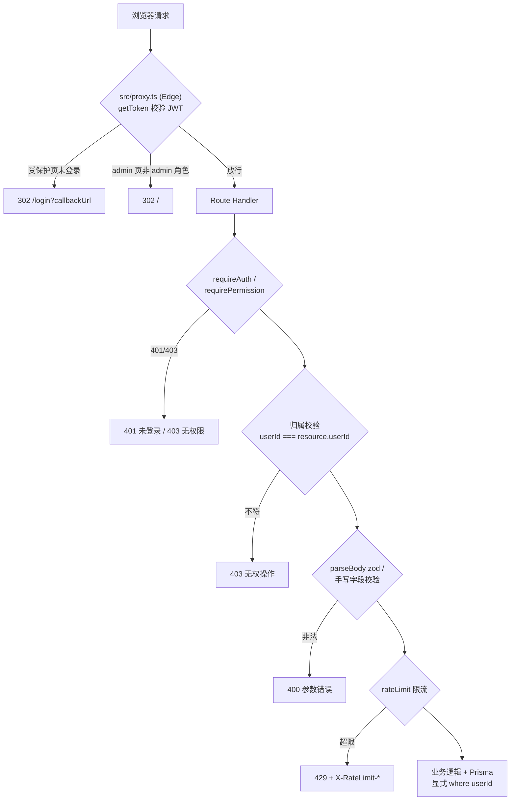

# 08 安全与权限设计

> 项目：interview-platform ｜ 版本：v1.1 ｜ 生成日期：2026-10-06 ｜ 修订：2026-10-06 一致性回刷 ｜ 依据：源码分析

本篇是安全专项篇，系统梳理 interview-platform 的认证会话、RBAC 权限、API 鉴权层、输入校验、AI 提示词注入面、文件上传安全与已知隐患。与《01-系统架构》的「安全设计」段落、《03-接口设计》的「认证与鉴权机制」一节是深化关系：旧篇讲「有哪些机制」，本篇讲「机制为什么这样设计、边界在哪、哪里还可能被打」。每一条结论都标注了源码位置，便于复核与整改。

## 1. 安全模型总览

整个系统的安全设计可以概括为「**四层纵深 + 一条旁路**」：Edge 层（`src/proxy.ts`）做页面级粗筛，API 层（`src/lib/session.ts` / `permission.ts`）做会话与权限点细查，数据层（各路由内归属校验）做资源级隔离，内容层（rehype-sanitize、CSP、响应头）做注入与滥用防御；旁路是限流（`src/lib/rate-limit.ts`），横切保护所有消耗外部配额的入口。四层彼此独立失效不影响另一层——例如 proxy 挂了，API 层仍然拦得住未授权数据访问。



## 2. 认证与会话（next-auth）

**会话策略与签名密钥**。`src/lib/auth.ts` 配置 `session.strategy = "jwt"`，并显式指定 `secret: process.env.AUTH_SECRET`——源码注释解释了原因：NextAuth v4 默认读 `NEXTAUTH_SECRET`，若不显式指定，会话 JWT 可能退回开发默认密钥，导致与 `src/proxy.ts`、`src/lib/jwt.ts` 的密钥不一致（proxy 用 `NEXTAUTH_SECRET ?? AUTH_SECRET` 兜底，`docker-compose.yml` 把两者注入同一值 `${AUTH_SECRET}` 三重保险）。`src/lib/jwt.ts`（后台 Bearer JWT）在**模块加载时**就求值密钥：生产环境未设置 `AUTH_SECRET` 直接抛错拒绝启动，开发环境回退硬编码 `dev-secret-change-in-production` 并打印警告——模块级求值意味着运行期轮换密钥必须重启进程 ⚠️ 待确认（未见热轮换逻辑）。

**登录前置校验**。`authorize()` 的检查顺序是：凭证非空 → 按邮箱查用户 → `banned` 抛 `ACCOUNT_BANNED` → `emailVerified` 缺失抛 `EMAIL_NOT_VERIFIED` → `bcrypt.compare`。注意 bcrypt 比较在封禁/未验证检查**之后**，这有一个细微的时序侧信道：攻击者可以通过响应差异（错误码不同）探测某邮箱是否注册/被封禁。注册接口的邮箱查重（`GET /api/auth/check-email`）本就是公开的枚举面，属低危已知权衡。

**「无状态令牌 + 有状态校正」**。`session` 回调每次拉取会话都 `findUnique` 回查用户，`banned=true` 时返回 null 会话——由于 JWT 无法主动吊销，这是「封禁即时踢出」的唯一手段：被封禁用户下一次请求 API 时 `getServerSession` 拿到 null，全部接口 401；前端 `src/lib/request.ts` 收到 401/403 自动 `signOut` 跳登录页。同一回调还刷新 `image/name/role`，保证改头像/改角色实时生效。代价是**每个带会话的请求多一次主键查库**（性能影响见《10-性能设计与优化》第 3 节），且回调查库失败时降级用 token 旧值（catch 分支），可用性优先。

**凭证安全**。密码 `bcrypt.hash(password, 10)` 十轮加盐（`POST /api/auth/register`），测试用例（`src/app/api/auth/register/route.test.ts`）显式断言了轮数参数。注册验证码体系（`src/lib/verify-code.ts`）：6 位数字 `crypto.randomInt(100000, 1000000)`、5 分钟过期、60 秒重发窗口（`isRateLimited` 按最近一条记录的过期时间倒推）、验证成功即 `deleteMany` 该邮箱全部历史码（一次性使用）。发码接口 IP 限流 5 次/分（`send-code` 路由），注册接口 IP 限流 10 次/时。遗留问题：验证码校验本身没有独立尝试次数上限，爆破 6 位码的空间受注册接口 10 次/时/IP 的限流间接约束 ⚠️ 待确认（若攻击者分布 IP，理论上限仍为每小时 10 次提交 × 每次一个码）。

## 3. RBAC 权限模型与首个管理员的 bootstrap

**数据模型**。`Role / Permission / RolePermission` 三表通过迁移 `prisma/migrations/20260824010000_add_rbac_models` 建表，`20260824020000_seed_rbac_data` 灌入三角色七权限点：`admin`（全部 7 个）、`editor`（6 个内容管理权限点，含 `admin:access` 但不含 `user:manage`）、`user`（无权限点），全部 `ON CONFLICT DO NOTHING` 幂等。`User.role` 是指向 `Role.code` 的**字符串弱关联**（无外键约束，schema 注释说明是为「避免破坏现有数据」），这带来一个边界：给用户写入不存在的 role 字符串不会报错，但 `loadRolePermissions` 查不到 Role 记录时返回空数组 → 一切权限点校验 403，即「脏 role 值等价于无权限」，fail-safe 方向正确。

**校验入口**。`src/lib/permission.ts` 的 `requirePermission(code)` 双通道识别身份：请求头 `Authorization: Bearer <JWT>` 优先（`verifyJWT` 校验失败即返回 null，不会降级到 session——防止拿无效 token 绕过），否则走 NextAuth session，role 缺省按 `user`。角色权限集合有 30 秒 TTL 内存缓存（模块级 Map），**改角色或改角色权限点后最长 30 秒内旧权限仍有效**，且多实例部署时各进程缓存独立——这是权限变更的生效窗口，运营侧需知晓。`src/lib/admin-auth.ts` 的 `requireAdmin()` 已收敛为 `requirePermission("admin:access")` 的别名，旧调用点无需改动。

**Bootstrap 流程（重要）**。源码**没有**「首个管理员」引导机制：无 `ADMIN_EMAIL`/`BOOTSTRAP_ADMIN` 环境变量，`prisma/seed.ts` 不提升任何用户角色。因此生产部署后必须手工改库（`docker-compose.yml` 未编排 psql，需在数据库侧执行）：

```sql
UPDATE users SET role = 'admin' WHERE email = 'you@example.com';
```

前提是注册流程已跑通（SMTP 未配置时验证码打印在服务端控制台，见《12-FAQ与故障排查》）。角色/权限点数据随 `migrate deploy` 自动就位（容器 CMD 内建），无需手工播种。之后的角色调整走后台接口 `PATCH /api/admin/users/[id]/role`，白名单只允许 `admin|user` 两个值——`editor` 角色目前**无法**通过任何 API 授予，只能改库 ⚠️ 待确认是否有意收窄。

**页面级与 API 级的双保险**。`src/proxy.ts`（Next.js 16 将 middleware 更名为 proxy，运行于 Edge Runtime，因此只能 import `next-auth/jwt` 的 `getToken`，不能碰 prisma）对 `/profile /settings /bookmarks /dashboard` 前缀要求登录、对 `/admin` 前缀要求 `token.role === "admin"`；`src/app/admin/layout.tsx` 再做一次客户端校验。但真正的防线是每个 `/api/admin/*` 路由内的 `requireAdmin()`——proxy 的 role 判断读的是 JWT 里的旧值（登录时写入），用户被降权后 JWT 未过期前 proxy 仍可能放行页面壳，但数据接口会被 RBAC 拦住（配合 30 秒权限缓存，最坏 30 秒窗口）。

## 4. API 鉴权中间层与资源归属

**守卫函数模式**。项目没有集中式鉴权中间件，而是「每个路由显式调用守卫函数」：`requireAuth()` 返回 401 响应或 null；`requirePermission(code)` 返回 401/403 或 null；`optionalAuth()` 永不拦截、返回可空 session。这种模式的优点是每个端点的鉴权级别一眼可见、不会被路由顺序或配置遗漏坑害；风险是**依赖人工纪律**——新增路由忘了调用守卫即裸奔。对 101 个 route.ts 的核查结论（2026-10-06 回刷修订）：读公开数据（题目/竞赛/搜索，另含未做守卫的 `GET /api/review/schedule`，其响应不含个人完成态）用 optionalAuth 或无守卫属设计意图；写接口与私有读接口均有守卫——**已证例外一处**：`PATCH /api/solutions/[id]/upvote` 读取会话但**不拒绝未登录请求**（session 仅用于通知），匿名可写、可无限刷赞（见第 9 节第 7 条与《13-技术债务与演进建议》2.2）。该核查依赖人工复查，建议以 CI 规则固化。

**归属校验（防 IDOR）**。「登录」只证明身份，「能不能操作这条资源」由归属校验保证。项目内的范式：学习计划四路由的 `checkOwnership`（404/403 二分）、模拟面试 turn/complete/delete 的 `interview.userId !== user.id → 403`（源码注释明确「userId 为 null 的历史记录同样拒绝」）、视频转写 save 的事务内归属检查（存在且归属他人即整体回滚返回 403）、题解/笔记/评论编辑删除的 owner 比对。唯一刻意放开的是收藏同步：详情页 `toggleBookmark` 会把题目写进本人「默认收藏夹」，只操作本人数据，无越权面。

**限流矩阵与标识符**。`src/lib/rate-limit.ts` 是进程内 Map 滑动窗口（5 分钟定期清理防泄漏，`unref()` 不阻塞退出），返回值携带 `X-RateLimit-Limit/Remaining/Reset` 头。全项目限流点：AI 对话 20/分/用户、模拟面试创建 10/分/用户 + 每日 20 场（上海自然日）、面试轮次 20/分、渐进提示 10/分、视频 Token 10/分、StartVoiceChat 5/分、视频转写保存 30/分、ASR 10/分、TTS 10/分/IP（保留游客朗读）、上传 OSS 20/分、run-code 30/分、后台登录 IP 5/分 + 邮箱失败 10/时、发码 IP 5/分、注册 IP 10/时。标识符选择有讲究：按用户限流的接口都用 `requireAuth` 之后的 userId（伪造不了），TTS 刻意按 IP（游客功能），`getClientIp()` 取 `x-forwarded-for` **最后一跳**（注释说明第一段可被客户端伪造，单层反代下最后一跳才是可信值）。根本局限：内存实现多实例不共享，扩容前必须换 Redis（《13-技术债务与演进建议》1.1）。

## 5. 输入校验

**zod 声明式层**。`src/lib/validate.ts` 的 `parseBody(request, schema)` 统一处理「非法 JSON → 400 请求体必须是合法的 JSON」「校验失败 → 400 首个 issue 的路径+消息」，schema 集中在 `src/lib/schemas.ts`：评论 5000 字、题解 20000 字、计划标题 100 字/totalDays 1-365、组卷 1-100 题、资料更新各字段长度、题目状态 mastery 枚举 + refine 至少一个字段。**覆盖面**：新接口（评论/题解/计划/试卷/资料/状态）已接入；老接口（题目创建/编辑、竞赛创建、笔记、面试回答）仍是手写 `if (!x) return 400`，长度上限缺失——例如 `POST /api/mock-interview/[id]/turn` 的 answer 无长度上限（最终受 DeepSeek 上下文约束，但大 payload 会先消耗带宽与内存）⚠️ 待确认。统一化是明确的演进项。

**白名单校验**。排序字段白名单（`GET /api/questions` 的 orderBy）、视频面试 direction 白名单（`ALLOWED_DIRECTIONS`，源码注释点名「防止 prompt 注入」）、上传扩展名白名单（见第 6 节）、角色白名单（`admin|user`）、`runCode` 语言映射表（不在 `LANGUAGE_MAP` 的语言直接抛「不支持的语言」）——凡取值可枚举的入参，项目一律用白名单而非黑名单，方向正确。

**输出脱敏**。查询侧统一 `select` 白名单：公开用户主页不含 email、admin 用户列表与 ban/role 更新不回传 password（源码注释「白名单脱敏」）、题目详情不再 include 他人 practiceHistory。`handleApiError`（`src/lib/api-response.ts`）统一返回「服务器内部错误」不带堆栈；AI 上游错误被转译为「AI 服务暂时不可用」（turn 接口注释「不向上游透传内部错误细节」）。已知例外：`POST /api/mock-interview` 创建失败时会把 DeepSeek 的 `errorText` 拼进响应返回给前端（502 分支），存在内部信息泄露面，建议同样转译。

## 6. 文件上传安全（语音 / 视频 / 头像 / OSS）

上传链路共两条：头像 `POST /api/upload/avatar`（2MB 上限）与通用图片 `POST /api/upload/oss`（10MB 上限），两者都要求登录（后者额外 20 次/分限流），服务端持 STS 临时凭证（`src/lib/oss.ts` 的 `assumeRole`，1 小时有效期，策略名 `interview-platform-upload`）写入阿里云 OSS，对象键为 `uploads/[日期|avatars]/uuid.ext`（随机 UUID 防路径猜测与覆盖），并设 `x-oss-object-acl: public-read`、强制 https 返回。

**校验层次与真实强度**：① `file.type.startsWith("image/")` —— 客户端可伪造，仅第一道；② 扩展名白名单 `jpg/jpeg/png/gif/webp` —— 真正的闸门，`upload/oss` 源码注释明确写了动机：「防止 text/html 等内容以 .html/.svg 扩展名传成公共读对象（存储型 XSS 托管）」；③ 大小上限。**未做的防御**：无 magic byte 嗅探、无图片重编码（re-encode 既能杀多态恶意载荷也能抹掉 EXIF 隐私）、无 OSS 侧 Content-Type 强制覆盖 ⚠️ 待确认（若 OSS 按扩展名推断 Content-Type，伪造 image/png 的 HTML 载荷仍会以 text/html 渲染——白名单已挡 .html 扩展名，但「扩展名 png + 内容 HTML」的组合在部分浏览器嗅探行为下仍有残余风险，建议补「sharp 重编码 + response-content-type 固定 image/*」）。语音/视频方向没有文件上传：音频以 base64 JSON 进 ASR 代理（10MB 上限后转 Buffer 直发火山），视频对话不落文件、只有转写文本入库，上传攻击面集中于图片两条接口。

## 7. AI 提示词注入面

LLM 相关入口共六个（`/api/ai`、`ai/evaluate`、`ai/review-code`、`mock-interview` 创建与 turn、`hints` 生成、视频 StartVoiceChat 的 system_role），注入面按「谁的内容进 prompt」分三类：

| 注入源 | 位置 | 可控方 | 现有缓解 | 残余风险 |
| --- | --- | --- | --- | --- |
| 用户回答文本 | turn 接口把 answer 以引号嵌入 evaluationPrompt | 任意登录用户 | 仅引号包裹，无指令过滤 | 可诱导评估器给出高分/输出任意「feedback」，影响仅限本人战报，危害低 |
| 用户自由消息 | `/api/ai` 透传 messages[] | 登录用户 | system prompt 固定人设 | 典型「越狱教练」风险，输出经 Markdown 渲染且过 rehype-sanitize，无工具调用权限，危害受限 |
| 题面与参考答案 | hints 接口截断 3000/2500 字注入 | 题目创建者（`question:add` 权限）与编辑建议审核链 | 内容生产者可信级别较高；输出只缓存为提示 | 恶意题面可让提示输出诱导内容，投毒影响所有查看该题提示的用户（共享缓存放大），需关注 `question:add` 授权 |
| direction 参数 | 视频面试 system_role 拼接 | 登录用户 | `ALLOWED_DIRECTIONS` 白名单（源码注释点名防注入） | 已闭环 |
| 会话历史 | turn 接口注入历史 turns | 本人历史数据 | 自我注入仅影响自己 | 低 |
| 行为面试题库 | `src/lib/behavioral-questions.ts` 静态常量 | 无 | 代码级可信 | 无 |

总体评估：本项目的 AI 无工具调用、无外部数据写回，注入的最大实际危害是「提示缓存投毒」（hints 共享缓存）与「面试战报被诱导」，均属内容质量风险而非系统安全风险。若未来给 AI 加「自动建题/自动组卷」等工具能力，必须先补输出结构校验与权限旁路检查。

## 8. 传输与内容安全

`next.config.ts` 注入全站响应头：`X-Content-Type-Options: nosniff`、`X-Frame-Options: SAMEORIGIN`、`Referrer-Policy: strict-origin-when-cross-origin`、`Permissions-Policy: camera=(self), microphone=(self), geolocation=()`（显式允许本站用摄像头麦克风——语音视频面试的先决条件，同时禁止地理位置）。CSP 目前是 **Report-Only** 观察模式（`Content-Security-Policy-Report-Only`，注释写明观察两周后切强制），白名单放行 DeepSeek/阿里云/火山/Umami 域名与 `'unsafe-inline'` 脚本（Next 水合与防闪烁主题脚本所需）——未切强制前 XSS 防线主要靠 rehype-sanitize：`src/components/MarkdownRenderer.tsx` 渲染题面/题解/AI 输出时经 `rehype-sanitize` 消毒，Mermaid 图表单独渲染。`next/image` 的 `remotePatterns` 只放行 `OSS_HOSTNAME`（默认构建期常量），外域头像用原生 ``（ESLint 规则为此关闭，见《14-配置与环境详解》）。CSRF 面：自建 API 依赖 NextAuth v4 会话 cookie 的默认 `SameSite=Lax` + 自定义头 JSON Content-Type（跨站表单无法伪造 JSON POST），风险可控；但存在**读时副作用**先例——`GET /api/stats/streak` 会 upsert 当日快照，属幂等无害，不建议效仿 ⚠️ 待确认（后续新增接口应避免 GET 副作用）。CORS 未显式配置（同源部署，无跨域放行），`allowedDevOrigins` 仅影响开发服务器。

## 9. 已知隐患与遗留清单

以下条目均为源码核实的事实，按「位置 / 证据 / 影响」呈现，整改建议统一收敛到《13-技术债务与演进建议》：

1. **compose 注入但源码未读取的变量**：`docker-compose.yml` environment 段透传 `STORAGE_DRIVER`、`NEXT_PUBLIC_OSS_REGION`、`NEXT_PUBLIC_OSS_BUCKET`，全源码 grep 无任何引用——疑为早期「浏览器直传 OSS」方案残留。无直接安全危害（空值透传），但误导部署者以为存在可切换的存储驱动。
2. **废弃的 GITHUB OAuth 示例**：`.env.example` 提供 `GITHUB_ID/GITHUB_SECRET`，但 `src/lib/auth.ts` 仅注册 CredentialsProvider，源码无任何 GitHub Provider 引用——照抄示例配置不会生效，属文档性隐患。
3. **`src/lib/jwt.ts` 开发默认密钥**：未配置 `AUTH_SECRET` 的开发环境用硬编码密钥签发后台 JWT；生产抛错兜底已做，风险限于开发态。
4. **CRON_SECRET 非常量时间比较**：`src/app/api/reminders/digest/route.ts` 用 `!==` 明文比较请求头与密钥，存在理论上的时序侧信道；配合 60 秒 maxDuration 的邮件群发能力，建议常量时间比较并加 IP 白名单。
5. **创建模拟面试接口回显上游错误**：502 分支把 DeepSeek 的 `errorText` 拼进响应（见第 5 节），与其余接口的「不透传」纪律不一致。
6. **题目创建/编辑无 zod 且无长度上限**：`POST /api/questions` 手工校验三个必填字段后直接落库，`title/content` 无限长；编辑接口 PATCH 同样全量透传 body 字段（仅 admin 可调，风险降级）。
7. **点赞无去重**：`PATCH /api/solutions/[id]/upvote` 简单 `upvotes + 1`，重复点赞持续累加（注释自认「toggle 逻辑由前端处理」）——可刷票。
8. **editor 角色不可达**：角色接口白名单 `admin|user`，RBAC 精心设计的 editor 角色无法经 API 授予（见第 3 节）。
9. **限流内存实现 + 权限 30 秒缓存**：多实例下配额失效、权限回收延迟（见第 3、4 节）。
10. **Umami 统计脚本硬编码**：`src/app/layout.tsx` 引入 `analytics.zhangzhengyang.com` 的脚本与固定 website id，二次部署会向原作者的统计实例回传数据——既是隐私问题也是供应链依赖，`next.config.ts` 的 CSP 只放行了 `analytics.umami.is`（与实际脚本域名不一致，Report-Only 模式下不拦截 ⚠️ 待确认是否有意为之）。
11. **会话回调查库失败降级**：`session` 回调 catch 后回退 token 旧值——数据库故障窗口内被封禁用户可能凭旧 token 继续操作（窗口极短，fail-open 设计需知晓）。

## 10. 安全配置基线速查

最后给出运维侧的最小安全基线（逐条对应源码机制）：`AUTH_SECRET` 必须 ≥32 位随机且生产必配（jwt.ts 生产抛错 + auth.ts 签名 + proxy 校验三处依赖同一值）；`DATABASE_URL` 只经运行期注入、绝不进 build-arg（Dockerfile 注释明令）；CSP 观察期结束后移除 Report-Only 后缀；上线前手工完成首管理员 bootstrap 并核对该账号确实拥有 `admin:access`（`GET /api/admin/stats` 200 为准）；定期审计 `users` 表的 `role='admin'` 行；为 `CRON_SECRET` 端点加网络层访问控制；监控 429 与 `[API Error]` 日志（日志入口见《12-FAQ与故障排查》第 6 节）。安全事件的应急处置顺序：封禁用户（后台 → `banned=true` 即时生效）→ 轮换 `AUTH_SECRET`（全员会话失效）→ 重建 OSS STS 角色 → 从备份恢复数据（见《06-部署运行》第 7 节）。
