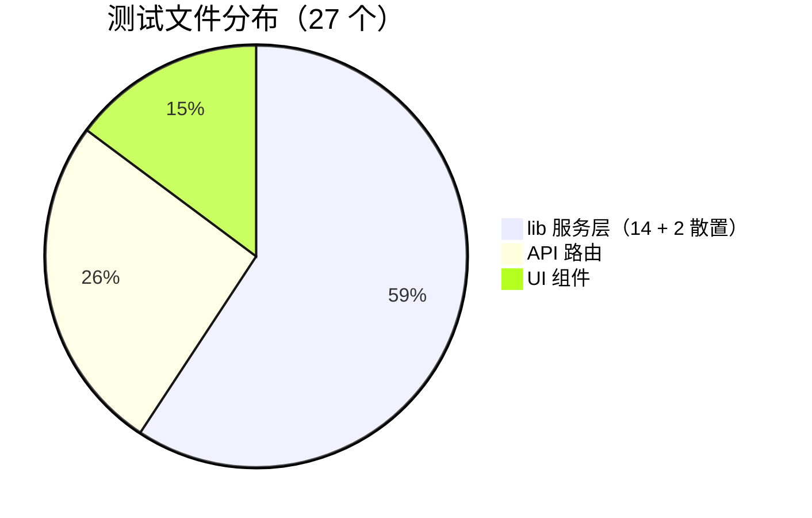

# 09 测试与质量保障

> 项目：interview-platform ｜ 版本：v1.1 ｜ 生成日期：2026-10-06 ｜ 修订：2026-10-06 一致性回刷 ｜ 依据：源码分析

本篇是测试专项篇：给出 27 个测试文件的逐域分布与代表性用例解析，拆解 Vitest 覆盖率门槛（`src/lib` 40%/30%）、ESLint、husky、CI 四道门禁的配置细节与协作关系，并对 E2E 缺失给出可落地的补齐建议。与《06-部署运行》第 9 节的「质量门禁总览」是深化关系：旧篇回答「门禁有哪些」，本篇回答「每个测试测什么、怎么 mock、门禁为什么这样设、还缺什么」。

## 1. 测试体系总览

项目的测试形态是「**Vitest 单测为主、覆盖三圈、E2E 未落地**」。三圈指：服务层（`src/lib`，核心业务逻辑与纯函数）、API 路由（`src/app/api/**` 的 route handler 直调测试）、UI 组件（Testing Library 渲染测试）。全部测试与源码同目录或就近存放（`__tests__/` 目录或 `.test.ts(x)` 后缀），运行环境为 jsdom，`globals: true` 免去逐文件导入 describe/it/expect。27 个测试文件合计约 2057 行，与 101 个 Route Handler、30 余个 lib 模块的体量相比，覆盖策略明显是「**守护最关键的核心算法与最易回归的边界**」，而非追求全量覆盖——这与覆盖率门槛只锁 `src/lib/**` 的取舍一致。



## 2. 测试文件逐域分布清单

### 2.1 服务层（16 个）

| 测试文件 | 被测模块 | 用例数与代表断言 |
| --- | --- | --- |
| `src/lib/__tests__/api-response.test.ts` | `api-response.ts` | 3 例：`ok` 负载在顶层、`fail` 返回 `{success, code, error}` 与指定状态码、`handleApiError` 统一 500 且**不泄露内部错误细节** |
| `src/lib/__tests__/category-cache.test.ts` | `category-cache.ts` | 3 例：首次查库并缓存、TTL 内命中缓存、`invalidate` 后重新查库（mock prisma 计数调用次数） |
| `src/lib/__tests__/category-utils.test.ts` | `category-utils.ts` | 3 例：无重名直用名称、重名用父级路径区分、路径层级**防死循环保护** |
| `src/lib/__tests__/deepseek.test.ts` | `deepseek.ts` | 6 例：非流式取首个 choice、**占位 Key 视同未配置且不发起请求**、上游非 2xx 抛状态码错误（不透传响应体）、流式返回响应体、上游失败抛错、`sseFormat` 输出 data 前缀 + 双换行 |
| `src/lib/__tests__/judge.test.ts` | `judge.ts` 的 `wrapCode` | 9 例：JS 注入 runner 并支持箭头函数、Python 反射 Solution、Java/C++ 含 main 原样返回否则注入包装器、未知语言原样返回（详见第 3 节） |
| `src/lib/__tests__/jwt.test.ts` | `jwt.ts` | 3 例：签名后可验证还原 payload、**篡改 token 返回 null 而非抛错**、任意非法字符串返回 null |
| `src/lib/__tests__/permission.test.ts` | `permission.ts` | 5 例：未登录 401、角色缺权限点 403、具备权限点放行返回 null、**角色不存在视为无任何权限**、同角色查询走 30 秒内存缓存（断言 prisma 只调一次） |
| `src/lib/__tests__/question-types.test.ts` | `question-types.ts` | 5 例：已知题型原样返回、脏值归一化 qa、每种题型 defaultTab 必须在自己的 tabs 里（**注册表自洽性**）、code 题才需要模板、脏值返回 qa 元数据 |
| `src/lib/__tests__/rate-limit.test.ts` | `rate-limit.ts` | 6 例：首次成功、达限拒绝、不同 identifier 独立计数、limit=1 第二次拒绝、**窗口过期后放行**（vitest 假时钟） |
| `src/lib/__tests__/request.test.ts` | `request.ts` | 8 例：成功解析 JSON、非 2xx 抛 `ApiError`（优先后端 error 字段）、401/403 自动登出且 `redirectOnAuth:false` 可关闭、网络异常抛 status 0 |
| `src/lib/__tests__/review-scheduler.test.ts` | `review-scheduler.ts` | 4 例：次数 0 → 间隔 1 天、按 1→2→4→7→15→30 递进、**超过阶段数封顶 30 天**、不修改传入 Date（纯函数性） |
| `src/lib/__tests__/sse.test.ts` | `sse.ts` | 4 例：多事件流逐事件回调、**跨 chunk 断裂事件正确拼装**、跳过 DONE 与非法 JSON、忽略非 data 前缀行 |
| `src/lib/__tests__/streak.test.ts` | `streak.ts` | 17 例（最大体量）：上海时区零点换算、日期键格式化、跨月/跨年减天、当前连续（今天未练从昨天起算）、最长连续段扫描 |
| `src/lib/__tests__/validate.test.ts` | `validate.ts` + `schemas.ts` | 7 例：parseBody 三态（合法/非法 JSON/校验失败取首个错误）、状态 schema 的 refine、totalDays 边界 1 与 365 合法 0 与 366 拒绝 |
| `src/lib/design-tokens.test.ts` | `design-tokens.ts` | 约 14 例：题型颜色 token 结构、难度色映射、标签色板等设计令牌完整性 |
| `src/lib/utils.test.ts` | `utils.ts` | 约 14 例：cn 类名合并五种输入形态、日期格式化、相对时间分段、UUID 生成唯一性 |

### 2.2 API 路由（7 个）

| 测试文件 | 被测端点 | 用例要点 |
| --- | --- | --- |
| `src/app/api/auth/register/route.test.ts`（200 行，最重） | `POST /api/auth/register` | 7 例：邮箱已存在 409 且**不触发 bcrypt/create**、有效输入 201 并断言 `bcrypt.hash(password, 10)` 轮数、缺字段 400「密码至少6位」、缺 name 用邮箱前缀兜底、prisma 抛错 500「注册失败」（详见第 3 节） |
| `src/app/api/questions/route.test.ts` | `GET /api/questions` | 2 例：默认 createdAt desc 排序、支持 encounterCount desc（排序白名单生效路径） |
| `src/app/api/questions/[id]/edits/route.test.ts` | `POST/GET .../edits` | 4 例：未登录 401、创建编辑建议、列出编辑列表 |
| `src/app/api/questions/[id]/encounter/route.test.ts` | `POST .../encounter` | 3 例：未登录 401、题目不存在 404、有效提交 upsert 并**更新 encounterCount 计数** |
| `src/app/api/questions/[id]/hints/route.test.ts` | `GET/POST .../hints` | 覆盖：GET 无需登录返回缓存列表、POST 命中缓存直接返回 `cached:true` 不调 AI、未命中时调 DeepSeek 并落库 |
| `src/app/api/search-history/route.test.ts` | `POST /api/search-history` | 3 例：未登录 401、空内容 400、保存成功 |
| `src/app/api/test-papers/route.test.ts` | `POST/GET /api/test-papers` | 3 例：未登录 401、有效数据创建试卷、列表返回 |

### 2.3 UI 组件（4 个）

| 测试文件 | 被测组件 | 用例要点 |
| --- | --- | --- |
| `src/components/ui/Button.test.tsx` | `Button` | 12 例：渲染子内容、onClick 回调、variant/size 全枚举的样式类、disabled 不触发、className 合并、displayName |
| `src/components/ui/Input.test.tsx` | `Input` / `Textarea` / `FormError` | 18 例：受控值、onChange、ref 转发、error 态样式类、disabled、`FormError` 带 `role="alert"`（无障碍断言） |
| `src/components/ui/Badge.test.tsx` | `DifficultyBadge` / `TagBadge` / `ErrorCountBadge` | 13 例：三难度标签渲染、已知标签配色/未知标签默认色、0 次错误渲染、monospace 字体 |
| `src/components/SpeakButton.test.tsx` | `SpeakButton` | 1 例：点击调用 `speechSynthesis.speak`（mock Web Speech API） |

## 3. 代表性用例深度解析

**路由测试的标准管线（以注册接口为例）**。`route.test.ts` 展示了本项目的四步法：第一步 `vi.mock("@/lib/prisma", ...)` 整体替换模块，只保留被测路径用到的方法（`user.findUnique/create`）；第二步 mock 外围依赖（bcryptjs 的 hash 固定返回 `mocked-hashed-password`、rate-limit 恒放行、verify-code 恒通过）——注意 mock 的是「依赖模块」而非数据库，因此测试的是路由逻辑本身而非 SQL；第三步用真实 `NextRequest` 构造请求（`new NextRequest("http://localhost/api/auth/register", {method, body})`），保证 headers/JSON 解析走真分支；第四步断言「状态码 + 响应体 + 副作用不应发生」（如 409 用例同时断言 `bcrypt.hash` 与 `prisma.user.create` 未被调用）。这种「断言不该发生的调用」写法在 409/400 用例中反复出现，是防「校验通过还继续执行」回归的有效手段。

**纯函数守护（以 wrapCode 为例）**。`judge.test.ts` 只测 `wrapCode` 这个纯函数（mock 掉文件顶部 import 的 prisma 与 code-runner 仅为让模块可加载），断言策略是「**包含性断言**」：包装结果应包含用户原文与 runner 标识（`Auto-generated runner`、`import sys, json`、`class Main`），而非快照全文——这样包装器内部实现调整不会打碎测试，只守住「用户代码不被破坏 + runner 被注入」的契约。Java/C++ 的「含 main 原样返回」用例用 `toBe`（全等）断言，精确锁住「不二次包装」的行为。

**并发与缓存的时序测试**。`rate-limit.test.ts` 用短窗口（50ms）+ 真实等待验证「窗口过期后放行」；`permission.test.ts` 通过连续两次 `requirePermission` 断言 prisma 角色查询只发生一次来锁定 30 秒缓存行为；`category-cache.test.ts` 同理锁定 5 分钟 TTL 与失效。这三个用例共同守护了《08-安全与权限设计》第 3 节所述「权限回收最长 30 秒延迟」的实现行为——测试即文档。

**UI 测试的取舍**。UI 圈只测 4 个基础组件（Button/Input/Badge/SpeakButton），全部是「样式类 + 事件 + 可访问性」的浅渲染断言；业务组件（1715 行的面试页、1100 行的题目详情页）零覆盖——这些页面的核心交互（SSE 解析、状态机）实际由 `src/lib/sse.ts` 等被测模块承担，业务组件测试的投入产出比被刻意压低。这个取舍合理但要有意识：页面级回归目前只能靠人工冒烟（建议见第 6 节 E2E）。

## 4. 覆盖率门槛：src/lib 40%/30%

`vitest.config.ts` 的 coverage 段是本项目质量基线的核心声明：

```ts
coverage: {
  provider: "v8",
  reporter: ["text"],
  include: ["src/lib/**"],
  thresholds: {
    statements: 40, lines: 40, functions: 30, branches: 30,
  },
},
```

四个要点值得展开。**第一，统计范围只含 `src/lib/**`**——API 路由与 UI 组件不在覆盖率统计内（尽管它们有测试），门槛语义是「核心业务逻辑层保底」，源码注释写明这是「2026-09 设定基线、防止覆盖率回退」：40/30 不是目标而是**下限**，任何使 `pnpm test:coverage` 低于阈值的提交都会非零退出。**第二，门槛与现状的差距需实测**——`src/lib` 下尚有 auth.ts、session.ts、oss.ts、mailer.ts、notify.ts、verify-code.ts、video-interview.ts、volcengine*.ts、behavioral-questions.ts 等模块无对应测试文件 ⚠️ 待确认（未实际运行 coverage 无法给出各文件精确百分比，但按 16 个测试文件对 30 余个模块的比例，整体应显著高于 40% 但存在长尾零覆盖模块）。**第三，reporter 只有 text**——无 HTML/lcov 产物，CI 也不上传覆盖率报告，趋势不可追溯，属低成本可改进项。**第四，阈值是四个独立下限**（语句/行 40%、函数/分支 30%），任一不满足即失败，分支覆盖 30% 的存在确保「只测 happy path」的策略会撞墙。

## 5. 静态检查、提交钩子与 CI 门禁

**ESLint 9 flat config（`eslint.config.mjs`）**。在 `eslint-config-next` 的 core-web-vitals 与 typescript 两套预设之上做了三类定制：① 显式关闭 `react-hooks/set-state-in-effect`（源码注释：客户端组件 useEffect 内 setState 是本项目的标准数据获取模式，全量 RSC 化不现实）；② 关闭 `@next/next/no-img-element`（注释：所有 `` 均为动态外域头像，域名不可枚举，next/image 不适用）；③ 对 `src/app/error.tsx`、`global-error.tsx` 关闭 `no-html-link-for-pages`（错误边界内不能假设 next/link 可用）。globalIgnores 排除 `.next/out/build`、`scripts/**`（数据生成脚本，用 require）与 `src/data/backend-questions-supplement.ts`（超大数据文件，跳过解析）。每条关闭都带理由注释——这是「规则豁免可审计」的良好实践。

**husky + lint-staged**。`package.json` 的 `prepare: "husky"` 在 `pnpm install` 时装配钩子；`.husky/pre-commit` 仅一行 `pnpm exec lint-staged`，对暂存的 `*.{ts,tsx,js,mjs}` 执行 `eslint --fix`——脏文件要么被自动修复入暂存区，要么因残留 error 使提交失败。注意 pre-commit **不跑测试、不跑 typecheck**，这两项前移到 CI。

**CI 流水线（`.github/workflows/ci.yml`）**。单 job `verify` 串行四步：checkout → `pnpm/action-setup@v4`（version 10）+ `setup-node@v4`（node 22、pnpm 缓存）→ `pnpm install --frozen-lockfile` → `pnpm lint` → `pnpm typecheck`（tsc --noEmit 全量，测试文件类型由 `tsconfig.test.json` 注入 vitest/globals 与 jest-dom 类型）→ `pnpm test:run`。触发条件是 push 到 master/main 与全部 PR。三个刻意为之的「不做」：不跑 build（由 Docker 构建承担）、不连数据库（单测全 mock，无集成测试层）、不跑覆盖率门槛（`test:run` 而非 `test:coverage`）——第三个意味着**覆盖率门槛实际不在 CI 强制路径上**，靠开发者本地自觉，是最容易形同虚设的一环（整改建议见《13-技术债务与演进建议》3.5）。依赖更新由 `.github/dependabot.yml` 每周各开一批 npm 与 github-actions 升级 PR。

四道门禁的协作关系可以概括为：**pre-commit 拦格式与 lint（最快反馈）→ CI 拦类型与单测（合入前）→ Docker 构建拦编译（部署前）→ 覆盖率门槛拦质量滑坡（本地，弱约束）**。

## 6. E2E 缺失与补齐建议

**现状**。`package.json` devDependencies 里有 `@playwright/test: ^1.61.0`，但仓库内不存在 `playwright.config.*`、`e2e/` 或 `tests/` 目录，`.dockerignore` 也排除了 `*.spec.ts`——**E2E 体系只有依赖、没有骨架** ⚠️ 待确认（无任何历史用例残留可考）。这意味着当前没有任何自动化手段验证「注册 → 登录 → 刷题 → 判题 → 看板」这类跨层关键旅程，页面级回归依赖人工。

**补齐建议（按投入产出排序）**：

1. **先立骨架**：新增 `playwright.config.ts`（`testDir: "e2e"`、`baseURL` 从 `E2E_BASE_URL ?? http://localhost:3000` 读取、CI 里 `webServer` 命令复用 `pnpm dev`）；把 4 个 UI 组件测试之外的高价值旅程写成 smoke 级用例。
2. **五条最小关键旅程**：① 访客打开首页与题库列表（验证 SSR/骨架不白屏）；② 注册（SMTP 未配置时验证码需从服务端日志或测试钩子获取——建议加 `E2E_TEST_MODE` 环境变量让 `sendVerificationCode` 同时把验证码写入响应头仅供测试 ⚠️ 需评审安全性）；③ 登录后题目详情提交代码判题（Piston 外部依赖需 mock：可用 `PLAYWRIGHT` 环境拦截 `emkc.org` 的 `page.route`）；④ 创建学习计划并勾选进度；⑤ AI 面试创建（同样 `page.route` 拦截 DeepSeek 返回固定 SSE 流）。要点：**所有外部 SaaS（DeepSeek/Piston/火山/OSS/SMTP）一律网络层 mock**，E2E 不为第三方可用性背锅。
3. **接入 CI**：单独 job 起 PostgreSQL service 容器 + `prisma migrate deploy` + `pnpm exec playwright test`；先 nightly/手动触发，稳定后再卡 PR。
4. **数据策略**：每条用例自建数据（注册新用户、新建题目），断言后清理；或引入 `db:seed` 的最小子集 fixture。避免用例间共享状态导致顺序耦合。

## 7. 测试基建备忘

三个容易被忽视的基建细节收尾。其一，`src/test/setup.ts`（7 行）是全局 setup，负责加载 `@testing-library/jest-dom` 匹配器（UI 断言 `toBeInTheDocument` 等依赖它）。其二，`tsconfig.test.json` 继承主 tsconfig 并把 `types` 换成 `vitest/globals + @testing-library/jest-dom`、include 收窄到 `*.test.ts(x)` 与 `src/test/**`——即测试文件与业务代码用两套类型配置，`pnpm typecheck` 只查业务侧（vitest globals 不会泄漏到业务代码，测试文件的类型检查实际依赖编辑器或专门的 test typecheck ⚠️ 待确认 CI 未单独跑测试目录 typecheck）。其三，`.dockerignore` 排除全部测试文件与 vitest 配置，测试基础设施完全不进镜像——运行时体积与攻击面因此最小化，代价是镜像内不可复现测试，排障需回源码仓。

## 8. 质量体系的长短板评估

把四道门禁与三圈测试合起来看，这套体系的长处与短板都很清晰，接手者应当先建立这个全局判断再决定投入方向。**长处有四**：一是「测试即文档」的成色高——`permission.test.ts` 锁 30 秒缓存、`rate-limit.test.ts` 锁窗口语义、`review-scheduler.test.ts` 锁艾宾浩斯间隔与纯函数性、`question-types.test.ts` 锁注册表自洽性，这些用例守护的正是业务规则里最容易被人无意改坏的部分；二是 mock 边界划得干净——统一 mock 依赖模块（prisma/bcrypt/rate-limit/deepseek）而非拦截网络，测试只描述「给定依赖行为，路由如何反应」，因此运行毫秒级且不脆；三是断言习惯好——大量「负面断言」（校验失败后不应发生的调用）与「契约断言」（bcrypt 轮数、响应结构、错误文案），回归时能精确定位；四是豁免可审计——ESLint 每条关闭规则带理由注释，后来者不会「顺手恢复」造成全量报错。**短板同样有四**：一是覆盖分布头重脚轻——`src/lib` 的鉴权三件套（auth/session/verify-code）、外部集成五件套（oss/mailer/notify/video-interview/volcengine 系列）零测试，而它们恰是安全与金钱相关的高危区（第 2 节已列）；二是 API 圈只覆盖 7/101 个路由，且集中在早年开发的题库与认证侧，竞赛/学习/社区/后台四大域的路由零覆盖；三是覆盖率门槛未上 CI（第 5 节），「防止回退」的基线实际靠自觉；四是完全没有集成测试层（真库 + 真迁移），Prisma 查询的正确性（如复合唯一键、级联行为）从未被自动验证——这类问题单测 mock 掉 prisma 后天然不可见，是 E2E 之外的第二块补齐方向（可在 CI 用 PostgreSQL service 跑「迁移 + 少量真查询冒烟」，成本远低于全量 E2E）。

对「接下来一个月该往哪投入」给出明确排序：第一优先补 `src/lib/permission.ts` 之外的鉴权链路测试（verify-code 的过期/一次性语义、auth.ts 的 banned 分支——后者需要 mock getServerSession）；第二优先把 `pnpm test:coverage` 加进 CI（一行改动）；第三优先为四个零覆盖业务域各补一个「鉴权 + 归属 + 主流程」三断言的最小路由测试（模板照抄 `search-history/route.test.ts`）；最后才是 E2E 骨架（第 6 节方案）。这个排序的逻辑是：先用最便宜的单测堵住安全面，再让既有基线强制生效，然后才铺开新圈层。
