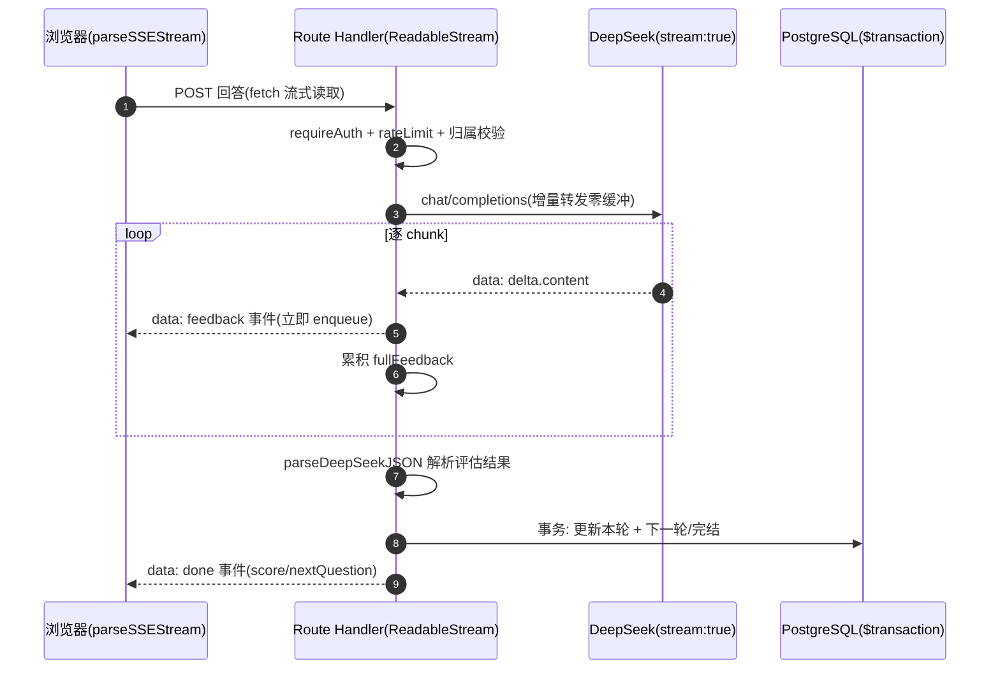

# 10 性能设计与优化

> 项目：interview-platform ｜ 版本：v1.1 ｜ 生成日期：2026-10-06 ｜ 修订：2026-10-06 一致性回刷 ｜ 依据：源码分析

本篇是性能专项篇：梳理项目的渲染与数据获取策略、AI 流式响应链路的每一跳、数据库查询形态与索引配套、静态资源与交付策略，并给出按优先级排序的优化建议。与《01-系统架构》（分层与数据流）、《06-部署运行》（构建与部署）互补：旧篇讲「怎么跑」，本篇讲「跑得快不快、哪里会慢、怎么更快」。所有现状描述均取自源码，优化建议均标注前置条件。

## 1. 渲染与数据获取策略：CSR 为主的双轨制

**页面渲染的总体形态是「客户端组件 + SWR」**：`src/app/` 下绝大多数 `page.tsx` 顶部声明 `"use client"`，首屏先渲染骨架屏（`SkeletonBox` / `animate-pulse`），挂载后由 `useSWR("/api/...", fetcher)` 拉数据（`src/lib/swr.ts`：`revalidateOnFocus: false`、2 秒去重、3 次错误重试）。真正的服务端渲染只有三类：`src/app/career/**`（服务端组件直读 `public/knowledge/*.md` 静态文件，零数据库查询）、`src/app/sitemap.ts` 与 `robots.ts`（服务端生成，sitemap 目前只含 6 个静态页，未枚举题目详情页）、根布局的元数据。这个策略的代价是**首屏内容必须等接口往返**——首页 Dashboard 要并行等 6 个接口返回才撤骨架（`extendedStats` 就绪即判定 loading 结束），慢网络下首屏可交互时间（TTI）明显后移；收益是交互密集页面（筛选、Tab、SSE 流式渲染）的状态管理完全在前端，实现成本低。补充两个与感知性能相关的细节：题库列表页的「URL 即状态」设计让详情页返回时免于重新筛选（减少一次完整的列表重建）；`dedupingInterval: 2000` 使 2 秒内的重复挂载共享同一请求，首页六路 SWR 并发因此不会翻倍成十二路。

**缓存语义与动态渲染**。依赖会话的 API 普遍声明 `export const dynamic = "force-dynamic"`（29 个文件，含 mock-interview 全族、stats/extended、study-plans、notifications 等），确保 Route Handler 不被静态化；其余接口（如 `/api/questions`）虽未声明，但因读取 session cookie 实际也是动态执行。客户端侧唯一的持久缓存是 SWR 内存缓存 + Service Worker（见第 5 节），无服务端缓存层（无 Redis/内存对象缓存，仅有三处进程内小缓存：分类树 5 分钟、RBAC 角色权限 30 秒、限流窗口）。**优化空间**：公开只读数据（题目列表、题集、学习路径、每日一题）完全具备页面级 ISR 或 `Cache-Control: s-maxage` + CDN 的条件，是收益最大的首屏优化方向（见第 6 节建议 1）。

## 2. AI 流式响应链路

AI 是本项目延迟最敏感的链路（DeepSeek 生成整段反馈常需 5-20 秒），流式设计是其可用性的关键。链路分三段：

**第一段：DeepSeek → Route Handler（服务端）**。`src/lib/deepseek.ts` 的 `callDeepSeekStream` 用原生 fetch 以 `stream: true` 请求 `https://api.deepseek.com/chat/completions`，直接返回上游 `response.body`（ReadableStream），无任何中间缓冲——零拷贝转发的前提。`/api/mock-interview/[id]/turn` 在自己的 ReadableStream `start()` 里 `getReader()` 逐 chunk 读取，按行拆 SSE 帧，解析出 `choices[0].delta.content` 增量后立即 `controller.enqueue` 转发给浏览器，同时累积完整文本供流结束后解析 JSON。**注意关键取舍：落库发生在流结束之后**（`parseDeepSeekJSON` 解析出 `{feedback, score, nextQuestion...}` 后才在事务里写库），流式期间该请求占用一个 Node 事件循环连接与一段内存缓冲，长反馈下并发能力受限于单实例连接数 ⚠️ 待确认（无并发上限配置，仅靠 rateLimit 20/分/用户间接约束）。

**第二段：Route Handler → 浏览器**。响应头固定 `Content-Type: text/event-stream`、`Cache-Control: no-cache, no-transform`（no-transform 防中间代理压缩/改写破坏流式语义）、`Connection: keep-alive`。前端不用 EventSource（它只支持 GET），而是 fetch POST 后交给 `src/lib/sse.ts` 的 `parseSSEStream` 手工解析：`TextDecoder` 流式解码、按双换行切帧、残帧留 buffer 拼装、跳过非法 JSON——测试（`sse.test.ts`）专门覆盖了「跨 chunk 断裂」场景。`/api/ai` 是例外：它把 DeepSeek 的原始字节流直接 enqueue 透传（连帧格式都不改），最后补发 `data: [DONE]`，是三段中开销最小的实现。

**第三段：语音视频的实时链路**。ASR 是服务端到火山的 WebSocket（`ws` 库），音频按 6400 字节分片同步写入，30 秒总超时；TTS 是 HTTP Chunked 透传，接口把多个 JSON 分片的 base64 音频**拼接完再一次性返回**（非流式下发）——短文本可接受，长文本（上限 2000 字）会让用户等到合成完成 ⚠️ 待确认（前端体验上 TTS 是等全量音频）。视频面试的语音走火山 RTC 通道（浏览器直连 `wss://rtc.volcengineapi.com`），不经过应用服务器，服务端只承担 Token 签发与 StartVoiceChat/StopVoiceChat 的信令调用（10 秒超时保护），因此**应用服务器的带宽与长连接压力不随视频面试时长增长**——这是该架构最聪明的一点。

## 3. 数据库查询形态与索引配套

**连接层**。`src/lib/prisma.ts` 用 `pg.Pool` + `PrismaPg` 适配器；Pool 未配置 `max`（默认 10 连接）⚠️ 待确认——生产高并发下 10 个连接可能先于 CPU 成为瓶颈，建议显式配置并结合 PostgreSQL 的 `max_connections` 规划。开发环境实例挂 `globalThis` 防热重载重复建池，生产环境模块单例。

**查询形态盘点**（按读放大风险排序）：

| 查询形态 | 位置 | 形态 | 索引配套 | 风险评估 |
| --- | --- | --- | --- | --- |
| 题库列表 | `src/app/api/questions/route.ts` | where 动态组装 + findMany/count 并行 + 第三查合并个人状态 | `categoryId`/`jobRole` 单列索引 | 关键字 `contains insensitive` 是 ILIKE 全表扫，题量大后成慢查询；个人状态过滤是两次 `in` 查询 |
| 复习推导 | `src/lib/review-scheduler.ts` | `practiceHistory.groupBy(questionId)` 取个人全量记录 | `@@index([userId, attemptedAt])` | 每用户全量 groupBy，练习上万条后每次首页加载都要扫 |
| 打卡/热力图 | `src/lib/streak.ts`、`stats/extended` | 近一年/90 天 findMany 仅取时间列 | 同上 | 时间范围限制了扫描量，可控 |
| 通知列表 | `notifications/route.ts` | findMany + count + 未读 count 三连 | `@@index([userId, read])` | 未读徽章高频查询，索引精准命中 |
| 竞赛排行 | `contests/[id]/leaderboard` | groupBy 聚合 + take 100 | `ContestSubmission` 三索引（contestId/userId/submittedAt） | 聚合在 DB 侧完成，可控 |
| 会话回查 | `src/lib/auth.ts` session 回调 | 每个带会话请求一次 `user.findUnique` | 主键 | 单次极快，但**请求量 × 1 次额外查库**，是全系统最高频查询 |
| 搜索 | `search/route.ts` | question/solution/note 三表 contains 并行 | 无全文索引 | 全表 ILIKE × 3，数据量增长后最先劣化 |

迁移 `20260924170000_add_hot_path_indexes` 沉淀了热路径索引：`PracticeHistory(userId, attemptedAt)` 复合索引支撑打卡/热力图/复习推导的全部按「用户 + 时间」扫描；`Notification(userId, read)` 服务未读徽章；`Question(jobRole)`、`Question(categoryId)` 服务筛选；`Solution` 三单列索引对应三种排序读取；`ContestSubmission` 三索引支撑排行。**索引与查询基本配套**，缺的是文本搜索类（ILIKE 无索引可用）。

**进程内缓存**。`category-cache.ts`（分类树全量，5 分钟 TTL，写操作后 `invalidateCategoryCache()` 手动失效）把题库列表最高频的子树展开查询降为内存操作；`permission.ts` 角色权限缓存 30 秒把 RBAC 校验的查库频次降为每角色每 30 秒一次。两者都是「读多改少 + 容忍秒级陈旧」的正确用法。多实例部署时两者退化为每实例各自缓存（正确性不受影响，仅失效延迟）。

**写路径的放大效应同样值得关注**。读路径之外，几个高频写操作各自带有隐藏的额外查询：判题通过后的状态推进是「先 findUnique 再 create/update」两步（`submit/route.ts`），并发提交同一题时存在竞态但唯一键兜底；题目详情的每次访问不更新 `viewCount`（计数只在列表排序里用，接口内自增的路径在 encounter 等处）；`UserStreak` 的读时物化让每次打卡查询都伴随一次 upsert 写。这些设计的共同点是「用可接受的写放大换取实现简单」，在当前量级合理，但意味着**写入 QPS 是数据库容量的隐性消耗者**——做容量规划时应按「读 × 3 + 写 × 2」的经验系数估算，而不是只看接口调用量。

## 4. 外部调用与超时治理

对外部依赖的耗时控制是分散但一致的：判题逐用例 `Promise.race` 15 秒超时（`src/lib/judge.ts`），超时即中断后续用例（最坏一次提交 15 秒，不会长尾累积）；RTC OpenAPI 调用 10 秒 AbortController 超时（`src/lib/video-interview.ts`）；ASR WebSocket 30 秒总超时；cron 摘要端点 `maxDuration = 60`（逐用户串行发信，用户量大时会超时 ⚠️ 待确认——循环体内无分批/异步并发，千人级用户单次执行可能超 60 秒）；视频 start 接口 `maxDuration = 30`。并行化做得好的位置：`stats/extended` 八查询 `Promise.all`、`stats` 五查询并行、题目列表 findMany + count 并行。串行的位置：判题逐用例（正确性要求，无法并行）、admin/stats 的趋势统计（先 findMany 再内存分组）。`/api/reminders` 内部还每题单查 `question.findUnique`（循环 N+1）⚠️ 待确认——它是低频个人接口，影响有限但属典型反模式。

## 5. 静态资源与交付

**前端资源**：Recharts、Mermaid、CodeMirror 6、react-markdown 全家桶是体积大头，均为常规 import（未见 dynamic import 按需加载 ⚠️ 待确认），首包体积受 Mermaid（数 MB 级）影响明显；Turbopack 构建未开启任何手动分包。**图片**：`next/image` 仅放行 OSS 域名（`images.remotePatterns`），外域头像走原生 `` 无优化；OSS 对象为公共读，依赖浏览器缓存。**PWA**：`public/sw.js` 缓存 `/`、`/questions`、`/manifest.json` 三个入口，fetch 策略是 **network-first**（注释明确解释了为何不用 cache-first：避免 CACHE_NAME 不变导致刷新永远命中旧版本），API 请求一律不缓存直连——缓存语义清晰，但预缓存列表太小，离线体验仅覆盖首页。**服务端交付**：`next.config.ts` 的 `serverExternalPackages: ["ali-oss"]` 把纯 Node SDK 排除出打包（避免 Turbopack 静态分析 proxy-agent 失败），运行时按需 require；Docker 镜像未启用 standalone 输出，携带全量 node_modules（部署层面优化见《06-部署运行》第 10 节与《13-技术债务与演进建议》3.7）。

## 6. 优化建议（按优先级）

**P0（低风险高收益，建议先做）**：
1. **公开题目内容的 CDN/ISR 化**：题目列表与详情对游客是同一份内容，可用 `revalidate` ISR 或在响应头加 `Cache-Control: public, s-maxage=60, stale-while-revalidate`，由 CDN 吸收绝大部分读流量；个人状态（mastery/isBookmarked）已按登录态合并，游客视图天然可缓存。
2. **显式配置 pg Pool `max` 与 `connectionTimeoutMillis`**：一行配置消除连接数不可见性，配合 Prisma 文档推荐值与数据库 `max_connections` 对齐。
3. **SSE 中间代理兼容核查**：生产若经 Nginx，确认 `proxy_buffering off`（或响应已带 `X-Accel-Buffering: no`——当前未带 ⚠️ 待确认），否则流式会被缓冲成整段返回，AI 面试体验崩塌。
4. **`/api/reminders` 循环查题合并**：一次 `question.findMany({where: {id: {in: [...]}}})` 替换循环内单查，消除 N+1。

**P1（需要设计与验证）**：
5. **文本搜索升级**：引入 PostgreSQL 全文检索（`tsvector` 生成列 + GIN 索引）或 `pg_trgm` 加速 ILIKE，替换 search/questions 两侧的 contains 全表扫描；中文分词可用 `zhparser` 扩展 ⚠️ 待确认（需确认托管 PG 支持扩展）。
6. **复习推导降载**：`getDueReviewQuestions` 的全量 groupBy 可改为「只取 30 天内有练习的 questionId」预过滤，或物化到 `UserQuestionState` 上冗余 `lastPracticedAt/practiceCount` 列（写时更新），把复习查询降为主键索引点查。
7. **session 回查减频**：会话回调的每请求查库可加 30-60 秒进程内缓存（封禁生效延迟从「即时」退化为「≤1 分钟」，需安全侧确认可接受），或仅在前端 `update()` 触发时强制刷新。
8. **重依赖分包**：Mermaid 与 Recharts 改 `next/dynamic` 按需加载（仅题解含图/看板页加载），预计显著减小首包。

**P2（随规模演进）**：
9. **限流与缓存外置 Redis**：多实例部署的先决条件（`rate-limit.ts` 源码注释自认的局限），同时可承载分类树等共享缓存。
10. **AI 流式并发治理**：为 SSE 长连接设全局并发上限（如 20），超限排队或快速失败，防止单实例被长连接占满；上传/判题等重 IO 路由可评估独立部署（全栈单体的拆分起点，见《13-技术债务与演进建议》路线图）。
11. **sitemap 全量化**：当前 sitemap 仅 6 个静态 URL，公开题目详情页未被收录——对内容型平台的 SEO 流量是重大损失，建议按分类/分页枚举题目页（配合建议 1 的缓存策略）。

## 7. 性能回归的观测缺口

最后指出当前的可观测性短板：项目无 APM、无慢查询日志采集、无接口耗时埋点（唯一日志是 `handleApiError` 的错误打印），性能问题目前只能靠用户反馈或 `docker logs` 事后分析。建议最小成本起步：在 `handleApiError` 之外增加统一耗时中间件式封装（Route Handler 包装器记录 path/耗时/状态码，超阈值打 warn），并利用 PostgreSQL 侧 `pg_stat_statements` 找慢查询——这两个抓手不需要引入新组件即可建立性能基线。
