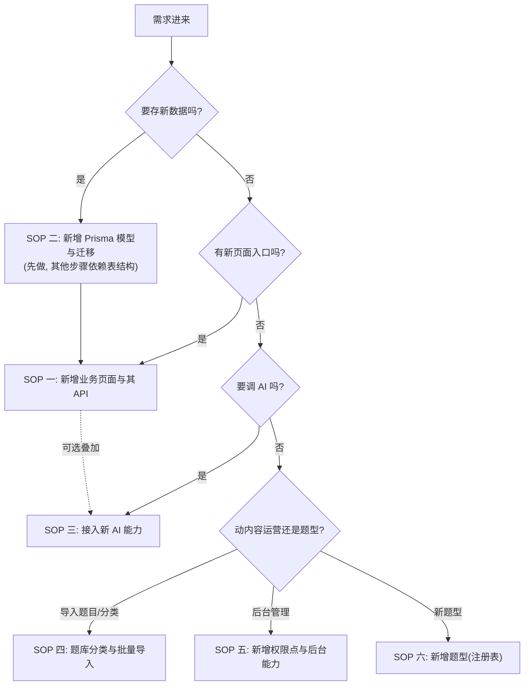

# 11 扩展开发指南

> 项目：interview-platform ｜ 版本：v1.1 ｜ 生成日期：2026-10-06 ｜ 依据：源码分析

本篇是「怎么改」的手册篇：给出六个高频扩展场景的标准作业程序（SOP）。每个 SOP 都按「目标 → 步骤 → 参照实现 → 自检清单」组织，参照实现全部指向仓库内真实文件，读者可以边读边对源码。开工前请先读《00-项目总览》第 4 节的目录导览与 `AGENTS.md` 第 6 节的开发约定（本项目基于 Next.js 16，`params` 是 Promise、中间件叫 `proxy.ts`，与训练数据中的旧版 Next.js 不同——`AGENTS.md` 头部有专门警告）。环境准备（pnpm install、prisma generate、db:migrate）见《06-部署运行》第 3 节，其中「prisma generate 必须手动执行」「.env 与 .env.local 加载者不同」两个坑与本篇强相关。

## 0. 选型：你的需求属于哪个 SOP

动手前先对号入座。六个 SOP 覆盖了日常迭代中绝大多数改动形态，它们的入口文件、依赖链与自检重点各不相同；跨场景的大改动（比如「新增一个同时带页面、API、数据表和 AI 评估的功能」）按 SOP 一 → 二 → 三的顺序串联即可，每个 SOP 的自检清单独立成立。

## SOP 一：新增一个业务页面与其 API

以「新增错题本页面 `/mistakes`（列出本人高频错题）」为例，覆盖从页面到 API 的全链路。

**步骤 1：建 API 路由**。新建 `src/app/api/mistakes/route.ts`，模板结构参照 `src/app/api/stats/route.ts`（同为登录态聚合查询）：

1. 文件头 import：`prisma`（`@/lib/prisma`）、守卫（`@/lib/session` 的 `requireAuth/getCurrentUser`）、可选 `parseBody`（写接口必用）、`handleApiError`（`@/lib/api-response.ts`）。
2. 若接口消耗外部配额或 AI，加 `rateLimit(标识, 上限, 窗口ms)`（参照 `src/app/api/questions/[id]/hints/route.ts` 的用法与 429 + `rateLimitHeaders` 响应）。
3. 依赖会话的接口声明 `export const dynamic = "force-dynamic"`。
4. GET 实现：`const authError = await requireAuth(); if (authError) return authError;` 然后 `getCurrentUser()` 拿 id，查询**必须显式 `where: { userId }`**（`AGENTS.md` 约定第 9 条，多用户数据隔离的硬纪律）。错题本可直接复用 `stats/route.ts` 的 `groupBy questionId + status: "failed"` 模式。
5. 错误兜底：整个 handler 包 try/catch，`return handleApiError(error, "GET /api/mistakes")`。

**步骤 2：建页面**。新建 `src/app/mistakes/page.tsx`，顶部 `"use client"`，数据用 `useSWR("/api/mistakes", fetcher)`（fetcher 从 `@/lib/swr` 导入，自带 401 自动登出），状态三态（loading 骨架 / error 重试卡 / 空态 `EmptyState`）参照 `src/app/page.tsx`。若页面需要登录，在 `src/proxy.ts` 的 `PROTECTED_PAGES` 数组加入 `"/mistakes"`（见第 1 节，Edge 层页面门禁）。样式只用 CSS 变量 token（`var(--primary)` 等，见 `src/lib/design-tokens.ts`），禁硬编码 rgba。

**步骤 3：导航入口**。在 `src/components/layout/TopNav.tsx`（桌面）与 `MobileDrawer.tsx`（移动端）加菜单项；需要下拉分组的参照「面试宝典」下拉的实现。

**自检清单**：未登录直接 curl API 返回 401；登录后只看到本人数据（换账号验证隔离）；`pnpm lint` 与 `pnpm typecheck` 通过；为新路由补一个 route 测试（参照 `src/app/api/search-history/route.test.ts` 的四步法）；`proxy.ts` 门禁与 API 守卫双重生效。

## SOP 二：新增一个 Prisma 模型与迁移

以「面试复盘笔记 `InterviewNote`」为例。

**步骤 1：改 schema**。在 `prisma/schema.prisma` 追加模型，遵守项目既有约定（见《04-数据模型》第 1 节）：主键 `String @id @default(uuid())`、时间戳 `createdAt @default(now())` / `updatedAt @updatedAt`、表名 `@@map("interview_notes")`、字段 `@map` 下划线小写；关联用户时明确删除策略——强归属用 `onDelete: Cascade`，可匿名化保留的用 `onDelete: SetNull` 且字段可空。若模型表达「每用户对某资源的状态」，必须加复合唯一键（参照 `UserQuestionState` 的 `@@unique([userId, questionId])`），并发 upsert 靠它兜底。

**步骤 2：生成并应用迁移**。执行 `pnpm db:migrate`（等价 `prisma migrate dev`），它会生成 `prisma/migrations/<时间戳>_add_interview_note/migration.sql` 并应用。**禁止手写或手改迁移 SQL**（`AGENTS.md` 约定第 3 条）；迁移文件必须随代码入库。注意前置条件：`pnpm db:migrate` 走 `prisma.config.ts`，它 `import "dotenv/config"` 只加载根目录 `.env`——若你只有 `.env.local`，先补一份 `DATABASE_URL` 到 `.env`（详见《12-FAQ与故障排查》第 1 条）。本地生成后无需手动 `prisma generate`（migrate dev 会触发），但**拉取他人新迁移后必须手动 `pnpm prisma generate`**（无 postinstall 钩子）。

**步骤 3：接入数据访问**。Route Handler 里直接 `prisma.interviewNote.findMany(...)` 使用（项目无 Repository 层）；若涉及「查出来再合并个人状态」，参照 `questions/route.ts` 的 Map 批量合并写法防 N+1。

**步骤 4：生产发布**。生产库不需要手动迁移——容器 CMD 是 `prisma migrate deploy && pnpm start`，推新镜像重启即自动应用（《06-部署运行》第 6.2 节）。破坏性迁移（删列/改类型）务必先在预发库演练，`migrate deploy` 无 down。

**自检清单**：`pnpm typecheck` 通过（生成物在 `src/generated/prisma/`，类型自动就位）；新表在 `pnpm db:studio` 可见；唯一键在并发 upsert 下不产生重复行；删除用户时按预期级联或置空。

## SOP 三：接入一个新的 AI 能力

以「简历点评 `/api/ai/resume-review`」为例。项目的 AI 基建已收敛在 `src/lib/deepseek.ts`，新能力只需组装，不要自建 HTTP 调用。

**步骤 1：写路由**。新建 `src/app/api/ai/resume-review/route.ts`，管线五件套缺一不可（参照 `src/app/api/ai/review-code/route.ts`，它与本例形态最接近）：

1. `requireAuth()` + `getCurrentUser()`（AI 能力一律登录可用）；
2. `rateLimit("resume-review:" + user.id, 20, 60 * 1000)`（与 evaluate/review-code 同一配额池命名风格）；
3. `validateDeepSeekApiKey()`，失败返回 503（占位串 `sk-your-deepseek-api-key-here` 与 `fake` 已被识别为未配置）；
4. `parseBody(request, schema)` 校验入参并**设长度上限**（旧接口无上限是已知债务，新接口不要继承）；
5. 组装 messages 调 `callDeepSeek`（非流式，适合返回结构化 JSON）或 `callDeepSeekStream` + 自建 ReadableStream（流式，参照 `src/app/api/ai/route.ts`）。

**步骤 2：Prompt 设计约定**。system prompt 定义角色与输出格式；用户内容以明确分隔符包裹并截断（参照 hints 接口对题面 3000 字/答案 2500 字的截断）；要求模型按固定 JSON 结构返回时，解析用「提取 Markdown 代码围栏内 JSON + 兜底纯文本解析」的两段式（参照 `turn/route.ts` 的 `parseDeepSeekJSON`），解析失败返回 502「AI 返回了无法解析的内容」，**不要把上游原文透传给前端**。

**步骤 3：前端接入**。流式用 `parseSSEStream`（`@/lib/sse`）消费 fetch Response；非流式直接 `apiPost`（`@/lib/request`）。

**自检清单**：未配 Key 时 503 且提示变量名；20 次/分限流 429；prompt 注入面评估过（用户文本是否进了 system 位置？评分类结果是否只影响本人？见《08-安全与权限设计》第 7 节）；为解析函数补单测（参照 `deepseek.test.ts` 的 mock fetch 写法）。

## SOP 四：新增题库分类与批量导入题目

**新增分类（运营态）**：走后台接口 `POST /api/categories`（需 `category:manage` 权限），或直接 `pnpm db:studio` 可视化操作。注意两点：分类是自关联树（`parentId`），建子分类要把父 id 传对；**写操作后必须失效分类缓存**——`src/lib/category-cache.ts` 的缓存 TTL 5 分钟，`categories/route.ts` 的 POST 里调用了 `invalidateCategoryCache()`，若你绕过接口直接改库，题目列表的子分类展开会陈旧最长 5 分钟。

**批量导入题目（开发态）**：项目的方式是「数据文件 + seed」。步骤：① 新建 `src/data/your-questions.ts`，导出符合 `SeedQuestion` 接口的数组（`title/content` 必填，`solution/codeTemplate/questionType/difficulty/tags` 可选——interface 定义见 `prisma/seed.ts` 头部）；② 在 `prisma/seed.ts` 的 `SOURCES` 数组登记 `{name, domain, questions}`，domain 需在 `DOMAINS` 分类列表中（不存在则先加）；③ 执行 `pnpm prisma db seed`。幂等性保证：分类按固定 id upsert、题目**按 title 查重存在即跳过**、题集/学习路径存在即跳过，重复执行安全。两个语义要记住：seed 只做加法——删除线上题不会被复活，但修改 `src/data` 中旧题内容**不会**同步到已存在的题目（想改需删掉旧题再跑 seed，或走后台编辑）。若 data 文件超大（参照 `src/data/backend-questions-supplement.ts` 已被 ESLint/tsconfig 双重排除的先例），记得同步加入 `eslint.config.mjs` 的 globalIgnores 与 `tsconfig.json` 的 exclude。

## SOP 五：新增权限点与后台管理能力

以「给题解增加 `solution:manage` 管理能力」为例。

**步骤 1：登记权限点**。RBAC 数据有两处来源：表结构与初始数据走迁移。新增权限点推荐新建一个迁移（`pnpm db:migrate` 先在 schema 无变化时可用 `pnpm exec prisma migrate dev --create-only` 生成空迁移再手写 INSERT——注意这属于「手写迁移内容」的例外场景，内容是数据播种而非结构变更，参照 `20260824020000_seed_rbac_data` 的幂等写法 `ON CONFLICT DO NOTHING`）：向 `permissions` 插入 `solution:manage`，并向 `role_permissions` 授予 `admin`（以及需要的话 `editor`）。

**步骤 2：挂到 API**。目标路由把守卫从 `requireAdmin()` 换成 `requirePermission("solution:manage")`（两者关系见《08-安全与权限设计》第 3 节：requireAdmin 只是 `admin:access` 的别名）。若该能力要开放给外部后台项目（Bearer JWT 通道），无需额外改动——`permission.ts` 双通道天然支持。

**步骤 3：后台页面**。在 `src/app/admin/` 下新建子页（参照 `src/app/admin/reports/page.tsx` 的「列表 + 操作列」形态），`src/app/admin/layout.tsx` 的侧栏数组加导航项。admin 域的鉴权无需改动：proxy 的 `/admin` 前缀门禁 + layout 客户端校验 + 各 API 的 `requireAdmin` 三层已就位。

**注意事项**：角色权限有 30 秒内存缓存，授予后测试要等缓存过期或重启 dev server；`User.role` 与 `Role.code` 是弱关联，别给用户写不存在的 role 字符串（会 403 一切权限点）；editor 角色目前无法经 `/api/admin/users/[id]/role` 授予（白名单只有 admin|user），分配 editor 需改库。

## SOP 六：新增一种题型

题型系统是全项目收敛得最好的扩展点：`src/lib/question-types.ts` 的 `QUESTION_TYPE_META` 是唯一事实源。以新增「填空题 `blank`」为例：

1. 在 `QuestionType` 联合类型加 `"blank"`，在 `QUESTION_TYPE_META` 注册元数据：`label`（「填空题」）、`color`（选一组语义 token，如复用 `--info-container`）、`tabs`（从 `CodeTab | QaTab` 的既有标签页集合中挑选组合）、`defaultTab`（必须是 tabs 子集——`question-types.test.ts` 有注册表自洽性测试把关）、`needsTemplate`。
2. 若需要新的标签页形态，扩展 `CodeTab/QaTab` 联合类型，并在 `src/app/questions/[id]/tabs/` 下实现对应内容组件，接入 `page.tsx` 的 Tab 渲染分支。
3. 若判题/判分需要特殊逻辑，同步评估 `src/lib/judge.ts`（`wrapCode` 目前只认四语言，qa/judge 型题型不走判题）与试卷判分（`test-papers/[id]/submit`）是否需要分支。
4. 数据兼容：`normalizeQuestionType()` 会把未知值归一化为 `qa`，因此 schema 无需迁移即可写入新 `questionType` 字符串（`Question.questionType` 是普通 String）；但老版本代码读到 `blank` 会当 qa 渲染——发布顺序是「先发代码，再录数据」。

**自检清单**：`pnpm test:run` 里 `question-types.test.ts` 全绿（defaultTab 自洽性）；新建题目表单（`src/app/questions/new/page.tsx`，读取 `needsTemplate` 决定是否渲染模板区）自动出现新题型；详情页默认 Tab 正确。

## 收尾：扩展的通用纪律

六个 SOP 背后是四条通用纪律，违反任何一条都会在后续排障时付出加倍代价。**其一，鉴权前置**：新 API 的第一行业务代码之前必须完成守卫与（如需）限流，归属校验在拿到资源后立刻做；**其二，个人数据显式 userId**：任何查个人数据的 Prisma 调用必须显式 `where: { userId }`，靠「接口已鉴权」推断归属是事故之源；**其三，schema 变更走迁移**：`pnpm db:migrate` 是唯一正道，迁移文件入库，生产靠容器 CMD 自动 deploy；**其四，测试随行**：纯函数进 `src/lib/__tests__/`，路由按四步法补一个最小用例，保持 `src/lib` 覆盖率在门槛之上（`pnpm test:coverage` 本地验证）。遇到本篇未覆盖的场景（如接入新的云厂商、拆分微服务），先读《01-系统架构》第 4 节的设计决策清单确认不与既有取舍冲突，再动手。

除此之外还有三条「软纪律」，决定扩展代码能不能顺利通过评审与后续维护。**第五，遵循既有范式而非发明新范式**：本项目的 Route Handler 已形成稳定的形态（守卫 → 限流 → 校验 → 业务 → 兜底），响应结构沿用 `{error}` 惯例或新接口用 `ok()/fail()`，不要在一个功能里混出第三种风格；前端数据获取一律 SWR + `@/lib/swr` 的 fetcher，绕开它意味着丢掉 401 自动登出与去重。**第六，文案与配色走集中配置**：用户可见文案优先中文、错误消息直接可读（它们会原样展示在前端 toast）；颜色只用 `src/lib/design-tokens.ts` 的语义 token，新题型/新徽章的颜色在注册表里登记而不是散落组件。**第七，改动范围与提交纪律**：一次提交一件事（`AGENTS.md` 约定第 6 条，约定式提交前缀 feat/fix/docs），schema 迁移与使用它的代码同仓同批提交，避免「迁移先上线、代码未跟」的窗口期。把这三条与前述四条合并执行，新代码就能自然融入这套代码库的肌理，而不是成为下一轮技术债的种子。
