# 13 技术债务与演进建议

> 项目：interview-platform ｜ 版本：v1.1 ｜ 生成日期：2026-10-06 ｜ 依据：源码分析

本篇汇总散落在《07-12》各篇「⚠️ 待确认」与「已知局限」中的技术债务，逐条给出位置、证据、影响与整改建议，并在篇末给出三阶段演进路线图。定位原则：**债务清单只收源码可证实的事实**，推测性问题一律标注待确认；建议按「风险 × 成本」排优先级，不追求一步到位。

## 1. 债务清单（P0：安全与正确性相关）

**1.1 限流器为进程内存实现，多实例即失效**
- 位置：`src/lib/rate-limit.ts`（模块级 `Map` 存储，源码头注释自认「适用于单实例部署。多实例部署需替换为 Redis 实现」）。
- 证据：`rateLimit()` 读写进程内 `store`；所有 AI/上传/登录入口的配额都依赖它。
- 影响：水平扩容后配额按副本数倍增（4 副本 = AI 配额 ×4），防护形同虚设；后台登录的防爆破（IP 5 次/分、邮箱失败 10 次/时）同样被稀释。
- 建议：抽象 `RateLimiter` 接口，默认内存实现保留，新增 Redis 实现（`INCR + EXPIRE` 即可），以环境变量切换；在完成前把「单实例部署」写入部署文档的硬约束（《06-部署运行》第 10 节已有提示，建议升级为显式警告。2026-10-06 回刷：后半项已执行，该节第 1 条已升级为「硬约束」级显式警告）。

**1.2 RBAC 权限 30 秒缓存 + proxy 读旧 JWT，权限回收存在窗口**
- 位置：`src/lib/permission.ts`（`CACHE_TTL = 30_000`）、`src/proxy.ts`（`token.role` 来自登录时写入的 JWT）。
- 影响：降权/改角色后最长 30 秒内旧权限仍可调 API；`/admin` 页面壳在 JWT 过期前仍可进入（数据接口会被拦，但体验上像漏防）。
- 建议：对「写操作 + admin 权限点」的校验绕过缓存直查库（低频路径可承受）；或角色变更时主动失效该角色缓存条目（进程内可直接做，多实例配合 1.1 的 Redis 一并解决）。

**1.3 CRON_SECRET 非常量时间比较 + 邮件群发端点无频控**
- 位置：`src/app/api/reminders/digest/route.ts`（`request.headers.get("x-cron-secret") !== secret`；循环逐用户 `sendMail`，`maxDuration = 60`）。
- 影响：理论时序侧信道；端点被调用会向全体开启提醒的用户群发邮件（骚扰面/配额消耗）。
- 建议：改 `crypto.timingSafeEqual` 常量时间比较；补充调用来源约束（网络层白名单或复用 Bearer 语义）；群发加分批与单次执行上限。

**1.4 上传缺内容级校验（magic byte / 重编码）**
- 位置：`src/app/api/upload/avatar/route.ts` 与 `src/app/api/upload/oss/route.ts`（MIME 前缀 + 扩展名白名单 + 大小上限，注释自认「file.type 客户端可伪造，仅作第一道校验」）。
- 影响：扩展名为图片、内容为 HTML/脚本的多态文件可上桶（公共读）；EXIF 中的位置等隐私随原图外泄。
- 建议：服务端用 `sharp` 重编码（压平为纯图片，同时抹 EXIF、限制分辨率），OSS 侧响应头固定 `Content-Type: image/*`；保留现有白名单作为前置闸门。

**1.5 创建模拟面试接口回显上游错误详情**
- 位置：`src/app/api/mock-interview/route.ts` 的 502 分支（`DeepSeek API 错误: ${status} - ${errorText}` 直接拼进响应）。
- 影响：上游响应体可能含账户/配额/内部端点信息，泄露给终端用户；与 turn 接口「不向上游透传内部错误细节」的纪律不一致。
- 建议：与其他 AI 接口对齐——日志留详情，响应只给「AI 服务暂时不可用」。

**1.6 题目创建/编辑接口无长度上限与 zod 校验**
- 位置：`src/app/api/questions/route.ts` POST（仅三个必填字段手写校验）、`[id]/route.ts` PATCH（body 字段全量透传入 update）。
- 影响：超大 `title/content` 可直接入库并拖累列表查询与渲染；PATCH 虽限 admin，但误传字段会静默写入。
- 建议：迁入 `src/lib/schemas.ts` 的 zod schema（题目内容给合理上限如 5 万字符），与评论/题解同构。

## 2. 债务清单（P1：功能缺陷与一致性）

**2.1 E2E 测试缺失（依赖已装、骨架全无）**
- 位置：`package.json` devDependencies 有 `@playwright/test: ^1.61.0`；仓库无 `playwright.config.*` 与任何用例。
- 影响：注册→登录→刷题→判题→看板的关键旅程零自动化覆盖，页面回归靠人工。
- 建议：按《09-测试与质量保障》第 6 节的四步补齐方案落地（骨架 → 五条旅程 → 外部依赖全 mock → CI nightly 起步）。

**2.2 点赞无去重，可无限刷票**
- 位置：`src/app/api/solutions/[id]/upvote/route.ts`（注释自认「toggle 逻辑由前端处理，这里简单 +1」，更新为 `upvotes + 1`）。
- 影响：脚本或连点即可刷榜；点赞通知也会被刷（`createNotification` 每次触发）。
- 建议：建 `SolutionUpvote(userId, solutionId) @@unique` 关系表，PATCH 改为 upsert toggle；或最低成本先加用户级限流（如 1 次/时/题解）。

**2.3 editor 角色经 API 不可达**
- 位置：`src/app/api/admin/users/[id]/role/route.ts`（白名单 `['admin', 'user']`）；RBAC 种子却定义了 editor 六权限点（`20260824020000_seed_rbac_data`）。
- 影响：RBAC 的内容运营分权设计（editor 管内容、admin 管用户）实际上无法通过产品路径启用。
- 建议：白名单加入 `editor`（同时校验目标账号 `emailVerified`），或在文档明确 editor 为「仅手工改库」的预留角色。

**2.4 复习间隔双表分叉**
- 位置：`src/lib/review-scheduler.ts`（`EBINGHAUS_INTERVALS = [1,2,4,7,15,30]`）与 `src/app/api/reminders/route.ts`（`SPACED_INTERVALS = [1,3,7,15,30]`）。
- 影响：首页待复习卡片与 `/api/reminders` 提醒（以及 digest 邮件经由 `getDueReviewQuestions` 的一侧）对「第几天该复习」口径不一致，用户感知为「提醒了但首页没到期待复习」。
- 建议：统一收敛到 `review-scheduler.ts` 单一来源，reminders 路由改为复用其常量与函数。

**2.5 reminders 路由的 N+1 查询**
- 位置：`src/app/api/reminders/route.ts`（循环内逐题 `question.findUnique`）。
- 影响：个人低频接口，量大时慢；属于「典型反模式存续」的示范。
- 建议：批量 `findMany({where: {id: {in: ...}}})` + Map 合并（同 `questions/route.ts` 的合并范式）。

**2.6 checkOwnership 三处复制粘贴**
- 位置：`src/app/api/study-plans/[id]/route.ts`、`[id]/items/route.ts`、`[id]/progress/route.ts` 各自定义同构 `checkOwnership`。
- 影响：无功能缺陷，但归属校验逻辑分散，新增子资源时易漏。
- 建议：抽到 `src/lib/ownership.ts`（或领域服务层），配合《09-测试与质量保障》的归属测试模板复用。

**2.7 Java/C++ 判题包装器名存实亡**
- 位置：`src/lib/judge.ts` 的 `wrapJava`/`wrapCpp`（无入口时注入只打印提示文案的占位 main；`wrapJava` 还有未使用变量 `input`）。
- 影响：Java/C++ 用户必须自带 main 才能判题，与「在线判题五语言」的产品宣称不符。
- 建议：短期在题型/编辑器默认模板里给 Java/C++ 预置含 main 的骨架代码（`codeTemplate` 已支持多语言模板）；长期参照 Python 反射包装器实现真实调用。

**2.8 判题依赖公共 Piston，无自建切换**
- 位置：`src/lib/code-runner.ts` 硬编码 `https://emkc.org/api/v2/piston/execute`。
- 影响：公共服务限流/抖动直接表现为全站判题不可用；内网部署整体不可用（源码无端点配置项）⚠️ 待确认。
- 建议：端点抽为 `PISTON_API_URL` 环境变量（默认公共地址），自部署 Piston 即插即用。

## 3. 债务清单（P2：工程化与可观测性）

**3.1 compose 注入但源码未读取的遗留变量**
- 位置：`docker-compose.yml` environment 段的 `STORAGE_DRIVER`、`NEXT_PUBLIC_OSS_REGION`、`NEXT_PUBLIC_OSS_BUCKET`；全源码 grep 无引用。
- 证据与推断：疑为早期「浏览器直传 OSS」方案的遗留（`.env.local.example` 中的 Supabase/OSS 浏览器直传配置是同一时代的化石）。
- 影响：误导部署者以为存在存储驱动开关；compose 与 `.env.example` 的「变量字典」地位受损。
- 建议：从 compose 删除三行；同步删除或归档 `STORAGE_DRIVER` 相关认知；`.env.local.example` 整文件删除（Supabase 方案已废弃，见 3.2）。

**3.2 废弃样例与死配置**
- 位置：`.env.local.example`（Supabase 配置，现行架构无 Supabase）；`.env.example` 的 `GITHUB_ID/GITHUB_SECRET`（源码仅 CredentialsProvider，无任何 GitHub Provider）。
- 影响：新协作者按样例配置后功能不生效，浪费排障时间（《12-FAQ与故障排查》已收录）。
- 建议：删除 `.env.local.example` 与 GITHUB 两行；`.env.example` 补上缺失的 SMTP 组与 `CRON_SECRET` 说明（见 3.3）。

**3.3 SMTP 组未列入 .env.example**
- 位置：`src/lib/mailer.ts` 读取 `SMTP_HOST/SMTP_PORT/SMTP_USER/SMTP_PASS`，`.env.example` 无该组。
- 影响：部署者不知道要配 SMTP，注册邮件静默降级为控制台打印，生产表现为「用户收不到验证码」。
- 建议：`.env.example` 增加 SMTP 四变量（注明 PORT 默认 465、三者齐备才真实发信）。

**3.4 PostgreSQL 版本下限不明**
- 位置：`prisma/schema.prisma` 仅 `provider = "postgresql"`；compose 无 db 服务；文档与仓库均未声明版本。
- 影响：过低版本（如不支持某些索引特性）或过旧版本（EOL）在迁移/运行时的兼容性无保障。
- 建议：在 README/部署文档声明基线（如 PostgreSQL 14+，官方维护期内版本），并在 CI 增加对应版本的 service 容器跑一次 `migrate deploy` 冒烟（同时解决 CI 不连库的集成盲区）。

**3.5 CI 不跑覆盖率门槛、无集成测试层**
- 位置：`.github/workflows/ci.yml` 用 `pnpm test:run`（非 `test:coverage`）；无数据库 service。
- 影响：《09-测试与质量保障》第 4 节所述——40%/30% 门槛不在强制路径上，长尾模块零覆盖可静默恶化；迁移与查询真实行为无 CI 验证。
- 建议：CI 增加第五步 `pnpm test:coverage`（本地已可达基线则零成本）；可选增加 `postgres:16` service + `migrate deploy` 冒烟步骤。

**3.6 CSP 仍为 Report-Only 且域名不一致**
- 位置：`next.config.ts`（`Content-Security-Policy-Report-Only`，注释「观察两周后切强制」）；实际统计脚本是 `analytics.zhangzhengyang.com`，CSP 白名单只放行 `analytics.umami.is`。
- 影响：XSS 纵深防御未生效；若切强制，现有统计脚本反而会被拦截——两者必先对齐。
- 建议：先替换/删除 layout.tsx 的硬编码统计脚本（含隐私考量，见《08-安全与权限设计》第 9 节第 10 条），对齐 CSP 域名，观察上报后移除 `-Report-Only` 后缀。

**3.7 镜像携带全量 node_modules（未启用 standalone）**
- 位置：`Dockerfile` 运行段整拷 `node_modules`（运行期 `prisma migrate deploy` 需 CLI，且 `next.config.ts` 未开 `output: "standalone"`）。
- 影响：镜像体积与拉取时间、更大的依赖攻击面。
- 建议：评估 standalone + 独立迁移作业（迁移容器复用构建镜像即可），或至少用 pnpm deploy 产出生产依赖子集；需同步解决 `public/`、`prisma/`、`prisma.config.ts` 随行（《06-部署运行》第 10 节已述约束）。

**3.8 无结构化日志与性能观测**
- 位置：全部日志为 console 前缀字符串（入口清单见《12-FAQ与故障排查》第 10 节）；无 APM/耗时埋点。
- 影响：排障靠 grep，性能回归不可见。
- 建议：引入请求耗时中间件式封装（Route Handler 包装器，超阈值 warn），开启数据库 `pg_stat_statements`；有余力再接轻量 APM。

**3.9 旧接口响应结构不统一**
- 位置：`src/lib/api-response.ts` 已提供 `ok/fail`，但多数旧路由返回裸结构（`{error}` / 裸数组 / `{success:true}` 混用），注释自认「供新写的 API 使用」。
- 影响：前端解析分支多，OpenAPI 化困难。
- 建议：不搞一次性大改；在《11-扩展开发指南》SOP 一中已强制新接口用统一封装，旧接口随迭代迁移。

## 4. 演进路线图

```mermaid
flowchart LR
    subgraph P0["第一阶段: 0-1 个月 (止血)"]
        A1["1.1 限流器 Redis 化接口抽象"]
        A2["1.3 CRON_SECRET 常量时间比较"]
        A3["1.5 AI 错误不透传"]
        A4["3.2/3.3 清理死配置与补 SMTP 样例"]
        A5["1.4 上传重编码"]
    end
    subgraph P1["第二阶段: 1-3 个月 (补课)"]
        B1["2.1 E2E 骨架 + 五条旅程"]
        B2["3.5 CI 覆盖率门槛 + PG 冒烟"]
        B3["1.6 题目接口 zod 化"]
        B4["2.2 点赞去重"]
        B5["2.4 复习间隔统一"]
        B6["2.7/2.8 判题模板与自建端点"]
    end
    subgraph P2["第三阶段: 3-6 个月 (演进)"]
        C1["3.7 standalone 镜像瘦身"]
        C2["多实例就绪: Redis 缓存 + 会话回查减频"]
        C3["3.8 结构化日志 + 慢查询观测"]
        C4["3.6 CSP 切强制"]
        C5["公开内容 CDN/ISR 化 (SEO)"]
    end
    P0 --> P1 --> P2
```

**路线图的三条主线**：第一条是**从单实例走向多实例**（1.1 → C2 → C5），这是平台用户增长的必经之路，限流器 Redis 化是第一块多米诺；第二条是**从「能跑」走向「可证」**（2.1 → 3.5 → C3），让质量与性能都有数据背书；第三条是**从「自用」走向「可交付」**（3.2/3.3/3.4 的配置治理 → 3.6 的安全基线 → 3.7 的交付优化），目标是任何团队拿到仓库都能一次部署成功。每阶段收尾时重读本篇清单核销已完成项，本套文档随版本号同步更新（v1.1 之后的核销情况应在对应篇目标注修订记录）。

最后强调一个原则：**债务清偿优先级 = 暴露面 × 触发概率 ÷ 修复成本**，而不是「哪个顺手修哪个」。1.5（一行改动）与 3.2（删配置）这类低成本高暴露项应立即处理；3.7 这类高成本项应与业务节奏绑定（如真有多实例需求时一并做），避免为重构而重构。
