# 15 接口全量参考

> 项目：interview-platform ｜ 版本：v1.1 ｜ 生成日期：2026-10-06 ｜ 依据：源码分析

本篇是接口速查手册，覆盖 `src/app/api/**` 下全部 101 个 Route Handler 的对外端点。每个端点给出「方法 / 路径 / 用途 / 关键入参 / 响应要点 / 鉴权 / 主要错误」七要素；AI 与语音视频接口按域单独成组；部分端点的逐字段落实现见《07-模块详解》，认证机制见《08-安全与权限设计》，限流配额矩阵见《08-安全与权限设计》第 4 节。

**通读约定**（适用于所有表格）：鉴权列的 Pub = 公开或可选登录（登录则附带个性化数据）；User = `requireAuth()`（401 `{error:"未登录，请先登录"}`）；Perm(x) = `requirePermission("x")`（401/403）；Inline = 路由内手写 session/role 检查；Cron = `x-cron-secret` 头校验。响应为顶层 JSON，错误统一 `{error: "中文消息"}`（`ok()/fail()` 新结构仅部分新接口使用）；除特别标注外，业务校验失败 400、资源不存在 404、归属不符 403、限流 429（带 `X-RateLimit-Limit/Remaining/Reset` 头）、依赖未配置 503、上游故障 502、兜底 500 `{error:"服务器内部错误"}`。动态段 `[id]` 的 `params` 为 Promise，服务端须 `await params` 解构（Next.js 16 约定）。全部表格中的「≤N/min」指该端点的进程内限流配额。

本篇与《03-接口设计》的分工需要再次明确：《03》讲「接口设计思想与代表性调用链」，本篇讲「**逐端点的速查事实**」——目的是让读者在不打开源码的前提下回答三类问题：「这个动作该调哪个端点、传什么」「这个端点谁能调、被拦了是什么码」「响应里有什么、哪些字段容易踩坑」。为保事实准确，撰写时对全部 101 个 route.ts 逐文件核对了守卫调用、限流键与关键分支；对少数无法从代码静态确认运行时行为的条目（如上游服务的实际响应形态）以 ⚠️ 标注。表格之外，每组成对出现了两段以上「集成要点」性质的散文段落——它们是从源码注释与实现中提炼的、表格承载不了的经验性结论，建议与表格配合阅读。

## 0. 业务域与接口组总览

```mermaid
graph TB
    CLIENT["浏览器 / 外部后台"]

    subgraph AUTH["认证域 /api/auth/*"]
        A1["send-code / register<br/>check-email / [..nextauth]"]
    end
    subgraph QB["题库域 /api/questions* categories companies question-sets"]
        B1["列表 详情 状态 提示<br/>评论 题解 编辑建议 遇见"]
    end
    subgraph JP["练习判题域"]
        C1["run-code / submit / practice"]
    end
    subgraph AI["AI 域 /api/ai* mock-interview*"]
        D1["ai 对话 评估 点评"]
        D2["mock-interview 会话与轮次 (SSE)"]
    end
    subgraph AV["语音视频域 voice* video-interview*"]
        E1["asr / tts / token / start / save"]
    end
    subgraph CO["竞赛域 /api/contests*"]
        F1["列表 详情 提交 排行"]
    end
    subgraph LP["学习域 learning-paths* study-plans* test-papers*"]
        G1["路径 计划 试卷"]
    end
    subgraph DB["看板域 stats* review* daily-question reminders* leaderboard achievements"]
        H1["统计 打卡 复习 每日一题"]
    end
    subgraph CM["社区域 follow notifications reports share notes bookmarks search*"]
        I1["关注 通知 举报 分享<br/>笔记 收藏 搜索"]
    end
    subgraph U["用户域 user users* upload*"]
        J1["资料 密码 注销 头像上传"]
    end
    subgraph AD["后台域 /api/admin* + RBAC"]
        K1["stats users questions question-sets login"]
    end
    SYS["系统域 /api/health"]

    CLIENT --> AUTH & QB & JP & AI & AV & CO & LP & DB & CM & U & AD & SYS
    AI --> DS["DeepSeek"]
    AV --> VC["火山引擎"]
    JP --> PI["Piston"]
    QB & CO & LP & DB & CM & U & AD --> PG[("PostgreSQL")]
```

## 1. 认证域（/api/auth/*）

| 方法 | 路径 | 鉴权 | 用途 | 关键入参 | 响应要点 | 主要错误 |
| --- | --- | --- | --- | --- | --- | --- |
| GET/POST | `/api/auth/[...nextauth]` | — | NextAuth 处理器（signIn/callback/session） | NextAuth 协议 | 会话 cookie | 401 凭证错误（业务码 ACCOUNT_BANNED / EMAIL_NOT_VERIFIED 由前端识别） |
| POST | `/api/auth/send-code` | Pub（IP 5/min） | 发送注册验证码 | `{email}` | `{success}`；SMTP 未配置降级控制台打印 | 429 发送频繁；400 邮箱非法 |
| GET | `/api/auth/check-email` | Pub | 邮箱注册查重 | `?email=` | `{exists}` | — |
| POST | `/api/auth/register` | Pub（IP 10/时） | 注册（验证码先验，bcrypt 10 轮，emailVerified 置位） | `{email, password≥6, name?, code}` | 201 `{id, email, name}`（name 缺省用邮箱前缀） | 409 已注册；400 验证码错误/字段缺失；500 注册失败 |

## 2. 题库域

题库域是端点最多的域（26 个），但鉴权形态只有三种：读公开（GET 系列）、写需登录（评论/题解/状态）、管理走权限点（创建 `question:add`、删除 `question:manage`、编辑 requireAdmin）。集成时最容易踩的两个坑都在「个人状态合并」上：其一，`mastery` 筛选与响应中的 `mastery/isBookmarked` 都依赖会话，游客拿到的永远是默认值 `unsolved/false`，前端不应据此渲染「未掌握」徽章给游客；其二，详情接口刻意不返回练习记录（历史泄露修复），需要练习历史的消费方应改走 `/api/stats` 系列。

| 方法 | 路径 | 鉴权 | 用途 | 关键入参 | 响应要点 | 主要错误 |
| --- | --- | --- | --- | --- | --- | --- |
| GET | `/api/questions` | Pub（optionalAuth） | 题库分页筛选 | `search/difficulty/mastery/questionType/categoryId/categoryIds/tags*/company/jobRole/take≤500/skip/orderBy(白名单 createdAt,viewCount,encounterCount)/orderDir` | `{questions, total, take, skip}`；mastery 筛选对游客忽略 | 500 |
| POST | `/api/questions` | Perm(`question:add`) | 创建题目 | `{title*, content*, difficulty*, solution?, codeTemplate?, company?, tags?, questionType?}` | 201 题目对象 | 400 缺必填字段 |
| GET | `/api/questions/[id]` | Pub（optionalAuth） | 题目详情（含近 50 条评论；不含他人练习记录） | — | 题目 + 个人状态 | 404 题目不存在 |
| PATCH | `/api/questions/[id]` | Inline(requireAdmin) | 编辑题目（tags 全量重建于事务内） | 同创建 + `jobRole/categoryId/answer/questionType` | 更新后题目 | 400 未提供任何更新字段 |
| DELETE | `/api/questions/[id]` | Perm(`question:manage`) | 删除题目 | — | `{success:true}` | 404 |
| GET/PATCH | `/api/questions/[id]/state` | User | 查询/更新个人掌握与收藏 | PATCH `{mastery?∈{unsolved,learning,mastered}, isBookmarked?}`（至少一项） | upsert `UserQuestionState` | 400 |
| POST | `/api/questions/[id]/submit` | Pub（登录才落记录） | 正式判题（可见用例） | `{code*, language*}` | `{status, passedCount, totalCount, duration, results[]}` | 404 题目不存在；400 无测试用例 |
| GET | `/api/questions/[id]/hints` | Pub | 已生成的渐进提示列表 | — | `{hints[]}` | — |
| POST | `/api/questions/[id]/hints` | User（≤10/min） | 获取指定级提示（按题缓存，AI 生成） | `{level∈1..3}` | `{level, content, cached}` | 503 Key 未配置；502 AI 空内容 |
| GET | `/api/questions/[id]/edit` | Pub | 读取当前解析 | — | `{solution}` | — |
| GET/POST | `/api/questions/[id]/edits` | GET Pub / POST User | 列出/提交解析编辑建议 | POST `{description?, reference?}` | `QuestionEdit` 记录 | 401 |
| POST | `/api/question-edits/[id]` | Inline(admin) | 审核编辑建议 | `{status∈{approved,rejected}, reviewMessage?}` | 审核结果；approved 回写题目 solution | 400 状态无效；404 |
| POST | `/api/questions/[id]/ai-improve` | User | AI 润色题目解析 | 题目内容 | AI 文本 | 503 |
| POST | `/api/questions/[id]/encounter` | User | 标记「在哪见过这题」（upsert + 计数） | `{tags[], note?}` | 记录 | 404 题目不存在 |
| GET | `/api/questions/[id]/encounters` | Pub | 该题的遇见记录列表 | — | 记录数组 | — |
| GET | `/api/questions/[id]/comments` | Pub | 评论列表（一层回复） | 分页参数 | `{comments[]}` | — |
| POST | `/api/questions/[id]/comments` | User | 发表评论/回复 | `{content≤5000, parentId?}` | 评论对象 | 400（zod） |
| PATCH/DELETE | `/api/questions/[id]/comments/[commentId]` | User | 编辑/删除本人评论 | `{content?}` | 结果 | 403 非本人 |
| GET | `/api/comments/[id]` | Inline(requireAdmin) | 评论详情（含作者 email，后台举报处置用） | — | 评论对象 | 404 |
| GET | `/api/questions/[id]/solutions` | Pub | 题解列表 | — | `{solutions[]}` | — |
| POST | `/api/questions/[id]/solutions` | User | 发布题解 | `{content≤20000, language?}` | 题解对象 | 400（zod） |
| PATCH/DELETE | `/api/questions/[id]/solutions/[solutionId]` | User | 编辑/删除本人题解 | 同上 | 结果 | 403 非本人 |
| PATCH | `/api/solutions/[id]/upvote` | **无守卫（匿名可调）** | 题解点赞（简单 +1，无去重） | — | `{upvoted, upvotes}`；给作者发通知（登录时） | — ⚠️ 可刷票，见《13-技术债务与演进建议》2.2 |
| GET | `/api/solutions/user/[id]` | Pub | 按用户查询其题解 | — | `{solutions[]}` | — |
| GET/POST | `/api/categories` | GET Pub / POST Perm(`category:manage`) | 分类树（`?includeStats=true` 附题量）/新建 | POST `{name, parentId?, type?, sortOrder?}` | `{categories[]}`；创建后失效分类缓存 | 400 |
| PATCH/DELETE | `/api/categories/[id]` | Perm(`category:manage`) | 编辑/删除分类 | — | 结果 | — |
| GET | `/api/companies` | Pub | 公司题库聚合（distinct + 计数） | — | 公司列表 | — |
| GET | `/api/question-sets` | Pub | 精选题集列表 | — | `{sets[]}` | — |
| GET | `/api/question-sets/[slug]` | Pub | 题集详情（分页集内题目，自增浏览计数） | `?take≤100/skip` | `{set, items, total}` | 404 |

## 3. 练习与判题域

| 方法 | 路径 | 鉴权 | 用途 | 关键入参 | 响应要点 | 主要错误 |
| --- | --- | --- | --- | --- | --- | --- |
| POST | `/api/run-code` | User（≤30/min） | 即时运行代码（不判题不落库） | `{code, language, stdin?}` | `{stdout, stderr, code, duration}` | 400 不支持的语言 |
| POST | `/api/practice` | User | 手写练习记录 | `{questionId, status∈{completed,failed}, durationSeconds?}` | 201 记录 | 400 |

## 4. AI 接口组（单独成组）

AI 四入口共用同一管线：`requireAuth` → 限流 → `validateDeepSeekApiKey()`（503）→ 组装 prompt → 调用（流式或非流式）。模型固定 `deepseek-chat`，`temperature` 默认 0.7。这一组的接口在排障时有三个共同特征值得记住：**第一，错误语义三级分层**——Key 未配置固定 503（消息里会点名环境变量，照抄配置即可修复）、上游故障固定 502（消息是面向用户的转译文案，真实原因在服务端日志 `DeepSeek API error:`）、内容不可解析在 SSE 流内以 `error` 事件下发（此时 HTTP 已 200，不能按状态码判断成败）。**第二，流式与非流式的响应形态由查询参数决定**——只有 `/api/ai` 支持 `?stream=false` 降级，mock-interview 族永远流式，集成方必须实现 SSE 解析（推荐直接复用 `src/lib/sse.ts`，它处理了跨 chunk 断裂）。**第三，成本护栏集中在创建与轮次两个入口**——创建 10 次/分加每日 20 场、轮次 20 次/分，其余 AI 接口 20 次/分；429 响应头携带重置时间，客户端应据此退避而不是立即重试。行为面试是这一组里的特殊路径：首题不走 DeepSeek（本地题库 + 模拟流式），评估阶段才消耗 AI 配额，评估 prompt 采用 STAR 四维加权（完整性 40%/具体性 25%/逻辑性 20%/表达力 15%）。

| 方法 | 路径 | 鉴权 | 用途 | 关键入参 | 响应要点 | 主要错误 |
| --- | --- | --- | --- | --- | --- | --- |
| POST | `/api/ai` | User（≤20/min） | AI 教练自由对话（默认 SSE 透传，`?stream=false` 降级 JSON） | `{messages[]}` | SSE 帧（服务端补发 data: [DONE]）或 `{content}` | 400 messages 无效 |
| POST | `/api/ai/evaluate` | User（≤20/min） | 回答四维评分（准确性/完整性/清晰度/深度） | `{questionTitle, questionContent, recommendedAnswer, userAnswer}` | 结构化评分 JSON（overallScore/dimensions/missedPoints/strengths/suggestions） | 502 |
| POST | `/api/ai/review-code` | User（≤20/min） | 代码点评（可关联题目上下文） | `{code, language, questionId?}` | AI 点评文本 | 502 |
| POST | `/api/mock-interview` | User（≤10/min + 每日 20 场上海自然日） | 创建面试并出第一题（SSE） | `{direction}`（java/backend/frontend/algorithm/system-design/python/general/behavioral） | SSE：`interview{id}` → `chunk*` → `done`；behavioral 首题走本地题库 | 429 上限；503 Key；502 上游（回显错误细节 ⚠️） |
| POST | `/api/mock-interview/[id]/turn` | User（≤20/min） | 提交回答，AI 评估 + 追问（SSE） | `{answer}` | SSE：`feedback*` → `done{score, nextQuestion}` 或 `done{score, status:"completed", overallScore, summary}` | 404 面试不存在；403 无权操作；400 已结束/已回答/轮次异常；502 AI 不可用；error 帧内容不可解析 |
| PATCH | `/api/mock-interview/[id]/complete` | User | 提前结束（本地按已评分轮均值算 overallScore） | — | 完成后的面试对象 | 404；403；400 已结束 |
| DELETE | `/api/mock-interview/[id]` | User | 删除本人面试 | — | `{success}` | 404；403 |
| GET | `/api/mock-interviews` | User | 我的历史面试（含 turns） | — | `{interviews[]}` | — |

前端消费约定：Prisma 字段 `aiQuestion/userAnswer/aiFeedback` 映射为前端 `question/answer/feedback`；SSE 解析用 `src/lib/sse.ts` 的 `parseSSEStream`（POST + fetch，非 EventSource）。

## 5. 语音视频接口组（单独成组）

四套火山凭证全部服务端持有；本组接口只下发会话级产物（文本/音频 base64/RTC Token）。可用性探测：前端先 `HEAD /api/video-interview/token`，200 才渲染视频入口。这一组的集成要点与 AI 组不同：**它的「成功」横跨多个接口与会话生命周期**——Token 签发只是入场券，`start` 才让 AI 面试官进房（按火山侧计费，因此限流最严、5 次/分），`save` 在面试结束后把字幕转写落库保证历史可回看；三者任一失败都不影响其他环节（start 失败可重试，save 失败只丢历史不丢面试）。安全上值得集成方注意两点：`roomId/userId` 由服务端生成并签进 Token，客户端不得自行拼接（Token 与房间绑定，跨房重放无效）；`save` 接口对 `interviewId` 做了归属校验（他人记录 403），是全项目 IDOR 防护最完整的写接口之一。`voice/tts` 是本组唯一保留游客访问的接口（题目页朗读体验），代价是限流按 IP 而非用户——共享出口 IP 的办公网络下容易互相挤占 10 次/分配额，属已知权衡。

| 方法 | 路径 | 鉴权 | 用途 | 关键入参 | 响应要点 | 主要错误 |
| --- | --- | --- | --- | --- | --- | --- |
| HEAD | `/api/video-interview/token` | Pub | 探测视频面试配置（六凭证齐全与否） | — | 200 / 503 | — |
| POST | `/api/video-interview/token` | User（≤10/min） | 签发 RTC Token（1 小时）+ 房间/用户标识 | `{direction?}`（白名单，非法回退 general） | `{appId, roomId, userId, token, direction}` | 429；503 未配置 |
| POST | `/api/video-interview/start` | User（≤5/min） | StartVoiceChat 让 AI 面试官进房 | `{roomId*, userId*, direction?}` | `{success, taskId, roomId}` | 400 缺参；503 未配置；502 加入失败 |
| DELETE | `/api/video-interview/start` | User | StopVoiceChat 结束 AI 语音对话 | `{roomId*, taskId*}` | `{success, error?}` | 400；502 |
| POST | `/api/video-interview/save` | User（≤30/min） | 视频面试转写落库（事务内防 IDOR：他人记录 403、匿名记录确立归属） | `{interviewId*, direction?, turns[]≤100 且单字段≤20000, overallScore?(0-100 整数), summary?}` | `{success, interviewId}` | 400 参数/超限；403 无权写入 |
| POST | `/api/voice/asr` | User（≤10/min） | 豆包 ASR 代理（服务端 WebSocket 二进制协议，30s 超时） | `{audio}`（base64，≤10MB） | `{text, requestId}` | 400 过大/缺失；503 未配置；500 识别失败 |
| POST | `/api/voice/tts` | Pub（IP ≤10/min，保留游客朗读） | 豆包 TTS 代理（HTTP Chunked 拼接） | `{text≤2000}` | `{audioBase64, format}` | 400 缺失/超长；502 合成失败/空音频；503 未配置 |

## 6. 竞赛域

竞赛域的鉴权形态值得单独说明：创建端点（`POST /api/contests`）用登录校验而非 `contest:manage` 权限点，源码注释写明原因是前台创建表单（`CreateContestForm`）也调用它——即**任何登录用户都能发起竞赛**，管理权限点只把守编辑与删除。这带来的集成事实是：竞赛列表会包含任意用户创建的自定义赛，运营侧若要管控质量，只能事后通过 PATCH/DELETE 处置或在前端列表做类型过滤。提交端点是本域唯一的高危路径：判题包含隐藏用例（防样例编程）、时间窗动态推导（`startTime + duration`）、部分通过按比例折算得分，三个分支的错误码都是 400 但消息不同，前端应透传消息而非笼统提示失败。

| 方法 | 路径 | 鉴权 | 用途 | 关键入参 | 响应要点 | 主要错误 |
| --- | --- | --- | --- | --- | --- | --- |
| GET | `/api/contests` | Pub | 竞赛分页列表 | `?status/page/limit≤50` | `{contests[], total}` | — |
| POST | `/api/contests` | User（登录即可，前台表单共用） | 创建竞赛（按 problemIds 关联赛题） | `{title, description?, startTime, duration, type, problemIds[]}` | 201 竞赛对象 | 400 |
| GET | `/api/contests/[id]` | Pub（登录附带本人提交） | 竞赛详情（含 problems） | — | 竞赛对象 | 404 |
| PATCH/DELETE | `/api/contests/[id]` | Perm(`contest:manage`) | 编辑/删除竞赛 | — | 结果 | — |
| POST | `/api/contests/[id]/submit` | User | 竞赛提交判题（含隐藏用例；时间窗外拒绝；部分通过按比例折算得分） | `{questionId*, code*, language*}` | `{submission{id, status, score, passedCount, totalCount, duration, submittedAt}}` | 401；404；400 未开始/已结束/题目不属于此竞赛/无用例 |
| GET | `/api/contests/[id]/leaderboard` | Pub | 竞赛排行（按用户聚合最高分，take 100） | — | 排名列表 | — |

## 7. 学习域（学习路径 / 学习计划 / 试卷）

学习域的鉴权有个清晰的三分结构：**路径（模板）公开可读、管理走 `path:manage`；计划（实例）全私有、每个端点做归属校验；试卷介于两者之间**（`isPublic` 二态 + 创建人特权）。集成时的关键认知是「join 是复制不是引用」：`/api/learning-paths/[id]/join` 生成的学习计划是路径当时的快照副本，此后路径更新不会同步到已加入的计划——前端若展示「路径已更新」提示需要自行比对。计划的进度接口是幂等设计（三元组唯一键 upsert，重复勾选无副作用），适合弱网环境重试；items 接口则会校验 `studyPlanDayId` 确实属于 URL 中的计划，跨计划操作返回 404。

| 方法 | 路径 | 鉴权 | 用途 | 关键入参 | 响应要点 | 主要错误 |
| --- | --- | --- | --- | --- | --- | --- |
| GET | `/api/learning-paths` | Pub | 路径列表 | `?category/preset=true` | `{paths[]}` | — |
| POST | `/api/learning-paths` | Perm(`path:manage`) | 创建路径（含 items） | 路径字段 + items | 201 路径对象 | 400 |
| GET | `/api/learning-paths/[id]` | Pub | 路径详情（含 items 与题目摘要） | — | 路径对象 | 404 |
| PATCH/DELETE | `/api/learning-paths/[id]` | Perm(`path:manage`) | 编辑/删除路径 | — | 结果 | — |
| POST | `/api/learning-paths/[id]/join` | User | 一键加入为个人学习计划（复制 Day/Item 三层） | — | 201 `{message, studyPlan{id, title, totalDays, totalQuestions,...}}` | 404 |
| GET | `/api/study-plans` | User | 我的计划列表（含进度统计） | `?search` | 计划数组 | — |
| POST | `/api/study-plans` | User | 创建计划（按 totalDays 建空白天） | `{title≤100, description?≤1000, totalDays 1..365}` | 201 计划 | 400（zod） |
| GET | `/api/study-plans/[id]` | User | 计划详情（归属校验；合并题目掌握状态） | — | 计划 + days/items/progress | 404；403 |
| PUT | `/api/study-plans/[id]` | User | 更新计划（totalDays 只增不减，事务扩天） | 同创建（均可选） | 更新后计划 | 400 totalDays 过小；404；403 |
| DELETE | `/api/study-plans/[id]` | User | 删除计划（级联 days/items/progress） | — | `{success}` | 404；403 |
| POST/DELETE | `/api/study-plans/[id]/items` | User | 天内加题/移题（校验 day 属于该计划） | `{studyPlanDayId*, questionId*, sortOrder?}` | 201 条目 / `{success}` | 400；404 计划或天数不存在；403 |
| POST/DELETE | `/api/study-plans/[id]/progress` | User | 勾选/取消进度（三元组唯一 upsert 幂等） | `{questionId*}` | `{progress?, completedCount}` | 400；404；403 |
| GET | `/api/test-papers` | Pub（私有卷仅本人可见） | 试卷列表 | `?take≤100/skip/isPublic/mine=true` | `{papers[], total}` | — |
| POST | `/api/test-papers` | User | 组卷（1-100 题，快照 questionType） | `{title≤100, detail?≤1000, isPublic?, questionIds[]}` | 201 试卷 | 400（zod）；401 |
| GET | `/api/test-papers/[id]` | Pub | 试卷详情（含题目 answer/solution ⚠️ 答前可见，见文末备注） | — | 试卷 + items + 作者 | 404 |
| PATCH/DELETE | `/api/test-papers/[id]` | User（Inline 归属校验） | 编辑/删除本人试卷 | — | 结果 | 401；403；404 |
| POST | `/api/test-papers/[id]/submit` | User | 交卷判分（answers 快照入库） | 答案集合 | `{score, total, correctCount}` | 401 |
| GET | `/api/test-papers/[id]/submit` | User | 查询本人成绩记录 | — | 提交记录 | 401 |

## 8. 看板与复习域

这一组是「登录读接口」最密集的域，也是首页加载的关键路径：`page.tsx` 并行订阅 `stats/extended`、`stats/ability`、`stats/streak`、`daily-question`、`review/due` 等六个端点，任何一个非 404 错误都会触发整页错误卡（仅 `daily-question` 的 404 被豁免）。集成看板类接口时注意两点：数据全部按上海时区推导「今天」，跨时区消费方核对数据要以 UTC+8 为准；`review/due` 与 `/api/reminders` 的到期口径不一致（两套间隔表），消费方应二选一并知晓差异（详见《13-技术债务与演进建议》2.4）。

| 方法 | 路径 | 鉴权 | 用途 | 关键入参 | 响应要点 | 主要错误 |
| --- | --- | --- | --- | --- | --- | --- |
| GET | `/api/stats` | User | 基础统计（题目总数/掌握/最近 10 条练习/高频错题 Top5） | — | `{total, mastered, unsolved, recentHistory[], topErrors[]}` | — |
| GET | `/api/stats/extended` | User（force-dynamic） | 扩展统计（日/周/月计数、分类 Top10 与难度分布、90 天补零热力图、掌握四格） | — | `{dailyCount, weeklyCount, monthlyCount, categoryDistribution[], difficultyDistribution[], heatmap[], overallStats}` | 401 |
| GET | `/api/stats/ability` | User | 能力雷达（分类正确率）+ 30 天进度 | — | `{abilityData[], progressData[]}` | — |
| GET | `/api/stats/report` | User | 学习报告聚合（总量/完成率/正确率/难度分布） | — | 报告指标对象 | — |
| GET | `/api/stats/streak` | User | 打卡统计（**读时物化**：顺带 upsert 当日快照） | — | `{currentStreak, longestStreak, todayCount, dailyGoal, goalMet,...}` | — |
| POST | `/api/stats/streak` | User | 修改每日目标 | `{dailyGoal}` | 更新后快照 | 400 |
| GET | `/api/review/due` | User | 到期复习清单（艾宾浩斯实时推导） | `?limit(默认20)/stage` | `{dueCount, reviews[]}`（daysOverdue 降序） | — |
| GET | `/api/review/schedule` | **Pub** | 单题六阶段复习计划（无 userId → 无个人完成态） | `?questionId*` | `{questionId, title, stages[]}` | 400 缺参；404 |
| GET | `/api/daily-question` | Pub | 每日一题（日期种子确定性；登录优先未掌握题） | — | 题目摘要；题库为空 404 | 404 |
| GET | `/api/leaderboard` | Pub | 全站排行 | `?by(默认 solved)/period(默认 all)` | 排名列表（含 accuracy 百分比） | — |
| GET | `/api/reminders` | User（Inline） | 待复习清单（尊重 reminderEnabled 开关；内部用独立间隔表 [1,3,7,15,30] ⚠️ 与 due 口径不一） | — | `{reminders[], total}`；关闭提醒返回空列表 | 401 |
| POST | `/api/reminders` | User | 标记复习（补写练习记录推进阶段） | `{questionId}` | 提醒对象 | — |
| PUT | `/api/reminders` | User | 批量重算逾期视图 | — | `{reminders[]}` | — |
| POST | `/api/reminders/digest` | Cron（`x-cron-secret`） | 定时提醒邮件摘要（外部 cron 每日调用，逐用户串行发信） | 无 body | `{success, users, sent, skipped}` | 503 未配置 CRON_SECRET；401 头不符 |
| GET | `/api/achievements` | User（force-dynamic） | 成就列表（纯计算无表：练习/连续/题解/掌握/粉丝五类分级） | — | `{achievements[]}`（progress/target/achieved） | 401 |

## 9. 社区域

社区域的整体鉴权哲学是「**公开可读、本人可写、管理另走通道**」：内容流（搜索、分享解析、热搜）对游客开放以利传播，一切写动作要求登录，处置权（举报列表/处置、评论详情）收归 admin。两个实现细节对前端集成有直接影响：其一，关注接口的 GET 在缺省 `userId` 参数时回退为「查自己」（此时才要求登录），前端实现「我的关注页」与「他人主页关注列表」共用一个端点；其二，通知的写入口虽然是 `POST /api/notifications`，但业务侧应统一走 `createNotification()`（`src/lib/notify.ts`）以获得「自己不通知自己」与「失败不阻塞」两个旁路保护，直调端点会绕过它们。

| 方法 | 路径 | 鉴权 | 用途 | 关键入参 | 响应要点 | 主要错误 |
| --- | --- | --- | --- | --- | --- | --- |
| POST | `/api/follow` | User | 关注（upsert 防重 + 通知） | `{userId*}` | 关注对象 | 400 不能关注自己/目标不存在 |
| DELETE | `/api/follow` | User | 取关 | `?followingId=` | `{success}` | — |
| GET | `/api/follow` | Pub（无 userId 时回退本人，需登录） | 粉丝/关注列表与计数、是否互相关注 | `?userId` | `{followers[], following[], counts, isFollowing}` | 401（回退场景） |
| GET | `/api/notifications` | User（force-dynamic） | 通知分页 + 未读数 | `?page/unreadOnly/type` | `{notifications[], unread, total, totalPages}` | — |
| POST | `/api/notifications` | User | 发送通知（测试/运营用） | `{userId, type, title, body?, link?}` | 通知对象 | — |
| PATCH/DELETE | `/api/notifications/[id]` | User | 标记已读/删除本人通知 | — | 结果 | — |
| PATCH | `/api/notifications/read-all` | User | 全部已读 | — | `{count}` | — |
| POST | `/api/reports` | User | 提交举报（校验目标存在于 question/comment/note） | `{target_type, targetId, reason}` | 201 举报对象 | 400 目标不存在 |
| GET | `/api/reports` | Inline(requireAdmin) | 举报分页列表 | `?status(默认 pending)/take≤100/skip` | `{reports[], total}` | — |
| PATCH | `/api/reports/[id]` | Inline(requireAdmin) | 处置举报 | `{status, ...}` | 更新后对象 | — |
| POST | `/api/reports/batch` | Inline(requireAdmin) | 批量处置 | `{ids[], status}` | `{count}` | — |
| POST | `/api/share` | User | 生成分享短链（type+targetId 幂等复用；8 位随机 slug 循环查重） | `{type∈{question,note,interview_result}, targetId}` | `{url, slug}` | 400 |
| GET | `/api/share` | Pub | 解析短链（自增 views；目标已删返回 404） | `?slug=` | 分享内容 | 404 |
| GET | `/api/notes` | **User**（返回本人笔记） | 笔记列表 | `?search`（title/content/company） | 笔记数组 | 401 |
| POST | `/api/notes` | User | 发布笔记 | `{title*, content?, company?, questionIds[]}` | 201 笔记 | 400 标题必填 |
| GET/PUT/DELETE | `/api/notes/[id]` | User（归属校验） | 详情/编辑/删除 | 同上（可改） | 结果 | 404；403 |
| GET | `/api/bookmarks/folders` | User（Inline） | 收藏夹列表（含条目计数） | — | `{folders[]}` | 401 |
| POST | `/api/bookmarks/folders` | User | 新建收藏夹（sortOrder 取当前最大 +1） | `{name, icon?}` | 201 文件夹 | — |
| GET/PATCH/DELETE | `/api/bookmarks/folders/[id]` | User | 详情/编辑/删除（级联条目） | `{name?, icon?}` | 结果 | 404 |
| POST | `/api/bookmarks/items` | User（Inline；folder 归属校验） | 收藏题目（folderId+questionId 唯一） | `{folderId*, questionId*}` | 201 条目 | 400 重复/题目不存在 |
| DELETE | `/api/bookmarks/items` | User | 取消收藏 | `?folderId=&questionId=` | `{success}` | — |
| GET | `/api/search` | Pub（登录记录搜索历史） | 聚合搜索（题目/题解/笔记三路并行） | `?q*/type(all,question,solution,note)/take≤50/skip` | `{results{}, total}` | 400 空 q |
| POST | `/api/search-history` | User | 记录搜索历史 | `{query}` | `{success}` | 401；400 空内容 |
| GET | `/api/search-history/hot` | Pub | 热搜词 | — | 热词列表 | — |

## 10. 用户与上传域

用户域的端点虽然只有八个，却承载了项目里最重的两个业务动作：**注销**与**上传**。`DELETE /api/user` 是全站破坏力最大的单请求——单事务内按依赖顺序清空十九张关联表后删除用户本体，不可逆且无软删除，前端必须二次确认并明确告知后果；事务也意味着注销在大数据量用户上可能超时（失败返回 500 可重试，幂等由事务保证）。上传两接口的安全语义见《08-安全与权限设计》第 6 节（MIME 前缀可伪造、扩展名白名单是真实闸门、无内容级重编码）；集成方还应知道返回 URL 已被强制改写为 https，前端不要再做协议替换。

| 方法 | 路径 | 鉴权 | 用途 | 关键入参 | 响应要点 | 主要错误 |
| --- | --- | --- | --- | --- | --- | --- |
| GET | `/api/user` | User | 当前用户详情 + 统计（练习/笔记/计划计数） | — | `{user, stats}`（select 白名单无 password） | 401；404 |
| PATCH | `/api/user` | User | 更新资料（zod） | `{name?≤50, image?≤500, bio?≤500, emailNotifications?, reminderEnabled?}` | 更新后用户 | 400 |
| DELETE | `/api/user` | User | 注销账号（单事务清理十九张关联表后删 user） | — | `{success}` | 500 |
| PATCH | `/api/user/password` | User | 修改密码（先验旧密码） | `{oldPassword, newPassword}` | 成功 | 400 旧密码错误 |
| GET | `/api/users/[id]` | Pub | 用户公开信息（select 白名单） | — | 用户对象 | — |
| GET | `/api/users/[id]/profile` | Pub（optionalAuth） | 公开主页数据（统计/关注状态/isSelf，脱敏无邮箱） | — | `{id, name, image, bio, joinedAt, stats, isFollowing, isSelf}` | 404 |
| POST | `/api/upload/oss` | User（≤20/min） | 服务端上传图片到 OSS（MIME 前缀 + 扩展名白名单 + ≤10MB；STS 临时凭证；公共读；强制 https） | FormData `file` | `{url}` | 400 类型/大小/扩展名；429；500 |
| POST | `/api/upload/avatar` | User | 上传头像（≤2MB，白名单同上，写入 uploads/avatars/） | FormData `file` | `{url}` | 400；500 |

## 11. 后台域（/api/admin/*，全部 Inline requireAdmin 除 login）

| 方法 | 路径 | 鉴权 | 用途 | 关键入参 | 响应要点 | 主要错误 |
| --- | --- | --- | --- | --- | --- | --- |
| POST | `/api/admin/login` | Pub（IP 5/min + 邮箱失败 10/时） | 后台独立登录（校验 role=admin 与 banned，签发 7 天 Bearer JWT） | `{email, password}` | `{id, email, name, image, role, token}` | 401 凭证错误；403 封禁/非管理员；429 锁定 |
| GET | `/api/admin/stats` | requireAdmin | 仪表盘聚合（七类计数、今日新增、30 天练习趋势、难度/分类分布） | — | 聚合对象 | — |
| GET | `/api/admin/users` | requireAdmin | 用户分页列表（脱敏） | `?page/search` | `{users[], total}` | — |
| PATCH | `/api/admin/users/[id]/ban` | requireAdmin | 封禁/解封（禁自封；select 白名单） | `{banned: boolean}` | 更新后用户 | 400；404 |
| PATCH | `/api/admin/users/[id]/role` | requireAdmin | 调整角色（白名单 admin\|user ⚠️ editor 不可达） | `{role}` | 更新后用户（脱敏） | 400 无效角色 |
| POST | `/api/admin/questions/batch-delete` | requireAdmin | 批量删除题目 | `{ids[]}` | `{count}` | — |
| POST | `/api/admin/questions/batch-company` | requireAdmin | 批量设置公司 | `{ids[], company}` | `{count}` | — |
| GET/POST | `/api/admin/question-sets` | requireAdmin | 题集列表/创建 | 题集字段 | `{sets[]}` / 201 | — |
| GET/PATCH/DELETE | `/api/admin/question-sets/[id]` | requireAdmin | 题集详情/编辑/删除 | — | 结果 | 404 |

## 12. 系统域

| 方法 | 路径 | 鉴权 | 用途 | 响应要点 |
| --- | --- | --- | --- | --- |
| GET | `/api/health` | Pub | 健康探针（无外部依赖，容器 HEALTHCHECK 与 compose healthcheck 共用） | `{status:"ok", timestamp}` |

## 13. 备注与已知偏差

作为速查手册的补充说明，以下几点是本次逐文件核对中确认的、与旧篇《03-接口设计》表述存在出入或值得使用者特别注意的事实。**其一，`GET /api/notes` 需要登录**且只返回本人笔记（旧篇标注 Pub/User 二态，实际为强登录），`/experiences` 页面对游客的数据呈现依赖其他公开端点。**其二，`/api/achievements` 仅有 GET**，成就为即时计算不落库，无 POST 端点。**其三，`PATCH /api/solutions/[id]/upvote` 无鉴权守卫**且无去重（`src/app/api/solutions/[id]/upvote/route.ts` 仅读取 session 用于通知），匿名可刷赞，已列入技术债务清单（《13-技术债务与演进建议》2.2）。**其四，`GET /api/test-papers/[id]` 为公开端点且响应含 `answer` 与 `solution` 字段**——答题前即可获取判断题标准答案与解析 ⚠️ 待确认是否为有意设计（若面向「刷题模式」可接受，若面向正式测验需在端点内按提交状态裁剪字段）。**其五，`GET /api/review/schedule` 为公开端点**且未传入 userId，返回的计划不含个人完成态（`completedAt` 恒为 null），与 `/api/review/due` 的个人化口径不同。**其六，审核类端点的鉴权实现不统一**：`/api/question-edits/[id]` 用路由内手写 `session.user.role !== "admin"` 检查，而 admin 域统一走 `requireAdmin()`（即 RBAC 的 `admin:access` 权限点）——两者在「editor 角色能否审核」上行为不一致（手写版拒绝 editor，RBAC 版放行），统一收口见《13-技术债务与演进建议》。**其七，竞赛创建使用登录校验而非 `contest:manage` 权限点**（源码注释说明前台表单共用），管理类 PATCH/DELETE 才走 RBAC。（回刷注 2026-10-06：其一至其五所涉《03-接口设计》旧表述已核销修订对齐；其六、其七为现状记录，《03》原表无冲突。另《19-数据契约与示例集》竞赛创建一节「按 title 匹配、静默跳过」的 ⚠️ 待确认 经同批回源证实为误记，已核销——实际按 `problemIds` ID 查题、缺失即整体 400。）

全部端点的实现文件路径可在各表「路径」列直接映射：`/api/X/Y` 对应 `src/app/api/X/Y/route.ts`（动态段同名目录），限流与守卫的公共实现分别在 `src/lib/rate-limit.ts`、`src/lib/session.ts`、`src/lib/permission.ts`。本篇与源码的对照基准是当前仓库快照；新增/删除端点时请以《11-扩展开发指南》SOP 一的清单同步更新本篇。
