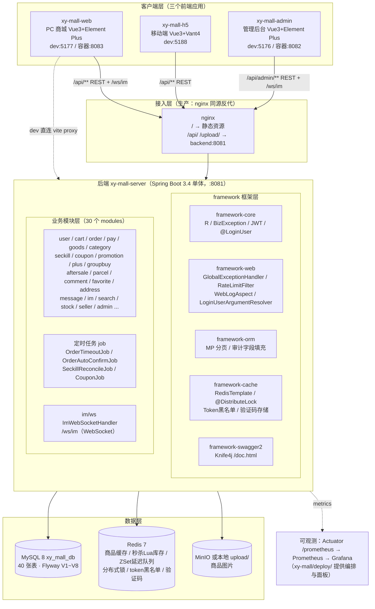
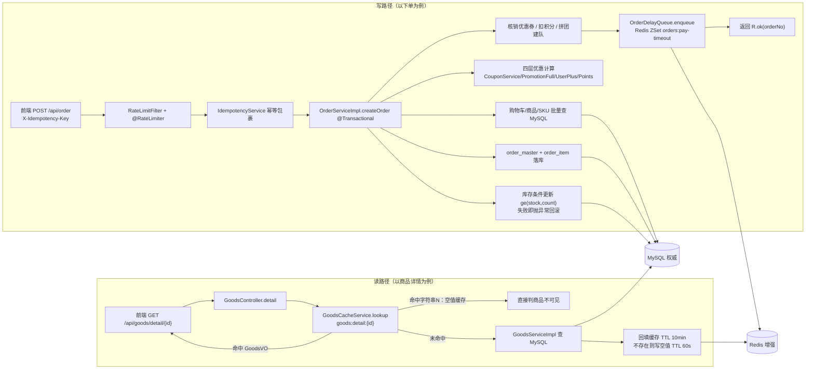

# 01 系统架构

> 项目：xyMall ｜ 版本：v1.0 ｜ 生成日期：2026-10-05 ｜ 依据：源码分析

## 1. 整体架构总览

xyMall 采用"**一后端 + 三前端**"的前后端分离架构。后端是刻意保持单实例的 Spring Boot 3 单体（`xy-mall/xy-mall-server`，端口 8081），对外同时服务三类客户端：PC 商城（5177/8083）、移动 H5（5188）、管理后台（5176/8082）。数据面由 MySQL 8（权威存储）、Redis 7（可选增强层）与 MinIO/本地 `upload/`（图片对象存储）组成。所有前端与后端的通信归为两类：HTTP REST（`/api/**` 统一响应 `R{code,message,data}`）与 WebSocket（`/ws/im` 客服 IM）。



架构上最重要的三个事实（均可在源码中验证）：

1. **单体但分层严格**：后端按"框架层 framework（5 个 Maven 模块）→ 业务模块层 server/modules（30 个模块）"组织，模块内再按 `controller / service / mapper / entity / vo / context / job / aop / ws` 分层（见 `xy-mall/server/src/main/java/com/xiaoye/mall/server/modules/` 目录）。
2. **Redis 是可选增强而非依赖**：`AGENTS.md` 第 6 节明确"所有 Redis 访问点必须 try/catch 降级"。典型如 `GoodsCacheService`（读缓存失败静默回源 DB）、`OrderDelayQueue.enqueue`（入队失败仅打 warn，由 DB 轮询兜底）、`SeckillStockRedisService`（Redis 不可用直接走纯 DB 条件扣减路径）。
3. **DB 是唯一权威**：无论秒杀库存还是订单状态，Redis 只是前置挡量/加速层，最终一致性以 MySQL 条件更新（CAS）为准，漂移由对账任务纠偏（`SeckillReconcileJob`）。

## 2. 后端架构：框架层详解

### 2.1 framework-core（零 Spring Web 依赖的内核）

路径 `xy-mall/framework/framework-core/src/main/java/com/xiaoye/mall/framework/core/`。该模块刻意不依赖 spring-web，保证纯业务工具可在任何环境测试：

- `result/R.java`：统一响应体 `{code, message, data}`，`R.ok(data)` 固定 code=200；全站接口返回值类型即 `R<T>`。
- `exception/BizException.java`：业务异常，携带语义化 code（400/401/500），由上层转为 HTTP 状态。
- `security/JwtUtil.java`：基于 jjwt 0.12.6 的 HS256 签发/验签，`createToken(secret, expireMillis, subject, claims)`；secret 由环境变量 `XY_MALL_JWT_SECRET` 注入，`application.yml` 不提供默认值，**未注入时启动即失败**（防可预测密钥）。
- `security/PasswordUtil.java`：随机盐 + `MD5(明文+盐)`，对应 `user.password_md5/salt` 两列。
- `annotation/LoginUser.java` + `security/TokenBlacklistService.java` + `LoginFailGuard.java` + `CaptchaCodeService.java`：认证体系的抽象接口。`framework-core` 提供 `InMemoryCaptchaStore/InMemoryLoginFailStore` 内存实现，`framework-cache` 提供 Redis 实现（`RedisCaptchaStore` 等），按装配环境自动切换——这是典型的**策略模式 + 条件装配**。

### 2.2 framework-web（Web 请求的横切面）

路径 `xy-mall/framework/framework-web/src/main/java/com/xiaoye/mall/framework/web/`：

- `handler/GlobalExceptionHandler.java`：`@RestControllerAdvice`。关键映射规则：`BizException` 中 code 为 **401/400 时透出对应 HTTP 状态码**（便于前端 axios 统一走"登录失效"分支），其余业务错误 HTTP 200 + body code；`MethodArgumentNotValidException` 取第一条字段错误；`HttpMessageNotReadableException` 返回"请求体格式错误"；兜底 `Exception` 返回 500"系统繁忙"。
- `resolver/LoginUserArgumentResolver.java`：解析 `@LoginUser Long userId` 参数。链路为：取 `Authorization` 头 → `JwtUtil.parseToken` 验签 → 查 Redis 黑名单（登出即失效）→ `AccountStatusChecker` 校验账号锁定/注销 → 校验 claims 中 `ver` 与 DB `token_version` 一致（改密后 +1 使旧 token 全失效）。任一环节失败抛 `BizException(401)`。
- `filter/RateLimitFilter.java` + `aop/RateLimitAspect.java`：双层限流。Filter 对 `/api/*` 做 IP 维度滑动窗口（300 次/分）兜底；`@RateLimiter(limit, windowSeconds, dimension)` 注解 + AOP 实现接口级限流（USER/IP 维度），已应用于下单、模拟支付、秒杀抢购、验证码、支付宝回调等高敏入口。
- `aop/WebLogAspect.java`：controller 层耗时观测，debug 全量打印、超过 `xy-mall.api.slow-cost-ms`（默认 1000ms）warn 告警，并输出 Micrometer 指标 `xy_mall_api_cost_seconds`。
- `config/WebConfig.java`：注册参数解析器与两个 Filter（`RequestIdFilter` 最高优先级，`RateLimitFilter` 次之）；将工作目录 `upload/` 映射为 `/upload/**` 静态资源（**因此必须以 xy-mall/ 为工作目录启动**）；按 `xy-mall.cors.allowed-origin-patterns` 开关 CORS；prod 关闭文档时对 `/doc.html` 等路径强制 404。

### 2.3 framework-orm / framework-cache / framework-swagger2

- `framework-orm/config/MybatisPlusConfig.java` 装配分页插件（3.5.9 起分页依赖 `mybatis-plus-jsqlparser`）；`handler/XyMetaObjectHandler.java` 自动填充 `createTime/updateTime` 审计字段；逻辑删除由 `application.yml` 的 `logic-delete-field: isDeleted` 全局声明。
- `framework-cache/config/CacheConfig.java` 装配 RedisTemplate；`lock/DistributeLockAspect.java` 实现 `@DistributeLock(scene, keyExpression, waitMs, leaseMs)`——SpEL 取参生成锁 key，Redis SETNX 加锁，**Redis 异常自动降级放行**（不因锁服务故障阻断业务）。
- `framework-swagger2/config/OpenApiConfig.java` 提供 OpenAPI 元数据，配合各 Controller 的 `@Tag/@Operation` 注解生成 `/doc.html`。

## 3. 后端架构：业务模块层

`XyMallServerLauncher`（`@SpringBootApplication(scanBasePackages="com.xiaoye.mall")` + `@MapperScan("...modules.**.mapper")` + `@EnableScheduling`）启动后，30 个业务模块按统一骨架工作。以订单模块为例的完整分层：

```
modules/order/
├── controller/OrderController.java     # REST 入口：POST /api/order（下单，@RateLimiter(10/60s)，X-Idempotency-Key 幂等）
├── context/SaveOrderContext.java       # 复杂入参聚合（cartItemIds/addressId/userCouponId/usePoints/invoice...）
├── service/OrderService.java           # 接口
├── service/impl/OrderServiceImpl.java  # 核心实现：createOrder/cancelOrder/paySuccess/closeIfTimeout/refundAndClose
├── service/OrderDelayQueue.java        # Redis ZSet 延迟队列（5s 轮询）
├── service/OrderLazyCloseTrigger.java  # 读路径惰性关单触发器
├── service/IdempotencyService.java     # 幂等键执行器
├── service/PointsCalculator.java       # 纯函数积分抵扣计算
├── statemachine/OrderStateMachine.java # 订单状态机（合法迁移表）
├── job/OrderTimeoutJob.java            # DB 轮询超时关单（60s）
├── job/OrderAutoConfirmJob.java        # 发货超时自动确认收货
├── mapper/OrderMasterMapper.java       # MyBatis-Plus Mapper
├── entity/OrderMaster.java OrderItem.java
└── vo/OrderVO.java OrderItemVO.java
```

模块间协作通过注入彼此的 Service 接口完成（如 `OrderServiceImpl` 注入 `CouponService`、`PromotionFullService`、`UserPlusService`、`SeckillService`、`GroupBuyService`、`SysConfigService` 等）；存在循环依赖时用 `@Lazy` 打破（如 `groupBuyService` 字段上的 `@org.springframework.context.annotation.Lazy`）。

## 4. 前端三端架构

### 4.1 共性骨架

三端共享同一套工程范式（可对比 `xy-mall-web/src/api/request.ts` 与 `xy-mall-admin/src/api/request.ts`）：

- **入口**：`src/main.ts` 创建 Vue 应用 → 装配 Pinia + Router → 挂载；
- **HTTP 层**：`src/api/request.ts` 创建 axios 实例（baseURL `/api`，timeout 15s，blob 导出放宽至 60s）。请求拦截器注入 `Authorization: Bearer ${token}`；响应拦截器把 `R` 结构**解包**——`code===200` 直接返回 `data`，业务错误弹 `ElMessage` 并 reject；HTTP 401 时做**跳转去重**（`redirecting` 标志位），清空本地登录态并带 `redirect` 参数回登录页；`silent: true` 的请求不弹全局提示；
- **状态层**：Pinia store，token/userInfo 持久化 localStorage（`xy-mall-web` 的 key 为 `xy-mall-token`/`xy-mall-user`，H5 为 `xy-h5-token`）；
- **路由守卫**：登录白名单（web 端 `authRoutes` 数组、h5 端硬编码列表、admin 端全局 token 检查 + `meta.perm` 权限点检查）；
- **自愈**：admin 与 h5 的 `router.onError` 捕获懒加载 chunk 失败（发版后旧 chunk 404），自动 `window.location.assign` 强刷。

### 4.2 差异点

| 维度 | xy-mall-web | xy-mall-admin | xy-mall-h5 |
| --- | --- | --- | --- |
| 组件引入 | `unplugin-vue-components` + ElementPlusResolver 自动按需引入（`vite.config.ts`） | 同左 | 全量引入 Vant（`src/main.ts`） |
| 权限模型 | 仅登录/未登录 | 路由 `meta.perm` + `v-perm` 按钮指令 + Layout 菜单按 `hasPerm` 过滤 + beforeEach 拉取 `/admin/profile` 刷新权限快照 | 仅登录/未登录 |
| 外壳 | `App.vue` 的 `meta.plain` 决定是否套 Header/Footer/ImWidget | `Layout.vue`：el-aside 菜单 + el-header 用户下拉 + el-main | `van-tabbar` 底部四页签（`meta.tab !== false` 显示），全局购物车角标 |
| 富交互 | 商品详情 SKU 选择、结算页四层优惠联动试算 | Dashboard ECharts 三图、wangEditor 商品详情富文本、IM 控制台 | 秒杀横滑条、瀑布流推荐 |

## 5. 数据流向图

一次典型的"读商品"与"下单"数据流向如下（注意 Redis 与 DB 的主从关系）：



## 6. 关键设计决策与设计模式

| 设计决策 | 实现位置 | 说明 |
| --- | --- | --- |
| 统一响应与异常 | `R.java` + `GlobalExceptionHandler` | 全站契约稳定，前端拦截器可解包 |
| 状态机收敛流转 | `modules/order/statemachine/OrderStateMachine.java` | 所有订单状态迁移经 `canTransit/checkTransit` 判定，禁止散写 if/switch（`AGENTS.md` 工程约定第 4 条） |
| CAS 条件更新 | `OrderServiceImpl` 各处 `.eq(orderStatus, 旧值)` 的 update | 防并发重复流转/超卖；`goodsSkuMapper.update ... .ge(GoodsSku::getStock, count)` 是防超卖核心 |
| 三重超时兜底 | `OrderDelayQueue`（Redis ZSet，5s）→ `OrderTimeoutJob`（DB 轮询，60s）→ `OrderLazyCloseTrigger`（详情读路径异步触发） | 任何一层失效订单仍会被关闭，`closeIfTimeout` 幂等 |
| Redis Lua 原子预扣 | `SeckillStockRedisService`（DEDUCT/RELEASE/WARM 三脚本） | 库存判减 + 每人每场幂等流水一个脚本内完成；DB 权威 + 对账纠偏 |
| 空值缓存 + 延迟双删 | `GoodsCacheService` | 防缓存穿透（60s 空值标记）与"删除→并发读回填旧值"脏窗口（2s 后二次删除，守护线程池不阻塞业务） |
| 注解式横切 | `@RateLimiter` / `@DistributeLock` / `@RequirePermission` + AOP 审计 | 业务代码零侵入获得限流/锁/权限/审计能力 |
| 策略 + 条件装配 | 验证码/登录失败存储的 InMemory 与 Redis 双实现 | 单机默认内存实现，装配 Redis 后自动升级 |
| 权限三级防线 | 后端 `@RequirePermission` + AOP 落 `admin_operation_log`；前端路由 `meta.perm`；按钮 `v-perm` | 前端隐藏只是体验，后端校验才是安全边界 |
| 设计模式 | 状态机（订单流转）、策略（缓存存储）、模板方法（MP `ServiceImpl` 基类）、代理/切面（限流锁审计）、生成器思想（`SaveOrderContext` 聚合入参）、观察者变体（延迟队列轮询回调 `OrderTimeoutExecutor`） | — |

## 7. 跨端通信机制

- **REST 契约**：用户端 `/api/**`、管理端 `/api/admin/**`，统一 `R{code,message,data}`；认证头 `Authorization: Bearer <token>`（用户与管理员是两套 token，管理员 subject 形如 `admin:{id}`，由 `AdminUserArgumentResolver` 解析 `@AdminUser` 参数）；下单可带 `X-Idempotency-Key` 幂等头。
- **WebSocket（IM）**：端点 `/ws/im?role=user|admin&token=...`（`modules/im/ws/ImWebSocketConfig.java`）。因为 WS 握手无法带 Header，鉴权信息放 query 参数，握手拦截器按与 HTTP 相同的标准验签 + 黑名单 + 账号状态 + 会话版本校验，任一失败拒绝握手；消息历史落 `im_message` 表（Flyway V8），REST 侧提供 `/api/user/im/history`、`/api/admin/im/history`、`/api/admin/im/sessions` 查询。前端 `xy-mall-web/src/components/ImWidget.vue` 在浮窗打开时建立连接、关闭时主动断开释放会话。
- **支付回调**：支付宝异步 `POST /api/pay/alipay/notify`（RSA2 验签 + 幂等确认，返回 "success"）、同步回跳 `GET /api/pay/alipay/return`；模拟支付走 `POST /api/order/paySuccess`（`xy-mall.payment.mock-enabled` 控制，prod 默认 true 供演示、正式接入后应改回 false）。
- **静态资源**：商品图片经 `/upload/**` 由后端静态映射（或 MinIO 公网基址直出），三端通过 vite proxy / nginx 反代访问。
