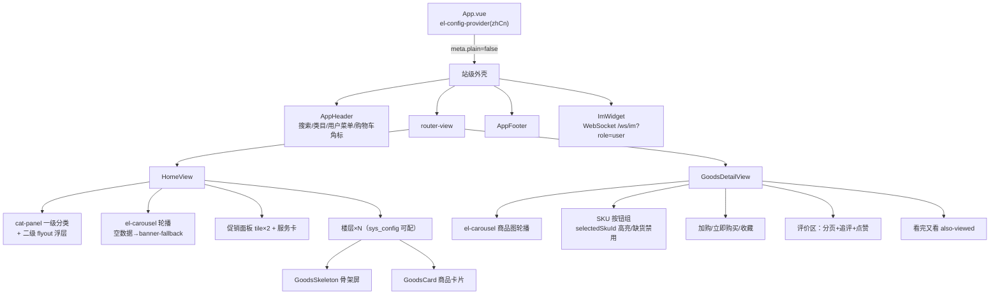
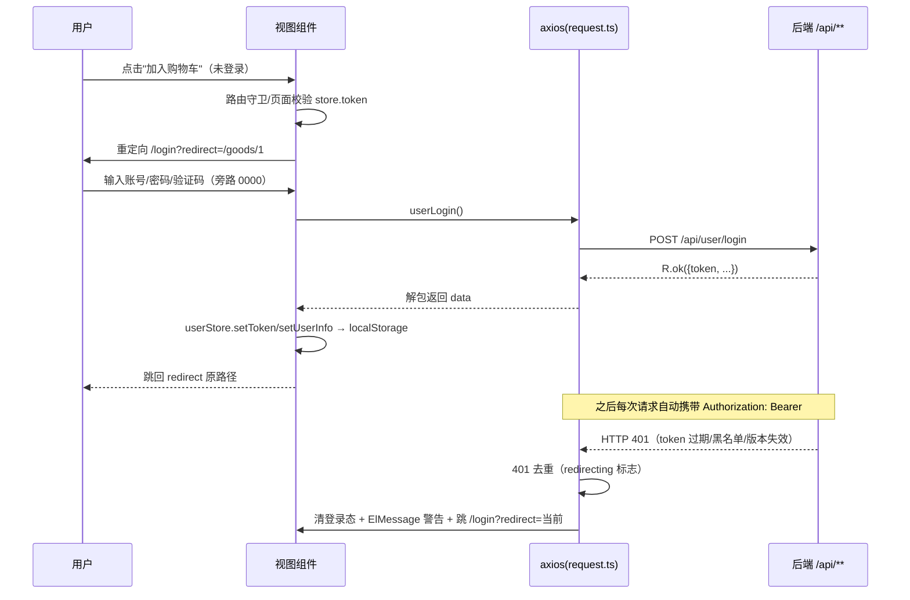

# 02 页面设计

> 项目：xyMall ｜ 版本：v1.0 ｜ 生成日期：2026-10-05 ｜ 依据：源码分析

本文按「商城 Web / 管理后台 / 移动端 H5」三端展开，给出每端的路由与页面总表、核心页面的布局与交互设计、组件树、状态管理设计与关键 UI 交互流程。所有页面文件位于各前端工程的 `src/views/` 目录。

## 1. 商城 Web 端（xy-mall-web）

### 1.1 路由与页面总表

路由定义集中于 `xy-mall-web/src/router/index.ts`，history 模式，全部懒加载；`meta.title` 用于 `afterEach` 同步 `document.title`，`meta.plain` 表示不套站级外壳（Header/Footer/IM 浮窗）。登录白名单 `authRoutes` 覆盖 `/cart /checkout /coupons /orders /address /profile /favorites /footprint`，守卫未命中 token 时重定向 `/login?redirect=原路径`。

| 路由 | 视图组件 | 页面职责 | 需登录 |
| --- | --- | --- | --- |
| `/` | `HomeView.vue`（739 行） | 商城首页：类目菜单+轮播+促销面板+楼层 | 否 |
| `/login` | `LoginView.vue` | 登录/注册（图形验证码），`plain` 外壳 | 否 |
| `/goods` | `GoodsListView.vue`（576 行） | 商品列表：关键词/分类/品牌/价格区间/排序 + 分页 | 否 |
| `/seckill` | `SeckillView.vue`（585 行） | 限时秒杀专场：场次倒计时（服务端对时）+ 抢购 | 否 |
| `/goods/:id` | `GoodsDetailView.vue`（1062 行，最重页面） | 商品详情：轮播/SKU/加购/立即购买/评价/收藏/足迹 | 否 |
| `/cart` | `CartView.vue` | 购物车：勾选、数量步进、删除、去结算 | 是 |
| `/checkout` | `CheckoutView.vue`（425 行） | 确认订单：地址/券/积分/发票/运费试算/提交 | 是 |
| `/orders` | `OrderListView.vue`（661 行） | 我的订单：状态页签、支付倒计时、取消/支付/确认收货/售后/评价 | 是 |
| `/coupons` | `CouponsView.vue` | 我的优惠券：可用/已用/已过期 + 兑换码 | 是 |
| `/address` | `AddressView.vue` | 收货地址 CRUD（省市区三级联动） | 是 |
| `/profile` | `ProfileView.vue`（361 行） | 个人中心：资料/改密/资产（余额充值、积分签到）/PLUS/注销/数据导出 | 是 |
| `/favorites` | `FavoritesView.vue` | 我的收藏 | 是 |
| `/footprint` | `FootprintView.vue` | 浏览足迹 | 是 |
| `/groups` | `GroupsView.vue` | 拼团专场：开团/拼团中队伍列表/参团 | 否 |
| `/messages` | `MessagesView.vue` | 消息中心：未读数、全部已读 | 是 |
| `/privacy` | `PrivacyView.vue` | 隐私声明（`plain`） | 否 |
| `/:pathMatch(.*)*` | `NotFoundView.vue` | 404 兜底 | 否 |

### 1.2 核心页面设计

**首页 `HomeView.vue`**：布局为京东式三栏主视觉——左侧 `cat-panel` 一级分类列表（`mouseenter` 展开二级浮层 `flyout`，点击跳 `/goods?categoryId=`）；中央 `el-carousel` 轮播（高 400px、4.5s 间隔，`carouselUrl` 为空或加载失败时渲染品牌占位图 `banner-fallback`）；右侧促销面板（秒杀/全部好物两个入口 tile + 服务卡片）。下方"楼层分区"由 `info[floor.key]` 驱动渲染（热销/新品/推荐来自 `/api/index/info`），楼层顺序与标题支持后台装修（`usePublicConfig` 读取 `sys_config: home.floors` JSON，未配置时用默认三楼层），再加一个"热卖 TOP"楼层（`/api/goods/top`）。数据未就绪时以 `GoodsSkeleton` 骨架屏占位。

**商品详情 `GoodsDetailView.vue`**：左图右购布局——左侧 `el-carousel` 商品轮播（`goodsCarousel` 逗号分隔拆分）；右侧价格区（选中 SKU 的价格优先：`displayPrice = selectedSku?.price ?? goods.sellingPrice`）、SKU 按钮组（缺货项 `disabled` + `active` 高亮，默认选中第一个有货 SKU）、数量 `el-input-number`、立即购买/加入购物车/收藏三操作。交互要点：①"立即购买"走"加购→按 goodsId+skuId 双条件定位刚加入的行→校准数量→携带该 cartItemId 跳结算页"的链路（规避购物车累加语义）；②进入详情自动 `recordFootprint` 记录足迹；③下方评价区分页加载 `/api/goods-comments` 与好评率 `summary`，可追评/点赞；④底部"看完又看"（`/api/goods/also-viewed`）。商品详情富文本经 `utils/sanitize.ts` 消毒后渲染，防 XSS。

**确认订单 `CheckoutView.vue`**：自上而下五个区块——收货地址（选择/新增）、商品清单（从 `route.query.ids` 或 `sessionStorage: xy-checkout-ids` 恢复的 cartItemIds）、优惠组合（可用券单选 + 积分抵扣开关）、发票（普票/专票 + 抬头 + 税号）、金额汇总栏。金额试算完全对齐后端公式：`total`（分）→ 券后 → 满减（`promotions` 按 threshold 取最优）→ 积分抵扣（`pointsDeductEstimate` 受 rate/max-percent 双约束）→ PLUS 折扣 → 运费（`total >= FREE_SHIPPING_AT` 包邮否则 `SHIPPING_FEE`，阈值来自 `usePublicConfig`）。提交时 `createOrder({cartItemIds, addressId, userCouponId, usePoints, remark, invoice...})`，成功后清除暂存并跳支付。

**我的订单 `OrderListView.vue`**：顶部状态页签（全部/待支付/待发货/待收货/已完成等，映射 `orderStatus` 0/1/2/3/4/-1/-2），`el-table` 列含订单号、总价、`el-tag` 状态（`statusMap` 定义文案与 tag 类型）、**支付剩余时间**（优先使用后端下发的 `payDeadline` 毫秒时间戳倒计时，缺失时以 `createTime + 超时分钟` 兜底）、操作列（按状态渲染：去支付/取消订单/确认收货/查看物流/申请售后/评价）。详情为 `el-dialog` 内嵌订单项表格。

### 1.3 组件与状态

公共组件：`AppHeader.vue`（489 行：logo、搜索框联想词、类目导航、用户菜单、购物车角标 `useCartCount`；1100px/860px 两档响应式折叠）、`AppFooter.vue`、`GoodsCard.vue`（商品卡片：图/名/价/收藏按钮，列表/楼层/收藏页复用）、`GoodsSkeleton.vue`、`ImWidget.vue`（客服 IM 浮窗，管理 WebSocket 生命周期）、`ServiceBar.vue`。全局样式 `styles/variables.css` 定义品牌变量，`global.css` 在 768px 断点做移动适配（该端自称"响应式适配手机"）。

## 2. 管理后台（xy-mall-admin）

### 2.1 路由与页面总表

路由定义于 `xy-mall-admin/src/router/index.ts`：`/login` 独立页，其余全部嵌套在 `Layout.vue` 下。每个业务路由通过 `meta.perm` 声明所需权限码，`beforeEach` 中校验 `store.hasPerm(perm)`，无权限一律回 `/dashboard`；若角色连 `dashboard:view` 都没有，则自动落到第一个有权限的路由（防止连环 403）。登录后 `beforeEach` 还会调用 `/admin/profile` 刷新角色与权限快照（首屏先用 localStorage 缓存渲染，避免闪烁）。

| 路由 | 视图组件 | 页面职责 | 权限点（meta.perm） |
| --- | --- | --- | --- |
| `/dashboard` | `DashboardView.vue` | 经营仪表盘：核心指标卡 + ECharts 趋势/分类占比/热卖 TOP 三图 + 热搜词 | `dashboard:view`（菜单免 perm 兜底） |
| `/goods` | `GoodsListView.vue` | 商品管理：分页/搜索、新增/编辑（含 SKU 子表、wangEditor 详情、图片上传）、上下架、批量状态、删除、CSV 导出 | `goods:update` |
| `/categories` | `CategoryListView.vue` | 三级分类管理 + 批量删除 | `category:update` |
| `/orders` | `OrderListView.vue` | 订单管理：分页/筛选、详情、状态流转（发货/配货/关闭）、批量状态、快递单号录入、补写物流轨迹、CSV 导出 | `order:list` |
| `/after-sale` | `AfterSaleListView.vue` | 售后审核：同意/驳回 + 备注（同意即退款至余额） | `order:flow` |
| `/comments` | `CommentListView.vue` | 评价管理：查看/商家回复/删除 | `comment:list` |
| `/users` | `UserListView.vue` | 用户管理：锁定/解禁、重置密码、详情、资产（余额/积分）调整、导出 | `user:lock` |
| `/coupons` | `CouponListView.vue` | 优惠券定义 CRUD + 上下架；用户持券查询/作废/补发 | `coupon:update` |
| `/seckill` | `SeckillListView.vue` | 秒杀场次 CRUD + 上下架 | `seckill:update` |
| `/carousels` | `CarouselListView.vue` | 轮播图管理 + 批量删除 | `carousel:update` |
| `/index-config` | `IndexConfigView.vue` | 首页楼层配置（热销/新品/推荐） | `index-config:update` |
| `/promotions` | `PromotionView.vue` | 满减活动 CRUD | `promotion:list` |
| `/group-buy` | `GroupBuyView.vue` | 拼团商品/队伍管理 | `groupbuy:list` |
| `/sellers` | `SellerView.vue` | 卖家店铺管理（含入驻审核） | `seller:list` |
| `/sys-config` | `SysConfigView.vue` | 运营参数（sys_config 键值）编辑：运费/积分/超时/热搜词/IP 白名单等 | `config:list` |
| `/managers` | `ManagerListView.vue` | 管理员账号 CRUD + 重置密码 | `admin:manager` |
| `/rbac` | `RoleListView.vue` | 角色管理与角色-权限点分配（el-tree 多选） | `admin:role` |
| `/operation-logs` | `OperationLogView.vue` | 管理端操作审计日志查询 | `log:list` |
| `/im` | `ImConsoleView.vue` | 客服工作台：会话列表 + WebSocket 实时会话 + 历史消息 | 免 perm |
| `/:pathMatch(.*)*` | `NotFoundView.vue` | 404（保留 Layout 外壳） | - |

### 2.2 典型 CRUD 页面范式

所有列表页遵循同一范式（以 `GoodsListView.vue` 为样本）：**顶部工具条（搜索条件 + 主操作按钮）→ `el-table` 数据表（border+stripe+v-loading）→ `el-pagination` 分页 → `el-dialog` 表单弹窗**。要点：

1. **按钮级权限**：写操作按钮全部挂 `v-perm` 指令（`src/directives/perm.ts`：无权限 `display:none` 隐藏而非移除 DOM，mounted/updated 双钩子保证响应式）。例如新增商品 `v-perm="'goods:create'"`、编辑/上下架 `v-perm="'goods:update'"`、删除 `v-perm="'goods:delete'"`。
2. **表单校验**：`el-form :rules` 声明必填/数值范围，`formRef.validate()` 通过后才提交。
3. **商品编辑弹窗**（780px 宽）：名称/品牌/卖家/预售设置/简介/主图（`AdminUploadController` 上传）/售价与划线价（元输入，提交前 ×100 转分）/库存（有 SKU 行时禁用，由 SKU 汇总）/**规格 SKU 子表**（el-table 内嵌行编辑：规格名/售价/划线价/库存，可增删行，保存走 `/admin/goods/{id}/skus`）/轮播图多图/分类级联/wangEditor 富文本详情。
4. **危险操作**：删除走 `ElMessageBox.confirm` 二次确认；上下架/批量状态走 `batchGoodsStatus`。
5. **CSV 导出**：`utils/download.ts` 接收 blob 响应触发浏览器下载（request.ts 对 blob 放宽超时到 60s 且不按 R 结构解包）。
6. **Dashboard**：`DashboardView.vue` 按需注册 ECharts 模块（`echarts.use([LineChart, BarChart, PieChart, GridComponent, LegendComponent, TooltipComponent, CanvasRenderer])`），三图分别是经营趋势折线、分类销售占比饼图、热卖商品条形图，数据来自 `/admin/dashboard/stats|trend|top-searches`；窗口 resize 时 `chart.resize()`。
7. **IM 控制台**：`ImConsoleView.vue` 左侧会话列表（`/admin/im/sessions`）、右侧消息流，WebSocket 连接 `ws://{host}/ws/im?role=admin&token=...`，发送经 `/admin/im/send`。

## 3. 移动端 H5（xy-mall-h5）

### 3.1 路由与页面总表

路由定义于 `xy-mall-h5/src/router/index.ts`，9 条路由；`meta.tab !== false` 的页面显示底部 `van-tabbar`（首页/分类/购物车/我的，购物车项带全局角标）。`/cart /checkout /orders /profile` 需登录。H5 是**迭代中的精简端**：复用与 Web 端完全相同的后端 API，但只实现核心购物链路。

| 路由 | 视图组件 | 页面职责 |
| --- | --- | --- |
| `/` | `HomeView.vue` | 红色渐变品牌头 + 搜索入口、`van-swipe` 轮播、金刚区分类、**秒杀横滑条**（京东式，库存为 0 显示"罄"角标）、"为你推荐"无限瀑布流（淘宝式） |
| `/goods` | `ListView.vue` | 商品列表/搜索结果：`van-list` 上拉加载 + 筛选 |
| `/category` | `CategoryView.vue` | 左右联动分类页（左一级右二级） |
| `/goods/:id` | `DetailView.vue` | 商品详情：轮播、SKU 弹层（`van-action-sheet` 风格 + `van-stepper` 数量）、底部 `van-action-bar`（店铺/收藏/加购/立即购买） |
| `/cart` | `CartView.vue` | 购物车：`van-swipe-cell` 左滑删除、全选结算 |
| `/checkout` | `CheckoutView.vue` | 确认订单：地址、券、积分、提交（默认余额支付 payType=0） |
| `/orders` | `OrdersView.vue` | 订单列表与状态操作 |
| `/profile` | `ProfileView.vue` | 个人中心：资产/签到/地址入口/退出 |
| `/login` | `LoginView.vue` | 登录/注册（验证码） |

### 3.2 设计要点

主题色经 CSS 变量双写覆盖为京东红（`App.vue` 中 `:root:root { --van-primary-color: #e4393c }`，双 `:root` 提高优先级压过 Vant 默认值）；`van-config-provider` 注入主题变量；全局隐藏滚动条模拟原生 App 手感；`utils/format.ts` 提供"分转元"等格式化。图片统一 `@error` 兜底占位。`App.vue` 在路由切换时静默刷新购物车角标（登录态下拉 `/cart/list` 求和 `goodsCount`，异常静默）。

## 4. 三端组件树（以商城 Web 首页与详情页为例）

## 5. 状态管理设计

三端状态层刻意保持轻量——**只有登录态需要跨页面共享**，页面数据（列表、详情、购物车行）均由页面组件自行拉取，不进全局 store：

| Store | 工程 | 职责 |
| --- | --- | --- |
| `stores/user.ts`（三端同名同构） | web / admin / h5 | `token` + `userInfo`（admin 端扩展 `roleCodes`/`perms`）；写入即同步 localStorage（web：`xy-mall-token`/`xy-mall-user`，h5：`xy-h5-token`）；`logout()` 双清。web 端兼容旧版散落的 `xy-mall-nick` key 并迁移清理 |
| `useCartCount`（composable） | web | 请求级共享购物车角标数，加购/删除后手动刷新 |
| `usePublicConfig`（composable） | web | 拉取 `/api/config/public`（运费阈值、积分规则、热搜词、首页楼层装修 JSON、模拟支付开关等），供结算试算与首页装修使用 |

权限判断集中在 admin 端 `stores/user.ts` 的 `hasPerm(code)` getter：`SUPER_ADMIN` 角色全通过，否则查 `perms` 数组。这样 `v-perm`、Layout 菜单过滤、路由 `meta.perm` 三处复用同一判定源，保证前端三道权限 UI 的一致性。

## 6. 关键 UI 交互流程

### 6.1 登录态与 401 统一处理

### 6.2 结算页金额联动（前端试算与后端公式对齐）

```mermaid
graph LR
    IDS["cartItemIds<br/>(query.ids / sessionStorage)"] --> LOAD["并行拉取：<br/>cart商品 / 地址 / 可用券 / 公共配置"]
    LOAD --> TOTAL["total = Σ 单价×数量"]
    TOTAL --> COUPON["选券 → couponDiscount"]
    COUPON --> PROMO["promoDiscount<br/>满 threshold 取最优满减"]
    PROMO --> POINTS["usePoints 开 →<br/>pointsDeduct 受 rate/max-percent 上限"]
    POINTS --> PLUS["PLUS 会员 →<br/>base×(100-折扣百分比)/100"]
    PLUS --> SHIP["运费：total≥包邮阈值 ? 0 : 固定运费"]
    SHIP --> PAY["应付 = max(total-各优惠,0) + 运费"]
    PAY --> SUBMIT["POST /api/order<br/>（后端以同一公式重算，前端值仅供参考展示）"]
```

需要强调：前端试算只用于交互反馈，**金额的最终裁决在后端** `OrderServiceImpl.createOrder`（券→满减→积分→PLUS→运费的顺序与 sys_config 参数一致），前端展示值与后端结算值不一致时以后端落库为准。
