# 04 数据模型

> 项目：xyMall ｜ 版本：v1.0 ｜ 生成日期：2026-10-05 ｜ 依据：源码分析

## 1. 存储方案总览

系统采用"**MySQL 权威 + Redis 增强 + 对象存储**"的三层存储：

| 存储 | 版本/形态 | 职责 | 关键事实 |
| --- | --- | --- | --- |
| MySQL 8 | 库名 `xy_mall_db`，InnoDB / utf8mb4 | 唯一权威数据源：40 张表（V1 建 28 张 + V2 新增 10 张 + V5 敏感词 1 张 + V8 IM 1 张），金额一律 INT 分 | schema 只经 Flyway 演进（`server/src/main/resources/db/migration/V1~V8`），`validate-on-migrate: true` 防漂移；逻辑删除字段 `is_deleted` 全局声明于 `application.yml` |
| Redis 7 | 单实例，可挂 | 纯增强层：商品缓存、秒杀库存/流水、订单延迟队列、分布式锁、token 黑名单、验证码、登录失败计数 | 所有访问点 try/catch 降级，挂掉不影响交易正确性（DB 为准） |
| MinIO / 本地 | S3 兼容，桶 `xy-mall` | 商品/评价/售后图片 | 密钥缺失或 NAS 掉线自动回落本地 `upload/` 目录（`WebConfig` 静态映射） |

Druid 连接池开启慢 SQL 日志（`slow-sql-millis: 2000`）与 stat 合并统计；出于安全关闭了 Druid Web 监控台（`stat-view-servlet.enabled: false`）。

## 2. 表清单与迁移脉络

| 迁移 | 内容 |
| --- | --- |
| `V1__init.sql` | 核心 28 表：`user`、`user_address`、`goods_category`、`goods`、`shopping_cart`、`order_master`、`order_item`、`carousel`、`index_config`、`admin_user`、`admin_role`、`admin_permission`、`admin_role_permission`、`coupon`、`user_coupon`、`seckill`、`seckill_success`、`goods_comment`、`after_sale`、`goods_sku`、`order_logistics`、`balance_log`、`points_log`、`browse_log`、`user_favorite`、`comment_like`、`sys_config`、`admin_operation_log` + RBAC/运营参数种子数据 |
| `V2__batch3.sql` | `search_log`、`user_message`、`stock_log`、`promotion_full`、`group_buy`、`group_team`、`group_member`、`user_membership`、`seller`、`order_package` 十表；`goods` 增 `brand/seller_id/presale/presale_deposit/presale_start`；`user` 增 `growth`；新增 6 个权限点 |
| `V3` | `order_master` 增 `promo_discount`（满减金额） |
| `V4` | 注册赠券相关 |
| `V5` | `group_member` 增 `order_no/paid`；`order_master` 增 `group_team_id`；`goods_comment` 增 `reply_content/reply_time`（商家回复）；`user` 增 `invite_code/inviter_id`（唯一键 `uk_invite_code`）；`sensitive_word` 敏感词表；`order_master` 增 `balance_order_for`（定金尾款关联） |
| `V6` | `seller` 增 `apply_user_id`（自助入驻）；`search_log` 增 `result_count` |
| `V7` | `shopping_cart` 唯一键升级为 `uk_user_goods_sku(user_id, goods_id, sku_id)`（SKU 粒度防重） |
| `V8` | `im_message` IM 消息表 |

## 3. 核心表结构

以下为最核心 10 张表的字段级定义（完整定义见 `V1__init.sql` / `V2__batch3.sql`，所有表均含 `create_time`，多数含 `update_time` 与 `is_deleted` 逻辑删除，下表省略这三列）。

### 3.1 user（用户）

| 字段 | 类型 | 约束 | 说明 |
| --- | --- | --- | --- |
| user_id | BIGINT | PK 自增 | 用户ID |
| login_name | VARCHAR(50) | 唯一 `uk_login_name` | 登录名 |
| nick_name | VARCHAR(50) | | 昵称 |
| password_md5 | VARCHAR(64) | NOT NULL | MD5(明文+盐) |
| salt | VARCHAR(32) | NOT NULL | 加盐 |
| mobile / email | VARCHAR(20)/VARCHAR(100) | | 联系方式 |
| locked_flag | TINYINT | 默认 0 | 锁定 0否 1是 |
| token_version | BIGINT | 默认 0 | 会话版本：改密后 +1 使旧 token 全失效 |
| balance | INT | 默认 0 | 余额（分） |
| points | INT | 默认 0 | 积分 |
| growth | INT | 默认 0（V2） | 成长值 |
| invite_code / inviter_id | VARCHAR(16)/BIGINT | 唯一（V5） | 邀请关系 |

### 3.2 goods / goods_sku / goods_category（商品域）

`goods`：`goods_id` PK；`goods_name` VARCHAR(200)；`goods_intro`；`goods_cover_img`；`goods_carousel`（逗号分隔多图）；`goods_detail` TEXT（富文本）；`original_price`/`selling_price` INT 分；`stock_num` INT；`goods_category_id`（索引）；`goods_sell_status` 0 上架 1 下架；`brand`（V2，自由标签）；`seller_id`（V2 多商户）；`presale`/`presale_deposit`/`presale_start`（V2 预售）。
`goods_sku`：`sku_id` PK、`goods_id`（索引）、`sku_name`、`price`、`original_price`、`stock`。主表库存与 SKU 库存并存：无 SKU 历史数据扣主表，有 SKU 扣 `goods_sku.stock`（`OrderServiceImpl` 下单逻辑）。
`goods_category`：`category_level` 1/2/3 三级、`parent_id`（索引）、`category_name`、`category_rank` 排序。

### 3.3 order_master / order_item（订单域）

`order_master`：

| 字段 | 类型 | 约束/索引 | 说明 |
| --- | --- | --- | --- |
| order_id | BIGINT | PK 自增 | 订单ID |
| order_no | VARCHAR(50) | 唯一 `uk_order_no` | 订单号（userId+时间戳+4位随机） |
| user_id | BIGINT | 索引 `idx_user_id` | 下单用户 |
| total_price | INT | | 应付总价（分，四层优惠+运费后） |
| shipping_fee | INT | | 运费（分） |
| points_used / points_deduct | INT | | 抵扣积分 / 抵扣金额（分） |
| promo_discount | INT（V3） | | 满减优惠金额（分） |
| group_team_id | BIGINT（V5） | | 拼团队伍ID |
| balance_order_for | VARCHAR(50)（V5） | | 作为某定金单的尾款单 |
| express_company / express_no | VARCHAR(50) | | 快递信息 |
| pay_status | TINYINT | | 0 未支付 1 已支付 |
| pay_type | TINYINT | | 0 余额 1 模拟/默认 2 支付宝（语义以调用处为准） |
| order_status | TINYINT | 组合索引 `idx_status_create`/`idx_status_update` | 0待支付 1已支付 2配货完成 3出库成功 4交易成功 -1手动关闭 -2超时关闭 |
| extra_info | VARCHAR(500) | | 地址快照 + 优惠/发票备注拼接 |

`order_item`：`order_id`（索引）、`goods_id`、`sku_id`（0 为无 SKU 历史单）、`sku_name`/`goods_name`/`goods_cover_img`（**下单时快照**，防商品后续改价改名）、`selling_price` 成交单价、`goods_count`。订单项无 `is_deleted`——订单项跟随主单生命周期。

### 3.4 优惠券 coupon / user_coupon

`coupon`：`coupon_name/desc`、`coupon_total`（0 不限量）、`discount`、`min_amount`（门槛，分）、`coupon_limit`（每人限领，0 不限）、`coupon_type`（0 用户领取 1 注册赠 2 兑换码）、`coupon_status`（0 可用 1 过期 2 下架）、`goods_type`（0 全部 1 指定分类 2 指定商品）+ `goods_value`（ID 集合逗号分隔）、`coupon_code`（唯一）、起止时间。
`user_coupon`：`(user_id, coupon_id, receive_seq)` 唯一键 `uk_user_coupon_seq`——**用"领取序号"防并发超领**；`use_status` 0 未使用 1 已使用 2 已过期；`order_no`/`used_time` 核销痕迹（索引 `idx_order_no` 支撑按单归还）。

### 3.5 秒杀 seckill / seckill_success

`seckill`：`goods_id`、`seckill_price`、`seckill_total`/`seckill_stock`、`seckill_status` 0 下架 1 上架、起止时间。
`seckill_success`：`(seckill_id, user_id)` 唯一 `uk_seckill_user` **限购一件的 DB 闸门**；`state` 0 已抢待支付 1 已支付 -1 已取消（取消后该行可被条件更新复用，规避唯一键冲突）；`order_no` 回写（索引）。

### 3.6 账务流水 balance_log / points_log / stock_log

`balance_log`：`user_id`、`change`（正充负扣，分）、`reason`、`order_no`；"迟到支付补偿退款"以 `(order_no, reason)` 查重实现幂等（`OrderServiceImpl.compensateLatePayment`）。
`points_log`：同构；亮点是 `sign_date DATE GENERATED ALWAYS AS (CASE WHEN reason='每日签到' THEN CAST(create_time AS DATE) END) STORED` **生成列** + `(user_id, sign_date)` 唯一键，数据库层直接防同日重复签到。
`stock_log`：`goods_id + sku_id`（0 表主表库存）、`change` 正加负减、`reason`（下单/订单关闭回补/管理员调整）、`order_no`——库存每次变动可追溯。

### 3.7 RBAC 与审计 admin_user / admin_role / admin_permission / admin_role_permission / admin_operation_log

`admin_user`：`login_user_name` 唯一、`login_password`+`salt`、`locked_flag`、`role_id`（单角色模型）、`token_version`。
`admin_role`：`role_code` 唯一（`SUPER_ADMIN` 全权限）；`admin_permission`：`perm_code` 唯一（如 `goods:delete`）、`module` 分组；`admin_role_permission`：`(role_id, permission_id)` 唯一。V1 内置种子：超级管理员/运营专员两角色、约 40 个权限点、`admin` 账号绑定超管。
`admin_operation_log`：审计流水（`admin_user_id`、`admin_name` 冗余、`module`、`perm_code`、`summary`、`action`=HTTP 方法+URI、`params` 入参 JSON **脱敏截断**、`ip`、`success`、`error_msg`、`cost_ms`），三个查询索引。

### 3.8 其余表速览

`user_address`（省市区+详址+默认标记）、`shopping_cart`（`uk_user_goods_sku` 唯一，`sku_attrs` 快照）、`carousel`、`index_config`（config_type 1 热销 2 新品 3 推荐）、`goods_comment`（`(order_no, goods_id)` 唯一"一单一件一条"、追评、点赞数、商家回复 V5）、`comment_like`（`(comment_id, user_id)` 去重）、`after_sale`（`order_no` 唯一，`refund_amount` 按实付锁定，状态 0 待处理 1 同意 2 驳回）、`order_logistics`（轨迹节点）、`browse_log`、`user_favorite`（`(user_id, goods_id)` 唯一）、`search_log`（词+用户+命中数）、`user_message`（type: order/logistics/refund/activity/system）、`sys_config`（`config_key` 唯一，种子含运费/积分/超时/热搜词/IP 白名单/PLUS 价格/搜索引擎等）、`promotion_full`（满减门槛+减免+起止+状态）、`group_buy`/`group_team`/`group_member`（拼团三件套，成员 `(team_id, user_id)` 唯一）、`user_membership`（PLUS，`user_id` 唯一）、`seller`（店铺，V6 增 `apply_user_id` 入驻）、`order_package`（拆单包裹）、`sensitive_word`（V5）、`im_message`（V8，会话消息）。

## 4. ER 图

```mermaid
erDiagram
    USER ||--o{ USER_ADDRESS : "收货地址"
    USER ||--o{ ORDER_MASTER : "下单"
    USER ||--o{ SHOPPING_CART : "加购"
    USER ||--o{ USER_COUPON : "持券"
    USER ||--o{ USER_FAVORITE : "收藏"
    USER ||--o{ BROWSE_LOG : "足迹"
    USER ||--o{ BALANCE_LOG : "余额流水"
    USER ||--o{ POINTS_LOG : "积分流水"
    USER ||--o{ USER_MESSAGE : "消息"
    USER ||--o{ USER_MEMBERSHIP : "PLUS会员"
    USER ||--o{ GOODS_COMMENT : "评价"
    GOODS_CATEGORY ||--o{ GOODS : "归类"
    GOODS ||--o{ GOODS_SKU : "规格"
    GOODS ||--o{ SHOPPING_CART : ""
    GOODS ||--o{ ORDER_ITEM : "快照"
    GOODS ||--o{ GOODS_COMMENT : ""
    GOODS ||--o{ USER_FAVORITE : ""
    GOODS ||--o{ SECKILL : "秒杀商品"
    GOODS ||--o{ GROUP_BUY : "拼团商品"
    SELLER ||--o{ GOODS : "挂载"
    ORDER_MASTER ||--|{ ORDER_ITEM : "订单项"
    ORDER_MASTER ||--o{ ORDER_PACKAGE : "拆单包裹"
    ORDER_MASTER ||--o{ ORDER_LOGISTICS : "物流轨迹"
    ORDER_MASTER ||--o| AFTER_SALE : "售后"
    ORDER_MASTER }o--o| GROUP_TEAM : "拼团队伍"
    GROUP_BUY ||--o{ GROUP_TEAM : "开团"
    GROUP_TEAM ||--o{ GROUP_MEMBER : "参团"
    COUPON ||--o{ USER_COUPON : "发放"
    SECKILL ||--o{ SECKILL_SUCCESS : "抢购记录"
    ADMIN_ROLE ||--o{ ADMIN_USER : "授予"
    ADMIN_ROLE ||--o{ ADMIN_ROLE_PERMISSION : ""
    ADMIN_PERMISSION ||--o{ ADMIN_ROLE_PERMISSION : ""
    ADMIN_USER ||--o{ ADMIN_OPERATION_LOG : "审计"
    IM_MESSAGE }o--|| USER : "user-admin 会话"

    USER { bigint user_id PK "登录名唯一/token_version" }
    GOODS { bigint goods_id PK "主表库存/品牌/预售" }
    GOODS_SKU { bigint sku_id PK "price/stock" }
    ORDER_MASTER { bigint order_id PK "order_no唯一/四层优惠字段/状态机" }
    ORDER_ITEM { bigint order_item_id PK "商品名价图快照" }
    COUPON { bigint coupon_id PK "门槛/限领/适用范围" }
    USER_COUPON { bigint user_coupon_id PK "receive_seq 防超领" }
    SECKILL { bigint seckill_id PK "seckill_stock 权威库存" }
    SECKILL_SUCCESS { bigint seckill_success_id PK "uk_seckill_user 限购" }
    BALANCE_LOG { bigint id PK "change 正充负扣" }
    POINTS_LOG { bigint id PK "sign_date 生成列防重复签到" }
    STOCK_LOG { bigint id PK "库存全量流水" }
    ADMIN_USER { bigint admin_user_id PK "role_id/token_version" }
    ADMIN_PERMISSION { bigint permission_id PK "perm_code 唯一" }
    SYS_CONFIG { bigint config_id PK "config_key 唯一 运营参数" }
```

## 5. 缓存设计（Redis）

| 用途 | Key / 结构 | TTL | 一致性策略 | 源码 |
| --- | --- | --- | --- | --- |
| 商品详情缓存 | `goods:detail:{goodsId}` → GoodsVO 对象 | 10 min | 更新时**延迟双删**（先删，2s 后守护线程再删一次）；进程重启丢失的二次删除由 TTL 兜底 | `modules/goods/service/GoodsCacheService.java` |
| 空值缓存（防穿透） | 同 key 写入字符串 `"N"` | 60 s | 读到字符串即判定商品不可见，不回源 | 同上 |
| 秒杀库存 | `seckill:stock:{id}` → 整数 | 活动结束 +2h（最少 1min） | Lua 原子预扣（HEXISTS 幂等判重→判库存→HSET+DECR）；任何失败 Lua 回补；**对账 Job 每分钟以 DB 纠偏** | `modules/seckill/service/SeckillStockRedisService.java`、`SeckillReconcileJob` |
| 秒杀流水 | `seckill:grab:log:{id}` → hash(userId→时间戳) | 同上 | 同一脚本内写入，防重复抢 | 同上 |
| 订单支付超时延迟队列 | `orders:pay-timeout` ZSet（score=截止毫秒） | - | 5s 轮询弹出→`closeIfTimeout`（幂等）→成功才出队；Redis 不可用时 DB 轮询 Job 兜底 | `modules/order/service/OrderDelayQueue.java` |
| 分布式锁 | `@DistributeLock(scene, keyExpression)` | leaseMs 租期 | Redis 异常自动降级放行 | `framework-cache/lock/DistributeLockAspect.java` |
| Token 黑名单 | 登出 token → 标记 | 与 token 剩余寿命对齐 | 每次鉴权查询 | `framework-cache/security/TokenBlacklistServiceImpl.java` |
| 验证码 / 登录失败计数 | `RedisCaptchaStore` / `RedisLoginFailStore` | 短 TTL | 降级实现为进程内 Map | `framework-cache/security/` |

缓存设计遵循的统一原则（`AGENTS.md` 工程约定）：**读降级**（Redis 挂掉直查 DB）、**TTL 必须**、**更新时延迟双删**。

## 6. 数据生命周期

- **产生**：Flyway 建表 → 业务写入。审计与流水类（`admin_operation_log`、`balance_log`、`points_log`、`stock_log`、`browse_log`、`search_log`）只增不改。
- **更新**：状态类字段（`order_status`、`use_status`、`state`、`coupon_status`）全部经状态机/CAS 条件更新推进，从不裸 update。
- **逻辑删除**：业务主体表（user/goods/category/coupon/seckill/评价/售后等）走 `is_deleted=1` 软删，查询由 MyBatis-Plus 全局逻辑删除自动过滤；流水/日志/关联表物理保留。
- **过期**：优惠券 `end_time` 到期由 `coupon/job` 定时任务批量置 `use_status=2`；秒杀 Redis key 到活动结束后 2 小时自动过期；订单 30 分钟未支付关闭（延迟队列 + DB 轮询 + 惰性触发三重兜底）；发货后 N 天自动确认收货（`OrderAutoConfirmJob`）。
- **归档**：仓库保留 `sql/archive/` 目录存放被 Flyway 取代的历史手工升级脚本，仅作考古用途。
- **备份**：`xy-mall/scripts/db-backup.sh` 提供 mysqldump 备份脚本；docker-compose 使用命名卷 `mysql-data` 持久化。
