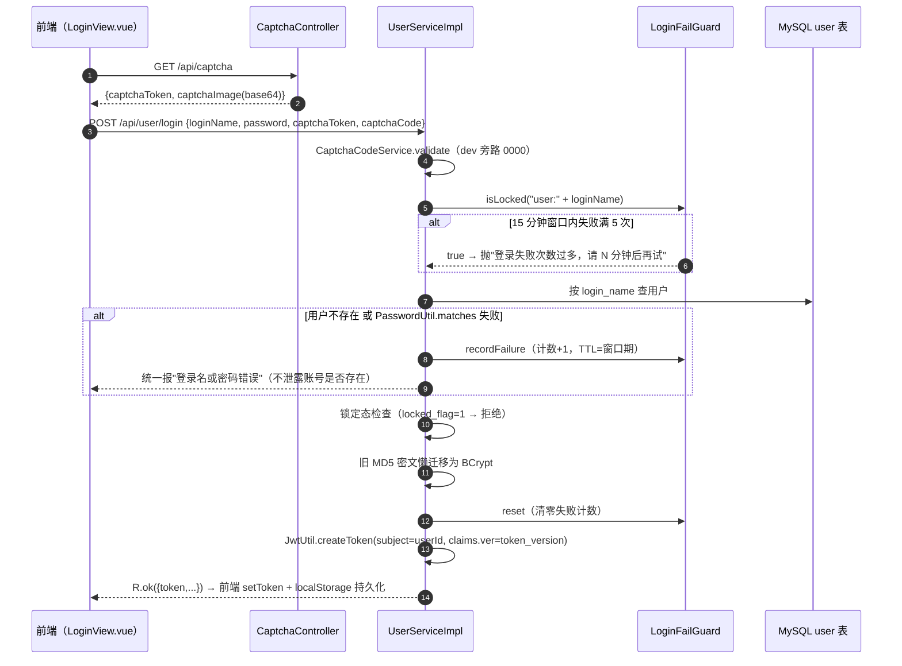
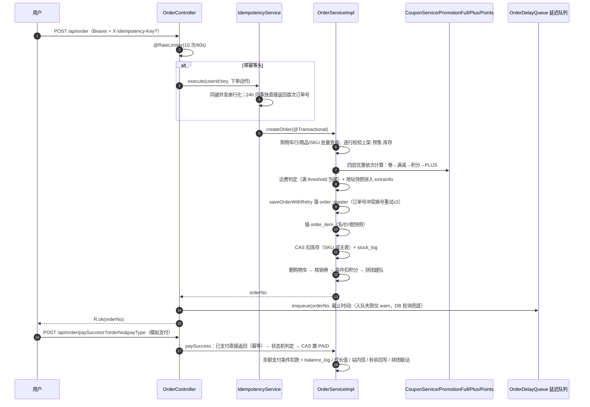
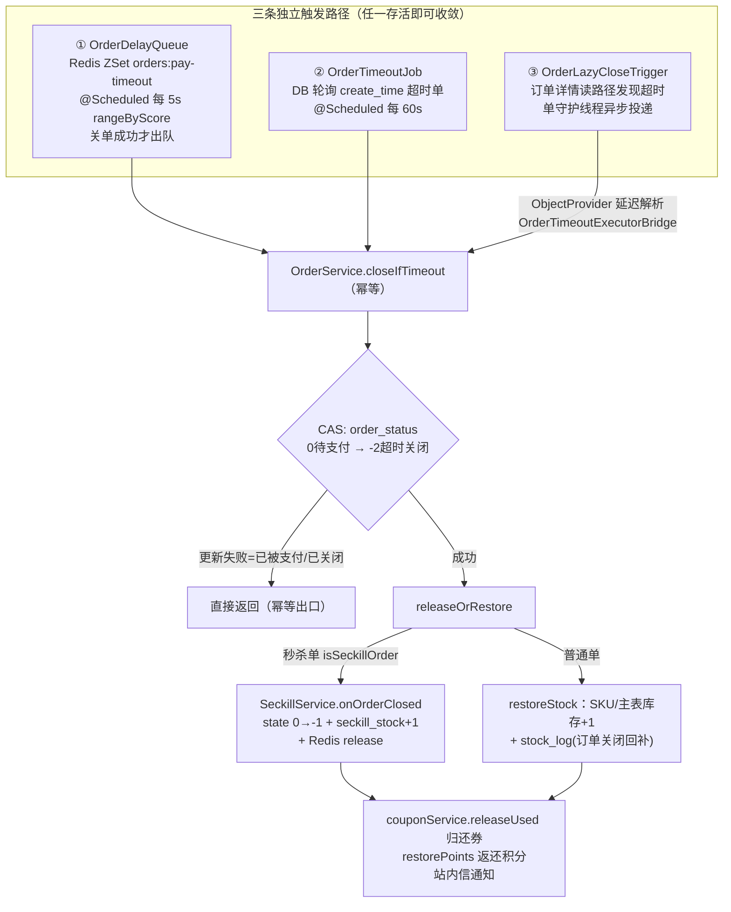
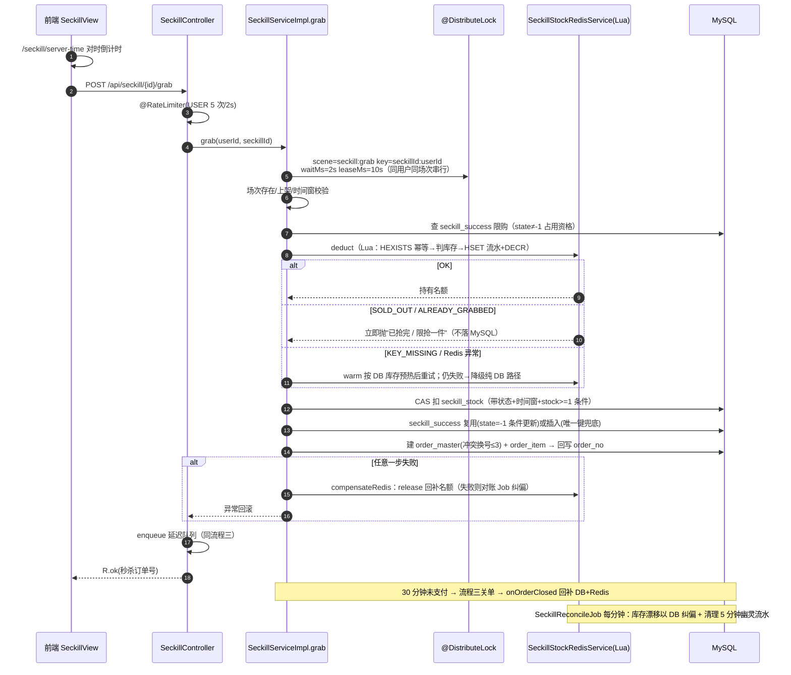
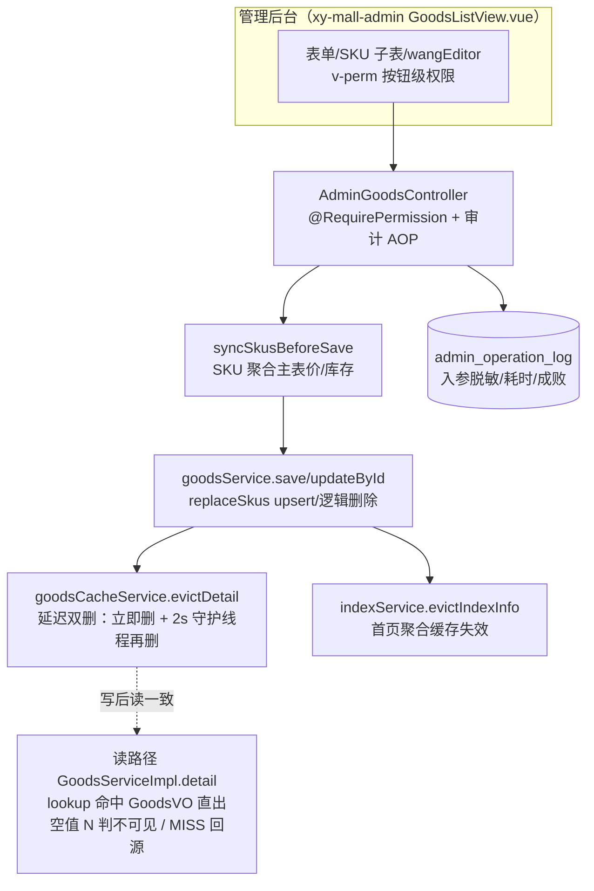

# 05 核心流程

> 项目：xyMall ｜ 版本：v1.0 ｜ 生成日期：2026-10-05 ｜ 依据：源码分析

本文选取 5 条业务价值最高的端到端链路，展开到类与方法级别讲清"代码是怎么跑通的"：①注册/登录与令牌生命周期；②购物车→下单→支付；③超时关单三重兜底与库存回补；④秒杀抢购（Redis Lua 预扣 + DB 权威 + 对账纠偏）；⑤后台商品管理与缓存一致性。接口契约、数据表结构、架构分层已在《03-接口设计》《04-数据模型》《01-系统架构》详述，本文不重复罗列，仅在链路需要时指路。

五条链路共享两条贯穿全局的铁律（源自 `xy-mall/AGENTS.md` 工程约定，源码中处处可见）：

- **DB 是唯一权威，Redis 是可丢的增强层**：所有扣减最终以 MySQL 条件更新（CAS）兜底，所有 Redis 访问点 try/catch 降级，Redis 挂掉只降性能不坏数据；
- **状态流转收敛**：凡状态推进必经状态机/唯一键/CAS 三选一防并发，从不裸 update——这是本系统能在单机演示环境下做出生产级正确性的根基。

---

## 1. 流程一：注册、登录与令牌生命周期

### 1.1 链路总览

### 1.2 分步说明

**① 图形验证码（防脚本批量的第一道闸）**。`CaptchaController`（`modules/captcha/`）生成随机码并返回 `captchaToken + base64 图片`，验证码存储经 `CaptchaCodeService` 抽象：`framework-core` 提供 `InMemoryCaptchaStore` 内存实现，装配 Redis 后自动切换 `framework-cache` 的 Redis 实现（策略 + 条件装配，见《01-系统架构》第 2.1 节）。`framework-core/.../security/CaptchaCodeService.java` 中留有一个仅开发态的旁路开关：`@Value("${mall.captcha.allow-bypass:false}")`，当配置为 true 且输入恒等于 `0000` 时直接放行——该开关只在 `application-dev.yml` 中声明，prod profile 不加载，生产不可绕过。注册与登录**都**要求验证码：注册侧的动机写在 `UserServiceImpl.register` 注释里——"防脚本批量注册薅注册赠送/滥用"。

**② 登录失败计数锁定**。`framework-core/.../security/LoginFailGuard.java` 以"同一登录名 15 分钟窗口内连续失败满 5 次（`MAX_FAIL=5`，`LOCK_WINDOW=15min`）即锁定"为规则，计数经 `LoginFailStore` 抽象落内存或 Redis（Redis 版让多实例共享计数，防轮询不同节点绕过锁定；TTL 即窗口期，到期自动清零）。`UserServiceImpl.login` 在"用户不存在"与"密码错误"两种情况下都调用 `recordFailure` 并返回**同一条**错误文案"登录名或密码错误"，避免向攻击者泄露账号是否存在；且**先验密码再看锁定态**（源码注释：避免向未持有密码的人泄露"账号存在且被锁定"）。

**③ 密码哈希的演进态**。`framework-core/.../security/PasswordUtil.java` 当前实现为：新口令一律 `BCryptPasswordEncoder` 加密（BCrypt 自带盐）；`matches` 先按 `$2` 前缀判断密文形态，BCrypt 走 BCrypt 校验，旧密文按 `md5(明文+盐)` 校验——`UserServiceImpl.login` 在旧密文校验通过后立即将其替换为 BCrypt（源码注释称之为"懒迁移"），无需停机批量刷库。这解释了《00-项目总览》中"加盐 MD5"的历史由来：表结构仍保留 `password_md5/salt` 两列，`salt` 列对新账号仅作兼容保留。

**④ 签发与双重失效机制**。`createToken`（`UserServiceImpl` 私有方法）调用 `JwtUtil.createToken(secret, expireMillis, subject, claims)` 签发 HS256 令牌，subject 为用户 ID，claims 中携带 `ver = user.token_version`。令牌此后有两个互相独立的失效通道：

- **登出黑名单**：`UserController.logout` 把当前 token 交给 `TokenBlacklistService`（Redis 实现 TTL 与令牌剩余寿命对齐），之后每次请求在 `LoginUserArgumentResolver` 第 2 步被拒；
- **会话版本**：改密（`updatePassword`）、注销（`deactivate`）都会 `token_version + 1`，因为解析器第 4 步要求 claims.ver 与 DB 当前值相等，旧 token（含被盗设备上的）立即全失效，无需等待自然过期。

**⑤ 请求侧四重校验**。每个带 `@LoginUser` 的接口进入业务前，`framework-web/.../resolver/LoginUserArgumentResolver.java` 依次执行：验签 → 黑名单 → `AccountStatusChecker.isAccountActive`（锁定/注销即时生效）→ 会话版本比对，任一失败抛 `BizException(401)`，由前端 axios 拦截器统一登出跳转（该前端行为已画在《02-页面设计》图 6.1，此处不重复）。管理端链路完全同构，仅解析器换成 `AdminUserArgumentResolver`（subject 形如 `admin:{id}`），管理登录额外多一道 `sys_config: admin.ip-whitelist` IP 白名单（`AdminAuthController.checkIpWhitelist`，逗号分隔、空为不限制）。

### 1.3 涉及文件清单

| 端 | 文件 |
| --- | --- |
| 后端 | `xy-mall/framework/framework-core/src/main/java/com/xiaoye/mall/framework/core/security/`（`JwtUtil` / `PasswordUtil` / `CaptchaCodeService` / `LoginFailGuard` / `AccountStatusChecker`）、`framework-web/.../resolver/LoginUserArgumentResolver.java`、`xy-mall/server/.../modules/user/controller/UserController.java`、`modules/user/service/impl/UserServiceImpl.java`、`modules/captcha/`、`modules/admin/controller/AdminAuthController.java` |
| 前端 | `xy-mall-web/src/views/LoginView.vue`、`src/stores/user.ts`、`src/api/request.ts`（401 去重跳转）；admin 端同构 |

---

## 2. 流程二：购物车 → 结算下单 → 支付

### 2.1 链路总览

### 2.2 分步说明

**① 加购与结算页前置**。加购入口 `ShoppingCartServiceImpl.saveItem`：`(user_id, goods_id, sku_id)` 在 V7 迁移后是唯一键 `uk_user_goods_sku`（见《04-数据模型》第 2 节），重复加购走累加数量而非新增行。前端结算页 `CheckoutView.vue` 从 `route.query.ids` 或 `sessionStorage` 恢复 cartItemIds 并做四层优惠试算，但**试算值仅供参考**，金额裁决在后端（详见《02-页面设计》第 6.2 节）。

**② 幂等层**。`OrderController.create` 上有两道防线：`@RateLimiter(limit = 10, windowSeconds = 60)` 限流防刷；可选请求头 `X-Idempotency-Key` 交给 `modules/order/service/IdempotencyService.java`。该服务是单实例进程内实现（`ConcurrentHashMap`，TTL 24 小时，容量 5 万条，超量惰性清理）：**每个键一把锁**，同键并发请求串行化保证只执行一次；键已存在且未过期直接返回首次订单号；业务异常不落键，客户端可携原键安全重试。源码注释同时坦白了边界——这是"单实例部署"假设的一部分，横向扩容前需外置到 Redis（`AGENTS.md` 第 6 节坑位清单）。

**③ 单事务内的下单主流程**（`OrderServiceImpl.createOrder`，`@Transactional(rollbackFor = Exception.class)`，任何一步抛异常整体回滚）：

1. **取数与校验**：按 cartItemIds 查购物车行（为空则全量结算），批量查商品与 SKU（源码注释强调"一次性批量查询，避免购物车循环内逐行查库"）。逐行校验：商品在售（`goodsSellStatus=0`）、预售开售时间、SKU 归属与库存；无 SKU 的历史数据回落主表价与主表库存。
2. **价格覆盖**：拼团价（`context.groupBuyId` 命中当前商品时覆盖单价）、预售定金（`presale_deposit` 或按 `sys_config: presale.default-deposit-percent` 默认 20% 折算，skuName 追加"【预售定金】"标记）。
3. **四层优惠按固定顺序计算**：券（`CouponService.discountFor`，校验门槛与适用范围）→ 满减（`PromotionFullService.bestDiscountFor`，对券后金额取满足门槛的最优一档）→ 积分（`computePointsDeduction` 委托纯函数 `PointsCalculator.calculate`：1 元 = `points.deduct.rate`（默认 100）积分、抵扣上限为券后金额的 `points.deduct.max-percent`（默认 50%）、受 `points.deduct.enabled` 开关约束）→ PLUS 折扣（`plus.discount-percent` 默认 95，作用于前三层之后的金额）。**注意计算顺序与扣款顺序分离**：积分此处只算金额，实际扣减放在订单落库之后与核销券同事务执行。
4. **运费与快照**：`totalPrice >= SHIPPING_FREE_THRESHOLD(9900 分)` 包邮否则收 `SHIPPING_FEE(1000 分)`；收货地址强制校验归属并把"姓名 电话 省市区 详址 | 备注 | 优惠券抵扣 X 元 | 满减优惠 X 元 | PLUS会员优惠 X 元 | 发票 | 积分抵扣"依次拼进 `extra_info` 快照列——这就是《04-数据模型》所说"地址快照 + 优惠/发票备注拼接"的生成处。
5. **落库与防重**：`saveOrderWithRetry` 生成订单号 `userId + 毫秒时间戳 + 4 位随机`，命中 `uk_order_no` 唯一键冲突（同用户同毫秒极小概率碰撞）时换号重试，最多 3 次后抛"下单繁忙"；订单项的名/价/图在下单时刻快照，防商品后续改价改名。
6. **库存 CAS 扣减**：SKU 单执行 `update goods_sku set stock = stock - n where sku_id=? and stock >= n`，无 SKU 扣主表 `stock_num`；**条件更新影响行数为 0 即抛"商品库存不足，下单失败"回滚一切**——这是全系统防超卖的权威闸门，同时写 `stock_log`（reason="下单"）保证库存可追溯。
7. **联动核销**：删购物车行 → `couponService.markUsed`（条件核销 + 记录 order_no）→ `deductPoints`（`points >= n` 条件扣减防并发透支 + `points_log`）→ 拼团 `createOrJoinTeam` 建队/占位并回写 `group_team_id`。

**④ 支付三通道与幂等确认**。事务提交后 `OrderController.enqueueDelay` 把支付截止时间推入 Redis ZSet（见流程三）。支付有三条通道，全部收敛到 `OrderService.paySuccess`：

- **模拟支付**：`POST /api/order/paySuccess`，由 `xy-mall.payment.mock-enabled` 开关控制（默认 false，fail-closed——开关关闭直接抛"支付通道未开放"，防止未接真实支付前被裸调置单）；
- **余额支付**（payType=0）：`balance >= totalPrice` 条件扣款防并发透支，写 `balance_log("订单支付")`；
- **支付宝沙箱**（`modules/pay/controller/PayController.java`）：`/create` 校验归属与状态（限流 10/60s）→ `/page` 生成收银台自动提交表单整页跳转 → 异步 `/notify`（IP 限流 60/60s）与同步 `/return` 走同一段 `confirmPayment`：RSA2 验签 → **金额比对**（`total_amount` 与订单分值转元比较，防篡改/部分支付）→ `paySuccessInternal` 确认。`paySuccess` 本身幂等：已 PAID 直接 return；CAS 更新失败时回查状态，若已被并发请求置为 PAID 亦视为成功。订单已关闭后钱才到账的"迟到支付"，由 `compensateLatePayment` 以 `(order_no, reason="迟到支付补偿退款")` 流水查重实现幂等退款（防支付宝重试导致重复入账）。

支付成功后的联动：`seckillService.onOrderPaid` 回写抢购记录 state→1、按 `growth.rate-percent`（默认 10%）累加成长值、发站内信、拼团单 `groupBuyService.onOrderPaid` 联动参团进度。

### 2.3 涉及文件清单

`xy-mall/server/.../modules/order/controller/OrderController.java`、`modules/order/context/SaveOrderContext.java`、`modules/order/service/impl/OrderServiceImpl.java`、`modules/order/service/IdempotencyService.java`、`modules/order/service/PointsCalculator.java`、`modules/pay/controller/PayController.java`、`modules/pay/service/AlipayPayService.java`、`modules/cart/service/impl/ShoppingCartServiceImpl.java`、`modules/coupon/service/impl/CouponServiceImpl.java`；前端 `xy-mall-web/src/views/CheckoutView.vue`、`xy-mall-h5/src/views/CheckoutView.vue`。

---

## 3. 流程三：超时未支付关单——三重兜底与库存回补

### 3.1 链路总览

### 3.2 分步说明

**为什么需要三重**：任何单一机制都有失效窗口——Redis 重启丢 ZSet 数据、定时任务停摆、实例崩溃，若只有一条路径，订单会永久滞留"待支付"并占着库存。本设计让三条路径**互不依赖、全部幂等**，随便哪条先到都能正确关单，其余后到者空转返回。

**第一重：Redis ZSet 延迟队列**（`modules/order/service/OrderDelayQueue.java`）。下单/秒杀成功后，`OrderController.enqueueDelay` / `SeckillController` 以 `sys_config: order.pay.timeout-minutes`（默认 30 分钟）计算截止毫秒，`ZADD orders:pay-timeout orderNo deadline`。轮询器每 5 秒 `rangeByScore(0, now)` 弹出到期成员，经 `OrderTimeoutExecutorBridge`（桥接接口，避免队列与 OrderService 循环依赖）调 `closeIfTimeout`，**关单成功才 ZREM 出队**，失败保留成员下轮重试。入队失败仅打 warn——源码注释："由 DB 轮询兜底"，这正符合"Redis 挂掉不阻断交易"的全局约定。

**第二重：DB 轮询 Job**（`modules/order/job/OrderTimeoutJob.java`）。每 60 秒扫描 `order_status=0 且 create_time < now - timeoutMinutes` 的订单逐笔关闭，同样读 `sys_config` 动态取超时分钟数。它不依赖 Redis，是延迟队列数据丢失后的恢复通道；源码注释指出其附带收益——多实例下也靠 CAS 防重复关闭。

**第三重：读路径惰性触发**（`modules/order/service/OrderLazyCloseTrigger.java`）。用户查看订单详情时，`OrderService.detail` 顺带调用 `triggerIfTimeout(order)`：发现待支付订单已过截止时间，就把 orderNo 投给一个**单守护线程**异步执行关单（读路径只投递不阻塞）；执行器经 `ObjectProvider<OrderTimeoutExecutor>` 延迟解析，规避"bridge → OrderService → 本组件"的创建期循环依赖。投递失败也无副作用——注释写明"延迟队列与 DB 轮询两重兜底仍在"。三条路径的判断基准统一为 `createTime + timeout 分钟`，与 `OrderVO.payDeadline`（下发给前端做倒计时的时间戳，见《02-页面设计》1.2 节）同源。

**幂等关单核心**（`OrderServiceImpl.closeIfTimeout`）：先按 `orderStatus=0` 查单（查不到即已支付/已关闭，直接返回）；再执行带旧状态条件的 CAS 更新置 `-2`；**只有 CAS 成功的那个请求**才执行回补链 `releaseOrRestore`：

- **秒杀单回补**：`isSeckillOrder` 按 `seckill_success.order_no` 判定后进入 `SeckillService.onOrderClosed`（与流程四衔接，见下节）；
- **普通单回补**：`restoreStock` 按订单项逐条回补——SKU 单回补 `goods_sku.stock`、历史单回补主表 `stock_num`，并写 `stock_log`（reason="订单关闭回补"），库存每一分增减都有流水可查；
- **公共联动**：`couponService.releaseUsed` 按 `idx_order_no` 归还已核销券、`restorePoints` 返还抵扣积分（`pointsUsed=0` 的单直接跳过，天然幂等）、发"订单超时未支付已关闭"站内信。

同一套"状态机 + CAS + 回补"骨架还复用在：用户取消（`cancelOrder`）、后台批量关闭（`adminFlow`，状态机不允许的订单跳过）、售后关单（`closeByAfterSale`）与已支付退款关单（`refundAndClose`）——`refundAndClose` 与 `closeByAfterSale` 双通道都以 CAS 互斥，源码注释："杜绝双通道重复退款"。另有一个长周期兜底 `OrderAutoConfirmJob`：每天 02:10 把发货满 7 天仍"已出库"的订单自动置交易成功。

### 3.3 涉及文件清单

`xy-mall/server/.../modules/order/service/OrderDelayQueue.java`、`modules/order/service/OrderTimeoutExecutorBridge.java`、`modules/order/service/OrderLazyCloseTrigger.java`、`modules/order/job/OrderTimeoutJob.java`、`modules/order/job/OrderAutoConfirmJob.java`、`modules/order/statemachine/OrderStateMachine.java`、`modules/order/service/impl/OrderServiceImpl.java`（`closeIfTimeout/closeTimeoutOrders/releaseOrRestore/restoreStock/restorePoints`）、`modules/seckill/service/impl/SeckillServiceImpl.java`（`onOrderClosed`）。

---

## 4. 流程四：秒杀抢购——Lua 预扣、DB 权威与对账纠偏

### 4.1 链路总览

### 4.2 分步说明

**① 场次准备与预热**。后台创建场次（`SeckillServiceImpl.adminCreate`）时 `seckill_stock` 初始化为 `seckill_total`，随后 `warmRedisQuietly` 调用 `SeckillStockRedisService.warm` 预热 Redis：`WARM_SCRIPT` 以 SETNX 语义写入库存（不覆盖已有值），并给库存 key `seckill:stock:{id}` 与流水 key `seckill:grab:log:{id}` 统一 `PEXPIRE` 到"活动结束 + 2 小时"（下限 1 分钟，防错误配置立即过期）。编辑侧有两条业务保护：已开始的场次禁改秒杀价/数量/时间（源码注释："已售库存不能复活，重置剩余库存会超卖"）；上下架/删除场次时 `evict` 两个 key，让预扣按需重建。

**② 进入抢购的四道前置**。`SeckillController.grab` 先过用户维度限流（`@RateLimiter(USER, 5 次/2s)`）挡住高频点击；进入 `SeckillServiceImpl.grab` 后：`@DistributeLock(scene="seckill:grab", keyExpression="#seckillId + ':' + #userId", waitMs=2000, leaseMs=10000)` 把**同一用户对同一场次**的并发请求串行化（重复点击直接等锁或收到"抢购请求处理中"），随后做场次存在性/上架状态/起止时间窗校验，再查 `seckill_success` 限购资格——`state ≠ -1`（待支付/已支付）的记录占用资格；`state = -1` 的旧记录已释放库存、不占资格，但该行将被复用（唯一键 `uk_seckill_user` 含旧记录，无法重复插入）。

**③ Redis Lua 预扣（挡量层）**。`reserveRedis` 调用 `SeckillStockRedisService.deduct`，`DEDUCT_SCRIPT` 在一个脚本内原子完成三件事：`HEXISTS` 流水判重（幂等）→ `GET` 判库存 → `HSET` 流水 + `DECR` 库存；返回值 0/-1/-2/-3 分别表达成功/抢完/重复抢/key 缺失。三个分支值得注意：

- `KEY_MISSING`：库存 key 不存在（实例重启或后台绕过服务层改库），按 DB 当前库存 `warm` 后**重试一次**；
- `ALREADY_GRABBED` 且 DB 中只有已取消旧记录：说明 Redis 流水是"预扣后、建单前进程崩溃"留下的幽灵，**先 `release` 清除再重扣**（源码称"幽灵流水自愈"）；
- Redis 连接异常：warn 日志 + 返回 false，**降级纯 DB 条件扣减路径**，秒杀不中断。

**④ DB 权威扣减与建单（事务内）**。无论是否持有 Redis 名额，都继续走 MySQL：`update seckill set seckill_stock = seckill_stock - 1 where seckill_id=? and seckill_status=1 and start_time<=now and end_time>=now and seckill_stock >= 1`——条件更新影响 0 行即抛"手慢了，该场次已抢完或已结束"。源码注释强调二者**不互信**："DB 条件更新为权威防超卖闸门，Redis 仅前置挡量，漂移由对账 Job 纠偏"。随后写 `seckill_success`（复用行走 `state=-1→0` 条件更新，并发复用只有一个成功；新行走 insert，`DataIntegrityViolationException` 兜底限购），建 `order_master`（订单号碰撞换号重试≤3）与单条 `order_item`（数量恒为 1、成交价取秒杀价），回写 `order_no`。**任何 RuntimeException 触发 `compensateRedis`**：若此前持有 Redis 名额则 `release`（HDEL 流水 + INCR 库存）同步回补，"消除回滚漂移误判"；release 本身失败也只 log error，交给对账 Job。

**⑤ 库存回补闭环（onOrderClosed）**。秒杀单 30 分钟未支付时，流程三的 `closeIfTimeout → releaseOrRestore → isSeckillOrder` 命中后调用 `SeckillService.onOrderClosed`：按 `order_no` 查 `state=0` 记录 → 条件更新置 `-1`（复用资格由此而来）→ `seckill_stock + 1`（DB 权威回补）→ `seckillStockRedisService.release`（Redis 同步回补，"防预扣侧误拒"）。支付成功则由 `onOrderPaid` 把 state 置 1，资格永久占用。

**⑥ 对账纠偏（SeckillReconcileJob）**。每 60 秒对活动中的场次做两件事（`modules/seckill/job/SeckillReconcileJob.java`）：其一，Redis 库存与 DB 不一致时打 warn 并 `correctStock` 以 DB 覆写——兜住崩溃窗口、历史手工改库等一切漂移；Redis key 缺失则按 DB 重建预热。其二，取出预扣时间早于 5 分钟（`STALE_GRAB_MS`）的流水，逐一交叉核验 `seckill_success`：DB 无 `state≠-1` 有效记录的即"进程在预扣后建单前崩溃"的幽灵流水，`release` 之，避免"Redis 记得、DB 不认"永久占用资格与库存。单场失败不影响其他场次（try/catch 隔离）。

### 4.3 涉及文件清单

`xy-mall/server/.../modules/seckill/controller/SeckillController.java`、`modules/seckill/service/SeckillStockRedisService.java`（DEDUCT/RELEASE/WARM 三脚本）、`modules/seckill/service/impl/SeckillServiceImpl.java`（`grab/reserveRedis/compensateRedis/onOrderClosed/adminCreate`）、`modules/seckill/job/SeckillReconcileJob.java`、`framework-cache/.../lock/DistributeLockAspect.java`；前端 `xy-mall-web/src/views/SeckillView.vue`、`xy-mall-h5/src/views/HomeView.vue`（秒杀横滑条）。压测入口见《06-部署运行》第 6 节 `scripts/load-seckill.py`。

---

## 5. 流程五：后台商品管理与缓存一致性

### 5.1 链路总览

### 5.2 分步说明

**① 权限与审计前置**。`AdminGoodsController` 的每个方法都标注 `@RequirePermission("goods:list/create/update/delete/status")`，由 `modules/admin/aop/AdminPermissionAspect.java` 校验角色权限点（`SUPER_ADMIN` 全通过）；写操作执行后 `AdminOperationLogAspect` 异步落 `admin_operation_log`（模块、权限码、HTTP 动作、经 `AuditParamMasker` 脱敏截断的入参、IP、耗时、成败）。前端侧同一权限码控制三道 UI：路由 `meta.perm`、Layout 菜单过滤、按钮 `v-perm`（见《02-页面设计》第 2.2 节）——前端隐藏只是体验，后端校验才是安全边界。

**② 商品保存与 SKU 聚合**。新增/编辑前 `syncSkusBeforeSave` 对 SKU 行做合法性校验（名称非空、价/库存非负、划线价不低于售价），并在提交了 SKU 时用聚合值回写主表：售价取 SKU 最低价、划线价取最高、库存取总和——保证列表价与详情 SKU 价一致。编辑时的 `replaceSkus` 是一段值得细读的兼容逻辑：按提交的 skuId（其次按规格名）**复用旧行保留 skuId**，让存量购物车行的 `sku_id` 不失效；库存差异写 `stock_log("后台调整")`、新增 SKU 写 `stock_log("后台新增SKU")`；被移除的 SKU 逻辑删除，并把引用它们的购物车行**重置为无 SKU（sku_id=0）**，结算时回落主商品价，避免用户端报"商品SKU已失效"。

**③ 缓存一致性：读链路与失效链路成对出现**。读侧（`GoodsServiceImpl.detail`）先 `GoodsCacheService.lookup`：命中 GoodsVO 对象直接返回；命中字符串 `"N"` 为空值缓存（60 秒 TTL），直接判"商品不存在或已下架"不回源（防穿透）；未命中查 DB 后 `putDetail` 回填（TTL 10 分钟），商品不存在/已下架则 `putNegative`。写侧，`update / delete / batchStatus` 三个入口都在事务路径上调用 `goodsCacheService.evictDetail(goodsId)`——该方法先立即删除，再由单守护线程池 `DELAY_DELETER` 在 **2 秒后二次删除**（`DOUBLE_DELETE_DELAY_MS=2000`），清掉"删除 → 并发读旧值回填"脏窗口；进程重启丢失的二次删除由 10 分钟 TTL 兜底（线程命名 `goods-cache-delay-delete`，全部 try/catch 不阻塞业务）。同时 `indexService.evictIndexInfo` 失效首页聚合缓存，保证楼层/首页数据同步刷新。这套"空值缓存 + 延迟双删"的机制说明见《01-系统架构》第 6 节与《04-数据模型》第 5 节，本节补充的是**触发点分布**：删除商品除软删外还联动清理该商品的购物车条目、首页配置与 SKU（`delete` 方法内的四连删），避免任何一处残留脏数据。

**④ 商品删除与导出**。删除是软删（MyBatis-Plus `@TableLogic` 全局逻辑删除），但联动清理是物理删除购物车/首页配置/SKU 行。CSV 导出（`GET /api/admin/goods/export`）上限 1 万行（`LIMIT 10000`），写入 UTF-8 BOM 头（`0xEF,0xBB,0xBF`）保证 Excel 打开不乱码，金额"分转元"两位小数输出，文件名按日期编码进 `Content-Disposition`。

### 5.3 涉及文件清单

`xy-mall/server/.../modules/admin/controller/AdminGoodsController.java`、`modules/admin/aop/AdminPermissionAspect.java`、`modules/admin/aop/AdminOperationLogAspect.java`、`modules/admin/aop/AuditParamMasker.java`、`modules/goods/service/GoodsCacheService.java`、`modules/goods/service/impl/GoodsServiceImpl.java`、`modules/index/service/`（首页聚合缓存）；前端 `xy-mall-admin/src/views/GoodsListView.vue`、`src/directives/perm.ts`、`src/utils/download.ts`。

---

## 6. 五条流程的公共设计语汇

对照以上五节，可以提炼出贯穿代码库的五个反复出现的模式，读任何其余模块（拼团、售后、优惠券）时按图索骥即可：

1. **入口三板斧**：`@RateLimiter` 限流 → 幂等层（幂等头/唯一键/幂等流水）→ 归属校验（`getOwnedOrder` 式"查单必带 userId"）；
2. **一致性三件套**：状态机/唯一键/CAS 三选一防并发，`@Transactional` 圈定回滚边界，流水表（`stock_log/balance_log/points_log`）记录每一次资损相关变动；
3. **缓存三原则**：读降级（try/catch 直查 DB）、TTL 必须有、更新延迟双删；
4. **兜底多通道**：关键收敛点（超时关单、库存漂移）都有 ≥2 条独立触发路径，且每条路径幂等可重入；
5. **优雅降级清单**：Redis 挂 → DB 兜底；MinIO 挂 → 本地 `upload/`；ES 缺 → MySQL like；幂等键服务为进程内实现——每处降级在源码注释中都写明了代价与边界（详见《01-系统架构》第 1 节与《06-部署运行》第 5 节）。
