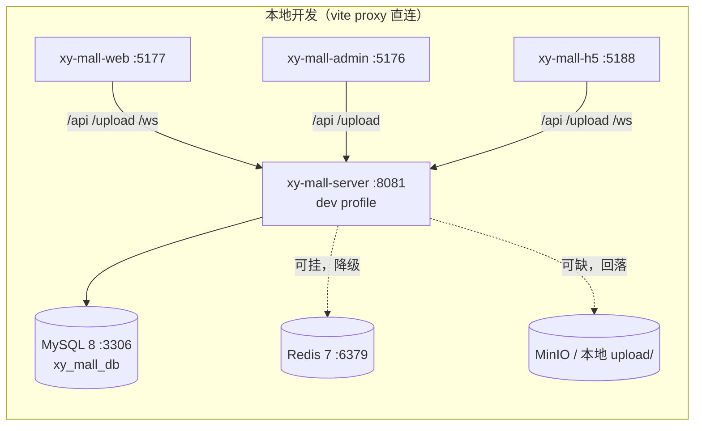
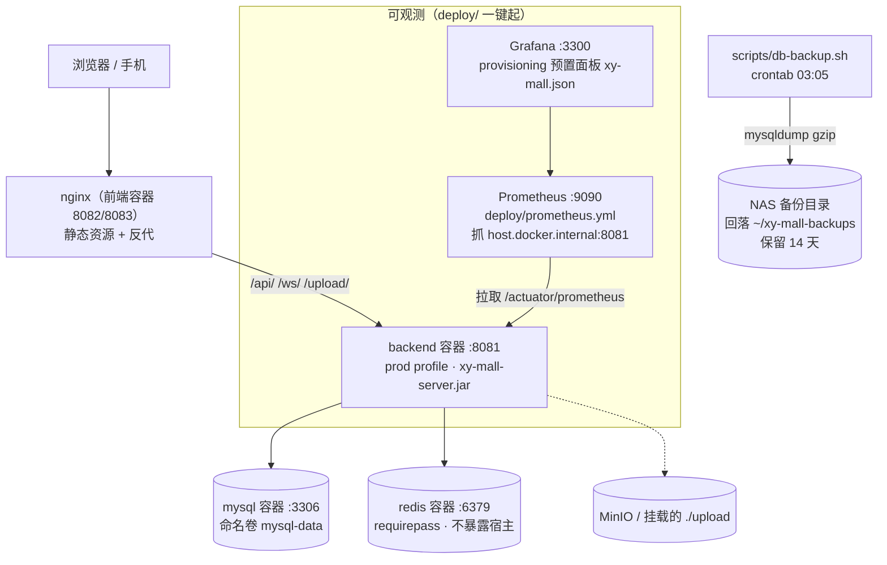

# 06 部署运行

> 项目：xyMall ｜ 版本：v1.0 ｜ 生成日期：2026-10-05 ｜ 依据：源码分析

本文覆盖从零把 xyMall 跑起来的全部操作：环境要求、本地启动（后端 + 三前端，命令级）、环境变量与配置清单、构建产物与容器化部署链路（含备份与可观测）、常见问题排查、测试体系与质量门禁。所有命令均出自仓库真实脚本与配置文件（`xy-mall/Dockerfile`、`docker-compose.yml`、`start.sh`、`.env.example`、`scripts/`、`deploy/`、三个前端的 `package.json`/`vite.config.ts`）。快速上手的最短路径已见于《00-项目总览》第 5 节，本文是其完整展开。

## 1. 环境要求

| 类别 | 要求 | 依据 |
| --- | --- | --- |
| JDK | 17（推荐 Eclipse Temurin 17） | 父 POM `xy-mall/pom.xml` 固定 `java.version=17`；Dockerfile 运行镜像 `eclipse-temurin:17-jre` |
| 构建工具 | Maven 3.9+ | Dockerfile 构建阶段镜像 `maven:3.9-eclipse-temurin-17` |
| 数据库 | MySQL 8.0（必须） | 驱动 8.4.0；compose 镜像 `mysql:8.0`；库名默认 `xy_mall_db` |
| 缓存 | Redis 7（可选，强烈建议） | 所有 Redis 访问点 try/catch 降级纯 DB 路径，挂掉不阻断交易（见《01-系统架构》第 1 节）；compose 镜像 `redis:7-alpine` |
| Node / pnpm | Node 20+；pnpm 11（三端 `packageManager: pnpm@11.24.0` 锁定） | 前端 Dockerfile 用 `node:20-alpine`；pnpm 11 存在构建脚本拦截问题，dev 启动须绕过（见 2.3 节坑位） |
| 容器（可选） | Docker + Docker Compose v2 | 一键编排五服务，见第 4 节 |
| Python 3（可选） | 3.9+，仅标准库 | 冒烟/压测脚本 `scripts/e2e-smoke.py`、`scripts/load-seckill.py` 不依赖第三方包 |
| 对象存储（可选） | MinIO（S3 兼容）或本地 `upload/` 目录 | 密钥缺失或 NAS 掉线自动回落本地目录，`WebConfig` 静态映射 `/upload/**` |

端口规划：后端 8081；本地开发前端 商城 Web 5177、管理后台 5176、H5 5188；容器化后 商城 Web 8083、管理后台 8082、MySQL 宿主侧映射 3307；可观测 Prometheus 9090、Grafana 3300。

## 2. 本地启动步骤

### 2.1 准备数据库与敏感配置

```bash
# 方式 A（推荐）：直接空库启动，Flyway 自动建表
mysql -u root -p -e "CREATE DATABASE IF NOT EXISTS xy_mall_db DEFAULT CHARSET utf8mb4"

# 方式 B：手工执行 V1 后再启动（V2~V8 仍由 Flyway 增量执行）
mysql -u root -p xy_mall_db < xy-mall/server/src/main/resources/db/migration/V1__init.sql
```

应用通过 `spring.config.import=optional:file:./.env.properties`（`application.yml` 第 10~12 行）加载仓库根的敏感配置，模板即 `.env.example`，复制后至少填写三项：

```bash
cd xy-mall
cp .env.example .env.properties
# 必填：MYSQL_USERNAME / MYSQL_PASSWORD / XY_MALL_JWT_SECRET
export XY_MALL_JWT_SECRET=$(openssl rand -base64 36)
```

`XY_MALL_JWT_SECRET` 无默认值，`application.yml` 中为 `secret: ${XY_MALL_JWT_SECRET:}`——**未注入时启动直接失败**（防止使用可预测密钥签发 token）。

### 2.2 启动后端

```bash
cd xy-mall
mvn clean install -DskipTests          # 首次全量编译安装 framework 五模块
mvn -pl server spring-boot:run         # dev profile（默认），控制台打印 SQL

# 或编译产物直接运行（start.sh 会自动 source .env.properties 并 export 敏感变量）
mvn -pl server -am package -DskipTests
SPRING_PROFILES_ACTIVE=dev ./start.sh
```

验证：

```bash
curl http://localhost:8081/api/health       # 健康检查
open http://localhost:8081/doc.html         # Knife4j 接口文档（prod 关闭）
```

**两个必踩的坑（`AGENTS.md` 第 6 节原文警告）**：其一，**必须以 `xy-mall/` 为工作目录启动**——`WebConfig` 把相对路径 `upload/` 映射为 `/upload/**` 静态资源，`cd server && mvn spring-boot:run` 会丢全部商品图；其二，本地联调验证码旁路：以 `--mall.captcha.allow-bypass=true` 启动（或 dev profile 默认加载）后，验证码一律填 `0000`，prod profile 不含此配置不可绕过。演示账号（`docs/HANDOVER.md` 记载）：商城 `test001/123456`，后台超管 `admin/admin123`（role_id=1）。注意 Flyway 迁移脚本只包含 RBAC 角色绑定（`V1__init.sql` 第 262 行 UPDATE），`admin` 账号行的初始 INSERT 不在 V1~V8 中——新环境若空库启动后无 admin 账号，需手工插入或沿用已有库（回刷核实：V1~V8 确无 `INSERT INTO admin_user`，`scripts/` 亦无初始化账号脚本，空库必须手工补账号）。

切换生产模式启动时（`SPRING_PROFILES_ACTIVE=prod`）行为差异体现在三处：接口文档三件套（`/doc.html`、`/swagger-ui.html`、`/v3/api-docs`）整体关闭，`WebConfig` 还会对这些路径强制 404；actuator 只保留 `/actuator/health` 且不吐组件细节；模拟支付与充值开关按 `application-prod.yml` 的演示站语义取值（接入真实支付宝后需手工把 `mock-enabled` 改回 false，此后订单只能由带 RSA2 验签的支付回调置为已支付——即《03-接口设计》所说的 fail-closed）。首次启动（空库）的内部时序无需人工干预：Flyway 从 V1 全量建表并灌入 RBAC 与 `sys_config` 种子数据 → `validate-on-migrate` 校验通过 → 定时任务按各自 `initialDelay` 陆续就绪（订单延迟队列轮询 15 秒、DB 轮询与秒杀对账 30 秒后首跑）→ `/api/health` 可用即部署完成。

### 2.3 启动三个前端

```bash
# PC 商城（5177）
cd xy-mall-web && pnpm install && ./node_modules/.bin/vite

# 管理后台（5176）
cd xy-mall-admin && pnpm install && ./node_modules/.bin/vite

# 移动 H5（5188）
cd xy-mall-h5 && pnpm install && ./node_modules/.bin/vite
```

三个前端的 `vite.config.ts` 都配置了开发代理：`/api` 与 `/upload` 转发到本机 8081 后端（web 与 admin 指向 `127.0.0.1:8081`，h5 指向 `localhost:8081`），web 与 h5 额外把 `/ws` 以 `ws: true` 代理到后端（供客服 IM WebSocket 使用），admin 端无 IM 浮窗故无此项。因此**前端无需任何环境变量**即可联调，只要求后端先于前端就绪。第三条坑：pnpm 11 默认拦截依赖包的构建脚本，`pnpm dev` 可能无法直跑，故统一用 `./node_modules/.bin/vite` 直启；且 dev server 仅监听 IPv6，浏览器地址栏须用 `localhost` 而非 `127.0.0.1`。

### 2.4 本地启动拓扑



## 3. 环境变量与配置清单

### 3.1 环境变量（`.env.properties` / 进程环境，`spring.config.import` 加载）

| 变量 | 必填 | 默认 | 说明 |
| --- | --- | --- | --- |
| `MYSQL_HOST` / `MYSQL_PORT` / `MYSQL_DATABASE` | 否 | 127.0.0.1 / 3306 / xy_mall_db | 数据源 URL 拼装（`application.yml` datasource.url） |
| `MYSQL_USERNAME` / `MYSQL_PASSWORD` | 是 | 无 | 生产必须显式覆盖，root 弱口令仅限本机 |
| `XY_MALL_JWT_SECRET` | **是** | 无（缺失启动失败） | `openssl rand -base64 36` 生成 |
| `XY_MALL_CLIENT_IP_HEADER` | 否 | `X-Real-IP` | 可信反代注入的真实客户端 IP 头；直连部署置空则用 remoteAddr（X-Forwarded-For 可伪造，全站不信任） |
| `SPRING_DATA_REDIS_HOST` / `_PORT` / `_PASSWORD` | 否 | 127.0.0.1 / 6379 / 无 | Redis 未设密码时留空即可 |
| `XY_MALL_OSS_ENDPOINT` / `_BUCKET` / `_PUBLIC_BASE` / `_AK` / `_SK` | 否 | NAS 示例地址 / xy-mall | MinIO 密钥缺失自动回落本地 `upload/`；`XY_MALL_OSS_MIGRATE_LOCAL=true` 可把本地历史图片幂等迁移上 MinIO |
| `XY_MALL_ALIPAY_APP_ID` / `_PRIVATE_KEY` / `_PUBLIC_KEY` / `_GATEWAY` / `_NOTIFY_URL` / `_RETURN_URL` | 否 | 沙箱网关 | 支付宝沙箱（真实接口、假钱）；回调地址须公网可达 |
| `XY_MALL_ALIPAY_ENABLED` | 否 | true | 关闭后支付宝入口整体不可用 |
| `SPRING_PROFILES_ACTIVE` | 否 | dev | 生产必须显式 `prod`（`start.sh` 默认补 dev） |
| `MYSQL_ROOT_PASSWORD` / `REDIS_PASSWORD` | compose 必填 | 无 | 仅供 docker-compose 注入 mysql/redis 两服务（`:?` 语法强制非空） |

### 3.2 application.yml 关键配置项（非敏感，随代码走）

| 配置键 | dev 值 | prod 值 | 说明 |
| --- | --- | --- | --- |
| `xy-mall.jwt.expire-millis` | 604800000 | 同 | token 有效期 7 天 |
| `xy-mall.payment.mock-enabled` | true | true（演示站） | 模拟支付开关；**接入真实支付宝后必须改回 false**（fail-closed，见《03-接口设计》3.2） |
| `xy-mall.user.recharge-enabled` | - | **false** | 余额充值入口，prod 默认关防无凭证加钱 |
| `xy-mall.cors.allowed-origin-patterns` | `http://localhost:*` 等 | 两个生产域名 | prod 经 nginx 同源反代，跨子域需显式放行，否则带 Origin 的 POST 被拒 |
| `xy-mall.api.slow-cost-ms` | 1000 | 同 | `WebLogAspect` 慢接口告警阈值，超限 warn + Micrometer 指标 |
| `mall.captcha.allow-bypass` | true（仅 dev 配置文件） | 未声明（不可绕过） | 验证码 0000 旁路 |
| `server.forward-headers-strategy` | - | framework | 反代后按 X-Forwarded-* 重建 https 同源判断与绝对地址 |
| `springdoc/knife4j` | 开 | **关**（api-docs/swagger-ui/enable 全 false） | 生产不暴露接口文档 |
| `management.endpoints...include` | health,info,prometheus | **仅 health**，show-details: never，prometheus 导出关 | actuator 生产收紧，指标采集走内网再放开 |
| `spring.flyway.validate-on-migrate` | true | 同 | schema 漂移即启动失败，杜绝"代码超前于迁移" |
| `mybatis-plus...log-impl` | StdOutImpl（打印 SQL） | NoLoggingImpl | 生产不打印用户数据 |

### 3.3 运营参数（运行时可调，`sys_config` 表 + `SysConfigService.Keys`）

以下键值可在管理后台"系统配置"页（`/sys-config`）热改，业务代码经 `sysConfigService.getInt/getStr` 读取：

| config_key | 默认 | 控制的行为 |
| --- | --- | --- |
| `order.pay.timeout-minutes` | 30 | 支付超时分钟数：前端倒计时、延迟队列、DB 轮询三处同源（《05-核心流程》流程三） |
| `shipping.free.threshold` / `shipping.fee` | 9900 / 1000（分） | 包邮门槛与固定运费 |
| `points.deduct.enabled` / `points.deduct.rate` / `points.deduct.max-percent` | 1 / 100 / 50 | 积分抵扣开关、1 元对应积分、抵扣上限百分比 |
| `points.sign` | - | 每日签到奖励积分 |
| `plus.monthly-price` / `plus.discount-percent` | - / 95 | PLUS 售价与折扣百分比 |
| `growth.rate-percent` | 10 | 支付成功成长值比例 |
| `presale.default-deposit-percent` | 20 | 预售默认定金比例 |
| `user.register.balance` | **0** | 注册赠余额，默认必须为 0（源码注释：防新环境误开资损口子） |
| `stock.alert.threshold` | - | 低库存预警阈值（`StockAlertController`） |
| `search.hot-words` | - | 首页热搜词 |
| `admin.ip-whitelist` | 空（不限制） | 管理后台登录 IP 白名单，逗号分隔 |

## 4. 构建产物与部署方式

### 4.1 产物形态与 Docker 化部署链路

后端唯一运行产物是 Spring Boot 可执行 jar：`xy-mall/server/target/xy-mall-server.jar`（`Dockerfile` 第 10 行的 COPY 路径即它；`distribution/` 模块仅为打包占位，描述"Docker 镜像构建上下文"）。一条命令完成五服务编排：

```bash
cd xy-mall
cp .env.example .env    # 填 MYSQL_ROOT_PASSWORD / REDIS_PASSWORD / XY_MALL_JWT_SECRET
docker compose up -d --build
```

`docker-compose.yml` 的五个服务与两条数据持久化设计如下（端口均为"宿主机:容器"）：

| 服务 | 镜像/构建 | 端口 | 关键设计 |
| --- | --- | --- | --- |
| mysql | `mysql:8.0` | 3307→3306 | **命名卷 `mysql-data`** 持久化；healthcheck `mysqladmin ping`（10s×10 次）；表结构由后端 Flyway 在空库自动初始化（compose 注释明确"勿再挂载过期的 schema.sql"） |
| redis | `redis:7-alpine` | 不映射宿主端口 | `--requirepass $REDIS_PASSWORD`，仅容器网络内访问 |
| backend | 本目录 `Dockerfile` | 8081→8081 | 两阶段构建（maven 3.9 + temurin 17 编译 → temurin 17-jre 运行）；`SPRING_PROFILES_ACTIVE=prod`；数据源/Redis/JWT 全部经 `SPRING_DATASOURCE_*` 等标准环境变量覆盖；**宿主 `./upload` 挂载到 `/app/upload`** 持久化本地回落图片；`depends_on: mysql: service_healthy` 保证库就绪后启动 |
| admin-web | `../xy-mall-admin` 的 Dockerfile | 8082→80 | `node:20-alpine` 阶段 `pnpm install --frozen-lockfile && pnpm exec vite build` → `nginx:alpine` 承载 `dist/` |
| mall-web | `../xy-mall-web` 同构 | 8083→80 | 同上 |

H5 端仓库内已有 `nginx.conf` 但**没有 Dockerfile，也未纳入 compose**（`ls xy-mall-h5` 可验证）——该端尚在迭代，需要容器化时可复制 admin 端 Dockerfile 并在 compose 增加同构服务 `⚠️ 待确认`（是否有计划内安排无源码依据）。

两份前端 `nginx.conf`（`xy-mall-web/nginx.conf` 与 `xy-mall-admin/nginx.conf` 几乎同构）承担生产接入层职责，这是理解部署拓扑的关键：

- `/api/` → `proxy_pass http://backend:8081`（compose 服务名），并注入 `X-Real-IP / X-Forwarded-*`（与后端 `client-ip-header`、`forward-headers-strategy` 配套），`client_max_body_size 10m`；
- `/ws/` → WebSocket 升级头透传（`Upgrade`/`Connection "upgrade"`，`proxy_read_timeout 3600s`），仅商城 web 侧配置（IM 浮窗）；
- `/upload/` → 反代后端静态映射；
- `/assets/` → 带内容哈希的构建产物 `Cache-Control: public, max-age=31536000, immutable` 长缓存；
- `/` → `try_files $uri $uri/ /index.html` 支撑 history 路由刷新；统一开启 gzip 与 `X-Frame-Options/X-Content-Type-Options/Referrer-Policy` 安全响应头。

### 4.2 部署拓扑与升级/回滚



**版本升级标准链路**：`git pull` → `mvn clean package -DskipTests` → 替换 `server/target/xy-mall-server.jar` → `SPRING_PROFILES_ACTIVE=prod ./start.sh` 重启（或 `docker compose up -d --build` 重建镜像）。启动时 Flyway 自动执行未应用的迁移并 validate 校验存量结构；前端发版后旧 chunk 404 由 admin/h5 路由器的 `router.onError` 自动强刷自愈（见《01-系统架构》第 4.1 节）。回滚即换回旧 jar 重启——但注意 Flyway 已应用的迁移不会自动回退，需按《04-数据模型》第 2 节的迁移脉络评估兼容性。

**单实例假设的边界**（扩容前必读，`AGENTS.md` 第 6 节）：登录失败计数、下单幂等键、sys_config 进程缓存等多处进程内状态，多副本部署即失效，横向扩容前需先外置到 Redis。

### 4.3 备份与恢复

`xy-mall/scripts/db-backup.sh` 的完整行为：从仓库根 `.env.properties` 读取凭据（缺失直接报错退出，不硬编码）；优先写入 NAS 挂载目录（`/Volumes/xiaoye/.../xy-mall/db-backups`），未挂载回落 `~/xy-mall-backups`；`mysqldump --single-transaction --routines | gzip`（InnoDB 一致性快照不锁表）先写 `.tmp` 校验非空再原子改名；NAS 与本地双路径都按 `KEEP_DAYS=14` 清理过期备份。推荐 crontab（脚本头部注释原文）：

```bash
5 3 * * * /path/to/xy-mall/scripts/db-backup.sh >> /tmp/xy-db-backup.log 2>&1
```

恢复：`gunzip < xy_mall_db_YYYYMMDD_HHMMSS.sql.gz | mysql -u root -p xy_mall_db`（恢复到空库后重启后端，Flyway `baseline-on-migrate: true, baseline-version: 1` 会对已有结构的库跳过 V1 从 V2 续跑）。

**可观测性部署**：`docker compose -f deploy/docker-compose.grafana.yml up -d` 一键起 Prometheus（9090）与 Grafana（3300→3000，初始口令 `GF_SECURITY_ADMIN_PASSWORD=admin123`，数据卷 `grafana-data`）；`deploy/prometheus.yml` 静态抓取 `host.docker.internal:8081/actuator/prometheus`（跨机改 IP）；Grafana 经 `deploy/grafana/provisioning/` 预置数据源与 `xy-mall.json` 面板，核心指标即《01-系统架构》第 2.2 节的 `xy_mall_api_cost_seconds` 接口耗时直方图。注意 prod profile 默认关闭 prometheus 导出——生产接入监控时需在 actuator 配置中重新放开并限制内网访问（`application-prod.yml` 注释原意）。`deploy/nginx-https-sample.conf` 另提供 MinIO 图片域名的 HTTPS 样例（certbot 签发 + 对象名即内容指纹的长缓存）。

## 5. 常见问题与故障排查

以下条目全部对应源码或配置文件中的真实约束与注释，按"启动失败 → 运行异常 → 数据一致性"排列：

1. **启动即失败：JWT 密钥缺失**。报错源于 `JwtUtil`/`JwtProperties` 装配链，根因是 `application.yml` 故意不给 `xy-mall.jwt.secret` 默认值——防可预测密钥被伪造 token。处置：`export XY_MALL_JWT_SECRET=$(openssl rand -base64 36)` 或写入 `.env.properties`。
2. **启动即失败：Flyway 校验不通过**。`validate-on-migrate: true` 检出 schema 漂移（手工改过库结构或历史库 checksum 陈旧）时拒绝启动，`application.yml` 注释给出处置："先执行 flyway repair 或 baseline 对齐后再升级"。这正呼应《04-数据模型》"schema 变更只走 Flyway，严禁手改库结构"的约定。
3. **前端 POST 全部被拒：Invalid CORS request**。prod profile 下 `xy-mall.cors.allowed-origin-patterns` 只放行两个生产域名，`application-prod.yml` 注释原文警告："未配置来源时后端不开启 CORS，会以 Invalid CORS request 拒绝所有带 Origin 的 POST"——跨子域部署（如 admin 域名调 api 域名）必须把前端来源显式加入该配置。
4. **商品图全部 404**。十有八九是启动工作目录不对：`upload/` 静态映射是相对路径，必须以 `xy-mall/` 为工作目录（见 2.2 节坑位一）；容器化部署则检查 `./upload:/app/upload` 挂载是否存在。
5. **Redis 挂掉后的现象清单**（属预期降级而非故障）：商品详情直查 DB 变慢、秒杀失去预扣快路径走纯 DB 条件扣减、延迟队列停摆但 `OrderTimeoutJob` 仍会在 60 秒粒度上关闭超时订单、验证码与登录失败计数回落进程内存实现——交易正确性不受影响，此即《01-系统架构》"Redis 是可选增强"的落地表现。恢复后秒杀库存由 `SeckillReconcileJob` 自动按 DB 重建（`KEY_MISSING → warm`）。
6. **MinIO/NAS 掉线**：上传自动回落本地 `upload/` 目录（`modules/upload/` 的回落逻辑），历史图片经 `XY_MALL_OSS_PUBLIC_BASE` 仍指向 MinIO 域名时可能出现部分图片不可达，可用 `deploy/nginx-https-sample.conf` 的反代样例配合修复，或开启 `XY_MALL_OSS_MIGRATE_LOCAL=true` 幂等迁移。
7. **支付接口报"支付通道未开放"**：`xy-mall.payment.mock-enabled=false` 时的 fail-closed 行为，属设计而非故障；演示站需要一键支付时在 prod 配置中显式打开（见 3.2 表）。
8. **页面白屏/资源 404（发版后）**：懒加载 chunk 换 hash 导致旧页面加载失败，admin 与 h5 的 `router.onError` 会自动整页刷新自愈；若仍白屏，检查 nginx 是否正确配置了 `/` 的 `try_files ... /index.html` 与 `/assets/` 长缓存。

## 6. 测试体系与质量门禁

### 6.1 后端：单元 + 集成

`mvn test` 运行全部测试。仓库现有 7 个测试类（`find server/src/test framework/*/src/test` 验证），覆盖矩阵：

| 测试类 | 类型 | 被测对象 | 用例数 |
| --- | --- | --- | --- |
| `server/src/test/.../modules/order/service/PointsCalculatorTest.java` | 单元 | 积分抵扣纯函数（开关/比例/上限边界） | 8 |
| `server/src/test/.../modules/coupon/service/CouponCalculatorTest.java` | 单元 | 券门槛/面额/适用范围计算 | 5 |
| `server/src/test/.../modules/admin/aop/AuditParamMaskerTest.java` | 单元 | 审计入参脱敏 | 5 |
| `server/src/test/.../modules/order/statemachine/OrderStateMachineTest.java` | 单元 | 状态机合法迁移表 | 3 |
| `server/src/test/.../PasswordUtilTest.java` | 单元 | BCrypt/旧 MD5 双算法校验与懒迁移 | 4 |
| `framework-core/src/test/.../util/CsvUtilTest.java` | 单元 | CSV 单元格转义防注入 | 5 |
| `server/src/test/java/com/xiaoye/mall/server/it/OrderFlowIntegrationTest.java` | **集成** | 真实 Spring 上下文全链路：下单扣库存 → 余额支付 → 取消返还 → 售后退款闭环 | 2 |

集成测试的关键设计（类注释与 `@SpringBootTest(properties=...)` 原文）：连接**独立库** `jdbc:mysql://127.0.0.1:3306/xy_mall_it?createDatabaseIfNotExist=true`，Flyway 自动建表，不污染开发库；内联注入测试专用 JWT secret 与必挂的 OSS endpoint（`http://127.0.0.1:1`，验证上传失败回落路径）、`mall.captcha.allow-bypass=true`。因此跑测试的硬前提是**本地 MySQL 可用且凭据为 root/root1234**（properties 硬编码，与《00-项目总览》第 5 节一致）。`AGENTS.md` 第 5 节记载测试为"27 个"，按当前源码 `@Test` 注解统计为 32 个，存在少量漂移，以 `mvn test` 实际输出为准。

### 6.2 前端：类型检查即门禁 + 双层 E2E

- **构建门禁**：web 与 admin 的 `build` 脚本均为 `vue-tsc -b && vite build`——类型检查失败则无法产出构建物，这是前端的硬质量门禁；两端另配 `pnpm lint`（ESLint 9 + typescript-eslint + eslint-plugin-vue）。H5 的 build 仅为 `vite build`（无 vue-tsc），与其"迭代中精简端"的定位一致。
- **API 冒烟**：`python3 xy-mall/scripts/e2e-smoke.py` 是一条 P0 级端到端断言链（脚本内逐段编号）：用户/管理员双登录 → MinIO 上传并可访问 → 积分签到 → 带积分抵扣下单（断言积分扣减数）→ 取消订单（断言积分全额返还）→ 余额支付第二单 → 发起售后 → 管理员同意 → 断言退款到账金额 → 审计日志分页查询并断言含 password 的入参已脱敏。前置：后端 8081 已启动且验证码旁路开启（脚本验证码固定填 0000）。
- **GUI 冒烟**：`xy-mall-web` 独有的 `npm run e2e:gui`（`e2e/gui-smoke.mjs`，playwright-core 驱动**本机 Chrome**，无需下载浏览器）：首页 → 搜索"手机壳" → 进详情 → 登录 → 加购 → 结算 → 提交订单 → 订单列表；每步 `step()` 包裹，失败自动截图 `e2e-fail-*.png` 并非零退出。前置：后端 8081 与商城端 5177 已启动。
- **压测**：`python3 xy-mall/scripts/load-seckill.py <seckillId> <并发数> <每人请求数>`，asyncio 并发抢购，输出成功/业务拒绝/异常分布与 P50/P95/max 耗时——验证《05-核心流程》流程四的限流、限购与防超卖表现。

### 6.3 质量门禁清单

`AGENTS.md` 第 7 节的二次开发检查清单即本项目的提交门禁，原文六条：新表走 Flyway V(N+1)；新接口走 R 统一响应 + BizException + Swagger 注解 + 对应注解（`@LoginUser`/`@RequirePermission`）；高并发入口加 `@RateLimiter`、临界区加 `@DistributeLock`、库存操作以 DB 条件更新为准；状态流转进 `OrderStateMachine` 迁移表；新缓存满足"读降级 + TTL + 延迟双删"；**补对应单测/集成测试，`mvn test` 全绿再交付**。配合第 3 节的运行时约束（schema 严禁手改、Redis 访问必须 try/catch 降级、金额一律分），构成从编码到部署的完整约束闭环。
