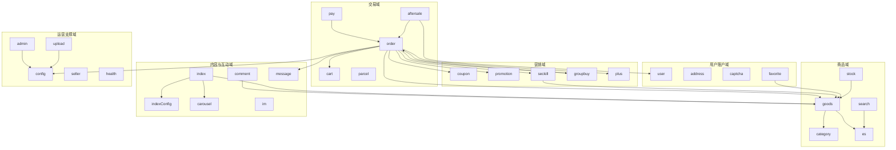

# 07 模块详解
> 项目：xyMall ｜ 版本：v1.1 ｜ 生成日期：2026-10-06 ｜ 依据：源码分析

本文是文档集的"逐模块深读"篇：《00-项目总览》给出四端全景，《01-系统架构》讲清分层与设计决策，本文则按目录把**每一个主要模块**拆开——职责定位、关键文件与类/方法清单、内部机制走读、与其他模块的交互关系。阅读本文时建议对照源码目录 `xy-mall/server/src/main/java/com/xiaoye/mall/server/modules/`（30 个业务模块）与三个前端的 `src/` 目录。模块间协作的业务级流程（下单、秒杀、超时关单等）在《05-核心流程》已展开到方法级，本文不再重复成段，仅在"交互"小节指路。

## 1. 模块总览与依赖关系

后端 30 个业务模块并非平铺，按业务语义可归为六个域；框架层 5 个 Maven 模块（framework-core/web/orm/cache/swagger2）的职责已在《01-系统架构》第 2 节详述，本文第 2 节仅补充逐文件清单。业务域之间的依赖方向总体是"交易域 ← 商品域 + 营销域 + 用户域，运营支撑域被所有域依赖"：

依赖注入的工程手法只有两种：模块间通过注入对方 **Service 接口**协作（不直接引用对方 Mapper，唯二例外见第 9.1 节的 favorite 与 parcel）；出现创建期循环依赖时用 `@Lazy` 打破（如 `OrderServiceImpl` 中 `groupBuyService` 字段、`OrderLazyCloseTrigger` 经 `ObjectProvider` 延迟解析）。下面按域逐一展开。

## 2. 框架层（framework，5 个 Maven 模块）

框架层与业务层的边界非常严格：framework 不 import 任何 `server.modules` 包，因此可以独立编译、单测（`CsvUtilTest` 即位于 framework-core）。逐模块文件清单如下。

| 模块 | 关键文件（相对 `xy-mall/framework/`） | 职责要点 |
| --- | --- | --- |
| framework-core | `core/result/R.java`、`core/exception/BizException.java`、`core/security/JwtUtil.java`、`core/security/JwtProperties.java`、`core/security/PasswordUtil.java`、`core/security/CaptchaCodeService.java`、`core/security/LoginFailGuard.java`、`core/security/AccountStatusChecker.java`、`core/security/TokenBlacklistService.java`、`core/annotation/LoginUser.java`、`core/constant/Constants.java`、`core/util/CsvUtil.java`、`core/validation/CreateGroup.java` | 零 Spring Web 依赖的内核：统一响应、业务异常、JWT/BCrypt 工具、验证码/登录失败/黑名单三个"接口 + 内存实现"（`InMemoryCaptchaStore`/`InMemoryLoginFailStore`），CSV 转义防公式注入 |
| framework-web | `web/handler/GlobalExceptionHandler.java`、`web/resolver/LoginUserArgumentResolver.java`、`web/filter/RateLimitFilter.java`、`web/filter/RequestIdFilter.java`、`web/aop/RateLimitAspect.java`、`web/aop/WebLogAspect.java`、`web/annotation/RateLimiter.java`、`web/config/WebConfig.java`、`web/util/ClientIpUtil.java` | Web 横切面：异常→HTTP 映射、四重校验的登录解析、双层限流（Filter 进程内滑窗 + AOP Redis 滑窗）、耗时观测、CORS、`/upload/**` 静态映射、文档关闭时强制 404 |
| framework-orm | `orm/config/MybatisPlusConfig.java`、`orm/handler/XyMetaObjectHandler.java` | 分页插件（3.5.9 需配 `mybatis-plus-jsqlparser`）与 `createTime/updateTime` 审计字段自动填充；逻辑删除由 `application.yml` 全局声明 `isDeleted` |
| framework-cache | `cache/config/CacheConfig.java`、`cache/lock/DistributeLock.java`、`cache/lock/DistributeLockAspect.java`、`cache/security/RedisCaptchaStore.java`、`cache/security/RedisLoginFailStore.java`、`cache/security/TokenBlacklistServiceImpl.java` | RedisTemplate 装配、SpEL 注解式分布式锁（Lua 比对 token 释放、Redis 异常降级放行）、三个安全存储的 Redis 实现按条件装配覆盖内存版 |
| framework-swagger2 | `swagger/config/OpenApiConfig.java` | SpringDoc + Knife4j 元数据，生成 `/doc.html` |

机制细节（异常映射规则、限流双层结构、锁的 Order 高于事务拦截器等）见《01-系统架构》第 2 节与《08-安全与权限设计》，此处不重复。

## 3. 用户账户域（user / address / captcha / favorite）

### 3.1 user 模块

**职责**：用户生命周期（注册/登录/资料/改密/登出/注销）与用户资产（余额/积分/签到/成长值）、浏览足迹、订单物流轨迹实体的托管。它是被交易域、营销域引用最多的模块（下单扣积分、支付加成长值、售后退余额都要动 user 的表）。

| 关键文件（相对 `modules/user/`） | 类/方法 | 说明 |
| --- | --- | --- |
| `controller/UserController.java` | `register/login/info/updatePassword/updateInfo/logout/deactivate` | 认证主入口，`/api/user/**` |
| `controller/UserAssetController.java` | `balance/recharge/points/sign/data-export/footprint` | 资产与互动入口；`data-export` 输出个人数据 CSV（合规向） |
| `service/impl/UserServiceImpl.java` | `login`（验证码→失败计数→密码懒迁移→签发）、`register`（唯一索引兜底 + 注册赠券/赠余额）、`deactivate`（资产清零写流水 + token 全失效） | 认证链路核心，机制详解见《05-核心流程》流程一 |
| `context/` | `UserLoginContext` 等 4 个 | 复杂入参聚合 |
| `security/UserAccountStatusChecker.java` | 实现 framework-core 的 `AccountStatusChecker` | 校验 `locked_flag` 与 `token_version`，供解析器与 IM 握手共用 |
| `entity/` | `User/BalanceLog/PointsLog/BrowseLog/OrderLogistics` | 注意 `OrderLogistics`（订单物流轨迹）实体放在 user 模块而非 order 模块——历史遗留的组织方式，查询服务 `OrderService.logistics` 直接注入 `OrderLogisticsMapper`（归属问题记录于《13-技术债务与演进建议》） |
| `mapper/` | 5 个 Mapper | 与实体一一对应 |

内部机制上，该模块最值得注意的是**资产变更全部走条件更新 + 流水**：余额扣款 `balance >= n` 才更新、积分抵扣 `points >= n` 才更新、签到防重靠 `points_log.sign_date` 生成列唯一键（见《04-数据模型》3.6）。注销 `deactivate` 不做物理删除，而是清零资产、`token_version+1`、打注销标记，保留订单追溯能力。

### 3.2 address 模块

标准七件套结构（controller/context/entity/mapper/service/impl/vo）的最小样本。业务规则：地址归属强制校验（`收货地址不存在或不属于当前用户`）、上限 20 条、默认地址唯一。`UserAddressServiceImpl.saveAddress/updateAddress/deleteAddress` 均以 `userId` 为第一参数——"查改删必带归属"的约定在本模块体现得最纯粹。下单时 `OrderServiceImpl` 校验归属后把地址**快照**拼入 `order_master.extra_info`，此后地址表变更不影响历史订单。

### 3.3 captcha 模块

全库最小的模块，仅 `controller/CaptchaController.java` 一个类：生成随机码 + base64 图片，返回 `captchaToken + captchaImage`。验证码的存取与校验逻辑不在本模块，而在 framework-core 的 `CaptchaCodeService`（策略接口）与 framework-cache 的 Redis 实现——控制器只做"生成与下发"，校验由 `UserServiceImpl` 调用 `captchaCodeService.validate(token, code)` 完成。dev 旁路（`0000`）的开关声明在 `application-dev.yml`，机制见《05-核心流程》1.2 节①。

### 3.4 favorite 模块

收藏功能只有三个文件：`FavoriteController` + `UserFavorite` 实体 + Mapper，**没有 service 层**——控制器直接操作 Mapper（全库仅有的直连样本之一）。业务要点：toggle 前先 `goodsService.detail(goodsId)` 校验商品在售；`(user_id, goods_id)` 唯一键并发下捕获 `DuplicateKeyException` 转"已收藏，请刷新"。它对 goods 模块是 Service 级依赖，属于"轻模块直连 Mapper、重模块走 Service"的实用主义分层。

## 4. 商品域（goods / category / search / es / stock）

### 4.1 goods 模块

**职责**：商品与 SKU 的读写、详情缓存、搜索/联想/热卖榜/看完又看等查询门面，是全库被依赖最多的模块（交易、营销、内容各域都引用）。

| 关键文件（相对 `modules/goods/`） | 类/方法 | 说明 |
| --- | --- | --- |
| `controller/GoodsController.java` | `list/search/suggest/top/brands/also-viewed/detail/{id}` | 全部公开接口，`detail` 是全站 QPS 最高的读路径 |
| `service/impl/GoodsServiceImpl.java` | `pageGoods/detail/suggest/topSales/listVOByIds/listOnSaleByIds/listBrands/escapeLike` | 详情走缓存三段式（命中/空值/回源）；列表按分类**含子孙分类**展开（`listCategoryAndDescendantIds`）；`escapeLike` 转义 `%/_/\` 防全表模糊 |
| `service/GoodsCacheService.java` | `lookup/putDetail/putNegative/evictDetail` | 详情缓存 10min + 空值 60s + 延迟双删（守护线程 `goods-cache-delay-delete`），全部 try/catch 降级——机制见《05-核心流程》流程五 |
| `context/GoodsQueryContext.java` | 列表查询入参聚合 | keyword/categoryId/brand/价格区间/排序/分页 |
| `entity/Goods.java`、`GoodsSku.java` | 主表 + SKU | 主表库存与 SKU 库存并存的语义见《04-数据模型》3.2 |
| `vo/` | `GoodsVO/GoodsSkuVO/TopGoodsVO` | `toListVO` 刻意置空 `goodsDetail` 大字段，列表不背富文本 |

与其他模块的交互：写路径由 admin 域驱动（`AdminGoodsController` → `syncSkusBeforeSave` → `goodsService.save/updateById` → `goodsCacheService.evictDetail` + `indexService.evictIndexInfo` + `esGoodsIndexService.indexGoods`）；读路径被 `IndexServiceImpl`（首页楼层）、`CommentServiceImpl`、`FavoriteController`、`StockAlertController` 等复用。ES 索引同步是"尽力而为"——失败仅 debug 日志，不阻断商品保存。

### 4.2 category 模块

三级分类（`category_level` 1/2/3、`parent_id` 自关联）。除标准 CRUD 外有一个被 goods 依赖的关键方法 `listCategoryAndDescendantIds(categoryId)`：递归展开子孙分类 ID 集合，支撑"点一级分类看到全部层级商品"。管理入口在 admin 域 `AdminCategoryController`（含 `/options` 下拉数据源与批量删除）。

### 4.3 search 模块

搜索行为的"记录侧"：`SearchLogService.record(keyword, userId, resultCount)` 落 `search_log` 表（含 V6 增加的命中数列），为仪表盘 `top-searches` 提供数据。真正的搜索执行在 `GoodsController.search`：先问 `EsGoodsIndexService.enabled()`（读 `sys_config: search.engine`），ES 可用则按相关度取 ID 列表回表，否则回落 MySQL like——策略选择的判定代码在控制器，而非 search 模块。

### 4.4 es 模块

全库唯一"无 Controller、无 Mapper、无实体"的模块，只有一个 `EsGoodsIndexService`（112 行）：**JDK 原生 HttpClient 直连 ES REST API**（`PUT /goods/_doc/{id}` 同步索引、`DELETE` 删文档、`POST /goods/_search` match 查询），不引入重量级 elasticsearch 客户端依赖。端点经 `sys_config: es.endpoint` 配置（默认 `http://127.0.0.1:9200`，项目文档记录演示依赖 NAS 19200），连接超时 2s、请求超时 3s，任何失败静默降级。这是"可选增强"哲学在搜索域的落点（见《10-性能设计与优化》第 3 节）。

### 4.5 stock 模块

库存的"可观测侧"：`StockLogService.record` 写 `stock_log` 流水（下单/回补/后台调整/新增 SKU 四类 reason），`StockAlertController` 提供 `/api/admin/stock/alerts` 低库存清单——分别扫主表 `stock_num <= threshold` 与 `goods_sku.stock <= threshold`（阈值来自 `sys_config: stock.alert.threshold`，默认 10，limit clamp 到 200）。注意本模块**不执行任何库存增减**：真正的扣减/回补内嵌在 order/seckill/admin-goods 的事务里，本模块只负责"记账与告警"。

## 5. 交易域（cart / order / pay / aftersale / parcel）

### 5.1 cart 模块

购物车七件套 + `SettleVO`。核心规则：`(user_id, goods_id, sku_id)` 唯一键（V7 升级为 SKU 粒度），重复加购**累加数量**而非新增行；结算入口 `GET /api/cart/settle` 按 cartItemIds 返回带商品快照的结算行（`SettleVO`），是结算页的首个数据源。`ShoppingCartServiceImpl.saveItem/updateCount/removeItems` 均带归属校验；下单成功后由 `OrderServiceImpl` 删除对应行。前端角标数由 `useCartCount`（web）/`App.vue`（h5）轮询 `/cart/list` 求和。

### 5.2 order 模块

**全库最重的业务模块**（22 个文件），文件清单在《01-系统架构》第 3 节已整树列出。补充三个本文视角的要点：

1. **文件即架构**：`statemachine/OrderStateMachine`（合法迁移表 + `canTransit/checkTransit`）、`service/IdempotencyService`（进程内幂等键执行器）、`service/PointsCalculator`（纯函数，可直接单测）、`service/OrderDelayQueue + OrderTimeoutExecutorBridge + OrderLazyCloseTrigger + job/OrderTimeoutJob + job/OrderAutoConfirmJob`（三重兜底 + 长周期自动确认）——每一个横切关注点都被提为独立类，`OrderServiceImpl`（895 行）反而只是"事务内的编排者"。
2. **常量与状态**：`constant/OrderStatus.java` 定义 0/1/2/3/4/-1/-2 七态；所有流转先过状态机再 CAS（带旧状态条件的 update），`closeIfTimeout` 是全模块幂等的收敛点（机制见《05-核心流程》流程三）。
3. **对营销域的编排**：`createOrder` 依次注入并调用 `CouponService.discountFor/markUsed/releaseUsed`、`PromotionFullService.bestDiscountFor`、`PointsCalculator`、`UserPlusService`、`SeckillService`（识别秒杀单）、`GroupBuyService`（拼团建队/参团联动）——订单模块是四层优惠与三种玩法的**唯一编排点**，营销模块自身不感知订单。

### 5.3 pay 模块

只有 `PayController` + `AlipayPayService` 两个类。前者暴露 `/api/pay/alipay/create|page|return|notify` 四端点，后者封装支付宝 SDK 的签名/验签与统一下单。关键设计：notify 与 return 走同一段 `confirmPayment`（RSA2 验签 → 金额比对 → `orderService.paySuccess`）；"迟到支付"（订单已关闭后钱到账）由 `OrderServiceImpl.compensateLatePayment` 以 `(order_no, reason)` 流水查重实现幂等退款。模拟支付不在本模块，而在 `OrderController.paySuccess`（由 `xy-mall.payment.mock-enabled` 开关 fail-closed 控制）。

### 5.4 aftersale 模块

双控制器结构：`UserAfterSaleController`（用户发起/列表）+ `AdminAfterSaleController`（分页/审核）。`AfterSaleServiceImpl.apply` 锁定 `refund_amount` 为订单实付、一单一条（`order_no` 唯一）；`handle` 在 `status=1`（同意）时于同一事务内退款至余额（`balance_log` reason="售后退款"）并 CAS 关单（`closeByAfterSale`），与已支付退款 `refundAndClose` 双通道互斥（见《05-核心流程》3.2 节末段）。

### 5.5 parcel 模块

拆单包裹的演示模块：`OrderPackageController`（挂在 `/api/admin/order` 路径下）+ 实体 + Mapper，无 service 层，控制器直接操作 Mapper。提供"查看订单包裹/创建包裹/包裹发货"三端点，发货时补写物流轨迹。`AGENTS.md` 明确其为"订单级演示"能力（不与真实仓配对接）。

## 6. 营销域（coupon / promotion / seckill / groupbuy / plus）

### 6.1 coupon 模块

券定义（`coupon`）与用户持券（`user_coupon`）双实体。关键文件：`CouponController`（领券/兑换/我的券/结算试算）、`CouponService`（`receive/markUsed/releaseUsed/discountFor`）、`CouponCalculator`（**纯函数**：面额/折扣两种券型的金额计算，折扣券按 `discount` 百分比、上限为券后金额）、`job/CouponExpireJob`（定时批量置过期）。并发防线是三层：领取走 `receive_seq` 唯一键（`uk_user_coupon_seq`，先查 coupon_limit 计数再插入，唯一键兜底并发超领）、核销走 `use_status=0` 条件更新、归还按 `idx_order_no` 索引反查。`discountFor` 校验门槛（`min_amount`）、适用范围（`goods_type` 0 全部/1 分类/2 商品）与时间窗，错误文案如"未满足优惠券最低消费金额"。

### 6.2 promotion 模块

满减活动（`promotion_full`）双控制器：`PublicPromotionController`（`/api/promotion/active` 生效中列表）+ `AdminPromotionController`（CRUD）。`PromotionFullServiceImpl.bestDiscountFor(amount)` 对券后金额遍历生效活动，取满足门槛的最优一档减免——"多档取最优"而非"命中即停"。下单时减免额写入 `order_master.promo_discount`（V3 引入的列）。

### 6.3 seckill 模块

秒杀是全库工程密度最高的模块（9 个文件）：`SeckillController`（限流 5 次/2s USER 维度）、`SeckillServiceImpl`（grab 主链路：锁→校验→Lua 预扣→DB 权威扣减→建单→失败补偿）、`SeckillStockRedisService`（DEDUCT/RELEASE/WARM 三个 Lua 脚本，逐行注释了返回码语义）、`job/SeckillReconcileJob`（每分钟 DB 纠偏 + 幽灵流水清理）。机制在《05-核心流程》流程四已展开到脚本行级，此处只补充模块视角的两点：其一，后台侧由 admin 域的 `AdminSeckillController` 承担（保存时 `warmRedisQuietly` 预热、上下架/删除时 `evict` 两个 key）；其二，资格复用设计（`seckill_success.state=-1` 的行可被条件更新复用）是唯一键约束下的巧解，注释写明"规避唯一键冲突"。

### 6.4 groupbuy 模块

拼团三件套 `group_buy/group_team/group_member` + `GroupBuyController`（开团/参团/进度）+ `AdminGroupBuyController` + `job/GroupBuyExpireJob`（成团超时处理）。与订单的联动是双向的：下单时 `OrderServiceImpl` 调 `createOrJoinTeam` 建队/占位并回写 `group_team_id`，支付成功 `onOrderPaid` 推进参团进度。`(team_id, user_id)` 唯一键防重复参团（错误文案"你已加入该队伍"）；成员行记录 `order_no/paid`（V5 增列）支撑成团判定与退款联动。

### 6.5 plus 模块

PLUS 会员（`user_membership`，`user_id` 唯一）：`UserPlusController`（状态/购买续费）+ `UserPlusServiceImpl`。购买走余额扣款（条件更新）+ `balance_log`，到期时间顺延；折扣生效点在下单计算链最后一层——`OrderServiceImpl` 按 `sys_config: plus.discount-percent`（默认 95）对前三层优惠后的金额打折。价格与折扣均可在管理后台"系统配置"页热调（`plus.monthly-price`）。

## 7. 内容与互动域（comment / carousel / index / indexConfig / message / im）

### 7.1 comment 模块

商品评价：`GoodsCommentController`（`/api/goods-comments` 列表/分页/好评率 summary/发表/追评/点赞）+ `CommentServiceImpl`。发表前校验**订单归属与已完成状态**（防刷评），`(order_no, goods_id)` 唯一键保证"一单一件一条"；追评限 500 字、只能一次；点赞经 `comment_like` 表 `(comment_id, user_id)` 去重。商家回复字段（`reply_content/reply_time`，V5）由 admin 域 `AdminCommentController` 治理（删除/回复）。敏感词表 `sensitive_word`（V5）在本模块落库——回刷核实：全后端源码对该表零读取调用点，"建而不用"属实（见《13-技术债务与演进建议》D10）。

### 7.2 carousel / indexConfig / index 三模块

首页装配的"数据三件套"：`carousel`（轮播图）、`indexConfig`（楼层配置，`IndexConfigTypeEnum` 定义 1 热销/2 新品/3 推荐）、`index`（聚合门面）。`IndexServiceImpl.info` 一次性聚合轮播 + 三楼层商品列表 + 热搜词，并提供 `evictIndexInfo` 供商品/楼层变更时失效聚合缓存。公开端三个接口 `/api/carousel/list`、`/api/index-config/list`、`/api/index/info` 分别被前端 HomeView 的不同区块消费；管理端对应 `AdminCarouselController`、`AdminIndexConfigController`。

### 7.3 message 模块

站内信（`user_message`，type: order/logistics/refund/activity/system）：`UserMessageServiceImpl.send(userId, type, title, content)` 被订单域多处调用（下单成功、支付成功、超时关闭、发货、退款到账等），`UserMessageController` 提供列表/未读数/单条已读/全部已读。发送是**同库写**而非 MQ 投递——单实例下的最简可靠实现，消息量大的演进建议见《13-技术债务与演进建议》。

### 7.4 im 模块

客服 IM 三件套：`ws/ImWebSocketConfig`（端点 `/ws/im`，握手拦截器做与 HTTP 同标准的四重校验，Origin 白名单 `localhost:*`/`127.0.0.1:*`）、`ws/ImWebSocketHandler`（在线会话表 `ConcurrentHashMap`，用户以 userId 为 key、管理端固定 key="admin"；出站用 `ConcurrentWebSocketSessionDecorator` 串行化防帧交错；消息 JSON `{"toUserId":1,"content":"..."}`，历史落 `im_message` 表，V8）、`controller/AdminImSendController + ImHistoryController`（REST 侧发送/历史/会话列表）。前端连接管理见 `xy-mall-web/src/components/ImWidget.vue`（浮窗打开建连、关闭断连）。安全细节见《08-安全与权限设计》第 4 节。

## 8. 运营支撑域（admin / config / upload / seller / health）

### 8.1 admin 模块

管理后台的后端聚合模块（46 个文件，19 个 Controller）：`AdminAuthController`（登录含 IP 白名单 `checkIpWhitelist`、profile 下发 `roleCodes[]+perms[]`）、15 个业务管理 Controller、RBAC 五表实体与 `AdminPermissionService.hasPermission`、`annotation/@AdminUser + @RequirePermission`、`resolver/AdminUserArgumentResolver`、`aop/AdminPermissionAspect + AdminOperationLogAspect + AuditParamMasker`、`config/AdminWebConfig`（注册解析器）。权限模型是**单角色**（`admin_user.role_id` → `admin_role` → `admin_role_permission` → `admin_permission`，`SUPER_ADMIN` 旁路全通过）；审计切面把"模块/权限码/HTTP 动作/脱敏入参/IP/耗时/成败"异步落 `admin_operation_log`。前端三道权限 UI（路由 meta.perm、菜单过滤、v-perm）见《02-页面设计》第 2 节，安全分析见《08-安全与权限设计》第 5 节。

### 8.2 config 模块

运营参数中心：`SysConfigService` 定义全部 15 个键常量（内部类 `Keys`），`SysConfigServiceImpl` 用 `ConcurrentHashMap` 做进程内缓存——**写时全量清空**（`cache.clear()`），读未命中回源 DB。`PublicConfigController` 把无敏感的子集（运费/积分规则/热搜词/首页装修 JSON/模拟支付开关）经 `/api/config/public` 下发前端。单实例假设的典型样本：多副本部署时各副本缓存独立失效，需外置（《06-部署运行》4.2 节边界清单）。

### 8.3 upload 模块

图片上传：`UserUploadController`（用户态，限流防刷"上传太频繁"）+ `AdminUploadController`（`upload:image` 权限）+ `UploadStorageService`。后者是"优雅降级"的范本：启动时探测 MinIO（5s 快速失败超时），就绪则自动建桶 + 匿名读策略；上传校验链为"非空 → ≤5MB → 扩展名白名单 → **内容级校验**（GIF 魔数/其余必须 ImageIO 可解码，杜绝 HTML/SVG 伪装）→ 大于 1280px 压缩（thumbnailator，质量 0.85）"，Content-Type 一律由服务端按扩展名推导。MinIO 成功返回 `publicBase/bucket/文件名`（对象名即 UUID 内容指纹，长缓存头），失败回落本地 `upload/` 目录返回相对路径。`XY_MALL_OSS_MIGRATE_LOCAL=true` 时启动后经守护线程幂等迁移本地历史图片。

### 8.4 seller / health

`seller`：店铺实体（V6 增 `apply_user_id` 自助入驻）+ `AdminSellerController`（分页/全部/CRUD），无 service 层；多商户仅"商品挂载店铺"层级，无入驻分账（`AGENTS.md` 第 6 节边界声明）。`health`：`HealthController` 单端点 `GET /api/health`（在 `RateLimitFilter` 的 `shouldNotFilter` 中豁免限流），是 compose healthcheck 与发布验证的探针。

## 9. 前端三端模块详解

### 9.1 xy-mall-web（PC 商城，36 个源文件）

| 目录/文件 | 内容与机制 |
| --- | --- |
| `src/api/request.ts` | axios 实例（baseURL `/api`、timeout 15s）；请求拦截器注入 Bearer；响应拦截器解包 `R`（code 200 直返 data）、401 去重跳登录、`silent` 请求免弹窗、blob 不解包 |
| `src/api/index.ts` | 约 70 个接口函数，与后端 Controller 一一对应，类型定义集中于此 |
| `src/router/index.ts` | 17 条懒加载路由 + `authRoutes` 白名单守卫 + `meta.plain` 外壳开关 + `afterEach` 同步标题 |
| `src/stores/user.ts` | Pinia：token/userInfo 持久化（`xy-mall-token`/`xy-mall-user`），含旧 key 迁移清理 |
| `src/composables/` | `useCartCount`（角标共享）、`usePublicConfig`（公共配置单例缓存） |
| `src/components/` | `AppHeader`（489 行，搜索联想/类目浮层/响应式折叠）、`GoodsCard`、`GoodsSkeleton`、`ImWidget`（WebSocket 生命周期管理）、`ServiceBar`、`AppFooter` |
| `src/views/` | 17 个页面视图；最重的三个：`GoodsDetailView`（1062 行）、`HomeView`（739 行）、`OrderListView`（661 行） |
| `src/utils/` | `sanitize.ts`（富文本消毒防 XSS）、`img.ts`（占位图兜底） |
| `src/styles/` | `variables.css` 品牌变量、`global.css` 768px 断点移动适配 |

页面级设计（布局/交互/组件树）已在《02-页面设计》第 1 节逐页展开，本表只做模块索引。

### 9.2 xy-mall-admin（管理后台，31 个源文件）

在 web 端共性骨架之上新增三个机制件：`src/directives/perm.ts`（`v-perm` 按钮级权限指令，display:none 隐藏 + mounted/updated 双钩子）、`src/utils/download.ts`（blob CSV 下载）、`src/stores/user.ts` 扩展的 `hasPerm(code)`（SUPER_ADMIN 全通过，否则查 perms 数组——路由守卫、菜单过滤、v-perm 三处共用同一判定源）。19 个业务视图全部遵循"工具条 + el-table + el-pagination + el-dialog"范式（样本见《02-页面设计》2.2）；`Layout.vue` 是唯一常驻组件（el-aside 菜单按 `hasPerm` 过滤）。构建侧 `vite.config.ts` 把 echarts/zrender 单独拆包（`manualChunks`），避免主 chunk 膨胀。

### 9.3 xy-mall-h5（移动端，17 个源文件）

精简端的最小集：`api/index.ts` 只保留认证/商品/购物车/订单/资产五组接口；9 条路由对应 9 个视图；无 components 目录（UI 由 Vant 全量组件承担，`main.ts` 全量引入）；`utils/format.ts` 提供分转元。主题定制在 `App.vue`（`:root:root` 双写提高优先级覆盖 `--van-primary-color` 为京东红）+ `van-config-provider`；购物车角标在 `App.vue` 路由切换时静默刷新（异常吞掉）。与 web 端的显著差异：build 无 `vue-tsc` 类型门禁、无 e2e、无 Dockerfile（见《13-技术债务与演进建议》）。

## 10. 模块速查索引

为便于"从需求找模块"，给出正向索引（完整接口口径见《15-接口全量参考》）：

| 需求/话题 | 后端模块 | 前端入口 |
| --- | --- | --- |
| 注册登录/会话 | user、captcha、admin（管理端） | `LoginView.vue`、`stores/user.ts` |
| 商品浏览/搜索 | goods、category、search、es | `GoodsListView`、`ListView` |
| 加购/下单/支付 | cart、order、pay | `CartView`、`CheckoutView` |
| 优惠计算 | coupon、promotion、plus、order(PointsCalculator) | `CheckoutView` 优惠区 |
| 秒杀/拼团/预售 | seckill、groupbuy、goods(presale 字段) | `SeckillView`、`GroupsView` |
| 售后/物流/包裹 | aftersale、user(OrderLogistics)、parcel | `OrderListView` 操作列 |
| 资产（余额/积分/PLUS） | user、plus | `ProfileView` |
| 评价/收藏/足迹 | comment、favorite、user(BrowseLog) | `GoodsDetailView`、`FavoritesView` |
| 消息/客服 IM | message、im | `MessagesView`、`ImWidget`、`ImConsoleView` |
| 后台管理/RBAC/审计 | admin | `xy-mall-admin/src/views/*` |
| 运营参数 | config | `SysConfigView` |
| 上传/存储 | upload | `AdminUploadController` 对接的上传组件 |
