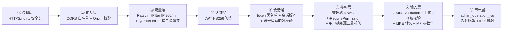

# 08 安全与权限设计
> 项目：xyMall ｜ 版本：v1.1 ｜ 生成日期：2026-10-06 ｜ 依据：源码分析

本文是安全专题篇：把散落在框架层与业务层的安全机制收拢为一条完整防线——认证与会话、鉴权模型、输入校验与注入防护、敏感信息管理、传输与存储安全、安全配置清单，最后如实列出**已知安全隐患**。单点机制的流程叙事（《05-核心流程》流程一的登录链路、《03-接口设计》第 7 节的鉴权时序）以引用为准，本文侧重"防线清单 + 每道防线的代码锚点与强度评估"。

## 1. 安全防线总览

xyMall 的安全设计遵循"后端校验是唯一安全边界，前端隐藏只是体验"的原则（`AGENTS.md` 工程约定），防线自外向内共八层：

每一层都有独立的失效后果与补偿：某一层被绕过时，内层仍能独立拦截（例如攻击者伪造了合法来源 IP，仍需通过验签；拿到了有效 token，注销/改密后立即失效）。

## 2. 认证与会话

### 2.1 令牌签发与算法

签发入口 `framework-core/.../security/JwtUtil.java`：jjwt 0.12.6 的 `Jwts.builder().signWith(key)`，算法由密钥长度决定走 **HS256**；`parseToken` 用 `verifyWith` 严格验签，任何篡改抛 `JwtException`。两类令牌共享同一密钥但**主体空间隔离**：用户 token 的 subject 是纯数字 userId，管理员 token 的 subject 形如 `admin:{id}`（`AdminUserArgumentResolver` 中 `ADMIN_SUBJECT_PREFIX` 校验，用户 token 冒充管理员会被"无管理员权限"拒绝）。有效期 `xy-mall.jwt.expire-millis=604800000`（7 天，`application.yml`）。

密钥管理是认证安全的第一闸门：`application.yml` 中 `secret: ${XY_MALL_JWT_SECRET:}` **刻意不提供默认值**，`JwtProperties` 装配时密钥为空即启动失败——杜绝"用源码里可预测的默认密钥伪造任意用户 token"这类经典事故。密钥经 `.env.properties`（gitignored）或环境变量注入，生成方式 `openssl rand -base64 36`。

### 2.2 请求侧四重校验

每个标注 `@LoginUser`/`@AdminUser` 的接口，参数解析器依次执行四步（`framework-web/.../resolver/LoginUserArgumentResolver.java` 与 `server/.../admin/resolver/AdminUserArgumentResolver.java`）：

1. **验签**：`JwtUtil.parseToken`，过期抛"登录已过期"、篡改抛"无效的登录凭证"；
2. **黑名单**：`TokenBlacklistService.isBlacklisted(token)`——登出接口把当前 token 拉黑，TTL 与令牌剩余寿命对齐（Redis 实现 `TokenBlacklistServiceImpl`；Redis 挂掉时该步退化为放行，见 2.4 的边界）；
3. **账号状态**：`AccountStatusChecker.isAccountActive(userId)`——锁定（`locked_flag=1`）或注销后旧 token 立即被拒，报"账号已被锁定，请联系客服"；
4. **会话版本**：claims 中的 `ver` 与 DB `user.token_version`（管理端 `admin_user.token_version`）比对——改密、管理员重置密码、注销都会 +1，**所有已签发令牌立即全端失效**，无需等待 7 天自然过期。

管理端比用户端多一道 subject 前缀校验与账号存在性校验（admin 被删除后 token 立即失效）。四步中任一步失败统一抛 `BizException(401)`，由 `GlobalExceptionHandler` 转为 HTTP 401，前端 axios 拦截器清登录态并去重跳转登录页。

### 2.3 登录侧防爆破

- **图形验证码**：登录与注册都强制校验（`CaptchaCodeService.validate`），一次性消费（校验通过即删除，防重放）；防脚本批量的第一道闸。dev 旁路 `0000` 仅由 `application-dev.yml` 的 `mall.captcha.allow-bypass=true` 开启，prod profile 无此配置项（fail-closed）。
- **登录失败计数锁定**：`framework-core/.../security/LoginFailGuard.java`，同一登录名 15 分钟窗口（`LOCK_WINDOW`）内失败满 5 次（`MAX_FAIL`）锁定，报"登录失败次数过多，请 N 分钟后再试"；存储经 `LoginFailStore` 抽象，Redis 实现使计数跨实例共享。
- **账号枚举防护**：`UserServiceImpl.login` 对"用户不存在"与"密码错误"返回**同一条**"登录名或密码错误"，且都调用 `recordFailure`；先验密码再看锁定态，避免向未持有密码的人泄露"账号存在且被锁定"（源码注释原文）。
- **管理端 IP 白名单**：`AdminAuthController.login` 先过 `checkIpWhitelist`（读 `sys_config: admin.ip-whitelist`，逗号分隔，空为不限制），可在运营层面把后台登录限制到办公网段。

### 2.4 会话机制的已知边界

黑名单与登录失败计数的 Redis 实现整体遵循"Redis 挂掉降级"的全局约定，但黑名单读路径是例外（回刷核实）：`TokenBlacklistServiceImpl.isBlacklisted` 直接 `hasKey` 且 RedisTemplate 无自定义 errorHandler，Redis 不可用时异常上抛——`AdminPermissionAspect` 侧该调用包在 `catch(Exception){return null}` 内，异常被吞但语义是**拒绝**（切面取不到 adminUserId，admin 接口 401）；`LoginUserArgumentResolver`/`AdminUserArgumentResolver` 侧异常不在捕获列表内，直接外溢为 500。即该窗口黑名单路径**失败关闭**而非"静默跳过"，会话版本与账号状态两道校验在可达时仍走 DB，改密/锁定依然即时生效。同理，`RateLimitFilter` 是**进程内**滑窗，多实例部署时单 IP 限流阈值按实例数放大——这两点都写入了《06-部署运行》第 4.2 节"单实例假设边界"。

### 2.5 WebSocket 认证

`/ws/im` 握手无法携带 Authorization 头，token 走 query 参数（`ImWebSocketConfig.HandshakeAuthInterceptor`）。校验标准与 HTTP 完全一致：验签 → 黑名单 → （用户端）账号状态 + 会话版本；admin 角色要求 subject 以 `admin:` 开头。任一失败直接拒绝握手（`return false`）。额外有 **Origin 白名单**（`setAllowedOriginPatterns("http://localhost:*", "http://127.0.0.1:*")`，注释"不再放行任意来源"）防跨站 WebSocket 劫持——注意生产域名需显式加入，否则线上 IM 无法建连（这既是安全配置也是部署坑，见《12-FAQ与故障排查》）。连接建立后消息落库前仍按会话身份写 `im_message`，无匿名发言通道。

## 3. 鉴权模型

### 3.1 用户端：登录态 + 资源归属

用户端没有角色体系，鉴权=「必须登录」+「资源属于我」。后者是一组散布在 Service 层的约定式检查（无统一注解）：订单 `getOwnedOrder(orderNo, userId)`、地址 `收货地址不存在或不属于当前用户`、优惠券 `优惠券不存在或不属于当前用户`、售后 `按 userId 查单` 等。这类检查的正确性依赖开发者自律，`AGENTS.md` 第 7 节检查清单把它列为新接口必查项。越权尝试的典型报错即上述归属类文案（《12-FAQ与故障排查》有完整清单）。

### 3.2 管理端：RBAC 三级防线

数据模型是"单角色 RBAC"：`admin_user.role_id` → `admin_role` → `admin_role_permission` → `admin_permission(perm_code 唯一)`，V1 种子约 40 个权限点、超管/运营专员两角色；`SUPER_ADMIN` 角色码在 `AdminPermissionServiceImpl.hasPermission` 中旁路全通过。运行时防线分三级：

1. **后端方法级**：`@RequirePermission("goods:update")` + `AdminPermissionAspect`（`@Around` 注解拦截）。切面内部独立解析 token（验签 + 黑名单 + subject 前缀），无权限抛"无操作权限：{perm}"；**它是安全边界的最后一环**——绕过前端直接调 API 也会被拦。
2. **路由级**：admin 前端 `beforeEach` 校验 `meta.perm`，无权限回 `/dashboard`（或第一个有权限的路由）。
3. **按钮级**：`v-perm` 指令隐藏无权限按钮。

### 3.3 审计（可追责）

`AdminOperationLogAspect` 在每个写操作后异步落 `admin_operation_log`：模块、权限码、HTTP 动作（方法+URI）、**经 `AuditParamMasker` 脱敏的入参 JSON**（正则匹配 password/loginPassword/newPassword/oldPassword/passwordMd5/salt/captchaCode/secretKey 九类字段替换为 `***`，超 2000 字符截断）、IP（`ClientIpUtil`）、成败与错误信息、耗时。该纯函数有独立单测（`AuditParamMaskerTest`，5 用例）。查询入口 `/api/admin/operation-logs/page`（权限 `log:list`）。

## 4. 输入校验与注入防护

| 威胁 | 防护手段 | 代码锚点 |
| --- | --- | --- |
| SQL 注入 | 全库 MyBatis-Plus 参数化（lambda wrapper 无字符串拼接 SQL）；自定义 SQL 仅 `selectTopSales` 等少量注解 SQL，参数走 `#{}` 占位 | `modules/goods/mapper/GoodsMapper.java` |
| LIKE 通配符注入 | `escapeLike` 转义 `%/_/\`，防用户输入 `%` 触发全表模糊 | `GoodsServiceImpl.escapeLike`（私有静态方法，注释说明了 MP 急切求值的坑） |
| XSS（富文本） | 商品详情富文本渲染前经前端 `sanitize.ts` 消毒；服务端不存白名单外的标签语义 | `xy-mall-web/src/utils/sanitize.ts` |
| XSS（图片上传） | 上传内容级校验：GIF 校验 `GIF87a/89a` 魔数，其余必须 `ImageIO` 可解码——**杜绝 HTML/SVG 伪装成图片**存储后借域执行 | `UploadStorageService.processImage`（类注释原文"请求头 Content-Type 用户可控不可信"） |
| 上传滥用 | 扩展名白名单 jpg/jpeg/png/gif/webp、≤5MB、`@RateLimiter` 防频次（"上传太频繁"）、文件名服务端 UUID 重命名（防路径穿越/覆盖） | `UploadStorageService.saveImage`、`UserUploadController` |
| 参数校验缺失 | Jakarta Validation（`@NotNull/@NotBlank/@Size` 等）+ `GlobalExceptionHandler` 把 `MethodArgumentNotValidException`/`ConstraintViolationException` 转为第一条字段错误文案（不堆栈外泄） | `framework-web/.../handler/GlobalExceptionHandler.java` |
| 内部信息泄露 | `IllegalArgumentException` 统一对外报"参数错误"（注释："消息可能携带内部变量值，仅记日志"）；兜底异常只报"系统繁忙，请稍后再试" | 同上 |
| CSRF | 无 token 的 CSRF 防护依赖 CORS 白名单（跨源 POST 被浏览器同源策略 + 服务端 Origin 校验拦截）与「写接口全部要求 Bearer 头」——攻击者网页无法读取 localStorage 中的 token 也就无法构造认证头 | `WebConfig.addCorsMappings` |
| 点击劫持 | nginx 统一注入 `X-Frame-Options/X-Content-Type-Options/Referrer-Policy` | `xy-mall-web/nginx.conf` |
| CSV 公式注入 | `CsvUtil` 导出时单元格转义（引号/逗号/换行），有 `CsvUtilTest` 5 用例覆盖 | `framework-core/.../util/CsvUtil.java` |

金额类入参另有业务级纵深：前端提交的优惠相关数值（券/积分）后端一律重算，前端值仅供参考（《02-页面设计》6.2 节），从根上封死"改包价下单"。

## 5. 敏感信息管理

**密钥清单与注入路径**：JWT 密钥（`XY_MALL_JWT_SECRET`，必填无默认）、MySQL 口令（`MYSQL_USERNAME/PASSWORD`）、Redis 口令（compose 侧 `REDIS_PASSWORD`）、MinIO AK/SK（`XY_MALL_OSS_AK/SK`）、支付宝应用私钥/支付宝公钥（`XY_MALL_ALIPAY_PRIVATE_KEY/_PUBLIC_KEY`）。全部经 `.env.properties`（`spring.config.import=optional:file:./.env.properties` 加载，文件已 gitignore）或进程环境注入，仓库与代码中**不留任何真实密钥**（`.env.example` 仅 `change-me` 占位）。`start.sh` 负责 source 并 export，Docker Compose 用 `${VAR:?}` 语法强制非空。

**日志侧**：dev 的 MyBatis-Plus `StdOutImpl` 会打印含用户数据的 SQL，prod 切 `NoLoggingImpl`（`application.yml` 注释"避免生产打印用户数据"）；`GlobalExceptionHandler` 对异常分级脱敏；审计入参走 `AuditParamMasker`。日志框架配置在 `server/src/main/resources/logback-spring.xml`（回刷核实：pattern 仅含 `%X{requestId:-}` 一个 MDC 变量，无其他敏感上下文）。

**展示侧**：密码字段任何 VO 均不下发（`UserVO`/`AdminLoginVO` 无密码属性）；个人数据导出（`/api/user/data-export`）只含本人数据，作为合规出口而非泄露面。

## 6. 传输与存储安全

- **传输**：生产经 nginx 提供 HTTPS（证书样例见 `xy-mall/deploy/nginx-https-sample.conf`，certbot 签发）；`server.forward-headers-strategy: framework` 按 `X-Forwarded-*` 重建协议，保证重定向与支付回跳的 https 判断正确。MinIO 图片域名的 HTTPS 与长缓存同样有样例配置。
- **口令存储**：新口令一律 BCrypt（自带盐、可调 cost），旧"盐+MD5"密文在登录成功时**懒迁移**为 BCrypt（`PasswordUtil.matches` 按 `$2` 前缀分流 + `UserServiceImpl.login` 回写），迁移期无明文/弱哈希新增。表结构保留 `password_md5/salt` 列仅为兼容。
- **数据存储**：MySQL 侧口令/密钥类列仅哈希与盐；逻辑删除保证误删可恢复；`admin_operation_log` 入参脱敏后入库。Redis 侧存放的是短 TTL 的验证码、失败计数、黑名单与业务缓存，无持久化敏感依赖；compose 部署时 Redis `--requirepass` 且**不映射宿主端口**（仅容器网络可达）。
- **对象存储**：MinIO 桶策略仅放开 `s3:GetObject` 匿名读（`UploadStorageService.init` 中的 bucket policy JSON），写操作必须 AK/SK；对象名是 UUID 内容指纹，不可枚举。

## 7. 安全配置清单（发布前逐项核对）

| 配置项 | 位置 | 生产要求值 | 未按此配置的后果 |
| --- | --- | --- | --- |
| `XY_MALL_JWT_SECRET` | 环境变量/.env.properties | 随机 36 字节 base64 | 缺失启动失败（设计如此） |
| `SPRING_PROFILES_ACTIVE` | 启动参数 | `prod` | 误用 dev：SQL 全打印 + 验证码 `0000` 旁路生效 |
| `xy-mall.payment.mock-enabled` | `application-prod.yml` | 接真实支付宝后改 `false` | 任何人可裸调 `/api/order/paySuccess` 把订单置为已支付 |
| `xy-mall.user.recharge-enabled` | 同上 | `false`（默认已关） | 开启且无支付凭证时等于无中生有加余额 |
| `xy-mall.cors.allowed-origin-patterns` | 同上 | 显式列出生产前端域名 | 空=拒绝所有带 Origin 的 POST；过宽=任意站点可带凭据跨源调用 |
| `mall.captcha.allow-bypass` | 仅 dev 文件 | 不得出现在 prod 配置 | 验证码形同虚设 |
| springdoc/knife4j | 同上 | 全 false | 接口结构对外泄露（`WebConfig` 还会对文档路径强制 404 兜底） |
| actuator exposure | 同上 | 仅 `health`，`show-details: never` | `/actuator/prometheus` 等暴露运行指标与组件细节 |
| Druid `stat-view-servlet` | `application.yml` | `false`（默认已关） | SQL 监控台暴露 |
| IM Origin 白名单 | `ImWebSocketConfig` | 追加生产域名 | 线上 IM 无法建连（可用性问题）；反之放开 `*` 则有跨站 WS 风险 |
| `admin.ip-whitelist` | `sys_config` | 建议配置办公网段 | 后台登录面对全网爆破（仍有验证码+失败锁定兜底） |
| nginx 安全头 | `xy-mall-web/nginx.conf` | 保留三条安全头与 `/api` 反代 | 缺失时降级为应用层单点防护 |

## 8. 已知安全隐患与改进建议

以下是**从源码如实得出的**风险清单，按"影响 × 可利用性"排序；均为演示/单实例定位下的接受项或待办，非隐藏缺陷：

1. **模拟支付开关在生产默认开启**（`application-prod.yml` 注释明示"演示环境"）。任何登录用户可把自己的订单置为已支付。这是刻意的演示站语义，接入真实支付后必须改回 `false`（fail-closed 校验在 `OrderController.paySuccess`）。上线核对项，见第 7 节。
2. **CORS `allowCredentials(true)` + 通配 pattern**（`WebConfig.addCorsMappings`）。dev 的 `http://localhost:*` 是合理放行；若运维图省事把生产 pattern 配成 `https://*` 之类宽匹配，将形成"任意站点携带凭据跨源调用"的组合风险。当前生产配置只列两个域名，风险受控。
3. **WS token 走 query 参数**会进入 nginx/access 日志与可能的代理日志，token 泄露面比 Header 略大；且 token 有效期 7 天。缓解：黑名单 + 会话版本使泄露 token 可被主动作废；建议演进为"一次性 WS 票据"（先 REST 换短时效 ticket 再握手）。
4. **限流计数与黑名单是进程内/单 Redis 实现**，横向扩容后 IP 限流按实例数放大、Redis 单点；`RateLimitFilter` 的 `windows.size() > 10_000` 时**整体清空**（防御性重置），极端情况下可被用"海量伪造 IP"触发清窗，但 IP 来源默认取 `remoteAddr`（不可伪造），仅配置了可信代理头时才可被注入头伪造——生产 nginx 必须用 `X-Real-IP` 覆写而非透传客户端头。
5. **无登录图形验证码的人机风控纵深有限**：验证码为自绘图形（非行为式），脚本识别后仍有失败锁定兜底；注册赠余额默认 `user.register.balance=0`（源码注释"防新环境误开资损口子"），即使批量注册也无资损。
6. **管理端单角色模型**（`admin_user.role_id` 单值）：无法表达"一人多角色"，权限粒度到方法级但不支持数据行级隔离（任何有 `order:list` 权限的运营可见全部订单）。
7. **审计覆盖面**：`AdminOperationLogAspect` 只拦 `@RequirePermission` 方法，`/api/admin/login`（登录成功/失败）不在审计内（回刷核实：切面 pointcut 为 `@annotation(requirePermission)`，`AdminAuthController` 的 login/logout 确无该注解；登录行为审计依赖应用日志而非审计表）。
8. **依赖版本**：jjwt 0.12.6、Druid 1.2.25 等在父 POM `xy-mall/pom.xml` 仲裁；建议纳入依赖扫描（OWASP dependency-check 类工具）定期复核 CVE（回刷核实：三仓 CI 仅 `mvn test` 与 lint+vue-tsc+build，仓库内确无依赖扫描配置，属流程建议）。

总体评价：在"单实例教学/演示"的定位下，认证、会话、鉴权、审计、注入防护五条主防线完整且相互独立，错误口径统一、密钥管理规范；主要风险集中在"演示便利开关进入生产"与"单实例假设"两类，均可通过第 7 节清单在发布流程中闭环。
