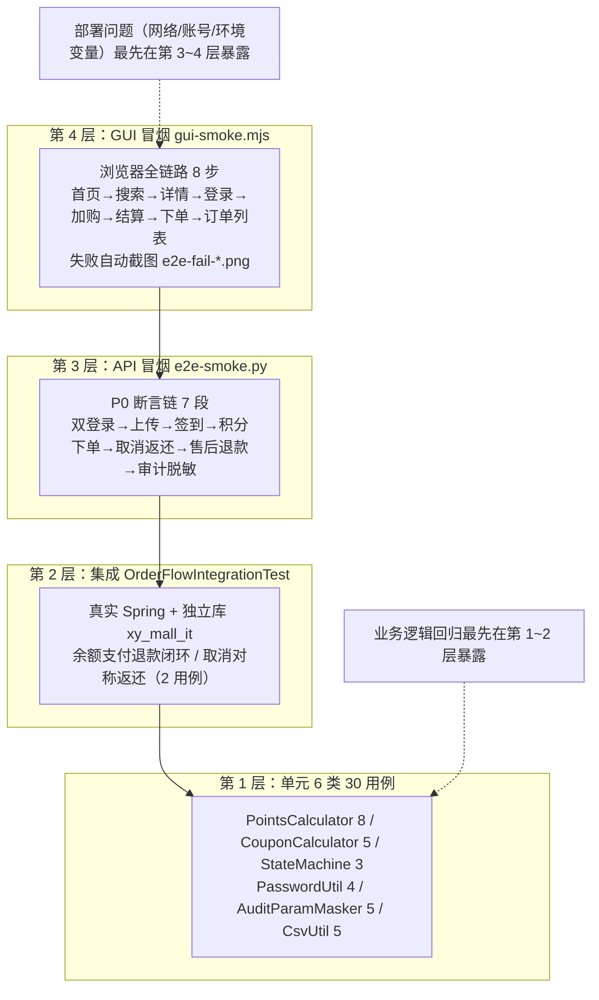

# 09 测试与质量保障
> 项目：xyMall ｜ 版本：v1.1 ｜ 生成日期：2026-10-06 ｜ 依据：源码分析

本文是测试专题篇：给出测试体系全景（框架选型、分层分布、运行方式），把仓库中每一个测试类与三个测试脚本**逐类逐段展开**（后端 7 个测试类共 32 个用例、API 冒烟 `e2e-smoke.py`、GUI 冒烟 `gui-smoke.mjs`、秒杀压测 `load-seckill.py`），说明覆盖率现状与质量门禁，最后如实列出测试缺口与补测建议。《06-部署运行》第 6 节已给过一页式速览，本文是其完整展开与逐用例解析。

## 1. 测试体系全景

### 1.1 框架与工具链

| 层 | 框架/工具 | 版本与来源 | 说明 |
| --- | --- | --- | --- |
| 后端单元/集成 | JUnit 5 + Spring Boot Test | 随 `spring-boot-starter-test`（父 POM `xy-mall/pom.xml` BOM 管理） | 断言用 JUnit Jupiter 原生 `assertEquals/assertThrows`，未引入 AssertJ/Mockito |
| 集成测试运行时 | 真实 MySQL + Flyway | `@SpringBootTest(properties=...)` 内联数据源 | 独立库 `xy_mall_it`，`createDatabaseIfNotExist=true`，不污染开发库 |
| API 冒烟 | Python 3 标准库 | `xy-mall/scripts/e2e-smoke.py`（129 行） | 仅 `urllib/json/base64`，零第三方依赖，任何装有 Python 的机器可跑 |
| GUI 冒烟 | playwright-core + 本机 Chrome | `xy-mall-web/e2e/gui-smoke.mjs` + `package.json` 的 `e2e:gui` 脚本 | `playwright-core` 不下载浏览器，通过 `findChrome()` 探测本机 Chrome 路径 |
| 压测 | Python 3 asyncio | `xy-mall/scripts/load-seckill.py`（58 行） | `run_in_executor` 包同步请求实现并发 |
| 前端静态门禁 | vue-tsc + ESLint 9 | web/admin 的 `build` 脚本 `vue-tsc -b && vite build` | 类型错误即无法产出构建物（H5 例外，见 5.2） |

### 1.2 分层分布与运行方式

测试资产共四类十件：后端 7 个测试类（6 单元 + 1 集成，32 个 `@Test`）、2 个 Python 脚本、1 个 JS GUI 脚本、构建期静态检查。运行命令矩阵：

| 命令 | 覆盖 | 前置条件 |
| --- | --- | --- |
| `mvn test`（在 `xy-mall/`） | 全部 32 个后端用例 | 本地 MySQL 8 可用且 root/root1234（集成测试 properties 硬编码，见 3.1） |
| `mvn test -Dtest=OrderFlowIntegrationTest` | 仅集成链路 | 同上 |
| `mvn test -Dtest=PointsCalculatorTest` | 纯函数单测 | 无（毫秒级） |
| `python3 scripts/e2e-smoke.py` | 后端 P0 端到端 | 后端 8081 已启动 + 验证码旁路（脚本验证码固定 0000） |
| `npm run e2e:gui`（在 `xy-mall-web/`） | 浏览器全链路 | 后端 8081 + 商城端 5177 已启动；本机装有 Chrome |
| `python3 scripts/load-seckill.py <id> <并发> <请求数>` | 秒杀压测 | 后端 8081 + 账号 test001/123456 + 旁路开启 |
| `pnpm build`（web/admin） | vue-tsc 类型门禁 | pnpm install 完成 |

单测只测"可确定性计算的纯逻辑"（计算器、状态机、脱敏、转义、密码算法），集成测试测"真实 Spring 上下文里的事务闭环"，脚本层测"部署出来的系统作为一个整体是否可用"——三层各司其职，后端没有为 Service 编写 mock 式单测（Service 依赖 DB 语义过重，mock 价值低，作者选择用集成测试覆盖）。四层资产的守护关系如下：越靠下的层失败越接近"业务逻辑回归"，越靠上的层失败越接近"部署与环境问题"，排障时按此顺序归因效率最高。

## 2. 后端单元测试逐类解析（6 类 30 用例）

### 2.1 PointsCalculatorTest（8 用例）——积分抵扣纯函数

被测对象 `modules/order/service/PointsCalculator.java`，签名 `calculate(points, baseAmount, rate, maxPercent, enabled) → int[]{usedPoints, deductAmount}`。8 个用例构成一份"边界条件目录"：

| 用例 | 输入要点 | 断言的不变式 |
| --- | --- | --- |
| `disabledReturnsZero` | `enabled=false` | 开关关闭一律 0 |
| `invalidParamsReturnZero` | rate=0 / maxPercent=0 / base=0 / points=0 四组非法参数 | 非法参数返回 0 而非异常（下单主链路容错） |
| `basicDeduction` | 20 积分、rate=100 | 20 积分抵 20 分（1 元=100 积分基准） |
| `cappedByPercent` | 券后 100 分、上限 50% | 抵扣被 maxPercent 截断为 50 分 |
| `cappedByPoints` | 积分只有 10 | 抵扣被持有量截断 |
| `roundingNeverDeductsWithoutValue` | rate=3（1 元=3 积分）非整除 | 5 积分 → deduct=166 分，反算 used=4 积分（4×3/100=133≤166）；断言"使用积分反算价值不超过抵扣金额"的取整不变式 |
| `deductNeverExceedsBase` | 大额积分 + 小额订单 | 抵扣永不超过券后金额的 50% |
| `largeAmountNoOverflow` | base=2_000_000_0 分 | int 乘法不溢出（金额以分存储的上界验证） |

这组测试的实际价值在于**守护下单资金计算**：`OrderServiceImpl.computePointsDeduction` 委托该纯函数，任何"积分抵成负数/超额抵扣/取整套利"的回归都会在这里被拦住。

### 2.2 CouponCalculatorTest（5 用例）——券金额计算

被测对象 `modules/coupon/service/CouponCalculator.java`。用例：`flatDiscountCappedAtAmount`（满减券面额超过订单金额时按金额封顶，不让券"倒找钱"）、`discountCoupon`（折扣券按百分比打折）、`discountCouponWithSpaces`（百分比配置带空格容错）、`invalidPercentThrows`（非法百分比抛异常——与积分计算器的"返回 0"策略相反，因为券配置是运营录入的强校验场景）、`zeroAmountReturnsZero`。它与 PointsCalculatorTest 合计 13 个用例，覆盖了下单四层优惠中最具计算风险的两层。

### 2.3 OrderStateMachineTest（3 用例）——状态机迁移表

被测对象 `modules/order/statemachine/OrderStateMachine.java`。`legalTransitions` 逐条断言 10 条合法迁移（待支付→已支付/手动关闭/超时关闭；已支付→配货/关闭；配货→出库/关闭；出库→交易成功/关闭；交易成功→关闭）；`illegalTransitions` 断言 7 条非法迁移（跨级跳跃、关闭单复活、终态回退）；`checkTransitThrowsWithCallerMessage` 验证 `checkTransit` 抛出的 `BizException` 携带调用方传入的文案（保证用户看到"当前状态不可操作"而非泛化错误）。状态机是全站订单正确性的单点，这 3 个用例是性价比最高的回归资产。

### 2.4 PasswordUtilTest（4 用例）——密码算法与懒迁移

`ProfileView` 之外最贴近安全的一组：`saltShouldBeRandomAndNonEmpty`（盐随机非空）、`encryptAndMatchesRoundTrip`（BCrypt 加密→校验闭环）、`samePasswordWithDifferentSaltDiffers`（同密码不同盐密文不同，验证盐生效）、`nullInputsNeverMatch`（空输入一律不匹配，防 NPE 型认证旁路）。旧 MD5 双算法兼容与懒迁移语义在《05-核心流程》1.2 节③说明，测试锚定了 BCrypt 主路径。

### 2.5 AuditParamMaskerTest（5 用例）——审计脱敏

被测对象 `modules/admin/aop/AuditParamMasker.java`（纯函数）：`masksPasswordField`、`masksCaseInsensitiveAndMultipleFields`（大小写不敏感 + 多字段同时脱敏）、`keepsNonSensitiveValues`（非敏感字段原样保留——审计可用性）、`nullReturnsNull`、`longParamsTruncated`（超 2000 字符截断加省略标记）。守护的是"审计日志既有用又不泄露口令"这对矛盾需求的平衡点。

### 2.6 CsvUtilTest（5 用例，位于 framework-core）

全库唯一不在 server 模块的测试，印证 framework-core "零 Spring 依赖可独立测试"的设计：`quotesCommas`（含逗号加引号）、`escapesInnerQuotes`（内嵌引号翻倍转义）、`flattensNewlines`（换行拍平）、`nullIsEmpty`、`plainValueStillQuoted`。守护商品/订单/用户三处 CSV 导出在 Excel 中的格式正确性。

## 3. 集成测试：OrderFlowIntegrationTest（2 用例）

类路径 `server/src/test/java/com/xiaoye/mall/server/it/OrderFlowIntegrationTest.java`，是整个后端唯一的"真 Spring + 真 MySQL"测试。`@SpringBootTest(properties={...})` 内联了五组测试专用配置，每一项都有明确意图：独立库 `xy_mall_it?createDatabaseIfNotExist=true`（Flyway 自动建表，跑完可整库丢弃）；`xy-mall.jwt.secret=it-test-secret-...`（绕过生产密钥要求）；`xy-mall.oss.endpoint=http://127.0.0.1:1`（**故意指向不可达端口**，顺带验证 MinIO 失败回落路径不阻断业务）；`mall.captcha.allow-bypass=true`（注册免验证码）。

两个用例对应两条资金守恒链：

1. **`balancePayAndRefundClosedLoop`（余额支付-售后退款闭环）**：注册新用户 → 显式把余额清零再固定加 100 元（注释：断言不受注册赠送配置影响，测试自洽）→ 造商品（10 元/SKU 库存 5）→ 加购 2 件 → 下单 → **断言 `totalPrice=3000`（20 元货款 + 10 元运费，未达包邮线）与 `shippingFee=1000`**（运费公式锚定）→ `paySuccess(payType=0)` 余额支付 → 断言支付状态、余额扣减精确到分 → 发起售后 → 管理员 `handle(同意)` → 断言**余额全额回到 100 元、`balance_log` 恰有一条 reason="售后退款"、金额 3000、订单置 -1**——一条用例串起下单/支付/售后/退款四段事务与三张账（余额、流水、订单状态）。
2. **`cancelOrderRestoresStockAndCouponPointsSymmetrically`（取消订单的对称返还）**：赠 100 积分后带积分下单 → 断言 `pointsUsed>0` 且"100 - used = 当前积分"（扣减精确）→ 断言 SKU 库存从 3 变 2（扣减落地）→ `cancelOrder` → **断言积分回到 100、库存回到 3、订单 -1**——验证取消路径与下单路径严格互逆，这正是《05-核心流程》流程三"回补链"的资金/库存守恒要求的落地证明。

运行硬前提是本地 MySQL `root/root1234`（properties 硬编码）——这是 `mvn test` 全绿的环境门槛，也是《00-项目总览》第 5 节演示凭据的由来。用例数据用 UUID 截断串隔离命名，多次运行不互相污染，但不做清理（`xy_mall_it` 库会持续增长，偶尔手动 drop 即可）。

## 4. 端到端测试脚本逐段解析

### 4.1 API 冒烟 e2e-smoke.py（P0 断言链）

`xy-mall/scripts/e2e-smoke.py` 用标准库 `urllib` 实现 `req/multipart_upload/login/admin_login` 四个原语后，按编号推进一条完整业务断言链，每段失败即 assert 中断（非零退出）：

1. **双登录**：用户 `test001` 与管理员 `admin` 各自走"取验证码→登录（验证码 0000）"；随后**清理挂起订单**（遍历待支付单逐个取消），保证后续积分断言的初始状态干净——这一步体现了"测试自我准备环境"的设计。
2. **上传**：构造合法 1×1 PNG（base64 硬编码；注释说明旧版硬编码字节 IDAT 有误、新版服务端内容校验会正确拒绝——脚本与服务端校验能力同步演进）→ 断言返回 URL 可 GET。
3. **积分签到**：查询 `signedToday` 幂等处理当日重复执行。
4. **带积分下单**：加购固定商品（goods 21362/sku 2047）→ 下单 `usePoints=true` → 拉详情与积分余额 → **断言积分减少量 == 订单 `pointsUsed`**，并检查 `extraInfo` 含"积分抵扣"快照。
5. **取消返还**：取消订单 → **断言积分全额恢复**并打印最近两条流水。
6. **售后退款闭环**：余额支付第二单 → 申请售后 → 管理员同意 → **断言退款到账金额精确**（脚本尾部，与集成测试用例 1 互为 HTTP 层/进程内层的镜像验证）。
7. **审计脱敏验证**：分页查询操作日志 → 断言含 password 的入参已显示为 `***`。

该脚本的定位是**部署验收**：容器化发布或换环境部署后跑一遍，即可确认"数据库迁移、Redis、MinIO、支付开关、审计"五个部署变量全部正常。

### 4.2 GUI 冒烟 gui-smoke.mjs（浏览器全链路）

`xy-mall-web/e2e/gui-smoke.mjs`（`npm run e2e:gui`）：playwright-core 驱动**本机 Chrome**（`findChrome()` 按 `CHROME_PATH` 环境变量 → macOS/Linux 常见路径逐个探测），`HEADLESS=false` 可观察执行。8 个 `step()` 依次：打开首页 → 搜索"手机壳" → 进第一个商品详情 → 登录（表单填充 + 验证码 0000）→ 加入购物车 → 进结算页 → 提交订单 →（末段跳转订单列表校验）。工程细节：每步 1.5~2.5s 的显式等待（演示环境不求极速求稳定）；任一步失败**自动截图 `e2e-fail-{时间戳}.png`**、置非零退出码并关闭浏览器——失败现场可直接人工目检。它验证的是 API 冒烟覆盖不到的层：路由守卫、组件渲染、表单交互、页面间跳转参数传递。

### 4.3 压测 load-seckill.py

`xy-mall/scripts/load-seckill.py <seckillId> <并发数> <每人请求数>`（默认 50 用户 × 2 轮）：asyncio + `run_in_executor` 并发 POST `/api/seckill/{id}/grab`，统计三类结果分布（成功/业务拒绝/异常）与 **P50/P95/max 耗时**。脚本注释坦承单账号演示的局限："成功数受库存/限购约束"——单账号触发的是限流（5 次/2s）与"该场次每人限抢一件"，因此它验证的首先是**限流与限购的正确性**（成功数应 ≤1、拒绝占绝大多数、无 500 异常），其次才是吞吐数字。多账号压测需自行扩展 tokens 列表。

## 5. 覆盖率现状与质量门禁

### 5.1 覆盖率现状

仓库**未配置 JaCoCo 等覆盖率工具**（父 POM 无插件）。CI 情况（回刷核实）：xy-mall / xy-mall-admin / xy-mall-web 三仓均有 `.github/workflows/ci.yml`（后端跑 `mvn -B test` + `package -DskipTests`，web/admin 跑 eslint + `vue-tsc -b` + vite build；h5 仓库无 CI），但这些流水线均未接覆盖率与 e2e-smoke 门禁，以下为按测试资产映射的结构性评估：有测试保障的是"纯计算层"（积分/券计算、状态机、脱敏、CSV、密码）与"一条交易主链"（集成测试）；`AGENTS.md` 记载"27 个"测试而当前源码统计为 32 个 `@Test`（6.1 节表格逐类相加：8+5+5+3+4+5+2=32），存在文档与代码的少量漂移，以 `mvn test` 实际输出为准。无覆盖的关键区域：支付回调验签、秒杀抢购全链路、超时关单三重兜底、IM WebSocket、RBAC 切面——均为高价值但依赖环境/并发的场景，与下一节补测建议直接对应。

### 5.2 门禁清单

| 门禁 | 强制力 | 出处 |
| --- | --- | --- |
| `mvn test` 全绿 | 人工约定（AGENTS.md 第 7 节"补对应单测/集成测试，mvn test 全绿再交付"） | `xy-mall/AGENTS.md` |
| Flyway validate | 启动强制（schema 漂移拒绝启动） | `application.yml` |
| `vue-tsc -b` | 构建强制（web/admin） | 两端 `package.json` build 脚本 |
| `pnpm lint` | 人工执行（未挂入 build） | 同上 |
| 二次开发六条检查 | 评审约定 | `AGENTS.md` 第 7 节 |

## 6. 测试缺口与补测建议

按"风险 × 补测成本"排序给出可执行建议：

1. **秒杀并发正确性集成测试**（高价值）：复用集成测试骨架，开一个线程池并发 grab 同一场次，断言 `seckill_stock` 最终扣减数 == 成功单数、`seckill_success` 无重复资格、Redis 名额与 DB 一致——把《05-核心流程》流程四的核心承诺钉进回归。成本：中等（需注入 `SeckillStockRedisService` 的测试 Redis 或允许纯 DB 路径）。
2. **超时关单兜底测试**：造一笔 `create_time` 已过期的待支付单，直接调 `closeIfTimeout` 断言库存/券/积分三返还与状态 -2；再连续调用两次断言幂等。成本：低，纯 DB 断言。
3. **支付回调安全测试**：对 `AlipayPayService` 的验签与金额比对做负路径单测（伪造 sign、金额不符、"订单已关闭后回调"的幂等退款），可把 SDK 交互抽接口后 mock。成本：中。
4. **覆盖率工具化**：父 POM 引入 JaCoCo（`prepare-agent` + `report`），先拿到基线数字再谈门禁阈值；`mvn verify` 产出报告。
5. **CI 门禁补强**：三仓已有 GitHub Actions 基础流水线（后端 `mvn test`、web/admin lint+vue-tsc+build），缺的是 e2e-smoke（起 MySQL8/Redis 服务容器后执行）与覆盖率门禁——在其上追加即可，无需从零搭建；h5 仓库连基础 CI 也没有，可顺带补齐。`AGENTS.md` 约定中后端测试与前端类型检查已由现有 CI 硬性兜底，剩余门禁（e2e、覆盖率）仍依赖开发者自觉。
6. **前端组件/组合式函数测试**：`usePublicConfig`/`hasPerm`/`sanitize.ts` 是纯逻辑，适配 Vitest 成本低；`sanitize.ts` 尤其值得（安全组件无回归网）。
7. **压测脚本多账号化**：tokens 列表参数化，验证真实并发下的防超卖（单账号只能验证限流限购）。
8. **H5 端类型门禁**：h5 build 无 `vue-tsc`，与其"迭代中"定位一致；稳定后建议补齐，避免三端质量水位分化。
