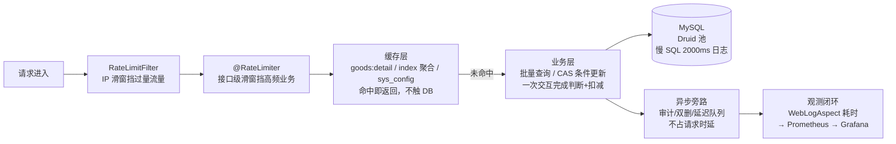

# 10 性能设计与优化
> 项目：xyMall ｜ 版本：v1.1 ｜ 生成日期：2026-10-06 ｜ 依据：源码分析

本文是性能专题篇：先划定系统的性能关键路径，再把**已实施的每一项优化手段逐一落到实现文件**（缓存一致性、Lua 库存、延迟队列、连接池、批量查询、限流、异步化、拆包……），然后如实给出性能风险与瓶颈预测，最后给出按投入产出排序的进一步优化建议。机制的流程级叙事（《05-核心流程》流程三/四/五）以引用为主，本文聚焦"性能账"：每一项手段优化了什么、代价是什么、边界在哪里。

## 1. 性能关键路径

按"QPS 预期 × 资源消耗 × 时延敏感度"三个维度，系统的性能关键路径有五条：

1. **商品详情读**（`GET /api/goods/detail/{id}`）：全站 QPS 最高的读路径，首页/列表/秒杀页都会触发；解法是 Redis 对象缓存 + 空值缓存（见 2.1）。
2. **下单写**（`POST /api/order`）：单事务 8~10 次 DB 写（订单/订单项/库存/流水/券/积分/购物车），是 DB 压力最大的入口；解法是限流 + 幂等 + 批量查询 + 条件更新一次命中。
3. **秒杀抢写**（`POST /api/seckill/{id}/grab`）：瞬时脉冲流量，DB 无法直接承接；解法是三级漏斗（限流→Lua 预扣→DB 条件扣减）。
4. **首页聚合读**（`GET /api/index/info`）：一次请求聚合轮播 + 三楼层 + 配置；解法是聚合缓存 `IndexServiceImpl`（失效联动见 2.2）。
5. **管理端列表/导出**（`/api/admin/*/page|export`）：运营低频但查询重（多表 join、CSV 上限 1 万行）；解法是分页 clamp、导出行数上限、慢 SQL 观测。

性能预算的基准事实：单实例 Spring Boot + MySQL 8 + Druid（连接池参数取默认值）部署，目标用户量为演示/小规模生产（数百并发以内）。所有优化的目标不是"极限吞吐"，而是**在单机资源下把时延与正确性同时保住**——这决定了它的手段清单与大规模系统截然不同：不做读写分离、不做分库分表、不引入 MQ，而是在"每一类请求多走一次缓存、少打一次库、失败有退路"上做文章。读关键路径的逐条机制时，建议同步留意每一项的"代价列"：缓存引入一致性问题（用双删+TTL 换）、预扣引入漂移问题（用对账换）、限流引入误伤问题（用维度拆分换）——没有免费的性能，只有被明确接受并管理的代价。

## 2. 已实施的优化手段（逐项对源码）

### 2.1 缓存体系：详情缓存 + 空值缓存 + 延迟双删

实现文件 `xy-mall/server/.../modules/goods/service/GoodsCacheService.java`（113 行，全部机制一目了然）：

| 手段 | 实现细节 | 性能收益 | 一致性代价与补偿 |
| --- | --- | --- | --- |
| 对象缓存 | `goods:detail:{id}` → GoodsVO，TTL 10min（`TTL` 常量） | 详情读从"DB 主查 + SKU 查"降为一次 Redis GET | 后台改商品时 `evictDetail` 失效 |
| 空值缓存 | 不存在/已下架写入字符串 `"N"`，TTL 60s（`NEGATIVE_TTL`） | 恶意扫描不存在 ID 时不击穿 DB（`lookup` 返回 `negative=true` 直接判不可见） | 60s 内上架的新商品有最长 1 分钟不可见窗口（可 `evict` 主动清） |
| 延迟双删 | `evictDetail` 立即删 + 单守护线程池 `DELAY_DELETER`（`goods-cache-delay-delete`）2 秒后二次删（`DOUBLE_DELETE_DELAY_MS=2000`） | 清掉"删除→并发读旧值回填"的脏窗口 | 进程重启丢二次删除，由 10min TTL 兜底（类注释原文） |
| 读降级 | 所有 Redis 操作 try/catch，失败 warn 后回源 DB | Redis 挂掉时系统不劣化为不可用，只是变慢 | 无 |

触发点分布（与《05-核心流程》流程五互补）：商品 `update/delete/batchStatus` 三个入口都调 `evictDetail`，删除商品还联动清购物车/首页配置/SKU；同时 `indexService.evictIndexInfo` 失效首页聚合缓存——**写侧的缓存失效清单是硬编码在 `AdminGoodsController` 里的**，新增会缓存的读路径时必须同步维护（`AGENTS.md` 检查清单第 5 条）。

### 2.2 首页聚合与 sys_config 进程缓存

`IndexServiceImpl` 把"轮播 + 三楼层商品 + 热搜词"聚合成一次 `IndexInfoVO` 读，避免首页并发下重复执行 5~6 个查询；商品/楼层/轮播变更时 `evictIndexInfo` 失效。`SysConfigServiceImpl` 用 `ConcurrentHashMap` 进程内缓存运营参数（读 DB 0 次/请求），写时 `cache.clear()` 全量失效——运营参数读是全站最高频的隐藏查询（运费、积分规则、超时分钟数遍布各链路），这层小缓存把它们的 DB 成本摊薄到近零。

### 2.3 秒杀三级漏斗与 Lua 原子预扣

实现文件 `modules/seckill/service/SeckillStockRedisService.java`（DEDUCT/RELEASE/WARM 三脚本）+ `SeckillServiceImpl.grab`：

- **第一级限流**：`@RateLimiter(USER, 5 次/2s)`（`SeckillController`）把单用户高频点击挡在业务前；
- **第二级分布式锁**：`@DistributeLock(scene="seckill:grab", key="#seckillId + ':' + #userId", waitMs=2000, leaseMs=10000)` 把同用户同场次请求串行化（重复点击直接等锁或报"抢购繁忙"）；
- **第三级 Lua 预扣**：`DEDUCT_SCRIPT` 在 Redis 单线程内原子完成 `HEXISTS 幂等判重 → GET 判库存 → HSET 流水 + DECR 库存`，返回码 0/-1/-2/-3——**绝大多数"抢完了/重复抢"的请求到不了 MySQL**；
- **DB 权威扣减**：穿透漏斗的请求走 `seckill_stock >= 1` 条件更新，注释明言"DB 条件更新为权威防超卖闸门，Redis 仅前置挡量，二者不互信"；
- **失败即回补**：任何 RuntimeException 触发 `compensateRedis → release`（HDEL 流水 + INCR 库存），消除回滚漂移；漂移兜底是 `SeckillReconcileJob` 每分钟以 DB 覆写 + 清理 5 分钟幽灵流水（`STALE_GRAB_MS`）。

性能账：库存 1000 件的场次，理论上最多 1000 个请求触达 MySQL 写路径，其余全部在 Lua 层拿到 SOLD_OUT/ALREADY_GRABBED——单机 MySQL 的秒杀承载能力因此提升约两个数量级。

### 2.4 订单延迟队列与三重兜底（时延换吞吐）

实现文件 `modules/order/service/OrderDelayQueue.java`（ZSet `orders:pay-timeout`，score=截止毫秒，5s 轮询）+ `job/OrderTimeoutJob`（60s DB 轮询）+ `service/OrderLazyCloseTrigger`（读路径惰性触发）。性能设计取舍：不用 JVM `DelayQueue`（重启丢失）也不用 MQ（引入新组件），用 Redis ZSet + 轮询把"海量定时器"压缩为一次 `rangeByScore` 调用；轮询周期 5s 意味着关单时延最多 5s+处理时间——**用秒级时延换掉了每订单一个定时器的资源开销**。入队失败仅 warn（DB 轮询兜底），两条路径都幂等，任何一层失效订单仍会收敛（《05-核心流程》流程三）。

### 2.5 批量化与单查询化

- 下单取数：`OrderServiceImpl.createOrder` 对购物车行/商品/SKU **一次性批量查询**（类注释："一次性批量查询，避免购物车循环内逐行查库"），把 N+1 压成 3 次；
- 商品列表：`GoodsServiceImpl.pageGoods` 单条分页 SQL（分类展开为 `in` 子查询一次完成）；列表 VO 刻意置空 `goodsDetail` 大字段（`toListVO` 注释"列表不返回大字段详情"），列表传输量降低一个数量级；
- 库存预警：`StockAlertController.alerts` 两条 `LIMIT ≤200` 的查询并行覆盖主表与 SKU 维度。

### 2.6 条件更新（CAS）与连接池

防超卖的条件更新（`stock >= n`）本身是性能手段：它把"查库存→判断→扣减"三次交互压缩为一次原子 UPDATE，且失败即短路（无重试风暴）。连接池选型 Druid（`application.yml` `spring.datasource.druid`）：`merge-sql` 合并统计 + `slow-sql-millis: 2000` 慢 SQL 日志——把 SQL 层的性能观测做进了连接池；Web 监控台关闭（安全），但 stat 数据仍可经日志采集。Druid 参数（initialSize/maxActive 等）取默认值（回刷核实：`application.yml` druid 段确无任何池参数显式声明，依赖 Druid 默认值）。

### 2.7 限流与异步化

- 双层限流：`RateLimitFilter`（IP 维度进程内滑窗 300 次/分，`shouldNotFilter` 豁免 `/api/health` 与 actuator）+ `@RateLimiter` AOP（Redis Lua 滑窗，`SLIDING_WINDOW_SCRIPT` 单脚本完成"清窗→计数→判限→记录→续 TTL"）。限流保护的是**过载下的系统存活**，是所有其他优化手段的前提。
- 异步化三处：审计落库（`AdminOperationLogAspect` 异步写 `admin_operation_log`，不拖慢管理端写操作）；延迟双删守护线程（不占业务线程）；MinIO 本地图片迁移线程（`oss-migrate-local`，启动不阻塞）。IM 出站用 `ConcurrentWebSocketSessionDecorator`（5s 写超时、256KB 缓冲上限）串行化发送，防慢消费者拖垮 EventLoop。
- ES 搜索卸载：`EsGoodsIndexService` 以 2s 连接/3s 请求超时把关键词搜索的相关度排序卸载到 ES，失败自动回落 MySQL like（`GoodsController.search`）——可选增强，不构成依赖。

### 2.8 观测与前端侧优化

- **耗时观测**：`framework-web/.../aop/WebLogAspect.java` 只拦 controller 层（注释："service/mapper 每方法一层反射开销大，且 controller 耗时已含下游"），debug 全量、≥`xy-mall.api.slow-cost-ms`（默认 1000ms）warn，并打 Micrometer Timer `xy.mall.api.cost`（Prometheus 指标名 `xy_mall_api_cost_seconds`，标签 class/method）→ Grafana 面板（`xy-mall/deploy/grafana/`）。
- **前端拆包**：admin 端 `vite.config.ts` 的 `manualChunks` 把 echarts/zrender 拆独立 chunk（首屏不下载图表库）；三端生产构建 `esbuild drop: ['console','debugger']`；路由级懒加载（17/19/9 条路由全懒加载）；nginx 对 `/assets/` 内容哈希文件发 `max-age=31536000, immutable` 长缓存；MinIO 图片对象自带一年 immutable 缓存头（`UploadStorageService.saveImage`）。

把 2.1~2.8 的手段按"请求进入的先后"串起来，可以看到一条完整的分层消耗曲线——每一层都在替下一层挡流量或省往返：

## 3. 性能风险与瓶颈预测

按单实例部署推演，最先暴露的瓶颈依次是：

1. **MySQL 写吞吐**：下单事务串行度受限于库存行锁（同商品并发下单在 `goods_sku` 行上排队）；秒杀已用 Lua 漏斗保护，但**普通大促**（同一爆款高并发下单）没有预扣层，行锁热点直接落在 MySQL。症状：`@RateLimiter(10/60s)` 之后的下单时延上升、Druid 慢 SQL 日志出现 `update goods_sku` 聚合项。
2. **Druid 默认连接池上限**（Druid 默认 maxActive=8，配置未显式声明已核实）：任何慢查询占住连接都会放大为全局排队；当前靠慢 SQL 日志发现，无池水位告警。
3. **进程内限流与幂等的单实例上限**：`RateLimitFilter` 的 `ConcurrentHashMap<String, Deque>` 在 IP 池膨胀时整体清空（>10,000 触发），极端流量下限流精度抖动；`IdempotencyService` 容量 5 万条惰性清理，超量后幂等保障弱化（源码注释均已声明）。
4. **秒杀对账窗口**：`SeckillReconcileJob` 60s 一轮、单场失败 try/catch 隔离，正常；但 Redis 与 DB 的双写漂移在对账间隔内对用户可见（如超卖拒单前的少量误放行）——正确性无虞（DB 闸门），时延体验有秒级窗口。
5. **导出与深分页**：CSV 导出上限 1 万行是保护，但订单导出的查询仍可能随数据量线性变慢；`offset` 深分页在百万行级列表会劣化（当前演示数据量无感）。
6. **IM 在线会话表**：`ImWebSocketHandler.online` 是单机 Map，连接数受单实例文件句柄与内存限制；管理端单连接服务所有用户，客服高峰时成为消息扇出瓶颈（当前定位无碍）。

## 4. 进一步优化建议（按投入产出排序）

1. **显式化 Druid 池参数并接监控**：在 `application.yml` 声明 `initial-size/max-active/max-wait`，配合已有的 stat filter 把池水位接入 Micrometer——半小时工作量，消除最隐蔽的瓶颈。
2. **爆款商品热点行优化**：为下单路径引入与秒杀同构的"Redis 预扣 + 异步落单"或至少把库存拆段（`sku_id + 段号` 分散行锁）；可复用 `SeckillStockRedisService` 的脚本骨架。
3. **缓存命中观测**：`GoodsCacheService` 加 hit/miss 计数器（Micrometer），验证 10min TTL 与双删策略的实际命中率，为调参提供依据。
4. **列表查询覆盖索引复核**：随数据增长用 `EXPLAIN` 复核 `goods(goods_sell_status, goods_category_id)`、`order_master(idx_status_create)` 等组合索引的实际命中（索引定义见 `V1__init.sql`/`V2__batch3.sql`）。
5. **sys_config 缓存多实例化**：多副本部署前把 `SysConfigServiceImpl.cache` 换 Redis 或加版本号广播（`AGENTS.md` 单实例假设清单第 2 条）。
6. **导出流式化**：订单/商品导出改 MyBatis 流式游标 + 分批写 CSV，去掉 1 万行上限的硬保护前先消除内存峰值。
7. **前端首屏**：H5 全量引入 Vant 可改按需（`unplugin-vue-components` 的 VantResolver）；web 端 `HomeView` 楼层图可加 `loading="lazy"`（部分已由 `img.ts` 占位兜底）。
8. **压测常态化**：把 `load-seckill.py` 扩展为多账号版并纳入发布前检查，用 P95 而非均值作为回归基线（脚本已输出 P95）。

总体评价：该代码库的性能工程是"**正确性优先、单机预算内做深**"的路线——缓存三原则、三级秒杀漏斗、三重兜底、双层限流、批量查询、异步化、观测埋点等手段都有明确实现锚点与降级出口；未做的是分布式横向扩展类优化（读写分离、分库分表、MQ 削峰），这与"刻意保持单实例"的项目定位一致，相关演进路线见《13-技术债务与演进建议》。
