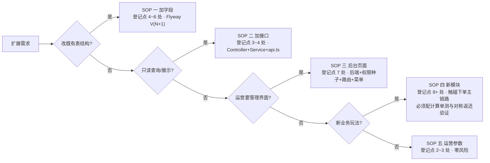

# 11 扩展开发指南
> 项目：xyMall ｜ 版本：v1.1 ｜ 生成日期：2026-10-06 ｜ 依据：源码分析

本文面向要在 xyMall 上做二次开发的工程师，给出 5 个典型扩展场景的 SOP（标准作业程序）：①新增商品模型字段、②新增用户端接口、③新增管理后台页面、④新增营销玩法模块、⑤新增运营参数（sys_config 键）。每个 SOP 以源码真实结构为锚点，列出**目录约定、改动文件清单（登记点）、代码骨架与验收自查清单**。开工前必读的三份"宪法"：`xy-mall/AGENTS.md`（工程约定与检查清单）、《04-数据模型》（schema 规约）、《03-接口设计》（契约规约）。所有示例文件路径相对 `mall/`。

## 0. 全局目录约定（所有 SOP 共用）

**后端**（`xy-mall/server/src/main/java/com/xiaoye/mall/server/modules/{module}/`）：一个业务模块一个目录，内部固定八类子包——`controller/`（REST 入口，只做参数接收与 R 包装）、`context/`（复杂入参聚合类，三个字段以上不散参）、`service/` + `service/impl/`（接口与实现，实现类继承 MP `ServiceImpl`）、`mapper/`（MP Mapper 接口，由启动类 `@MapperScan("...modules.**.mapper")` 自动扫描，**无需登记**）、`entity/`（表实体，含 `isDeleted` 逻辑删除字段则自动生效）、`vo/`（出参对象）、`job/`（定时任务，`@Scheduled`）、`statemachine/`（可选）。包名即模块名，全小写一个词（参考现存 30 个模块命名）。

**数据库**：只走 Flyway，新文件放 `xy-mall/server/src/main/resources/db/migration/V{N}__描述.sql`（当前最大 V8，新迁移从 V9 起），文件名下划线分隔、描述用英文。**严禁手改库结构**（`validate-on-migrate: true` 会因 checksum 漂移拒绝启动）。建表模板抄 `V1__init.sql`：InnoDB + utf8mb4、`create_time/update_time` 审计列、业务主体表带 `is_deleted`、唯一约束用 `UNIQUE KEY uk_*`、查询列 `KEY idx_*`。

**前端**：三端共用范式——接口函数集中声明在 `src/api/index.ts`（类型一并声明，禁止组件内裸 axios）；路由在 `src/router/index.ts`；页面在 `src/views/`。管理后台额外有两个登记点：菜单数组 `Layout.vue` 的 `menuItems`（第 78 行起）、按钮权限指令 `v-perm`（值 = 权限码字符串）。

**事务与并发红线**（每个 SOP 的验收清单都会复核）：金额一律分（INT）；状态流转进 `OrderStateMachine`（订单相关）或走唯一键/CAS；高并发入口加 `@RateLimiter`；跨步骤临界区加 `@DistributeLock`；库存操作以 DB 条件更新为准；Redis 访问必须 try/catch 降级；新缓存满足"读降级 + TTL + 更新时延迟双删"。

## 1. SOP 一：新增商品模型字段（以"产地 origin"为例）

**场景**：商品需要新增一个可筛选字段。以此为样本，任何 `goods`/`order_master`/`user` 等既有表的加列都照此办理。

**第 1 步：Flyway 迁移**。新建 `xy-mall/server/src/main/resources/db/migration/V9__goods_origin.sql`：

```sql
ALTER TABLE `goods`
    ADD COLUMN `origin` VARCHAR(50) DEFAULT NULL COMMENT '产地' AFTER `brand`;
```

只写增量，不写 IF NOT EXISTS 判重（Flyway 语义下每个版本只执行一次）；同时更新实体。

**第 2 步：实体与 VO**。`xy-mall/.../modules/goods/entity/Goods.java` 加 `private String origin;`（MP 驼峰映射自动对应 `origin` 列，无需注解）；出参 `vo/GoodsVO.java` 加同名字段（`toListVO` 用 `BeanUtils.copyProperties`，同名即自动拷贝）；入参若是新增/编辑商品，改 `AdminGoodsController` 使用的保存上下文/实体直传链路。

**第 3 步：查询链路**（可选，若需按产地筛选）：`context/GoodsQueryContext.java` 加 `origin` 字段 → `GoodsServiceImpl.pageGoods` 的条件构造器加一行 `.eq(StringUtils.hasText(context.getOrigin()), Goods::getOrigin, context.getOrigin())`（照抄 `brand` 行的写法）。若需要筛选效率，评估是否加索引（追加 `ALTER TABLE ... ADD KEY idx_origin(origin)` 到 V9）。

**第 4 步：前端三端展示**（按需）：web 端 `GoodsDetailView.vue` 详情参数区加一行展示；admin 端 `GoodsListView.vue` 编辑弹窗加表单项（`el-form-item` + rules，元/分换算规则不适用于字符串字段）；若进列表筛选，`GoodsListView.vue` 工具条加条件并透传给 `pageGoods` API。

**登记点清单**：Flyway V9（必须）→ `Goods.java`（必须）→ `GoodsVO.java`（需展示时）→ `GoodsQueryContext.java` + `GoodsServiceImpl.pageGoods`（需筛选时）→ 前端视图（需展示/筛选时）。**无其他隐藏登记点**——这正是该代码库"约定优于配置"的好处：无 XML 映射、无 DTO 注册表。

**验收自查**：空库从 V1 全量跑 Flyway 成功；存量库增量跑 V9 成功（`flyway_schema_history` 出现 V9 行）；`mvn test` 全绿；管理后台编辑商品回显与保存均正常；列表接口 SQL（dev 控制台 StdOutImpl 打印）确认新条件为参数化 `?` 而非字符串拼接；未配置该字段的老商品展示为空而非报错。

## 2. SOP 二：新增用户端接口（以"GET /api/goods/tag-filter"为例）

**场景**：给商城 Web/H5 增加一个新查询接口。挂靠既有模块则三步，跨模块读另需归属校验。

**第 1 步：Controller 方法**。在目标模块 controller（如 `modules/goods/controller/GoodsController.java`）加方法，骨架严格照抄同文件既有方法：

```java
@GetMapping("/tag-filter")
@Operation(summary = "按标签筛选商品", description = "公开接口，无需登录")
public R<List<GoodsVO>> tagFilter(@RequestParam String tag,
                                  @RequestParam(defaultValue = "1") long pageNum,
                                  @RequestParam(defaultValue = "10") long pageSize) {
    return R.ok(goodsService.listByTag(tag, pageNum, pageSize));
}
```

规约：类上已有 `@RequestMapping("/api/goods")` 前缀无需重复；Swagger 注解 `@Tag/@Operation` 必须写（`/doc.html` 文档由此生成）；分页参数用 `pageNum/pageSize` 默认 1/10；返回统一 `R<T>`。**鉴权选择**：公开接口不加注解；需登录则参数加 `@LoginUser Long userId`（解析器自动四重校验，见《08-安全与权限设计》2.2）；管理端接口放 admin 模块并加 `@RequirePermission("xxx:yyy")`。

**第 2 步：Service 方法**。接口声明加到 `service/GoodsService.java`，实现加到 `service/impl/GoodsServiceImpl.java`。业务失败一律 `throw new BizException("中文文案")`（400/401 语义用两参构造 `new BizException(400, "...")`）；查询涉及用户资源时**第一条语句先做归属校验**；涉及金额/库存的写操作必须 `@Transactional(rollbackFor = Exception.class)` 且条件更新。

**第 3 步：横切登记**（按需）：高频/敏感入口在 Controller 方法上加 `@RateLimiter(limit = 10, windowSeconds = 60)`（维度 USER 或 IP）；若走了新缓存，同时实现"读降级 + TTL + 更新时延迟双删"三件套。

**第 4 步：前端接线**。`xy-mall-web/src/api/index.ts` 增加类型化函数（如 `export const tagFilter = (params: TagParams) => request.get<GoodsVO[]>('/goods/tag-filter', { params })`——request.ts 拦截器已解包，函数返回值即 data）；H5 同步在 `xy-mall-h5/src/api/index.ts` 增加精简版。

**验收自查**：`/doc.html` 能看到新接口并可调试；未登录访问需登录接口返回 HTTP 401 且前端跳登录；`mvn test` 全绿（纯函数逻辑补单测，见《09-测试与质量保障》6 节建议）；接口级限流触发时返回"请求过于频繁"文案；dev 控制台确认无 N+1 查询。

## 3. SOP 三：新增管理后台页面（以后台"赠品管理"为例）

**场景**：管理端新增一个业务管理页。这是登记点最多的 SOP，前后端合计 7 处。

**第 1 步：后端能力**（若复用既有接口可跳过）：admin 聚合模块下新增 `modules/admin/controller/AdminGiftController.java`，挂 `/api/admin/gift`；每个写方法加 `@RequirePermission("gift:update")`——审计切面会自动落 `admin_operation_log`，无需额外编码。管理端查询通常直连其他模块 Service（参考 `AdminGoodsController` 注入 `GoodsService` 的方式）。

**第 2 步：权限点种子**。`AGENTS.md` 第 6 节第 6 条是硬约定：**新权限点必须进 Flyway 种子**，否则超管以外的角色永远看不到菜单。V9 迁移中追加：

```sql
INSERT IGNORE INTO `admin_permission` (`perm_code`, `perm_name`, `module`) VALUES
('gift:list', '赠品查看', 'gift'),
('gift:update', '赠品维护', 'gift');
```

超管角色经 `INSERT IGNORE INTO admin_role_permission SELECT 1, permission_id FROM admin_permission` 的既有模式自动获得（照抄 V1 第 253 行写法）。存量的运营专员角色是否授权，上线后在 `/rbac` 页面勾选即可。

**第 3 步：前端 API**。`xy-mall-admin/src/api/index.ts` 增加 `giftPage/giftSave/giftDelete` 等函数（路径 `/admin/gift/...`）。

**第 4 步：视图**。新建 `xy-mall-admin/src/views/GiftListView.vue`，整体范式抄 `CouponListView.vue`（工具条 + `el-table` + `el-pagination` + `el-dialog` 表单）：写按钮挂 `v-perm="'gift:update'"`；删除走 `ElMessageBox.confirm`；表单 `formRef.validate()` 通过才提交；分页 clamp 交给后端。

**第 5 步：路由与菜单双登记**。`src/router/index.ts` 的 children 数组加 `{ path: 'gifts', name: 'gifts', component: () => import('@/views/GiftListView.vue'), meta: { perm: 'gift:update' } }`；`src/views/Layout.vue` 的 `menuItems` 数组加 `{ path: '/gifts', label: '赠品管理', perm: 'gift:update' }`。**两处的 perm 必须与后端 `@RequirePermission` 完全一致**（三处同源校验：路由守卫、菜单过滤、后端切面）。

**验收自查**：超管登录可见菜单并可 CRUD；用只有部分权限的运营专员账号验证——无权限时菜单隐藏、直敲 URL 回 dashboard、直调 API 收到"无操作权限：gift:update"；`/operation-logs` 查到写操作审计且 password 类入参已 `***`；`vue-tsc` 构建通过（`pnpm build`）；非超管角色在 `/rbac` 勾选新权限点后刷新即刻生效（profile 快照拉取）。

## 4. SOP 四：新增营销玩法模块（以"满折活动"为例）

**场景**：新增一类独立营销玩法（定价/秒杀/拼团之外的第四种）。以 `promotion`（满减）为模板、`groupbuy`（拼团）为进阶参考。

**第 1 步：建表**。V9 迁移建 `promotion_flat`（门槛、折扣、起止时间、状态、`is_deleted`），照抄 `V2__batch3.sql` 中 `promotion_full` 的建表段（含索引与注释风格）。

**第 2 步：模块骨架**。建 `modules/flatpromo/`（模块名全小写一词）七件套：`entity/PromotionFlat.java`、`mapper/PromotionFlatMapper.java`（自动被 `@MapperScan` 扫到，无需注册）、`service/PromotionFlatService.java`、`service/impl/PromotionFlatServiceImpl.java`（继承 `ServiceImpl<PromotionFlatMapper, PromotionFlat>`）、`controller/PublicFlatPromoController.java`（`/api/flat-promo/active` 公开列表）、`controller/AdminFlatPromoController.java`（`/api/admin/flat-promo` CRUD + `@RequirePermission("flatpromo:update")` + V9 权限点种子，同 SOP 三第 2 步）、`vo/`。

**第 3 步：接入下单计算链**——营销模块的正确性核心。抄 `PromotionFullServiceImpl.bestDiscountFor(amount)` 的"多档取最优"形态实现 `bestFlatDiscountFor(amount)`，然后修改 `OrderServiceImpl.createOrder`：在满减层之后、积分层之前插入一层计算（**顺序是契约**：券→满减→满折→积分→PLUS，新增层必须写注释说明位次），优惠金额落 `order_master` 新列（V9 加列）并拼入 `extra_info` 快照（照抄满减的拼接语句）。**只算不扣**：若玩法有"占用资格"类副作用（如拼团建队），照 `GroupBuyService.createOrJoinTeam` 的模式在落库后、同事务内执行，并保证 `cancelOrder/closeIfTimeout` 的回补对称（见《05-核心流程》流程三的守恒要求）。

**第 4 步：前台展示**。web 端 `CheckoutView.vue` 优惠区加一行试算（**前端只展示、后端裁决**，公式必须与 `OrderServiceImpl` 逐字对齐）；商品详情若要打标，走 `GoodsVO` 扩展（SOP 一）。

**第 5 步：测试**。计算逻辑抽纯函数类（照 `PointsCalculator` 形态放模块 `service/` 下），配 `FlatDiscountCalculatorTest`（边界：门槛恰好/差一分、折扣上限、多档取最优、0 元单），纳入 `mvn test`。

**验收自查**：下单金额按新顺序重算正确（对照前端试算）；取消/超时关闭后优惠全额返还；管理端 CRUD + 权限 + 审计三查通过；活动未开始/已结束不生效；并发下单不超发（若有限量）；`AGENTS.md` 第 7 节六条检查逐条打勾。

## 5. SOP 五：新增运营参数（sys_config 键）

**场景**：让某个写死的阈值可被运营热调（如"赠品单笔上限"）。

**登记点 1**：`modules/config/service/SysConfigService.java` 内部类 `Keys` 加常量 `public static final String GIFT_MAX_PER_ORDER = "gift.max-per-order";`——**全库唯一读取口径**，业务侧一律 `sysConfigService.getInt(Keys.GIFT_MAX_PER_ORDER, 默认值)`（进程内缓存自动生效，写时全量失效）。

**登记点 2**：V9 迁移插入种子行 `INSERT IGNORE INTO sys_config (config_key, config_value, remark) VALUES ('gift.max-per-order', '5', '赠品单笔上限');`——不插也能跑（读时取默认值），但插入后管理后台 `/sys-config` 页才能看到并可热改。

**登记点 3**（前端展示，可选）：`SysConfigView.vue` 若按键名硬编码表单行，补一行；读取侧无需任何改动（`PublicConfigController` 只透出白名单子集，敏感参数**不要**加进 `/api/config/public`）。

**验收自查**：管理后台改值后**无需重启**即时生效（`cache.clear()` 语义）；改回默认值行为复原；非法数值（非数字）时 `getInt` 回落默认值而非抛错；并发读无锁竞争问题（ConcurrentHashMap 语义）。

五个 SOP 的登记点数量与风险面差异很大，选型时先对照下图估算改动范围——SOP 五几乎零风险，SOP 四要动下单主链路，必须配测试：



## 6. 通用验收门禁（所有 SOP 提交前过一遍）

源自 `xy-mall/AGENTS.md` 第 7 节并扩展为可勾选清单：

- [ ] schema 变更只经 Flyway V(N+1)，`validate-on-migrate` 启动通过；金额字段 INT 分；
- [ ] 新实体带 `isDeleted`（主体表）；查询默认走逻辑删除过滤；
- [ ] 新接口：`R` 统一响应 + `BizException` 中文文案 + Swagger 注解；用户态 `@LoginUser`，管理态 `@RequirePermission` + 权限点进种子；
- [ ] 高并发入口 `@RateLimiter`；临界区 `@DistributeLock`；库存/资产操作 DB 条件更新；订单状态流转进 `OrderStateMachine`；
- [ ] 新缓存：读降级 + TTL + 更新时延迟双删，且在对应写入口补失效调用；
- [ ] 补对应单测/集成测试，`mvn test` 全绿；前端 `pnpm build`（vue-tsc）通过；
- [ ] dev 全链路手测 + 至少跑一次 `scripts/e2e-smoke.py` 确认未破坏 P0 链路；
- [ ] 涉及新报错文案的，回到《12-FAQ与故障排查》补条目；涉及新配置的，回到《14-配置与环境详解》补环境变量/参数行。
