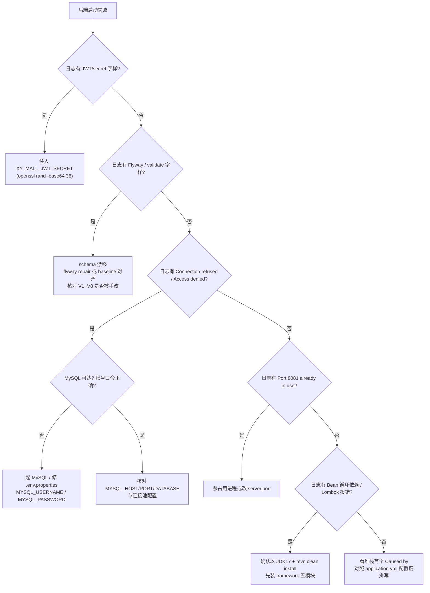

# 12 FAQ与故障排查
> 项目：xyMall ｜ 版本：v1.1 ｜ 生成日期：2026-10-06 ｜ 依据：源码分析

本文是排障操作手册：按"现象 → 根因 → 解决 → 出处文件"整理高频报错与坑，给出两张排查决策树（启动失败、运行期异常）与日志/调试入口清单。所有错误文案均从源码 `throw new BizException(...)` 与配置注释中提取，可直接作为日志检索关键词。《06-部署运行》第 5 节已有 8 条部署侧 FAQ 的概览，本文全面展开并补充业务侧与前端侧条目。

## 0. 排障方法论

在查具体条目之前，先建立三方法则，可解决大部分"不知道从哪查起"的场景。**第一，先分辨报错层级**：xyMall 的错误分四个面——前端弹窗文案（`ElMessage` 展示的即后端 `R.message` 原文）、HTTP 状态码（只有 401/400/404/405/429 五种会被特殊透出，其余业务错误一律 HTTP 200）、后端日志级别（`business exception` 的 warn 是业务拒绝、`system exception` 的 error 才是真异常）、以及基础设施日志（MySQL/Redis/MinIO 连接问题）。四个面的信息拼起来，基本能定位到《12》某一行。**第二，先确认是不是"设计如此"**：这个代码库有大量"故意的失败"——验证码锁定、限流 429、fail-closed 的模拟支付、空值缓存导致的商品不可见窗口、CAS 冲突后的"状态已变更请刷新"——它们的共性是报错文案规范、日志级别是 warn 且有明确注释。遇到疑似 bug，先对照本篇表格排除"故意行为"，再怀疑代码。**第三，改动前后各跑一次冒烟**：`scripts/e2e-smoke.py` 是现成的"是否被我改坏"检验器，七段断言覆盖了最容易被波及的链路，比手工点页面快且无遗漏。

另一个实用技巧是**用中文错误文案直接全局检索源码**：`grep -rn "该场次每人限抢一件" xy-mall/server/src/main/java` 一秒定位到抛出点与上下文注释——本项目的错误文案与抛出点一一对应，文案本身就是最好的检索键。本篇表格的"现象"列全部可直接作为 grep 关键词。

## 1. 高频报错与坑（按排查频率排序）

### 1.1 启动与部署类

启动类问题的共性是"进程根本没起来或起来了但缺资源"，此时业务代码尚未介入，排查对象是环境变量、文件系统与依赖服务三样东西。本项目特意把多数配置错误设计成**快速失败**（JWT 密钥缺失、Flyway 漂移都拒绝启动），因此"启动成功"本身就是一个强信号——它意味着密钥、数据库结构、连接池三关都过了，剩下的问题只会出在运行期。

| # | 现象 | 根因 | 解决 | 出处 |
| --- | --- | --- | --- | --- |
| 1 | 启动即失败，日志含 JWT/密钥装配错误 | `XY_MALL_JWT_SECRET` 未注入（application.yml 故意无默认值，防可预测密钥） | `export XY_MALL_JWT_SECRET=$(openssl rand -base64 36)` 或写入 `.env.properties` | `xy-mall/server/src/main/resources/application.yml`（xy-mall.jwt.secret 注释） |
| 2 | 启动失败：Flyway validate 校验不通过 | 手改过库结构或历史库 checksum 陈旧（schema 漂移） | 先 `flyway repair` 或 `baseline` 对齐再升级；新表一律走 V(N+1) 迁移 | `application.yml`（flyway 注释原文给处置） |
| 3 | 启动成功但商品图全部 404 | 启动工作目录不是 `xy-mall/`（`upload/` 静态映射是相对路径） | `cd xy-mall` 后再启动；容器部署检查 `./upload:/app/upload` 挂载 | `xy-mall/framework/.../web/config/WebConfig.java`（addResourceHandlers） |
| 4 | 容器循环重启：后端连不上 MySQL | compose 的 backend `depends_on mysql: service_healthy` 未满足（MySQL 初始化中/口令不符） | 看 `docker compose logs mysql`；确认 `.env` 的 `MYSQL_ROOT_PASSWORD` 与数据卷状态一致 | `xy-mall/docker-compose.yml`（healthcheck 段） |
| 5 | pnpm dev 直跑报构建脚本被拦截 | pnpm 11 默认拦截依赖包构建脚本 | 统一用 `./node_modules/.bin/vite` 直启 | `xy-mall/AGENTS.md` 第 6 节第 4 条 |
| 6 | 浏览器访问前端 dev 端口无响应（用 127.0.0.1） | dev server 仅监听 IPv6 | 地址栏用 `localhost` | 同上 |
| 7 | 发版后页面白屏/资源 404 | 懒加载 chunk 换 hash，旧页面加载旧 chunk 失败 | admin/h5 的 `router.onError` 已自动强刷自愈；web 端手动刷新；检查 nginx `try_files ... /index.html` | `xy-mall-admin/src/router/index.ts`、`06-部署运行` 5.8 |

### 1.2 网络与接入类

这一类问题的共同特征是"后端进程健康，但请求没走到业务逻辑"：CORS 拒绝发生在进入 Controller 之前、限流在 Filter 层直接写回响应、IM 握手失败在 WebSocket 升级阶段。判别技巧：看浏览器 Network 面板的响应——有 `Invalid CORS request` 字样或 HTTP 429 说明请求被框架层拦截；请求根本没出现在 Network 里则要查代理配置（vite proxy / nginx upstream）。生产环境的 CORS 与 IM Origin 两个白名单是最高频的两处遗漏，因为它们在 dev 环境永远暴露不出来。

| # | 现象 | 根因 | 解决 | 出处 |
| --- | --- | --- | --- | --- |
| 8 | prod 下前端 POST 全部被拒：`Invalid CORS request` | prod 的 CORS 白名单只放行两个生产域名，跨子域 POST 带 Origin 被拒 | 把前端来源显式加入 `xy-mall.cors.allowed-origin-patterns` | `application-prod.yml`（注释原文警告此现象） |
| 9 | 请求返回 `{"code":429,"message":"请求过于频繁，请稍后再试"}`（HTTP 429） | 触发全局 IP 限流（300 次/分） | 正常防护；联调压测时临时调高或等待窗口滑过 | `framework-web/.../filter/RateLimitFilter.java` |
| 10 | 业务报"下单过于频繁/上传太频繁，请稍后再试" | 触发 `@RateLimiter` 接口级限流 | 属防护行为；压测需按接口阈值控制节奏 | `framework-web/.../aop/RateLimitAspect.java` |
| 11 | IM 浮窗连接不上（本地正常、线上失败） | `ImWebSocketConfig` 的 Origin 白名单仅 `localhost:*/127.0.0.1:*`，生产域名被拒握手 | 把生产域名加入 `setAllowedOriginPatterns`；同时检查 nginx `/ws` 升级头透传 | `xy-mall/.../modules/im/ws/ImWebSocketConfig.java` |

### 1.3 认证与权限类

认证类报错全部是 401 或带 401 语义的业务码，且文案精确对应四重校验中的某一步——把文案对号入座即可知道卡在哪一关："请先登录"是没带头，"登录已过期/无效的登录凭证"是验签不过，"登录已失效，请重新登录"是黑名单或会话版本不符（后者常发生在改密之后，属预期行为），"账号已被锁定"是状态检查不过。权限类报错（"无操作权限"）则说明认证已过、RBAC 未过，排查方向从 token 转向角色-权限点分配。注意 401 会被前端 axios 拦截器统一处理成"清登录态跳登录页"，所以用户口中的"一直被踢回登录页"大概率是下表某一行而非前端 bug。

| # | 现象（报错文案） | 根因 | 解决 | 出处 |
| --- | --- | --- | --- | --- |
| 12 | HTTP 401 "请先登录" | 未携带 Authorization 头 | 登录获取 token，请求头 `Authorization: Bearer <token>` | `LoginUserArgumentResolver` 第一步 |
| 13 | HTTP 401 "登录已过期" / "无效的登录凭证" | token 过期（7 天）或被篡改 | 重新登录 | `LoginUserArgumentResolver`（ExpiredJwtException/JwtException 分支） |
| 14 | HTTP 401 "登录已失效，请重新登录"（刚改过密码/管理员重置过密码） | 会话版本 +1，旧 token 全端失效 | 用新密码重登（设计行为，非故障） | `user.token_version` 校验链 |
| 15 | HTTP 401 "账号已被锁定，请联系客服" | 用户 `locked_flag=1` 或已注销（即时生效） | 管理后台 `/users` 解锁 | `AccountStatusChecker` |
| 16 | "登录失败次数过多，请 N 分钟后再试" | 15 分钟窗口内失败满 5 次触发锁定 | 等待窗口滑过，或清 Redis 对应 key | `framework-core/.../security/LoginFailGuard.java` |
| 17 | "登录名或密码错误"（确认密码正确） | 验证码错误消耗后重试仍带旧验证码；或旧 MD5 账号迁移异常 | 重新拉验证码再试；查 `user.password_md5` 是否 `$2` 前缀 | `UserServiceImpl.login`、`PasswordUtil` |
| 18 | "验证码错误或已过期" | 验证码一次性消费后重放；或 TTL 过期；或 prod 环境填了 0000（旁路仅 dev） | 重新获取；prod 不可用 0000 | `CaptchaCodeService`、`application-dev.yml` |
| 19 | "无操作权限：xxx:yyy"（管理端） | 角色未分配该权限点，或新权限点没进 Flyway 种子导致无法授权 | `/rbac` 页勾选；确认种子迁移已执行 | `AdminPermissionAspect`、`AGENTS.md` 第 6 节第 6 条 |
| 20 | 管理员登录成功但看不到菜单 | 前端权限快照陈旧或角色无对应 perm | 重新登录刷新 profile 快照；`/rbac` 分配权限 | `xy-mall-admin/src/views/Layout.vue`（visibleMenus 过滤） |
| 21 | "支付通道未开放，请通过收银台完成支付" | `xy-mall.payment.mock-enabled=false`（fail-closed 设计） | 演示需要则在 prod 配置显式打开；接入真实支付后保持关闭 | `OrderController.paySuccess`、`application-prod.yml` |

### 1.4 交易与库存类

交易类报错是全系统设计密度最高的区域，绝大多数"看起来像 bug"的现象（抢不到、支付失败、订单没关）实际是防超卖、限购、幂等、超时兜底四套机制在正确工作。判断原则：**凡是带"请刷新/请重试/已抢完/限抢"字样的都是并发防护文案，属预期**；真正需要警惕的是两类静默异常——订单长期滞留待支付（三重兜底同时失效，见条目 26）与资金账实不符（这在对账任务落地前只能靠流水排查，见《13》D7）。交易问题排查的最后手段是直接对账：对比 `order_item` 数量与 `goods_sku.stock` 变化量、对比 `balance_log` 合计与 `user.balance` 现值。

| # | 现象（报错文案） | 根因 | 解决 | 出处 |
| --- | --- | --- | --- | --- |
| 22 | "商品库存不足，下单失败" | CAS 条件更新 `stock >= n` 影响 0 行（真实售罄或并发扣减失败） | 属正确行为；补库存后重试 | `OrderServiceImpl.createOrder`（防超卖权威闸门） |
| 23 | "手慢了，该场次已抢完或已结束" / "该场次每人限抢一件" | 秒杀售罄（Lua 返回 SOLD_OUT）或限购（唯一键/幂等流水拦截） | 正常行为；验库存可对比 `seckill_stock` 与 Redis `seckill:stock:{id}` | `SeckillServiceImpl.grab`、`SeckillStockRedisService` |
| 24 | "抢购繁忙，请重试" | 同用户同场次的分布式锁等待超时（2s） | 正常防重行为，稍后重试 | `@DistributeLock` waitMs 超时分支 |
| 25 | "订单状态已变更，请刷新后重试" | CAS 更新影响 0 行（并发流转/已被关闭） | 刷新订单详情后按新状态操作 | `OrderServiceImpl` 各流转方法 |
| 26 | 订单一直"待支付"未被关闭 | 三重兜底全部失效（罕见）：Redis 丢数据 + 定时任务停摆 + 无人访问详情 | 检查后端进程与 `@Scheduled`；手工调 `closeIfTimeout`；重启后 DB 轮询会在 60s 内收敛 | `OrderDelayQueue`/`OrderTimeoutJob`/`OrderLazyCloseTrigger` |
| 27 | 已支付订单钱到账但订单已关闭（迟到支付） | 支付回调晚于超时关单 | 已自动按流水幂等退款（`balance_log` reason="迟到支付补偿退款"），无需人工干预 | `OrderServiceImpl.compensateLatePayment` |
| 28 | "回调金额与订单不一致" / "支付宝签名验证失败" | 回调被篡改或配置的支付宝密钥/网关不匹配 | 核对 `XY_MALL_ALIPAY_*` 五个变量与沙箱应用配置 | `AlipayPayService` |
| 29 | "商品SKU已失效：xxx"（结算时） | 购物车行引用的 sku_id 已被删除 | 后台编辑商品时会自动把引用行重置 sku_id=0 回落主商品价；存量脏数据可删购物车行重加 | `AdminGoodsController`（replaceSkus 联动逻辑） |
| 30 | "未满足优惠券最低消费金额" / "优惠券不适用于当前商品" | 券门槛或适用范围（goods_type/goods_value）不匹配 | 属业务校验；核对券配置 | `CouponService.discountFor` |

### 1.5 数据与存储类

存储类问题的共同背景是本项目"三层存储各有降级"的设计：MySQL 是权威、Redis 可丢、MinIO 可回落本地。因此这类故障极少表现为"不可用"，更多是"行为变了"——图片时有时无（两条存储路径并存）、详情偶发变慢（缓存击穿回源）、秒杀变慢（Redis 降级纯 DB）。排查时先回答一个问题：**数据现在到底存在哪？** 上传看返回 URL 的前缀（OSS 域名还是相对路径 /upload/），库存对比 Redis key 与 DB 列，缓存用 `redis-cli` 查对应 key 空间。

| # | 现象 | 根因 | 解决 | 出处 |
| --- | --- | --- | --- | --- |
| 31 | 上传报"文件大小不能超过 5MB"/"仅支持 jpg/jpeg/png/gif/webp 格式图片"/"仅支持上传图片文件" | 大小/扩展名白名单/内容级校验（ImageIO 解码或 GIF 魔数）失败；伪装 HTML/SVG 也会被拒 | 换合规图片；前端表单先行限制 | `UploadStorageService.saveImage/processImage` |
| 32 | 上传成功但图片时有时无 | MinIO(NAS) 间歇可达：成功对象落在 MinIO、失败回落本地 `upload/`，两类 URL 基址不同 | 修复 NAS 网络；或开 `XY_MALL_OSS_MIGRATE_LOCAL=true` 迁移本地历史图 | `UploadStorageService.init/migrateLocalImagesIfNeeded` |
| 33 | "商品不存在或已下架"（刚上架的商品访问不到） | 空值缓存 60s 窗口（先访问时商品不可见被缓存） | 等待 60s，或后台编辑保存一次（触发 evict 双删） | `GoodsCacheService.putNegative/NEGATIVE_TTL` |
| 34 | Redis 挂掉后的现象清单（详情变慢/秒杀走慢路径/关单只靠 DB 轮询） | 预期降级而非故障（所有 Redis 点 try/catch 回落） | 修复 Redis；恢复后秒杀库存由对账 Job 按 DB 自动重建 | `AGENTS.md` 第 6 节第 3 条、`SeckillReconcileJob` |
| 35 | 积分签到报"今日已签到" | `points_log.sign_date` 生成列 + 唯一键拦截重复签到 | 正常行为 | `points_log` 表定义（V1） |

## 2. 排查决策树

### 2.1 启动失败决策树



### 2.2 运行期接口异常决策树

```mermaid
flowchart TD
    E["接口返回异常"] --> C{"HTTP 状态码?"}
    C -->|401| A1["登录四重校验失败:<br/>过期/黑名单/锁定/会话版本<br/>→ 重登或解锁账号"]
    C -->|429| A2["触发限流<br/>全局 IP 300/min 或 @RateLimiter"]
    C -->|404| A3["路径拼写 / prod 文档路径 404<br/>静态图检查工作目录与挂载"]
    C -->|405| A4["HTTP 方法不匹配<br/>对照《15-接口全量参考》"]
    C -->|200| B1{"body code?"}
    B1 -->|400| B2["参数/业务校验失败<br/>按 message 修正入参"]
    B1 -->|500| B3["看后端日志定位:<br/>warn=business exception(业务拒绝)<br/>error=system exception(真异常)"]
    B3 --> B4{"message 是中文业务文案?"}
    B4 -->|是| B5["按第 1 节表格对号入座<br/>多为并发/状态/归属校验"]
    B4 -->|否(系统繁忙)| B6["查 error 堆栈:<br/>SQL?→慢SQL日志/索引<br/>Redis?→确认降级路径<br/>NPE?→定位空数据"]
```

## 2A. 典型案例走查（三个端到端示例）

以下三个案例演示"按方法论走一遍"的完整过程，覆盖三类最常见报障。

**案例一：新同事本机部署后"登录一直失败"**。现象：登录页填 test001/123456，验证码输入 0000，报"验证码错误或已过期"。排查：按方法论第二则先怀疑"设计如此"——0000 旁路只在 dev profile 生效，追问得知该同事以 `SPRING_PROFILES_ACTIVE=prod` 启动却仍在用旁路验证码。处置：改回 dev（或 prod 下输入真实图形验证码）。教训：旁路开关的生效条件是 profile 而非启动参数（历史版本曾支持启动参数后门，已在整改中移除，见《13》第 6 节 P0-2 溯源）；出处 `application-dev.yml` 唯一声明处与 `CaptchaCodeService` 的旁路分支。

**案例二：秒杀活动"明明有库存却都抢不到"**。现象：运营在后台看到 `seckill_stock` 还有 200，用户全部收到"手慢了，该场次已抢完或已结束"。排查：该文案有两个可能来源——Redis Lua 返回 SOLD_OUT 或 DB 条件更新影响 0 行。`redis-cli get seckill:stock:{id}` 发现值为 0，而 DB 还有 200：Redis 与 DB 漂移。回想机制：正常情况下每分钟 `SeckillReconcileJob` 会以 DB 纠偏，漂移仍存在说明对账 Job 没跑或场次不在"活动中"集合里。查后端日志见对账 warn——该场次起止时间被配错（当天已结束但仍显示在列表，前端倒计时依赖 `server-time` 接口可复现时间差）。处置：修正场次时间后 `evict` 两个 Redis key（或等对账 Job 重建）。出处 `SeckillReconcileJob` 与 `SeckillStockRedisService.correctStock`。

**案例三：发版后部分用户"白屏且一直跳登录"**。现象：admin 后端正常，部分浏览器用户打开后白屏，控制台大量 chunk 404。排查：白屏 + chunk 404 是懒加载换 hash 的典型症状，`router.onError` 应自动强刷自愈（admin/h5 均有）；"一直跳登录"则叠加了另一个因素——强刷后 localStorage 里的旧 token 触发 401，被拦截器清态跳登录，属一次性行为。个别用户反复出现的原因是浏览器缓存了旧 `index.html`（nginx 对 `/` 未禁缓存时可能出现），导致始终加载旧 hash 清单。处置：确认 nginx `try_files` 与 html 响应头（`no-cache`）配置；让用户硬刷新一次即可。出处 `xy-mall-admin/src/router/index.ts` 的 `router.onError`、`06-部署运行` 条目 8。

以上三个案例的共性值得记住：**现象在用户侧，根因在配置或数据状态，而机制的注释就写在代码里**。xyMall 的中文注释密度保证了"顺着出处文件读下去"总能找到设计意图，这也是本篇坚持给每条 FAQ 标注出处的原因。

## 3. 日志与调试入口

### 3.1 后端日志

| 入口 | 位置/开关 | 用途 |
| --- | --- | --- |
| SQL 日志 | dev profile 自动开启（MyBatis-Plus `StdOutImpl`），prod 关闭 | 观察每条 SQL 与参数；排查 N+1、索引缺失 |
| 业务拒绝日志 | `GlobalExceptionHandler` 的 `log.warn("business exception: ...")` | 所有 `BizException` 的统一出口，文案即第 1 节表格关键词 |
| 系统异常日志 | 同文件 `log.error("system exception", e)` 含全堆栈 | 兜底 500 的定位起点 |
| 慢接口日志 | `WebLogAspect`：≥`xy-mall.api.slow-cost-ms`（默认 1000ms）warn，格式 `Xxx.yyy cost Nms` | 性能回归；dev 下另有 debug 全量耗时 |
| 慢 SQL 日志 | Druid `filter.stat.log-slow-sql`，阈值 `slow-sql-millis: 2000` | DB 层性能定位 |
| 请求追踪 | `RequestIdFilter` 为每个请求生成 requestId（MDC） | 串联一次请求的多条日志（回刷核实：`doFilterInternal` 中 `response.setHeader` 回吐响应头，属实） |
| 关键行为日志 | IM 上下线、MinIO 回落、延迟队列失败、秒杀对账纠偏等均有中文 info/warn | 各机制健康度速查 |

### 3.2 在线调试工具

- **Knife4j 文档**：`http://localhost:8081/doc.html`（dev），全部接口可在线填参调试；prod 已关（连 `/doc.html` 路径都 404，见 `WebConfig` 文档拦截器）。
- **Actuator**：dev 暴露 `/actuator/health|info|prometheus`；prod 仅 health 且不吐细节。`/actuator/prometheus` 的 `xy_mall_api_cost_seconds` 直方图可在 Prometheus（`deploy/prometheus.yml` 抓取配置）+ Grafana（`deploy/grafana/` 面板）里看接口耗时分布。
- **Redis 观察**：`redis-cli` 看 `keys goods:detail:*`（缓存）、`zrange orders:pay-timeout 0 -1 withscores`（延迟队列）、`hgetall seckill:grab:log:{id}`（抢购流水）、`get seckill:stock:{id}`（预扣库存）——四个 key 空间覆盖了全部 Redis 机制。
- **压测/冒烟**：`scripts/e2e-smoke.py`（P0 链路）、`scripts/load-seckill.py`（秒杀）、`npm run e2e:gui`（浏览器）——三者兼作"改动后的回归工具"，用法见《09-测试与质量保障》第 4 节。

### 3.3 前端调试

三端 `src/api/request.ts` 的响应拦截器是排障第一现场：业务错误会 `ElMessage` 弹出后端原文案（`silent: true` 的请求除外，如购物车角标）；HTTP 401 触发清态跳登录。dev 环境 F12 Network 看 `/api` 代理是否到达 8081；WebSocket 在 Network-WS 看 `/ws/im` 帧内容（JSON 协议 `{"toUserId":..,"content":".."}`）。admin 端生产构建 drop 了 console，本地排查用 dev 模式。

### 3.4 从日志到代码的映射（排障的最后一公里）

拿到一条日志后，定位源码的固定套路有四条，覆盖 90% 的场景。**其一，业务文案反查**：warn 级 `business exception: X` 的 X 就是源码里的字符串字面量，全局检索即达抛出点，抛出点周围的中文注释通常直接写明触发条件与设计意图。**其二，切面日志反查**：`慢接口 Xxx.yyy cost Nms` 的 `Xxx.yyy` 是"控制器类名.方法名"，直接打开 `modules/*/controller/XxxController.java` 找 `yyy` 方法，耗时构成沿 Service 调用链向下看；`接口限流触发：Xxx.yyy, scope=..., limit=...` 同理，顺带确认限流维度与阈值是否符合预期。**其三，机制日志对照**：IM 上下线（`IM 上线：`）、MinIO 回落（`MinIO 上传失败，回落本地`）、延迟队列（`延迟队列入队失败`/`延迟队列关单失败，保留重试`）、秒杀对账（`correctStock` 相关 warn）——这四类日志各对应一个"降级/兜底机制"的触发点，日志出现即意味着主路径不可用、降级路径已接管，处理优先级应放在修复主路径而非消除日志。**其四，滚动文件定位**：容器部署时控制台日志随容器生命周期消失，`logback-spring.xml` 的 FILE appender 把日志落在工作目录 `logs/xy-mall.log`（按天+50MB 滚动、gzip、保留 14 天、总量 2GB 上限），容器场景确认该目录是否在挂载卷内，否则重启即失联。

调试期还有两个"放大镜"开关值得记住：dev profile 下 `com.xiaoye.mall` 日志为 debug，WebLogAspect 会全量打印每个 controller 方法耗时；MyBatis-Plus 的 `StdOutImpl` 会把每条 SQL 连同参数打印到控制台——两者叠加基本等于给请求拍了 X 光。生产环境不要开（SQL 打印含用户数据），临时排查可用 `-Dlogging.level.com.xiaoye.mall=debug` 启动参数定点放开。

三端 `src/api/request.ts` 的响应拦截器是排障第一现场：业务错误会 `ElMessage` 弹出后端原文案（`silent: true` 的请求除外，如购物车角标）；HTTP 401 触发清态跳登录。dev 环境 F12 Network 看 `/api` 代理是否到达 8081；WebSocket 在 Network-WS 看 `/ws/im` 帧内容（JSON 协议 `{"toUserId":..,"content":".."}`）。admin 端生产构建 drop 了 console，本地排查用 dev 模式。
