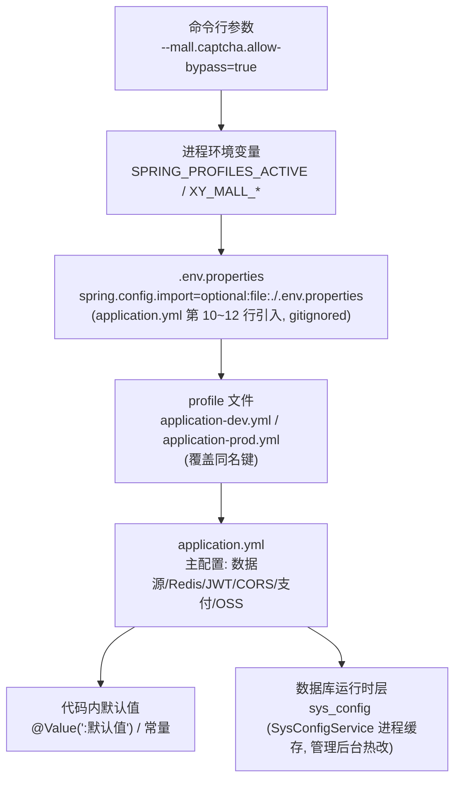

# 14 配置与环境详解
> 项目：xyMall ｜ 版本：v1.1 ｜ 生成日期：2026-10-06 ｜ 依据：源码分析

本文是配置的"逐文件走读"手册：后端三个 application 配置文件、logback 日志策略、`.env` 敏感配置模板、Dockerfile 与 docker-compose 五服务、deploy/ 可观测编排、三份 nginx 配置、三个前端 vite 配置，全部逐一过一遍；随后给出**环境变量全量清单**（名称/读取位置/默认值/缺失后果）与 **sys_config 运营参数全表**（含种子出处与迁移演进），最后是 `scripts/` 三个脚本的完整命令说明。《06-部署运行》第 3 节给过配置速查表，本文是其展开版：每个文件都标注它在整体装配链路中的位置。

## 1. 配置装配链路总览

后端配置按"**代码内默认 < application.yml < profile 文件 < .env.properties < 进程环境变量 < 命令行参数**"的优先级叠加（Spring Boot 标准顺序）：

这套链路体现了三条设计哲学，理解它们能预判大部分配置问题。**其一，敏感项一律无默认值或空默认**：JWT 密钥缺失直接拒绝启动、数据库口令默认空、MinIO AK/SK 默认空（空即回落本地而非报错）——"不安全"与"不可用"二选一时，代码选择了在启动期暴露问题而不是带病运行；compose 更以 `${VAR:?}` 语法把"缺变量"提前到编排期就报错。**其二，便利项一律锁进 dev profile**：验证码旁路、SQL 打印、debug 日志只存在于 application-dev.yml，生产 profile 物理上加载不到，杜绝"运维忘了关"这一类事故。**其三，行为参数与基础设施参数分离**：改运费、改积分规则是运营动作（sys_config，热生效、不重启、不进 git）；改数据源、改密钥是运维动作（环境变量，冷生效、要重启、走 .env 注入）。两层的修改主体、频率、审计要求完全不同，混在一起是配置混乱的根源。

注意最后一层：`sys_config` 是**运行时可调**的配置（管理后台"运营设置"页热改，无需重启），与文件配置的边界是——文件配置多为"基础设施连接与安全开关"（改完要重启），sys_config 全是"业务参数"（即时生效）。`start.sh` 位于链路最外圈的封装：source `.env.properties` 并 export 关键变量后 `exec java -jar`。

## 2. 后端配置文件逐文件走读

### 2.1 application.yml（主配置，118 行）

按段落过：`server.port=8081`；`spring.profiles.default=dev`（注释明示生产须以 `SPRING_PROFILES_ACTIVE=prod` 覆盖）；`spring.config.import=optional:file:./.env.properties`（`optional:` 前缀意味着文件缺失不报错——生产若依赖它注入密钥，缺失会在 JWT 装配时才暴露）。**Flyway 段**是数据安全的核心：`baseline-on-migrate: true, baseline-version: 1`（存量库跳过 V1）、`validate-on-migrate: true`（漂移即拒启，注释给出 repair/baseline 处置）。**数据源段**：URL 由 `MYSQL_HOST/PORT/DATABASE` 三个变量拼装（默认 127.0.0.1:3306/xy_mall_db），`username/password` 默认**空**（必须注入）；Druid 段关闭 Web 监控台、开启 stat 合并 + 慢 SQL 日志（2000ms）。**Redis 段**：host/port/database 直接写死 127.0.0.1/6379/0（容器环境经 `SPRING_DATA_REDIS_*` 环境变量覆盖；密码未在主配置声明，同样靠环境变量注入）。**xy-mall 业务段**：`security.client-ip-header`（默认 `X-Real-IP`，注释解释为何不信任 X-Forwarded-For）、`jwt.secret`（空默认=启动失败闸门）与 `expire-millis`（7 天）、`cors.allowed-origin-patterns`（dev 放行 localhost/127.0.0.1）、`payment.mock-enabled: true`、`alipay` 六件（沙箱网关 + 两个 zhangzhengyang.com 回调域名默认值）、`oss` 五件（endpoint/bucket 默认指向 NAS 192.168.1.18:9000，AK/SK 空默认）。**文档段** springdoc/knife4j 开；**actuator 段**暴露 health,info,prometheus 且 show-details: always；**MyBatis-Plus 段**：SQL 日志默认 NoLogging（dev profile 覆写为 StdOut）、逻辑删除全局声明 `isDeleted` 1/0。**logging 段**：`com.xiaoye.mall` 为 info（实际文件输出由 logback-spring.xml 接管）。

### 2.2 application-dev.yml（14 行）

只做三件事：SQL 日志切 `StdOutImpl`（控制台可见全部 SQL 与参数）、`com.xiaoye.mall` 日志升 debug（WebLogAspect 全量耗时打印）、**声明 `mall.captcha.allow-bypass: true`**（验证码 0000 旁路，全仓库唯一声明处；prod profile 不含此键，fail-closed）。它体现的开发/生产分离原则：所有"便利开关"只存在于 dev 文件，而非靠运维记得关闭。

### 2.3 application-prod.yml（53 行）

九组覆盖：模拟支付 true（演示站语义，注释强调接入真实支付宝后改回 false）；`user.recharge-enabled: false`（充值与模拟支付解耦，防无凭证加钱）；CORS 收紧为两个生产域名（注释警告"未配置来源时会以 Invalid CORS request 拒绝所有带 Origin 的 POST"）；`server.forward-headers-strategy: framework`（反代后按 X-Forwarded-* 重建 https 判断）；springdoc/swagger/knife4j 全关（配合 `WebConfig` 对文档路径强制 404）；Druid web-stat-filter 关；日志级别 root 降 warn；**actuator 收紧为仅 health、show-details: never、prometheus 导出关**（注释：指标采集走内网再评估放开）。dev 与 prod 的完整键级对比即《06-部署运行》表 3.2。从运维视角把两个 profile 的差异再压缩成一句话：**dev 的一切配置都为了"看得见"**（SQL 打印、debug 日志、文档开放、指标全暴露、验证码旁路），**prod 的一切配置都为了"关得上"**（同类开关全部反向收敛），两者之间没有第三个灰色态——这也是为什么 `SPRING_PROFILES_ACTIVE` 是全系统唯一一个"配错的代价是静默降级安全水位"的变量（见《13》D3）。

### 2.4 logback-spring.xml（37 行）

双 appender：CONSOLE（容器日志）+ FILE（`logs/xy-mall.log`，SizeAndTimeBased 滚动——单文件 50MB、按天、保留 14 天、总量 2GB 封顶，滚动即 gzip）。行格式 `%d [%thread] %-5level [%X{requestId:-}] %logger{40} - %msg%n`——**requestId 来自 MDC**（`RequestIdFilter` 注入），这是《12-FAQ与故障排查》3.1 节请求追踪的落地处。root=info，`com.xiaoye.mall` 显式 info（被 profile 的 logging.level 覆盖生效）。

### 2.5 .env.example（28 行，模板）

分组注释的敏感配置模板：MySQL 五件（HOST/PORT/DATABASE/USERNAME/PASSWORD）、JWT 密钥（注释给生成命令）、MinIO 五件 + `XY_MALL_OSS_MIGRATE_LOCAL`、支付宝五件（APP_ID/PRIVATE_KEY/PUBLIC_KEY/NOTIFY_URL/RETURN_URL，注释指向支付宝沙箱申请页）、compose 专用两件（MYSQL_ROOT_PASSWORD/REDIS_PASSWORD）。使用方式：复制为 `.env.properties`（后端加载，已被 gitignore）或 `.env`（compose 加载）。注意同名两用的细节：`MYSQL_ROOT_PASSWORD` 只被 compose 消费，`MYSQL_PASSWORD` 才是后端数据源口令——两处都要填且通常同值。

## 3. 容器化配置逐文件走读

### 3.1 后端 Dockerfile（13 行，两阶段）

构建阶段 `maven:3.9-eclipse-temurin-17`：整目录 COPY 后 `mvn -q clean install -DskipTests`（框架五模块 + server 一次装完）；运行阶段 `eclipse-temurin:17-jre`：仅拷 `server/target/xy-mall-server.jar` 为 app.jar，EXPOSE 8081，`java -jar` 直启。要点：**没有 HEALTHCHECK 指令**（compose 侧也没有 backend 健康检查，依赖 nginx 反代容错）；工作目录 /app——容器内的上传回落目录是 `/app/upload`，靠 compose 挂载持久化。

### 3.2 docker-compose.yml（五服务）

| 服务 | 配置要点 |
| --- | --- |
| mysql | `mysql:8.0`，端口 3307→3306；`MYSQL_ROOT_PASSWORD: ${...:?}` 强制非空语法（缺变量 compose 直接报错拒绝启动，这是"敏感配置不留默认值"哲学的 compose 实现）；命名卷 `mysql-data`；healthcheck `mysqladmin ping`（10s 间隔 ×10 次）；注释明确"表结构由后端 Flyway 初始化，勿再挂载过期 schema.sql" |
| redis | `redis:7-alpine`，`--requirepass $REDIS_PASSWORD`；**不映射宿主端口**（仅容器网络可达） |
| backend | build 本目录；`SPRING_PROFILES_ACTIVE=prod`；数据源/Redis/JWT 全部以标准 Spring 环境变量覆盖（`SPRING_DATASOURCE_URL/USERNAME/PASSWORD`、`SPRING_DATA_REDIS_HOST/PORT/PASSWORD`、`XY_MALL_JWT_SECRET`）；`./upload:/app/upload` 挂载；`depends_on: mysql: service_healthy` |
| admin-web | build `../xy-mall-admin`，8082→80，depends_on backend |
| mall-web | build `../xy-mall-web`，8083→80，同构 |

### 3.3 前端 Dockerfile（admin 与 web 同构，11 行）

`node:20-alpine` 阶段：先拷 package.json + pnpm-lock.yaml 单独 `pnpm install --frozen-lockfile`（层缓存友好——依赖不变时跳过安装），再全量拷贝 `pnpm exec vite build`；`nginx:alpine` 阶段拷 dist 与 nginx.conf。注意 h5 端没有对应文件（见《13-技术债务与演进建议》D2）。

### 3.4 两份 nginx.conf（web 与 admin 几乎同构）

五段式职责：`/api/` 反代 `proxy_pass http://backend:8081` 并注入 `X-Real-IP / X-Forwarded-*`（与后端 `client-ip-header`、`forward-headers-strategy` 三件配套）；`/ws/` WebSocket 升级头透传（`Upgrade`/`Connection`，`proxy_read_timeout 3600s`——仅商城 web 侧有，IM 浮窗用）；`/upload/` 反代后端静态映射；`/assets/` 内容哈希资源 `Cache-Control: public, max-age=31536000, immutable`；`/` 的 `try_files $uri $uri/ /index.html`（history 路由刷新兜底）。外加 `client_max_body_size 10m`（上传上限的服务端闸门，配合应用内 5MB 校验）与三条安全响应头（X-Frame-Options/X-Content-Type-Options/Referrer-Policy）。

### 3.5 deploy/ 可观测编排

`deploy/prometheus.yml`：单 job 静态抓 `host.docker.internal:8081/actuator/prometheus`（跨机改 IP）。`deploy/docker-compose.grafana.yml`：Prometheus 9090 + Grafana 3300→3000（`GF_SECURITY_ADMIN_PASSWORD=admin123` 初始口令——**部署后必须改**），provisioning 目录预置数据源（`datasources/prometheus.yml`）与面板（`dashboards/json/xy-mall.json`，核心图即 `xy_mall_api_cost_seconds` 耗时直方图），数据卷 `grafana-data`。`deploy/nginx-https-sample.conf`：MinIO 图片域 HTTPS 样例（certbot + 对象名内容指纹长缓存）。注意 prod profile 默认关闭 prometheus 导出，接入监控需在 actuator 配置重新放开并限制内网。

### 3.6 三份 vite.config.ts

| 端 | 端口 | 代理 | 特有配置 |
| --- | --- | --- | --- |
| xy-mall-web | 5177 | `/api`、`/upload` → `127.0.0.1:8081`；`/ws` → `localhost:8081`（ws:true） | `unplugin-vue-components` + ElementPlusResolver 自动按需引入；build 时 esbuild drop console/debugger |
| xy-mall-admin | 5176 | `/api`、`/upload` → 127.0.0.1:8081（无 /ws，IM 走 REST 发送） | echarts/zrender `manualChunks` 单独拆包；drop console 仅 production mode |
| xy-mall-h5 | 5188 | `/api`、`/upload` → localhost:8081；`/ws` → `ws://localhost:8081` | 无组件自动引入（Vant 全量）；build 仅 `vite build`，devDependencies 里的 vue-tsc 装而不用（无类型门禁，见《17-依赖全景》§5.3） |

三端共同点：**零环境变量**即可联调（代理写死 8081），`@` 别名指 src。生产形态下代理职责由 nginx.conf 接管，vite 配置不参与。两个容易踩的细节：其一，web 与 admin 指向 `127.0.0.1:8081` 而 h5 指向 `localhost:8081`，在仅监听 IPv6 的 dev server 下二者行为一致（vite 代理是 Node 侧发起，不受浏览器 IPv6 限制），但若后端改为只监听 IPv4 或换端口，需要逐端核对代理目标；其二，`/ws` 代理只有 web 与 h5 配了 `ws: true`，admin 端的 IM 控制台走 REST 轮询历史 + `/admin/im/send` 发送（不建 WS 连接），因此 admin 在 dev 下没有 `/ws` 代理属于设计而非遗漏——若要在 admin 端启用 WebSocket 直连，需先补代理再改 `ImConsoleView.vue` 的连接地址。

## 4. 环境变量全量清单

按"读取位置 → 缺失后果"整理（默认值列为 `${VAR:默认}` 中的默认）：

| 变量 | 读取位置 | 默认值 | 缺失/错误后果 |
| --- | --- | --- | --- |
| `MYSQL_HOST` | application.yml datasource.url | 127.0.0.1 | 连本机库；容器内漏配则连不上 MySQL |
| `MYSQL_PORT` | 同上 | 3306 | 同上 |
| `MYSQL_DATABASE` | 同上 | xy_mall_db | 建错库；Flyway 会在错误库上新建表 |
| `MYSQL_USERNAME` | datasource.username | 空 | 启动失败（数据库连接拒绝） |
| `MYSQL_PASSWORD` | datasource.password | 空 | 同上 |
| `XY_MALL_JWT_SECRET` | xy-mall.jwt.secret | **无（空）** | **启动即失败**（设计闸门） |
| `XY_MALL_CLIENT_IP_HEADER` | xy-mall.security.client-ip-header | X-Real-IP | 取 remoteAddr；反代后若未配该头又没置空，全部请求同一 IP → 集体触发限流 |
| `SPRING_DATA_REDIS_HOST` | spring.data.redis.host（环境变量覆盖） | 127.0.0.1（yml 写死） | 连不上 Redis → 全站降级纯 DB（不阻断但变慢） |
| `SPRING_DATA_REDIS_PORT` | 同上 | 6379 | 同上 |
| `SPRING_DATA_REDIS_PASSWORD` | 同上 | 无 | Redis 有密码而无此变量：启动可用但运行期全部 Redis 调用异常（日志刷 warn） |
| `XY_MALL_OSS_ENDPOINT` | xy-mall.oss.endpoint | http://192.168.1.18:9000 | 指向不可达 NAS → 启动探测失败回落本地 upload（功能可用） |
| `XY_MALL_OSS_BUCKET` | xy-mall.oss.bucket | xy-mall | 桶不存在会自动创建 |
| `XY_MALL_OSS_PUBLIC_BASE` | xy-mall.oss.public_base | http://192.168.1.18:9000 | 与实际访问域名不一致 → 图片 URL 打不开 |
| `XY_MALL_OSS_AK` / `XY_MALL_OSS_SK` | xy-mall.oss.access-key/secret-key | 空 | 空则**直接走本地回落**（init 有意短路，不发无效请求） |
| `XY_MALL_OSS_MIGRATE_LOCAL` | xy-mall.oss.migrate-local（@Value 默认 false） | false | true 时启动后异步迁移本地历史图（幂等） |
| `XY_MALL_ALIPAY_ENABLED` | xy-mall.alipay.enabled | true | false 时支付宝入口整体不可用 |
| `XY_MALL_ALIPAY_APP_ID` / `_PRIVATE_KEY` / `_PUBLIC_KEY` | xy-mall.alipay.* | 空 | 创建支付时报"支付宝支付未配置（缺少 APPID/密钥）" |
| `XY_MALL_ALIPAY_GATEWAY` | 同上 | 沙箱网关 | 指向生产网关 + 沙箱密钥会验签失败 |
| `XY_MALL_ALIPAY_NOTIFY_URL` / `_RETURN_URL` | 同上 | https://pay-callback.zhangzhengyang.com/... | 回调地址不可公网达 → 支付后订单无法自动置为已支付 |
| `SPRING_PROFILES_ACTIVE` | spring.profiles | dev（yml default / start.sh 兜底） | 漏配 prod → SQL 打印、文档暴露、验证码 0000（见《13》D3） |
| `MYSQL_ROOT_PASSWORD` | docker-compose（mysql 服务 + healthcheck） | 无（`:?` 强制） | compose 启动直接报错 |
| `REDIS_PASSWORD` | docker-compose（redis command） | 无（`:?` 强制） | 同上 |
| `GF_SECURITY_ADMIN_PASSWORD` | deploy/docker-compose.grafana.yml | admin123 | 仅 Grafana 初始口令，登录后应修改 |
| `BASE_URL` / `MALL_USER` / `MALL_PASS` / `CHROME_PATH` / `HEADLESS` | `xy-mall-web/e2e/gui-smoke.mjs` | localhost:5177 / test001 / 123456 / 自动探测 / true | 仅影响 GUI 冒烟脚本目标 |

## 5. sys_config 运营参数全表

运行时层配置，管理后台 `/sys-config` 热改（`SysConfigService.Keys` 是代码侧唯一读取口径）。种子分布：V1（9 键）→ V2（8 键）→ V4（1 键，后被 V7 修正）：

| config_key | 种子值 | 种子出处 | 控制行为（读取方） |
| --- | --- | --- | --- |
| shipping.free.threshold | 9900 | V1 | 包邮阈值（分）；下单运费判定 + 前端试算（`/api/config/public` 透出） |
| shipping.fee | 1000 | V1 | 固定运费（分） |
| points.sign | 10 | V1 | 每日签到赠积分 |
| order.pay.timeout-minutes | 30 | V1 | 支付超时：倒计时/延迟队列/DB 轮询三处同源 |
| search.hot-words | 手机壳,连衣裙,…（7 词） | V1 | 首页热搜词 |
| points.deduct.enabled | 1 | V1 | 积分抵扣开关（PointsCalculator） |
| points.deduct.rate | 100 | V1 | 1 元对应积分 |
| points.deduct.max-percent | 50 | V1 | 抵扣上限（占券后金额 %） |
| stock.alert.threshold | 10 | V2 | 低库存预警阈值（StockAlertController） |
| admin.ip-whitelist | 空 | V2 | 管理端登录 IP 白名单（逗号分隔，空不限） |
| plus.monthly-price | 990 | V2 | PLUS 月费（分） |
| plus.discount-percent | 95 | V2 | PLUS 结算折扣（95=95 折） |
| growth.rate-percent | 10 | V2 | 支付成长值比例（实付 %） |
| search.engine | db | V2 | 搜索引擎 db/es（GoodsController.search 分流） |
| es.endpoint | http://106.15.35.71:19200 | V2 | ES 地址（EsGoodsIndexService；代码默认 127.0.0.1:9200，种子覆盖为公网 NAS） |
| presale.default-deposit-percent | 20 | V2 | 预售默认定金比例（%） |
| user.register.balance | 0 | V4 建 10000000 → **V7 修正为 0** | 注册赠余额（分）；注释"防新环境误开资损口子" |

两个隐藏键不在种子中但代码可读：`SysConfigServiceImpl` 读取未配置的键时直接回落方法默认值（如 `STOCK_ALERT_THRESHOLD` 的代码默认 10），因此"参数缺失"与"参数为 0"是两种不同语义，改配置时注意。

## 6. scripts 全量命令说明

| 脚本 | 命令 | 前置 | 行为 |
| --- | --- | --- | --- |
| `scripts/db-backup.sh` | 加入 crontab：`5 3 * * * /path/to/xy-mall/scripts/db-backup.sh >> /tmp/xy-db-backup.log 2>&1` | 仓库根有 `.env.properties`（凭据从中读取，缺失直接报错退出） | `mysqldump --single-transaction --routines | gzip`（一致性快照不锁表）→ 先写 `.tmp` 校验非空再原子改名 → 优先 NAS 备份目录、未挂载回落 `~/xy-mall-backups` → 双路径均按 `KEEP_DAYS=14` 清理过期 |
| `scripts/e2e-smoke.py` | `python3 scripts/e2e-smoke.py` | 后端 8081 已启动且验证码旁路开启；演示账号 test001/admin 存在 | P0 断言链：双登录 → 清理挂起单 → 上传 PNG 并回读 → 签到 → 积分下单断言扣减 → 取消断言返还 → 余额支付 → 售后→管理员同意→断言退款 → 审计脱敏断言；任一 assert 失败非零退出（逐段解析见《09》4.1） |
| `scripts/load-seckill.py` | `python3 scripts/load-seckill.py <seckillId> [并发数=50] [每人请求数=2]` | 后端 8081；test001 可登录；目标场次存在 | asyncio 并发抢购（单账号演示限购），输出成功/业务拒绝/异常分布与 P50/P95/max 耗时；健康标准：成功 ≤1（限购）、无异常、P95 稳定 |

三个脚本均零第三方依赖（Python 标准库），可在任何有 Python3 的机器直接运行；它们同时是《09-测试与质量保障》所述测试体系与《12-FAQ与故障排查》排障工具箱的组成部分。组合用法上有一套经过验证的发布节奏：**发版前**跑一遍 e2e-smoke（确认改动没破坏 P0 链路）→ **发版后**先 `curl /api/health` 再跑 e2e-smoke（确认部署环境变量、数据库迁移、MinIO 可达性都正常）→ **大促/活动前**对目标场次跑 load-seckill（确认限流限购行为与耗时基线无回归）→ **每天凌晨**由 crontab 触发 db-backup。四个动作对应的失败处置分别是：回滚 jar、核对环境变量（第 4 节清单）、检查场次配置与 Redis、检查备份目录剩余空间。

## 6A. 配置变更操作规程（改配置的正确姿势）

三类配置的变更规程各不相同，混用是多数配置事故的源头。

**改 sys_config（运营参数）**：管理后台 `/sys-config` 页直接改 → 即时生效（进程缓存写时清空）→ 无需重启、无需发版。两条纪律：改之前先记下原值（页面无历史版本，改错只能靠记忆或 `admin_operation_log` 审计找回）；涉及资金的三个键（`user.register.balance`、`plus.monthly-price`、`points.deduct.*`）改动后立即在前端走一遍真实下单验证，`e2e-smoke.py` 的积分断言段可作为资金口径的回归器。

**改环境变量/`.env.properties`（基础设施）**：编辑文件或 export → 重启后端进程（jar 重启或 `docker compose up -d` 重建）→ 用 `/actuator/health`（dev）或 `/api/health`（prod）确认存活。注意 `.env.properties` 只在**启动时**读取一次，改完不重启等于没改；compose 场景改 `.env` 后需要 `docker compose up -d` 让 environment 重新注入。JWT 密钥属特殊变量：轮换它会使全部已签发 token 立即失效（所有用户被登出），应选低峰窗口并预告。

**改 profile 文件/application.yml（代码侧配置）**：这类改动应作为代码变更走完整流程——分支修改 → `mvn test` → 按第 11 篇 SOP 验收 → 发版。尤其注意 `application-prod.yml` 的每次改动都在改变生产安全水位（如放开 actuator、增加 CORS 域名、关闭模拟支付），建议在提交信息中显式写明"安全配置变更"以便审计追溯。

## 7. 配置核对清单（新环境部署十分钟自检）

1. `.env.properties`/`.env` 六个必填项就位：MYSQL_USERNAME/PASSWORD、XY_MALL_JWT_SECRET、（compose 额外）MYSQL_ROOT_PASSWORD/REDIS_PASSWORD；
2. 空库启动后查 `flyway_schema_history` 应有 V1~V8 八行；查 `sys_config` 应见 `user.register.balance=0`（V7 修正生效）；
3. `admin` 账号需手工建立（D1，《13》第 2 节），建后立即改密；
4. `curl /api/health` 200；`/doc.html` 在 prod 应 404；
5. 图片上传一次，确认落 MinIO（URL 为 OSS 域）或本地 `upload/`（回落路径），两种都属正常；
6. prod 下用带 Origin 的 POST 验证 CORS 白名单；WebSocket 用生产域名验证 IM 握手（Origin 白名单需追加，见《12》条目 11）；
7. Grafana 若部署，首登改 `admin123` 默认口令。
