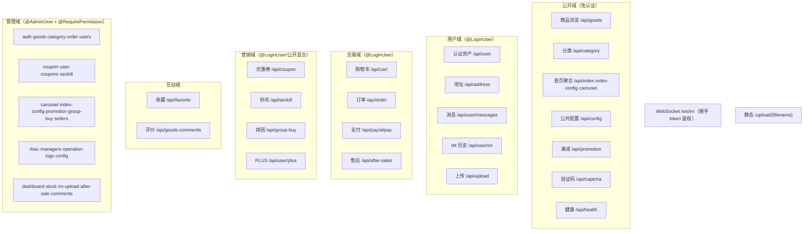

# 15 接口全量参考
> 项目：xyMall ｜ 版本：v1.1 ｜ 生成日期：2026-10-06 ｜ 依据：源码分析

本文是后端**全部端点**的速查体例：51 个 Controller（含 WebSocket 端点与静态资源映射）按业务域分组，每端点给出方法、路径、用途、关键入参、响应 data、鉴权要求。全局约定与错误码契约见第 1、2 节（所有端点共用，分组表内不再重复）；《03-接口设计》讲契约背后的设计意图与示例报文，本文讲"查得到、对得上"，两篇互补。端点清单从 `xy-mall/server/src/main/java/com/xiaoye/mall/server/modules/**/controller/` 逐文件提取并经注解核对。

## 1. 业务域总览

## 2. 全局约定（适用于所有端点）

- **统一响应** `R{code, message, data}`：成功 `code=200, message="success"`；业务失败 code 400/401/500 等。
- **HTTP 状态映射**（`GlobalExceptionHandler`）：BizException 携带 401/400 时透出对应 HTTP 状态；其余业务错误 HTTP 200 由 body code 区分；路径不存在 HTTP 404；方法不支持 HTTP 405；全局限流 HTTP 429。
- **认证**：请求头 `Authorization: Bearer <token>`。鉴权列缩写：`公开`=无需 token；`登录`=用户 token（`@LoginUser`，四重校验）；`管理员`=管理 token（`@AdminUser`）；`权限(x:y)`=管理 token + `@RequirePermission("x:y")`（写操作均异步落审计日志）。
- **分页**：`pageNum` 默认 1、`pageSize` 默认 10（服务端 clamp 上限 100），响应 `IPage{records,total,size,current}`。
- **金额**：分（INT）。**时间**：ISO `yyyy-MM-ddTHH:mm:ss`（格式错误报 code 400"请求体格式错误…"）。
- **幂等**：`POST /api/order` 支持 `X-Idempotency-Key` 头，24h 内重放返回首次订单号。

**全局错误码表**：

| HTTP | body code | 触发 | 典型 message |
| --- | --- | --- | --- |
| 200 | 200 | 成功 | success |
| 401 | 401 | 未登录/token 失效/锁定/会话版本不符 | 请先登录 / 登录已失效，请重新登录 / 登录已过期 / 无效的登录凭证 / 账号已被锁定，请联系客服 |
| 400 | 400 | 参数校验失败（Validation/JSON 解析/IllegalArgumentException） | 取第一条字段错误 / 请求体格式错误… / 参数错误 |
| 200 | 400 | 业务校验失败（显式 BizException(400)） | 如"商品库存不足，下单失败" |
| 200 | 500 | 业务规则失败/系统异常 | 具体中文文案 / 系统繁忙，请稍后再试 |
| 200 | 自定义 | 接口级限流（429 语义经 body 透出） | 下单过于频繁，请稍后再试 |
| 429 | 429 | 全局 IP 限流（300 次/分） | 请求过于频繁，请稍后再试 |
| 404 | 404 | 路径/静态资源不存在 | 资源不存在 |
| 405 | 405 | HTTP 方法不匹配 | 请求方法不支持 |

## 3. 认证与用户域

本域回答"你是谁、你的东西有哪些"。三条主线：验证码与账号生命周期（3.1）是全站流量的第一道闸，注册与登录都强制验证码，登录失败计数与锁定在最前面拦截爆破；用户资产与足迹（3.2）把余额/积分/签到/数据导出/浏览足迹五个自助能力收拢在一个 Controller，所有资产接口的共同形态是"查询带流水、变更有开关"（充值受 `recharge-enabled`、签到受生成列唯一键约束）；PLUS 与站内信（3.3）以及收货地址（3.4）是用户域的两个外围——PLUS 是唯一"花钱买折扣"的会员入口，地址则是下单链路的前置数据。

### 3.1 验证码与用户账户（CaptchaController / UserController）

| 方法 | 路径 | 用途 | 关键入参 | 响应 data | 鉴权 |
| --- | --- | --- | --- | --- | --- |
| GET | `/api/captcha` | 图形验证码（一次性，登录注册均需） | - | `{captchaToken, captchaImage}` | 公开 |
| POST | `/api/user/register` | 注册（唯一索引兜底 + 注册赠券/赠余额） | `{loginName, password, nickName?, captchaToken, captchaCode}` | UserLoginVO（含 token） | 公开 |
| POST | `/api/user/login` | 登录（失败 5 次锁 15 分钟） | `{loginName, password, captchaToken, captchaCode}` | UserLoginVO | 公开 |
| GET | `/api/user/info` | 当前用户信息（含余额/积分/成长值） | - | UserVO | 登录 |
| PUT | `/api/user/info` | 修改资料 | `{nickName, mobile?, email?...}` | - | 登录 |
| PUT | `/api/user/password` | 改密（成功后 token_version+1 全端失效） | `{oldPassword, newPassword}` | - | 登录 |
| POST | `/api/user/logout` | 登出（token 入黑名单） | Header token | - | 登录 |
| POST | `/api/user/deactivate` | 注销（验密码，资产清零写流水） | `{password}` | - | 登录 |

典型错误：该登录名已被注册 / 登录名或密码错误 / 登录失败次数过多，请 N 分钟后再试 / 验证码错误或已过期 / 原密码错误 / 新密码长度至少 6 位 / 密码不正确。

### 3.2 用户资产与足迹（UserAssetController）

| 方法 | 路径 | 用途 | 关键入参 | 响应 data | 鉴权 |
| --- | --- | --- | --- | --- | --- |
| GET | `/api/user/balance` | 余额 + 流水分页 | `pageNum?, pageSize?` | `{balance, logs[]}` | 登录 |
| POST | `/api/user/balance/recharge` | 余额充值（`recharge-enabled` 开关 fail-closed） | `amount` | 充值后余额 | 登录 |
| GET | `/api/user/points` | 积分 + 流水（含 signedToday） | - | `{points, signedToday, logs[]}` | 登录 |
| POST | `/api/user/points/sign` | 每日签到（生成列唯一键防重） | - | 签到后积分 | 登录 |
| GET | `/api/user/data-export` | 个人数据导出（CSV blob） | - | 文件流 | 登录 |
| POST | `/api/user/footprint/{goodsId}` | 记录浏览足迹 | 路径 goodsId | - | 登录 |
| GET | `/api/user/footprint` | 足迹列表（分页） | `pageNum?, pageSize?` | IPage | 登录 |

典型错误：今日已签到 / 充值通道未开放，请通过真实支付方式完成充值 / 充值金额不合法。

### 3.3 PLUS 与消息（UserPlusController / UserMessageController）

| 方法 | 路径 | 用途 | 关键入参 | 响应 data | 鉴权 |
| --- | --- | --- | --- | --- | --- |
| GET | `/api/user/plus` | PLUS 会员状态 | - | `{active, expireTime,...}` | 登录 |
| POST | `/api/user/plus/purchase` | 购买/续费 PLUS（余额扣款） | - | 最新状态 | 登录 |
| GET | `/api/user/messages` | 站内信分页 | `type?, pageNum?, pageSize?` | IPage | 登录 |
| GET | `/api/user/messages/unread-count` | 未读数 | - | int | 登录 |
| PUT | `/api/user/messages/{id}/read` | 单条已读 | 路径 id | - | 登录 |
| PUT | `/api/user/messages/read-all` | 全部已读 | - | - | 登录 |

### 3.4 收货地址（AddressController，`/api/address`）

| 方法 | 路径 | 用途 | 关键入参 | 鉴权 |
| --- | --- | --- | --- | --- |
| GET | `/list` | 地址列表 | - | 登录 |
| GET | `/{addressId}` | 地址详情（校验归属） | 路径 addressId | 登录 |
| POST | `/` | 新增（上限 20 条） | `{userName, userPhone, provinceName, cityName, regionName, detailAddress, isDefault?}` | 登录 |
| PUT | `/{addressId}` | 修改 | 同上 | 登录 |
| DELETE | `/{addressId}` | 删除 | 路径 addressId | 登录 |

典型错误：收货地址不存在或不属于当前用户 / 收货地址最多 20 条，请先删除不需要的地址。

## 4. 交易域

交易域是全系统正确性要求最高的四个模块，接口设计上有三个一以贯之的特征：**归属校验先行**（订单/地址/售后/购物车行的每个读写在 Service 层第一步都校验"资源属于当前用户"，越权请求得到的是"不存在或不属于当前用户"而非数据）；**状态机兜底**（订单与售后的每次流转都先问 `OrderStateMachine.canTransit` 再做 CAS 条件更新，并发冲突统一报"状态已变更，请刷新后重试"）；**入口限流**（下单 10 次/60 秒、模拟支付、支付宝创建/回调各有独立阈值）。使用本域接口时务必理解"响应 data 为订单号字符串"这类轻量契约——订单的完整视图永远通过 detail 接口二次获取。

### 4.1 购物车（CartController，`/api/cart`）

| 方法 | 路径 | 用途 | 关键入参 | 响应 data | 鉴权 |
| --- | --- | --- | --- | --- | --- |
| GET | `/list` | 我的购物车（带商品快照） | - | `CartItemVO[]` | 登录 |
| GET | `/settle` | 结算行试算（按 cartItemIds） | `ids`（逗号分隔） | `SettleVO[]` | 登录 |
| POST | `/` | 加购（唯一键去重，重复累加） | `{goodsId, goodsCount, skuId?}` | - | 登录 |
| PUT | `/{cartItemId}` | 修改数量 | `{goodsCount}` | - | 登录 |
| DELETE | `/{cartItemId}` | 删除购物项 | 路径 cartItemId | - | 登录 |

典型错误：商品不存在或已下架 / 购物车项不存在 / 加入购物车失败，请重试。

### 4.2 订单（OrderController，`/api/order`）

| 方法 | 路径 | 用途 | 关键入参 | 响应 data | 鉴权 |
| --- | --- | --- | --- | --- | --- |
| POST | `/` | 下单（限流 10/60s；幂等头可选） | Body `SaveOrderContext{cartItemIds[], addressId, userCouponId?, usePoints?, remark?, invoiceType?, invoiceTitle?, invoiceTaxNo?, groupBuyId?, teamId?}`；Header `X-Idempotency-Key?` | 订单号 string | 登录 |
| GET | `/list` | 订单分页 | `orderStatus?, pageNum?, pageSize?` | IPage\<OrderVO\> | 登录 |
| GET | `/detail/{orderNo}` | 详情（含 items/payDeadline；惰性触发超时关单） | 路径 orderNo | OrderVO | 登录 |
| GET | `/logistics/{orderNo}` | 物流轨迹（演示数据） | 路径 orderNo | `OrderLogistics[]` | 登录 |
| PUT | `/{orderNo}/cancel` | 取消（回补库存/券/积分） | 路径 orderNo | - | 登录 |
| PUT | `/{orderNo}/finish` | 确认收货 | 路径 orderNo | - | 登录 |
| POST | `/paySuccess` | 模拟支付（mock 开关 fail-closed） | `orderNo, payType` | - | 登录 |

典型错误：订单不存在 / 订单当前状态不可支付 / 订单状态已变更，请刷新后重试 / 商品库存不足，下单失败 / 没有可结算的购物车商品 / 请选择收货地址 / 支付通道未开放，请通过收银台完成支付 / 下单繁忙，请重试。

### 4.3 支付（PayController，`/api/pay/alipay`）

| 方法 | 路径 | 用途 | 关键入参 | 响应 data | 鉴权 |
| --- | --- | --- | --- | --- | --- |
| POST | `/create` | 创建支付（校验归属与状态；限流 10/60s） | `orderNo` | 跳转所需信息 | 登录 |
| GET | `/page` | 收银台自动提交表单（整页跳转） | `orderNo` | HTML form | 登录 |
| GET | `/return` | 同步回跳：验签 + 查单确认后 302 回商城 | 支付宝回跳参数 | 302 | 公开（验签保护） |
| POST | `/notify` | 异步回调：RSA2 验签 + 幂等确认（限流 60/60s） | 支付宝回调参数 | 文本 `success` | 公开（验签保护） |

典型错误：支付宝支付未配置（缺少 APPID/密钥）/ 支付宝签名验证失败 / 回调金额与订单不一致 / 支付宝下单失败，请稍后重试。

### 4.4 售后（UserAfterSaleController / AdminAfterSaleController）

| 方法 | 路径 | 用途 | 关键入参 | 响应 data | 鉴权 |
| --- | --- | --- | --- | --- | --- |
| POST | `/api/after-sales` | 发起售后（一单一条，refund_amount=实付） | `{orderNo, reason}` | AfterSale | 登录 |
| GET | `/api/after-sales` | 我的售后列表 | - | `AfterSale[]` | 登录 |
| GET | `/api/admin/after-sale/page` | 售后分页 | `status?, pageNum?, pageSize?` | IPage | 权限(order:flow) |
| PUT | `/api/admin/after-sale/{afterSaleId}/handle` | 审核：1 同意（退款至余额+关单）/ 2 驳回 | `status, remark?` | - | 权限(order:flow) |

典型错误：该订单已提交过售后申请 / 当前订单状态不可申请售后 / 申请状态已变更，请刷新后重试 / 处理备注不能超过 200 字。

## 5. 商品与内容域（公开）

本域 14 个端点承担商城的全部"逛"流量，无认证要求，QPS 占全站八成以上。两个使用要点：其一，列表与搜索接口的筛选参数完全同构（分类/品牌/价格区间/排序/分页），`search` 只是多了 keyword 并可能走 ES 相关度排序——前端把两个接口做成同一数据源切换即可；其二，`detail` 接口背后是 10 分钟对象缓存 + 60 秒空值缓存 + 延迟双删的完整缓存体系（《10-性能设计与优化》2.1），因此"刚上架的商品 404"通常是空值缓存窗口而非 bug，重试或触发后台编辑即可消除。

| 方法 | 路径 | 用途 | 关键入参 | 响应 data | 鉴权 |
| --- | --- | --- | --- | --- | --- |
| GET | `/api/goods/list` | 商品分页（分类含子孙/品牌/价格/排序） | `goodsCategoryId?, brand?, keyword?, minPrice?, maxPrice?, sort?, pageNum?, pageSize?` | IPage\<GoodsVO\> | 公开 |
| GET | `/api/goods/search` | 搜索（ES 可用优先，回落 like；记录 search_log） | `keyword?, 同上筛选` | IPage\<GoodsVO\> | 公开 |
| GET | `/api/goods/suggest` | 搜索联想词 | `keyword` | `string[]` | 公开 |
| GET | `/api/goods/top` | 热卖榜 | `limit?`（默认 8，≤50） | `TopGoodsVO[]` | 公开 |
| GET | `/api/goods/brands` | 在售品牌去重 | - | `string[]` | 公开 |
| GET | `/api/goods/also-viewed` | 看完又看 | `goodsId, limit?` | `GoodsVO[]` | 公开 |
| GET | `/api/goods/detail/{goodsId}` | 详情（缓存 10min/空值 60s/双删） | 路径 goodsId | GoodsVO（含 skus） | 公开 |
| GET | `/api/category/list` | 三级分类树 | - | 树形 VO | 公开 |
| GET | `/api/index/info` | 首页聚合（轮播+楼层+热搜词） | - | IndexInfoVO | 公开 |
| GET | `/api/index-config/list` | 楼层配置列表 | `configType`（1 热销 2 新品 3 推荐） | `IndexConfig[]` | 公开 |
| GET | `/api/carousel/list` | 轮播图 | - | `CarouselVO[]` | 公开 |
| GET | `/api/config/public` | 公开运营配置（运费/积分/热搜/装修/mock 开关） | - | Map | 公开 |
| GET | `/api/promotion/active` | 生效中满减活动 | - | `PromotionFull[]` | 公开 |
| GET | `/api/health` | 健康检查（免限流） | - | - | 公开 |

典型错误：商品不存在或已下架（命中空值缓存时同样返回）。

## 6. 营销域

营销域的接口契约围绕"资格与限额"展开：领券受 `receive_seq` 唯一键与限领数双重约束、抢购受限流+分布式锁+Lua 预扣+DB 条件扣减四级漏斗保护、参团受 `(team_id, user_id)` 唯一键约束。调用方应把"失败响应"当作正常业务结果处理（前端对 grab 的失败分支要有专门的 UI 态，参考 `SeckillView.vue` 的"已抢完"角标），而不是当作异常。秒杀的两个查询接口（list/server-time）刻意与 grab 分离，前者公开供列表页渲染，后者专门为倒计时对时设计——倒计时一律以服务端时间为基准，勿用客户端时钟。

### 6.1 优惠券（CouponController，`/api/coupon`）

| 方法 | 路径 | 用途 | 关键入参 | 响应 data | 鉴权 |
| --- | --- | --- | --- | --- | --- |
| GET | `/list` | 可领券列表 | - | `CouponVO[]` | 公开 |
| POST | `/{couponId}/receive` | 领券（receive_seq 唯一防超领） | 路径 couponId | - | 登录 |
| POST | `/exchange` | 兑换码换券 | `{couponCode}` | - | 登录 |
| GET | `/mine` | 我的券 | `useStatus?` | `UserCouponVO[]` | 登录 |
| POST | `/usable` | 结算可用券试算 | Body `cartItemIds[]` | 可用券及优惠额 | 登录 |

典型错误：优惠券已领完 / 已达该优惠券领取上限 / 兑换码无效 / 未满足优惠券最低消费金额 / 优惠券不适用于当前商品 / 优惠券不在领取时间范围内 / 优惠券状态已变更，请刷新后重试。

### 6.2 秒杀与拼团（SeckillController / GroupBuyController）

| 方法 | 路径 | 用途 | 关键入参 | 响应 data | 鉴权 |
| --- | --- | --- | --- | --- | --- |
| GET | `/api/seckill/list` | 进行中场次列表 | - | `SeckillVO[]` | 公开 |
| GET | `/api/seckill/server-time` | 服务端时间（倒计时对时） | - | 毫秒时间戳 | 公开 |
| POST | `/api/seckill/{seckillId}/grab` | 抢购（限流 USER 5/2s + 分布式锁 + Lua 预扣 + DB 权威） | 路径 seckillId | 秒杀订单号 string | 登录 |
| GET | `/api/group-buy/list` | 拼团商品列表 | - | `GroupBuy[]` | 公开 |
| POST | `/api/group-buy/{buyId}/teams` | 开团 | 路径 buyId | teamId | 登录 |
| POST | `/api/group-buy/{buyId}/teams/{teamId}/join` | 参团 | 路径 buyId, teamId | - | 登录 |
| GET | `/api/group-buy/teams/{teamId}` | 队伍进度 | 路径 teamId | 队伍+成员 | 公开 |

典型错误：手慢了，该场次已抢完或已结束 / 该场次每人限抢一件 / 抢购繁忙，请重试 / 秒杀尚未开始（活动时间校验）/ 拼团活动不存在或已下架 / 你已加入该队伍 / 拼团尚未开始 / 拼团已结束 / 队伍不可加入。

## 7. 互动域与上传

互动域接口的共性是"轻写重读"：评价/收藏/点赞的写入都有一单一条、唯一键去重的硬约束，读侧则完全公开（评价列表与好评率是商品详情页的转化要素）。上传接口是全站唯一的多端点入口（用户态与后台各一个），共享同一条校验链——大小 5MB、扩展名白名单、内容级解码校验、服务端 UUID 重命名，返回的 URL 直接可存入商品主图/轮播/评价图字段，无需二次处理。

| 方法 | 路径 | 用途 | 关键入参 | 响应 data | 鉴权 |
| --- | --- | --- | --- | --- | --- |
| GET | `/api/favorite/list` | 我的收藏 | - | `UserFavorite[]` | 登录 |
| POST | `/api/favorite/{goodsId}/toggle` | 收藏/取消（在售校验+唯一键） | 路径 goodsId | boolean（是否已收藏） | 登录 |
| DELETE | `/api/favorite/{goodsId}` | 取消收藏 | 路径 goodsId | - | 登录 |
| GET | `/api/goods-comments` | 商品评价列表 | `goodsId, pageNum?, pageSize?` | IPage\<CommentVO\> | 公开 |
| GET | `/api/goods-comments/page` | 评价分页（同上） | 同上 | IPage | 公开 |
| GET | `/api/goods-comments/summary` | 好评率汇总 | `goodsId` | `{total, goodRate,...}` | 公开 |
| POST | `/api/goods-comments` | 发表评价（校验订单归属与已完成） | `{orderId/orderNo, goodsId, content, score?}` | - | 登录 |
| POST | `/api/goods-comments/{commentId}/append` | 追评（一次，≤500 字） | `{content}` | - | 登录 |
| POST | `/api/goods-comments/{commentId}/like` | 点赞（comment_like 去重） | 路径 commentId | - | 登录 |
| POST | `/api/upload` | 用户上传图片（限流防刷；5MB/白名单/内容级校验） | multipart `file` | 图片 URL string | 登录 |
| GET | `/upload/{filename}` | 静态图片访问（本地回落目录） | 路径 filename | 图片流 | 公开 |

典型错误：已收藏，请刷新 / 该商品已评价过了 / 追评内容不能为空 / 追评内容不能超过 500 字 / 已点赞 / 文件为空 / 文件大小不能超过 5MB / 仅支持 jpg/jpeg/png/gif/webp 格式图片 / 仅支持上传图片文件 / 上传太频繁，请稍后再试。

## 8. 管理端：认证与账号体系

管理端所有接口走 `/api/admin` 前缀，认证体系与用户端平行但隔离（token subject 带 `admin:` 前缀，同一密钥签发但主体空间不同）。本节三个 Controller 构成后台的"控制面"：登录认证带 IP 白名单（8.1）、RBAC 与管理员账号（8.2）决定"谁能用什么"、审计与运营配置（8.3）负责"事后可查、参数可调"。权限点在三个层位生效——路由守卫（前端）、`@RequirePermission` 切面（后端）、审计落库（旁路），三者使用同一套 `module:action` 命名，见 8.2 表格的权限列。

### 8.1 管理员认证（AdminAuthController，`/api/admin`）

| 方法 | 路径 | 用途 | 关键入参 | 响应 data | 鉴权 |
| --- | --- | --- | --- | --- | --- |
| POST | `/login` | 管理员登录（先过 IP 白名单） | `{loginUserName, loginPassword, captchaToken, captchaCode}` | `{token, nickName}` | 公开 |
| POST | `/logout` | 登出 | Header token | - | 管理员 |
| GET | `/profile` | 当前管理员（roleCodes+perms 快照） | - | `{nickName, roleCodes[], perms[]}` | 管理员 |
| PUT | `/password` | 改密（token_version+1 强制重登） | `{oldPassword, newPassword}` | - | 管理员 |
| PUT | `/name` | 修改登录名/昵称 | `{loginUserName?, nickName?}` | - | 管理员 |

典型错误：用户名或密码错误 / 无管理员权限 / 该登录名已存在。

### 8.2 RBAC 与管理员账号（AdminRbacController / AdminManagerController）

| 方法 | 路径 | 用途 | 关键入参 | 鉴权 |
| --- | --- | --- | --- | --- |
| GET | `/api/admin/rbac/roles` | 角色列表 | - | 权限(admin:role) |
| POST | `/api/admin/rbac/roles` | 新建角色 | `{roleName, roleCode, remark?}` | 权限(admin:role) |
| PUT | `/api/admin/rbac/roles/{roleId}` | 修改角色 | 同上 | 权限(admin:role) |
| DELETE | `/api/admin/rbac/roles/{roleId}` | 删除角色 | 路径 roleId | 权限(admin:role) |
| GET | `/api/admin/rbac/permissions` | 权限点全量 | - | 权限(admin:role) |
| GET | `/api/admin/rbac/roles/{roleId}/permission-ids` | 角色已授权限 ID | 路径 roleId | 权限(admin:role) |
| PUT | `/api/admin/rbac/roles/{roleId}/permissions` | 分配权限点 | Body `permissionIds[]` | 权限(admin:role) |
| GET | `/api/admin/managers/page` | 管理员分页 | `loginUserName?, pageNum?, pageSize?` | 权限(admin:manager) |
| POST | `/api/admin/managers` | 新建管理员 | `{loginUserName, loginPassword, nickName?, roleId}` | 权限(admin:manager) |
| POST | `/api/admin/managers/migrate-md5` | 存量口令懒迁移 BCrypt | - | 权限(admin:manager) |
| PUT | `/api/admin/managers/{managerId}` | 修改（昵称/角色/锁定） | 路径 managerId | 权限(admin:manager) |
| PUT | `/api/admin/managers/{managerId}/password` | 重置密码（对方 token 全失效） | `{newPassword}` | 权限(admin:manager) |
| DELETE | `/api/admin/managers/{managerId}` | 删除管理员 | 路径 managerId | 权限(admin:manager) |

典型错误：角色不存在 / 超级管理员角色不可删除 / 超级管理员无需分配权限 / 不能修改自己的角色或锁定自己 / 不能删除当前登录账号 / 超级管理员账号不可删除。

### 8.3 审计与配置（AdminOperationLogController / AdminConfigController）

| 方法 | 路径 | 用途 | 关键入参 | 响应 data | 鉴权 |
| --- | --- | --- | --- | --- | --- |
| GET | `/api/admin/operation-logs/page` | 审计日志分页（入参已脱敏） | `module?, adminName?, success?, pageNum?, pageSize?` | IPage | 权限(log:list) |
| GET | `/api/admin/config/list` | sys_config 全量 | - | `SysConfig[]` | 权限(config:list) |
| PUT | `/api/admin/config` | 改配置值（进程缓存即写即失效） | `{configKey, configValue}` | - | 权限(config:list) |

典型错误：配置项不存在：{key} / 请选择配置。

## 9. 管理端：商品·分类·库存

| 方法 | 路径 | 用途 | 关键入参 | 响应 data | 鉴权 |
| --- | --- | --- | --- | --- | --- |
| GET | `/api/admin/goods/page` | 商品分页（含下架） | `keyword?, goodsCategoryId?, goodsSellStatus?, pageNum?, pageSize?` | IPage | 权限(goods:list) |
| GET | `/api/admin/goods/{goodsId}` | 商品详情（含富文本） | 路径 goodsId | GoodsVO | 权限(goods:list) |
| GET | `/api/admin/goods/{goodsId}/skus` | SKU 列表 | 路径 goodsId | `GoodsSkuVO[]` | 权限(goods:list) |
| POST | `/api/admin/goods` | 新增（SKU 聚合回写主表；ES 同步） | Goods + `skus[]` | goodsId | 权限(goods:create) |
| PUT | `/api/admin/goods/{goodsId}` | 编辑（replaceSkus 兼容；缓存双删） | 同上 | - | 权限(goods:update) |
| DELETE | `/api/admin/goods/{goodsId}` | 软删 + 联动清购物车/楼层/SKU | 路径 goodsId | - | 权限(goods:delete) |
| GET | `/api/admin/goods/export` | CSV 导出（≤1 万行，UTF-8 BOM） | 同 page 筛选 | 文件流 | 权限(goods:list) |
| PUT | `/api/admin/goods/batch-status` | 批量上下架 | `{goodsIds[], goodsSellStatus}` | - | 权限(goods:status) |
| GET | `/api/admin/category/page` | 分类分页 | `categoryLevel?, parentId?, pageNum?, pageSize?` | IPage | 权限(category:update) |
| GET | `/api/admin/category/options` | 级联下拉数据 | - | 树/列表 | 权限(category:update) |
| POST | `/api/admin/category` | 新增分类 | `{categoryLevel, parentId?, categoryName, categoryRank?}` | categoryId | 权限(category:update) |
| PUT | `/api/admin/category/{categoryId}` | 修改分类 | 同上 | - | 权限(category:update) |
| DELETE | `/api/admin/category/{categoryId}` | 删除（有商品/子级时拒绝） | 路径 categoryId | - | 权限(category:update) |
| DELETE | `/api/admin/category/batch` | 批量删除 | Body `categoryIds[]` | - | 权限(category:update) |
| GET | `/api/admin/stock/alerts` | 低库存清单（主表+SKU） | `limit?`（默认 50，≤200） | `Map[]` | 权限(goods:list) |

注意：库存流水（`stock_log`）只有写入无查询端点，`/api/admin/stock-log/page` 在部分旧文档中出现但**当前代码不存在**（后端无 StockLogController，前端三端亦无调用，纯文档债；《13-技术债务与演进建议》D11）。

## 10. 管理端：订单·包裹·物流

| 方法 | 路径 | 用途 | 关键入参 | 响应 data | 鉴权 |
| --- | --- | --- | --- | --- | --- |
| GET | `/api/admin/order/page` | 订单分页（多条件） | `orderNo?, userId?, orderStatus?, 时间区间?, pageNum?, pageSize?` | IPage | 权限(order:list) |
| GET | `/api/admin/order/export` | 订单 CSV 导出 | 同上 | 文件流 | 权限(order:list) |
| GET | `/api/admin/order/{orderId}/detail` | 订单详情（含 items） | 路径 orderId | OrderVO | 权限(order:list) |
| PUT | `/api/admin/order/{orderId}/status` | 状态流转（状态机判定） | `{targetStatus}` | - | 权限(order:flow) |
| PUT | `/api/admin/order/batch-status` | 批量流转（非法状态跳过） | `{orderIds[], targetStatus}` | 成功数 | 权限(order:flow) |
| GET | `/api/admin/order/{orderId}/logistics` | 查物流轨迹 | 路径 orderId | `OrderLogistics[]` | 权限(order:list) |
| POST | `/api/admin/order/{orderId}/logistics` | 补写轨迹节点 | `{title, detail?}` | - | 权限(order:flow) |
| PUT | `/api/admin/order/{orderId}/express` | 录入快递单号 | `{expressCompany, expressNo}` | - | 权限(order:flow) |
| GET | `/api/admin/order/{orderId}/packages` | 查拆单包裹 | 路径 orderId | `OrderPackage[]` | 权限(order:list) |
| POST | `/api/admin/order/{orderId}/packages` | 创建包裹（拆单演示） | `{items[]?}` | packageId | 权限(order:flow) |
| PUT | `/api/admin/order/packages/{packageId}/ship` | 包裹发货 | `{expressCompany, expressNo?}` | - | 权限(order:flow) |

典型错误：不支持将订单置为目标状态 / 所选订单当前状态均不可流转为目标状态 / 轨迹标题不能为空 / 包裹不存在 / 包裹已发货。

## 11. 管理端：用户·资产·券·秒杀·营销内容

| 方法 | 路径 | 用途 | 关键入参 | 鉴权 |
| --- | --- | --- | --- | --- |
| GET | `/api/admin/users/page` | 用户分页 | `loginName?, nickName?, lockedFlag?, pageNum?, pageSize?` | 权限(user:list) |
| GET | `/api/admin/users/{userId}/detail` | 用户详情 | 路径 userId | 权限(user:list) |
| GET | `/api/admin/users/{userId}/assets` | 余额/积分概览 | 路径 userId | 权限(user:list) |
| PUT | `/api/admin/users/{userId}/lock` | 锁定/解禁 | `{lockedFlag}` | 权限(user:lock) |
| PUT | `/api/admin/users/{userId}/password` | 重置密码 | `{newPassword}` | 权限(user:lock) |
| POST | `/api/admin/users/{userId}/balance/adjust` | 余额调整（写流水） | `{change, reason}` | 权限(user:lock) |
| POST | `/api/admin/users/{userId}/points/adjust` | 积分调整（写流水） | `{change, reason}` | 权限(user:lock) |
| GET | `/api/admin/users/export` | 用户 CSV 导出 | 同 page 筛选 | 权限(user:list) |
| GET | `/api/admin/coupon/page` | 券定义分页 | `couponName?, couponStatus?, pageNum?, pageSize?` | 权限(coupon:update) |
| POST | `/api/admin/coupon` | 新建券 | `{couponName, discount, minAmount, couponLimit, couponType, goodsType, goodsValue?, 起止时间...}` | 权限(coupon:update) |
| PUT | `/api/admin/coupon/{couponId}` | 编辑券 | 同上 | 权限(coupon:update) |
| PUT | `/api/admin/coupon/{couponId}/status` | 上下架/过期 | `{couponStatus}` | 权限(coupon:update) |
| DELETE | `/api/admin/coupon/{couponId}` | 删除券 | 路径 couponId | 权限(coupon:update) |
| GET | `/api/admin/user-coupons/page` | 用户持券分页 | `userId?, useStatus?, pageNum?, pageSize?` | 权限(coupon:update) |
| PUT | `/api/admin/user-coupons/{userCouponId}/void` | 作废持券（仅未使用） | 路径 userCouponId | 权限(coupon:update) |
| POST | `/api/admin/user-coupons/grant` | 补发券 | `{userId, couponId}` | 权限(coupon:update) |
| GET | `/api/admin/seckill/page` | 秒杀场次分页 | - | 权限(seckill:update) |
| POST | `/api/admin/seckill` | 新建场次（预热 Redis 库存） | `{goodsId, seckillPrice, seckillTotal, 起止时间}` | seckillId | 权限(seckill:update) |
| PUT | `/api/admin/seckill/{seckillId}` | 编辑（已开始禁改价/量/时间） | 同上 | - | 权限(seckill:update) |
| PUT | `/api/admin/seckill/{seckillId}/status` | 上下架（联动 evict） | `{seckillStatus}` | - | 权限(seckill:update) |
| DELETE | `/api/admin/seckill/{seckillId}` | 删除场次 | 路径 seckillId | - | 权限(seckill:update) |
| GET | `/api/admin/promotion/page` | 满减活动分页 | - | 权限(promotion:list) |
| POST | `/api/admin/promotion` | 新建满减 | `{threshold, discount, 起止时间...}` | - | 权限(promotion:list) |
| PUT | `/api/admin/promotion/{id}` | 编辑满减 | 同上 | 权限(promotion:list) |
| DELETE | `/api/admin/promotion/{id}` | 删除满减 | 路径 id | 权限(promotion:list) |
| GET | `/api/admin/group-buy/page` | 拼团商品分页 | - | 权限(groupbuy:list) |
| POST | `/api/admin/group-buy` | 新建拼团商品 | `{goodsId, 拼团价, 成团人数, 有效期...}` | - | 权限(groupbuy:list) |
| PUT | `/api/admin/group-buy/{id}` | 编辑拼团 | 同上 | 权限(groupbuy:list) |
| GET | `/api/admin/sellers/page` | 卖家分页 | `sellerName?, pageNum?, pageSize?` | 权限(seller:list) |
| GET | `/api/admin/sellers/all` | 卖家全量（下拉） | - | 权限(seller:list) |
| POST | `/api/admin/sellers` | 新建/入驻登记 | `{sellerName, ...}` | - | 权限(seller:list) |
| PUT | `/api/admin/sellers/{id}` | 编辑卖家 | 同上 | 权限(seller:list) |
| DELETE | `/api/admin/sellers/{id}` | 删除卖家 | 路径 id | 权限(seller:list) |
| GET | `/api/admin/carousel/page` | 轮播分页 | - | 权限(carousel:update) |
| POST | `/api/admin/carousel` | 新建轮播 | `{carouselUrl, linkUrl?, rank?}` | - | 权限(carousel:update) |
| PUT | `/api/admin/carousel/{carouselId}` | 编辑轮播 | 同上 | 权限(carousel:update) |
| DELETE | `/api/admin/carousel/{carouselId}` | 删除轮播 | 路径 carouselId | - | 权限(carousel:update) |
| DELETE | `/api/admin/carousel/batch` | 批量删除 | Body `carouselIds[]` | - | 权限(carousel:update) |
| GET | `/api/admin/index-config/page` | 楼层配置分页 | `configType?` | IPage | 权限(index-config:update) |
| POST | `/api/admin/index-config` | 新增楼层项 | `{configType, goodsId, rank?}` | - | 权限(index-config:update) |
| PUT | `/api/admin/index-config/{configId}` | 编辑楼层项 | 同上 | 权限(index-config:update) |
| DELETE | `/api/admin/index-config/{configId}` | 删除楼层项 | 路径 configId | - | 权限(index-config:update) |
| DELETE | `/api/admin/index-config/batch` | 批量删除 | Body `configIds[]` | - | 权限(index-config:update) |
| GET | `/api/admin/comments/page` | 评价分页 | `goodsId?, pageNum?, pageSize?` | IPage | 权限(comment:list) |
| DELETE | `/api/admin/comments/{commentId}` | 删除评价 | 路径 commentId | - | 权限(comment:list) |

典型错误（资产调整）：调整量不能为空 / 调整量不能为 0 / 调整后余额不能为负数 / 调整后积分不能为负数 / 调整失败：当前余额不足 / 调整失败：当前积分不足；（秒杀）活动已开始，秒杀价/数量/时间不可修改，仅允许修改排序与状态；（券）持券记录不存在 / 仅未使用的券可作废 / 折扣券暂不支持限定分类/商品范围（goodsValue 字段语义冲突）。

## 12. 管理端：仪表盘·IM·上传

| 方法 | 路径 | 用途 | 关键入参 | 响应 data | 鉴权 |
| --- | --- | --- | --- | --- | --- |
| GET | `/api/admin/dashboard/stats` | 核心指标卡（销售额/订单/用户等） | `days?` | Map | 管理员 |
| GET | `/api/admin/dashboard/trend` | 经营趋势（折线） | `days?` | 序列 | 管理员 |
| GET | `/api/admin/dashboard/top-searches` | 热搜词 TOP | `limit?` | `Map[]` | 管理员 |
| GET | `/api/admin/dashboard/operate` | 运营概览 | - | Map | 管理员 |
| POST | `/api/admin/im/send` | 客服发消息（落库 + WS 推送） | `{toUserId, content}` | - | 管理员 |
| GET | `/api/admin/im/history` | 与指定用户的历史 | `userId, pageNum?, pageSize?` | IPage | 管理员 |
| GET | `/api/admin/im/sessions` | 会话列表（按最后消息） | - | `Map[]` | 管理员 |
| POST | `/api/admin/upload` | 后台图片上传（同用户态校验链） | multipart `file` | URL string | 权限(upload:image) |

## 13. WebSocket 与静态资源

| 协议 | 端点 | 用途 | 参数 | 鉴权 |
| --- | --- | --- | --- | --- |
| WebSocket | `/ws/im` | 客服 IM（用户↔管理员，历史落 `im_message`） | query：`role=user\|admin`、`token=<JWT>`；消息帧 `{"toUserId":1,"content":"..."}` | 握手四重校验（验签/黑名单/账号状态/会话版本）+ Origin 白名单（`localhost:*/127.0.0.1:*`，生产域名需追加） |
| HTTP GET | `/upload/{filename}` | 本地回落图片访问（`WebConfig` 静态映射工作目录 `upload/`） | 路径 filename | 公开（MinIO 就绪时图片 URL 直指 OSS，不走此端点） |

## 14. 端点统计与使用建议

按域统计：公开 16 个、用户域 21 个、交易域 14 个、营销域 8 个、互动域 7 个、管理域 75 个、WS/静态 2 个，合计约 143 个端点（以 `mvn spring-boot:run` 后 `/doc.html` 的实时分组为准）。数量分布本身就是一张架构画像：管理域端点数是用户域的三倍有余，说明这个系统"后台先于前台完整"，与它作为运营驱动的电商演示项目定位一致。

三种典型使用场景的推荐路径：**联调新页面**时，先在本文按业务域找到目标端点核对方法/入参/鉴权列，再到 `src/api/index.ts` 确认封装函数是否已存在（存在则复用，不存在按第 11 篇 SOP 二补齐）；**排错**时，用响应里的 message 原文到《12-FAQ与故障排查》反查条目，再回到本文核对该端点的"典型错误"清单确认是否为已知业务校验；**二次开发**时，新增端点除按 SOP 实现外，应同步维护本文对应域的表格行与"典型错误"清单，并检查前端三端 `api/index.ts` 是否需要联动——接口契约文档与代码的同步漂移是最常见的文档债（《13》D11/D15 即前车之鉴）。

版本演进的注意事项：本文与《03-接口设计》构成"速查 + 意图"的双层契约文档。未来任何破坏性变更（改路径、改入参语义、收紧鉴权）都应同时更新两篇并在变更处标注版本；非破坏性新增（新端点、新可选入参）只需更新本文。若启动 `docs/MICROSERVICE-SHARDING-PLAN.md` 的微服务化改造，本文的端点清单就是"前端零改动"约束的核对基准——路径契约不变是绞杀式迁移成立的前提。
