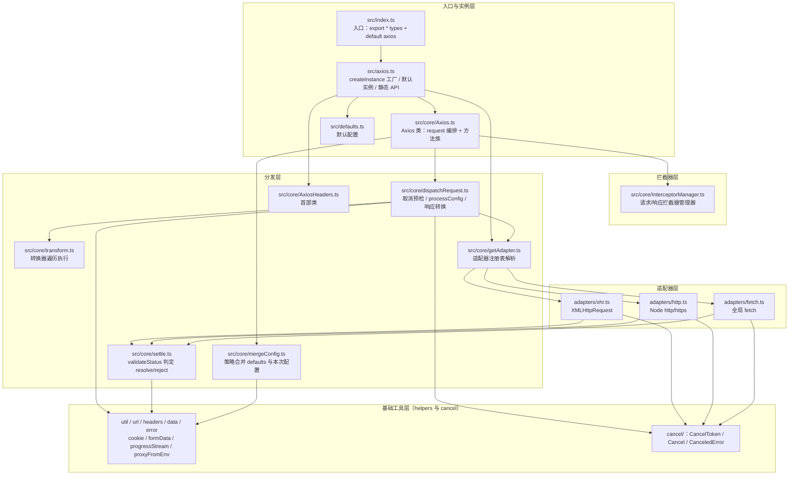
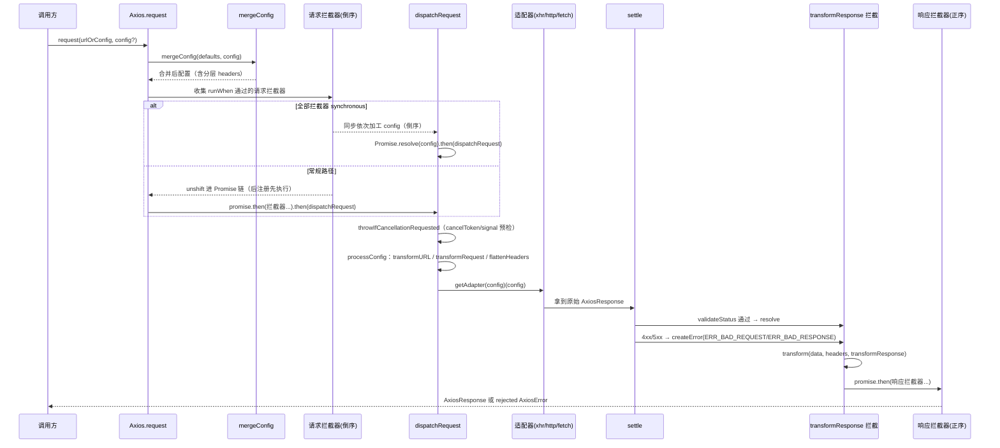

# 01-系统架构
> 项目：my-ts-axios ｜ 版本：v1.0 ｜ 生成日期：2026-10-06 ｜ 依据：源码分析

## 1. 总体分层架构

整个库在逻辑上分为五层：**入口与实例层、拦截器层、分发层、适配器层、基础工具层**。层间依赖严格自上而下，任何上层模块都不反向依赖下层调用方，这保证了"换适配器不影响链路编排、换拦截器不影响适配器"的可替换性。



这一分层在源码中由三条可验证的依赖规则支撑。规则一：`core/` 内任何模块都不 import `src/axios.ts`——`axios.ts` 是唯一依赖链路核心的模块而不是相反，因此 `axios.create()` 产出的每个实例都共享同一套 `core` 实现而无需继承。规则二：适配器模块的 import 面收敛于 `helpers/`、`cancel/`、`core/settle` 与 `types/`，三个适配器彼此之间零依赖，替换或新增一个适配器不会牵动其余两个。规则三：`helpers/` 全部是无状态纯函数（没有模块级可变缓存，`url.ts` 里仅有的两个模块级变量 `urlParsingNode`/`currentOrigin` 是浏览器 DOM 解析的性能缓存，且带惰性初始化守卫），这使它们可以在任意层被安全复用。理解了这三条规则，就能预判任何一处修改的影响半径。

各层职责一句话概括：

- **入口与实例层**：`src/index.ts` 只做两件事——`export * from './types'` 导出全部类型、`export default axios` 导出默认实例。`src/axios.ts` 用 `createInstance` 把 `Axios` 类实例"拍平"成一个既是函数、又带全套方法与静态属性的混合对象。
- **拦截器层**：`InterceptorManager` 是与请求链路完全解耦的有序容器，`Axios.request` 在每次请求时才读取它。
- **分发层**：`dispatchRequest` 是 Promise 链的"中心环节"，向前承接拦截器产出的合并后配置，向后调用 `getAdapter` 选出的适配器，并对响应做最后的 `transformResponse`。
- **适配器层**：三个适配器都实现同一签名 `(config) => AxiosPromise`，且共享 `settle` 完成 resolve/reject 判定。
- **基础工具层**：无状态的纯函数集合（`helpers/`）与取消机制（`cancel/`），被所有上层复用。

## 2. 一次请求到响应的完整数据流

下图是用户调用 `axios({ url, method, data })` 后，数据在系统中的完整流转路径（对应 `src/core/Axios.ts` 的 `request` 方法与 `src/core/dispatchRequest.ts`）。



一个常被追问的架构问题是：**为什么数据转换放在 `dispatchRequest` 而不是下沉到各适配器？** 答案在源码结构里显而易见：三个适配器对"什么算请求完成"的判定本就通过共享的 `settle` 收敛到了一处，若数据转换再各自实现一遍，`transitional.forcedJSONParsing` 这类横切语义就要维护三份。把"发请求前的最后一次加工"与"拿到响应后的第一次加工"都锚定在 `dispatchRequest`（`processConfig` 与 `transformResponseData`），使得默认转换器（`src/defaults.ts`）只需被 mergeConfig 合并一次、被 `transform.ts` 执行一处，用户自定义 `transformRequest`/`transformResponse` 也天然获得与内置转换器相同的执行时机与顺序语义。这是"横切关注点收敛到链路中层"这一决策的直接收益。

数据流有几个必须记住的"形态变换点"：

1. **配置合并在 `request` 入口立刻发生**（`Axios.ts` 第 51 行 `config = mergeConfig(this.defaults, config)`），此后链上流转的是单一配置对象，`method` 已被统一 `toLowerCase()`。
2. **URL 在 `processConfig` 中就变成最终形态**：`transformURL` 完成 `baseURL` 拼接（受 `allowAbsoluteUrls` 控制）与 `params` 序列化，适配器拿到的 `config.url` 已是完整 URL。
3. **`data` 在进入适配器前完成序列化**：默认 `transformRequest` 会把普通对象 `JSON.stringify`，并在显式声明 `multipart/form-data` 时把普通对象转成 FormData（`src/defaults.ts`）。
4. **headers 在进入适配器前被"拍平"**：`flattenHeaders` 把 `common` + `method` + 顶层三层合并为一个平面对象（`src/helpers/headers.ts`）。
5. **响应数据在 dispatchRequest 的 then 中做最后一次 `transformResponse`**；失败路径上，若错误携带 `response`，同样先转换 `e.response.data` 再继续 reject（`dispatchRequest.ts` 第 15~20 行），保证 4xx/5xx 时 `error.response.data` 也是解析后的对象。

## 3. 关键设计决策与设计模式

### 3.1 混合对象模式（函数即实例）

`src/axios.ts` 的 `createInstance` 是全库的基石：

```ts
function createInstance(config: AxiosRequestConfig): AxiosStatic {
  const context = new Axios(config)
  const instance = Axios.prototype.request.bind(context)
  extend(instance, context)
  return instance as AxiosStatic
}
```

`axios` 本身是 `Axios.prototype.request` 的绑定函数，因此可以 `axios(config)` 直接调用；`extend`（`src/helpers/util.ts`）再把实例属性（`defaults`、`interceptors`）与原型方法（`get`/`post`/...）拷贝到这个函数上，于是 `axios.get(...)` 也成立。一个容易被忽视的实现细节：`extend` 除了 `for...in` 之外还**沿原型链遍历 `getOwnPropertyNames`**，因为 ES6 class 方法是不可枚举的，在 Vite/esbuild 保留原生 class 语义的场景下 `for...in` 会漏拷全部方法（`util.ts` 第 28~36 行的注释明确记录了这一坑）。

### 3.2 适配器模式与环境探测

`src/core/getAdapter.ts` 维护一张注册表：

```ts
const knownAdapters: Record<string, AxiosAdapter | null | undefined> = {
  xhr: typeof XMLHttpRequest !== 'undefined' ? xhrAdapter : null,
  http: httpAdapter,
  fetch: fetchAdapter
}
```

设计要点：①默认解析顺序 `['xhr', 'http', 'fetch']`，与官方 v1.7+ 一致——浏览器优先 xhr，Node 回退 http，无 XHR 环境兜底 fetch；②`config.adapter` 支持"函数（自定义）/ 字符串（命名）/ 数组（依次回退）"三种形态，循环中命名适配器不可用（如浏览器里指定 `'http'`）时静默尝试下一个，全部失败才抛出列出可用适配器的 Error；③fetch 适配器始终注册，但运行时无 `fetch` 全局时以 `ERR_NOT_SUPPORT` 拒绝——这样注册表在构建期是稳定的，环境差异推迟到运行时表达。

### 3.3 拦截器与 Promise 链编排（洋葱模型的链式表达）

axios 的拦截器并非中间件框架那样显式的洋葱模型，而是**把整个请求生命周期折叠为一条动态拼装的 Promise 链**：请求拦截器按注册序 `unshift` 到链头（后注册先执行），`dispatchRequest` 居中，响应拦截器按注册序追加到链尾。`Axios.request`（`src/core/Axios.ts` 第 73~104 行）中还实现了一条**同步快路径**：当所有请求拦截器都声明 `synchronous: true` 时，直接在当前调用栈内倒序套用拦截器加工配置，只保留一次 `Promise.resolve(conf).then(dispatchRequest)`，避免每个拦截器各引入一个 microtask。`runWhen(config)` 过滤则在收集阶段完成，被过滤掉的拦截器连链都不进。

### 3.4 策略模式：配置合并

`src/core/mergeConfig.ts` 用 `strats` 映射表实现三类合并策略——`url`/`params`/`data` 只认本次配置（`fromVal2Strat`）；`headers`/`auth` 走深合并（`deepMergeStrat`，注意它会**深拷贝默认值返回副本**，避免实例默认配置被单次请求污染）；其余字段用"本次优先、缺省回退默认"（`defaultStrat`）。新增配置项若无特殊语义则零成本获得合理合并行为，这是策略模式最直接的收益。

### 3.5 双端构建：别名 + shim

如第 00 篇所述，`rollup.config.mjs` 对 Node 构建把 `http`/`https`/`zlib`/`stream`/`form-data` 声明为 external，对浏览器构建则把这五者全部 alias 到 `src/shims/node-builtins.ts`（每个导出都是"调用即抛错"的占位函数）。http 适配器顶部的 `require('form-data')` 包在 try/catch 中，未安装该可选依赖时降级为字符串发送。这个组合让同一份 `src/` 产出三种产物而不需要任何条件编译语法。

### 3.6 错误处理的工厂与统一 settle

`src/helpers/error.ts` 提供 `AxiosError` 类与 `createError` 工厂（附带 ES5 下 `class extends Error` 丢原型的 `setPrototypeOf` 修复）；三个适配器全部复用 `src/core/settle.ts` 判定成败：`validateStatus` 通过即 resolve，否则按 `status >= 500 ? ERR_BAD_RESPONSE : ERR_BAD_REQUEST` 生成错误并把状态码写入 `error.status`。判定逻辑只有一份，三端行为天然一致。

在架构层面，错误模型还体现为"**错误在何处产生、在何处被加工、在何处被消费**"的三段约定。产生段：错误只在两处诞生——适配器内部（网络/超时/取消/URL/重定向/代理/超限）与 `settle`（HTTP 状态错误），链路其他环节只透传不制造。加工段：`dispatchRequest` 的失败分支是唯一会对错误做"数据补全"的位置（为携带 `response` 的错误补跑 `transformResponse`），它不吞错、不改错型。消费段：响应拦截器的 rejected 钩子与调用方 catch；库不提供任何全局错误兜底（没有官方 axios 的 `onError` 回调之类），错误处理的最终责任在调用方。这三段约定保证了无论底层是 XHR、Node http 还是 fetch，调用方看到的失败形态完全一致——这是同构库最核心的架构承诺。

### 3.7 构建架构：一份源码的三种产物

第 00 篇已述双构建的基本形态，这里从架构视角补一层"为什么成立"。关键在于 http 适配器对 Node 内置模块的依赖被限制在**静态 import + 顶层 try/catch require** 两种形态：静态 import（`http.ts` 第 8~11 行的 `http/https/zlib/stream`）在浏览器构建中被 alias 替换为抛错占位，因此在浏览器里这些符号永远取不到真实实现；可选的 `form-data` 用 try/catch require 探测，失败时置 `null` 并在 `toNodeFormData` 里走降级分支。浏览器构建产物因别名而零 external、自包含；Node 构建产物因 external 而保持对真实内置模块的引用，不把 Node 源码打进去。两个构建共享同一份 TypeScript 编译插件配置（`tsconfig: './tsconfig.json'`），保证了类型检查口径一致。这套安排的代价是 `src/shims/node-builtins.ts` 必须与被替代模块的"实际用到的导出面"保持同步——目前覆盖 `request/createGunzip/createInflate/createBrotliDecompress/Readable/Transform` 与 form-data 默认导出，若 http 适配器未来引入新的内置 API，shim 需同步补齐，否则浏览器构建会在运行时（而非构建时）才暴露缺符号。

## 4. 设计模式清单（源码可查证）

| 模式 | 落点 | 说明 |
| --- | --- | --- |
| 适配器模式 | `src/core/getAdapter.ts` + `adapters/*` | 统一 `(config) => AxiosPromise` 签名，注册表 + 回退数组 |
| 工厂模式 | `src/axios.ts` `createInstance`；`helpers/error.ts` `createError` | 实例工厂与错误对象工厂 |
| 策略模式 | `src/core/mergeConfig.ts` `strats` | 字段级合并策略映射 |
| 责任链（Promise 链变体） | `src/core/Axios.ts` `request` | 拦截器与 dispatchRequest 串成可动态拼装的链 |
| 发布订阅 | `src/cancel/CancelToken.ts` | `token.promise` 的 then 订阅取消事件 |
| 模板方法（弱形式） | `adapters/xhr.ts` 内部 `configureRequest/addEvents/processHeaders/processCancel/processSignal` | 固定的装配步骤序列，`request.send(data)` 之前逐个执行 |
| 包装器/装饰 | `src/helpers/progressStream.ts` | 用 Transform 流包装请求/响应流注入进度与限速 |

上表中"责任链"一项值得额外辨析。经典责任链模式里，处理器显式持有下一环引用并决定是否继续传递；本项目把"决定是否继续"交给了 Promise 的原生语义——链环返回正常值即继续、抛错即短路、返回被拒 Promise 即短路、rejected 钩子返回正常值即恢复。因此全库找不到任何"next()"式的样板代码，链的拼装只剩 `chain.shift()` 与 `promise.then(resolved, rejected)` 两个动作（`Axios.ts` 第 93~96 行）。这也是"用语言原语替代设计模式样板"的一个漂亮样本：模式的行为保真了，实现的复杂度却降到了最低。同理，CancelToken 的发布订阅直接复用了 Promise 的单次播发语义（一个 promise 可以被多次 `then`，天然实现"一个 token 取消多个并发请求"），不需要自建监听器数组。

## 5. 模块依赖原则与扩展指引

源码的依赖方向可归纳为三条规则，扩展时应遵守：

1. **`core/` 不 import `axios.ts`**：链路核心对入口零依赖，因此 `axios.create` 产生的任意实例都复用同一套 `core`。
2. **适配器只依赖 `helpers/`、`cancel/`、`settle`、类型**：新增适配器（例如 mock 适配器）只需实现 `(config) => AxiosPromise` 并处理 `settle`，再到 `getAdapter.ts` 的 `knownAdapters` 注册一个键即可被 `adapter: 'xxx'` 引用。
3. **`helpers/` 保持无状态**：所有环境探测（`typeof document`、`typeof FormData !== 'undefined'`、`typeof process === 'undefined'`）都内聚在具体函数内部（如 `url.ts` 的 `isURLSameOrigin`、`util.ts` 的 `isFormData`、`proxyFromEnv.ts` 的 `getEnv`），上层不需要感知运行环境。
