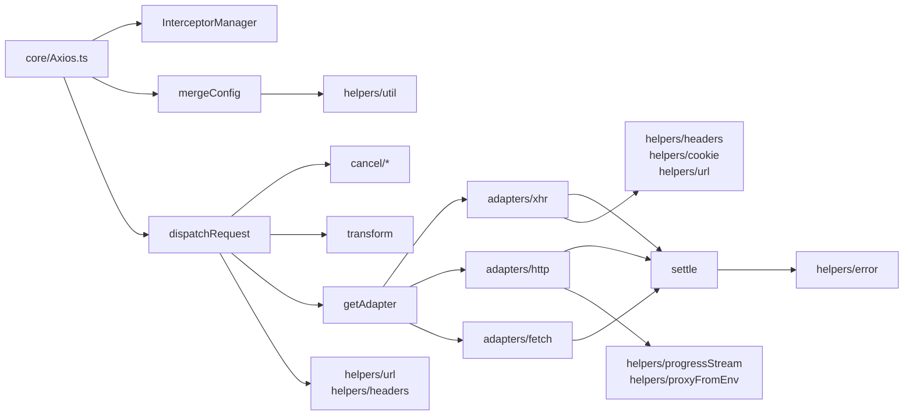

# 02-模块设计
> 项目：my-ts-axios ｜ 版本：v1.0 ｜ 生成日期：2026-10-06 ｜ 依据：源码分析

## 1. 模块划分总表

| 模块 | 职责 | 关键文件 | 对外接口（导出） |
| --- | --- | --- | --- |
| 入口模块 | 汇出类型与默认实例 | `src/index.ts` | `default axios` + 全部类型 |
| 实例工厂 | 创建混合对象实例、挂载静态 API | `src/axios.ts` | `axios.create`、`CancelToken`、`isCancel`、`all`、`spread`、`AxiosHeaders`、`mergeConfig`、`getAdapter`、`isAxiosError`、`toFormData`、`formToJSON` 等 |
| 请求编排 | 拼装 Promise 链、HTTP 方法族 | `src/core/Axios.ts` | `Axios` 类：`request`/`get`/.../`patchForm`/`getUri`，属性 `defaults`、`interceptors` |
| 配置合并 | defaults 与请求配置的字段级合并 | `src/core/mergeConfig.ts` | `mergeConfig(config1, config2)` |
| 拦截器管理 | 有序存取请求/响应拦截器 | `src/core/InterceptorManager.ts` | `use`/`eject`/`forEach` |
| 请求分发 | 链中心环节：取消预检、配置加工、调适配器、响应转换 | `src/core/dispatchRequest.ts` | `dispatchRequest(config)`、`processConfig`、`transformURL` |
| 数据转换 | 转换器数组遍历执行 | `src/core/transform.ts` | `transform(data, headers, fns)` |
| 适配器解析 | 命名/自定义适配器注册表与回退 | `src/core/getAdapter.ts` | `getAdapter(config)` |
| 结果判定 | validateStatus → resolve/reject | `src/core/settle.ts` | `settle(resolve, reject, response, config)` |
| 首部类 | 规范化键名的首部容器 | `src/core/AxiosHeaders.ts` | `set/get/has/delete/clear/normalize/merge/toJSON/toString`、静态 `from/concat` |
| xhr 适配器 | 浏览器端 XHR 通讯 | `src/core/adapters/xhr.ts` | `xhrAdapter(config)` |
| http 适配器 | Node 端 http/https 通讯（重定向/代理/解压/限流/流） | `src/core/adapters/http.ts` | `httpAdapter(config)` |
| fetch 适配器 | SW/Workers 环境通讯 | `src/core/adapters/fetch.ts` | `fetchAdapter(config)` |
| 取消机制 | CancelToken/Cancel/CanceledError 双轨取消 | `src/cancel/*` | `CancelToken` 类（含 `source()`）、`Cancel` 类、`CanceledError` 类、`isCancel` |
| 类型体系 | 全部公共接口定义 | `src/types/index.ts` | `AxiosRequestConfig`、`AxiosResponse`、`AxiosError`、`AxiosStatic` 等 |
| 默认配置 | 库级默认值与默认转换器 | `src/defaults.ts` | `defaults` 对象 |
| 工具集 | URL/headers/data/cookie/错误/表单/进度流/代理等纯函数 | `src/helpers/*` | 见各文件命名导出 |
| 构建占位 | 浏览器产物中替代 Node 内置模块 | `src/shims/node-builtins.ts` | 与被替代模块同名的抛错导出 |

通读总表可以提炼出本库模块化的三条设计原则。**原则一：链路与端点分离**——`Axios.ts`/`dispatchRequest.ts`/`mergeConfig.ts` 等"怎么编排"的模块，与 `adapters/` 里"怎么收发字节"的模块之间只隔着一个 `getAdapter` 注册表，二者通过 `(config) => AxiosPromise` 这一单一契约对话。**原则二：无状态支撑层**——`helpers/` 全部是无副作用的纯函数，取消原语（`cancel/`）是仅有的带内部状态的支撑件，且其状态（`reason`、内部 promise）一经定局不可回退，状态面被压到最小。**原则三：单一出口契约**——无论内部多少模块协作，对调用方暴露的值形态只有四种（config、response、AxiosError、Cancel/CanceledError），全部定义在 `src/types/index.ts`，类型即文档。

模块间依赖关系如下（箭头指向被依赖方，详见第 01 篇架构图；此图聚焦 `core` 内部）：



## 2. 配置合并模块（`src/core/mergeConfig.ts`）

### 2.1 策略表

合并入口签名为 `mergeConfig(config1, config2): AxiosRequestConfig`（config1 通常是 defaults，config2 是本次请求配置），内部维护 `const strats = Object.create(null)` 的字段→策略函数映射：

| 字段 | 策略 | 行为 |
| --- | --- | --- |
| `url` / `params` / `data` | `fromVal2Strat` | 只取 config2 的值，config2 未给则字段为 `undefined`（不会从 defaults 继承 URL/参数/请求体） |
| `headers` / `auth` | `deepMergeStrat` | config2 是普通对象则 `deepMerge(val1, val2)`；config2 非 undefined 直接用；否则对 config1 深拷贝出副本返回（防污染默认值） |
| 其余全部字段 | `defaultStrat` | `typeof val2 !== 'undefined' ? val2 : val1` |

### 2.2 合并次序与一个细节

函数体先遍历 `config2` 的所有键调用 `mergeField`，再遍历 `config1` 中 `config2` 未定义的键补合并；结果对象用 `Object.create(null)` 创建，避免原型链键（如 `constructor`）干扰。注意 `deepMerge`（`src/helpers/util.ts`）以 `Object.create(null)` 为结果容器递归合并普通对象，因此合并产物**没有原型**，`isPlainObject`（基于 `Object.prototype.toString`）依然能正确识别它。

扩展指引：若新增一个"布尔开关但希望允许显式 `false` 覆盖默认 `true`"的配置（如 `decompress`），`defaultStrat` 天然满足；若新增"对象且希望与默认值深合并"的配置（如未来的 `proxy` 默认值），只需把键名追加进 `stratKeysDeepMerge` 数组。

## 3. 拦截器管理器（`src/core/InterceptorManager.ts`）

### 3.1 数据结构

```ts
export interface InterceptorOptions<T> {
  synchronous?: boolean
  runWhen?: (config: T) => boolean
}

interface Interceptor<T> {
  resolved: ResolvedFn<T>
  rejected?: RejectedFn
  options?: InterceptorOptions<T>
}
```

容器本体是 `private interceptors: Array<Interceptor<T> | null>`——一个**稀疏数组**：

- `use(resolved, rejected?, options?)`：`push` 后返回下标作为 id（第 28 行 `return this.interceptors.length - 1`）；
- `eject(id)`：不移动数组元素，而是把对应槽位置为 `null`（第 42~46 行），因此**已发出的 id 永远有效**，删除其余拦截器不会错位；
- `forEach(fn)`：遍历时跳过 `null` 槽位，对 `Axios.request` 暴露稳定的有序遍历。

### 3.2 与官方 v1 对齐的两个选项

`options.synchronous` 与 `options.runWhen` 在 `Axios.request` 中消费（`src/core/Axios.ts` 第 54~80 行）：`runWhen(config)` 返回 `false` 的请求拦截器在收集阶段被剔除；只有当**全部**入选请求拦截器都标记 `synchronous` 时才走同步快路径（当前调用栈内倒序套用，最后一次 `then` 进入 `dispatchRequest`），否则维持逐环 `then` 的异步链。响应拦截器不提供同步路径（响应本身依赖异步请求结果）。

## 4. 请求分发与转换（`dispatchRequest.ts` + `transform.ts`）

`dispatchRequest(config)` 是链上唯一"真正做事"的环节，按固定顺序执行四步：

```ts
export default function dispatchRequest(config: AxiosRequestConfig): AxiosPromise {
  throwIfCancellationRequested(config)   // ① cancelToken.throwIfRequested() + signal.aborted 检查
  processConfig(config)                  // ② url / data / headers 三项加工
  return getAdapter(config)(config).then( // ③ 选适配器并发起请求
    (res) => transformResponseData(res),  // ④ 成功：执行 transformResponse
    (e) => {                              //    失败：若带 response 也先转换其 data 再继续 reject
      if (e && e.response) { e.response = transformResponseData(e.response) }
      return Promise.reject(e)
    },
  )
}
```

- `processConfig` 的三步依次是：`config.url = transformURL(config)`（baseURL 拼接 + params 序列化）、`config.data = transform(config.data, config.headers, config.transformRequest)`（此步默认转换器内部还会补 `Content-Type: application/json` 等）、`config.headers = flattenHeaders(config.headers, config.method!)`（三层拍平）。
- `transformResponseData` 体现 `transitional.forcedJSONParsing === false` 语义：此时传给 `transform` 的转换器数组为 `undefined`，`transform.ts` 第 8~10 行对空 `fns` 直接原样返回数据。
- `transform(data, headers, fns)` 是 18 行的小函数：把单函数统一包装成数组后逐个 `data = fn(data, headers)`，即**转换器按数组顺序串行管道执行**。

## 5. 适配器抽象

三个内置适配器共用签名 `(config: AxiosRequestConfig) => AxiosPromise`，返回的 Promise 最终只能走 `settle(resolve, reject, response, config)` 出口（成功与 HTTP 状态错误），或在网络层失败/取消/超时时直接 reject `AxiosError`。各适配器的内部分工：

| 关注点 | xhr.ts | http.ts | fetch.ts |
| --- | --- | --- | --- |
| 取消 | `cancelToken.promise.then(abort+reject)`；`signal` 监听 abort，settle 后 `removeAbortListener` 清理 | cancelToken 只在 `currentReq` 上注册一次（跨重定向复用）；signal 监听器收集进 `abortCleanups`，settle 统一移除 | 内部 `AbortController` 统一承载 signal / cancelToken / timeout 三种中断源，`settledEarly` 标记防止连带失败重复 reject |
| 超时 | `request.timeout` + `ontimeout`（`ECONNABORTED`，`clarifyTimeoutError` 时 `ETIMEDOUT`） | `clientReq.setTimeout`（同上错误码逻辑） | `setTimeout` 定时 abort |
| 进度 | `makeProgressHandler` 把原生 `ProgressEvent` 规范化为 `AxiosProgressEvent`（含 `bytes` 增量、方向标记） | `createProgressStream` Transform 包装（下行在解压前统计原始字节；上行支持限速） | `body.getReader()` 循环读取统计；**无上传进度** |
| headers 处理 | FormData 时删 `Content-Type` 交浏览器补 boundary；`data === null` 时删 content-type | form-data 转换前**先删任意大小写的 content-type** 再 `Object.assign(headers, nodeForm.getHeaders())` | 无 body 或 FormData 时删 content-type |
| 认证 | `btoa(auth.username + ':' + auth.password)` | `options.auth`（跨 host 重定向剥离） | `btoa`，Node 环境回退 `Buffer` |
| XSRF | `withXSRFToken`（函数/非 false）+ `withCredentials || isURLSameOrigin` + `cookie.read` | 不适用 | 同 xhr 规则，额外要求 `typeof document !== 'undefined'` |
| 特有配置 | `withCredentials`、`responseType`（跳过 `'stream'`） | `maxRedirects`/`beforeRedirect`/`proxy`/`decompress`/`maxContentLength`/`maxBodyLength`/`responseType:'stream'`/`http(s)Agent`/`socketPath`/`maxRate` | `fetchOptions`（先展开、核心字段后覆写，故无法覆盖 method/headers/body/signal/credentials）、`responseType: 'blob'/'stream'` |

`src/core/settle.ts`（33 行）是三端共享的最终裁判，其错误码分支：`response.status >= 500` → `ERR_BAD_RESPONSE`，否则 `ERR_BAD_REQUEST`，并把数值状态写入 `error.status`（通过 `createError` 的第 6 个参数）。

## 6. 取消机制（`src/cancel/`）

取消是"双轨制"：旧版 `CancelToken` 与新版 `AbortSignal` 并存，任何一轨触发都使请求以取消原因拒绝。

### 6.1 CancelToken（`src/cancel/CancelToken.ts`）

```ts
export default class CancelToken {
  promise: Promise<Cancel>
  reason?: Cancel
  constructor(executor: CancelExecutor) {
    let resolvePromise: ResolvePromise
    this.promise = new Promise<Cancel>((resolve) => { resolvePromise = resolve })
    executor((message) => {
      if (this.reason) return            // 幂等：重复取消只生效一次
      this.reason = new Cancel(message)
      resolvePromise(this.reason)
    })
  }
  throwIfRequested(): void {
    if (this.reason) throw this.reason   // dispatchRequest 发请求前预检
  }
  static source(): CancelTokenSource {
    let cancel!: Canceler
    const token = new CancelToken((c) => { cancel = c })
    return { cancel, token }
  }
}
```

核心是**把"取消"建模为一个尚未 resolve 的 Promise**：适配器用 `cancelToken.promise.then(reason => abort + reject(reason))` 订阅，取消方调用 `cancel(message)` 时该 Promise 落定，所有订阅者被唤醒。`throwIfRequested` 覆盖"取消发生在请求发出之前"的时序。`Cancel.ts` 中的 `isCancel(value)` 同时识别 `Cancel` 与 `CanceledError` 两个类型，保证双轨判断统一。

### 6.2 AbortSignal 轨道

`config.signal` 的处理内聚在各适配器：xhr/http 适配器直接 `signal.addEventListener('abort', ...)`，触发时 `abort()` 底层请求并以 `new CanceledError('canceled', config, request)` reject；fetch 适配器则把 signal、cancelToken、timeout 全部收敛到内部 `AbortController`（`fetch.ts` 第 71~135 行）。`CanceledError`（`src/cancel/CanceledError.ts`）继承 `AxiosError`，固定 `code: 'ERR_CANCELED'`、`name: 'CanceledError'`，并显式 `Object.setPrototypeOf` 修复继承链。

### 6.3 防泄漏细节

两个适配器都显式处理了**AbortSignal 监听器泄漏**：xhr 适配器在所有 settle 出口调用 `cleanup()` 移除 abort 监听（`xhr.ts` 第 30~39 行注释说明"避免长生命周期 signal 复用时监听器累积"）；http 适配器因重定向会多次注册监听，用 `abortCleanups` 数组在最终 resolve/reject 包装器里统一执行（`http.ts` 第 80~93 行）。

## 7. AxiosHeaders 首部类（`src/core/AxiosHeaders.ts`）

以自身为存储容器（`[key: string]: any` 索引签名），键名一律 `trim().toLowerCase()` 规范化后存取，因此 `set('Content-Type', x)` 与 `get('content-type')` 等价。构造器接受三种输入：普通对象、AxiosHeaders 实例、原始报文字符串（按 `\n` 行、首个 `:` 切分）。方法面为官方子集：`set`（`rewrite = true` 默认覆盖；值为 `undefined/null` 时等价删除）、`get`、`has`（"键存在即真"，与官方一致，空字符串也算有）、`delete`、`clear`、`normalize`、`merge`（数组值合并而非覆盖）、`toJSON`（过滤 `undefined/null`）、`toString`（`key: value` 行拼接），静态方法 `from` / `concat`。在请求链路中，`flattenHeaders`（`src/helpers/headers.ts` 第 69~71 行）兼容用户直接传 AxiosHeaders 实例作为 `config.headers`（先 `toJSON()` 再参与深合并），但**库内部流转仍以普通对象为主**，这与官方 v1 全面 AxiosHeaders 化是一个明确取舍。

## 8. 工具模块速览（`src/helpers/`）

- `util.ts`：`isDate`/`isPlainObject`/`isURLSearchParams`（均基于 `Object.prototype.toString`）、`extend`（含原型链遍历）、`deepMerge`、`isFormData`。
- `url.ts`：`buildURL`（支持函数式与对象式 `paramsSerializer`、数组 `indexes` 三态、Date→ISO、对象→JSON、跳过 null/undefined、剥离 `#` 后再拼 `?`/`&`）；`isAbsoluteURL`；`combineURL`；`isURLSameOrigin`（浏览器用 `<a>` 标签解析 origin，非浏览器恒返回 `true`）。
- `headers.ts`：`processHeaders`（普通对象数据补 `application/json;charset=utf-8`）、`parseHeaders`（XHR 原始头文本 → 小写键对象）、`flattenHeaders`（`deepMerge(common, method, 顶层)` 后删除方法键）。
- `data.ts`：默认请求/响应转换器；注意 `transformRequest` **先放行 Node 可读流**（`typeof data.pipe === 'function'`）再判断普通对象，防止流被 `JSON.stringify` 破坏。
- `formData.ts`：`toFormData`（`walk` 递归 + `visitor` 扩展点，支持 `dots` 点号路径、`indexes` 数组下标三态）与 `formToJSON`（`parseKey` 反解方括号/点号路径，数值段还原数组，重复键聚合）。
- `progressStream.ts`：`createProgressStream` 返回 Transform 流，2 秒滑动窗口计算瞬时 `rate`，事件携带 `loaded/total/progress/bytes/rate/estimated`；`maxRate` 通过延迟 `callback` 实现平均限速；`resolveMaxRates` 把 `number | [number, number]` 归一为 [上行, 下行]。
- `proxyFromEnv.ts`：`getProxyForUrl` 按协议读取 `https_proxy`/`http_proxy`/`all_proxy`（大小写兼容），`NO_PROXY` 支持 `*`、`.后缀`、精确主机、带端口条目与 IPv6 括号写法。
- `error.ts` / `HttpStatusCode.ts`：错误类工厂与完整状态码常量表（第 03 篇详述）。

## 9. Axios 类与方法族的设计（`src/core/Axios.ts`）

`Axios` 类是"编排层"的物化，实例上只有两个数据属性（`defaults`、`interceptors`），其余全部是方法。方法族的组织方式体现了一个清晰的复用层次：`get/delete/head/options` 四个无请求体方法全部委托给私有方法 `_requestMethodWithoutData`，`post/put/patch` 三个带请求体方法委托给 `_requestMethodWithData`，二者都只是用 `Object.assign(config || {}, {...})` 把位置参数折算成配置对象后转调 `request`；`postForm/putForm/patchForm` 走 `_requestForm`，在折算之外还做两件事——把 `Content-Type: multipart/form-data` 前置写入 headers（用户显式传入的 headers 优先级更高，因为它在 `Object.assign` 的后位），以及调用 `toFormData(data, undefined, config.formSerializer)` 把请求体预先转成 FormData。注意这里用的是**全局 `toFormData` 而非 `defaults.env.FormData`**（第二个参数传 `undefined`，`src/helpers/formData.ts` 内部回退 `new FormData()`），与 `defaults.ts` 默认请求转换器里"优先取 `env.FormData`"的路径略有差异 ⚠️ 待确认是否有意为之。

`request` 方法本身承担三种职责：双签名归一（字符串 URL + 配置 / 纯配置）、合并与小写化、Promise 链编排（详见第 05 篇流程一）。类上被注释掉的第一版实现（`request(config) { return dispatchRequest(config) }`，第 37~39 行）是理解演进的好线索——它保留了"最原始形态"，说明拦截器、同步快路径等都是在这一最小内核上逐步叠加的。`getUri` 是唯一的只读成员：它同样执行 `mergeConfig` 与 `transformURL`，但不触发 `processConfig` 的 data/headers 加工，因此可以安全地用于"预览最终请求地址"。

## 10. 默认配置模块（`src/defaults.ts`）

`defaults` 是一个普通的 `AxiosRequestConfig` 对象，但它有两处非常规设计。其一是 **headers 的分层默认值**：`headers.common` 只放 `Accept`，`methodsNoData`（delete/get/head/options）的默认 headers 为空对象，`methodsWithData`（post/put/patch）则默认 `Content-Type: application/x-www-form-urlencoded`——这个看似保守的默认值链路是 axios 兼容性的重要一环：普通对象数据在默认转换器里会被补上 `application/json;charset=utf-8`（`processHeaders` 只在缺失时补），而 FormData 会在适配器层删掉 Content-Type 交给运行时补 boundary，三层兜底环环相扣。其二是**默认转换器内嵌了对 multipart 的显式支持**：当 headers 中已声明 `multipart/form-data` 且 data 是普通对象时，直接用 `env.FormData`（可注入替代实现）构造 FormData 并跳过常规的 processHeaders——注释明确说明这是"与官方 axios 对齐"的行为。`transitional` 三项默认值（`silentJSONParsing: true`、`forcedJSONParsing: true`、`clarifyTimeoutError: false`）中只有后两者被源码消费，第一项为兼容性占位。

## 11. 类型模块的设计取舍（`src/types/index.ts`）

类型模块约 300 行，是全库唯一"只有声明没有实现"的文件，几个取舍值得注意。**接口与实现的分工**：`AxiosError` 在 types 里是 interface（描述值的形状，供调用方标注类型），在 `helpers/error.ts` 里是 class（提供运行时原型与 `instanceof` 能力），二者同名但服务不同场景；`AxiosPromise` 保留 `interface extends Promise<...>` 的空接口形式并附 eslint 豁免注释，为的是让下游可以 `extends` 扩展响应类型（官方同款做法）。**静态类型的拆分**：`Axios`（实例方法面）、`AxiosInstance`（Axios 加两个调用签名）、`AxiosClassStatic`（构造器）、`AxiosStatic`（Instance 再加全部静态成员）四层递进，精确对应 `createInstance` 产物的真实形状——这是 TypeScript 表达"函数即对象"混合体的教科书式写法。**宽松索引签名**：`AxiosRequestConfig` 末尾的 `[propName: string]: any` 有意放弃了字段级拼写检查换取扩展自由，代价是 `timeout` 写成 `tiemout` 这类错误编译器不会报——学习版选择兼容性优先，若用于生产可移除该签名收紧类型。
