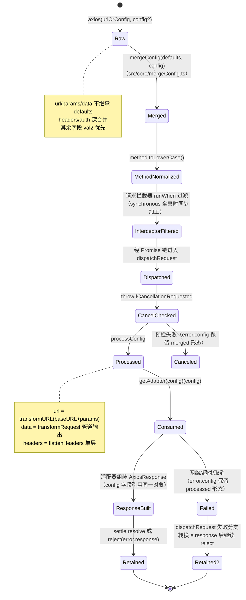

# 04-数据模型
> 项目：my-ts-axios ｜ 版本：v1.0 ｜ 生成日期：2026-10-06 ｜ 依据：源码分析

## 1. 四类核心数据结构

本篇关注"值"本身：请求发出前后的每个关键对象长什么样、在哪里被改变、在哪里被固定。全库参与请求生命周期的值可以收敛为四类——请求配置（AxiosRequestConfig）、响应（AxiosResponse）、错误（AxiosError）与取消原语（Cancel/CanceledError/CancelToken），此外还有一个贯穿全程的隐性角色：headers 的多层与单层形态。掌握这四类值的结构与流转，等价于掌握了库的运行时全貌；类型层面的字段清单已在第 03 篇给出，本篇侧重"值的行为"。

### 1.1 请求配置（AxiosRequestConfig）

完整字段表见第 03 篇第 3.1 节。从数据模型角度，需要掌握的是它在链路上的**三种形态**：

| 形态 | 所处阶段 | 特征 |
| --- | --- | --- |
| 用户输入形态 | 调用 `axios(config)` 时 | 稀疏、只含本次覆盖项；headers 可以是三层结构或 AxiosHeaders 实例 |
| 合并形态 | `Axios.request` 内 `mergeConfig` 之后 | 与 defaults 深度合并的完整对象；`method` 已小写；`url`/`params`/`data` 仅来自本次配置 |
| 加工形态 | `dispatchRequest.processConfig` 之后 | `url` 已是拼好 baseURL 与查询串的完整 URL；`data` 已序列化（字符串/FormData/流）；`headers` 已拍平为单层小写兼容对象，**此后适配器直接消费它** |

关键事实：**全程只有一个 config 对象被就地修改**（`processConfig` 直接改写 `config.url/data/headers`），并最终以 `response.config` 与 `error.config` 的形式回传给调用方。因此响应里看到的 config 是"加工后"的形态（URL 已展开、headers 已拍平）。

这一"单对象就地演进"的设计是理解 axios 系行为的关键前提，它带来三个可观察的推论。推论一：**响应/错误里的 config 不是快照**——请求完成后若再修改该对象（或在并发场景下复用同一 config 对象发起下一个请求），前一次响应的 `config` 字段也会跟着变，因此需要事后审计请求参数的场景应在发请求前自行浅拷贝。推论二：**拦截器可以"作弊"**——请求拦截器拿到的就是 Merged 形态对象，直接改写 `config.headers` 或 `config.data` 会原样生效，这既是拦截器改造请求的标准姿势，也是误改导致的隐性 bug 之源。推论三：**memory profile 上每请求只有一个大对象**——不像"复制式"实现那样在链路上产生多个副本，对高频请求场景更省内存，代价是牺牲了不可变性。

### 1.2 响应（AxiosResponse）

| 字段 | 类型 | 来源（三适配器对照） |
| --- | --- | --- |
| `data` | `any` | xhr：`responseText` 或 `request.response`；http：Buffer（arraybuffer）或按 `responseEncoding`（默认 utf8）解码的字符串，经解压与 `maxContentLength` 累积；fetch：`text()`/`arrayBuffer()`/`blob()`/ReadableStream |
| `status` | `number` | xhr：`request.status`；http：`res.statusCode`；fetch：`fetchRes.status` |
| `statusText` | `string` | xhr：`request.statusText`；http：`res.statusMessage \|\| ''`；fetch：`fetchRes.statusText` |
| `headers` | 小写键普通对象 | xhr：`parseHeaders(getAllResponseHeaders())`；http：`parseRawHeaders(res.rawHeaders)`（直接小写化，跳过字符串序列化）；fetch：遍历 `headers.forEach` 小写化 |
| `config` | AxiosRequestConfig | 全局唯一 config 对象引用（加工形态） |
| `request` | `any` | xhr：XMLHttpRequest 实例；http：`http.ClientRequest` 实例；fetch：恒 `null` |

### 1.3 错误（AxiosError）

统一由 `src/helpers/error.ts` 的 `createError(message, config, code, request, response, status?)` 工厂产出。字段含义见第 03 篇第 3.3 节。错误模型有三个贯穿性的设计决定，读下表前先建立这三点认知：**决定一，错误永远携带现场**——`config` 与 `request` 两个槽位让每个错误都能回答"哪个请求、用什么配置、底层对象是谁"，这是日志与重试中间件的基础；**决定二，错误码是封闭集合**——所有业务性失败都从 `AxiosErrorCodes` 常量取值，调用方按码分流（重试 ERR_NETWORK、跳过 ERR_CANCELED、提示 ERR_BAD_REQUEST），不存在裸字符串错误码；**决定三，HTTP 错误与传输错误分离**——4xx/5xx 是"服务器正常应答了但语义失败"（`error.response` 有值），网络断连是"根本没有应答"（`error.response` 为 undefined），两类失败的下游处理策略通常完全不同。错误产生的全部来源（源码穷举）：

| 错误来源 | code | 触发位置 |
| --- | --- | --- |
| 请求发出前已取消（token/signal 预检） | `ERR_CANCELED`（CanceledError）或 Cancel 实例 | `dispatchRequest.ts` `throwIfCancellationRequested` |
| 传输中取消 | `ERR_CANCELED` | 各适配器 signal/cancelToken 处理段 |
| 超时 | `ECONNABORTED`（`clarifyTimeoutError` 时 `ETIMEDOUT`） | xhr `ontimeout` / http `clientReq.setTimeout` / fetch `setTimeout` |
| 网络失败 | `ERR_NETWORK` | xhr `onerror`、http `clientReq.on('error')`、fetch Promise reject 分支 |
| HTTP 4xx | `ERR_BAD_REQUEST` + `status` | `src/core/settle.ts` |
| HTTP 5xx | `ERR_BAD_RESPONSE` + `status` | `src/core/settle.ts` |
| 重定向超限 | `ERR_FR_TOO_MANY_REDIRECTS` | `http.ts` `onResponse` |
| 代理失败 | `ERR_PROXY` | `http.ts` CONNECT 隧道与代理请求错误分支 |
| URL 缺失/非法 | `ERR_INVALID_URL` | `http.ts` 开头与 `_send` 的 `new URL` catch |
| 响应体过大 | `null`（message `maxContentLength exceeded`） | `http.ts` `stream.on('data')` |
| 请求体过大 | `ERR_BAD_REQUEST`（message `maxBodyLength exceeded`） | `http.ts` `finalize` 与流式计数 Transform |
| 响应流读取失败 | `null`（http）/ `ERR_BAD_RESPONSE`（fetch） | `http.ts` `stream.on('error')`、`fetch.ts` `onBodyError` |
| 环境不支持 | `ERR_NOT_SUPPORT` | `fetch.ts` 无全局 fetch；浏览器构建触发 `src/shims/node-builtins.ts` 占位导出 |
| 适配器不可用 | 普通 `Error`（非 AxiosError） | `getAdapter.ts` 末尾 throw |
| 旧版取消（请求已完成后 token 触发） | `Cancel` 实例（非 AxiosError） | `CancelToken.throwIfRequested` / 适配器 `reject(reason)` |

### 1.4 取消（Cancel / CanceledError / CancelToken）

```text
Cancel          { message?: string }                       ← 旧版取消原因（纯对象语义）
CanceledError   AxiosError 子类 { code:'ERR_CANCELED', name:'CanceledError' }
CancelToken     { promise: Promise<Cancel>, reason?: Cancel, throwIfRequested(), static source() }
```

数据上的关联：`CancelToken.promise` 在取消时 resolve 出一个 `Cancel`；`isCancel()`（`src/cancel/Cancel.ts`）用 `value instanceof Cancel || value instanceof CanceledError` 做统一判定，因此调用方不必关心请求是被哪一轨取消的。

## 2. 配置对象在各环节的形态变化

下方的状态图刻画同一个 config 对象从用户输入到被适配器消费、再到作为 `response.config` 回传的完整生命周期（`raw → merged → processed → consumed → retained`）。



三个值得注意的数据变换细节：

1. **headers 的三层→单层**：默认结构是 `{ common: {Accept...}, get: {}, post: {'Content-Type': 'application/x-www-form-urlencoded'}, ... , 顶层自定义 }`。`flattenHeaders` 执行 `deepMerge(headers.common, headers[method], 顶层)` 后删除全部方法键（`src/helpers/headers.ts` 第 72~79 行），得到单层对象。默认转换器在此之后才执行，因此 `processHeaders` 补写的 `Content-Type: application/json;charset=utf-8` 会进入拍平结果；FormData 场景由适配器删掉该头交给运行时补 boundary。
2. **data 的类型判定序**：默认 `transformRequest`（`src/defaults.ts`）先检测"显式 `multipart/form-data` + 普通对象"→ 转 FormData；否则 `processHeaders` 补 JSON 头 + `transformRequest`（流直通 → 普通对象 `JSON.stringify` → 其余原样）。所以同一份 data 在 `transformRequest` 前后可能从"对象"变为"JSON 字符串"或"FormData"。
3. **`response.config === 请求时的 config`**：三适配器组装响应时都直接引用传入的 config（如 `xhr.ts` 第 80 行），没有拷贝。这意味着拦截器若在请求前修改 config，会反映到 `response.config`；官方 axios 同样如此。

从代码锚点的角度看，形态变化的全部发生地只有四处，可作为断点设置的备忘：`Axios.ts` 第 51 行（mergeConfig，Raw→Merged）、`Axios.ts` 第 52 行（method 小写化）、`dispatchRequest.ts` 第 25~28 行（processConfig 三连：url/data/headers，Merged→Processed）、以及各适配器对 headers 的临末微调。第三处之后是否回写因适配器而异，排查请求头问题时需特别注意：**xhr 适配器解构出的 `headers` 与 `config.headers` 是同一个对象引用**（`xhr.ts` 第 16 行），其对 FormData 删 Content-Type、附加 XSRF 头等修改会反映到最终回传的 `response.config.headers`；而 **http 与 fetch 适配器都先做了浅拷贝**（`http.ts` 第 134 行 `{ ...config.headers }`、`fetch.ts` 第 138 行 `{ ...headers }`），它们的本地修改不会出现在 `response.config.headers` 里。

## 3. 响应 data 的形态矩阵

`responseType` 决定 `transformResponse` 之前的原始 data 形态，之后默认转换器只对字符串做 JSON 解析。这张矩阵解释了一个高频疑问——"为什么 `responseType: 'json'` 时解析失败不报错？"：xhr 路径下解析由浏览器完成（失败时 `request.response` 为 null）；http/fetch 路径下拿到的是字符串，解析发生在默认 `transformResponse`（`src/helpers/data.ts`）的 try/catch 里，失败时静默保持字符串。两种路径的失败表现并不完全一致，这是跨适配器开发时需要留意的细节。

| responseType | xhr | http | fetch | 默认 transformResponse 之后 |
| --- | --- | --- | --- | --- |
| 缺省 / `text` | `responseText` 字符串 | utf8 字符串 | `text()` 字符串 | 字符串能 `JSON.parse` 则为对象，否则保持字符串 |
| `json` | `request.response`（已解析） | utf8 字符串→解析 | `text()`→解析 | 对象（parse 失败保持原值，不抛错） |
| `arraybuffer` | `request.response` | Buffer | ArrayBuffer | 原样（非字符串不解析） |
| `blob` | `request.response` | 不支持 | Blob | 原样 |
| `stream` | 跳过设置（视同缺省） | Readable 流（不进字符串管道，`settle` 前直挂 `response.data`） | ReadableStream | 流对象原样 |

## 4. 内部状态生命周期

### 4.1 请求对象（Promise 链）状态

一次请求在库内只有一个显式状态机——Promise 的 pending/fulfilled/rejected。值得强调的是，这个状态机是"组合"出来的：库本身不为请求维护任何状态字段（没有 `request.state` 之类的东西）， underway/canceled/completed 的全部信息都蕴含在 Promise 与各组件的局部闭包变量里（如 fetch 适配器的 `settledEarly`、http 适配器的 `abortCleanups` 数组、xhr 的 `removeAbortListener`）。这种"状态即闭包"的设计让单个请求的全部瞬态天然被限定在一次调用的作用域内，不会形成跨请求的共享状态，也就不存在并发请求间的相互干扰。

- **pending**：从 `Promise.resolve(config)` 开始，经拦截器链、`dispatchRequest`、适配器、响应拦截器；
- **fulfilled**：唯一出口是 `settle` 的 `resolve(response)`（`validateStatus` 通过或 status 为 0/无 validateStatus）；
- **rejected**：出口有四类——取消（Cancel/CanceledError）、超时（ECONNABORTED/ETIMEDOUT）、网络（ERR_NETWORK 等）、HTTP 状态错误（ERR_BAD_REQUEST/ERR_BAD_RESPONSE）。失败响应先在 `dispatchRequest` 失败分支里补 `transformResponse`，再原样向下传播，保证响应拦截器的 rejected 钩子拿到的错误已含解析后的 `response.data`。

### 4.2 适配器内部瞬态

- xhr：`open → configureRequest → addEvents → processHeaders → processCancel → processSignal → send` 的固定装配序；`readyState === 4 && status !== 0` 触发 `handleResponse`（status 0 视为未产生 HTTP 响应，静默等待 onerror/ontimeout）。
- http：`_send(url, redirectCount, ...)` 递归驱动"跳"状态；每跳内 `finalize` 完成"请求体处理 → 创建请求 → 挂 error/timeout/signal → 发送"四步；响应侧走"重定向判定 → 进度包装 → stream 直通或解压累积 → settle"。
- fetch：`settledEarly` 标志位区分"超时/取消已定局"与"fetch 本身失败"，避免 AbortError 连带重复 reject（`fetch.ts` 第 73 行、第 301~313 行）。

### 4.3 取消令牌生命周期

`CancelToken` 的状态只有"未取消（reason 未赋值、promise pending）→ 已取消（reason 赋值、promise fulfilled）"两态，构造时 executor 持有 cancel 函数，重复调用因 `if (this.reason) return` 幂等（`CancelToken.ts` 第 17~23 行）。`AbortSignal` 则是平台状态机，库只读取 `signal.aborted` 与监听 `abort` 事件，并在 settle 后解除监听以防泄漏。

两个状态的交互有一个微妙的时序边界：**token/signal 的取消动作在请求 settle 之后到达时**，xhr/http 适配器已移除 signal 监听，不会有任何反应；但 CancelToken 的 `promise.then` 订阅是无法注销的——迟到的 `cancel()` 仍会把 token 的 promise resolve 出来，只是适配器侧的 `then` 回调里 `currentReq.abort()` 作用在一个已结束的请求对象上成为无害操作，`reject` 对已定局的 Promise 也是无操作（Promise 语义保证）。因此"取消一个已完成的请求"是安全的空操作，而不会抛出未捕获异常，这一保证由 Promise 的 settle-once 语义免费提供，也是选择 Promise 承载取消事件的重要理由。

## 5. 数据不变量（扩展时必须维持）

为帮助后续贡献者安全扩展，从源码归纳出五条不变量，每条都对应着"破坏它会怎样"的具体后果：

1. `mergeConfig` 产物的 `url`/`params`/`data` 永远不来自 defaults——破坏它会导致 baseURL 示例、请求体默认值等历史语义全部漂移，调用方将无法依赖"不传 data 就没有请求体"的直觉；
2. 进入适配器前，`config.url` 必为完整 URL、`config.headers` 必为单层对象、`config.data` 必为可发送形态——新适配器因此可以不做任何 URL/头/体加工，若在适配器里重复加工，幂等性会被破坏（如 URL 被拼两次 baseURL）；
3. 所有以 `AxiosError` 表达的失败必须携带 `config`；HTTP 状态错误必须携带 `response` 且 `status` 已写入 `error.status`——错误恢复拦截器与日志上报普遍依赖这两个字段定位请求，缺失会让上游治理静默失效；
4. 任何取消路径的 reject 值必须满足 `isCancel() === true`（`Cancel` 或 `CanceledError`）——否则"用户主动取消不算错误"的通用判定（如全局错误提示里 `if (!isCancel(e)) toast(...)`）会误弹错误；
5. `response.headers` 的键必须已小写化（三适配器与 `parseHeaders` 共同保证），这是三端统一的输出契约；请求侧的 multipart 探测由 `getContentType`（`src/defaults.ts` 第 8~14 行）承担，其实现大小写不敏感、并不依赖该前提，`forcedJSONParsing` 亦只读 `transitional` 开关而与 headers 无关——本条原引用的锚点与依赖关系已在回刷中修正。

一条实用的记忆法：前三条约束"请求侧"，第四条约束"取消侧"，第五条约束"响应侧"，新增代码路径时按侧自查即可覆盖绝大多数回归风险。
