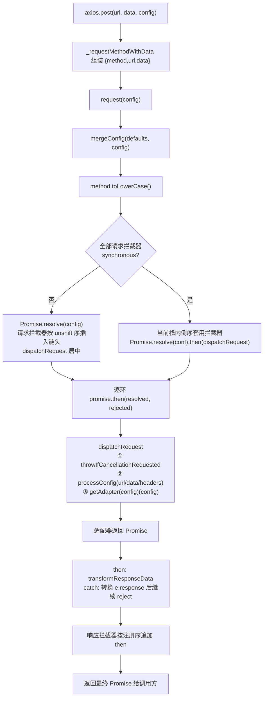
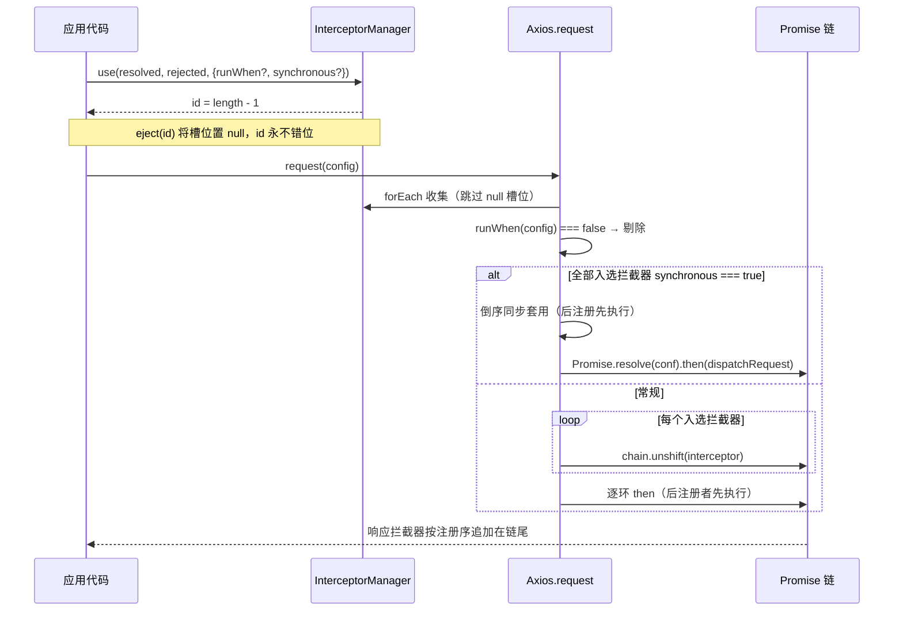
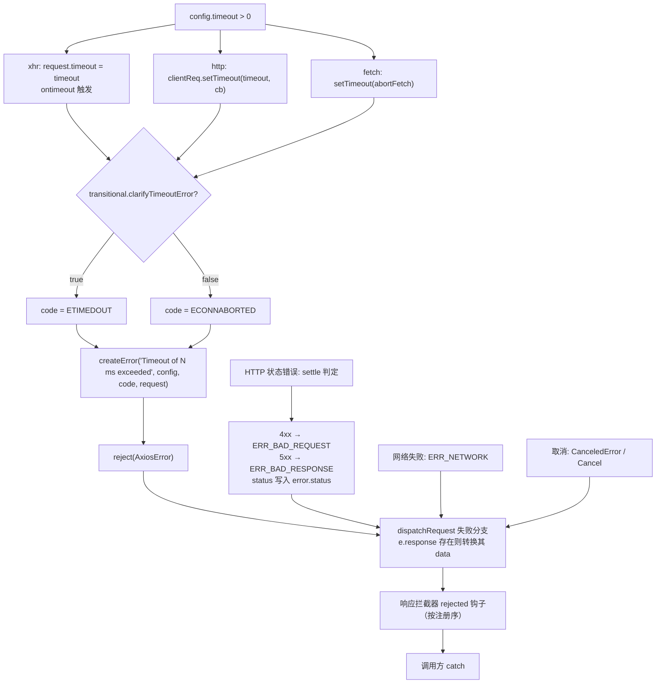
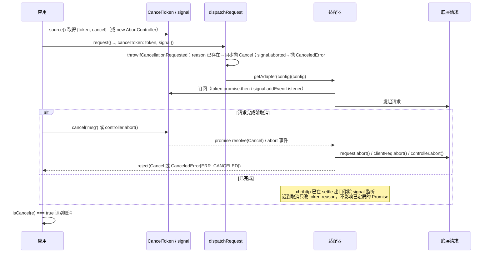
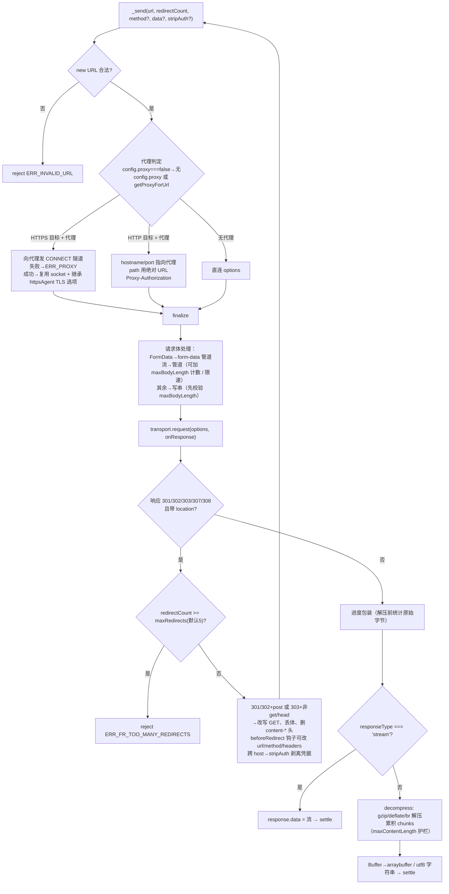

# 05-核心流程
> 项目：my-ts-axios ｜ 版本：v1.0 ｜ 生成日期：2026-10-06 ｜ 依据：源码分析

本篇选取五个最能代表该库设计的流程逐一拆解：Promise 链编排、拦截器注册与执行、超时与错误传播、取消请求、Node 适配器的重定向与代理。选型覆盖了"编排（流程一/二）、失败语义（流程三）、状态中断（流程四）、端点内循环（流程五）"四个正交维度——前三者发生在 `core` 编排层与所有适配器，后两者分别横跨适配器与平台能力。每个流程附 mermaid 图、分步说明与涉及文件清单；行号以当前源码为准，重构后请以函数名为锚重新定位。

阅读方法上有一个通用技巧：五个流程的每一步都能对应到第 04 篇状态图的某个形态迁移，调试时先确认"此刻 config 处于 Raw/Merged/Processed 哪种形态"，即可把断点范围缩小到一两个函数内。

## 流程一：一次完整请求的 Promise 链编排

**涉及文件**：`src/core/Axios.ts`（`request` 及方法族）、`src/core/dispatchRequest.ts`、`src/core/mergeConfig.ts`、`src/core/getAdapter.ts`、`src/core/transform.ts`、`src/core/settle.ts`、`src/defaults.ts`。

分步说明：

1. **方法族糖衣**：`post/put/patch` 走 `_requestMethodWithData`，`get/delete/head/options` 走 `_requestMethodWithoutData`，二者都用 `Object.assign(config || {}, {method, url, data?})` 把位置参数折算成配置对象（`Axios.ts` 第 154~180 行）。`postForm` 系额外前置 `toFormData(data, undefined, config.formSerializer)` 并强制 `Content-Type: multipart/form-data`（`_requestForm`，第 182~196 行）。
2. **入口归一**：`request(url, config?)` 兼容"字符串 + 配置"与"纯配置"两种签名（第 41~49 行），随后立即合并 defaults 并小写化 method。
3. **链的拼装**（第 82~97 行）：初始链只有一个中坚环节 `dispatchRequest`；请求拦截器 `forEach` 时逐个 `chain.unshift(interceptor)`，因此**后注册的请求拦截器离 dispatchRequest 越远、越先执行**；随后 `while (chain.length)` 依次 `promise.then(resolved, rejected)` 完成静态拼装。注意请求拦截器链环的 `rejected` 位是 `undefined`——一旦某个请求拦截器抛错（或返回被拒的 Promise），该 rejection 会跳过剩余请求拦截器**和 `dispatchRequest` 本身**（其 rejected 位同样是 `undefined`），直接落到响应拦截器的 rejected 钩子或调用方 catch。换言之，请求拦截器阶段产生的错误不会触发任何网络请求，这是 axios 语义的一部分。
4. **dispatchRequest 三步加工**见第 02 篇第 4 节；其中 `processConfig` 顺序刻意安排为"url → data → headers"，因为默认请求转换器需要先按原始 headers 判断 Content-Type，拍平必须放在最后。
5. **响应侧**：适配器 resolve 后统一经 `transformResponseData`（受 `transitional.forcedJSONParsing === false` 影响可能跳过转换）；reject 且带 `response` 时同样先转换错误响应体。
6. **响应拦截器**始终按注册序追加（第 100~102 行），其 rejected 钩子捕获的是"适配器错误 + dispatchRequest 失败分支"传下来的 AxiosError。

**边界与陷阱**：其一，方法族糖衣里 `Object.assign(config || {}, {...})` 会**就地改写调用方传入的 config 对象**（method/url/data 被写入），复用同一个 config 对象连续发起两个不同请求时要意识到这一点；其二，`getUri` 只走到 `transformURL`，不校验 method 也不拍平 headers，不能用它的输出去推断适配器实际收到的 headers；其三，`synchronous` 快路径要求 `every` 全真，只要混入一个未标记的拦截器就整体退回异步链，且快路径下拦截器抛错会**同步抛出**（发生在 `request()` 调用栈内），与异步路径的"返回 rejected Promise"不同，调用方若只写了 `.catch` 而没有 try/catch，同步路径下会漏接。

## 流程二：拦截器的注册与执行

**涉及文件**：`src/core/InterceptorManager.ts`、`src/core/Axios.ts`（第 54~104 行）、`src/types/index.ts`（`AxiosInterceptorManager`）。

要点展开：

1. **存储结构是稀疏数组**：`eject(id)` 把 `interceptors[id]` 置 `null` 而非 `splice`，保证已发放的 id 长期有效；`forEach` 跳过空槽（`InterceptorManager.ts` 第 42~46 行）。
2. **执行顺序不对称**：请求拦截器后注册先执行（`unshift`），响应拦截器先注册先执行（顺序 `then`）。这决定了一个常见范式——"日志类响应拦截器先注册，业务类后注册"。
3. **`runWhen` 在收集期生效**：返回 `false` 的拦截器连链都不进，而不是进链后跳过（`Axios.ts` 第 56~64 行）；典型用法是 `runWhen: config => config.headers?.has?.('x-refresh')` 之类的条件刷新 token。
4. **`synchronous` 快路径的收益**：常规路径每个拦截器引入一个 microtask；全同步时配置加工在当前调用栈完成，只保留一次 `then` 进入异步域（第 70~80 行注释同步说明）。
5. **响应拦截器无同步路径**：因为响应本身必须等适配器异步返回（第 99 行注释）。

## 流程三：超时与错误传播

**涉及文件**：`src/core/adapters/xhr.ts`（`ontimeout`）、`src/core/adapters/http.ts`（`clientReq.setTimeout`）、`src/core/adapters/fetch.ts`（`setTimeout` + `settledEarly`）、`src/core/settle.ts`、`src/helpers/error.ts`、`src/core/dispatchRequest.ts`（失败分支）。

分步说明：

1. **三种超时实现，一种语义**：xhr 用原生的 `request.timeout` + `ontimeout`；http 用 `clientReq.setTimeout`（socket 空闲计时，触发即 `abort()`）；fetch 用 `setTimeout` 调 `controller.abort()`。三者错误消息统一为 `Timeout of N ms exceeded`（http 侧为 `timeout of Nms exceeded`），错误码由 `transitional.clarifyTimeoutError` 决定（`ECONNABORTED` 或 `ETIMEDOUT`），保证与官方 axios 的过渡期行为一致。
2. **错误对象五要素齐全**：`createError(message, config, code, request, response?, status?)` 的各适配器调用点分别把 XHR 实例 / ClientRequest 传入 `request` 位；HTTP 状态错误额外带 `response` 与 `status`（`settle.ts` 第 20~31 行）。
3. **失败响应的 data 也会被转换**：`dispatchRequest` 的 catch 分支（`dispatchRequest.ts` 第 14~20 行）对 `e.response` 执行 `transformResponseData`，因此 404 返回 JSON 时 `error.response.data` 已是对象。
4. **传播链**：reject 之后错误按链路逆序经过"dispatchRequest catch → 各响应拦截器的 rejected → 调用方 catch"。若某个响应拦截器 rejected 返回了非 Promise 值，则错误在其后**恢复为 resolved**——这是 Promise 链的原生语义，也是"错误恢复拦截器"的实现基础。
5. **去重保护**：fetch 适配器的 `settledEarly` 标志确保超时/取消先定局后，`fetch()` 因 abort 产生的连带失败被静默吞掉，不会覆盖已经 reject 的结果（`fetch.ts` 第 301~314 行）。

**边界与陷阱**：xhr 适配器里 `readyState === 4 && status === 0` 的响应会被静默忽略（`xhr.ts` 第 68~70 行）——这是浏览器把网络层失败映射为"status 0 的完成事件"的产物，真正的错误留给 `onerror`/`ontimeout` 报告；http 适配器的超时是 socket 空闲计时而非整请求计时，慢速但持续有数据的响应不会触发超时（与 follow-redirects 的行为一致，但与"总时长超时"的直觉不同）；`maxContentLength` 超限的 reject 不带错误码（`createError` 第 3 参传 `null`），靠 message 区分。

## 流程四：取消请求（双轨）

**涉及文件**：`src/cancel/CancelToken.ts`、`src/cancel/Cancel.ts`、`src/cancel/CanceledError.ts`、`src/core/dispatchRequest.ts`（`throwIfCancellationRequested`）、`src/core/adapters/xhr.ts`（`processCancel`/`processSignal`）、`src/core/adapters/http.ts`（cancelToken 与 signal 两段）、`src/core/adapters/fetch.ts`（内部 AbortController）。

分步说明：

1. **预检先于订阅**：`dispatchRequest` 第一步就检查 `cancelToken.throwIfRequested()` 与 `signal.aborted`，覆盖"发请求之前就已取消"的时序——此时连适配器都不会进入（`dispatchRequest.ts` 第 50~58 行）。
2. **CancelToken 的本质**是一个手工 resolve 的 Promise：`source()` 帮调用方完成"executor 持有 cancel 函数"的样板代码；cancel 幂等（`CancelToken.ts` 第 20 行 `if (this.reason) return`）。
3. **适配器侧的差异**：xhr 直接 `request.abort()`；http 取消的是 `currentReq`（跨重定向仍指向当前跳的请求对象，`http.ts` 第 105~115 行注释解释了从"每跳注册"改为"只注册一次"的原因）；fetch 把 signal/cancelToken/timeout 三个中断源统一收敛到内部 AbortController。
4. **取消值的双形态**：走 `cancelToken` 的 reject 值是 `Cancel` 实例（旧语义），走 `signal` 或"预检发现 signal.aborted"的 reject 值是 `CanceledError`（`code: 'ERR_CANCELED'`）；`isCancel()` 对两者都返回 `true`。
5. **监听器卫生**：xhr 与 http 适配器在所有 settle 出口移除 abort 监听（xhr 的 `cleanup()`、http 的 `abortCleanups`），防止复用一个长生命周期 `AbortController.signal` 发起多次请求时监听器线性累积。

**边界与陷阱**：取消的 reject 值形态取决于轨道而非时机——预检阶段发现 `signal.aborted` 抛 `CanceledError`，而 `cancelToken` 路径在任何阶段 reject 的都是 `Cancel` 实例（两者都能被 `isCancel` 识别，但 `instanceof CanceledError` 只对前者成立）；http 适配器的 cancelToken 订阅持有对 `currentReq` 的闭包，重定向换请求对象后取消的总是"当前跳"，这一细节是 `http.ts` 第 105~107 行注释专门记录的历史修复；fetch 适配器在浏览器全局 `AbortController` 缺失（极端老旧环境）时 `controller` 为 `null`，超时将无法真正中断底层连接，只能提前 reject。

## 流程五：Node http 适配器的重定向与代理

**涉及文件**：`src/core/adapters/http.ts`（`_send`/`onResponse`/`finalize`）、`src/helpers/proxyFromEnv.ts`、`src/helpers/progressStream.ts`。

分步说明：

1. **代理决策优先级**：`config.proxy === false` 显式禁用（压过环境变量）；`config.proxy` 对象最优先；否则 `getProxyForUrl` 按 `https_proxy/http_proxy/all_proxy`（大小写兼容）推导并尊重 `NO_PROXY`（`http.ts` 第 456~459 行、`proxyFromEnv.ts`）。
2. **HTTPS 隧道**：向 HTTP 代理发 `CONNECT host:port`，成功后把返回的 socket 挂到 `options.socket` 并设 `servername`；由于自定义 socket 时 Node 不会自动应用 `httpsAgent` 的 TLS 配置，代码显式把 `rejectUnauthorized/ca/cert/key/pfx/passphrase/ciphers/secureProtocol` 从 agent options 继承过来（第 494~517 行）。
3. **重定向循环**以 `_send` 自递归实现：改写规则对齐 follow-redirects/RFC 7231 的常见子集；`beforeRedirect` 抛错即中断；跨 host 一旦剥离凭据则后续所有跳保持剥离（`stripAuth || crossHost`）。
4. **流的三个插桩点**：下行进度在**解压前**统计原始字节（content-length 为 total）；`responseType === 'stream'` 时 `response.data` 直接是流并提前 settle；上行侧 form-data/可读流管道可叠加 maxBodyLength 计数 Transform 与限速 Transform。
5. **错误出口**集中在 `reject` 包装器内先执行 `abortCleanups` 再落定 Promise，保证多次注册的 signal 监听不泄漏。

## 流程间的关系

这五个流程共享同一批基础设施：`settle` 是流程一/三/五的共同出口；`CanceledError` 与监听器清理贯穿流程三/四/五；`processConfig` 的产物是流程一/三/四的共同输入。理解任何一个流程时，建议对照第 04 篇的配置状态图确认"此刻 config 处于哪种形态"，即可准确定位代码断点。
