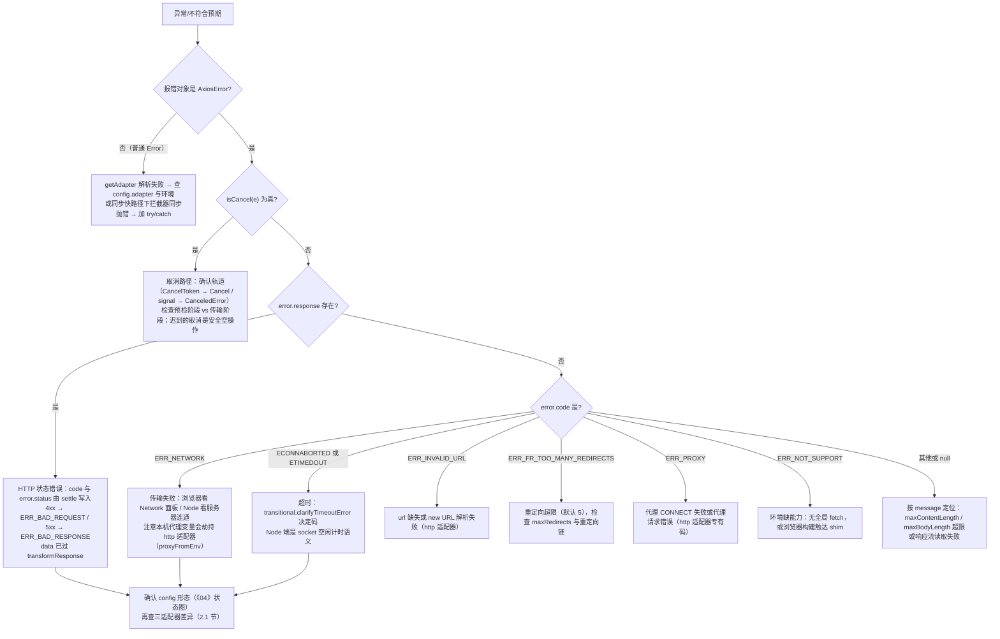

# 12-FAQ与故障排查
> 项目：my-ts-axios ｜ 版本：v1.1 ｜ 生成日期：2026-10-06 ｜ 依据：源码分析

## 1. 本篇定位与排查总纲

前七篇按"设计与机制"组织，本篇按"症状与根因"组织：把使用这个库时最高频的报错与反直觉行为逐条展开（每条给出症状、根因锚点、处置方法），再给一棵从症状出发的排查决策树与调试入口清单。阅读方法：先在第 2 节的症状索引里找到匹配条目直达；症状不在清单里的，走第 3 节决策树；决策树落到某个环节后，用第 4 节的调试入口下断点。

排查总纲只有一句话：**先用 `error.code` 与 `error.message` 定位产生段，再确认"此刻 config 处于哪种形态"（《04》状态图），最后检查三适配器的行为差异**。第 01 篇确立的错误三段约定（产生段只在适配器内部与 settle、加工段在 dispatchRequest 失败分支、消费段在调用方）意味着：任何 AxiosError 的 `code` 都能唯一反查到产生位置，这是整个排查体系的锚。

## 2. 高频问题逐条

### 2.1 三适配器 headers 修改的可见性不一致（最重要的跨端坑）

**症状**：同一段代码在浏览器里 `response.config.headers` 里看不到 `Content-Type`（被删了），在 Node 里却看得到；或拦截器里加的头在 Node 的 `response.config.headers` 出现、浏览器（fetch 适配器）不出现。

**根因**：xhr 适配器解构出的 `headers` 与 `config.headers` 是**同一个引用**（`src/core/adapters/xhr.ts` 第 16 行解构、第 137/148/152 行的原地 delete/写），它对 FormData 删 Content-Type、附加 XSRF 头、写 Authorization 的全部修改都会写回 `config.headers` 并出现在最终 `response.config.headers`；而 http 与 fetch 适配器都先做了浅拷贝（`http.ts` 第 134 行 `{ ...config.headers }`、`fetch.ts` 第 138 行 `{ ...headers }`），本地修改不回写。《04-数据模型》第 2 节末尾专门标注了这三个代码锚点。

**处置**：不要依赖 `response.config.headers` 观察实际发送的头——三端只有 xhr 是"所见即所得"。要确认真实发送头，浏览器看 DevTools Network、Node 端在适配器 options 组装处打断点或用回显服务（`test/core/httpAdapterHardening.spec.ts` 的 serverB 就是现成范本）。给库贡献代码时：新增适配器应选择"浅拷贝"派（不污染调用方 config），xhr 的行为是历史遗留（《13-技术债务》条目 5）。

### 2.2 CJS/ESM 互操作：require 拿到 `{ default: ... }` 包装

**症状**：Node 里 `const axios = require('ts-axios-zhangzhengyang')` 后 `axios.get is not a function`，打印出来是 `{ default: [Function] }`；或打包器报"xxx is not exported"。

**根因**：库的 ESM 源只有 default 导出（`src/index.ts`），若构建时 CJS 按默认的 named 导出编译，会发出 `module.exports = { default: axios }`。仓库为此在 `rollup.config.mjs` 第 42 行显式 `exports: 'default'`（CJS 产物直接 `module.exports = axios` 函数本身），并在 `scripts/smoke-dist.cjs` 第 10~14 行以 require 断言防护——文件头注释记录了这次坏包事故。因此**如果你在消费端看到包装对象，第一嫌疑是拿到了旧版本 dist 或用了未经本构建链的产物**。

**处置**：库维护者：重跑 `npm run build` 并确认 `node scripts/smoke-dist.cjs` 通过；消费方：确认安装版本的 `dist/node/axios.cjs` 是最新产物，或临时用 `require(...).default || require(...)` 兜底（不推荐长期保留）。另一个相关边界：ESM 产物文件名是 `dist/index.esm.js`（.js 后缀），供打包器经 `exports.import` 条件消费没问题；直接用 Node 的 ESM loader 加载它则依赖 Node 的模块语法自动探测（Node 22+ 默认开启，更老版本会按 CJS 解析失败）——**Node 端请走 `require` 条件（CJS 产物）或打包器**，不要手工 import ESM 文件。

### 2.3 Node 端 shims 抛错："Node.js 内置模块 xxx 在浏览器构建中不可用"

**症状**：浏览器 `<script>` 引入 UMD 产物后控制台抛 `Error: Node.js 内置模块 http 在浏览器构建中不可用`（或 zlib/stream/form-data），且发生在发请求时。

**根因**：请求被路由到了 **http 适配器**——浏览器 UMD 构建把 `http/https/zlib/stream/form-data` 全部 alias 到 `src/shims/node-builtins.ts` 的抛错占位（`rollup.config.mjs` 第 19~23 行），代码能加载但一调用就抛（`shims/node-builtins.ts` 第 3~7 行）。http 适配器被选中有两种可能：显式 `adapter: 'http'`；或运行环境被判定为"无 XMLHttpRequest"（`getAdapter.ts` 第 11 行的模块加载时探测）。

**处置**：去掉显式 `adapter` 让默认解析顺序（`['xhr', 'http', 'fetch']`）工作；确认 UMD 的使用场景是浏览器（Service Worker 里若需 fetch 适配器请显式 `adapter: 'fetch'`）。同类症状的镜像：Node 端没装 `form-data` 时 multipart 请求体变成 JSON 字符串（`http.ts` 第 24~29 行可选依赖探测失败走降级）——安装 optionalDependencies 并重装依赖即可。

### 2.4 取消后的 reject 判定：Cancel、CanceledError 与 isCancel

**症状**：`catch (e)` 里判断取消时 `e instanceof CanceledError` 在 CancelToken 轨道下是 false；或 `e.message` 有时是 undefined。

**根因**：双轨取消的 reject 值形态**取决于轨道而非时机**（《05》流程四边界）：`cancelToken` 轨道任何阶段 reject 的都是 `Cancel` 实例（只有 `message` 字段，`src/cancel/Cancel.ts`）；`signal` 轨道与"预检发现 signal.aborted"抛的是 `CanceledError`（`code: 'ERR_CANCELED'`，`src/cancel/CanceledError.ts`）。两者都能被 `isCancel()` 识别（`Cancel.ts` 第 12~14 行：`instanceof Cancel || instanceof CanceledError`），但 `instanceof CanceledError` 只对后者成立。

**处置**：统一用 `axios.isCancel(e)`（或自行 import 的 `isCancel`）判定取消，不要用 instanceof 区分轨道后再统一处理；需要 message 时对 Cancel 允许 undefined（`cancel('msg')` 不传 message 时就是 undefined）。另一个高频追问"取消一个已完成的请求会怎样"：安全空操作——xhr/http 已在 settle 出口移除 signal 监听，CancelToken 的 promise 迟到 resolve 也只作用于已定局的 Promise（Promise settle-once 语义，《04》第 4.3 节）。

### 2.5 其他高频条目速查表

| 症状 | 根因锚点 | 处置 |
| --- | --- | --- |
| `transitional.silentJSONParsing: false` 不生效 | 声明未消费（`defaults.ts` 第 70 行，全库无读取点）；实际开关是 `forcedJSONParsing`（`dispatchRequest.ts` 第 39~48 行） | 用 `transitional.forcedJSONParsing: false` 跳过整个响应转换管道；JSON 解析失败本就静默保持字符串（`data.ts` 第 15~24 行），下游做形态断言 |
| `responseType: 'json'` 时解析失败三端表现不同 | xhr 由浏览器解析（失败 `request.response` 为 null）；http/fetch 拿字符串后在 transformResponse 静默失败 | 见《04》第 3 节矩阵；跨端代码不要依赖"解析失败"的具体形态，先判 `typeof data === 'string'` |
| fetch 适配器没有上传进度 | fetch API 限制，`fetch.ts` 未消费 `onUploadProgress` | 上传进度敏感场景用 xhr（浏览器）或 http（Node）适配器 |
| Node 端超时"不准时" | http 适配器超时是 socket 空闲计时（`clientReq.setTimeout`），慢速但持续有数据的响应不会触发 | 需要总时长超时就在外层 `Promise.race` 计时，或接受 idle 语义（《05》流程三边界） |
| 4xx 时 `error.status` 是 undefined 而不是状态码？ | 不会——settle 把数值状态写进 `error.status`（`settle.ts` 第 20~31 行）；undefined 说明错误不是 settle 产生的 | 检查 `error.code`：网络/超时/取消类错误无 status；`maxContentLength` 超限错误 code 为 null 靠 message 区分（`http.ts` 第 271 行） |
| `getAdapter` 抛普通 Error："There is no suitable adapter..." | 所有命名适配器不可用或函数不是函数；这是普通 Error 不是 AxiosError（`getAdapter.ts` 第 45~52 行） | 修正 `config.adapter` 拼写；浏览器里指定 'http' 会因注册表为 null 而落到下一个候选 |
| 请求拦截器抛错没有发起网络请求，也没有进 dispatchRequest | 请求链环的 rejected 位是 undefined，错误直达响应拦截器 rejected（`Axios.ts` 第 82~96 行） | 这是 axios 语义；在响应拦截器 rejected 或调用方 catch 处理 |
| synchronous 快路径下拦截器抛错直接同步抛出 | 快路径在当前调用栈内执行拦截器（`Axios.ts` 第 74~80 行） | 调用方加 try/catch，或给该拦截器去掉 synchronous |
| 复用同一个 config 对象连续请求，第二次带上了第一次的 method/data | 方法族糖衣 `Object.assign(config || {}, {...})` 就地写入（`Axios.ts` 第 160~179 行）；且 `response.config` 是同一引用 | 每次传新对象，或先浅拷贝 |
| params 里的空格变成 `+`，服务端解析成加号 | 默认 encode 白名单把 `%20` 还原为 `+`（`url.ts` 第 4~13 行） | 对 RFC 严格服务端：`paramsSerializer: { encode: v => encodeURIComponent(v) }` |
| `//evil.com` 之类的 url 绕过了 baseURL | `isAbsoluteURL` 把 `//` 开头判为绝对地址（`url.ts` 第 87~89 行） | 调用方校验最终 URL 的 host（拦截器或封装层），见《08》第 2.2 节 |
| 同一 headers 对象里 `content-type` 与 `Content-Type` 并存 | `processHeaders` 只归一 Content-Type 自身的变体（`headers.ts` 第 7~18 行），用户自造的大小写重复不合并 | 传一种写法；或进实例前先用 AxiosHeaders.normalize |

## 3. 排查决策树

拿到一个失败请求或异常行为时，按下面的树走（mermaid 决策图，从"观察到的症状"出发）：

树的三个分叉口对应三类完全不同的处置思路：**非 AxiosError**（库的"协议外"失败，查 adapter 与调用方式）、**取消**（用 isCancel 统一判定）、**其余 AxiosError**（先看有没有 response 区分"服务器应答了但失败"与"根本没应答"，再用 code 反查产生点）。

## 4. 调试入口与断点建议

按"形态变换点"设置断点效率最高（《04》第 2 节的四个锚点），配合 `error.code` 反查表使用：

| 想观察什么 | 断点位置（相对项目根） | 观察点 |
| --- | --- | --- |
| 用户输入如何被合并 | `src/core/Axios.ts` 第 51 行 | mergeConfig 前后的 config；确认 url/params/data 不继承 defaults |
| 拦截器收集与过滤 | `src/core/Axios.ts` 第 56~71 行 | runWhen 剔除结果、synchronous every 判定 |
| URL 最终形态 | `src/core/dispatchRequest.ts` `transformURL`（第 30~37 行） | baseURL 拼接与 params 序列化结果 |
| data/headers 加工 | `src/core/dispatchRequest.ts` `processConfig`（第 24~28 行）三行各断一次 | 序列化后的 data、拍平后的 headers |
| 适配器选择 | `src/core/getAdapter.ts` 第 31~43 行循环 | 每轮候选与命中结果 |
| settle 判定 | `src/core/settle.ts` 第 17 行 | validateStatus 输入输出 |
| xhr 实际发送 | `src/core/adapters/xhr.ts` `processHeaders` 末尾（第 154~160 行）与 `request.send` | setRequestHeader 的逐项调用 |
| http 实际发送 | `src/core/adapters/http.ts` `finalize` 内 `transport.request(options, onResponse)`（第 334 行） | options.headers、options.path、代理分支后的最终 options |
| fetch 实际发送 | `src/core/adapters/fetch.ts` `fetch(requestUrl, init)`（第 188 行） | init.headers、init.body、init.signal |

两个不带断点的低成本手段：其一，注册一个首位的响应拦截器打印 `error.code / error.status / error.config.url`——利用"错误按链逆序经过响应拦截器 rejected"的语义（《05》流程三），一个拦截器即可观测所有失败；其二，测试驱动的复现——36 个 spec 覆盖了绝大多数行为分支（《09》第 2 节地图），把可疑行为在最近的 spec 里改造复现，往往比在业务代码里调试快一个数量级；http 适配器的问题可直接借用 `test/core/httpAdapter.spec.ts` 的本地服务器骨架起一个最小复现端点。

## 5. 小结

这份 FAQ 的条目分布本身说明了这个库的行为规律：大部分"坑"不是 bug，而是**三适配器实现细节差异**（2.1、2.5 的多处）、**双轨并存的语义成本**（2.4）与**官方兼容默认值的副作用**（+ 编码、baseURL 绕过、超时语义）三类。排查时牢记三个"先看"：先看 `error.code`（协议内失败的身份证）、先看 `isCancel`（取消的统一身份证）、先看此刻 config 形态（三态定位法）。仓库自带的 `test/` 与 `examples/` 是两个现成的复现场——前者覆盖行为分支，后者覆盖真实浏览器与跨域场景，绝大多数问题都可以在这两个场里最小化后再定位根因。
