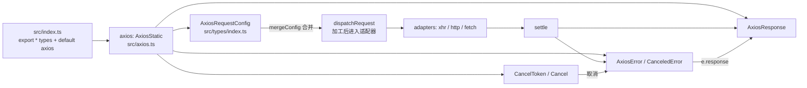

# 15-接口全量参考
> 项目：my-ts-axios ｜ 版本：v1.1 ｜ 生成日期：2026-10-06 ｜ 依据：源码分析

## 1. 本篇定位与阅读方法

本篇是九篇新篇目的收官之作，也是全文档集的**速查层**：把散落在第 02/03/04 篇中的接口信息全量化为五组大表——入口导出清单、`AxiosRequestConfig` 全字段表（新增"消费点"列，标明每个字段被哪个源文件的哪段逻辑读取）、响应/错误/取消结构全表、实例方法签名表、与官方 axios 的行为差异对照全表。第 03 篇已经建立了接口设计的"为什么"，本篇只回答"有哪些、是什么、在哪生效"。

三张总图先行。第一张是接口体系的 mermaid 总览（下方），刻画从入口到值形态的导出与消费关系；第二、三张已在既有篇目（《01》图 1 依赖分层、《05》流程一 Promise 链），本篇不重复。

读表的三条口径约定：**默认值列**区分三档——"有"（`src/defaults.ts` 显式给出）、"无（不继承）"（`fromVal2Strat` 字段，defaults 中的值不会生效）、"无"（字段缺省，运行时按字段的消费点各自兜底）；**消费点列**给出读取该字段的最主要位置，路径相对项目根，多处消费时以分号并列；**类型列**照录 `src/types/index.ts` 的声明，联合类型保持原样。另有一处命名差异需要先说明：类型文件里 `AxiosError` 是 interface（第 166~173 行），运行时实现类在 `src/helpers/error.ts`——本篇表格统一描述**运行时值形态**，类型形态见第 03 篇 3.3 节。

默认值的三档划分值得再展开一层，因为它直接决定"我在 defaults 里改这个值有没有用"。第一档"有"的字段（method、timeout、xsrf 两名、validateStatus、transitional、env）写在 `src/defaults.ts` 的 defaults 对象上，任何实例创建时经 `mergeConfig` 继承，在实例 defaults 上修改即可全局生效；第二档"无（不继承）"的字段（url、params、data）受 `mergeConfig.ts` 第 18 行 `stratKeysFromVal2` 策略表约束——即使你在实例 defaults 上写了 `data: {默认请求体}`，每次请求也不会读到它，这是官方同款的语义防护（避免"上一次请求体渗漏进下一次"）；第三档"无"的字段最多，它们的兜底逻辑散落在消费点内部，例如 `maxRedirects` 在 `http.ts` 第 177 行兜底为 5、`decompress` 在第 258 行以 `!== false` 兜底为 true、`responseEncoding` 在第 281 行兜底 utf8——这类"消费点兜底"与"defaults 兜底"的行为差异在于前者不参与 mergeConfig 合并，调用方显式传 `undefined` 与不传完全等价。三档的划分依据全部可以在 `src/core/mergeConfig.ts` 的策略表与各消费点的判空方式中逐行验证，这正是"消费点"列存在的意义。

消费点列的粒度也有约定：它指向**读取该字段做出行为分支的那一处代码**，而不是字段被传递经过的每一站。以 `transitional` 为例，它从 config 出发会经过合并、加工、适配器三个阶段，但真正"读取并分支"的只有 `dispatchRequest.ts` 第 39~48 行（forcedJSONParsing）与三个适配器的超时回调（clarifyTimeoutError）；再以 `auth` 为例，它被三端以三种完全不同的机制消费——xhr 拼进 Authorization 头、http 交给 `options.auth` 由 Node 底层处理、fetch 用自实现的 base64 助手——消费点列把这三个位置并列给出，跨端排查时可以逐端核对。若某字段的消费点标注为"无"或"未消费"，即说明类型声明超前于实现，状态与整改建议统一登记在《13-技术债务与演进建议》，本表只在原地标注互链，不展开重复内容。

## 2. 入口导出清单

### 2.1 src/index.ts 的导出面

| 导出 | 内容 | 说明 |
| --- | --- | --- |
| `default` | `axios`（`AxiosStatic` 混合对象） | 全部运行时值的唯一出口 |
| `export *`（仅类型） | `src/types/index.ts` 全部 27 个类型 | 编译后消失，无运行时代价 |

### 2.2 默认实例（axios）的全部成员

| 成员 | 签名/类型 | 类别 | 说明 |
| --- | --- | --- | --- |
| `axios(config)` | `(config) => AxiosPromise` | 调用 | 绑定的 `Axios.prototype.request` |
| `axios(url, config?)` | `(url, config?) => AxiosPromise` | 调用 | 同上，双签名 |
| `request` | `(config) => AxiosPromise` | 方法族 | 同调用形态 |
| `get/delete/head/options` | `(url, config?) => AxiosPromise` | 方法族 | 无请求体 |
| `post/put/patch` | `(url, data?, config?) => AxiosPromise` | 方法族 | 带请求体 |
| `postForm/putForm/patchForm` | `(url, data?, config?) => AxiosPromise` | 方法族 | 自动 toFormData + multipart 头 |
| `getUri` | `(config?) => string` | 方法族 | 只算不发 |
| `defaults` | `AxiosRequestConfig` | 实例数据 | 可运行时修改 |
| `interceptors` | `{ request, response }` | 实例数据 | 两个 InterceptorManager |
| `create` | `(config?) => AxiosInstance` | 静态 | 总以全局 defaults 为底；**不拷贝到子实例** |
| `Axios` | `AxiosClassStatic` | 静态 | 类本身 |
| `AxiosHeaders` | `typeof AxiosHeaders` | 静态 | 首部类 |
| `AxiosError` / `CanceledError` | 错误类 | 静态 | 供 instanceof |
| `Cancel` / `CancelToken` / `isCancel` | 取消原语 | 静态 | 双轨取消 |
| `all` / `spread` | 并发糖 | 静态 | Promise.all / 参数展开 |
| `VERSION` | `string`（`'0.2.1'`） | 静态 | 与 package.json 同步由 smoke-dist 校验 |
| `HttpStatusCode` | 状态码常量表 | 静态 | 63 项全量 |
| `mergeConfig` / `getAdapter` | 内部工具 | 静态 | 可脱离请求单独使用 |
| `isAxiosError` | `(payload) => boolean` | 静态 | instanceof 判定 |
| `toFormData` / `formToJSON` | 表单工具 | 静态 | 见第 02 篇第 8 节 |

## 3. AxiosRequestConfig 全字段表

按"通用 → 取消与安全 → 转换与序列化 → fetch 专属 → Node 专属"分组。消费点列是本表相对第 03 篇的核心增量。

| 字段 | 类型 | 默认值 | 消费点（主要） |
| --- | --- | --- | --- |
| `url` | `string` | 无（不继承） | `core/dispatchRequest.ts` `transformURL` → 三适配器 |
| `method` | `Method`（13 字面量联合） | `'get'` | `core/Axios.ts` 第 52 行小写化；三适配器 `method.toUpperCase()` |
| `data` | `any` | 无（不继承） | `defaults.ts` transformRequest → `dispatchRequest.processConfig` → 三适配器 |
| `params` | `any` | 无（不继承） | `transformURL` → `helpers/url.ts` `buildURL` |
| `headers` | `any`（推荐三层结构） | `headers.common.Accept` 等 | `mergeConfig` 深合并 → `helpers/headers.ts` `flattenHeaders` → 三适配器 |
| `timeout` | `number` | `0`（不限） | `adapters/xhr.ts` `configureRequest`；`adapters/http.ts` `clientReq.setTimeout`；`adapters/fetch.ts` setTimeout |
| `responseType` | `XMLHttpRequestResponseType \| 'stream'` | 无 | xhr `configureRequest`（跳过 stream）；http 响应侧分流；fetch 响应侧分流 |
| `withCredentials` | `boolean` | 无 | `adapters/xhr.ts`、`adapters/fetch.ts`（credentials: 'include'） |
| `auth` | `{username, password}` | 无 | xhr `processHeaders`（btoa）；http `options.auth`；fetch `base64` |
| `validateStatus` | `(status) => boolean` | 200≤status<300 | `core/settle.ts` 第 16~17 行 |
| `adapter` | 函数/字符串/数组 | 无（内部顺序 `['xhr','http','fetch']`） | `core/getAdapter.ts` |
| `signal` | `AbortSignal` | 无 | `dispatchRequest.ts` 预检；三适配器监听 |
| `cancelToken` | `CancelToken` | 无 | `dispatchRequest.ts` 预检；三适配器订阅 `token.promise` |
| `xsrfCookieName` | `string` | `'XSRF-TOKEN'` | `adapters/xhr.ts`、`adapters/fetch.ts`（+ `helpers/cookie.ts` read） |
| `xsrfHeaderName` | `string` | `'X-XSRF-TOKEN'` | 同上两处写入请求头 |
| `withXSRFToken` | `boolean \| (config) => boolean` | 无（非 false 即允许） | 同上两处判定 |
| `transformRequest` | 转换器或数组 | defaults 内置数组 | `dispatchRequest.processConfig` → `core/transform.ts` |
| `transformResponse` | 转换器或数组 | defaults 内置数组 | `dispatchRequest.transformResponseData`（受 forcedJSONParsing 控制） |
| `paramsSerializer` | 函数或 `{serialize,encode,indexes}` | 无 | `helpers/url.ts` `buildURL` |
| `baseURL` | `string` | 无 | `transformURL`（`combineURL`） |
| `allowAbsoluteUrls` | `boolean` | 无（undefined 视同 true） | `transformURL` 第 33 行 |
| `transitional` | `{silentJSONParsing?, forcedJSONParsing?, clarifyTimeoutError?}` | `{true, true, false}` | forcedJSONParsing → `dispatchRequest.ts` 第 39~48 行；clarifyTimeoutError → 三适配器超时分支；silentJSONParsing **无消费点**（见《13》条目 1） |
| `formSerializer` | `{dots?, metaTokens?, indexes?, visitor?, maxDepth?}` | 无 | `core/Axios.ts` `_requestForm` → `helpers/formData.ts`（metaTokens/maxDepth 无消费点，见《13》条目 2/3） |
| `env` | `{FormData?: any}` | 全局 FormData 或 undefined | `defaults.ts` transformRequest 第 42~44 行（注意 `_requestForm` 不走此路径，《13》条目 6） |
| `fetchOptions` | `Record<string, any>` | 无 | `adapters/fetch.ts` init 展开（不可覆盖 method/headers/body/signal/credentials） |
| `onUploadProgress` / `onDownloadProgress` | `(e: AxiosProgressEvent) => void` | 无 | xhr `makeProgressHandler`；http `progressStream` 上下行；fetch 仅下载 |
| `maxRate` | `number \| [number, number]` | 无 | `helpers/progressStream.ts` `resolveMaxRates` → http 适配器 |
| `httpAgent` / `httpsAgent` | `any` | 无 | `adapters/http.ts` `options.agent`；CONNECT 隧道继承 TLS 选项 |
| `proxy` | `AxiosProxyConfig \| false` | 无（false 显式禁用） | `http.ts` 第 458~459 行代理决策；`helpers/proxyFromEnv.ts` 兜底 |
| `maxRedirects` | `number` | 5 | `http.ts` `onResponse` 第 177 行 |
| `maxContentLength` | `number` | 无（不设限） | `http.ts` 流累积校验第 268 行 |
| `maxBodyLength` | `number` | 无（不设限） | `http.ts` `finalize` 预校验 + 流式计数 Transform |
| `decompress` | `boolean` | true（`!== false`） | `http.ts` `buildDecompressStream` |
| `responseEncoding` | `string` | `'utf8'` | `http.ts` Buffer.toString 第 281 行 |
| `socketPath` / `family` / `lookup` / `insecureHTTPParser` | 各自类型 | 无 | `http.ts` `options` 直传 |
| `transport` | `any` | 无 | `http.ts` 第 132 行 transport 选择 |
| `beforeRedirect` | `(options, responseDetails?) => void` | 无 | `http.ts` `onResponse` 第 210~223 行（抛错中断） |

## 4. 响应、错误与取消结构全表

### 4.1 AxiosResponse（成功值形态）

| 字段 | 类型 | 三适配器来源 |
| --- | --- | --- |
| `data` | `any` | xhr：`responseText`/`request.response`；http：Buffer 或按 responseEncoding 解码字符串（经解压与 maxContentLength 护栏）；fetch：text/arrayBuffer/blob/ReadableStream，均经 transformResponse |
| `status` | `number` | `request.status` / `res.statusCode` / `fetchRes.status` |
| `statusText` | `string` | `request.statusText` / `res.statusMessage \|\| ''` / `fetchRes.statusText` |
| `headers` | 小写键普通对象 | xhr `parseHeaders(getAllResponseHeaders())`；http `parseRawHeaders(res.rawHeaders)`；fetch `headers.forEach` 小写化 |
| `config` | `AxiosRequestConfig` | 引用传入 config（加工形态，非快照——《04》推论一） |
| `request` | `any` | XMLHttpRequest 实例 / ClientRequest 实例 / 恒 `null` |

### 4.2 AxiosError（运行时 class，`src/helpers/error.ts`）

| 字段/方法 | 类型 | 说明 |
| --- | --- | --- |
| `message` / `name` | `string` | name 恒 `'AxiosError'`（CanceledError 改写为 `'CanceledError'`） |
| `config` | `AxiosRequestConfig` | 全部 AxiosError 携带（不变量 3） |
| `code` | `string \| null` | 13 个码，见 4.4 来源表；`maxContentLength` 超限与响应流错误为 null |
| `status` | `number \| null` | settle 经 createError 第 6 参写入 |
| `request` | `any` | 底层对象（可为 undefined） |
| `response` | `AxiosResponse`（可选） | HTTP 状态错误携带，data 已转换 |
| `isAxiosError` | `boolean` | 恒 true；判定用 `isAxiosError()`（instanceof） |
| `toJSON()` | 方法 | 序列化 message/name/code/status/config/response |

### 4.3 取消结构

| 结构 | 形态 | 关键行为 |
| --- | --- | --- |
| `CancelToken` | `{promise: Promise<Cancel>; reason?; throwIfRequested(); static source()}` | 构造即 executor 执行；cancel 幂等；promise 多订阅 |
| `Cancel` | `{message?}` | 旧轨 reject 值；`instanceof Cancel` |
| `CanceledError` | AxiosError 子类，`code: 'ERR_CANCELED'` | 新轨与预检 reject 值；显式 setPrototypeOf |
| `isCancel(value)` | `(value) => boolean` | `instanceof Cancel \|\| instanceof CanceledError`，双轨统一判定 |

### 4.4 错误码产生点全表

| code | 产生点 | 触发条件 |
| --- | --- | --- |
| `ERR_CANCELED` | `cancel/CanceledError.ts` | signal 触发/预检 aborted（cancelToken 轨道 reject 的是 Cancel 实例） |
| `ECONNABORTED` / `ETIMEDOUT` | 三适配器超时分支 | `transitional.clarifyTimeoutError` 决定取哪个 |
| `ERR_NETWORK` | xhr onerror、http clientReq error、fetch reject 分支 | 传输层失败 |
| `ERR_BAD_REQUEST` | `core/settle.ts` | status < 500 且 validateStatus 拒绝；另 http maxBodyLength 超限 |
| `ERR_BAD_RESPONSE` | `core/settle.ts` | status ≥ 500；另 fetch 响应体读取失败 |
| `ERR_FR_TOO_MANY_REDIRECTS` | `http.ts` onResponse | redirectCount ≥ maxRedirects |
| `ERR_PROXY` | `http.ts` CONNECT 两分支 | 本项目自增码（官方无） |
| `ERR_INVALID_URL` | `http.ts` 开头与 `_send` | url 缺失或 `new URL` 失败 |
| `ERR_NOT_SUPPORT` | `fetch.ts` 环境守卫、shims 触发 | 环境缺能力 |
| `ERR_BAD_OPTION_VALUE` / `ERR_BAD_OPTION` / `ERR_DEPRECATED` | 无产生点 | 占位码（对齐官方码表，见《13》条目 4） |

错误处理的阅读建议按"三层"进行。第一层看 4.2 的字段表建立"错误长什么样"的静态认知：所有 AxiosError 都携带 config 与 request 两个现场槽位，HTTP 状态错误额外携带 response 且 status 已写入错误对象——这意味着任何错误处理函数都能不依赖外部上下文地回答"哪个请求、什么配置、服务器答了什么"。第二层看 4.4 的产生点表建立"错误从哪来"的动态认知：错误码是封闭集合，每个码都能反查到唯一的产生位置与触发条件，取消轨（CancelToken）的拒绝值是 Cancel 实例而非 AxiosError 这一点要特别留意，它不计入 4.4 的码表但计入 isCancel 的判定。第三层结合《12-FAQ与故障排查》的决策树把两层知识串成排查动作：先 isCancel 再看 response 有无、最后按 code 反查产生点。三层读完会发现一个规律——本库错误体系的设计重心在"可定位性"而非"可读性"，message 文本仅用于人读，机器分流一律应依赖 code 与结构字段，这与第 6 节差异表第 15 条"不要按 message 匹配"的建议互为表里。

## 5. 实例方法签名表

| 方法 | 签名 | 内部委托 | 备注 |
| --- | --- | --- | --- |
| `request` | `(config) => AxiosPromise`；`(url, config) => AxiosPromise` | 链编排本体 | 双签名归一后 mergeConfig |
| `get/delete/head/options` | `<T = any>(url, config?) => AxiosPromise<T>` | `_requestMethodWithoutData` | `Object.assign` 就地写入调用方 config |
| `post/put/patch` | `<T = any>(url, data?, config?) => AxiosPromise<T>` | `_requestMethodWithData` | 同上 |
| `postForm/putForm/patchForm` | `<T = any>(url, data?, config?) => AxiosPromise<T>` | `_requestForm` | 前置 multipart 头 + toFormData（formSerializer 透传） |
| `getUri` | `(config?) => string` | `mergeConfig` + `transformURL` | 唯一同步方法；不加工 data/headers |
| `create`（仅静态） | `(config?) => AxiosInstance` | `createInstance(mergeConfig(defaults, config))` | 产物无 create 与静态 API |
| 泛型说明 | — | — | 泛型 T 只存在于 `types/index.ts` 的接口声明（落点 `response.data`）；实现侧返回非泛型 `AxiosPromise`，运行时无约束 |

## 6. 与官方 axios 的行为差异对照全表

对照口径与第 03 篇第 4 节一致：只列**源码可验证**的差异，"官方也如此"的行为不列。本表为全量化版本（11 条 → 15 条），并补充每条的使用建议列：

| # | 差异点 | 本库行为（锚点） | 官方 v1 行为 | 使用建议 |
| --- | --- | --- | --- | --- |
| 1 | `Cancel` 与 `CanceledError` 双类 | `Cancel.ts` 独立简单类 | `axios.Cancel === CanceledError` 别名 | 判取消只用 `isCancel`，勿依赖两者同一 |
| 2 | headers 流转形态 | 内部普通对象；响应 headers 小写键普通对象；AxiosHeaders 可选容器 | 全面 AxiosHeaders 化，响应 headers 是实例 | 不要调用 AxiosHeaders 独有方法（forEach/match 等）于响应 headers |
| 3 | http 重定向自实现 | `_send` 递归；301/302+post、303+非 get/head 改写 GET 丢体删 content-*；maxRedirects 默认 5；beforeRedirect 可改写；跨 host 剥凭据 | follow-redirects 库 | 行为语义对齐 RFC 子集，但无 follow-redirects 的全部选项（如 maxBodyLength 语义差异） |
| 4 | fetch 适配器无上传进度 | `onUploadProgress` 未消费 | 同（fetch API 限制） | 上传进度选 xhr/http |
| 5 | `transitional` 消费粒度 | forcedJSONParsing=false 跳过**整个** transformResponse；silentJSONParsing 未消费 | silentJSONParsing=false 时解析失败抛 ERR_BAD_RESPONSE；forcedJSONParsing 粒度更细 | 不要配置 silentJSONParsing（无效）；依赖"解析失败报错"需自建拦截器 |
| 6 | AxiosHeaders 方法面 | 官方方法子集（无 forEach/match/asType/setCookie/getSetCookie 等） | 完整方法面 | 需要这些方法自行扩展（《11》SOP） |
| 7 | 同步快路径条件 | `every` 全真才同步；响应拦截器无同步概念 | 一致（官方同款 every） | 无需迁移成本，列出防误判 |
| 8 | `axios.create` 以全局 defaults 为底 | `axios.ts` 第 28~30 行 | 一致 | 实例间配置隔离需各自 create |
| 9 | `ERR_PROXY` 自增码 | CONNECT 两分支（`http.ts` 486/524） | 无此码，代理失败归普通 Error/ERR_NETWORK | 按码分流的白名单需包含它（或忽略它） |
| 10 | `responseType: 'stream'` 仅 Node | xhr 显式跳过（`xhr.ts` 第 52 行）；fetch 返回 ReadableStream | 一致 | 浏览器勿依赖 stream 形态 |
| 11 | paramsSerializer 能力 | 函数式 + `{serialize, encode, indexes}` 三选项；数组 indexes 三态对齐 | 基于此之上官方更多依赖 qs 生态 | 复杂序列化用函数式全接管 |
| 12 | formSerializer 部分选项未消费 | `metaTokens`/`maxDepth` 声明未实现 | 已实现 | 勿配置这两个（无效） |
| 13 | 占位错误码 | `ERR_BAD_OPTION_VALUE/ERR_BAD_OPTION/ERR_DEPRECATED` 无产生点；adapter 非法抛普通 Error | 参数校验路径使用它们（AxiosError） | catch 分流不能假设所有失败都是 AxiosError |
| 14 | XSRF 附加条件 | `withXSRFToken` 非 false 即允许 + （withCredentials 或同源） | 一致（v1 同款规则） | 严格控制附加范围用函数形式 |
| 15 | 错误消息文本 | 超时消息大小写/格式与官方存在细微差异（如 http 端 `timeout of Nms exceeded`） | 官方统一 `Timeout of N ms exceeded`（旧版小写） | 不要按 message 文本匹配，按 code 分流 |

对照口径与第 03 篇第 4 节一致：只列**源码可验证**的差异，"官方也如此"的行为不列。本表为全量化版本（11 条 → 15 条），并补充每条的使用建议列。编制方法需要说明：差异的判定不是凭文档印象，而是逐条打开本库锚点源码后与官方 v1 的公开行为对照——例如第 5 条 transitional 的差异，是把本库 `dispatchRequest.ts` 的 transformResponseData 与官方同名函数分别读完后的结论；第 3 条重定向差异，是把 `_send` 的改写规则逐状态码核对 RFC 7231 与 follow-redirects 源码后的结论。建议列则把"差异"翻译成"动作"：多数差异对迁移无感（7、8、14 官方本就一致或行为兼容），少数需要改代码习惯（1、2、15 的判定方式），个别需要绕行（4、12 的无效配置）。阅读时建议先扫"使用建议"列再回看锚点，把表当成迁移检查单而非知识点清单。

值得注意的是差异表的分布规律：十五条中真正"行为不同"的只有第 1、2、3、5、9、12、13 条，其余是"官方也如此但易误判"或"官方行为的精确子集"。这个分布说明本库在接口面上对官方的追随是高保真的——差异主要集中在取消双轨的类形态、headers 的容器选择与几处声明未消费的配置上，而请求方法族、合并策略、进度事件、settle 判定这些高频路径全部与官方对齐。对使用者而言，这意味着官方文档的心智模型可以整体迁移，只需要把第 6 节这张表里"使用建议"列的条目纳入习惯。

## 7. 速查使用建议

本篇五组表的使用场景各有侧重：接入阶段查第 2 节（拿到什么）；写请求查第 3 节（配什么、在哪生效）；写错误处理查 4.2/4.4（拿到什么错误、什么码）；封装层查第 5 节（方法签名与泛型边界）；迁移自官方 axios 查第 6 节（哪些行为不能想当然）。全表与源码的对应关系以"消费点"列为桥——任何行为疑问都可以从该列的锚点直接跳到源码验证，这也呼应了整个文档集的方法论：**每个接口行为都应能在 `src/` 中找到唯一消费位置**；找不到消费点的字段（表 3 中已标注的三个）即是当前实现与声明的缺口，状态汇总在《13-技术债务与演进建议》，此处不重复展开。

落到具体工作流，四种角色各有一条最短路径。**业务开发者**：先从第 2 节确认可调用面，写请求时只查第 3 节的"通用"与"取消与安全"分组即可覆盖九成场景，Node 专属分组仅在服务端调用时启用；遇到行为与预期不符，按"消费点"列跳源码，再按需转入《12》的决策树。**封装层作者**（在库之上包一层团队 SDK）：第 5 节的泛型说明决定了类型策略——在封装层重新声明带泛型的签名比依赖库内泛型可靠，因为运行时无约束；`create` 的"总是以全局 defaults 为底"语义（第 6 节第 8 条）意味着多环境配置（测试/预发/生产）应在封装层持有各自的实例，而不是在运行时改全局 defaults。**错误处理中间件作者**：以 4.4 产生点表为白名单设计分流，务必处理"code 为 null"（maxContentLength/响应流错误）与"拒绝值不是 AxiosError"（Cancel 实例）两个表外形态。**库贡献者**：把第 3 节当回归清单用——新增或修改任何字段行为时，检查该行"消费点"列涉及的所有文件，并同步更新本表（这是全文档集唯一要求"随代码变更必须同步"的表格，因为它承诺的是全量而非示例）。
