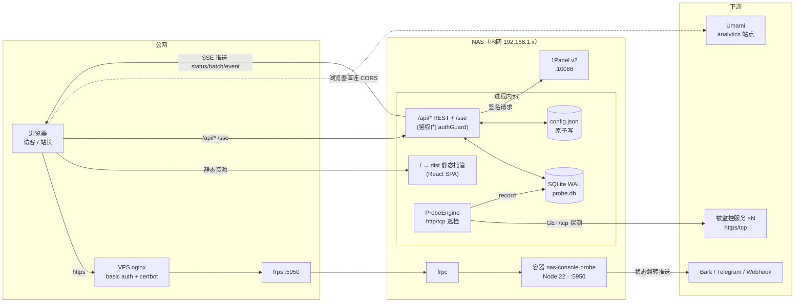
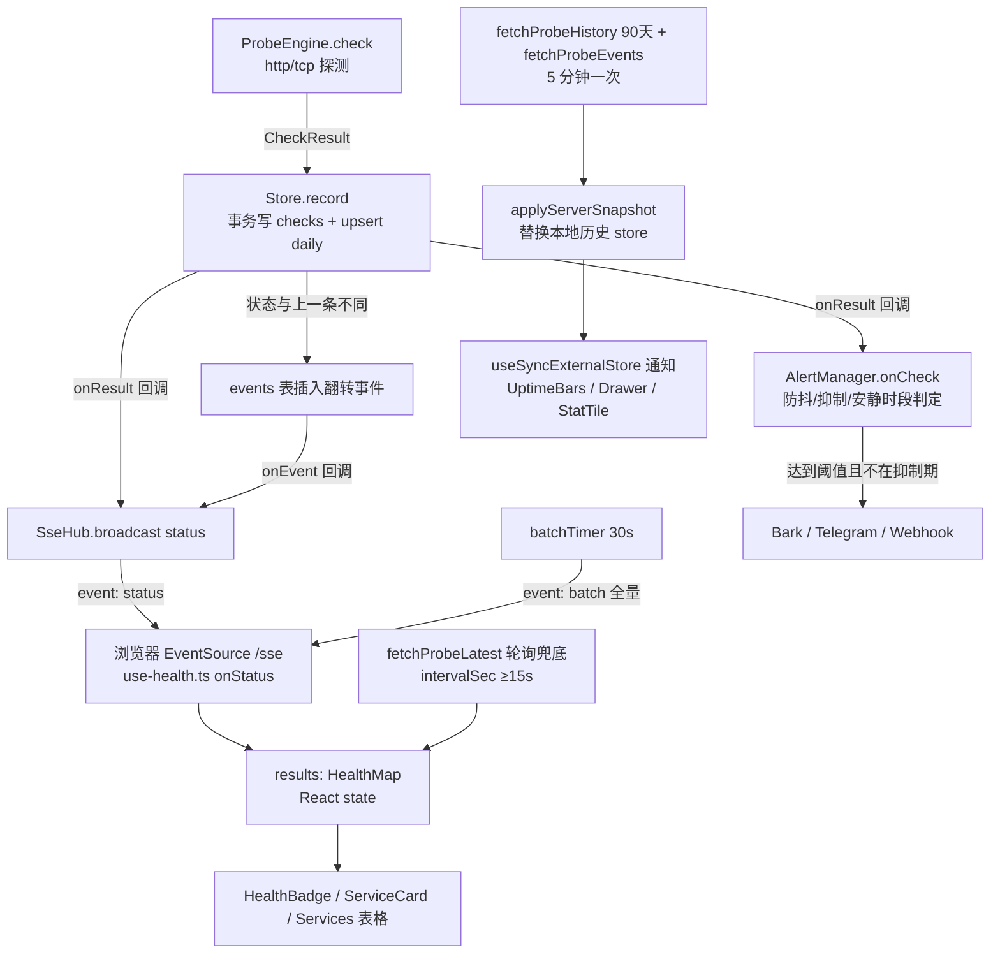
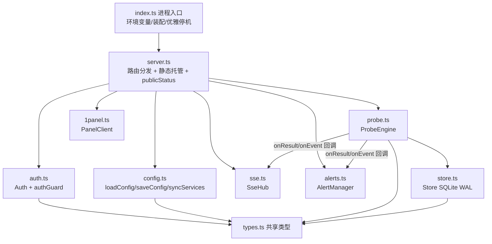

# 01 系统架构
> 项目：nas-console ｜ 版本：v1.0 ｜ 生成日期：2026-10-05 ｜ 依据：源码分析

## 1. 整体架构图

系统在物理上只有**一个常驻进程**（探针容器 `nas-console-probe`），它同时承担四个角色：探针引擎、REST/SSE API 服务、前端静态资源托管、以及 1Panel/告警渠道的出站客户端。生产链路（README「部署」节 + `docs/v03-probe-design.md`）如下：

图中有两条刻意的分界线值得强调：

1. **Umami 走浏览器直连而非服务端代理**。`src/api/umami.ts` 顶部注释写明「Umami 对 /api/* 开放 CORS」，因此 PV/UV 等统计请求不经过探针，由浏览器携带 Bearer token 直接访问 Umami 域名；探针进程对 Umami 完全无感知。这消除了代理层的鉴权透传与流量放大，代价是 Umami 账号密码只能保存在浏览器 localStorage（`ConsoleSettingsContext.tsx` 注释「仅存浏览器 localStorage，不上传」）。
2. **1Panel 必须走服务端代理**。与 Umami 相反，1Panel 的 API Key 属于高权限凭据，绝不能下发浏览器；`server/src/1panel.ts` 以 `md5("1panel" + apiKey + ts)` 签名（第 66-71 行 sign 函数），且域名绑定场景必须注入 Host 头。前端只访问探针的 `/api/host/metrics`、`/api/containers/*` 代理端点（`src/api/host.ts`）。

## 2. 前后端职责划分

| 职责 | 归属 | 落点 |
|---|---|---|
| 路由/页面渲染、主题、命令面板 | 前端 | `src/App.tsx`、`src/layouts/AppLayout.tsx` |
| 健康状态消费与展示（SSE 订阅、轮询兜底、降级巡检） | 前端 | `src/api/use-health.ts` |
| 健康历史消费（可用率条/延迟走势/事件列表） | 前端 | `src/api/health-history.ts` |
| Umami 全链路（登录、token 缓存、数据拉取、全站聚合） | 前端 | `src/api/umami.ts`、`src/pages/Analytics.tsx` |
| 用户偏好（主题/轮询间隔/Umami 凭据/自定义服务/隐藏清单） | 前端 localStorage | `src/settings/ConsoleSettingsContext.tsx` |
| 7×24 巡检调度与判定（http/tcp/超时/关键词/证书） | 后端 | `server/src/probe.ts` |
| 健康数据持久化与聚合（checks 90 天/daily 永久/events） | 后端 | `server/src/store.ts` |
| 实时推送（SSE 广播 + 30s batch 兜底 + 25s 心跳） | 后端 | `server/src/sse.ts`、`server/src/server.ts` |
| 告警决策与投递（防抖/抑制/安静时段/Bark/TG/Webhook） | 后端 | `server/src/alerts.ts` |
| 登录鉴权（口令哈希校验、签名 Cookie、IP 限流） | 后端 | `server/src/auth.ts` |
| 服务清单权威副本与脱敏快照 | 后端 | `server/src/config.ts`、`server/src/server.ts`（publicStatus） |
| 1Panel 集成与容器操作白名单 | 后端 | `server/src/1panel.ts`、`server/src/server.ts` |
| SPA 静态托管（含 SPA fallback 与 immutable 缓存） | 后端 | `server/src/server.ts`（serveStatic） |

职责边界遵循一条清晰原则：**凡是「7×24、需要凭据、需要脱敏」的事情都在服务端；凡是「呈现、偏好、可公开的第三方数据」都在浏览器**。健康检查因此存在双通道：探针在线时一切以服务端 SQLite 为权威（`use-health.ts` 注释「服务端是 7×24 巡检的权威数据源」），探针不可达时前端回退 v0.2 的浏览器探测，两条路径在 `useHealthChecks` Hook 内完成切换。

## 3. 数据流向图

下面这张图刻画「一次巡检结果从产生到各个消费端」的完整流向，这是系统最主干的数据流：

三个补充流：

- **清单下行流**：`useProbeListSync`（`src/api/use-probe-sync.ts`）在 AppLayout 挂载时把「内置 SERVICES + 自定义 customServices − 隐藏标记」整体 `PUT /api/services`，服务端 `syncServices`（`server/src/config.ts`）以 upsert 语义合并——已存在的 id 保留手工 check 配置，新 id 推导默认 check，`prune` 固定关闭（隐藏≠删除）。清单写回 config.json 采用 tmp + rename 原子替换（`saveConfig`）。
- **公开快照流**：`publicStatus()`（`server/src/server.ts` 第 341-381 行）把 config 清单 + 引擎最近结果 + `dailyBuckets(45)` 组装成脱敏快照；只有 `portal.publicGroups` 白名单分组追加 `url/tags/error/profile` 字段。
- **主机指标流**：前端 30s 轮询 `/api/host/metrics` → `PanelClient.nodeCurrent()/osInfo()` 并发请求 1Panel → 原样聚合返回；未配置时返回 400，`HostMetricsCard`/`NasCard` 据此自我隐藏（`e.notConfigured` 标记，`src/api/host.ts` 第 51-53 行）。

## 4. 后端内部分层

`server/src/` 虽然只有 10 个文件，但分层完整且单向依赖：

依赖规则：`store` 不认识 `probe`（由引擎主动写入），`sse`/`alerts` 不认识 `engine`（通过构造时注入的回调解耦，见 `server.ts` 第 54-60 行），`index.ts` 是唯一组装点。这实际上是**依赖注入 + 观察者模式**的极简实现：`ProbeEngine` 在构造时接收 `onResult`/`onEvent` 两个回调，`createServer` 把 `AlertManager.onCheck` 与 `SseHub.broadcast` 挂上去，引擎本身对「告警」「推送」零依赖。

## 5. 前端内部分层与关键设计决策

前端分层为四层：`api/`（数据访问，一个外部系统一个文件）→ `config/`+`settings/`（静态配置与用户偏好）→ `components/`+`charts/`（复用组件）→ `pages/`+`layouts/`（路由级组合）。状态管理没有引入任何第三方库，由三种机制分担（详见 02 篇第 5 节）。

以下是影响全局的五个架构决策，均可在源码中找到证据：

**决策一：探针自带静态托管，单容器单端口。** `docs/v03-probe-design.md` 第 2 节明确这是「关键决策」：Node 进程直接 `serveStatic(dist)`（`server.ts` 第 443-461 行），替代旧的 nginx 挂 dist 容器，「同源免 CORS、免二次反代，部署面最小」。静态托管带 SPA fallback（非存在路径回落 index.html）与 assets 目录 immutable 长缓存（`cache-control: public, max-age=31536000, immutable`）。

**决策二：服务清单权威归探针。** v0.2 时代清单散在「前端 localStorage + 构建期常量」，v0.3 迁移为「probe 持有的 config.json 权威副本」（设计稿第 2 节），前端设置页经 `/api/services` 读写。但 `src/config/services.ts` 里的 19 项内置清单仍是**编译期基线**：每次管理区布局挂载都会全量 upsert 给探针。这是一种「代码即基线、服务端为运行时权威」的双层模型——重建环境时前端一次访问即可完成清单回填（README「部署」节）。

**决策三：健康数据双模式 + 显式降级。** `useHealthChecks` 在挂载时调用一次 `probeAvailable()`（3 秒超时的 `GET /api/health/latest`），据此把 `source` 锁定为 `probe` 或 `browser`，**运行期不自动来回切换**（`use-health.ts` 第 37-46 行注释「运行中不自动来回切换」）。探针模式 = SSE 订阅 + latest 轮询兜底 + 5 分钟历史导入；浏览器模式 = no-cors fetch 并发 4 + localStorage 聚合。两条路径的历史结构（DayBucket/RecentSample）刻意保持同形，使 `applyServerSnapshot` 能整体替换本地状态而无缝衔接（`health-history.ts` 第 158-182 行）。

**决策四：零框架后端。** 路由是 `handleApi` 内一串 `if (req.method === ... && url.pathname === ...)` 分支，JSON 解析（`readJson`，1MB 上限）、文件上传（`readRaw`，5MB 上限）、MIME 表、静态服务全部手写。选择理由与部署形态强相关：探针与静态托管同进程后，引入 Web 框架的收益（中间件生态）趋近于零，而原生实现把运行时依赖压缩到 `better-sqlite3` 与 `dayjs` 两个（`server/package.json`）。

**决策五：公开面与鉴权面的字段级脱敏。** 公开快照不是「接口级」隔离而是「字段级」隔离：非白名单分组连 `error` 都不下发——`server.ts` 第 374 行注释「error 里可能含 host:port(ECONNREFUSED 等)」，这体现了对信息泄露面的细致考虑。同理，主机指标端点 `/api/host/metrics` 失败时只回固定文案「1Panel 暂不可用」，不回传含面板地址的 `panelMsg`（第 143 行注释「公开端点不回传 panelMsg(内含面板 host:port)」）。但要如实记录一处未统一的遗留：公开指标端点 `/api/public/metrics` 成功响应确实只回 4 个百分比字段，其 502 分支（第 212 行）却直接透传 `panelMsg(error)`——面板 host:port 可能经此到达公开面，与 host/metrics 的脱敏不对称（19 篇第 6.2 节有契约级描述）。

## 5.1 实时链路的选型与容错

系统在「服务端状态变化 → 浏览器感知」这条链路上选择了 SSE 而非 WebSocket，这个决定可以在三处证据中还原。第一，通信是严格单向的：探针结果只从服务端流向浏览器，浏览器对探针没有任何需要全双工通道的上行需求；第二，SSE 建立在普通 HTTP 之上，与「探针自带静态托管、同源部署」的形态天然契合，不需要协议升级，也就不会在 VPS nginx 与 frp 这两层反代/隧道上引入 Upgrade 头透传问题；第三，`EventSource` 原生自带断线重连语义，`src/api/probe.ts` 的订阅封装（`subscribeProbeEvents`）因此只需要处理「开/关/两类消息」四种回调，代码量比任何 WebSocket 客户端都小。

SSE 的已知弱点——代理链路容易掐断空闲连接、缓冲区攒包导致事件延迟——在实现里都有对应处置：`server/src/sse.ts` 每 25 秒向所有客户端写一行注释 `: ping`（SSE 规范中冒号开头的行为心跳注释，浏览器不派发事件），防止反代的空闲超时切断；响应头同时携带 `x-accel-buffering: no` 明确要求代理关闭缓冲。但中间网络设备未必尊重这些提示，所以设计上**不信任长连接的可靠性**：30 秒一次的 `batch` 全量快照（`server.ts` batchTimer）构成最终一致性的兜底，前端合并 batch 时直接按键覆盖，即使丢掉任意多条 status 事件，最多 30 秒后状态也会被快照纠正。再往上，latest 轮询（默认 60 秒）构成第三层兜底——三层递进使「实时性」成为尽力而为的增强属性，而非正确性的前提。

## 5.2 安全架构小结

把散落在各文件的安全措施集中来看，系统形成了四道边界。第一道是**传输与入口**：生产链路终端是 VPS nginx（TLS 由 certbot 维护，basic auth 作为外层门），进入容器后 `authGuard` 以公开路径白名单（`/api/public/*`、`/portal-covers/*`、`/api/auth/login|session`、`/statusz`）划分鉴权面。第二道是**凭据管理**：1Panel apiKey 只存服务端 config.json 且只出现在服务端出站请求里；Umami 凭据只存浏览器 localStorage、token 只存 sessionStorage；口令以 `salt$HMAC-SHA256` 存储且比较走 `timingSafeEqual`；会话签名密钥独立落盘且权限 0600。第三道是**输出脱敏**：公开快照的字段级白名单（error 不下发的原因即上文决策五）、公开指标端点成功响应只回四个百分比字段；失败文案固定为「1Panel 暂不可用」的是鉴权面的 `/api/host/metrics`，公开的 `/api/public/metrics` 502 时仍透传 panelMsg（遗留不一致，见决策五）。第四道是**输入防御**：上传 service id 正则与封面文件名正则（无目录穿越）、静态托管的 `normalize + startsWith` 双重路径校验、JSON 与上传的体积上限、容器操作动作白名单（remove 被显式排除，`server.ts` 第 243 行注释）。值得记录的残余风险有两处：会话 Cookie 未设 `Secure` 属性（依赖外层 HTTPS 保障传输机密性）；未启用 auth 时整个管理 API 完全裸奔（代码与 README 均明确此为仅限本地开发的模式）。

## 5.3 容量与扩展边界

`docs/v03-probe-design.md` 第 9 节用一整节「不做的」划定了容量假设：单 NAS 单实例、个人规模服务数（当前内置 19 项）、SQLite 足够、不做拨测代理池。这些假设可以换算成具体的量级感知：巡检写入速率约为服务数除以间隔，即 19/30 ≈ 每秒 0.6 行进 `checks` 表，90 天约 470 万行（实测 `probe.db` 为数 MB 量级，WAL 与索引开销可忽略）；`daily` 表每服务每年 365 行，永久保留也微不足道；SSE 客户端数是个位数到十位数（个人门户的访客量级），每客户端一个 `ServerResponse` 挂在 Set 里，内存可忽略。真正先触顶的会是 `events` 表的无裁剪增长（04 篇已标注待确认）与浏览器 localStorage 的配额（历史 JSON 恒定几十 KB，5MB 预算余量充足）。若未来服务数增长一个数量级，需要优先调整的不是存储而是巡检调度：`apply()` 的「每服务独立定时器 + 首检并发 4」模型在百级服务时仍可工作（间隔强制 ≥15 秒），但首检补跑时间会线性拉长，届时应把并发窗口参数化（当前硬编码在 `probe.ts` `runInitial` 的 `Math.min(4, ...)`）。

## 6. 关键设计模式盘点

| 模式 | 实现位置 | 说明 |
|---|---|---|
| 观察者/回调注入 | `probe.ts`（ProbeHandlers）+ `server.ts` 装配 | 引擎对告警与推送零依赖，构造时注入回调 |
| 单例模块级 store | `src/api/health-history.ts` | 顶层 `let state` + listeners 集合 + `useSyncExternalStore`，跨组件共享且免 Provider |
| 上下文 + localStorage | `ConsoleSettingsContext.tsx` | 用户偏好持久化，`useLocalStorage` 泛型 Hook 封装读写容错 |
| 门面（Facade） | `src/charts/index.ts`、`src/theme/index.ts` | 图表与主题的统一出口；`feedback.tsx` 把 antd App 上下文桥接为静态调用（替代原 Mantine notifications 包） |
| 防抖/限流/抑制 | `alerts.ts`（连续 N 次、30min 重发间隔、安静时段）与 `auth.ts`（5 次失败锁 10 分钟） | 两处独立实现，语义各自封装 |
| 代理模式 | `server.ts` 的 1Panel 端点 | 浏览器 → 探针 → 1Panel，凭据不出服务端 |
| 原子写 | `config.ts` saveConfig（tmp+rename） | 防止写一半损坏；NAS 单文件挂载会 EBUSY，故 `docker-compose.nas.yml` 改挂目录 |
| 降级兜底（Graceful Degradation） | `use-health.ts`、`NasCard.tsx`、`StatusCard.tsx` | 探针离线/1Panel 未配置时 UI 自适应隐藏或切换数据源，不白屏 |

## 7. 进程生命周期与可靠性

`server/src/index.ts` 定义了完整的生命周期：启动时按 `PORT`（默认 5950）、`STATIC_DIR`、`DB_PATH`、`CONFIG_PATH`、`SECRET_PATH`、`COVERS_DIR` 六个环境变量装配；`createServer` 内部再挂两个常驻定时器——30 秒一次的 `batch` 全量推送与 24 小时一次的 `store.prune()`（清理 90 天前原始记录），两者都 `unref()` 以免阻塞退出。SIGINT/SIGTERM 触发 `shutdown()`：停引擎定时器 → 关 SSE 心跳并断开客户端 → 关数据库 → 关 HTTP server，2 秒兜底强退。

可靠性设计散落在各处：SSE 心跳注释行 `: ping`（25 秒）防代理空闲断连（`sse.ts`）、`x-accel-buffering: no` 防反代攒包（`sse.ts` 与 `vite.config.ts` dev 代理同款处理）、`agent: false` 禁用连接复用让延迟含完整 TLS 握手且证书读取不落空（`probe.ts` 第 143 行注释）、会话密钥读不到时退化为进程级随机（重启全员失效，可接受，`auth.ts` 第 129 行注释）、localStorage 配额满时历史留内存（`health-history.ts` persist 容错）。

---

*架构相关的边界约定（鉴权白名单、错误码约定、Umami 链路细节）分别在 03-接口设计.md 展开；部署拓扑与两种容器构建的差异见 06-部署运行.md。*
