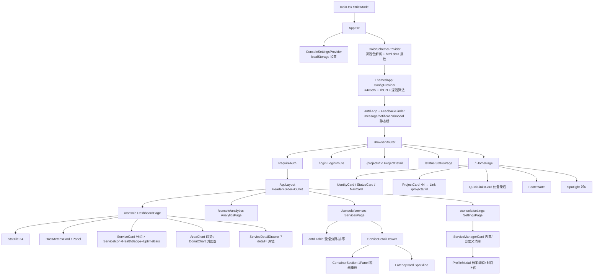
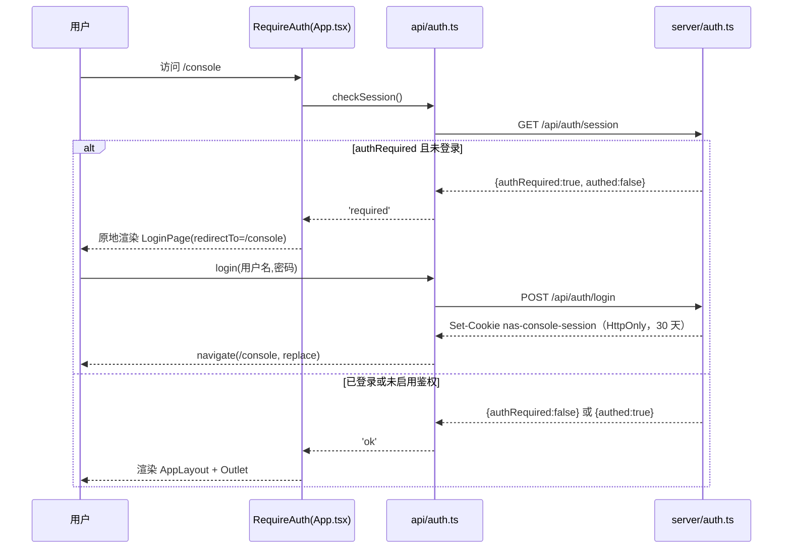
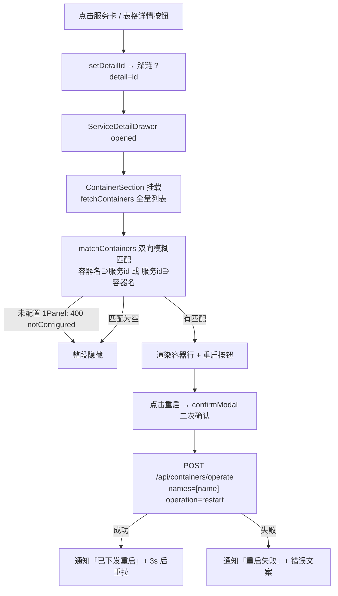

# 02 页面设计
> 项目：nas-console ｜ 版本：v1.0 ｜ 生成日期：2026-10-05 ｜ 依据：源码分析

## 1. 路由与页面总表

路由表集中定义在 `src/App.tsx`（`BrowserRouter` + `Routes`），共 8 条规则加 1 条兜底：

| 路由 | 页面组件 | 鉴权 | 布局 | 数据来源 | 轮询/推送 |
|---|---|---|---|---|---|
| `/` | `HomePage`（src/pages/Home.tsx） | 公开 | 独立 Bento 网格 | `GET /api/public/status` | 30s 轮询 |
| `/login` | `LoginPage`（src/components/LoginPage.tsx） | 公开 | 居中卡片 | `POST /api/auth/login` | — |
| `/projects/:id` | `ProjectDetail`（src/pages/ProjectDetail.tsx） | 公开 | 独立杂志式布局 | `GET /api/public/status` | 30s 轮询 |
| `/status` | `StatusPage`（src/components/StatusPage.tsx） | 公开（VPS 层豁免 basic auth） | 独立全屏布局 | `GET /api/public/status` | 30s 轮询 |
| `/console` | `DashboardPage`（src/pages/Dashboard.tsx） | `RequireAuth` | `AppLayout` | 探针 SSE+latest / Umami / 1Panel | SSE 实时 + 5min Umami |
| `/console/analytics` | `AnalyticsPage`（src/pages/Analytics.tsx） | `RequireAuth` | `AppLayout` | Umami API 浏览器直连 | 5min 轮询 |
| `/console/services` | `ServicesPage`（src/pages/Services.tsx） | `RequireAuth` | `AppLayout` | `useHealthChecks` | SSE/巡检共用 |
| `/console/settings` | `SettingsPage`（src/pages/Settings.tsx） | `RequireAuth` | `AppLayout` | localStorage + `/api/services` | 按需 |
| `*` | `Navigate to="/"` | — | — | — | — |

鉴权门 `RequireAuth`（`App.tsx` 第 38-54 行）只包裹管理区：挂载时调 `checkSession()`（`src/api/auth.ts`），返回三态 `checking/ok/required`——`checking` 渲染 null，`required` 原地渲染 `LoginPage`（携带 `redirectTo` 登录后回跳），`ok` 才放行 `AppLayout` 的 `<Outlet/>`。探针 API 收到 401 时（会话过期），`src/api/probe.ts` 的 `getJson` 会整页 `window.location.reload()`，让路由门重新接管。

## 2. 组件树

## 3. 逐页面设计说明

### 3.1 公开首页 `/`（HomePage）

布局为 CSS Grid 四列 Bento 网格（`src/app.css` 的 `.home-grid`：>960px 四列、560-960px 两列、<560px 单列并解除卡片跨行跨列），自上而下由六类卡片组成，全部数据来自脱敏快照 `fetchPublicStatus()`：

- **IdentityCard**（`src/components/home/IdentityCard.tsx`）：跨 2×2 的名片块，内容来自编译期常量 `IDENTITY`（`src/config/identity.ts`，改文案需重新构建）；渐变头像块 + 称呼徽章 + 介绍 + 链接胶囊。
- **StatusCard**：品牌渐变整块反白，显示「在线数/总数」与「30s 轮询」；`degraded`（快照拉取失败）时回退卡片样式显示「探针离线 · 稍后自动重试」。
- **NasCard**（`src/components/home/NasCard.tsx`）：CPU/内存/负载三条微型进度条。数据获取是**双端点级联**：先试鉴权的 `/api/host/metrics`（登录站长始终可见），失败再试公开的 `/api/public/metrics`（仅 `portal.publicMetrics` 开启时存在，且只含 4 个百分比字段），两者都取不到则整卡不渲染。
- **ProjectCard ×N**：只有**带 `url` 字段**的服务才成卡（`Home.tsx` 第 60 行注释「非公开分组只有名称/状态,不能成卡」——url 的有无本身就是白名单语义）；卡片含图标、名称、状态圆点（up 绿/down 红/未知灰，带霓虹光晕 `--nas-glow`）、简介、技术栈 tags、30 天可用率均值；外层 `<Link>` 进详情页，卡内「进入详情 →」提示。
- **QuickLinksCard**（仅登录后渲染）：拉 `/api/services` + `/api/health/latest`，把**非白名单分组**的内部服务（面板与运维等）以胶囊+状态点形式补齐展示，附全站 30 天可用率条；未登录或探针离线时不出现。
- **FooterNote**：探针在线状态、更新时间与 ⌘K 提示。

顶部工具条提供 ⌘K/Ctrl+K 命令面板入口（`Spotlight`，`src/components/Spotlight.tsx`：本地过滤 + 上下键选择 + 回车执行，动作清单 = 公开服务跳转 + 登录后的「管理控制台」导航），以及登录态感知的「管理/退出/登录」按钮。

### 3.2 登录页 `/login`（LoginPage）

居中 360px 卡片，用户名 + 密码 + 错误文案 + 提交按钮的原生 `<form>`（回车提交）。`login()`（`src/api/auth.ts`）失败时读取响应体 `error` 字段展示服务端中文文案（如「尝试过于频繁，请 N 分钟后再试」——限流逻辑在 `server/src/auth.ts`）。同一组件被两处复用：`/login` 独立路由（`redirectTo="/"`）与 `RequireAuth` 登录门（`redirectTo=当前路径`）。

### 3.3 项目详情页 `/projects/:id`（ProjectDetail）

杂志式档案，数据同样来自公开快照，但**只有白名单分组（快照下发 url）的服务**能匹配出详情，其余 id 一律渲染「项目不存在或未公开」404 视图（第 85-89 行注释）。页面结构自上而下：封面横幅（有 `profile.cover` 用图并叠渐变压暗，无图用 `--nas-gradient` 品牌渐变；横幅内叠图标/标题/状态徽章/延迟）→ 两栏主体（左 2fr：项目故事 `CardBox` +「我的角色」+ 亮点列表；右 1fr：实时状态卡（状态色 `#12b886`/`#fa5252`/`#868e96`、证书剩余天数、更新时间）、45 天可用率条 `AvailabilityStrip` 与近 30 天均值、技术栈 chips、「访问项目 ↗」主按钮与可选「仓库 ↗」次按钮）→ 截图画廊（横向滚动，点击新窗放大）→ 时间线（左侧竖线 + 圆点，date + text）。探针离线渲染「探针离线 · 数据暂时取不到」降级视图。

### 3.4 全屏状态页 `/status`（StatusPage）

为「分享给他人或挂电视屏」设计的精简总览（组件注释原文）：无设置入口、无 Umami，只读脱敏快照，30s 定时刷新（`useEffect` + `setInterval`，卸载时以 `stop` 标志防竞态）。按分组渲染卡片：每服务一行——图标 + 名称 + 证书天数 Tag（<15 红 / <30 橙 / 其余青）+ 状态 Tag（「运行中 · Nms」绿 / 「不可达」红且 Tooltip 展示 error / 「待检测」默认）+ 18px 高的 45 天可用率条 `StatusBars`。状态条配色不依赖图表主题上下文，而是内置了 `resolve` 函数把 `teal.6`/`orange.6`/`red.6`/`gray.5` 映射为深浅色两套固定色值（第 131-144 行注释）。

### 3.5 总览页 `/console`（DashboardPage）——核心监控面板

页面副标题动态反映数据源：`source === 'probe'` 显示「探针巡检(服务端 7×24 · 实时)」、`browser` 显示「浏览器巡检(探针未接入,仅页面打开时) · 每 Ns」。内容四段：

1. **四枚 StatTile**（`src/components/StatTile.tsx`，label + 大数字 + hint + 可选 Sparkline）：「服务在线 up/checked（附 30 天加权可用率均值）」「平均延迟」「实时在线（Umami active，未配置显示「未配置」）」「近 24h PV（附 UV 与 24h pageviews 走势 Sparkline）」。
2. **Umami 错误横幅**：`useUmamiDashboard` 失败时以 antd Alert 呈现并引导到设置页；认证类错误（`UmamiAuthError`）单独透出文案。
3. **HostMetricsCard**（`src/components/HostMetricsCard.tsx`）：NAS 主机 CPU/内存/负载三条 MeterBar（≥90% 红、≥75% 橙），Tooltip 展示发行版/内核/核数；30s 刷新，未配置 1Panel（400 `notConfigured`）整卡隐藏。
4. **分组服务卡矩阵**：`collectGroups` 保证四个预设分组恒定顺序（`src/config/services.ts`），每张 ServiceCard 含图标、名称、HealthBadge（up 显示延迟 ms 绿 Tag、down 红 Tag 带 Tooltip 错误、检查中 Spin）、描述、外链、30 天 `UptimeBars` 可用率条；点击卡片打开 `ServiceDetailDrawer`，且支持 `?detail=<服务id>` 深链直达（第 150-153 行，可收藏某服务的详情）。
5. **Umami 双图**（已配置时）：近 24h 访问趋势 `AreaChart`（pageviews + sessions 双序列）与浏览器分布 `DonutChart`（Top 6，固定六色板轮转）。

**ServiceDetailDrawer**（`src/components/ServiceDetailDrawer.tsx`）是健康信息的聚合视图：渐变标题栏（图标+名称+HealthBadge）→ 元信息卡（分组 Tag、探测方式 Tag、NAS 端口、证书剩余天数、外链）→ **ContainerSection**（按服务 id 与容器名双向模糊匹配出关联容器，展示状态 Tag + 镜像 + 运行时长 + 一键「重启」按钮——`confirmModal` 确认后经 `POST /api/containers/operate` 下发 1Panel，3 秒后重拉列表）→ 45 天可用率条 + 近 7 天/30 天可用率数字 → 48h 延迟走势 `Sparkline`（手写 SVG，Fritsch–Carlson 单调三次插值平滑，`src/charts/sparkline-path.ts`）→ 近 10 条状态翻转事件列表。抽屉用 `lastServiceRef` 保留关闭动画期间的最后一份服务数据避免内容闪空（第 158-161 行）。

### 3.6 访问分析页 `/console/analytics`（AnalyticsPage）

Umami 数据的完整工作台，顶部 `PageContainer.extra` 挂两个全局控件：站点选择器（「全部站点」哨兵值 `__all__` + 各站点，可搜索）与 `Segmented` 时间范围（24h/7d/30d/90d，映射到 Umami 的 hour/day 聚合单位——`resolveRange`）。内容三段：

- **四枚指标瓦片**：PV/UV/访问次数/跳出率，hint 显示**对比期环比百分比**（Umami stats 自带 `comparison`，`percent()` 计算 ±%）或平均停留时长（`fmtDuration` 把秒格式化为 `3m24s`）。
- **访问趋势 AreaChart**：PV 对 Sessions 双序列；全站模式副标注「各站直接求和 · 访客未跨站去重」（诚实标注聚合口径）。
- **维度分析**：`Segmented` 五个维度 Tab（热门页面 path/访问来源 referrer/浏览器 browser/操作系统 os/设备 device），`BarChart` Top 10 + 明细 Table（等宽数字）。

**全站聚合算法**是该页的精华：`sumStats`（各站指标直接求和，对比期同口径，缺失站不参与）、`mergePageviews`（按时间点 x 对齐求和，利用各站序列同为时间升序的性质）、`mergeMetrics`（维度值同名求和后降序）。拉取采用 `Promise.allSettled`——个别站点失败不拖垮整体，全部失败才抛首个错误。

### 3.7 服务管理页 `/console/services`（ServicesPage）

antd `Table` 全受控实现（数据约 30 行，客户端计算，第 28 行注释）：列 = 名称（图标+名称+描述）/分组/入口（无 url 显示「内网服务」置灰）/NAS 端口/健康（HealthBadge 或「不探测」，可按延迟排序）/操作（详情）。筛选状态四件套：关键词（名称/域名/描述）、分组 Select、排序器、分页（页码/页大小全部 useState 受控，`filtered` → `pageRows` 两级 useMemo）。工具条提供搜索框、分组过滤、「立即巡检」（浏览器模式下调 `refresh()`，探针模式下触发 latest 重拉）。点击「详情」复用 ServiceDetailDrawer。

### 3.8 设置页 `/console/settings`（SettingsPage）

四张卡片自上而下：**外观**（主题 Segmented：浅色/深色/跟随系统，写回 `settings.theme`）；**健康检查**（巡检间隔 InputNumber，15–600 秒，提示「最短 15 秒；间隔越短对目标站点请求越频繁」）；**服务清单管理**（`ServiceManagerCard`）；**Umami 访问分析**（部署地址/用户名/密码三输入 + 「保存并测试连接」按钮 + 总览页默认站点选择）。Umami 卡片有两处重要的安全提示文案：「凭据仅保存在本浏览器 localStorage」「token 缓存在 sessionStorage，关闭标签页即失效」。测试连接直接调 `fetchUmamiWebsites`，成功通知「已获取 N 个站点」，失败区分「授权失败」与「连接失败」。

**ServiceManagerCard**（`src/components/ServiceManagerCard.tsx`）：内置服务可「隐藏/显示」，自定义服务可增删改；表单含名称/描述/分组（可选「新建分组…」占位 `__new__`）/图标（14 个 ICON_KEYS）/技术栈标签（逗号分隔）/公网 URL/NAS 端口/「参与健康探测」开关——开关在 URL 非 `https://` 时禁用并提示「浏览器端仅支持 HTTPS 公网入口探测(混合内容限制)」（第 98-104 行），保存时 `checkable` 会被强制收敛为 `httpsUrl && form.checkable`。新增服务 id 由 `custom-${Date.now().toString(36)}` 生成。**ProfileModal**（`src/components/ProfileModal.tsx`）编辑项目档案：封面（上传 ≤5MB png/jpg/webp 或填外链，上传走 `POST /api/portal/upload?service=<id>`）、故事 TextArea、角色/仓库、截图集（逐张上传为 `<id>-s<N>`）、亮点列表、时间线（date+text 行编辑）。保存流程是「GET `/api/services` → 找到该服务合并 profile → PUT 全量写回」，同时自定义服务**双写** localStorage 保持离线一致性。

## 4. 关键 UI 交互流程

### 4.1 管理区登录门流程

### 4.2 服务详情抽屉打开与容器重启

## 5. 状态管理设计

前端没有引入 Redux/Zustand/React Query，状态按**作用域与持久化需求**分为四层，各司其职：

| 层 | 载体 | 内容 | 生命周期 |
|---|---|---|---|
| 服务端状态 | 页面 useState + 专用 Hook（`useHealthChecks`/`useUmamiDashboard`/`fetchHostMetrics`） | 健康结果、Umami 数据、主机指标 | 组件级，轮询/SSE 驱动 |
| 跨组件健康历史 | 模块级单例 store（`src/api/health-history.ts`）+ `useSyncExternalStore` | days/recent/events/lastStatus | 应用级 + localStorage `nas-console-health-history` 持久化 |
| 用户偏好 | `ConsoleSettingsContext`（React Context） | 主题/间隔/Umami 凭据/自定义服务/隐藏清单 | 应用级 + localStorage `nas-console-settings` |
| 临时 UI 态 | 各组件 useState | 抽屉开关、表单、筛选、Spotlight | 组件级 |

值得展开的两个设计：

- **`health-history.ts` 的模块级 store**：顶层 `let state` + `listeners: Set<()=>void>` 实现 `subscribe/emit`，`useHealthHistory()` 经 `useSyncExternalStore(subscribe, ()=>state, ()=>state)` 订阅（第 91-93 行）。任何写入路径（浏览器巡检 `recordBatch`、探针快照 `applyServerSnapshot`）都会 `persist()` 到 localStorage 并 `emit()`，所有订阅组件（UptimeBars、抽屉、StatTile）自动重算——这比 Context 更精准，避免全树重渲染。写入采用不可变更新（浅拷贝四块结构）+ `prune`（90 天桶、48h 采样、100 条事件上限）。
- **`useInterval` 的 autoInvoke 语义**（`src/hooks/useInterval.ts`）：默认不立即执行，`autoInvoke: true` 时挂载先跑一次。`use-health.ts` 浏览器模式刻意用 `autoInvoke: false` + 单独的 effect 触发首轮（第 121-126 行注释「避免双份首轮探测」），体现了对 React StrictMode 双挂载的防御。

主题链路：`ConsoleSettingsContext.settings.theme`（light/dark/auto）→ `ColorSchemeProvider` 解析为最终 `colorScheme`（auto 时监听 `matchMedia('(prefers-color-scheme: dark)')` 变化）→ 写 `<html data-color-scheme>` 与画布背景 → 三个消费端：antd `ConfigProvider` 算法切换（`App.tsx` ThemedApp）、`app.css` 的 CSS 变量组（`--nas-gradient` 浅色晕染/深色霓虹两套）、图表 `useChartTheme()`（`src/charts/chart-theme.ts`）。`index.html` 内联了同判定的防白闪背景样式。

反馈链路：antd v6 要求 message/notification/modal 从 `<App>` 上下文取实例，`FeedbackBinder`（`src/theme/feedback.tsx`）在挂载时把三个 API 存入模块级 `apis` 变量，对外暴露 `showNotification({title,message,color})` 与 `confirmModal(config)` 两个静态桥函数——注释明说是「原 Mantine notifications/modals 包」的等价迁移层。

## 6. 视觉与响应式规范

- **设计令牌**：主色 `#4c6ef5`（antd token + CSS 变量 + 图表 `indigo.6` 三处同源），圆角 8（antd）/14（手写卡片）；浅色 `--nas-gradient` 为 `135deg #4c6ef5→#7950f2` 晕染，深色为 `#4c6ef5→#15aabf` 霓虹并叠加 `--nas-glow` 状态灯光晕（`app.css`）。
- **状态语义色全局统一**：up=`teal.6`(#12b886)、down=`red.6`(#fa5252)、未知=`gray.5`、降级=`orange.6`(#fd7e14)；可用率条阈值 ≥99.95% 绿 / ≥50% 橙 / 其余红 / 无数据灰，在 `UptimeBars`、`StatusBars`、`AvailabilityStrip`、`QuickLinksCard` 四处保持一致。
- **响应式断点**：Bento 网格 960px/560px 两级折叠；详情页 `detail-grid` 860px 折单列；管理区 `StatTile` 用 antd Row/Col 的 xs=24/sm=12/lg=6 栅格。
- **可访问性细节**：Header 主题切换与搜索按钮带 `aria-label`；Spotlight 列表行高固定 52px + scroll-snap 对齐（源码注释解释了防滚动切字的考量）。

---

*接口层面的约定（每个页面调用了哪些端点、错误如何呈现）见 03-接口设计.md；健康检查双模式与清单同步的端到端时序见 05-核心流程.md。*
