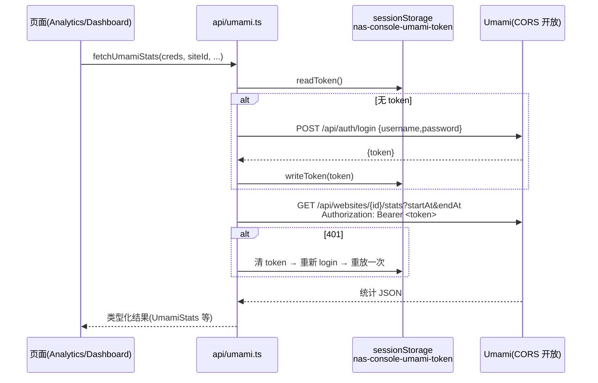

# 03 接口设计
> 项目：nas-console ｜ 版本：v1.0 ｜ 生成日期：2026-10-05 ｜ 依据：源码分析


后端不使用任何 Web 框架：全部 API 在 `server/src/server.ts` 的 `handleApi` 函数中以「方法 + 路径」精确匹配实现（第 110-306 行），入口 `createServer` 负责鉴权门与静态托管分流。所有 JSON 响应统一 `content-type: application/json; charset=utf-8` 与 `cache-control: no-store`（`json()` 辅助函数），请求体解析由手写 `readJson`（默认 1MB 上限，超限销毁连接）与 `readRaw`（上传用，5MB 上限）完成。

## 1. 端点总表

| # | 方法 | 路径 | 鉴权 | 用途 | 关键入参 | 成功响应（核心字段） | 失败 |
|---|---|---|---|---|---|---|---|
| 1 | POST | `/api/auth/login` | 公开 | 登录，种会话 Cookie | body `{username, password}` | `{ok:true}` + `set-cookie` | 401 `{error}`（凭据错/限流中/未启用 auth） |
| 2 | GET | `/api/auth/session` | 公开 | 查询鉴权状态 | — | `{authRequired:boolean, authed:boolean}` | — |
| 3 | POST | `/api/auth/logout` | 需会话 | 登出（清 Cookie） | — | `{ok:true}` | — |
| 4 | GET | `/api/health/latest` | 需会话 | 全部服务最近一次检查结果 | — | `{ts, results: CheckResult[]}` | 401 |
| 5 | GET | `/api/health/history` | 需会话 | 按天聚合 + 48h 采样 | `?days=`（1–90，默认 45） | `{days:{服务id:{日期:DayBucket}}, recent:{服务id:RecentSample[]}}` | 401 |
| 6 | GET | `/api/events` | 需会话 | 全局状态翻转事件 | `?limit=`（1–200，默认 50） | `{events: [{service_id, ts, to}]}`（线格式蛇形，非驼峰 ProbeEvent——19 篇第 2.3 节） | 401 |
| 7 | GET | `/api/services` | 需会话 | 读服务清单（权威副本） | — | `{services: ServiceConfig[]}` | 401 |
| 8 | PUT | `/api/services` | 需会话 | 全量 upsert 清单并落盘 | body `{services: ServiceConfig[]}` | `{ok:true, total:number}` | 400（缺 services/缺 id-name） |
| 9 | GET | `/api/public/status` | 公开 | 脱敏快照（首页/详情/状态页） | — | `{ts, portal:{publicMetrics}, groups:[...]}` | — |
| 10 | GET | `/api/public/metrics` | 公开 | 主机指标（仅百分比字段） | — | `{ts, current:{cpuUsedPercent, memoryUsedPercent, loadUsagePercent, cpuTotal}}` | 404（未开放）· 502（面板不可用） |
| 11 | GET | `/api/host/metrics` | 需会话 | 主机当前指标 + OS 信息 | — | `{ts, current: PanelNodeCurrent, os: PanelOsInfo}` | 400（未配置 1Panel）· 502 |
| 12 | GET | `/api/containers` | 需会话 | 容器列表（1Panel 代理） | `?name=` 模糊搜索 | `{containers: PanelContainer[]}` | 400/502 |
| 13 | POST | `/api/containers/operate` | 需会话 | 容器操作（白名单动作） | body `{names:string[], operation}` | `{ok:true}` | 400（缺参/动作不在白名单）· 502 |
| 14 | POST | `/api/alerts/test` | 需会话 | 向所有渠道发测试通知 | — | `{results:[{channel,ok,error?}]}` | — |
| 15 | POST | `/api/portal/upload` | 需会话 | 上传封面/截图（≤5MB） | `?service=<id>` + body 原始图片（Content-Type 决定扩展名） | `{url:"/portal-covers/<id>.<ext>"}` | 400（id 非法/类型不支持/空文件/超限） |
| 16 | GET/HEAD | `/portal-covers/<file>` | 公开 | 封面静态托管 | 路径段文件名 | 图片流（`cache-control: public, max-age=86400`） | 404（正则白名单外/不存在） |
| 17 | GET | `/sse` | 需会话 | SSE 实时推送 | — | `text/event-stream`（status/batch/event 三类事件） | 401 |
| 18 | GET | `/statusz` | 公开 | 进程健康（容器 healthcheck 用） | — | `{ok:true, services, sseClients, authRequired, ts}` | — |
| 19 | GET | `/*`（其余） | 公开 | SPA 静态托管 + fallback | 路径即文件 | 文件流；assets 目录 immutable 缓存 | 403（路径穿越）/回落 index.html |

未匹配到任何 API 分支的 `/api/*` 请求统一返回 404 `{error:"not found"}`（`server.ts` 第 305 行）。

## 1.5 接口设计总约定

在逐个看端点之前，先归纳贯穿全部 API 的六条约定，它们没有集中文档，但可以从 `server.ts` 的实现中一一验证：

1. **无版本号前缀**：全部端点挂在 `/api/*` 一级命名空间下，没有 `/api/v1`。这与「前端后端同容器同发版」的部署形态自洽——前后端永远同版本，不存在跨版本客户端兼容问题；代价是未来若出现第三方消费方需要补版本层。
2. **响应包络不统一但字段可预测**：没有 `{code, message, data}` 之类的统一包络——查询端点直接返回领域对象（如 `{ts, results}`），写入端点返回 `{ok: true, ...}`，错误统一 `{error: 中文文案}`。前端因此形成固定解析习惯：成功读字段、失败读 `error`。
3. **时间戳一律毫秒**：`ts`、`checkedAt`、`startAt/endAt` 全部是 Unix 毫秒（服务端 `Date.now()`、前端 dayjs 直接格式化），跨端无秒/毫秒换算负担；唯一例外是 1Panel 出站签名用秒（其 API 规范要求，`1panel.ts` sign 函数）。
4. **列表参数一律 clamp 而非报错**：`?days=` 与 `?limit=` 经 `clampInt` 夹取到合法区间（1–90、1–200）并带缺省值（45、50），非法输入静默回落缺省——对参数错误采取宽容策略，把错误面收敛到真正致命的写入校验（PUT services 的 400）。
5. **读端点全部禁缓存**：`json()` 统一输出 `cache-control: no-store`，因为所有数据都是「最近状态」语义；唯一的例外是封面图片（`max-age=86400`）与静态 assets（immutable），它们的不可变性是刻意的。
6. **写端点全量语义**：`PUT /api/services` 是唯一的状态写入入口，且是「整包 upsert」而非增量 patch——前端永远发送完整清单，服务端负责与权威副本合并。这让写路径无并发合并逻辑可写错，也让「服务端保留手工 check」的规则有了唯一的落点。

## 2. 鉴权机制

鉴权完全实现在 `server/src/auth.ts`（154 行，零外部依赖），机制要点：

- **启用条件**：config.json 存在非空 `auth` 段且 `username.length > 0`、`passwordHash` 含 `$`（`Auth.enabled` getter，第 36-38 行）。未配置时鉴权整体关闭（仅建议本地开发），启动日志会打印警告（`server.ts` 第 45 行）。
- **口令存储格式**：`passwordHash = <salt-hex>$<HMAC-SHA256(key=salt, msg=password)-hex>`，由 `server/scripts/hash-password.mjs` 生成（内部复用 `dist/auth.js` 导出的 `newSalt`/`hashPassword`，保证与校验侧算法同源）。README 建议 `read -s P && node scripts/hash-password.mjs admin "$P"` 避免密码进 shell 历史。
- **会话形态**：无状态签名 Cookie。`login()` 成功后返回 `nas-console-session=<base64url({u,exp})>.<HMAC-SHA256(base64url)>`，属性 `Path=/; HttpOnly; SameSite=Lax; Max-Age=2592000`（30 天 TTL，第 93 行）。签名密钥 32 字节随机 hex，首启生成并落盘 `data/session-secret`（mode 0600），重启后会话仍有效；数据目录不可写时退化为进程级随机（重启全员失效，代码注释认为可接受）。
- **校验路径**：`verify()` 解析 Cookie → base64url 解 payload → 检查 `exp` 未过期 → 重算 HMAC 并以 `timingSafeEqual` 比对签名（防时序攻击；用户名与口令比较同样走 `timingSafeText`，第 78-79 行）。**注意校验的是签名而非查库**，因此改密码（换 passwordHash）不会使已签发会话失效，只有更换 session-secret 才会。
- **守卫位置**：`authGuard()`（第 102-109 行）在 HTTP 入口统一判定——启用鉴权时，非公开路径返回 401 `{error:"unauthorized"}`。公开路径白名单（`isPublicPath`）：`/api/public/*`、`/portal-covers/*`、`/api/auth/login`、`/api/auth/session`、`/statusz`。`server.ts` 中对 `/api/*`、`/sse`、`/portal-covers/*` 三类前缀分别调用守卫；`/statusz` 与静态资源不设防。
- **登录限流**：按 IP 记失败次数（`fails: Map<ip, {count, lockUntil}>`），连续 5 次失败锁定 10 分钟（`MAX_FAILS=5`、`LOCKOUT_MS=10min`），锁定期内直接抛「尝试过于频繁」；成功登录清零计数。计数器在内存，重启即清。
- **前端协同**：会话状态在应用启动时经 `/api/auth/session` 判定一次（`src/api/auth.ts` checkSession）；探针不可达（网络失败）视为「无鉴权层」返回 `ok`，与浏览器降级模式兼容。任何需会话的 API 收到 401 时，`src/api/probe.ts` / `src/api/host.ts` 的 `getJson` 会整页刷新，交还 `RequireAuth` 接管。

## 3. 错误处理约定

`createServer` 的请求处理器用一个大 try/catch 包裹全部 API 逻辑（`server.ts` 第 71-93 行），未捕获异常统一 500 `{error: message}`。业务层错误遵循以下约定：

| 状态码 | 语义 | 典型场景 |
|---|---|---|
| 400 | 入参错误 | services 非数组/缺 id-name；上传 id 不匹配 `^[a-z0-9-]+$`；图片类型非 png/jpeg/webp；容器操作缺 names/operation 或动作不在白名单；未配置 1Panel 时访问其代理端点 |
| 401 | 未登录/会话无效 | authGuard 拦截；登录凭据错误或限流锁定（登录端点复用 401） |
| 404 | 资源不存在或未开放 | API 未匹配；`/api/public/metrics` 在 `publicMetrics=false` 时**故意**返回 404「not found」而非 403——不向访客暴露该端点的存在 |
| 500 | 服务端未捕获异常 | 兜底 |
| 502 | 上游（1Panel）失败 | `PanelError` 时区分 401（「1Panel 密钥或 IP 白名单校验失败」）与其它（「1Panel：<message>」，`panelMsg()`，第 394-399 行） |

两处刻意的错误信息脱敏：`/api/host/metrics` 失败时公开语义上只回「1Panel 暂不可用」（第 144 行注释：panelMsg 内含面板 host:port，不能回传）；`/api/public/status` 对非白名单分组连 `error` 字段都不下发（error 里可能出现 ECONNREFUSED 的 host:port）。前端约定：所有非 2xx 优先读响应体 `error` 字段作为用户可见文案（`src/api/auth.ts`、`src/api/host.ts`），拿不到再退化为 `HTTP <status>`。

补充两点错误路径上的行为细节。其一是**401 的前端副作用**：`src/api/probe.ts` 与 `src/api/host.ts` 的 `getJson` 在收到 401 时不弹错、不跳登录页，而是直接 `window.location.reload()`——让整页应用重新走一遍启动流程（`RequireAuth` 会话判定），这比在各处维护「跳转登录并携带回跳地址」的状态机简单得多，代价是丢失页面上的临时状态（可接受，因为所有持久数据都在 localStorage 或服务端）。其二是**部分成功不报错**：`/api/health/history` 若某服务尚无数据，`days`/`recent` 中就是没有该服务的键（而非空对象占位）；`/api/alerts/test` 永远 200，渠道失败信息在 `results` 数组里逐条携带——「批量操作的个体失败不影响整体成功」在两个端点上保持一致。

## 4. SSE 推送协议

`GET /sse`（`server/src/sse.ts`）响应头含 `content-type: text/event-stream`、`cache-control: no-store`、`connection: keep-alive`、`x-accel-buffering: no`（防 nginx 攒包）；连接建立立即写注释行 `: connected`，此后每 25 秒写 `: ping` 心跳防代理空闲断连。三类命名事件：

| 事件 | data 载荷 | 触发时机 |
|---|---|---|
| `status` | 单个 `CheckResult` | 每次检查完成（无论状态是否翻转），`onResult` 回调广播 |
| `event` | `{serviceId, ts, to}` | 状态翻转入库时，`onEvent` 回调广播 |
| `batch` | `CheckResult[]` 全量 | 固定 30 秒一拍（`server.ts` 第 65 行 batchTimer），防客户端丢帧 |

客户端封装在 `src/api/probe.ts` 的 `subscribeProbeEvents`：原生 `EventSource`（自带断线重连）+ `addEventListener('status'/'batch')`，单条 JSON 解析失败静默忽略；`onOpen`/`onError` 分别驱动 `use-health.ts` 的 `live` 状态（页面上呈现「· 实时」角标）。dev 环境下 `vite.config.ts` 对 `/sse` 代理同样注入 `x-accel-buffering: no`，避免事件被攒包延迟。

## 5. Umami 数据代理链路（对比：1Panel 代理链路）

**Umami 不经过后端**。整条链路在浏览器内闭环（`src/api/umami.ts`，190 行）：



要点：token 只进 sessionStorage（关闭标签页即失效，隐私模式下降级为内存态）；401 时「清 token → 重登 → 重放」仅自动一次，再次 401/403 抛 `UmamiAuthError`（页面据此提示「账号或密码错误/授权失败」而非笼统失败）；时间范围由 `resolveRange` 把 `24h/7d/30d/90d` 换算为毫秒 `startAt/endAt` 与聚合单位（24h 用 hour，其余用 day），代码注释解释了原因——「Umami 官方文档未提供封端接口」。消费的五个 Umami 端点：`POST /api/auth/login`、`GET /api/websites`、`GET /api/websites/{id}/stats`、`GET /api/websites/{id}/pageviews`、`GET /api/websites/{id}/metrics?type=`、`GET /api/websites/{id}/active`（兼容 number 与 `{visitors|x}` 两种返回形状）。

**1Panel 则是严格的服务端代理**（见第 1 节 #11–#13）：`PanelClient`（`server/src/1panel.ts`）以 `1Panel-Timestamp`（秒）+ `1Panel-Token = md5("1panel" + apiKey + ts)` 签名（v2 官方算法，第 66-71 行注释），域名绑定时注入 Host 头，全部请求 `agent: false`、8s 超时；上游响应按 `{code:200, data}` 包裹判定成功，否则抛 `PanelError(code)`。`/api/containers/operate` 在服务端维护动作白名单 `start/stop/restart/kill/pause/unpause`（`server.ts` 第 237 行），注释明言「remove 等破坏性操作不放行」。

## 6. 核心接口示例

### 6.1 `GET /api/public/status` —— 脱敏快照（首页/详情/状态页唯一数据源）

由 `publicStatus()`（`server.ts` 第 341-381 行）组装。白名单分组（`portal.publicGroups`，缺省 `["应用站点", "文档与统计"]`）的每个服务额外展开 `url/tags/error/profile` 字段；逐日可用率恒定给 45 天（无数据的天为 `null`）。

```json
{
  "ts": 1759656000000,
  "portal": { "publicMetrics": false },
  "groups": [
    {
      "name": "应用站点",
      "services": [
        {
          "id": "admin-vue", "name": "admin-vue 后台管理系统",
          "description": "NestJS 微服务 + pure-admin 前台", "group": "应用站点",
          "icon": "shield",
          "status": "up", "latencyMs": 87, "checkedAt": 1759655995000,
          "certExpiresInDays": 62,
          "days": [ { "date": "2026-08-22", "availability": 100.0 }, { "date": "2026-08-23", "availability": null } ],
          "url": "https://admin-vue.zhangzhengyang.com",
          "tags": ["React", "NestJS"],
          "profile": { "cover": "/portal-covers/admin-vue.png", "story": "……", "timeline": [ { "date": "2025.03", "text": "……" } ] }
        }
      ]
    },
    {
      "name": "面板与运维",
      "services": [
        { "id": "1panel", "name": "1Panel", "group": "面板与运维", "icon": "server",
          "status": "up", "latencyMs": 12, "checkedAt": 1759655995000,
          "days": [ { "date": "2026-08-22", "availability": 100.0 } ] }
      ]
    }
  ]
}
```

对比可见脱敏语义：非白名单的「面板与运维」分组没有 `url/tags/error/profile` 字段。前端 `HomePage` 以 `s.url` 的有无判定能否成项目卡（`Home.tsx` 第 59-60 行）。

### 6.2 `PUT /api/services` —— 清单全量 upsert

请求体为 `{services: [...]}`（前端 `syncProbeServices`，`src/api/probe.ts` 第 106-127 行，把内置+自定义清单展平，`hidden` 以独立布尔下发，`check` 按	checkable/url 推导为 `{type:"http"}` 或 `{type:"none"}`）。服务端处理链（`server.ts` 第 281-300 行 → `config.ts` `syncServices`）：

1. 校验：`services` 必须为数组，每项必须有 `id` 与 `name`，否则 400；
2. 合并：对每个传入 id——已存在则**保留探针侧已有 `check` 配置**（保护手工调优的 tcp 端口/关键词/tlsSkipVerify/intervalSec，`config.ts` 第 78 行 `{ ...s, check: prev.check, profile }`）；新 id 则用传入 check 或 `defaultCheck` 推导；`profile` 一律经 `sanitizeProfile` 净化（逐字段类型检查，防畸形数据进入公开快照导致详情页白屏，第 40-70 行）；
3. 不删除：`prune` 固定 false，探针有而清单没有的服务原样保留在尾部（前端「隐藏」只是标记，不删配置）；
4. 落盘：`saveConfig` 先写 `config.json.tmp` 再 `renameSync` 原子替换；**只重写 `services` 段**——`syncServices` 以展开运算符保留 config 的 `alerts`/`auth`/`portal`/`onePanel` 等手工维护段；
5. 热更新：`engine.apply(activeServices(next))` 立即按新清单重排定时器（幂等：清旧、按需调度、并发 4 补跑一轮）并清理已下线服务的 stale 快照。

成功响应：`{"ok": true, "total": 19}`（total 为合并后清单总长）。前端 `useProbeListSync`（`src/api/use-probe-sync.ts`）在管理区布局挂载时同步一次，此后每 60 秒重试（兼顾探针重启后的配置回填），失败静默等下个周期。

## 7. 接口与页面的对应关系

| 前端消费方（文件） | 使用的端点 |
|---|---|
| `RequireAuth` / `LoginPage` / `AppLayout` | `/api/auth/session`、`/api/auth/login`、`/api/auth/logout` |
| `use-health.ts` | `/api/health/latest`（首屏+兜底轮询）、`/sse`（status/batch）、`/api/health/history`、`/api/events`（5 分钟导入） |
| `use-probe-sync.ts` / `ProfileModal` | `GET|PUT /api/services`、`POST /api/portal/upload` |
| `HomePage` / `ProjectDetail` / `StatusPage` | `/api/public/status`（30s 轮询） |
| `HomePage.QuickLinks`（登录后） | `/api/services`、`/api/health/latest` |
| `NasCard` | `/api/host/metrics` → 失败回落 `/api/public/metrics` |
| `HostMetricsCard` | `/api/host/metrics`（30s） |
| `ServiceDetailDrawer.ContainerSection` | `/api/containers`、`/api/containers/operate` |
| `SettingsPage` | Umami 直连（`fetchUmamiWebsites` 测连） |
| `DashboardPage`/`AnalyticsPage` | Umami 直连（stats/pageviews/metrics/active） |
| 容器 healthcheck（compose） | `/statusz` |

这张表可以读出接口设计中的一个不对称性：**读公开快照的组件多而轻**（三个公开页共用一个端点、一份类型 `PublicService`），**写路径的消费方少而重**（PUT services 只有 `useProbeListSync` 与 `ProfileModal` 两个调用方，但承担了清单与档案两条业务线的落盘）。这决定了排障方向：公开页数据异常先查 `/api/public/status` 的白名单字段，管理区写不进去先查会话（401）与探针在线状态（60 秒同步周期内的静默重试意味着写入失败不会立刻有用户可见反馈）。

## 8. Umami 与 1Panel 两条外部链路的对比结论

把第 5 节的两条链路并排收尾：二者同为「控制台消费的外部系统」，但集成方向完全相反，这个对比是理解本系统边界划分的最佳案例。Umami 是**数据消费者在外、凭据在外**——浏览器直连、token 会话级缓存、探针进程对它零感知，因此它的可用性故障只影响分析页（页面渲染引导文案），不影响任何监控能力；1Panel 是**数据消费者在内、凭据在内**——探针代理一切、apiKey 永不出服务端、故障语义被翻译成 400/502 两档，它的可用性影响主机指标卡、公开 NAS 条卡与容器操作三处 UI。若未来要接入第三套外部系统，判断「放浏览器还是放探针」只需回答两个问题：凭据能否下发给浏览器（安全面）、数据是否需要 7×24 采集（在场性）。Umami 数据只有页面打开时才被消费，答案指向浏览器；1Panel 容器操作是运维动作且凭据敏感，答案指向探针。

---

*各端点涉及的数据结构（CheckResult/DayBucket/ServiceConfig 等）的完整字段定义见 04-数据模型.md；登录与健康巡检的端到端时序见 05-核心流程.md。*
