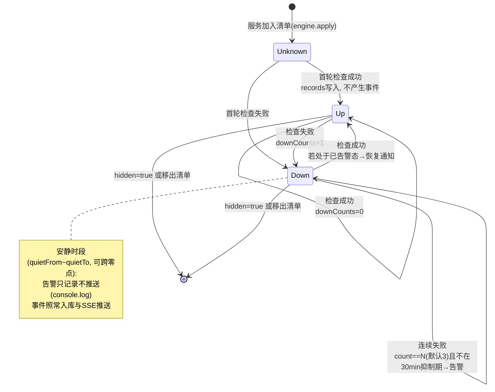
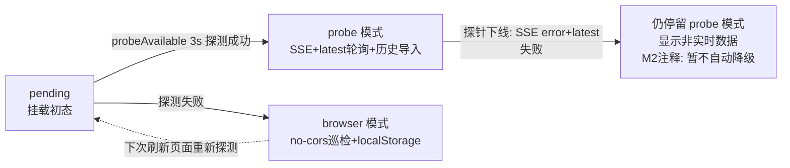

# 04 数据模型
> 项目：nas-console ｜ 版本：v1.0 ｜ 生成日期：2026-10-05 ｜ 依据：源码分析

系统的持久化数据分为三处：探针侧 `config.json`（服务清单权威副本 + 告警/鉴权/门户/1Panel 配置）、SQLite `data/probe.db`（健康历史）、以及浏览器 localStorage/sessionStorage（用户偏好与健康历史镜像）。类型定义集中在 `server/src/types.ts`（后端）与 `src/config/services.ts`、`src/api/*.ts`（前端），两侧刻意保持字段兼容（`types.ts` 首行注释「与前端 ServiceDef 保持字段兼容，check 为探针专属」）。

## 1. config.json schema（配置文件）

顶层结构（`ProbeConfig`，`server/src/types.ts` 第 50-65 行；`config.example.json` 只含前三段样例，`portal`/`onePanel` 需手工添加）：

| 字段 | 类型 | 必填 | 说明 |
|---|---|---|---|
| `services` | `ServiceConfig[]` | 是（必须是数组，否则 `loadConfig` 抛错拒绝启动，`config.ts` 第 10-12 行） | 服务清单权威副本 |
| `alerts` | `AlertsConfig` | 否 | 告警渠道与策略；**手工维护**，`PUT /api/services` 不触碰（types.ts 注释） |
| `auth` | `{username, passwordHash}` | 否 | 登录鉴权；缺省或空则关闭鉴权（仅供本地开发） |
| `portal` | `{publicGroups?, publicMetrics?}` | 否 | 首页门户公开策略；缺省 `publicGroups=["应用站点","文档与统计"]`、`publicMetrics=false`（`server.ts` publicStatus 缺省值） |
| `onePanel` | `{baseUrl, apiKey, hostHeader?}` | 否 | 1Panel v2 集成；`apiKey` 存在时才创建 `PanelClient`（`server.ts` getPanel 惰性单例） |

### 1.1 ServiceConfig（服务条目）

| 字段 | 类型 | 必填 | 说明 |
|---|---|---|---|
| `id` | string | 是 | 唯一键；内置清单为语义 id（如 `admin-vue`），自定义服务为 `custom-<base36时间戳>`；上传端点要求匹配 `^[a-z0-9-]+$` |
| `name` | string | 是 | 显示名 |
| `description` | string | 否 | 一句话描述（卡片/表格/详情页展示） |
| `group` | string | 是 | 分组名；内置四个预设：应用站点/文档与统计/面板与运维/数据库与中间件（`src/config/services.ts` `PresetGroup`），自定义可任意命名 |
| `url` | string | 是 | 公网入口；空字符串表示纯内网/TCP 服务 |
| `internalPort` | number | 否 | NAS 容器端口（信息展示；tcp 检查缺省端口来源之一） |
| `icon` | string | 否 | 图标 key（14 选 1，映射见 `src/components/ServiceIcon.tsx`） |
| `tags` | string[] | 否 | 技术栈标签，仅白名单分组随公开快照下发 |
| `checkable` | boolean | 是 | 「前端希望探测」的语义标记；真实探测行为由 `check` 决定（types.ts 注释） |
| `hidden` | boolean | 否 | 前端隐藏：保留配置便于恢复，但不参与探测、不出现在公开状态页 |
| `check` | `CheckConfig` | 是 | 探针专属探测配置（见下） |
| `profile` | `ServiceProfile` | 否 | 公开项目档案（cover/story/highlights/timeline/role/repo/screenshots）；写入前必经 `sanitizeProfile` 净化 |

### 1.2 CheckConfig（探测配置，探针专属）

| 字段 | 类型 | 缺省 | 说明 |
|---|---|---|---|
| `type` | `'http' \| 'tcp' \| 'none'` | — | 检查类型；`none` 不调度 |
| `intervalSec` | number | 30（全局） | 覆盖全局巡检间隔，引擎强制下限 15 秒（`probe.ts` 第 44 行 `Math.max(15, ...)`） |
| `expectStatus` | number[] | 无 → 2xx/3xx 视为 up | 期望状态码列表（`probe.ts` 第 152-154 行：未配置时 `<400` 即 up，配置后要求精确命中） |
| `keyword` | string | 无 | 响应体关键词检查；命中失败记 down（error=「关键词未命中」）；读取上限 256KB（`MAX_BODY_BYTES`） |
| `tlsSkipVerify` | boolean | false | 跳过 TLS 校验（自签证书服务如 DSM） |
| `tcpHost` / `tcpPort` | string / number | 从 `url` hostname / `internalPort` 推断 | tcp 检查目标（`probe.ts` 第 90 行） |

### 1.3 AlertsConfig（告警配置）

| 字段 | 类型 | 缺省 | 说明 |
|---|---|---|---|
| `bark.url` | string | — | 形如 `https://api.day.app/<pushKey>`，投递时拼 `/<标题>/<正文>`（URL 编码） |
| `telegram.botToken` + `chatId` | string | — | 走 `api.telegram.org/bot<token>/sendMessage` |
| `webhook.url` | string | — | POST JSON `{title, body, ts}` |
| `consecutiveDowns` | number | 3 | 连续 N 次 down 才告警（防抖，`Math.max(1,...)` 下限） |
| `renotifyAfterMin` | number | 30 | 同服务 down 告警重发间隔（分钟） |
| `quietFrom` / `quietTo` | `"HH:mm"` | — | 安静时段（支持跨零点，`alerts.ts` `inQuietHours` 第 105-113 行），窗口内只记录不推送 |

修改 `alerts`/`auth`/`portal`/`onePanel` 后需 `docker restart`（README「告警（M2）」节），因为它们只在启动时读入一次——`createServer` 中 `Auth`、`AlertManager` 构造时注入 config 引用，运行期仅 `services` 段可被 PUT 热更新。

### 1.4 段所有权与写入路径

config.json 是全系统唯一一个「多方共同读写」的文件，理解每一段归谁管是安全运维的前提。`services` 段的**日常写入口是前端**：管理区布局挂载后每 60 秒的 `PUT /api/services` 全量 upsert（合并规则见 03 篇第 6.2 节）；**手工编辑**只用于前端表达不了的探测细节（tcpHost/tcpPort、keyword、expectStatus、tlsSkipVerify、intervalSec）。`alerts`、`auth`、`portal`、`onePanel` 四段的**唯一写入口是手工编辑**——PUT 端点在 `syncServices` 中以展开运算符原样保留它们（`config.ts` 第 88 行 `{ ...config, services: merged }`），前端没有任何 UI 触达这些段。这个所有权的实际含义是：**手工编辑后要重启、前端操作后不用重启**；反过来，手工编辑 config.json 时也不必担心被前端同步覆盖掉 alerts 等段——但 services 段内的手工 check 字段必须挂在**已存在的服务 id** 上才会被保留（新服务由前端清单决定，已有 id 的 check 才受保护）。

物理写入全部经过 `saveConfig` 的「写 `.tmp` 再 rename」原子替换（`config.ts` 第 16-21 行），因此进程崩溃不会留下半个 JSON；`loadConfig` 在文件缺失时返回 `{services: []}` 空配置（首次启动合法态），但 services 非数组会直接抛错让进程拒绝启动——宁可不起也不带坏配置运行。

### 1.5 文件资产：covers 与 session-secret

`data/` 目录下还有两类非 JSON 的持久资产。`covers/` 存放项目封面与截图，文件名即 `service id + 扩展名`（封面 `<id>.<png|jpg|webp>`，截图 `<id>-s<N>.<ext>`，N 为上传序号），由上传端点按 Content-Type 映射扩展名后直接落盘；公开访问经 `/portal-covers/<file>`，文件名必须匹配 `^[a-z0-9-]+\.(png|jpe?g|webp)$`（`server.ts` 第 175 行）才允许读——文件名白名单天然免疫目录穿越，缓存头 `max-age=86400`。注意上传与 profile 保存是**两个独立动作**：上传只写文件并返回 URL，直到档案 PUT 保存后 `profile.cover/screenshots` 才引用它；孤儿文件（上传后未保存）不会被自动清理。`session-secret` 是 64 字符 hex 的会话签名密钥，首启生成、权限 0600；它的存在使会话跨重启有效，也意味着**泄露该文件等于可伪造任意会话**，备份 data 目录时应把它当作和数据库同级的敏感物。

## 2. SQLite 数据模型（data/probe.db）

建表语句在 `server/src/store.ts` 构造函数（第 19-47 行），WAL 模式，三张表：

| 表 | 列 | 主键/索引 | 保留策略 | 用途 |
|---|---|---|---|---|
| `checks` | `id INTEGER PK AUTOINCREMENT, service_id TEXT, ts INTEGER, status TEXT('up'/'down'), latency_ms INT NULL, error TEXT NULL` | `idx_checks_service_ts(service_id, ts)` | 90 天（`prune(days=90)` 每天清一次，`server.ts` pruneTimer） | 原始检查记录；`recentSamples(48h)` 降采样至 ≤240 点/服务供延迟走势 |
| `daily` | `day TEXT, service_id TEXT, up INT, down INT, latency_sum INT, latency_n INT` | `PRIMARY KEY(day, service_id)` | **永久** | 按天聚合；`dailyBuckets(n)` 支撑可用率条（前端 30/45/90 天三档） |
| `events` | `id INTEGER PK AUTOINCREMENT, service_id TEXT, ts INTEGER, to_status TEXT` | `idx_events_service(service_id, ts)` | ⚠️ 见下方注记 | 状态翻转事件；`events(limit)` 全局倒序查询 |

**写入事务**（`Store.record`，第 51-90 行）：同一事务内 INSERT checks + UPSERT daily（`ON CONFLICT DO UPDATE` 累加四列）；事务外比对该服务上一条 checks 记录的状态，不同则 INSERT events 并把 `ProbeEvent` 返回给引擎（驱动 SSE `event` 与告警恢复判定）。代码注释指出 `to` 是 SQL 关键字，查询时需 `AS "to"` 别名（第 134-139 行）。

> ⚠️ 待确认：`docs/v03-probe-design.md` 第 4 节写明保留策略「events 100 条/服务」，但 `store.ts` 的 `prune()` 只清理 `checks` 表，`events` 与 `daily` 无任何清理逻辑（daily 永久符合设计，events 则会无限增长）。个人规模下增长极慢（仅翻转时写入），风险低，但与设计稿不一致，接手后可考虑补一条定期裁剪。

## 3. 运行时/内存数据结构

| 结构 | 所在 | 形状 | 生命周期 |
|---|---|---|---|
| `latest: Map<id, CheckResult>` | `ProbeEngine`（probe.ts 第 26 行） | 每服务最近一次结果 | 进程内；`apply()` 时清理已下线 id；`latestResults()` 供 `/api/health/latest` 与快照 |
| `downCounts` / `lastDownNotifiedAt` / `alertedDown` | `AlertManager`（alerts.ts 第 12-14 行） | 防抖计数、上次通知时间、已告警集合 | 进程内；**重启清零**（代码注释：重启后首个故障会重新告警，符合预期） |
| `clients: Set<ServerResponse>` | `SseHub` | SSE 客户端集合 | 连接建立加入、断开摘除；`clientCount()` 进 `/statusz` |
| `fails: Map<ip,{count,lockUntil}>` | `Auth` | 登录失败计数 | 进程内 |
| `HealthHistoryState` | 前端 `health-history.ts` 模块单例 | `{days, recent, events, lastStatus}` 四个 Record | 应用级 + localStorage `nas-console-health-history` |
| `ConsoleSettings` | 前端 Context | 主题/间隔/Umami 凭据/dashboardSiteId/customServices/hiddenServiceIds | 应用级 + localStorage `nas-console-settings` |
| Umami token | 前端 sessionStorage | 字符串（Bearer） | 标签页级；隐私模式降级内存态 |

**CheckResult**（检查结果，前后端同形，`types.ts` 第 94-102 行）：`{id, status:'up'|'down', latencyMs:number|null, checkedAt:number(ms), error?, certExpiresInDays?}`。`certExpiresInDays` 仅内存快照不入库（注释明言），随 `/api/health/latest` 与 SSE 下发——因此进程重启后该字段要等下一轮 HTTPS 检查才恢复。

**DayBucket**（按天聚合，`types.ts` 第 104-109 行）：`{up, down, latencySum, latencyN}`；可用率 = `up/(up+down)*100`，日均延迟 = `latencySum/latencyN`（仅 up 采样计入）。前端镜像结构在 `src/api/health-history.ts` 第 16-42 行，另有展示层 `UptimeDay`（补齐 date/total/availability/avgLatency）与 `LatencyTrend`（≤60 点均匀抽样的 up 延迟 + avg + 覆盖区间）。

**ProbeEvent**（翻转事件）：`{serviceId, ts, to:'up'|'down'}`；存储列名 `to_status`，查询时别名回 `to`。注意 `/api/events` 的线格式仍是 SQL 行的蛇形 `service_id`——`store.events()` 的 `as ProbeEvent[]` 断言运行时失真，蛇形→驼峰的转换只发生在前端 `fetchProbeEvents` 的 DTO 映射（`src/api/probe.ts` 第 61-66 行；19 篇第 2.3 节、18 篇第 2.4 节）。

**1Panel 数据契约**（`server/src/1panel.ts`）：`PanelNodeCurrent`（load1/5/15、loadUsagePercent、cpuUsedPercent、cpuTotal、memoryTotal/Used/UsedPercent、swapMemoryTotal/UsedPercent，注意内存单位经 `HostMetricsCard.fmtBytes` 按「GB 值」处理——组件内 `/1024/1024` 两次换算说明上游为 KB）；`PanelOsInfo`（os/platform/platformFamily/kernelArch/kernelVersion/prettyDistro/diskSize）；`PanelContainer`（containerID/name/state/imageName/runTime/ports/appName）。上游统一包裹 `{code:200, message?, data}`，code≠200 抛 `PanelError(message, code)`。

**公开快照契约**（`PublicService`，前端镜像 `src/api/public-status.ts` 第 3-28 行）：见 03 篇示例。核心契约点是**字段的存在性即权限**——`url/tags/error/profile` 仅白名单分组存在；`days` 恒为最近 45 天 `{date, availability}`（availability=null 表示当日无数据）。`profile` 允许的字段与后端 `sanitizeProfile` 白名单一一对应：cover(string)、story(string)、highlights(string[])、timeline({date,text}[])、role(string)、repo(string)、screenshots(string[])，任何类型不符的字段被静默丢弃（`config.ts` 第 44-70 行注释：防止畸形数据把详情页渲染成白屏）。

### 3.1 浏览器端两块 localStorage 的 schema 细节

**`nas-console-settings`（ConsoleSettings）**是用户偏好的完整序列化，读取时与 `DEFAULT_SETTINGS` 浅合并（`ConsoleSettingsContext.tsx` 第 51 行），因此新增字段天然向后兼容（旧数据缺字段回落默认值）。各字段的运行时语义需要特别注意三处：`umamiUsername/umamiPassword` 是**浏览器本机**的 Umami 凭据（换设备需重填，页面文案反复提示）；`customServices` 是自定义服务数组，`ProfileModal` 保存档案时会绕过 Context 直接操作原始 JSON 双写 profile（`ProfileModal.tsx` 第 133-144 行）；`hiddenServiceIds` 与 `customServices` 共同构成 `useAllServices()` 的过滤输入——隐藏**不删除**自定义服务本体，恢复只需从数组移除 id。**`nas-console-health-history`（HealthHistoryState）**是健康历史的完整序列化，四个顶层键各自独立裁剪：`days` 按 90 天日期裁剪、`recent` 按 48 小时且每服务 240 点裁剪、`events` 每服务 100 条裁剪、`lastStatus` 不裁剪（仅作翻转判定基线）。读取损坏（JSON 解析失败）整体回退空态（`load` 的 try/catch），写入失败（配额满/隐私模式）静默保留内存态——历史在任何情况下都不会让页面挂掉。

### 3.2 DTO 命名映射与单位约定

数据在「SQLite 列名 ↔ TS 字段 ↔ 公开 JSON」之间经历两次命名转换，接手时容易混淆：SQLite 蛇形（`service_id`、`latency_ms`、`to_status`）→ TS 驼峰（`serviceId`、`latencyMs`、`to`），前者只存在于 `store.ts` 的 SQL 内，后者是绝大部分 API/SSE 的形状——唯一例外是 `/api/events` 的线格式：`events()` 的 `as ProbeEvent[]` 断言并未真正转换列名，JSON 里仍是蛇形 `service_id`（19 篇第 2.3 节）；转换点只有两处——`dailyBuckets/recentSamples/events` 三个查询方法与前端 `fetchProbeEvents` 的 map（各方向一次）。单位约定同样集中：时间戳毫秒、延迟毫秒（`performance.now` 差值四舍五入）、证书剩余天数向下取整（`Math.floor((valid_to - now)/86400000)`）、1Panel 内存字段为 KB（前端 `fmtBytes` 再除两次 1024 得 TB/GB 文案）、可用率是 0–100 的百分数而非 0–1 小数（四层 UI 的 `>= 99.95` 阈值判断都依赖这一约定）。

## 4. 状态流转

### 4.1 服务健康状态流转（含告警联动）

状态判定依据 `check.type` 分流：http 型要求（可选 expectStatus 命中 或 默认 <400）且（可选关键词命中）且未超时；tcp 型要求 `net.connect` 在 8 秒内成功。任何异常（DNS 失败、拒连、超时、TLS 错误）都以 `status:'down'` + `error` 文本收场——`checkHttp`/`checkTcp` 是永不 reject 的 Promise（resolve-only 设计，`probe.ts` 第 130、199 行），保证引擎的 `checkAndRecord` 永远拿得到结果。

### 4.2 健康数据从前端视角的三态流转

浏览器模式下的本地历史流转：`checkServices`（并发 4 的 no-cors fetch）→ `recordBatch`（入桶/追加采样/翻转判定——**首轮只建立基线不产生事件**，靠 `lastStatus` 区分，`health-history.ts` 第 123-130 行注释）→ `prune`（90 天/48h/240 点预算）→ `persist`（配额满留内存）→ `emit`（订阅组件重渲染）。探针模式的 `applyServerSnapshot` 则以服务端数据**整体替换** days/recent、**合并去重** events（按 `ts-to` 键去重后仍限 100 条）、保留本地 `lastStatus`（第 162-182 行）。

## 5. 数据体积与预算

几处明确的量级预算（源码注释/常量）：

- 前端 localStorage 历史：「19 个服务 × 90 天桶 + 48h 采样，JSON 恒定在几十 KB 量级」（`health-history.ts` 头注释）；48h 采样上限 240 点/服务、事件上限 100 条/服务、抽样步长 `ceil(len/limit)` 均匀降采样。
- 请求体：JSON 1MB（`readJson`）、图片 5MB（`readRaw`）、关键词检查响应体 256KB。
- 轮询节奏：巡检 30s（可按服务覆盖，下限 15s）、SSE batch 30s、心跳 25s、latest 兜底轮询 = `settings.healthIntervalSec`（默认 60s，下限 15s）、历史导入 5min、Umami 刷新 5min、公开快照/主机指标 30s、清单同步 60s、checks 清理 24h。

这些预算背后是一致的**有界状态**哲学：任何一个会增长的容器都配了裁剪规则或上限——`checks` 有 90 天清理、本地 `days` 有 90 天裁剪、`recent` 双重上限（时间窗 + 点数）、`events`（前端侧）100 条封顶、请求体体积封顶。唯一的例外是服务端的 `events` 与 `daily` 表（见第 2 节注记），这也是全项目数据模型中最值得接手者补齐的一处。另一个隐含预算是**配置体积**：config.json 的 services 段随清单线性增长，PUT 是全量包（1MB 上限足够容纳数百个服务），但 profile 的 story 字段无长度校验——只受 sanitize 的类型检查约束，极端长的故事会直接进公开快照，若在意可在前端编辑层加长度提示。

## 6. 数据契约的一致性保障

系统没有引入 zod/io-ts 之类的运行时校验库，契约一致性靠四个机制维持：

1. **编译期**：前后端各自 strict TS；`tsconfig.build.json` 把 `tsc --noEmit` 前置于 vite 打包，类型漂移在 CI/构建期暴露；
2. **边界净化**：`sanitizeProfile`（写入侧逐字段过滤）与 `clampInt`（查询参数 1–90/1–200 夹取，`server.ts` 第 388-392 行）守住了两个最易被污染的入口；
3. **同源复用**：`hash-password.mjs` 直接 import 编译产物 `dist/auth.js` 的哈希函数，杜绝「脚本与校验算法漂移」这类经典事故；
4. **容错读取**：前端对 Umami 返回形状做双形态兼容（`UmamiMetric[] | {data}`、`number | {visitors|x}`），localStorage 读取 try/catch 回退默认值——外部契约不可控处一律防御。

---

*各数据结构在接口中的具体流转见 03-接口设计.md；巡检/告警/同步等流程的完整时序见 05-核心流程.md。*
