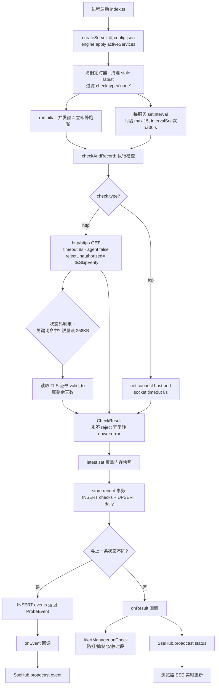
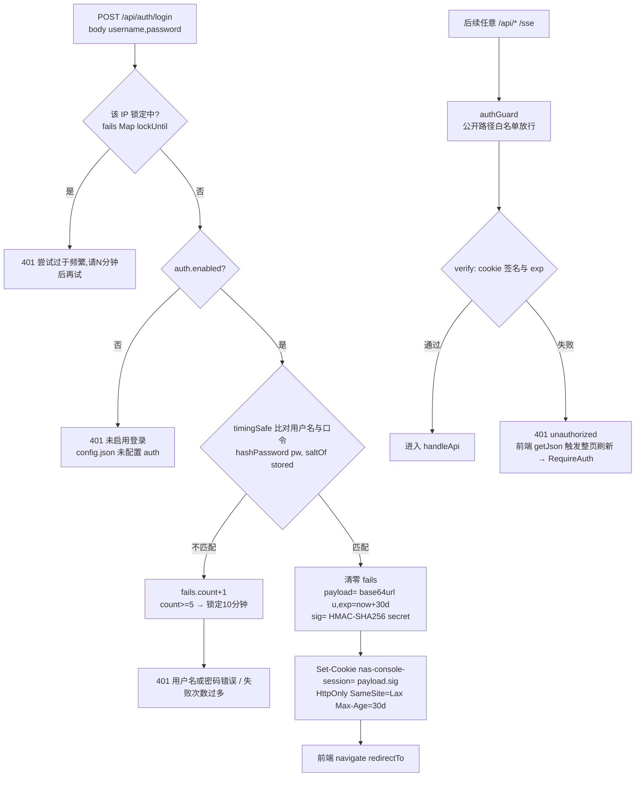
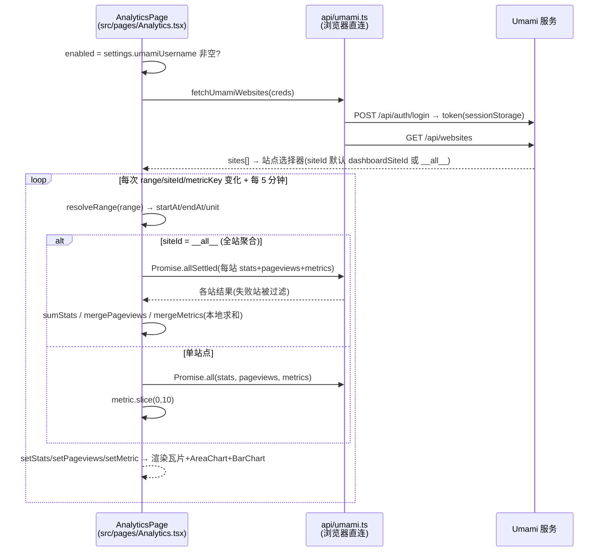
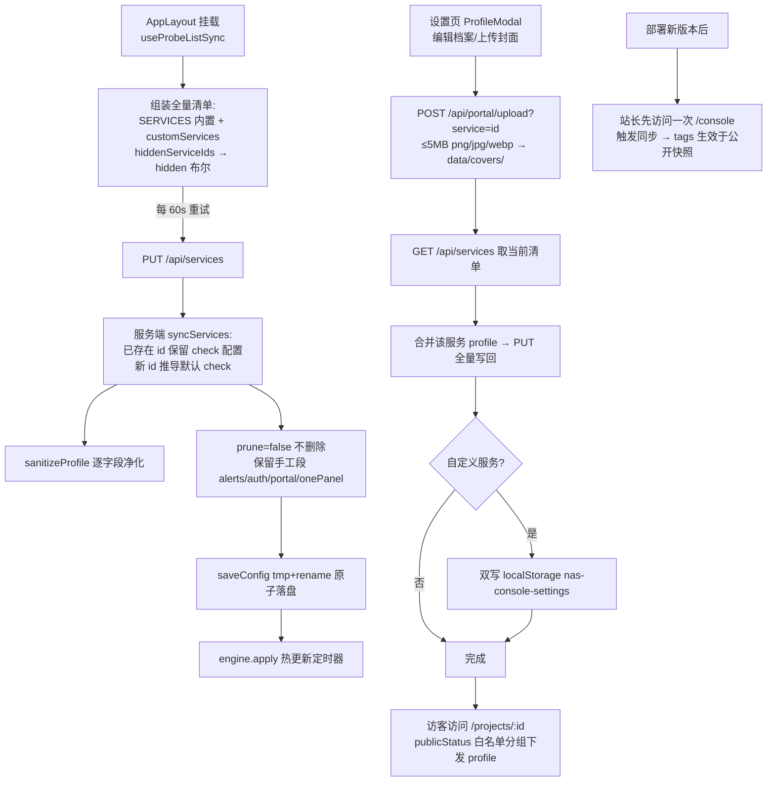

# 05 核心流程
> 项目：nas-console ｜ 版本：v1.0 ｜ 生成日期：2026-10-05 ｜ 依据：源码分析


本章选取五个端到端流程——健康检查轮询（探针引擎）、前端双模式数据接入、登录鉴权、Umami 数据拉取展示、服务清单同步与档案发布——逐一给出流程/时序图、分步说明与涉及文件清单。它们覆盖了「前端 + 轻后端协作」与「监控数据采集与展示链路」两条主线。

## 1. 健康检查轮询（探针引擎主线）

### 1.1 流程图



### 1.2 分步说明

1. **调度建立**：`createServer`（`server/src/server.ts` 第 54-66 行）构造 `ProbeEngine` 并注入两个回调——`onResult` 同时喂给 `AlertManager.onCheck` 与 `hub.broadcast('status')`，`onEvent` 触发 `hub.broadcast('event')`。随后若清单存在可检服务则 `engine.apply(activeServices(config))`（排除 `hidden`）。
2. **全量重排幂等**：`apply()`（`server/src/probe.ts` 第 34-47 行）先清空全部旧定时器与 stale 快照，再按新清单逐服务 `setInterval`（间隔 `Math.max(15, intervalSec ?? 30)` 秒），并异步补跑一轮首检——清单 PUT 热更新后重复调用 `apply` 不会产生双跑。
3. **并发窗口**：首检 `runInitial` 用「4 个 worker 共享一个 queue」的消费者模式（第 54-68 行），避免几十个探测同时打出；`running` 标志防重入。
4. **HTTP 检查细节**（`checkHttp`，第 125-191 行）：`agent: false` 禁用连接复用——注释给出两个理由：「延迟含完整握手更真实」且「TLS 会话恢复时 getPeerCertificate 返回空」；响应到达后先抓证书剩余天数（`certExpiresInDays` 从 `TLSSocket.getPeerCertificate().valid_to` 换算）；有关键词时限量读取响应体（256KB 后丢弃后续 chunk 但不判错，仅关键词未命中才判 down）；8 秒 timeout 触发 `req.destroy()` 并以「超过 8s 未响应」down 收场。
5. **TCP 检查**（`checkTcp`，第 193-221 行）：`net.connect` 成功即 up（延迟=连接耗时），host/port 缺省从 `url.hostname` 与 `internalPort` 推断，两者皆无则 down（error=「tcp 检查缺少 host/port」）。
6. **落库与翻转判定**：`Store.record`（`server/src/store.ts`）在单事务内写 `checks` 并对 `daily` 做 UPSERT 累加；随后查询该服务上一条记录，状态不同则写 `events` 并返回事件——注意「上一条」查询在事务外，极端并发下理论上有竞态，但单进程 + 每服务串行定时器使其实际安全。
7. **告警决策**（`server/src/alerts.ts` `onCheck`，第 19-45 行）：down 时计数 +1；恰好达到阈值（默认 3）时检查抑制窗口（同服务 30 分钟内已通知过则跳过）与安静时段（`quietFrom`~`quietTo`，支持跨零点），通过则并行投递 Bark（GET 拼 URL）/Telegram（POST sendMessage）/Webhook（POST JSON），任一渠道失败仅 console.error。up 时清零计数；若此前处于「已告警」集合则发恢复通知（附延迟）。**告警只在计数恰好等于阈值的瞬间触发一次**，持续 down 依靠 `renotifyAfterMin` 周期性重发。
8. **实时推送**：每次结果即时 `broadcast('status')`；30 秒 `batchTimer` 全量兜底防丢帧；SSE Hub 以 25 秒注释行心跳维持连接（`sse.ts`）。

**涉及文件**：`server/src/index.ts`（进程与定时器装配）、`server/src/server.ts`（引擎构造/回调接线/batch 与 prune 定时器）、`server/src/probe.ts`（调度与检查器）、`server/src/store.ts`（持久化与翻转）、`server/src/alerts.ts`（告警策略与投递）、`server/src/sse.ts`（推送）、`server/src/types.ts`（CheckResult/ProbeEvent）。

## 2. 前端健康数据接入（双模式与展示链路）

### 2.1 时序图

```mermaid
sequenceDiagram
    participant H as useHealthChecks<br/>(src/api/use-health.ts)
    participant PA as api/probe.ts
    participant SV as 探针 /api /sse
    participant HH as health-history store<br/>(localStorage)
    participant UI as Dashboard/Services 页面

    H->>H: 挂载: source='pending'
    H->>PA: probeAvailable() (GET /api/health/latest, 3s 超时)
    alt 可达 → probe 模式
        H->>PA: fetchProbeLatest()
        PA->>SV: GET /api/health/latest
        SV-->>H: results[] → setResults
        H->>PA: fetchProbeHistory(90) + fetchProbeEvents(100)
        PA->>SV: GET /api/health/history?days=90 · /api/events?limit=100
        SV-->>HH: applyServerSnapshot(整体替换+事件去重) → persist+emit
        H->>PA: subscribeProbeEvents()
        PA->>SV: EventSource /sse
        SV-->>H: event status → 合并单条; event batch → 全量合并
        loop 每 intervalSec(≥15s)
            H->>PA: fetchProbeLatest (SSE 失效兜底)
        end
        loop 每 5 分钟
            H->>PA: 重新导入历史快照
        end
    else 不可达 → browser 模式
        loop 每 intervalSec · 并发 4
            H->>H: checkServices: no-cors fetch each (8s 超时)
            H->>HH: recordBatch(入桶/采样/翻转/裁剪) → emit
        end
    end
    HH-->>UI: useSyncExternalStore 通知(UptimeBars/Drawer/可用率)
    H-->>UI: {results, running, source, live} → HealthBadge/StatTile
```

### 2.2 分步说明与设计意图

1. **模式探测只做一次**（第 37-46 行）：挂载时 `probeAvailable()` 以 3 秒超时打一次 `/api/health/latest`；结果写入 `source` 后**运行期不再切换**——注释明言「运行中不自动来回切换」，避免探针短暂抖动导致数据源反复横跳；探针中途下线的表现是 SSE `onError`（`live=false`，副标题不再显示「实时」）加 latest 轮询静默失败（保留上轮数据），源码注释预告「连续失败意味着探针下线，M2 再做自动降级」。
2. **探针模式三通道**：SSE（实时增量）+ latest 轮询（`intervalSec` 兜底）+ 历史导入（5 分钟，整段替换本地）。`useHealthHistory()` 在 Dashboard 顶部被额外调用一次（`Dashboard.tsx` 第 148 行注释「订阅历史写入,驱动可用率相关 UI 刷新」）。
3. **浏览器降级模式**：`checkService`（`src/api/health.ts`）用 `mode:'no-cors'` 的 opaque response——拿不到状态码，「是否可达 + 延迟」即全部信息；HTTPS 页面探测 HTTP 端点会被混合内容拦截统一表现为 down（文件头注释），这正是内置清单把非 HTTPS 服务标记 `checkable:false` 的原因。并发 4 + localStorage 聚合（`recordBatch`）完整复刻 v0.2 行为，且历史结构与探针侧同形，切换无损。
4. **展示消费**：`results: HealthMap` 驱动 HealthBadge（延迟/不可达徽章）与 StatTile 聚合（up 数、平均延迟）；`health-history` 的派生函数 `getUptimeDays/getAvailability/getLatencyTrend/getEvents` 分别支撑 UptimeBars、可用率均值、Sparkline 走势与事件列表。深链 `?detail=<id>` 由 Dashboard 读取并直开抽屉。

**涉及文件**：`src/api/use-health.ts`、`src/api/probe.ts`、`src/api/health.ts`、`src/api/health-history.ts`、`src/hooks/useInterval.ts`、`src/pages/Dashboard.tsx`、`src/pages/Services.tsx`、`src/components/HealthBadge.tsx`、`src/components/UptimeBars.tsx`、`src/components/ServiceDetailDrawer.tsx`。

## 3. 登录鉴权（含失败限流）

### 3.1 流程图



### 3.2 分步说明

1. **启用判定**：`Auth.enabled` 要求 config.json `auth.username` 非空且 `passwordHash` 含 `$`（`server/src/auth.ts` 第 36-38 行）；未启用时 `verify` 恒真、登录端点抛「未启用登录」。启动时未配置会在日志打印 ⚠️ 提示（`server.ts` 第 45 行）。
2. **口令校验**：存储格式 `salt$hash`，校验时以 `saltOf` 取盐、`hashPassword(输入, 盐)` 重算，两次比较均走 `timingSafeEqual` 变体（用户名同理）防时序侧信道（第 78-79、148-160 行）。
3. **限流**：`fails` 以 `req.socket.remoteAddress` 为键；连续失败第 5 次设置 `lockUntil=now+10min`，锁定期内任何尝试先抛「尝试过于频繁，请 N 分钟后再试」（N 向上取整）。成功登录删除记录。
4. **会话签发**：payload 只含 `{u, exp}`（30 天），签名密钥来自 `data/session-secret`（首次启动生成 32 字节 hex、0600 权限；目录不可写退化为进程随机——重启后全员需重登，代码注释判定可接受）。
5. **前端闭环**：`checkSession()`（`src/api/auth.ts`）在 `RequireAuth` 挂载时调用；探针不可达（fetch 抛异常）返回 `ok`——保证降级模式下公开页与管理页不被锁死。任何需会话请求收到 401 时 `getJson`（`src/api/probe.ts` 第 16-20 行）整页 `location.reload()`，让路由门重新走一遍会话判定。
6. **退出**：`POST /api/auth/logout` 下发 `Max-Age=0` 清 Cookie（注意该端点不在公开白名单，需要有效会话才能调用）；前端 `logout()` 随后整页刷新。

**涉及文件**：`server/src/auth.ts`、`server/src/server.ts`（login/session/logout 分支 + authGuard 接线）、`server/scripts/hash-password.mjs`（凭据生成）、`src/api/auth.ts`、`src/components/LoginPage.tsx`、`src/App.tsx`（RequireAuth）。

## 4. Umami 数据拉取与展示

### 4.1 时序图（访问分析页，全站聚合模式）



### 4.2 分步说明

1. **凭据来源与生命周期**：`ConsoleSettings` 的 `umamiUrl/umamiUsername/umamiPassword`（localStorage）；token 进 sessionStorage（`nas-console-umami-token`），401 自动「清 token→重登→重放」一次（`src/api/umami.ts` 第 116-122 行）。未配置时页面渲染引导 Alert 而非报错。
2. **区间换算**：`resolveRange`（第 179-189 行）——`24h` 用 `unit:'hour'`，`7d/30d/90d` 用 `unit:'day'`，`startAt/endAt` 为毫秒时间戳；代码注释解释 Umami 无封端接口故自行换算。
3. **全站聚合三算法**（第 59-94 行）：`sumStats` 对五项指标直和、对比期同口径（仅当全部站点都有 comparison 才聚合对比期）；`mergePageviews` 以时间字符串 x 为键做 Map 求和（依赖各站序列时间升序）；`mergeMetrics` 同名维度求和后降序。失败隔离用 `Promise.allSettled`，只要有一站成功就出数，全失败才抛首个原因。
4. **趋势行变换**：Umami 的 x 形如 `2026-10-05 14:00`，单站 24h 视图截 `HH:mm`、跨天视图截 `MM-DD HH:mm`（`trendRows` useMemo）；pageviews 与 sessions 按下标对齐拼成行数据供 recharts 使用。
5. **总览页摘要**：`useUmamiDashboard`（`Dashboard.tsx` 第 94-141 行）固定 24h 区间，并发拉 stats/pageviews/browsers/active，浏览器分布取 Top 6 套六色板；`enabled` 额外要求 `dashboardSiteId` 已设置——即总览页只盯「默认站点」，跨站聚合只在分析页提供。
6. **错误分层**：`UmamiAuthError`（凭据/授权问题，提示去设置页）与 `UmamiError`（网络/HTTP 问题）由页面分别渲染文案；设置页「保存并测试连接」直接以 `fetchUmamiWebsites` 作探针，成功即回填站点列表供选择默认站点。

**涉及文件**：`src/api/umami.ts`、`src/pages/Analytics.tsx`、`src/pages/Dashboard.tsx`（useUmamiDashboard）、`src/pages/Settings.tsx`（测连）、`src/settings/ConsoleSettingsContext.tsx`（凭据存储）、`src/charts/AreaChart.tsx`、`src/charts/BarChart.tsx`、`src/charts/DonutChart.tsx`。

## 5. 服务清单同步与项目档案发布（前端→探针写路径）

### 5.1 流程图



### 5.2 分步说明

1. **同步触发点**：`useProbeListSync` 只在管理区布局挂载（`src/layouts/AppLayout.tsx` 第 47 行），依赖键是 `JSON.stringify([customServices, hiddenServiceIds])`——设置变更立即触发重同步；页面打开期间每 60 秒重试，注释写明目的「兼顾探针重启后配置回填（探针侧手工 check 配置不被覆盖）」。
2. **upsert 语义**（`server/src/config.ts` `syncServices`，第 72-89 行）：已存在 id `{...s, check: prev.check, profile}`——前端传来的 check（恒为 `{type:'http'}` 或 `{type:'none'}`）被**忽略**，探针侧手工调优（tcp 端口/关键词/tlsSkipVerify/intervalSec）得以保留；这正是 README 提示「若 config.json 丢失重建，手工调优需重新应用」的反向保障。`prune` 固定 false：探针有而清单没有的服务追加保留在尾部。
3. **落盘与生效**：`saveConfig` 先写 `.tmp` 再 rename（原子替换防写坏，`config.ts` 第 16-21 行）；`engine.apply` 立即按新清单重排——整个过程无需重启进程，与 alerts/auth 等段「改后 docker restart」形成对照。
4. **档案发布链路**：ProfileModal 打开时先 GET 清单回填当前 profile；封面/截图上传是独立的二进制 POST（`Content-Type` 决定扩展名，服务端校验 id 正则与 5MB 上限，写入 `data/covers/<id>.<ext>`）；保存时「GET→合并→PUT」三步保证不覆盖其它服务的并发修改；自定义服务再镜像一份 profile 到 localStorage（`ProfileModal.tsx` 第 133-144 行注释「保持现有 ConsoleSettings 模式」）。
5. **对公开面的生效路径**：公开快照 `publicStatus()` 每次请求实时组装，因此 PUT 落盘后详情页/首页**即刻可见**；唯一的间接项是 `tags`——README 指出「tags 字段经页面打开时同步给探针（仅管理区布局挂载时触发）：部署新版本后，站长先访问一次 /console 即可使 tags 生效于公开快照」，因为 tags 变更通常来自代码里的内置清单更新，需要一次同步动作带下去。
6. **权限边界**：PUT `/api/services` 与上传端点都在鉴权面内，但**未启用 auth 的环境完全暴露**——README「项目档案与封面上传」节明确警告公网部署必须配置 auth。

**涉及文件**：`src/api/use-probe-sync.ts`、`src/api/probe.ts`（syncProbeServices）、`src/components/ProfileModal.tsx`、`src/components/ServiceManagerCard.tsx`、`server/src/server.ts`（PUT/upload/covers/publicStatus）、`server/src/config.ts`、`server/src/probe.ts`（apply）。

---

*五个流程共同的底层契约（数据结构、端点、配置字段）见 03/04 两篇；这些流程在生产链路上的部署形态见 06-部署运行.md。*
