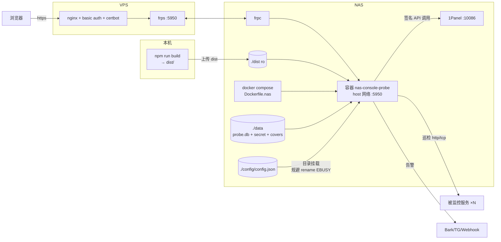

# 06 部署运行
> 项目：nas-console ｜ 版本：v1.0 ｜ 生成日期：2026-10-05 ｜ 依据：源码分析


## 1. 环境要求

| 项 | 要求 | 依据 |
|---|---|---|
| Node.js（本地开发/构建） | ≥ 20（类型层面向 ES2020/ES2022）；容器运行时为 node:22-bookworm-slim | 前端 `tsconfig.json` target ES2020；`server/tsconfig.json` target ES2022；两个 Dockerfile 均 `FROM node:22-bookworm-slim` |
| 操作系统（容器） | **Debian bookworm（glibc）**，不可换 alpine | `Dockerfile` 第 16 行注释：「bookworm（glibc）保证 better-sqlite3 命中预编译二进制；alpine(musl) 需要现场编译」 |
| 磁盘 | `data/` 卷存放 SQLite（实测 probe.db 数 MB 量级）+ covers 上传目录 | `server/data/` 目录结构 |
| 网络 | 容器监听 5950；生产链路经 VPS nginx + frps/frpc 内网穿透；1Panel 集成需容器可达面板地址（host 网络下源 IP=NAS 内网 IP） | `compose.yml` 端口映射；`docker-compose.nas.yml` 头部注释 |
| 可选外部系统 | Umami（任意可 CORS 访问的部署）、1Panel v2 社区版、Bark/Telegram/Webhook | `src/api/umami.ts`、`server/src/1panel.ts`、`server/src/alerts.ts` |

依赖规模刻意保持最小：前端运行时依赖 7 个（antd/dayjs/react/react-dom/react-icons/react-router-dom/recharts），server 仅 2 个（better-sqlite3/dayjs，见 `server/package.json`）。

## 2. 本地启动步骤（命令级）

```bash
# ① 前端依赖安装
cd nas-console && npm install

# ② 构建探针（TS → server/dist）
cd server && npm install && npm run build

# ③ 准备探针配置（首次）
cp config.example.json config.json
# 可选：启用登录鉴权（密码不进 shell 历史的写法）
#   read -s P && node scripts/hash-password.mjs admin "$P"
#   把输出的 {"auth":{...}} 合并进 config.json

# ④ 启动探针（dev 约定 5951，vite 代理指向它）
PORT=5951 node dist/index.js
cd ..

# ⑤ 启动前端 dev server
npm run dev          # http://127.0.0.1:5173

# ⑥ 生产构建（tsc 类型检查 + vite 打包）
npm run build        # 产物 → dist/

# 可选：重新生成 PWA 图标（纯 Node，无第三方依赖）
node scripts/make-icons.mjs   # 输出 public/icons/icon-{512,192,180}.png
```

dev 模式的关键约定在 `vite.config.ts`：`/api` 与 `/portal-covers` 代理到 `http://127.0.0.1:5951`；`/sse` 代理额外在 `proxyRes` 上注入 `x-accel-buffering: no`（第 16-21 行），防止代理缓冲把 SSE 事件攒包。探针不在线时页面照常可用——自动进入浏览器降级巡检模式（`use-health.ts`）。

dev 与生产在形态上有三处系统性差异，理解它们能解释大部分「本地正常、线上不对劲」类问题。**其一，同源与跨域**：生产环境探针同时托管 dist，前端全部走同源相对路径；dev 则是 5173 与 5951 两个源，靠 vite 代理伪装成同源——因此任何「直连绝对地址」的代码（如 Umami 浏览器直连）在 dev 与生产行为一致，而「相对路径」代码的一致性完全依赖代理配置齐全（`/api`、`/portal-covers`、`/sse` 三条缺一不可，新增后端路由前缀时必须同步补代理）。**其二，进程角色**：dev 里探针只跑 API（dist 尚未构建或不更新），静态托管形同虚设；生产里静态托管是探针的主职责之一，`STATIC_DIR` 指向的 dist 版本直接决定访客看到的页面。**其三，数据连续性**：dev 的 `DB_PATH` 是相对路径 `data/probe.db`（取决于启动时的工作目录，README 约定在 server/ 下启动），生产则由环境变量钉死到挂载卷——在错误的工作目录启动会让 dev 悄悄新建一个空库，表现为「历史数据消失」。

## 3. 配置文件准备

`config.example.json` → 实际 `config.json`（**不进仓库**，`.gitignore` 已排除 `config.json` 与 `data/`）：

```json
{
    "services": [],
    "alerts": {},
    "auth": { "username": "admin", "passwordHash": "" }
}
```

三段的填写策略各不相同：

- **services**：可以留空数组——首次打开管理区后，前端会把「内置 19 项 + 自定义」清单经 `PUT /api/services` 自动 upsert 落盘（README「部署」节）。之后如需手工调优探测参数（tcp 端口、关键词、tlsSkipVerify、intervalSec），直接编辑 config.json 后 `docker restart`；前端同步会保留这些手工 check 配置。
- **alerts**：完全手工维护（README M2 节示例含 bark/telegram/webhook/consecutiveDowns/renotifyAfterMin/quietFrom/quietTo），渠道至少配一个；改后重启。配置好后可用 `POST /api/alerts/test` 或设置相关入口验证连通性。
- **auth**：用 `server/scripts/hash-password.mjs` 生成（脚本复用 `dist/auth.js` 的 `newSalt`/`hashPassword`，输出即可直接合并）。**公网链路必须配置**（README 0.3.1 节加粗强调）。
- 可选扩展段（样例文件未含，按 `server/src/types.ts` 手工添加）：`portal.publicGroups`（首页公开分组白名单，缺省 `["应用站点","文档与统计"]`）、`portal.publicMetrics`（默认 false）、`onePanel.baseUrl/apiKey/hostHeader`。

> ⚠️ 安全注记：仓库工作区中存在 `auth.admin.json`（含明文密码与对应 hash，`.gitignore` 已排除、不会被提交）。它**不被任何代码、Dockerfile 或 compose 文件引用**——server 只读取 `config.json` 的 `auth` 段——属于本地生成凭据后的暂存文件。接手后建议：确认其内容已合并进部署机的 config.json 后删除本地该文件，或至少不要将其复制到任何公开位置。本文档不记录其内容。

## 4. 环境变量清单

全部在 `server/src/index.ts` 第 5-10 行解析：

| 变量 | 默认值 | 说明 |
|---|---|---|
| `PORT` | `5950` | HTTP 监听端口（dev 约定 5951） |
| `STATIC_DIR` | `../../dist`（相对 server/dist） | 前端构建产物目录；容器内为 `/app/dist` |
| `DB_PATH` | `data/probe.db` | SQLite 路径（WAL 模式，会产生 -wal/-shm 伴随文件） |
| `CONFIG_PATH` | `config.json` | 探针配置路径 |
| `SECRET_PATH` | `<DB_PATH 所在目录>/session-secret` | 会话签名密钥文件（首启自动生成，0600） |
| `COVERS_DIR` | `<DB_PATH 所在目录>/covers` | 封面上传目录（首启自动 mkdir） |
| `NODE_ENV` | — | 容器内置 `production`（两个 Dockerfile 的 ENV） |

前端无任何环境变量依赖：Umami 地址等全部来自设置页（localStorage），API 走同源相对路径。

## 5. 构建与两种 Docker 部署方式对比

### 5.1 对照表

| 维度 | `Dockerfile` + `compose.yml` | `Dockerfile.nas` + `docker-compose.nas.yml` |
|---|---|---|
| 定位 | 全量自包含构建（前端+探针一锅出） | NAS 专用轻量构建（仅探针服务端） |
| 构建上下文 | **上级 PROJECT 目录**（`context: ..`），需同级存在 `react-ui/` 仓库且已 `pnpm build:packages`（Dockerfile 第 1-3 行、compose.yml 注释） | 本目录（`context: .`），无需 react-ui |
| 前端 dist | 构建阶段 `npm run build` 产出并 COPY 进镜像 | **宿主机挂载** `./dist:/app/dist:ro`（本机构建后同步上传） |
| 构建阶段 | 单阶段 build（node:22）→ 运行阶段 COPY dist/server/dist/server/node_modules | 两阶段：deps 阶段 `npm ci --omit=dev`（按 NAS 平台拉 better-sqlite3 预编译二进制）→ 运行阶段仅拷 node_modules + package.json + server/dist |
| 网络模式 | 桥接，端口映射 `5950:5950`（注释：与旧 nas-console-web 的 5950:80 对齐，frpc/反代无需改动） | **`network_mode: host`**（直连本机，1Panel 白名单按源 IP 校验——compose 头部注释） |
| config 挂载 | 单文件 `./config.json:/app/config.json` | 目录 `./config:/app/config`（`CONFIG_PATH=/app/config/config.json`）——**注释明言原因：config.json 的原子写(rename)在单文件 bind mount 上会 EBUSY** |
| data 挂载 | `./data:/app/data` | `./data:/app/data` |
| healthcheck | `node -e fetch('http://127.0.0.1:5950/statusz')…` 30s/5s/3 次 | 同左 |
| 容器名 | `nas-console-probe` | `nas-console-probe` |
| 隐患备注 | 单文件挂载 config 与 rename 原子写存在 EBUSY 冲突（见上），新部署建议用目录挂载 | dist 只读挂载，更新前端只需替换宿主机 dist 并重启 |

`Dockerfile.nas` 还有一条容易被忽略的坑已写在注释里（第 16 行）：「package.json 必须在场：含 `"type": "module"`，缺失会把 ESM 当 CJS 解析」——运行阶段单独 COPY 了 `server/package.json`。

### 5.2 NAS 部署操作序列（README「部署」节）

```bash
# 本机：先产出前端 dist（停 dev server 后执行）
npm run build

# 上传仓库到 NAS 后：
cd nas-console && cp config.example.json config.json   # 或使用已迁移的既有配置
docker compose -f docker-compose.nas.yml up -d --build
```

生产访问链路（README + `docs/v03-probe-design.md`）：

```text
浏览器 → https://console.zhangzhengyang.com（VPS nginx + basic auth + certbot）
       → frps 5950 → NAS frpc → NAS 容器 nas-console-probe（Node 22, 5950）
                                ├── /            → dist 静态托管
                                ├── /api/*       → 探针/历史/清单 API
                                └── /statusz     → 进程健康检查
```

**VPS nginx 需要的放行规则**（README「公开状态页」节）：`/status` 与 `/api/public/` 豁免 basic auth，其余路径保持鉴权。启用探针侧登录鉴权后，VPS 层 basic auth 可退役「或保留作为第二道门」。日常运维节奏：手工调优探测参数 → 编辑 config.json → `docker restart nas-console-probe`；前端更新 → 本机 build → 同步 dist → 重启（容器内只读挂载，替换宿主机文件即可）。

### 5.2.1 构建产物剖析

理解「容器里到底有什么」有助于排障与安全评估。`Dockerfile.nas` 路径下，最终镜像只含四样东西：`server/node_modules`（仅 production 依赖，better-sqlite3 + dayjs）、`server/package.json`（ESM 标记必需）、`server/dist`（tsc 编译产物，11 个 JS 文件）、以及运行时挂载进来的 dist/config/data。`Dockerfile` 全量路径则额外把前端 dist 烧进镜像（`COPY --from=build .../dist ./dist`）。值得注意 Dockerfile 顶部注释要求构建时 COPY 兄弟仓库 `react-ui/`（「前端构建要消费同级 react-ui 仓库的 es/ 产物」），但当前根 `package.json` 的 dependencies 与 lock 文件中**均无 react-ui 相关依赖**——该 COPY 在现版本构建中很可能是无消费的历史遗留（早期 Mantine 时代从本地 packages 引组件的形态，`Field.tsx`/`feedback.tsx` 的「替代原 Mantine 包」注释可佐证）。⚠️ 待确认：确认无消费后可从 Dockerfile/compose.yml 中移除 react-ui COPY 与上下文要求，简化构建。

### 5.2.2 日常维护例程建议

源码没有内置任何运维工具（无日志轮转、无备份命令），以下例程是从数据模型与部署形态推导的最小集。**备份**：`data/probe.db`（可用 `sqlite3 probe.db ".backup ..."` 或直接停容器后拷贝，WAL 模式下热拷主文件有丢尾风险）、`config/config.json`（全部手工调优与凭据所在）、`data/session-secret`（丢失即全员重新登录）；`dist/` 与 `covers/` 可由构建与上传再生，优先级低。**日志**：探针只有 console 输出（启动四行、告警投递失败、安静时段跳过），交给 `docker logs` 与 Docker 默认轮转即可，无需额外采集。**证书**：TLS 证书剩余天数由探针自动采集并在 UI 告示（<30 橙 / <15 红），续期动作在 VPS certbot 侧，二者通过状态页联动的闭环已经够用。**升级**：拉新代码 → 本机 `npm run build` → 同步 dist → `docker compose up -d --build`（server 有依赖变更时才需要重建镜像）；升级后首访一次 `/console` 触发清单同步是 README 明示的习惯动作。

### 5.3 部署拓扑图



## 6. 测试体系

当前仓库**没有自动化测试**：`find src server/src -name "*.test.*" -o -name "*.spec.*"` 结果为空；根 `package.json` 无 `test` 脚本；`tsconfig.json` 却预置了 `exclude: ["src/**/*.test.{ts,tsx}", "src/test-setup.ts"]`，`src/charts/sparkline-path.ts` 头注释也写着「纯函数，便于单测」——说明测试基建是**预留而未落地**的状态。⚠️ 待确认：作者是否有未提交的测试计划。

现阶段的质量保障手段（可视为「测试替代物」，接手者应知晓并延续）：

1. **构建期类型门**：`npm run build = tsc --noEmit -p tsconfig.build.json && vite build`——strict TS 全量类型检查前置于打包，这是唯一的自动化关卡；server 侧 `npm run build` 同样是纯 tsc，且开启 `noUnusedLocals/noUnusedParameters/noUncheckedIndexedAccess` 等更严选项（`server/tsconfig.json`）。
2. **运行时健康自检**：`GET /statusz` 返回 `{ok, services, sseClients, authRequired, ts}`，被 compose healthcheck 每 30 秒调用，实现容器级存活探测。
3. **告警链路自测**：`POST /api/alerts/test` 向所有已配置渠道发真实测试消息（README M2 节「可验连通性」）。
4. **防御性编码**：`sanitizeProfile`（畸形档案净化）、`clampInt`（参数夹取）、readJson/readRaw 的体积上限、`checkHttp/checkTcp` 的 resolve-only 设计——把「永不拒绝、异常转 down」作为引擎不变量，规避未处理 Promise rejection。
5. **验证清单建议**（接手后手工冒烟）：探针启动日志三行（listening/static/db·config）；`/statusz` 返回 ok；未登录访问 `/api/health/latest` 得 401（启用 auth 时）；登录失败 5 次触发锁定提示；`/api/alerts/test` 各渠道收到消息；`/status` 与首页 30s 自动刷新可见；`PUT /api/services` 后 config.json 的 mtime 变化且手工 check 段未被覆盖。

## 6.1 公网部署安全加固清单

结合源码中的注释警告（README 多处「公网部署务必配置 auth」）与 01 篇第 5.2 节的安全架构，公网上线前应逐项核对：一，config.json 的 `auth` 段必须配置且口令经 `hash-password.mjs` 生成（非空、含 `$` 才会启用）；二，确认 VPS nginx 的放行规则精确匹配——`location = /status` 用等号精确匹配避免误放行子路径，`/api/public/` 是唯一公开 API 前缀；三，若保留 basic auth 作为外层，注意浏览器对两层鉴权的提示语义不同（401 弹窗 vs 页面登录表单），排障时先分清是哪层在拦；四，`data/session-secret` 与 config.json 内的 apiKey/口令不出 NAS——任何需要「把配置发给别人看」的场景先删 `auth`/`onePanel`/`alerts` 三段；五，`auth.admin.json` 这类本地凭据暂存文件不入仓库（`.gitignore` 已覆盖）也不随仓库上传 NAS，部署完成后建议删除。六，若在公网暴露时未配置 1Panel，无需额外处理——`getPanel` 对缺 apiKey 返回 null，相关端点恒 400，攻击面为零。

## 7. 常见运维问题速查

| 现象 | 根因与处置 |
|---|---|
| 改了 alerts/auth/portal/onePanel 不生效 | 这些段只在启动时读入（`createServer` 构造 Auth/AlertManager），需 `docker restart`；services 段除外（PUT 热更新） |
| NAS 上 `PUT /api/services` 报 EBUSY / 写配置失败 | 单文件 bind mount 上 rename 失败——改用 `docker-compose.nas.yml` 的目录挂载方式（`./config:/app/config`） |
| 探针测 TCP/自签服务失败 | 确认该服务 `check.type` 已手工改为 `tcp` 或 `tlsSkipVerify: true`（前端同步只保留不改写已有 check）；tcp 需 tcpHost/tcpPort 可从 url/internalPort 推断 |
| 页面显示「浏览器巡检(探针未接入)」 | `/api/health/latest` 3 秒内不可达（探针未启动或链路不通）；注意模式在页面加载时锁定，修复后需刷新页面 |
| 首页不显示某些服务的链接/详情 404 | 该分组不在 `portal.publicGroups` 白名单——字段级脱敏的预期行为；白名单分组更新后需访问一次 `/console` 触发清单同步 |
| Umami 面板报「账号或密码错误」 | 凭据存于浏览器 localStorage（设置页），与探针无关；token 在 sessionStorage，重开标签页会自动重登 |
| 容器反复重启 | 看 healthcheck：`/statusz` 5 秒内未响应；常见原因是 DB_PATH 目录不可写（SQLite WAL 无法创建）或 config.json 的 services 段不是数组（`loadConfig` 直接抛错拒绝启动） |
| 1Panel 端点 400 | `onePanel.apiKey` 未配置（getPanel 返回 null）；502 则查签名三要素：apiKey、时间同步（秒级时间戳）、域名绑定的 hostHeader 与 IP 白名单 |

---

*本文与 00–05 篇共同构成本项目的完整文档集；两处「⚠️ 待确认」（events 表无裁剪、react-ui 构建依赖疑似历史遗留）与安全注记（auth.admin.json）为源码分析中发现的差异点，详见各篇标注。*
