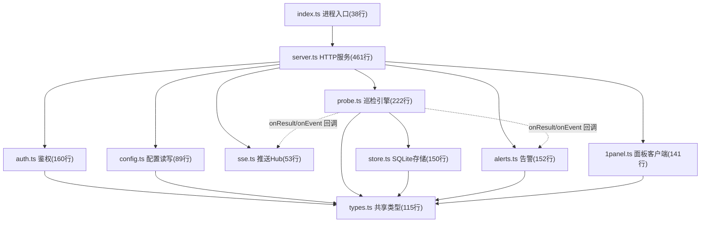

# 07 模块详解
> 项目：nas-console ｜ 版本：v1.1 ｜ 生成日期：2026-10-06 ｜ 依据：源码分析

## 0. 本篇定位与读法

前七篇（00–06）回答的是「这个系统是什么、如何组织、端到端如何运转」；本篇开始进入**逐模块深读**：以 `server/src/` 十个文件与前端核心目录为对象，给出每个模块的职责边界、关键文件与函数清单、内部机制走读。与 01 篇「架构分层图」不同，本篇的粒度是**函数级**——每个函数做什么、被谁调用、有什么不变量与边界行为，目标是让接手者不打开源码也能准确定位「要改的那一行在哪、改了会影响谁」。

阅读顺序建议：先看第 1 节的模块地图与依赖规则，再按「巡检链路（probe → store → sse → alerts）→ 门卫链路（auth → server）→ 配置链路（config）→ 外部集成（1panel）」的顺序读后端，最后按「数据接入（api/）→ 页面（pages/）→ 复用组件」的顺序读前端。文中所有行号以 v0.3.0 源码为准，函数名均可在对应文件中直接检索到。

## 1. 模块地图与依赖规则

server 端十个文件构成一张单向依赖图：`index.ts` 是唯一装配点，`server.ts` 是路由分发枢纽，`probe.ts`/`store.ts`/`sse.ts`/`alerts.ts` 四件套构成监控领域核，`auth.ts` 守门，`config.ts` 管配置读写，`1panel.ts` 对外对接面板，`types.ts` 是零依赖的共享类型层。

三条依赖纪律值得先记住，后续走读会反复出现：其一，`store` 不认识 `probe`——数据库只暴露 `record/dailyBuckets/recentSamples/events/prune` 五个方法，由引擎主动写入与查询，反向无感知；其二，`sse` 与 `alerts` 不认识 `engine`——它们通过 `server.ts` 第 54-60 行构造 `ProbeEngine` 时注入的 `onResult`/`onEvent` 两个回调接收数据，引擎对「谁在消费结果」零依赖（构造注入 + 观察者模式的极简实现）；其三，`types.ts` 不 import 任何东西，是唯一可以同时被前后端镜像的契约层（首行注释「与前端 ServiceDef 保持字段兼容，check 为探针专属」）。

前端分层为四层：`src/api/`（数据访问，一个外部系统一个文件）→ `src/config/`+`src/settings/`（静态清单与用户偏好）→ `src/components/`+`src/charts/`（复用组件）→ `src/pages/`+`src/layouts/`（路由级组合）。页面之间的共享状态只有两处：`health-history.ts` 的模块级单例 store 与 `ConsoleSettingsContext`。

## 2. server/src/index.ts —— 进程入口与生命周期

**职责**：解析六个环境变量、构造 `Store` 与 `createServer`、打印启动横幅、注册优雅停机。全文 38 行，没有任何业务逻辑，是理解「一个进程如何被装配出来」的最短入口。

| 函数/常量 | 位置 | 说明 |
|---|---|---|
| 环境变量解析 | 第 5-10 行 | `PORT`(默认 5950)、`STATIC_DIR`(默认 `../../dist` 相对 server/dist)、`DB_PATH`、`CONFIG_PATH`、`SECRET_PATH`(默认 DB 同目录 `session-secret`)、`COVERS_DIR`(默认 DB 同目录 `covers`) |
| `new Store(DB_PATH)` | 第 12 行 | 先建库再建服务，建表失败即进程退出（fail-fast） |
| `createServer(store, opts)` | 第 13-19 行 | 返回 `{server, engine, hub, alerts, auth, getConfig}`，入口只持有引用 |
| `server.listen` 回调 | 第 21-26 行 | 打印四行横幅：端口/静态目录/db·config/已纳入巡检的服务数 |
| `shutdown()` | 第 28-35 行 | 顺序：`engine.stop()` → `hub.stop()` → `store.close()` → `server.close(cb)` → 2 秒兜底 `process.exit(0).unref()` |
| 信号注册 | 第 36-37 行 | `SIGINT` 与 `SIGTERM` 共用同一 `shutdown`，对应 docker stop 的两种路径 |

**机制走读**：`STATIC_DIR` 的默认值用 `new URL('../../dist', import.meta.url).pathname` 计算——注意这是**相对编译产物位置**（`server/dist/index.js` 往上两级到项目根的 `dist/`），而不是相对进程工作目录；这也解释了 Dockerfile.nas 为何要显式设 `STATIC_DIR=/app/dist`。`shutdown` 的顺序刻意让「先停源头（引擎定时器）、再断消费者（SSE）、最后关库与端口」：若先关库，引擎定时器可能在窗口期内继续触发 `store.record` 而命中已关闭的数据库句柄报错。2 秒兜底强退用于 `server.close` 等待存量连接（含 SSE 长连接）迟迟不退出的场景——SSE 客户端不主动断开时 `server.close` 的回调可能永远不触发，所以必须有这个 unref 的定时器保底。

## 3. server/src/probe.ts —— ProbeEngine 巡检引擎

**职责**：按服务清单调度周期探测（http/tcp）、维护内存级最新结果、把每轮结果写入 Store 并通过回调上抛。引擎是全系统唯一「主动发起对外请求」的模块。

| 函数/成员 | 位置 | 说明 |
|---|---|---|
| `timers: Map<string, Timeout>` | 第 24 行 | 每服务一个 `setInterval` 句柄，id 为键 |
| `running` | 第 25 行 | `runInitial` 防重入标志 |
| `latest: Map<string, CheckResult>` | 第 26 行 | 内存最新结果快照，`apply()` 时清理已下线 id |
| `apply(services)` | 第 34-47 行 | 全量重排：清 stale 快照与旧定时器 → 过滤 `check.type==='none'` → 异步补跑首检 → 每服务 `setInterval`（间隔 `Math.max(15, intervalSec ?? 30)` 秒） |
| `stop()` | 第 49-52 行 | 清空全部定时器（不清 `latest`，停机时无需） |
| `runInitial(active)` | 第 54-68 行 | 「4 worker 共享一个 queue」消费者模式立即补跑一轮；`running` 防重入 |
| `checkAndRecord(service)` | 第 70-76 行 | 执行检查 → 更新 `latest` → `store.record()` → 回调 `onResult`，若有翻转事件再回调 `onEvent` |
| `latestResults()` | 第 79-81 行 | 返回 `[...latest.values()]`，供 `/api/health/latest` 与公开快照 |
| `check(service)` | 第 83-96 行 | 按 `check.type` 分流到 `checkHttp`/`checkTcp`；类型缺失返回 `down + 'check type 未配置'` |
| `hostOf(url)` | 第 99-105 行 | 从 url 提取 hostname（tcp 检查的缺省目标），解析失败返回 undefined |
| `certExpiresInDays(res)` | 第 113-123 行 | 从 `TLSSocket.getPeerCertificate().valid_to` 换算剩余天数（向下取整），非 TLS 或读取失败返回 undefined |
| `checkHttp(id, url, check, timeoutMs)` | 第 125-191 行 | HTTP(S) GET 探测，见下文 |
| `checkTcp(id, host, port, timeoutMs)` | 第 193-221 行 | `net.connect` 成功即 up，超时/错误转 down |

**机制走读**。`apply()` 的幂等性是设计核心：无论是启动首调还是 `PUT /api/services` 热更新后的重调，都走「先全部清空、再按新清单重建」的路径，因此重复调用不会产生双跑定时器；同时第 36-38 行先清理「新清单里不存在的 id」的 `latest` 快照，避免下线服务的结果残留到 API 响应里。首检补跑 `runInitial` 用并发窗 4（第 59 行 `Math.min(4, queue.length)`）——几十个服务同时启动时不会瞬间打出几十个探测，而是四个 worker 从共享队列依次领取；`running` 标志防止上次补跑未完成时 `apply` 重入导致两轮并发。

`checkHttp` 有五个容易忽略的细节。第一，`agent: false`（第 143 行注释）禁用连接复用，理由有二：延迟含完整 TLS 握手更能代表真实访客体感；TLS 会话恢复时 `getPeerCertificate()` 返回空对象，复用连接会导致证书天数读不到。第二，状态判定分两层：`statusOk = statusCode < 400`（未配置 `expectStatus` 时的默认），`codeOk = expected ? expected.includes(code) : statusOk`（配置后要求精确命中，第 152-154 行）。第三，关键词检查限量读 256KB（`MAX_BODY_BYTES`）：超限后停止累积但**不判错**（`overflow` 置位后 `finish(undefined)`），只有「完整读完了且关键词未命中」才判 down——即超长响应体不会因截断而误报。第四，无关键词时 `res.resume()` 直接丢弃响应体，尽早释放 socket。第五，整条 Promise 是 **resolve-only** 设计：timeout、request error、response error 全部转为 `down + error 文案` 收场，任何异常都不会让 `checkAndRecord` 的 await 落空。

`checkTcp` 更简单：`net.connect` 一次，`connect` 事件即 up（延迟=连接耗时），`timeout`/`error` 转 down，`done()` 里先 `socket.destroy()` 再 resolve，避免半开连接泄漏。host/port 的推断链是 `check.tcpHost ?? hostOf(service.url)`、`check.tcpPort ?? service.internalPort`（第 90 行），两者皆无时 down 并报「tcp 检查缺少 host/port」。

## 4. server/src/store.ts —— SQLite 存储层

**职责**：三张表（checks/daily/events）的建表、写入、查询与裁剪。构造函数即迁移脚本（`CREATE TABLE IF NOT EXISTS`），没有独立 migration 机制——个人规模下的刻意取舍。

| 方法 | 位置 | 说明 |
|---|---|---|
| 构造函数 | 第 18-48 行 | `new Database(dbPath)` → `pragma('journal_mode = WAL')` → 建三表两索引 |
| `record(result): ProbeEvent \| null` | 第 51-90 行 | 事务写 checks + UPSERT daily；事务外比对上一条状态，不同则写 events 并返回事件 |
| `dailyBuckets(days)` | 第 93-108 行 | 按天聚合查询，返回 `Record<服务id, Record<日期, DayBucket>>`（蛇形列名 → 驼峰字段的转换点之一） |
| `recentSamples(ms, limit=240)` | 第 111-132 行 | 最近 ms 毫秒的原始采样，每服务均匀降采样至 ≤limit 条（`step = ceil(len/limit)`，`i % step === 0`） |
| `events(limit)` | 第 134-139 行 | 全局倒序查询翻转事件；`to_status AS "to"` 别名（`to` 是 SQL 关键字，第 135 行注释）。注意 `as ProbeEvent[]` 断言运行时失真——返回行实为 `{service_id, ts, to}`，蛇形键由前端 DTO 映射消化（18 篇第 2.4 节、19 篇第 2.3 节） |
| `prune(days=90)` | 第 142-145 行 | `DELETE FROM checks WHERE ts < cutoff`，只清 checks（daily 永久、events 无裁剪，见 13 篇） |
| `close()` | 第 147-149 行 | 关库（shutdown 链路调用） |

**机制走读**。`record` 的事务边界值得精确描述：`this.db.transaction(...)` 包住的是「INSERT checks + UPSERT daily」两步（第 68-79 行），而「查询上一条状态」在事务外（第 64-66 行）、「INSERT events」也在事务外（第 82-88 行）。这样做的实际安全性依赖两个前提：单进程、每服务串行定时器（同一服务不会有两条 `record` 并发执行），因此「上一条查询 → 写入 → 比对」之间不会被同服务请求插入。daily 的 UPSERT 用 `ON CONFLICT (day, service_id) DO UPDATE SET up = up + excluded.up ...` 累加四列，避免了「先读后写」的竞态，也是全库唯一一条 upsert。另一个实现细节：三条预处理语句（insert/upsertDaily/last）在**每次 `record` 调用时 prepare**，而非构造时缓存——better-sqlite3 内部对 prepare 有缓存优化且本场景调用频率低（约 0.6 次/秒），性能无虞，但若服务数上一个数量级，把 prepare 提升到构造函数是零成本的改进（见 10 篇）。

WAL 模式的选择与读写模式匹配：本库是典型的「单写多读」——引擎持续写，HTTP 请求随时读（latest 来自内存不经库，但 dailyBuckets/recentSamples/events 每次请求都打库）。WAL 让读写不互斥，读请求不会被写入阻塞；代价是数据目录多出 `-wal`/`-shm` 两个伴随文件，备份时不能只拷主文件（见 06 篇备份例程）。

## 5. server/src/sse.ts —— SseHub 推送中心

**职责**：管理 SSE 客户端集合、三类事件的广播、心跳维持。全文 53 行，是最小的一个运行时模块。

| 方法 | 位置 | 说明 |
|---|---|---|
| `serve(req, res)` | 第 14-27 行 | 写响应头（`text/event-stream; charset=utf-8`、`no-store`、`keep-alive`、`x-accel-buffering: no`）→ 立即写 `: connected\n\n` → 加入 `clients` Set → 监听 `req close` 摘除 → 启动心跳 |
| `broadcast(event, data)` | 第 29-34 行 | 拼 `event: <名>\ndata: <JSON>\n\n` 帧后循环 `res.write`，无背压处理 |
| `clientCount()` | 第 36-38 行 | 客户端数，进 `/statusz` |
| `stop()` | 第 40-44 行 | 清心跳定时器、`res.end()` 全部客户端、清空集合（shutdown 用） |
| `ensureHeartbeat()` | 第 46-52 行 | 惰性单例心跳：首个客户端连上时启动 25s 间隔 `: ping`，`unref()` 不阻塞退出 |

**机制走读**。三类事件（`status`/`batch`/`event`）在类型上宽容：`broadcast` 的 data 参数类型是 `CheckResult | CheckResult[] | unknown`，因为 `event` 事件的载荷是 `ProbeEvent` 而非 CheckResult。心跳用 SSE 规范中的**注释行**（冒号开头），浏览器 EventSource 不派发事件但连接上有字节流动，反代的空闲超时因此不会掐断连接。`x-accel-buffering: no` 是给 nginx 的显式关缓冲指令；vite dev 代理在 `vite.config.ts` 第 16-21 行用 `proxyRes` 钩子注入同一头，两处同款。值得注意的两个边界：客户端异常断开（非优雅 close）依赖 Node 的 `req 'close'` 事件兜底摘除；`broadcast` 对已半断开的 res 调用 `write` 不会抛异常（写入错误走异步 'error'），残留连接最多存活到下一个 `close` 事件，个人规模无泄漏之虞。

## 6. server/src/alerts.ts —— AlertManager 告警决策与投递

**职责**：消费每次检查结果，执行「防抖 → 抑制 → 安静时段」三重判定后向已配置渠道投递；提供 `test()` 手动全渠道测试。状态全部在内存（三个 Map/Set），重启清零（头注释明言「重启后的首个故障会重新告警，符合预期」）。

| 成员/方法 | 位置 | 说明 |
|---|---|---|
| `downCounts: Map<string, number>` | 第 12 行 | 连续 down 计数（up 即清零） |
| `lastDownNotifiedAt: Map<string, number>` | 第 13 行 | 同服务上次 down 告警时间（抑制窗口基准） |
| `alertedDown: Set<string>` | 第 14 行 | 「已处于告警态」集合（恢复通知与抑制判定依据） |
| `onCheck(result)` | 第 19-45 行 | down：计数+1，`count === threshold` 瞬间判定抑制与安静时段后投递；up：清零 + 已告警集合非空则发恢复通知 |
| `test()` | 第 48-50 行 | 以固定标题投递一轮，返回各渠道 `{channel, ok, error?}` |
| `notify(title, body)` | 第 52-61 行 | 安静时段内仅 `console.log` 跳过；投递后逐条 `console.error` 失败渠道 |
| `dispatch(title, body)` | 第 63-103 行 | 按 bark/telegram/webhook 配置并行构造投递任务，`Promise.all` 等待后返回逐渠道结果 |
| `inQuietHours()` | 第 105-113 行 | `from <= to` 用区间内判定，`from > to` 视为跨零点（`minutes >= from || minutes < to`） |
| `parseHM(raw)` | 第 116-124 行 | 严格解析 `HH:mm`（小时 ≤23、分钟 ≤59），非法返回 null |
| `joinUrl(...)` | 第 126-130 行 | Bark URL 拼接：首段去尾斜杠、其余段去首尾斜杠 |
| `sendRequest(...)` | 第 137-152 行 | 8 秒 `AbortController` 超时的裸 fetch；非 2xx 抛错；`res.body?.cancel()` 尽早释放连接 |

**机制走读**。告警只在计数**恰好等于阈值**的瞬间触发一次（第 24 行 `count === threshold`，阈值 `Math.max(1, consecutiveDowns ?? 3)`）——持续 down 不重复触发，而由两层机制覆盖提醒：`renotifyAfterMin`（默认 30 分钟）在「已告警且距上次通知超过窗口」时于下一次到达阈值的重发（实际语义：抑制期内不重发，见第 27-29 行注释），恢复通知则在 `alertedDown` 命中时必发（第 41-44 行）。一个需要理解的边界：因为计数器在内存且阈值判定是「恰好等于」，服务在阈值以下抖动（down 2 次 → up → down 1 次）永远不会触发告警，这是防抖的预期代价。投递层三分支结构对称：Bark 走 GET 拼 URL（`joinUrl(bark.url, encodeURIComponent(title), encodeURIComponent(body))`），Telegram 走 POST `sendMessage`，Webhook 走 POST `{title, body, ts}`；任一渠道失败只影响自己的结果项，不影响其它渠道（`.then/.catch` 各自闭环）。

## 7. server/src/auth.ts —— 单用户鉴权

**职责**：口令哈希校验、HMAC 签名 Cookie 会话的签发与校验、登录限流、`authGuard` 入口守卫、会话密钥管理。零外部依赖（只用 `node:crypto` 与 `node:fs`）。

| 成员/函数 | 位置 | 说明 |
|---|---|---|
| `SESSION_TTL_MS` / `COOKIE_NAME` / `MAX_FAILS` / `LOCKOUT_MS` | 第 14-17 行 | 30 天 / `nas-console-session` / 5 次 / 10 分钟 |
| `get enabled()` | 第 36-38 行 | `cfg != null && username.length > 0 && passwordHash.includes('$')` |
| `isPublicPath(pathname)` | 第 40-48 行 | 白名单：`/api/public/*`、`/portal-covers/*`、`/api/auth/login`、`/api/auth/session`、`/statusz` |
| `verify(req)` | 第 51-68 行 | 读 Cookie → 拆 `payload.sig` → base64url 解 JSON → 检查 `exp` → 重算 HMAC → `safeEqual` 比对 |
| `login(ip, username, password): string` | 第 71-94 行 | 限流判定 → 口令校验（timingSafe）→ 成功清零失败计数并返回 Set-Cookie 字符串；失败抛中文错误 |
| `logout()` | 第 96-98 行 | 返回 `Max-Age=0` 的清 Cookie 串 |
| `authGuard(auth, req, res, pathname)` | 第 102-109 行 | 未启用恒放行 → 公开路径放行 → verify 通过放行 → 否则写 401 `{error:'unauthorized'}` 并返回 false |
| `readCookie(req, name)` | 第 111-119 行 | 手写 Cookie 头解析（`split(';')` + `split('=')`，值内 `=` 用 `rest.join('=')` 容错） |
| `loadOrCreateSecret(path)` | 第 121-132 行 | 读已有密钥或生成 32 字节 hex 落盘（0600）；目录不可写退化为进程级随机（第 129 行注释：重启全员失效，可接受） |
| `saltOf / hashPassword / newSalt` | 第 134-146 行 | 存储格式 `<salt-hex>$<HMAC-SHA256(key=salt, msg=password)-hex>`；`hash-password.mjs` 复用同一实现 |
| `safeEqual / timingSafeText` | 第 148-160 行 | `timingSafeEqual` 的字符串包装（先比长度再比内容） |

**机制走读**。会话是无状态设计：payload 只含 `{u, exp}`，校验只验签名与过期、**不查任何存储**——因此更换 config.json 里的 passwordHash 不会让已签发会话失效，只有更换 `data/session-secret` 才会全员下线（这一行为对「怀疑凭据泄露」的处置方式有直接影响，见 08 篇）。限流的键是 `req.socket.remoteAddress`：在本地开发里是浏览器 IP，但在生产 frp/nginx 链路后是**转发端的地址**而非真实客户端——这意味着所有限流计数可能共享同一个键（攻击者 5 次失败即可把该键锁 10 分钟，管理员也会被锁；反向也说明限流对分布式爆破基本无效），这是 08/13 篇展开的已知边界。`enabled` 的判定足够宽松：只要 `passwordHash` 里有 `$` 就认为格式合法，格式错误的 hash 会在登录时因 `saltOf` 取到错误盐而恒不匹配，等效于「无法登录」而非「绕过鉴权」。

## 8. server/src/config.ts —— 配置读写与清单合并

**职责**：config.json 的加载/原子保存、前端清单的 upsert 合并、profile 净化、默认 check 推导。

| 函数 | 位置 | 说明 |
|---|---|---|
| `loadConfig(path)` | 第 5-14 行 | 文件缺失返回 `{services: []}`；`services` 非数组抛错拒绝启动（第 10-12 行） |
| `saveConfig(path, config)` | 第 16-21 行 | 写 `path.tmp` → `renameSync` 原子替换（注释「避免写一半损坏」）；JSON 缩进 4 空格 |
| `defaultCheck(service)` | 第 23-27 行 | `checkable && url` → `{type:'http'}`，否则 `{type:'none'}` |
| `sanitizeProfile(p)` | 第 44-70 行 | 逐字段类型检查的白名单净化：cover/story/role/repo 要求非空 string，highlights/screenshots 要求 string 数组（过滤空串），timeline 要求 `{date,text}` 对象数组；全空返回 undefined。头注释写明目的：「防止手工编辑 config 或异常客户端把畸形数据送进公开快照（详情页会把非数组当列表渲染导致白屏）」 |
| `syncServices(config, incoming, opts)` | 第 72-89 行 | upsert 合并：已存在 id `{...s, check: prev.check, profile}`（**保留探针侧手工 check**）；新 id 用传入 check 或 `defaultCheck`；`prune` 缺省 false 时把「探针有而清单没有」的服务追加到尾部；返回新 config 但只重写 `services` 段（`{...config, services: merged}`，alerts/auth/portal/onePanel 原样保留） |

**机制走读**。「已存在 id 保留 check」是清单服务端化的关键规则：前端 `syncProbeServices` 每次都发送推导 check（恒为 `{type:'http'}` 或 `{type:'none'}`），服务端对已有服务**忽略**它而沿用旧值——站长手工加的 `keyword`/`tcpPort`/`tlsSkipVerify`/`intervalSec` 因此在前端 60 秒一次的同步轰炸下安然无恙。副作用是：手工 check 只挂在「已存在的 id」上才被保护，config.json 丢失重建后这些调优无法恢复（README 明示「需重新应用」）。`sanitizeProfile` 是公开面的最后一道输入闸门，与 04 篇第 6 节的「边界净化」呼应。

## 9. server/src/1panel.ts —— PanelClient 面板客户端

**职责**：1Panel v2 API 的签名、请求与四业务方法的封装；把上游统一包络翻译为 `PanelError`。

| 成员/方法 | 位置 | 说明 |
|---|---|---|
| `sign()` | 第 66-71 行 | `ts = 秒级时间戳`；`token = md5("1panel" + apiKey + ts)`（v2 官方算法，注释提及亦接受 HMAC 变体） |
| `request<T>(method, path, body?, timeoutMs=8000)` | 第 73-116 行 | 组 URL → `http.request`（`agent: false`、8s 超时、签名双头、可选 `Host` 头）→ 解析 `{code, message?, data}` 包络：`code===200` resolve data，否则 reject `PanelError`；非 JSON 响应 reject「响应解析失败」 |
| `nodeCurrent()` | 第 118-120 行 | GET `/api/v2/dashboard/current/node` → `PanelNodeCurrent` |
| `osInfo()` | 第 122-124 行 | GET `/api/v2/dashboard/base/os` → `PanelOsInfo` |
| `searchContainers(name)` | 第 127-135 行 | POST `/api/v2/containers/search`，body 固定 `{page:1, pageSize:100, name, state:'all', orderBy:'createdAt', order:'descending', filters:''}`（注释：State/OrderBy/Order 为面板必填字段）；兼容数组与 `{items}` 两种返回形状 |
| `operateContainers(names, operation)` | 第 138-140 行 | POST `/api/v2/containers/operate`（动作白名单在 server.ts 层把守，本方法原样透传） |

**机制走读**。签名三要素缺一不可：apiKey 正确、服务器时钟偏差在面板容忍窗口内（秒级时间戳）、域名绑定场景的 `hostHeader` 注入（面板按 Host 头路由安全入口）。`PanelError.code` 被上层 `panelMsg()`（server.ts 第 394-399 行）翻译：401 特化为「1Panel 密钥或 IP 白名单校验失败」，其余透传 message——这些文案最终出现在管理区的告警与通知里，是排障的第一现场（见 12 篇）。注意 `request` 用 `node:http` 而非 `https` 模块：面板地址按部署约定是内网 `http://192.168.1.18:10086`（类型注释），若改为 HTTPS 面板地址需换模块——当前实现不支持 https 面板，属于文档化的使用边界。

## 10. server/src/server.ts —— HTTP 服务与路由分发

**职责**：全系统的「主干道」。`createServer` 装配各模块并挂两个常驻定时器（30s batch、24h prune）；请求处理器的分流顺序是「鉴权门 → /sse → /api/* → /portal-covers/* → /statusz → 静态」；`handleApi` 以「方法 + 路径」精确匹配实现全部 19 个端点；另含 `publicStatus` 快照组装、`serveStatic` SPA 托管与四个工具函数。

| 函数 | 位置 | 说明 |
|---|---|---|
| `createServer(store, opts)` | 第 40-96 行 | 读配置 → 建 Auth（未启用打 ⚠️ 第 45 行）→ 惰性 `getPanel` → 建 hub/alerts/engine 并接线回调 → 首次 `engine.apply` → batchTimer(30s, unref) 与 pruneTimer(24h, unref) → http.createServer 分流 |
| `handleApi(req, res, url, deps)` | 第 110-306 行 | 19 个端点的顺序匹配，见 15 篇详表 |
| `activeServices(config)` | 第 309-311 行 | 过滤 `hidden`（隐藏≠删除，仅不巡检不出现在公开面） |
| `publicStatus(store, engine, getConfig)` | 第 341-381 行 | 脱敏快照组装，见 08 篇专节 |
| `json(res, data, status)` | 第 383-386 行 | 统一 `application/json; charset=utf-8` + `no-store` |
| `clampInt(raw, min, max, fallback)` | 第 388-392 行 | 非数字回落、四舍五入后夹取（`?days=` 1–90、`?limit=` 1–200） |
| `panelMsg(error)` | 第 394-399 行 | PanelError 401 → 固定文案；其余透传 message |
| `readRaw(req, limit)` | 第 401-417 行 | 上传用 Buffer 聚合，超限 reject 并 `req.destroy()` |
| `readJson(req, limit=1MB)` | 第 419-441 行 | JSON 解析失败带原因 reject；空 body 解析为 `{}` |
| `serveStatic(res, staticDir, pathname)` | 第 443-461 行 | `normalize` + 剥离 `..` 前缀 + `startsWith(resolve(staticDir))` 双重校验（穿越 → 403）；不存在/是目录 → SPA fallback 到 index.html；`assets/` 目录 immutable 长缓存，其余 `no-cache` |

**机制走读**。整个请求处理器被一个大 try/catch 包裹（第 71-93 行），未捕获异常统一 500 `{error: message}`——零框架下等效于 Express 的错误中间件。`/portal-covers/*` 与 `/api/*` 一样先过 `authGuard`（第 82-84 行），但 `isPublicPath` 已把 covers 前缀列入白名单，因此实际公开；`/statusz` 与静态资源**不设防**（前者本就是容器健康检查用，后者就是公开门户本体）。`publicStatus` 的组装流程：取 `portal.publicGroups`（缺省 `['应用站点','文档与统计']`）→ `dailyBuckets(45)` 一次查全 → `latest` 转 Map → 遍历 `activeServices` 按分组聚合，每个服务固定展开 `status/latencyMs/checkedAt/certExpiresInDays/days`，白名单分组额外追加 `url/tags/error/profile`（第 375-377 行展开运算符条件展开；第 374 行注释解释 error 不对非白名单下发的原因：「error 里可能含 host:port(ECONNREFUSED 等)」）。`days` 数组恒为 45 天、无数据日 `availability: null`，由第 346-347 行的日期列表统一生成，保证前端状态条无需处理缺日。

## 11. 前端核心模块之一：数据接入层（src/api/）

九个文件各管一个外部系统或领域逻辑，是前端唯一允许直接 `fetch` 的层。

| 文件 | 关键导出 | 说明 |
|---|---|---|
| `probe.ts` | `getJson`、`probeAvailable`、`fetchProbeLatest/History/Events`、`subscribeProbeEvents`、`syncProbeServices` | 探针客户端；`getJson` 对 401 整页 `location.reload()`（第 16-20 行注释：交给 RequireAuth 重新接管）；SSE 封装基于原生 EventSource，单条 JSON 解析失败静默忽略 |
| `health.ts` | `checkService`、`checkServices`、`HealthResult/HealthMap` | 浏览器降级探测：`mode:'no-cors'` opaque response 只有「可达+延迟」；并发窗 4；头注释解释混合内容限制 |
| `health-history.ts` | `useHealthHistory`、`recordBatch`、`applyServerSnapshot`、`getUptimeDays/Availability/LatencyTrend/Events` | 模块级单例 store（`let state` + listeners + `useSyncExternalStore`）；`recordBatch` 首轮只建基线不产事件（第 123 行注释）；`applyServerSnapshot` 整体替换 days/recent、events 按 `ts-to` 键去重合并、保留本地 lastStatus |
| `use-health.ts` | `useHealthChecks(services, {intervalSec})` | 双模式 Hook：挂载时 `probeAvailable()`（3s）锁定 source，运行期不切换（第 37 行注释）；探针模式 = SSE + latest 轮询兜底 + 5 分钟历史导入；浏览器模式 = `useInterval(refresh)`（autoInvoke 关闭避免双份首轮，第 125 行注释） |
| `use-probe-sync.ts` | `useProbeListSync()` | AppLayout 挂载同步一次 + 每 60s 重试；依赖键 `JSON.stringify([customServices, hiddenServiceIds])` |
| `auth.ts` | `checkSession/login/logout` | 三态 `checking/ok/required`；网络失败视为 `ok`（第 13 行注释：降级模式不被锁死） |
| `umami.ts` | `login/request/fetchUmami*`、`resolveRange`、`UmamiError/UmamiAuthError` | 浏览器直连；token 只进 sessionStorage；401 自动「清 token→重登→重放」一次（第 118-122 行） |
| `host.ts` | `fetchHostMetrics/fetchContainers/operateContainer/matchContainers` | 400 → `err.notConfigured` 标记供组件自隐藏（第 51-53 行）；`matchContainers` 双向模糊匹配（容器名∋id 或 id∋容器名） |
| `public-status.ts` | `fetchPublicStatus`、`PublicService/PublicPortalStatus` | 公开快照类型镜像（与 server.ts 的 `PublicService` 接口逐字段一致） |

## 12. 前端核心模块之二：健康面板（Dashboard 域）

**`src/pages/Dashboard.tsx`（321 行）**是管理区的首页，内部值得单独列出的函数：

| 函数/组件 | 位置 | 说明 |
|---|---|---|
| `ServiceCard` | 第 34-84 行 | 单服务卡：图标/名称/HealthBadge/描述/外链/30 天 UptimeBars；点击回调 `onDetail` |
| `useUmamiDashboard()` | 第 94-141 行 | 固定 24h 区间并发拉 stats/pageviews/browsers/active；`enabled = dashboardSiteId && umamiUsername` 双条件；5 分钟刷新；错误分层（AuthError 原文案、其余包装「Umami 请求失败:」） |
| `DashboardPage` 聚合段 | 第 143-184 行 | `upCount/downCount/checkedCount/avgLatency/avgAvailability` 五个 useMemo 级聚合；`trendRows` 把 Umami 的 x 轴字符串裁剪为 `HH:mm` |
| 深链抽屉 | 第 150-154 行 | `?detail=<id>` 初始化 `detailId`，可收藏某服务的详情直达 |

页面副标题按 `source` 三态切换文案（probe+live 显示「实时」角标），是排障时判断数据源的第一入口。`useHealthHistory()` 在页面顶层被空调用一次（第 148 行注释「订阅历史写入,驱动可用率相关 UI 刷新」）——`useSyncExternalStore` 只订阅不取值的惯用法。

**`src/components/ServiceDetailDrawer.tsx`（307 行）**：`ContainerSection`（第 49-138 行）在 `available=false`（400 notConfigured）或匹配为空时返回 null 整段消失；`restart` 走 `confirmModal` 二次确认 → `operateContainer(name,'restart')` → 成功通知 + 3 秒后重拉。`LatencyCard`（第 279-307 行）抽成独立组件的原因写在注释里：「保证 hooks（getLatencyTrend 依赖订阅刷新）顺序稳定」。`lastServiceRef`（第 158-161 行）保留关闭动画期间的最后一份服务数据，避免滑出过程中内容闪空。

**`src/components/HostMetricsCard.tsx`（76 行）**：30s 轮询 `fetchHostMetrics`，`notConfigured` 时 `setHidden(true)` 整卡不渲染；`MeterBar` 阈值配色 ≥90% 红 / ≥75% 橙；`fmtBytes` 以「GB 值」为输入约定（上游 KB 字段经 `/1024/1024` 换算）。

## 13. 前端核心模块之三：公开页（Home / ProjectDetail / StatusPage）

三个公开页共用一个数据源 `fetchPublicStatus()`，但渲染策略各异：

- **`src/pages/Home.tsx`（175 行）**：`load` 失败置 `degraded`（StatusCard 据此切降级文案）；30s 轮询；`projects = publicServices.filter(s => s.url)`（第 60 行注释：url 的有无本身就是白名单语义，非公开分组不能成卡）；登录态下额外拉 `/api/services` + `/api/health/latest` 组装 `QuickLinksCard`（第 65-98 行，把非白名单分组的内部服务补齐展示）；`availability` 是按「同一下标跨服务求均值」的逐日可用率数组（第 124-130 行）；⌘K 打开 Spotlight，动作清单 = 公开服务跳转 + 登录后的管理台导航。
- **`src/pages/ProjectDetail.tsx`（347 行）**：从快照中按 `:id` 匹配**且必须有 url**才渲染档案，否则 404 视图（第 85-89 行）；封面横幅（有 profile.cover 用图叠渐变，无图用品牌渐变）；两栏主体（左故事/角色/亮点，右实时状态卡 + 45 天可用率条 + 技术栈 + 访问按钮）；截图画廊横向滚动；时间线竖线圆点布局。`avgAvailability30`（`src/components/home/ProjectCard.tsx` 第 8-12 行）计算 30 天均值供卡片展示。
- **`src/components/StatusPage.tsx`（166 行）**：`useEffect` + `setInterval(30s)` 手工轮询（不用 useInterval，`stop` 标志防卸载后 setState 竞态，第 24-43 行）；`StatusBars`（第 124-166 行）不依赖图表主题上下文，内置 `resolve` 把 `gray.5/teal.6/orange.6/red.6` 映射为深浅两套固定色值（第 131 行注释）；证书天数 Tag 三档配色 <15 红 / <30 橙 / 其余青；down 的 Tooltip 直接展示快照下发的 error（仅白名单分组有此字段，公开语义闭环）。

## 14. 前端核心模块之四：管理区（Services / Settings / 布局）

- **`src/pages/Services.tsx`（226 行）**：全受控 antd Table——`keyword/group/page/pageSize/sorter` 五件 useState，`filtered`（关键词匹配 name/url/description + 分组过滤 + localeCompare 排序，null 值排尾）与 `pageRows` 两级 useMemo（第 28 行注释：数据约 30 行客户端计算）；「立即巡检」在浏览器模式下调 `refresh()`，探针模式下效果是触发 latest 重拉。
- **`src/pages/Settings.tsx`（155 行）**：Umami 凭据表单挂载时同步一次（第 25 行注释：避免测试连接后覆盖用户输入）；`testConnection` 先 `saveUmami()` 再 `fetchUmamiWebsites`，成功即回填站点列表供选「总览页默认站点」；通知标题区分「授权失败/连接失败」。
- **`src/components/ServiceManagerCard.tsx`（316 行）**：内置服务隐藏/显示、自定义服务 CRUD；表单的 `checkable` 开关在 url 非 https 时禁用（混合内容限制，第 98-104 行），保存时强制收敛 `checkable = httpsUrl && form.checkable`；新服务 id `custom-${Date.now().toString(36)}`；数据全部在 localStorage（第 55 行注释）。
- **`src/components/ProfileModal.tsx`（299 行）**：档案编辑与封面上传；保存流程 GET `/api/services` → 合并该服务 profile → PUT 全量写回；自定义服务**双写** localStorage 原始 JSON（第 133-143 行，绕过 Context 直接操作以「保持现有 ConsoleSettings 模式」）。
- **`src/layouts/AppLayout.tsx`（172 行）**：Header/Sider/Outlet 三段布局；第 47 行 `useProbeListSync()` 挂载清单同步——这是全应用唯一触发清单下行的位置；`selectedKey` 取最深路径匹配高亮导航；⌘K 与 Spotlight 全局挂载。

## 15. 前端核心模块之五：Umami 视图（Analytics）

**`src/pages/Analytics.tsx`（350 行）**是 Umami 工作台，模块内自含三个纯函数聚合器，是前端最适合补单测的文件之一（见 09 篇）：

| 函数 | 位置 | 说明 |
|---|---|---|
| `ALL_SITES = '__all__'` | 第 27 行 | 「全部站点」哨兵值，与真实站点 id 区分 |
| `percent(cur, prev)` | 第 44-49 行 | 环比百分比文案（`+x.x%`），prev 为 0/undefined 返回 undefined |
| `fmtDuration(seconds)` | 第 51-56 行 | 秒 → `3m24s` 格式 |
| `sumStats(list)` | 第 59-71 行 | 五项指标直和；对比期**仅当全部站点都有 comparison** 才递归聚合（第 68-69 行，口径一致性保护） |
| `mergePageviews(list)` | 第 74-85 行 | 以时间字符串 x 为键 Map 求和（注释：各站序列均为时间升序，插入序即时间序） |
| `mergeMetrics(list)` | 第 88-94 行 | 同名维度求和后按 y 降序 |
| `AnalyticsPage.load` | 第 129-174 行 | 全站模式 `Promise.allSettled` 逐站拉取（个别失败不拖垮整体，全失败抛首个原因）；单站模式 `Promise.all` 三接口；5 分钟刷新 |
| `trendRows` | 第 181-189 行 | 单站 24h 截 `HH:mm`、跨天截 `MM-DD HH:mm`（`p.x.length > 10` 区分） |

**`src/charts/`** 为 recharts 封装层（Area/Bar/Line/Donut 四个 recharts 组件 + 手写 SVG 的 Sparkline）+ 主题（`chart-theme.ts` 的 `resolveChartColor` 把 `indigo.6` 这类 token 名解析为深浅色两套固定色值并响应主题切换）+ 通用件（`ChartTooltip/ChartLegend`）。`Sparkline` 的路径生成在 `sparkline-path.ts`：`toPoints`（归一化到 0..100 viewBox、y 反转）+ `monotonePath`（Fritsch–Carlson 单调三次插值，不会过冲）+ `buildSparklinePath`（line + 闭合 area 两条路径），头注释明言「纯函数，便于单测」。

---

*本篇是函数级索引，行为细节（时序、契约、部署）分别在 05-核心流程、03-接口设计、06-部署运行、14-配置与环境详解中展开；模块层面的已知问题汇总见 13-技术债务与演进建议。*
