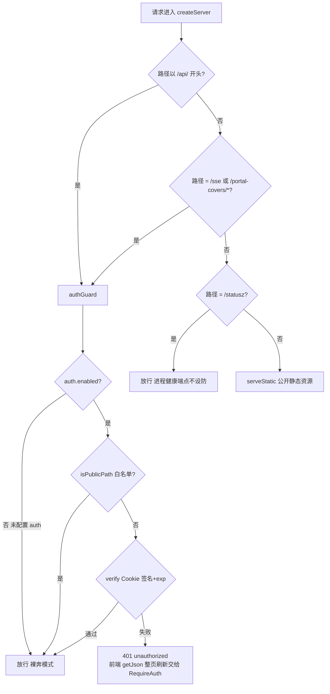

# 08 安全与权限设计
> 项目：nas-console ｜ 版本：v1.1 ｜ 生成日期：2026-10-06 ｜ 依据：源码分析

## 0. 本篇定位

01 篇第 5.2 节曾以「安全架构小结」四道边界概括全局；本篇是安全专题的完整展开：从威胁模型出发，逐条拆解自研鉴权机制的实现与边界、公开面的字段级脱敏策略、两套外部系统凭据策略的对比，最后汇总已知隐患与加固建议。安全是这个项目「个人规模」定位下被刻意简化但**未被忽视**的维度——大量安全决策以注释形式写在源码里，本篇把它们集中起来并补上原文没有展开的推演。

## 1. 威胁模型与信任边界

系统的物理链路是「浏览器 → VPS nginx（TLS + basic auth）→ frps → frpc → NAS 容器」，由此划出三条信任边界。**边界一：公网到 VPS**。TLS 由 certbot 维护的证书终结在 nginx，明文风险止步于此；nginx 层还有一层 basic auth 作为外门，仅 `/status` 与 `/api/public/` 豁免（README「公开状态页」节的放行规则）。**边界二：VPS 到 NAS 容器**。frp 隧道内流量是否加密取决于 frp 配置（仓库内无 frpc/frps 配置文件，⚠️ 待确认是否启用 tls/加密），这段链路上的 API 流量（含登录口令与会话 Cookie）若隧道未加密则存在被中间观测的理论面；缓解事实是隧道两端都处于自有设备且端口不对外暴露。**边界三：容器内部**。进入容器后一切由 `authGuard` 的公开路径白名单决定，这是本篇的主角。

面向的攻击者画像有两类：**匿名访客**（可访问公开首页、详情页、状态页与 `/api/public/*`）与**互联网上的随机扫描者**（会打 `/api/*`、`/sse`、上传端点与登录端点）。不存在「多租户越权」问题——系统只有一个管理员，所有会话等价于超级用户，这简化了鉴权模型（无角色/权限位），也意味着会话凭据的泄露面必须按「整站失守」评估。

## 2. 自研单用户鉴权：HMAC 签名 Cookie 全解

### 2.1 设计形态

实现全部在 `server/src/auth.ts`（160 行，零依赖）。启用条件由 `Auth.enabled`（第 36-38 行）判定：config.json 存在非空 `auth` 段、`username.length > 0` 且 `passwordHash` 含 `$`。会话是**无状态签名 Cookie**：`login()` 成功后返回 `nas-console-session=<base64url({u,exp})>.<HMAC-SHA256(payload, secret)>`，属性 `Path=/; HttpOnly; SameSite=Lax; Max-Age=2592000`（30 天，第 93 行）。签名密钥是 32 字节随机 hex，首次启动生成并落盘 `data/session-secret`（mode 0600，第 121-132 行）；数据目录不可写时退化为进程级随机——重启后所有会话失效，代码注释认为可接受。

这套「不引入 JWT 库/session 中间件」的自研方案，与项目「零依赖后端」的取向一致。它具备 JWT 形态的核心性质（无服务端会话存储、签名防篡改、自带过期），同时砍掉了 JWT 的头/算法协商（算法硬编码 HMAC-SHA256，不接受 Header 指定算法——从根上免疫 `alg:none` 类攻击，因为根本没有 Header 段）。

### 2.2 校验路径与不变量

`verify()`（第 51-68 行）的步骤：读 Cookie → 找第一个 `.` 拆出 payload 与签名 → base64url 解码并 `JSON.parse` → 检查 `exp` 存在且未过期 → 用密钥对 payloadB64 重算 HMAC → `safeEqual`（`timingSafeEqual` 包装，先比长度）比对。用户名与口令的比对同样走 timingSafe 变体（第 78-79 行 `timingSafeText`），防时序侧信道。三条由此推出的不变量值得记录：

1. **校验的是签名而非凭据**：改 config.json 的 passwordHash（换密码）不会使已签发会话失效；要让「可能已泄露的会话」全部下线，唯一手段是删除或更换 `data/session-secret` 后重启。
2. **签名不绑定客户端指纹**：Cookie 一旦被窃取（XSS 被 HttpOnly 挡住、或网络层被观测），在 30 天内任何客户端可重放；没有刷新/吊销机制，`logout` 只清浏览器侧 Cookie，服务端无黑名单。
3. **payload 不含签发时间**：`exp` 是绝对过期，无滑动续期——长期使用的浏览器会在第 30 天集中掉线一次，重新登录即可。

### 2.3 登录限流及其在反代后的失真

`login()`（第 71-94 行）按 IP 记失败：`fails: Map<ip, {count, lockUntil}>`，连续 5 次（`MAX_FAILS=5`）设置 `lockUntil = now + 10 分钟`（`LOCKOUT_MS`），锁定期内任何尝试直接抛「尝试过于频繁，请 N 分钟后再试」；成功登录清零；计数器在内存，重启即清。这里有一个源码没有说明、但部署形态决定的**重要失真**：限流键取自 `req.socket.remoteAddress`（`server.ts` 第 116 行传入），而生产链路上容器的 TCP 对端是 frpc（host 网络下是本机 frpc 进程、桥接下是 docker 网关）——**所有外部来源共享同一个限流键**。后果有两面：其一，任何人的 5 次失败会把「这个共享键」锁 10 分钟，攻击者可以故意锁死管理员（轻量拒绝登录攻击）；其二，反向看爆破者也被同一把锁限制，实际等效于全局限速而非按源限速。个人规模下这是可接受的折中，但接手者应当知道「5 次锁定」在生产上的真实语义是「全局共享 5 次」（若经 nginx 的 proxy_protocol/X-Forwarded-For 恢复真实 IP 则可恢复按源语义，当前实现未读取这些头）。

### 2.4 鉴权判定流程

白名单（`isPublicPath`，auth.ts 第 40-48 行）共五项：`/api/public/*`、`/portal-covers/*`、`/api/auth/login`、`/api/auth/session`、`/statusz`。注意 `/api/auth/logout` **不在**白名单里——登出需要有效会话才能调用，这避免了任何人 CSRF 触发他人登出的轻微骚扰（虽然登出本身的危害有限）。`/sse` 虽不在白名单但被单独守卫（server.ts 第 77-79 行），EventSource 无法自定义 Header，靠 Cookie 自动携带完成鉴权。

## 3. 公开面的字段级脱敏

### 3.1 `/api/public/status` 的白名单机制

公开快照由 `publicStatus()`（server.ts 第 341-381 行）实时组装，脱敏不是接口级（访客看不到这个接口？不，接口本身公开）而是**字段级**：所有分组都出现在响应里（名字、状态、延迟、45 天可用率），但只有 `portal.publicGroups` 白名单里的分组（字符串精确匹配 `publicGroups.includes(s.group)`，第 375 行）才额外展开 `url/tags/error/profile` 四个字段。缺省白名单为 `['应用站点', '文档与统计']`。前端以 `s.url` 的有无判定「能否成项目卡」（Home.tsx 第 60 行）与「能否进详情页」（ProjectDetail 的 404 视图），字段的存在性即权限。

`error` 字段的处理最能体现细致度：第 374 行注释原文是「error 里可能含 host:port(ECONNREFUSED 等)」，因此连失败原因都不对非白名单分组下发——访客看到「面板与运维」分组某服务「不可达」，但看不到是哪个内网地址拒连。同理两处刻意脱敏：`/api/host/metrics` 失败只回「1Panel 暂不可用」不透传 panelMsg（第 143-144 行注释：panelMsg 内含面板 host:port）；`/api/public/metrics` 关闭或未配置面板时返回 404 `not found` 而非 403（第 196-198 行）——不向访客暴露「这个端点存在但被关闭」的信息。

### 3.2 error 泄露 host:port 的残余面

字段级控制已经把公开快照的泄露面压到很小，但仍有三处**依赖白名单分组自身内容**的残余面需要接手者自查。其一，白名单分组的服务 `url` 本身就是公网地址，这是设计意图；但若误把内网地址服务放进白名单分组（如把 `dsm` 从「面板与运维」挪进「应用站点」），其 `url`（含 `https://106.15.35.71:5001` 这类 IP:端口形态）与失败时的 `error`（可能含内网 host:port）会一并公开——**白名单是分组级而非服务级的开关**，粒度选择时要意识到这一点。其二，`profile.story/timeline` 是自由文本，写入了内网 IP、端口、路径等细节会原样公开，`sanitizeProfile` 只做类型净化不做内容审查。其三，down 的 Tooltip 在白名单分组的状态页上直接展示 error 文案（StatusPage 第 106 行），Go/Node 的网络错误文案可能带出上游域名结构——对公开门户而言这是可接受的（域名本就公开），但对同分组的内网服务不成立，再次强调白名单分组里只放公网服务。

## 4. 两套外部凭据策略：Umami 直连 vs 1Panel 代理

这是本项目安全设计中最有教学价值的一组对比（03 篇第 8 节有接口视角的版本，本篇从凭据安全视角重述）。

| 维度 | Umami（浏览器直连） | 1Panel（服务端代理） |
|---|---|---|
| 凭据存放 | 账号密码在浏览器 localStorage（`nas-console-settings`） | apiKey 在服务端 config.json（`onePanel.apiKey`） |
| 凭据流向 | 浏览器 → Umami（POST /api/auth/login） | 服务端 → 1Panel（md5 签名头） |
| 会话凭据 | token 在 sessionStorage（标签页级） | 无会话，每请求签名 |
| 谁能拿到数据 | 能打开浏览器控制台的本机用户 | 只有探针进程；浏览器只见代理结果 |
| 泄露后果 | Umami 统计数据可读（低敏感） | 容器 start/stop/restart 可操作（高敏感） |
| 实现文件 | `src/api/umami.ts`（190 行） | `server/src/1panel.ts`（141 行）+ server.ts 三个代理端点 |

选择依据可以用两个问题还原（03 篇第 8 节的两问）：**凭据能否下发给浏览器**（安全面）与**数据是否需要 7×24 采集**（在场性）。Umami 的凭据是「分析面板的只读账号」，泄露影响限于统计数据可见，而它只有页面打开时才被消费，放浏览器可以让探针进程对 Umami 完全无感知；1Panel 的 apiKey 是可操控容器的**高权限凭据**，绝不能下发，且容器操作是运维动作需要服务端在场。1Panel 侧的纵深还有两层：签名（`1Panel-Token = md5("1panel" + apiKey + ts)`，1panel.ts 第 66-71 行）保证出站请求可被面板校验来源；面板侧按来源 IP 白名单（支持 CIDR）二次收口，docker-compose.nas.yml 头部注释明确「host 网络下源 IP = NAS 内网 IP，与面板白名单匹配」——即即使 apiKey 泄露，外部 IP 也打不进面板。

**残余风险**：Umami 凭据存 localStorage 意味着「借用他人电脑登录管理区并保存了 Umami 密码」会把凭据留在那台机器上——Settings 页第 101 行的提示文案（「凭据仅保存在本浏览器 localStorage,请勿在公用电脑保存」）是唯一防线，且没有「清除凭据」按钮（清掉 localStorage 键即可，但需要用户知道怎么做）。1Panel 侧，config.json 里的 apiKey 是明文，任何能读 NAS 上该文件的进程/人都能拿到——它受 Unix 文件权限与 NAS 物理边界保护，属于「服务器攻陷即全线失守」的经典假设，本项目未做额外加密（个人规模合理）。

## 5. Cookie 未设 Secure 的边界分析

`login()` 返回的 Set-Cookie 属性串是 `Path=/; HttpOnly; SameSite=Lax; Max-Age=...`（auth.ts 第 93 行）——**没有 `Secure` 属性**。逐属性评估其影响与补偿：

- **HttpOnly 已设**：JS 无法读取 Cookie，XSS 即便发生也偷不走会话——挡住了最常见的会话窃取路径。
- **SameSite=Lax 已设**：跨站导航的顶级 GET 会带 Cookie，但跨站 POST/子资源请求不带——这实际上缓解了绝大多数 CSRF 场景（本系统的写端点全是 POST/PUT，跨站表单 POST 不会携带 Cookie）。注意残余窗口：Lax 下顶级 GET 导航会带 Cookie，而本系统全部写操作非 GET，因此无实际可利用面。
- **Secure 未设**：浏览器在非 https 连接上也会发送该 Cookie，且允许非 https 页面 Set 这个 Cookie。补偿因素：生产链路入口是 VPS nginx 的 https（certbot），正常用户浏览器到 nginx 一段是 TLS 加密的，Cookie 不会明文过公网；http 明文窗口只存在于「nginx→frps→frpc→容器」的内网/隧道段与本地 http 开发环境。风险场景 therefore 收窄为：①攻击者能嗅探 VPS→NAS 段流量且 frp 未加密时；②用户被诱导访问 `http://console.zhangzhengyang.com`（若 nginx 未强制 301 到 https，明文请求会带出 Cookie——这是比传输窃听更现实的场景，⚠️ nginx 是否配置了 http→https 强跳不在仓库内，待确认）。**建议**：在 `login()` 的 Cookie 串追加 `Secure` 对生产无副作用（https 下行为不变），本地 http dev 会因浏览器拒收 Secure Cookie 而无法登录——可用环境变量或仅在 `NODE_ENV=production` 时追加，这是 13 篇路线图 v1.1 的一项。

## 6. 无 auth 配置时的裸奔面

`authGuard` 在 `!auth.enabled` 时恒放行（auth.ts 第 103 行），启动日志会打印警告「⚠️ 未配置 auth，API 无鉴权（仅建议本地开发使用）」（server.ts 第 45 行），README 加粗强调「部署到公网链路必须配置」。但代码层面**没有任何强制**——公网部署者忘了配 auth，系统照常运行。此时暴露面清单如下，值得完整列出以评估后果：

| 暴露端点 | 无 auth 时的后果 |
|---|---|
| `GET /api/health/latest` `/api/health/history` `/api/events` | 全部服务清单内网端口、延迟、错误文案、翻转历史公开 |
| `GET|PUT /api/services` | 任何人可**改写服务清单**（含 profile/story），40 秒内落盘 config.json 并热更新巡检 |
| `POST /api/portal/upload` | 任何人可上传 5MB 以内 png/jpg/webp 到 `data/covers/`（占磁盘、借道公开 `/portal-covers/*` 分发任意图片内容） |
| `GET /api/containers` + `POST /api/containers/operate` | **任何人可重启/停止 NAS 上任意容器**（若配置了 onePanel）——这是裸奔面上破坏力最大的一项 |
| `GET /api/host/metrics` | 主机指标公开（低危） |
| `POST /api/alerts/test` | 可被反复触发向 Bark/TG/Webhook 骚扰（若配置了告警） |
| `GET /sse` | 实时流公开（低危） |

注意 `/api/auth/login` 在未启用时抛「未启用登录」（auth.ts 第 77 行），所以连「提示管理员去配置」的入口都只在服务端日志里。防御纵深上唯一还在工作的是 VPS nginx 的 basic auth（`/status` 与 `/api/public/` 之外）——即裸奔的实际暴露面 = 「nginx 放行规则之外的路径被 basic auth 挡住，之内全裸」。**结论**：公网部署的上线检查清单里，确认 config.json 的 auth 段非空应当是第一步（06 篇第 6.1 节的清单第 1 条）；代码层的可选加固是在 `onePanel.apiKey` 存在但 `auth.enabled === false` 时拒绝启动或仅告警，见 13 篇。

## 7. 输入防御与静态资源安全

鉴权之外的第二道防线是输入验证，实现分散在 server.ts：

- **路径穿越**：`serveStatic`（第 443-461 行）`normalize(pathname)` + 正则剥离 `../` 前缀 + `resolve` 后 `startsWith(resolve(staticDir))` 前缀校验，穿越返回 403；封面托管用文件名白名单正则 `^[a-z0-9-]+\.(png|jpe?g|webp)$`（第 175 行）——不含 `/` 与 `.`，天然免疫穿越。
- **上传安全**：service id 必须匹配 `^[a-z0-9-]+$`（第 150 行）、Content-Type 必须命中 png/jpeg/webp 三种（第 154-155 行）、体积 ≤5MB（`readRaw` 超限 `req.destroy()`）。上传**直接覆盖写**（`writeFileSync` 同名文件），同 id 重复上传即替换，无版本管理；文件名由服务端拼装（id + 扩展名），客户端无法注入文件名。
- **请求体积**：JSON 1MB（`readJson`）、上传 5MB（`readRaw`），超限销毁连接，防内存型 DoS。
- **容器操作白名单**：`start/stop/restart/kill/pause/unpause` 六个（第 237 行），第 243 行注释「remove 等破坏性操作不放行」——即使会话泄露，攻击者也无法经此端点删除容器。
- **参数夹取**：`clampInt` 把 `?days=/?limit=` 静默夹到合法区间，杜绝异常大 limit 打穿查询。
- **畸形数据净化**：`sanitizeProfile`（config.ts 第 44-70 行）逐字段类型过滤，防止手工编辑的 config.json 或异常客户端把非数组送进公开快照导致详情页渲染白屏。

未覆盖的输入面有两处：`syncServices` 对服务条目只校验 `id/name` 非空（server.ts 第 288-293 行），`url/group/icon/tags` 等字段未校验格式——恶意清单可注入任意字符串到公开快照（React 渲染时转义，无 XSS，但可注入超长内容与奇怪 URL scheme 如 `javascript:`——项目内所有外链渲染点均带 `target="_blank" rel="noopener noreferrer"`，且链接 href 来自清单本身，管理员自污染场景，风险低）；公开快照的 `profile.cover` 等字段同样未校验是否指向 `/portal-covers/`，理论上可填任意外链——个人规模可接受，记录在案。

## 8. 已知隐患与加固建议汇总

按「利用难度 × 影响面」排序的隐患清单（第 1、2 项展开见 13 篇）：

1. **未配置 auth 的公网裸奔**（第 6 节）：代码只警告不阻断；建议对「onePanel 已配置 + auth 未启用」的组合拒绝启动。
2. **Cookie 无 Secure 属性**（第 5 节）：建议生产追加。
3. **限流键在反代后失真**（第 2.3 节）：共享键导致「5 次」实为全局限额且可被恶意锁死；建议改读 `X-Forwarded-For` 首段（可信代理链路内）。
4. **auth.admin.json 明文口令暂存**：仓库工作区存在含明文密码的凭据暂存文件（结构含 `auth.username`/`auth.passwordHash`/`password` 三个键），`.gitignore` 已排除、不被任何代码引用，但文件本体是明文落盘的口令副本；建议合并进部署机 config.json 后删除（本套文档不记录其内容）。
5. **改密码不使旧会话失效**（第 2.2 节不变量 1）：怀疑泄露时的正确处置是换 `session-secret` 而非改密码；建议在 README 运维节补一句说明。
6. **限流与会话状态在内存**：重启即清零（限流）与全失效（未持久化 secret 时），可用性取舍非漏洞。
7. **无 CSRF token**：SameSite=Lax + 写端点全 POST/PUT 已实际封死 CSRF 面，属于「不设防但有结构性缓解」的记录项。

---

*鉴权的端到端时序见 05 篇第 3 节；公开快照的字段契约见 04 篇第 3.1 节与 15 篇详表；五项技术债的演进路线图见 13-技术债务与演进建议。*
